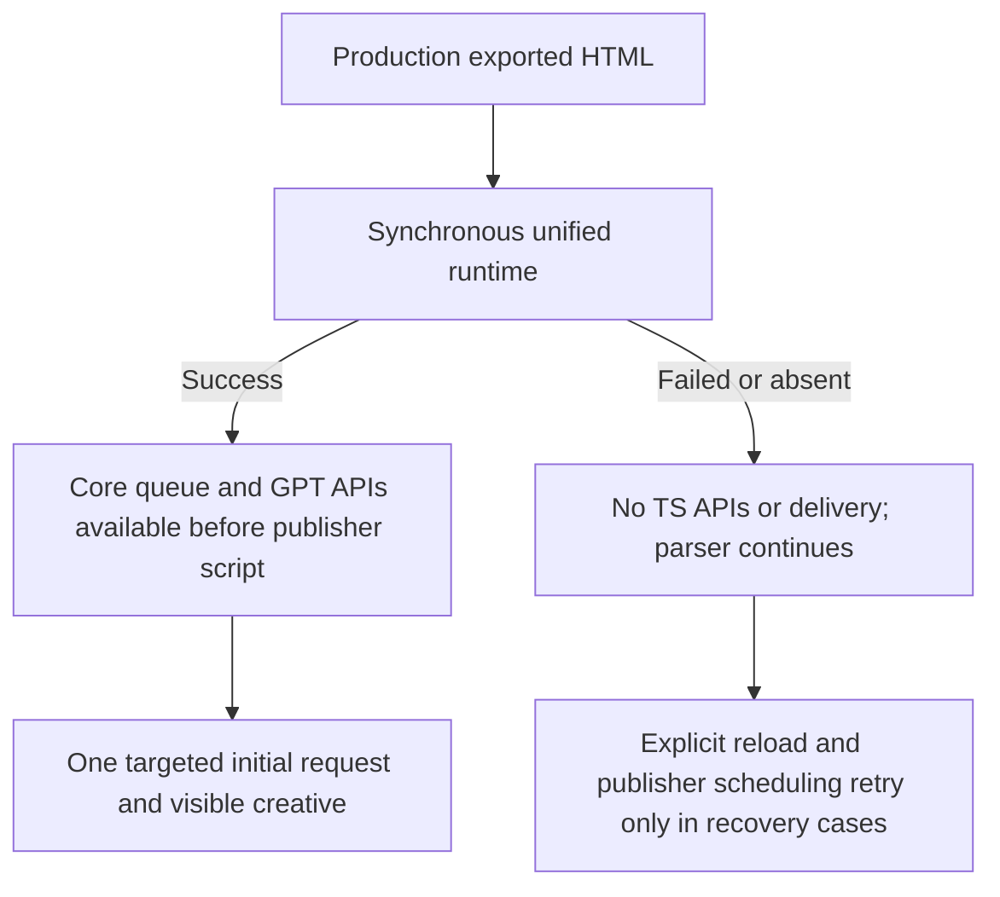

# Parser, paint and slot-space lab checks

This runner uses loopback HTTP servers, parser-created production script tags,
real Rust HTML injection and the exact JS bytes returned by the production static
route. GPT transport and bids are fictional. No customer, GAM or bidder request
is allowed. These are lab results, not field CWV or production fill evidence.

All scopes now test the approved synchronous unified runtime for this supported
GPT profile. Candidate documents must have one versioned, classic, parser-blocking
unified runtime, GPT configuration before it, and neither a raw nor compiled inline
bootstrap. A failed or absent critical runtime means no TS APIs or TS delivery.
The pinned original-main baseline remains a baseline, not a candidate failure.



## Export

From the repository root, with current production JS built by the coordinator:

```sh
HOST_TARGET="$(rustc -vV | awk '/^host:/ {print $2}')"
TSJS_PREBUILT_DIR=/absolute/current-dist \
  cargo run -p trusted-server-integration-tests --example cwv_html \
  --target "$HOST_TARGET" -- /tmp/cwv-loading unreserved
TSJS_PREBUILT_DIR=/absolute/current-dist \
  cargo run -p trusted-server-integration-tests --example cwv_html \
  --target "$HOST_TARGET" -- /tmp/cwv-combined reserved
```

The exporter writes inline/shared documents, responsive and unknown-height
creatives, unmatched paths, absent wrappers, registered slots and child-replacement
controls. Its manifest retains source revision/status, source fingerprints, exact
exporter source, configuration, toolchain and the production URL-to-asset map.
The runner snapshots and hashes every input before launching Chromium. Full
acceptance additionally validates source fingerprints against the selected checkout.
Regenerate candidate exports after production source changes. An iteration run
against older exports does not verify the final source state.

Baseline must identify original main
`51730bdaf841e4d7bb96c2258e5e98169bdff9a7`, not the former inline/deferred PR
snapshot. Use genuine baseline production HTML and served JS, never rewritten
candidate head snippets. For an archived source tree, copy the exporter and small
`test-utils` `publisher::fixture_ad_scripts` bridge that call existing production
builders. Omit `.with_request_path(path)` and `.with_enforced_csp(name == "csp")`
if absent in that source. Record those fixture-only differences. Archive exports
may supply `CWV_SOURCE_REVISION` and `CWV_SOURCE_STATUS`; the manifest records
these as environment overrides rather than Git observations.

## Run

Use the browser package's existing dependencies and matching Playwright Chromium.
The runner performs no installs or builds.

```sh
node --test crates/trusted-server-integration-tests/browser/cwv/*.test.cjs
node crates/trusted-server-integration-tests/browser/cwv/run.cjs \
  --baseline /tmp/cwv-baseline \
  --loading /tmp/cwv-loading --combined /tmp/cwv-combined \
  --runs 5 --out /tmp/cwv-evidence
```

Four measurement arms alternate forward/reverse order at 390x844 and 1280x1000:

- `baseline`: frozen original-main production HTML and JS, without reservation.
- `loading`: changed production HTML and JS, without reservation.
- `reservation`: baseline HTML and JS plus the exact changed production reservation
  style. This CSS-only isolation derivative does not imply old code understood the
  new configuration.
- `combined`: changed production HTML and JS with reservation.

Baseline and candidate measurement HTML stay untouched. Each derivative and copied
style has its own hash. All arms use the same selected conditions. Original-main
arms may retain their original raw bootstrap and lack the new renderer marker.
They still require one targeted request, actual Server creative DOM and visible-ad
evidence. Candidate arms additionally require renderer protocol version 1.

| Option                        | Default | Meaning                                                                                                                              |
| ----------------------------- | ------- | ------------------------------------------------------------------------------------------------------------------------------------ |
| `--runtime-delay-ms NUMBER`   | `750`   | Hold the first runtime HTTP response per navigation. `0` is valid. Cache hits never reach the server; explicit retries are not held. |
| `--cpu-rate NUMBER`           | `1`     | Chromium CDP CPU slowdown rate, at least 1.                                                                                          |
| `--network-latency-ms NUMBER` | `0`     | CDP latency in milliseconds.                                                                                                         |
| `--download-kbps NUMBER`      | `0`     | Decimal kilobits/second; `0` means unlimited.                                                                                        |
| `--upload-kbps NUMBER`        | `0`     | Decimal kilobits/second; `0` means unlimited.                                                                                        |
| `--cache cold\|warm`          | `cold`  | Cold disables cache and serves no-store responses. Warm primes then navigates again in the same page/context.                        |

Numbers must be finite and nonnegative except CPU rate, which must be at least 1,
and runs, which must be a positive safe integer. Delay must fit Node's timer range.
Invalid options fail before browser startup.

Each sample starts in a fresh context. Warm priming uses the exact document,
failure mode, viewport and conditions, waits for expected delivery, and retains
separate observer/network evidence. Successful exported JS, hero and creative JS
are cacheable for one hour; HTML, creative documents and failures are no-store.
Measured warm samples must demonstrate a native CDP HTTP-cache hit. Successful
runtimes must themselves hit cache. Service workers are blocked and never count
as HTTP-cache evidence. No Playwright routes disable browser caching.

An HTTP proxy forwards only the exact publisher and creative fixture origins,
preserves response headers, rejects all other origins and CONNECT tunnels, and
does not depend on loopback-bypass settings. Unexpected URLs fail assertions.
Artifacts retain the allowlist and every proxy request.

```sh
node crates/trusted-server-integration-tests/browser/cwv/run.cjs \
  --baseline /tmp/cwv-baseline --loading /tmp/cwv-loading \
  --combined /tmp/cwv-combined --out /tmp/cwv-warm \
  --runtime-delay-ms 0 --cache warm --cpu-rate 4 \
  --network-latency-ms 100 --download-kbps 1600 --upload-kbps 750
```

## Full functional gates

Full mode has `8 * runs + 24` samples. `--correctness-only` has 26 samples,
including two unreserved shift checks, but no repeated baseline comparison.
`--regressions-only` has four cases: renderer absence, normal runtime failure on a
registered slot, CSP success and CSP failure. Neither limited full-mode subset
satisfies the full measurement scope. The exact measurement and correctness case
lists reject missing, duplicated or reordered samples.

Every normal successful sample requires native runtime load before article parsing
and FCP at or after runtime response end. This remains a blocking-runtime check at
zero delay and with warm cache. The default cold 750ms hold demonstrates the same
paint cost; no timing-improvement threshold turns a regression into a pass.
CPU/network shaping applies to all fixture resources. Shared-host contention can
still affect measurements. Report paint and ad-startup changes against baseline.

Two separately hashed negative controls run in full and correctness-only modes:

- `runtime-deferred` adds only `defer` to the actual synchronous runtime tag.
  It must break the direct early publisher core call and its queued callback,
  load after article parsing, and fail the normal synchronous ordering assertion.
  Compiled APIs eventually become available, but the body-close scheduling call
  was missed, so no initial requests or creative delivery may be invented. With
  cold cache and the default 750ms hold, content must paint before runtime response
  end. At zero delay or with cache reuse, native parser/load evidence still proves
  the regression without requiring a favorable timing gap.
- `reservation-removed` removes only the production reservation styles. It must
  produce article movement and positive observer-reported CLS attributed to the
  article. The untouched reserved success arm must preserve article geometry and
  zero controlled ad-induced CLS for compatible fill or no-fill.

These are browser controls, not labels inferred from HTML or unit-test passes.
The old `parser-blocking` control was replaced because removing nonexistent
`defer` from the approved synchronous candidate would be vacuous.

Slow, failed, absent and explicitly recovered runtime cases cover automatic and
publisher-registered slots. Failed critical requests must produce exactly one
404 with no implicit retry; absent tags must produce no runtime request. Renderer
absence blocks the sole unified renderer, not an imaginary standalone deferred
module. No publisher probe or raw payload is removed. All unavailable cases retain
admitted candidate data but require unavailable core/GPT/shim/renderer APIs, an
undrained pre-core queue, no successful runtime load, zero native requests,
displays, refreshes or creatives, no visible-ad estimate and no delivery. Parsing
must still reach DOMContentLoaded and the article.

The retained publisher core probe reports exactly
`tsjs.setConfig is not a function` during outage. Registered fixtures also report
exactly `tsjs.registerPublisherSlot is not a function`. These declare failed
publisher calls, not successful compatibility behavior; no other page errors are
accepted. A registered publisher can create its native slot before its registration
call fails, but must not display or request it through TS.

Recovery samples first retain and assert the complete unavailable state. Only then
do they explicitly reload the runtime with a normal DOM script, re-register the
existing publisher native object when applicable, and retry initial scheduling.
They require exactly one failed and one successful runtime response, a single
queue drain after article parsing, the original failed early probe, and exactly
one targeted initial request and visible Server creative. This is explicit
publisher recovery, not automatic replay of failed scripts or inline fallback.

Registered success and recovery require explicitly disabled GPT initial loading,
exactly one native definition/display, one scoped refresh of the publisher's exact
native object, preserved `publisher_key` targeting and a settled `rendered` handle.
The transport fixture never deduplicates TS requests.

The enforced CSP sample sends an actual `Content-Security-Policy` header with
`script-src 'self'` and old inline hashes. With `--baseline`, hashes come from
genuine original-main inline scripts. Without baseline, the runner explicitly
records current synchronous legacy-inline output as the policy source. Fictional
creative-inline hashes are included. Neither policy permits a compiled early
bootstrap. Success requires all compiled APIs and actual creative delivery;
failure requires the same no-fallback boundary as normal pages. Both require zero
CSP violations. The failed case never relaxes the successful CSP gate.

Additional hard checks cover inline/shared payloads, direct early core calls,
publisher queues, missing wrappers, unmatched paths, replacement of the inner ad
element, responsive widths 1023/1024, no-fill and unknown/oversize creative heights.
No zero-shift promise applies to oversize or unknown-height creatives. The
child-replacement fixture is not React hydration proof; the separate Next.js
publisher-registration gate covers framework lifecycle.

## Limited diagnostic scopes

`--diagnostic-screen` still runs exactly `8 * runs` alternating four-arm
measurement samples. It requires baseline and explicit `--runtime-delay-ms 0`.
`--diagnostic-outages` still runs exactly four reserved-candidate cases at 390x844:
normal success/failure and enforced-CSP success/failure. Both flags are mutually
exclusive with the other scopes. They use the same synchronous document, queue,
API, transport and ordering assertions as full mode where applicable.

```sh
node crates/trusted-server-integration-tests/browser/cwv/run.cjs \
  --diagnostic-outages --baseline /tmp/cwv-baseline \
  --loading /tmp/cwv-loading --combined /tmp/cwv-combined \
  --out /tmp/cwv-diagnostic-outages --runtime-delay-ms 0
```

Diagnostic outcomes keep their distinct scope, exact expected sample count,
`fullAcceptancePassed=false` and both controls `not-requested` with reasons.
New outage diagnostic records acknowledge the approved architecture through
`changedOutageBehaviorApproved=true`. This does not promote a limited diagnostic
to full acceptance. The public full verifier rejects both diagnostic scopes.
Framework, full controls, publisher lifecycle and real-GPT acceptance remain
outside those scopes.

Historical measurements and outage records remain unchanged evidence for their
frozen inputs and tooling hashes, including their then-unapproved interpretation.
Do not relabel or overwrite those directories. New architecture approval does not
retroactively establish missing full acceptance. Missing authorized Google
inventory remains blocked, and staging/deployment/live activation require
separate authorization.

## Evidence

Buffered `PerformanceObserver` entries capture FCP, all LCP candidates, resources
and raw layout shifts with source geometry. CLS uses the largest session-window
sum, excludes recent input, and has one-second gaps and a five-second maximum.
Missing observers, paint, native load/parser evidence or required cases fail.
First-visible time is `firstVisibleEstimateMs`, a creative-ready, frame-bounds and
animation-frame estimate, not hardware paint or a GAM impression. Universal
Creative renders the fictional server bid; assertions inspect actual nested DOM.

`acceptance.json` is mirrored as `artifacts.json.outcome`, with schema version 1.
Status is `running`, `passed`, `failed`, or `blocked` for a missing export,
dependency or Chromium executable. Passing means only the selected scope
completed, including report writes and cleanup. It never certifies live behavior.
Scope, conditions, exact sample/profile counts, timestamps and errors are retained.
`negativeControls` contains `runtime-deferred` and `reservation-removed`, with
status, sample index and derivative HTML filename. Consumers must validate overall
status, scope, counts and both control statuses. Outcomes initialize before
reading exports, so a failed rerun cannot retain a stale pass. Malformed arguments
fail before output initialization.

`artifacts.json` retains input provenance, source snapshots, browser/Node versions,
runner/helper hashes, conditions, cache semantics and interventions. `samples.json`
retains raw observers, geometry, native traces, CDP cache evidence, server responses
and applied delays, headers, network calls and separate warmup evidence. Recovery
samples also retain their pre-recovery state. `summary.json` reports count, median,
minimum and maximum separately for measurement and correctness cases.
`comparisons.json` reports signed median deltas and percentages where baseline is
nonzero. Raw/gzip/Brotli sizes cover HTML, individual/all inline scripts and fetched
runtime. Every sample retains a screenshot and trace; failures retain available
observer/native/network state. Use a different output directory per condition set.
