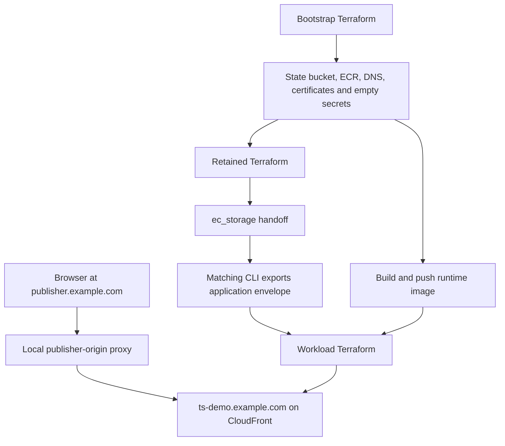

# Deploy an EC-only AWS evaluation

This walkthrough creates the prerequisites with Terraform rather than asking the operator to build them manually. All committed domains and identifiers are fictional. Put actual inputs, state, plans and evidence outside the checkout.

The example uses public-subnet Fargate with outbound public IP access, an HTTPS ALB, protected CloudFront Geo, authenticated task-local AppConfig Agent and retained DynamoDB EC storage. It runs one stop-first task, so updates interrupt service. This is not a highly available production deployment.



## 1. Select the release and private working directory

Obtain the release tag and independently verified commit SHA. Use that complete checkout for the CLI, image and templates; do not mix in a CLI from another revision. Install the tool versions pinned by the checkout, including Terraform `1.16.2` and AWS CLI v2, plus Docker Buildx, native compiler tools and CMake. Use the committed lockfiles with AWS `6.64.0` unchanged and `hashicorp/random` `3.9.1` in the workload root.

From the verified checkout root, with Bash-compatible syntax:

```bash
export TS_SOURCE="$PWD"
export TS_EXPECTED_SHA='REPLACE_WITH_VERIFIED_COMMIT_SHA'
test "$(git rev-parse HEAD)" = "$TS_EXPECTED_SHA"
export AWS_PROFILE='REPLACE_WITH_APPROVED_PROFILE'
export AWS_REGION='eu-west-2'
export AWS_ACCOUNT_ID="$(aws sts get-caller-identity --query Account --output text)"
export TS_WORK="$HOME/.config/trusted-server/example-staging"
export TF_ROOT="$TS_SOURCE/deploy/examples/native-aws-workload"
export TF_BOOTSTRAP="$TF_ROOT/bootstrap"
export TF_RETAINED="$TF_ROOT/retained"
umask 077
mkdir -p "$TS_WORK"
chmod 700 "$TS_WORK"

npm --prefix crates/trusted-server-js/lib ci
cargo install-cli
```

Use your organisation's approved credentials. SSO administrator access is accepted; a dedicated deployment-role name is not required. The [permissions checklist](README.md#deployment-permissions) describes the capabilities, not a universal least-privilege policy. Existing organisation denies still apply.

## 2. Provision the Terraform-owned prerequisites

Copy `bootstrap/terraform.tfvars.example` to `$TS_WORK/bootstrap.tfvars` and replace every fictional value. Choose a stable installation name, globally unique bucket name, accountable owner and evaluation hostname distinct from the publisher hostname.

By default bootstrap creates a public child zone named exactly `demo_hostname`. If its parent DNS is hosted elsewhere, you will add that child's NS delegation there after the first apply. To reuse a public Route 53 zone, set `existing_route53_zone_id`; Terraform will read that zone, not own or delete it. Bootstrap still owns its certificate-validation CNAME within it.

The first apply uses a private local state path because its S3 bucket does not exist yet. Initialize and review a saved bootstrap plan:

```bash
terraform -chdir="$TF_BOOTSTRAP" init -lockfile=readonly \
  -backend-config="path=$TS_WORK/bootstrap.tfstate"
terraform -chdir="$TF_BOOTSTRAP" plan -var-file="$TS_WORK/bootstrap.tfvars" \
  -out="$TS_WORK/bootstrap.tfplan"
terraform -chdir="$TF_BOOTSTRAP" show "$TS_WORK/bootstrap.tfplan"
```

After privately reviewing that exact file:

```bash
terraform -chdir="$TF_BOOTSTRAP" apply "$TS_WORK/bootstrap.tfplan"
```

This creates:

- Versioned, encrypted, HTTPS-only, public-blocked S3 state storage.
- An encrypted ECR repository with immutable tags and scan-on-push.
- Regional ALB and `us-east-1` CloudFront certificate requests, with one shared DNS validation CNAME.
- A new evaluation hosted zone unless an existing zone was supplied.
- Four empty application-secret containers and a separate empty Agent-token container.

Bootstrap manages no secret values. No IAM permission boundaries are invented. The bootstrap apply does **not** wait for certificate issuance, since external DNS delegation cannot happen until the nameservers exist.

Save the outputs after the reviewed apply:

```bash
terraform -chdir="$TF_BOOTSTRAP" output -json > "$TS_WORK/bootstrap-output.json"
node --input-type=module - "$TS_WORK" <<'JS'
import { readFileSync, writeFileSync } from 'node:fs';
import { join } from 'node:path';
const dir = process.argv[2];
const output = JSON.parse(readFileSync(join(dir, 'bootstrap-output.json'), 'utf8'));
for (const [root, config] of Object.entries(output.backend_configs.value)) {
  const hcl = Object.entries(config).map(([key, value]) => `${key} = ${JSON.stringify(value)}`).join('\n');
  writeFileSync(join(dir, `${root}.backend.hcl`), `${hcl}\n`, { mode: 0o600 });
}
writeFileSync(join(dir, 'bootstrap-workload.tfvars.json'), JSON.stringify({
  route53_zone_id: output.route53_zone_id.value,
  certificate_arn: output.regional_certificate_arn.value,
}, null, 2), { mode: 0o600 });
JS
```

Migrate bootstrap's local state to its generated S3 backend before continuing:

```bash
printf 'terraform {\n  backend "s3" {}\n}\n' > "$TF_BOOTSTRAP/backend_override.tf"
terraform -chdir="$TF_BOOTSTRAP" init -migrate-state \
  -backend-config="$TS_WORK/bootstrap.backend.hcl"
terraform -chdir="$TF_BOOTSTRAP" state list
```

Review the source and destination when Terraform asks to copy state. Confirm the bootstrap resource addresses remain present and its private backend metadata selects the expected S3 bucket/key. Keep the ignored backend override with the operational checkout, never in a commit. This is backend migration with `-migrate-state`, not `-reconfigure` and not a fresh empty state. See the [bootstrap state lifecycle](bootstrap/README.md#migrate-bootstrap-state-to-s3) for recovery and reverse migration.

## 3. Delegate DNS before the workload apply

For a new child zone, get the four nameservers:

```bash
terraform -chdir="$TF_BOOTSTRAP" output -json route53_name_servers
```

At the external parent DNS provider, add one NS record per value at the child label. For example, `ts-demo.example.com` under the parent `example.com` uses the label `ts-demo`. Do not replace the parent domain's nameservers, add an A/CNAME at that delegated label, or enable a parent provider's HTTP proxy for the delegation. If reusing a zone, verify its existing public delegation instead.

Check that public DNS reaches the Route 53 zone and resolves the validation CNAME. No manual `aws acm wait` command is required. The workload apply in step 8 waits for regional issuance through `aws_acm_certificate_validation.regional` and, when Geo is enabled, `us-east-1` viewer issuance through `aws_acm_certificate_validation.viewer`. The ALB listener and CloudFront distribution use those waiters' `certificate_arn` outputs, so they cannot use pending certificates.

If DNS is not delegated, the workload apply may time out waiting for issuance. Fix public delegation or validation records, then rerun the workload plan/apply without recreating certificates. Leave the validation CNAME in place for renewal. Bootstrap requests certificates but does not make application DNS live; the workload later creates the evaluation A alias.

## 4. Seed secret values outside Terraform

The application references are `handler_password`, `publisher_proxy_secret`, `ec_passphrase` and `browser_forwarder_secret`. `agent_token` is separate. Their values must be distinct. Keep the EC passphrase stable across task replacement and upgrades.

Use the approved secret-handling workflow. For a **new installation only**, the following generates five owner-readable random values with no trailing newline. It refuses to overwrite files, so rerunning setup cannot silently rotate identity secrets:

```bash
node --input-type=module - "$TS_WORK" <<'JS'
import { randomBytes } from 'node:crypto';
import { writeFileSync } from 'node:fs';
import { join } from 'node:path';
for (const name of ['handler_password', 'publisher_proxy_secret', 'ec_passphrase', 'browser_forwarder_secret', 'agent_token']) {
  writeFileSync(join(process.argv[2], `${name}.txt`), randomBytes(32).toString('base64url'), { mode: 0o600, flag: 'wx' });
}
JS
```

The browser forwarder requires at least 32 ASCII graphic bytes without spaces. Seed the exact bytes used by the browser proxy; a newline in a Secrets Manager whole-value secret is significant even when a browser credential-file reader strips it.

Publish the values and retain the returned immutable versions, never only `AWSCURRENT`:

```bash
for reference in handler_password publisher_proxy_secret ec_passphrase browser_forwarder_secret agent_token; do
  arn="$(node --input-type=module - "$TS_WORK/bootstrap-output.json" "$reference" <<'JS'
import { readFileSync } from 'node:fs';
const output = JSON.parse(readFileSync(process.argv[2], 'utf8'));
const reference = process.argv[3];
process.stdout.write(reference === 'agent_token' ? output.agent_secret_arn.value : output.application_secret_arns.value[reference]);
JS
)"
  aws secretsmanager put-secret-value --region "$AWS_REGION" \
    --secret-id "$arn" --secret-string "file://$TS_WORK/$reference.txt" \
    --query '{arn:ARN,version_id:VersionId}' --output json \
    > "$TS_WORK/$reference.version.json"
done

node --input-type=module - "$TS_WORK" <<'JS'
import { readFileSync, writeFileSync } from 'node:fs';
import { join } from 'node:path';
const dir = process.argv[2];
const version = name => JSON.parse(readFileSync(join(dir, `${name}.version.json`), 'utf8'));
const application_secrets = Object.fromEntries(['handler_password', 'publisher_proxy_secret', 'ec_passphrase', 'browser_forwarder_secret'].map(name => [name, version(name)]));
writeFileSync(join(dir, 'secrets.tfvars.json'), JSON.stringify({ application_secrets, agent_token: version('agent_token') }, null, 2), { mode: 0o600 });
writeFileSync(join(dir, 'browser-auth.txt'), `reviewer:${readFileSync(join(dir, 'handler_password.txt'), 'utf8')}`, { mode: 0o600 });
writeFileSync(join(dir, 'browser-forwarder-token.txt'), readFileSync(join(dir, 'browser_forwarder_secret.txt')), { mode: 0o600 });
JS
```

These are whole-value secrets, not JSON-field bindings. Delete unnecessary local value copies through your approved process after arranging secure recovery and browser testing. Do not put values in TOML, Terraform inputs, AppConfig, images or shared logs. Do not rerun first-installation secret seeding as an upgrade step.

## 5. Provision retained EC storage

Copy `retained/terraform.tfvars.example` to `$TS_WORK/retained.tfvars`. Set the same account/region and a stable table name, exclusive namespace and retention owner. Agree identity/withdrawal retention, allocator continuity, erasure and retirement before issuance.

```bash
terraform -chdir="$TF_RETAINED" init -lockfile=readonly \
  -backend-config="$TS_WORK/retained.backend.hcl"
terraform -chdir="$TF_RETAINED" plan -var-file="$TS_WORK/retained.tfvars" \
  -out="$TS_WORK/retained.tfplan"
terraform -chdir="$TF_RETAINED" show "$TS_WORK/retained.tfplan"
```

After privately reviewing that exact plan:

```bash
terraform -chdir="$TF_RETAINED" apply "$TS_WORK/retained.tfplan"
terraform -chdir="$TF_RETAINED" output -json ec_storage > "$TS_WORK/ec-storage.json"
```

The table has deletion protection and `prevent_destroy`. Reserve both `ec:<namespace>` and `ec-allocator:<namespace>`. Keep the allocator's non-TTL history with the identity dataset through restore and migration. Stopping ECS must not reset it. See [native persistence](../../../docs/guide/native-ec-persistence.md).

## 6. Export the exact application envelope

Copy `example-config.toml` to `$TS_WORK/trusted-server.aws.toml`. Replace the fictional publisher fields and all four storage fields using `ec-storage.json`. The file contains secret **reference names**, not values. For publisher-origin browsing, keep `[trusted_forwarder]` and use the same browser token reference seeded above. Sourcepoint capture is enabled without SDK rewriting; it does not install the publisher's CMP. Auctions and Prebid are disabled.

Add `[response_headers]` with `"X-Robots-Tag" = "noindex, nofollow"` for evaluation traffic. Keep the handler rule excluding only exact `/health`; admin and consent routes still require evaluation authentication. Do not alter consent defaults to make an identity appear.

From the complete matching checkout:

```bash
cd "$TS_SOURCE"
ts config validate --manifest edgezero.toml \
  --app-config "$TS_WORK/trusted-server.aws.toml" --no-env
ts config push --adapter axum --manifest edgezero.toml \
  --app-config "$TS_WORK/trusted-server.aws.toml" --local --no-env --no-diff --yes
node --input-type=module - "$TS_WORK/appconfig-envelope.json" <<'JS'
import { readFileSync, writeFileSync } from 'node:fs';
const map = JSON.parse(readFileSync('.edgezero/local-config-trusted_server_config.json', 'utf8'));
if (typeof map.trusted_server_config !== 'string') throw new Error('Missing configuration envelope');
writeFileSync(process.argv[2], map.trusted_server_config, { mode: 0o600 });
JS
```

Do not upload the outer map, patch the envelope, normalize its inner JSON or recompute its checksum. Regenerate with the CLI after TOML changes. Committed envelopes are test fixtures, not release exports. JavaScript is embedded during the Rust build; no separate Node service runs in ECS.

## 7. Build and publish the final runtime image

Obtain an approved Debian 13 runtime digest and official AppConfig Agent digest. The [runtime wrapper contract](../../runtime/native-aws/README.md) explains the two-stage image handoff. Both wrapper inputs must be digest references. Build from the same verified checkout as the CLI.

```bash
export ECR_URI="$(terraform -chdir="$TF_BOOTSTRAP" output -raw ecr_repository_url)"
export ECR_REPOSITORY="$(terraform -chdir="$TF_BOOTSTRAP" output -raw ecr_repository_name)"
export ECR_REGISTRY="${ECR_URI%%/*}"
export BUILD_ID="$(git rev-parse --short=12 HEAD)-$(date -u +%Y%m%d%H%M%S)"
export SOURCE_TAG="${BUILD_ID}-source"
export RUNTIME_TAG="${BUILD_ID}-runtime"
aws ecr get-login-password --region "$AWS_REGION" \
  | docker login --username AWS --password-stdin "$ECR_REGISTRY"

docker buildx build --platform linux/amd64 --load \
  --build-arg TRUSTED_SERVER__GIT_VERSION="$(git rev-parse HEAD)" \
  --build-arg NATIVE_FEATURES=aws-appconfig-agent,aws-secrets-manager,aws-dynamodb-ec,geo-cloudfront \
  --tag "$ECR_URI:$SOURCE_TAG" .
docker push "$ECR_URI:$SOURCE_TAG"
SOURCE_DIGEST="$(aws ecr describe-images --repository-name "$ECR_REPOSITORY" \
  --image-ids "imageTag=$SOURCE_TAG" --query 'imageDetails[0].imageDigest' --output text)"
export TS_NATIVE_PROVIDER_IMAGE="$ECR_URI@$SOURCE_DIGEST"
export TS_NATIVE_RUNTIME_IMAGE='debian:13-slim@sha256:REPLACE_WITH_APPROVED_DIGEST'
docker buildx build --platform linux/amd64 --load \
  --file deploy/runtime/native-aws/Dockerfile \
  --build-arg TS_NATIVE_PROVIDER_IMAGE="$TS_NATIVE_PROVIDER_IMAGE" \
  --build-arg TS_NATIVE_RUNTIME_IMAGE="$TS_NATIVE_RUNTIME_IMAGE" \
  --tag "$ECR_URI:$RUNTIME_TAG" .
docker push "$ECR_URI:$RUNTIME_TAG"
RUNTIME_DIGEST="$(aws ecr describe-images --repository-name "$ECR_REPOSITORY" \
  --image-ids "imageTag=$RUNTIME_TAG" --query 'imageDetails[0].imageDigest' --output text)"
export APPLICATION_IMAGE="$ECR_URI@$RUNTIME_DIGEST"
printf '%s\n' "$APPLICATION_IMAGE"
```

Tags are immutable. Choose a new build ID for a new publication, not an overwrite. ECS runs only the final runtime-wrapper digest. Record the source SHA, features, both wrapper input digests and final digest.

## 8. Plan and deploy the workload

Copy `terraform.tfvars.example` to `$TS_WORK/workload.tfvars` and replace every fictional value. Remove its example `application_secrets`, `agent_token`, `route53_zone_id` and `certificate_arn` entries because the generated private var files supply those. Set:

- The agreed account/region, two distinct regional AZs, owner and stable workload ID.
- Your evaluation `demo_hostname` and distinct `publisher_hostname`.
- `preserve_publisher_hostname = true` for the publisher-origin browser proxy.
- `application_image` to `APPLICATION_IMAGE`, `agent_image` to the reviewed official Agent digest, and `config_envelope_file` to the absolute CLI export path.
- `ec_storage` to the exact retained output, matching the TOML.
- `geo_front_door.rollout_phase = "dns-cutover"`, its `viewer_certificate_arn` from bootstrap and the stable `origin_credential_header_name` input.
- `runtime_boundaries = null` unless your organisation requires existing task/execution boundary policy ARNs. Both roles may use the same boundary ARN; their role policies scope permissions independently. The scoped runtime policies are present with or without boundaries. Supply customer-managed secret KMS key ARNs only when needed.

Do not supply `geo_front_door.origin_credential_value` or `cloudfront_ipv4_cidrs`. Terraform derives literal forwarding CIDRs from entries in the existing AWS-managed origin-facing CloudFront prefix list, the same source used for security-group admission. Forwarding CIDRs are a task-startup snapshot. A refreshed Terraform plan/apply updates the task definition when list entries change; the application does not poll or hot-reload the list. Reviewer CIDRs do not restrict CloudFront viewers. The example uses `reviewer_ipv4_cidrs = []` for this topology. For direct ALB ingress with `geo_front_door = null`, supply a nonempty set of valid IPv4 CIDRs; there is no prefix-width or count limit. Application authentication protects evaluation traffic.

For Geo, workload Terraform owns `random_password.origin_credential`, distinct from all five secrets. It generates a stable password used only by the ALB rule and CloudFront origin header. There is no credential-value output or ECS/AppConfig exposure. The sensitive value remains in restricted workload plans/state, so do not publish those files. Ordinary applies and configuration/application updates do not rotate it. Preserve the workload state and keep the header-name input stable for rollback. `staged` and `origin-enabled` are not uninterrupted migration steps; selecting Geo removes the unprotected path before DNS cutover. Plan existing-installation migrations separately.

```bash
terraform -chdir="$TF_ROOT" init -lockfile=readonly \
  -backend-config="$TS_WORK/workload.backend.hcl"
terraform -chdir="$TF_ROOT" plan \
  -var-file="$TS_WORK/workload.tfvars" \
  -var-file="$TS_WORK/bootstrap-workload.tfvars.json" \
  -var-file="$TS_WORK/secrets.tfvars.json" \
  -out="$TS_WORK/workload.tfplan"
terraform -chdir="$TF_ROOT" show "$TS_WORK/workload.tfplan"
```

After private review, apply that exact file:

```bash
terraform -chdir="$TF_ROOT" apply "$TS_WORK/workload.tfplan"
```

Do not substitute `ts deploy --adapter axum`. Verify the ECS image digest, healthy ALB target, exact HTTPS `/health` status `200`, unauthenticated-page rejection and authenticated page/JavaScript loading. Verify the UID/GID `10001:10001` application can write its `/run/trusted-server` mount with a read-only root filesystem. ECS `START` ordering is not Agent readiness. Configuration, secrets and DynamoDB preparation must succeed before listening, without a memory fallback.

## 9. Browser and consent acceptance

Obtain approval for the proxy's development CA and use a dedicated evaluation browser profile. With owner-readable `browser-auth.txt` and `browser-forwarder-token.txt` from step 4:

```bash
export TS_DEMO_HOSTNAME='ts-demo.example.com'
ts dev proxy ca install
ts dev proxy --map "publisher.example.com=$TS_DEMO_HOSTNAME" --rewrite-host \
  --basic-auth-file "$TS_WORK/browser-auth.txt" \
  --forwarder-secret-file "$TS_WORK/browser-forwarder-token.txt" --launch chrome
```

Replace both example hostnames with the agreed values. Keep TLS verification enabled. Do not use `--insecure` or `--upstream-plaintext`. The browser stays on the publisher origin while upstream Host/TLS use the evaluation endpoint. An ordinary page at the evaluation hostname cannot accept the publisher-scoped EC cookie. Changing only `publisher.cookie_domain` does not change EC scope, which derives from `publisher.domain`.

See the [proxy guide](../../../docs/guide/ts-dev-proxy.md), [Sourcepoint integration](../../../docs/guide/integrations/sourcepoint.md) and [native EC persistence](../../../docs/guide/native-ec-persistence.md). Record pass/fail evidence without visitor identifiers or consent strings for:

1. Health, authentication, visible publisher URL, genuine request Origin, first-party JavaScript and browser acceptance/return of `ts-ec`.
2. No-consent behaviour where consent is required, then genuine CMP grant followed by an eligible publisher GET document navigation.
3. Identity reuse against its retained record after replacing the task with the same EC secret, table and namespace.
4. Genuine withdrawal reaching the server, a durable tombstone, cookie expiry and rejection of stale identity/grant replay.

The TCF mirror updates the signal for subsequent requests; it does not send the GPP reconciliation POST or reload the page. Prefer the CMP's `euconsent-v2` where present. For applicable Sourcepoint GPP withdrawal, `POST /_ts/consent` must return exact `204`; publisher `200` is not acknowledgement and `503` is not confirmed processing. That endpoint never creates/revives an identity. Protected Geo supplies jurisdiction, not consent.

Native EC admin management is not the inspection path. Use approved backend access. Record source SHA, image digest, envelope hash and secret-version references with outcomes; leave untested cases outstanding.

## 10. Updates and shutdown

Configuration and secrets are startup snapshots. Export a new envelope and replace the task after changes. Retain compatible image/envelope/secret-version sets for rollback; ECS image rollback alone does not restore AppConfig. Do not restore old Terraform state or switch table/namespace to roll back. Preserve the generated CloudFront credential in workload state and its credential-removal header-name input for eligible rollback tasks. Configuration and application updates must not automatically rotate that credential.

Destroy the workload through its own reviewed Terraform workflow. Desired count zero stops compute, not ALB/CloudFront or every charge. Leave retained storage intact until its owner approves erasure and allocator retirement. Bootstrap resources have a third independent lifetime, including secret recovery windows, ECR images and state-object versions.

Before retiring the bootstrap bucket, migrate its state back to a private local backend, as documented in [bootstrap retirement](bootstrap/README.md#final-retirement). Retained/workload states must no longer depend on that bucket. Do not force-empty state or images as routine workload cleanup. If the parent zone is external, remove or update its delegation when retiring a Terraform-created child zone. Existing supplied zones are never destroyed by bootstrap.

After browser testing:

```bash
ts dev proxy ca uninstall
```

Close the evaluation browser and stop the proxy. Keep separately owned evidence, secrets, state and retained data only for their agreed lifetimes.
