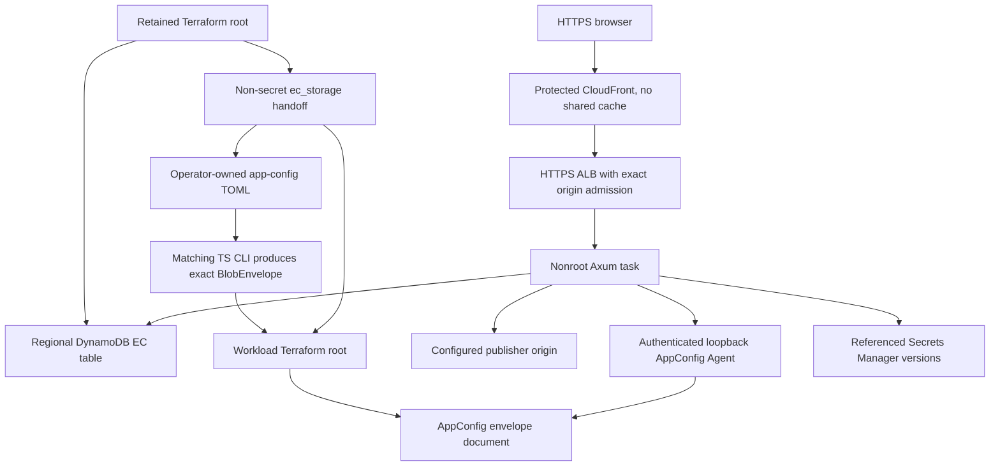

# Native AWS workload example

One example combines retained DynamoDB EC storage with an Axum workload on Fargate, AppConfig, Secrets Manager, an ALB and protected CloudFront Geo. The main fictional tfvars select CloudFront at `dns-cutover`; explicit `geo_front_door = null` selects Geo Off. The retained table and disposable workload have separate Terraform roots and separate locked state keys.

This is a closed-gate example, not an approved deployment recipe. It does not qualify an AWS account, final application image or public ingress. Operational deployment belongs in the separate, access-controlled deployer repository. Access to that repository is not required to understand this example or run its offline checks. No AWS deployment or cleanup is authorized here.



Without CloudFront, explicit reviewer CIDRs govern ALB ingress. The application port remains ALB-only in either mode. A task public IP supplies outbound connectivity; this is not private-subnet Fargate.

## Roots and input ownership

| Path           | Ownership and lifetime                                                                                                                                                       |
| -------------- | ---------------------------------------------------------------------------------------------------------------------------------------------------------------------------- |
| `retained/`    | Retained owner creates the table and exports `ec_storage`. No task role, policy attachment or workload-state dependency.                                                     |
| This directory | Workload owner creates the task role, attaches its scoped DynamoDB policy, and configures ECS, ingress and AppConfig. Workload removal must leave the retained table intact. |

Both roots use S3 lockfile locking, but neither supplies a backend key. The operator must explicitly supply stable installation/workload-specific keys, the separately owned bucket and backend region through the approved operator path. For illustration only, one installation could use `example-staging/retained.tfstate` and `example-staging/workload.tfstate`. Retained and workload keys must differ. Never reuse another environment's keys or point both roots at one key. Keep state encrypted, versioned, access-controlled and locked.

| Input                                                                                      | Responsible owner                                                                                                                         |
| ------------------------------------------------------------------------------------------ | ----------------------------------------------------------------------------------------------------------------------------------------- |
| AWS account, region, state bucket/access and operator authority                            | Account and state owners, outside these roots                                                                                             |
| Retained `owner`, table name and namespace reservation                                     | Retained owner, including allocator continuity, data lifetime, costs and eventual retirement                                              |
| `ec_storage`                                                                               | Retained owner hands off the exact provider, region, table and namespace; application and workload owners use the same object             |
| Publisher origin, hostname/cookie arrangement, authentication and consent signal transport | Application/publisher operator, reviewed before browser acceptance                                                                        |
| Digest-pinned application/runtime and Agent images                                         | Image owner, with final-image evidence rather than placeholder digest syntax                                                              |
| Secret ARN/version references and Agent token version                                      | Secret owner seeds values separately; no values enter app config or application tfvars                                                    |
| Task/execution permission boundaries                                                       | Boundary owner reviews effective permissions; the workload's `ec_task_policy_json` is a scoped allow document, not a replacement boundary |
| Certificates, hosted zone, reviewer access, CloudFront credentials and routing phase       | Ingress owner, with separate live TLS/DNS/admission qualification                                                                         |

The example creates no operator role, protected state bucket, permission boundary, certificate, hosted zone or image build/publisher. Fictional tfvars, reserved documentation client CIDRs and placeholder image digests are not deployable inputs. The Agent image placeholder is not a verified official image. Never publish credentials, actual tfvars, state, saved plans, licensed data or private qualification records.

All workload AWS resources depend directly on `terraform_data.draft_gate`. Its source-controlled blockers cover scoped operator/locked-state authority, final-image/nonroot-volume behavior and live ALB forwarding/auth/health. No input declares those qualifications passed. Mock tests remove blockers only in disposable copies. Offline success is not permission to remove the gate. The retained root's separate lifecycle does not authorize deploying the workload.

## Ordered configuration handoff

These steps describe input preparation and ownership. Cloud provisioning and state reads require a separately authorized operator workflow; the commands here are local only.

### 1. Agree the retained reservation

The retained owner reviews `retained/terraform.tfvars.example`, account/region, retained state identity and the app/environment reservation. The retained root creates a single-region `PAY_PER_REQUEST` table with string keys `pk` and `sk`, TTL on `ttl_epoch_s`, deletion protection and Terraform `prevent_destroy`. It uses DynamoDB's default encryption at rest with an AWS-owned key. It adds no task KMS permission, indexes or replicas.

Reserve both `ec:{namespace}` for identities/withdrawal markers and `ec-allocator:{namespace}` for the durable generation allocator. The allocator row has `sk=generation` and no TTL. Never reset it while the namespace may be reused. TTL collects expired rows eventually; runtime `expires_at_ms` controls logical expiry. See [the persistence guide](../../../docs/guide/native-ec-persistence.md) for continuity and retirement requirements.

### 2. Receive the retained handoff

After separately approved retained provisioning, the owner supplies its non-secret `ec_storage` output. No task role needs to exist first. The committed fixtures agree on this exact object:

```hcl
ec_storage = {
  provider  = "dynamodb"
  region    = "eu-west-2"
  table     = "example-retained-ec"
  namespace = "example-staging"
}
```

The handoff is explicit, not a Terraform remote-state dependency or a task environment binding. Preserve exact values in the workload input and published config. A provider/table/namespace change does not migrate existing identities or withdrawal obligations.

### 3. Prepare operator-owned TOML

Start with `example-config.toml` and review the entire application policy. Keep secret references, not resolved values. Include the retained selection:

```toml
[ec.storage]
provider = "dynamodb"
region = "eu-west-2"
table = "example-retained-ec"
namespace = "example-staging"
```

The matching CLI validates application semantics. Terraform does not duplicate TS authentication, indexing, signing, origin-protocol or secret-consumer policy. The fixture's hostname and empty integration settings are not browser acceptance evidence; resolve the operator-owned requirements below without weakening runtime consent checks.

### 4. Export the exact matching CLI envelope

Use the TS CLI from the final application's matching source revision. Prepare a disposable checkout of that revision, including `edgezero.toml` and all referenced adapter manifests. Copying only the root manifest is insufficient because CLI validation also reads referenced manifests, including Spin's. Run from the checkout root to validate and publish reference-only TOML with environment overlays disabled:

```sh
ts config validate --manifest edgezero.toml --app-config /private/site.toml --no-env
ts config push --adapter axum --manifest edgezero.toml --app-config /private/site.toml --local --no-env --no-diff --yes
```

Local publication writes `.edgezero/local-config-trusted_server_config.json`, an outer key-to-string map. Extract only the `trusted_server_config` string, preserving its bytes:

```sh
node --input-type=module -e '
import { readFileSync, writeFileSync } from "node:fs";
const map = JSON.parse(readFileSync(".edgezero/local-config-trusted_server_config.json", "utf8"));
writeFileSync("/private/site-envelope.json", map.trusted_server_config, { mode: 0o600 });
'
```

AppConfig consumes that inner `BlobEnvelope` document, not the outer local map or raw TOML. Do not parse and reserialize the envelope, patch its config, or recompute its checksum with Terraform. Regenerate through the matching CLI after any config change. Committed envelopes are offline fixtures, not release exports.

### 5. Prepare the workload inputs

The workload owner supplies the same `ec_storage` object and sets `config_envelope_file` to the exact CLI export. The workload checks envelope shape, publisher binding and exact `ec.storage` agreement, then publishes the original envelope text unchanged to AppConfig. It attaches exact-table/partition-scoped DynamoDB permissions to its own application task role. The retained root never attaches a policy to that role.

Review `ec_task_policy_json` with the boundary owner. An existing task boundary with an explicit deny excluding DynamoDB still denies the calls despite an inline allow. Review its action ceiling and constrained allows, plus organization and endpoint policy denies. Do not remove a boundary, grant administrator access or move application calls to the execution role. The execution role retains image-pull, logs and startup-secret responsibilities.

The main `terraform.tfvars.example` selects protected CloudFront at `dns-cutover`. The `staged` and `origin-enabled` phases are also modeled; they are not an automated safe rollout or rollback procedure. An explicit `geo_front_door = null` selects the alternate Geo Off path. Neither setting bypasses qualification.

## Runtime image contract

Use the TS-owned runtime packaging in [`../../runtime/native-aws/`](../../runtime/native-aws/), not a local development image. Pin the final application image by digest. Its required Axum features are `aws-appconfig-agent,aws-secrets-manager,geo-cloudfront,aws-dynamodb-ec`. Feature names and a valid digest are not evidence of runtime qualification.

The task expects:

- A Linux x86_64 application running as UID/GID `10001:10001`, listening on `0.0.0.0:8787`, with a read-only root filesystem and all Linux capabilities dropped.
- A writable, correctly owned `/run/trusted-server` task volume. The runtime entrypoint publishes literal `TS_NATIVE_BINDINGS_TOML` privately and passes `/run/trusted-server/native-bindings.toml` through `EDGEZERO__STORE_BINDINGS_FILE`. The ephemeral volume does not store the identity graph.
- Optional `TS_NATIVE_GEO_PROFILE_TOML` containing the CloudFront provider, ALB peer CIDRs and credential-removal header name, never the expected credential value. The runtime exports `TS_NATIVE_GEO_PROFILE_FILE`. An absent profile means Geo Off; an invalid explicit profile must fail before readiness. No KV Geo database/provider is configured here.
- `EDGEZERO__ADAPTER__TRUSTED_PROXY_CIDRS` and `EDGEZERO__ADAPTER__FORWARDING_HEADER_FAMILY=x-forwarded` for checked forwarding. Geo admission and ordinary forwarded-header trust are separate checks.
- An authenticated official AppConfig Agent on loopback `127.0.0.1:2772`, sharing the selected token version with the app. ECS `START` dependency orders startup but does not prove readiness. Qualify bounded cold Agent startup with the selected image/provider. No Agent disk-backup fallback is configured.
- Successful preparation of the selected regional EC table using task-role credentials before readiness. No local-memory fallback or deployed `local_endpoint` is allowed. Regional HTTPS connectivity and actual effective IAM still need qualification.
- Exact HTTP `200` on `/health` after startup validation, plus direct SIGTERM/request draining. Defaults are a 10-second application grace and 30-second container stop timeout. One stop-first task permits update downtime; this is not high availability.

## Browser hostname and consent qualification

The current fixtures use `publisher.example.com` and `ts-demo.example.com`. A response viewed at `https://ts-demo.example.com` cannot set an EC cookie scoped to `.publisher.example.com`; the browser rejects it. EC derives its cookie domain from `publisher.domain`, not `publisher.cookie_domain`. Changing only `cookie_domain` or fixing `X-Forwarded-Host` does not solve that rejection. The browser's visible response URL governs cookie acceptance.

Existing Terraform constraints require different publisher and demo hostnames. This example does not change those values or validations. The operator must supply an approved cookie-compatible hostname configuration within existing constraints, or use the existing publisher-preserving browser proxy. In that proxy session the browser stays on the publisher URL while the proxy connects to the demo endpoint and rewrites the upstream Host. With CloudFront, `preserve_publisher_hostname = true` fixes `X-Forwarded-Host` to the configured publisher for this mode. It does not change browser origin, aliases, certificates, ALB Host/credential admission, Geo trust or no-shared-cache policy. Ordinary demo-host browsing retains the default `false` and is not proof of EC cookie acceptance.

Consent runtime already extracts and enforces standard signals, including TCF, GPP, US Privacy and GPC. An empty `[integrations]` table is not necessarily a bug. An existing publisher CMP may already transport genuine signals. It is not evidence that transport works either. The operator owns genuine CMP signal transport for the selected browser path; this example adds no CMP integration and never fabricates consent or relaxes policy. The existing Sourcepoint GPP capture and `POST /_ts/consent` update path are a scoped example, not a generic TCF bridge or proof that another CMP's updates reach the server.

In separately authorized browser acceptance, retain evidence for:

1. The visible URL, origin/TLS, forwarding behavior, and the actual `Set-Cookie` domain. Inspect browser rejection reasons, stored `ts-ec`, and its return on the next eligible navigation. A response header alone is insufficient.
2. Genuine initial CMP decisions reaching native requests in the correct jurisdiction, including the no-consent case. Protected geography does not grant consent.
3. A real CMP update reaching the server and affecting subsequent behavior. Verify the chosen transport rather than assuming a client-side UI change propagated.
4. Withdrawal reaching the server, durable tombstone acknowledgement and browser-cookie expiry, with no stale update reviving identity. Verify persistence across task replacement separately.

## Secrets, updates and rollback limits

Application and Agent secrets use immutable Secrets Manager ARN/version references. Values do not belong in TOML, AppConfig or Terraform application inputs. The private CloudFront origin credential is an infrastructure exception and enters restricted Terraform state/plans despite `sensitive = true`. Keep its removal-header name stable across eligible rollback tasks. Operational saved-state/header continuity checks belong to the separate deployer; direct use of this example is not equivalent to that policy.

Configuration and secrets are immutable startup snapshots. Changes require new prepared tasks. ECS task rollback does not restore the shared latest AppConfig document; the operator must reconcile compatible config, secret versions, provider selection and image manually. Older binaries may reject `[ec.storage]`. Stopping persistence or switching namespaces is not a safe rollback for issued identities and withdrawal obligations. Rollback automation is deferred.

## Offline checks

Use Terraform `1.16.2`, locked AWS provider `6.64.0` and the repository's pinned Node. From the repository root:

```sh
terraform -chdir=deploy/examples/native-aws-workload fmt -check -recursive
terraform -chdir=deploy/examples/native-aws-workload init -backend=false -input=false -lockfile=readonly
terraform -chdir=deploy/examples/native-aws-workload validate
terraform -chdir=deploy/examples/native-aws-workload/retained init -backend=false -input=false -lockfile=readonly
terraform -chdir=deploy/examples/native-aws-workload/retained validate
env -u NODE_OPTIONS -u NODE_PATH node deploy/examples/native-aws-workload/test-draft.mjs
node --test deploy/examples/native-aws-workload/test-workflow.mjs
```

Backend-disabled initialization prepares provider tooling, not a live backend or AWS resources; it may need a provider download or an existing local mirror. When using an external `TF_DATA_DIR`, pass the same absolute directory to initialization and the helper. The helper copies an explicit public-file allowlist into disposable roots, strips inherited credentials/provider configuration, and uses a filesystem-only provider mirror. It never reads operator overrides, real state or private tfvars. Its mocked plans include the retained root, closed workload gate, main CloudFront tfvars, explicit Geo Off, storage mismatches, scoped IAM, routing phases and a fictional gate-only delete plan. No cloud resource is applied.

Separately, with the repository's pinned Rust/Node toolchains, the Linux host target and build dependencies installed, check both committed envelopes through the actual runtime config loader:

```sh
cargo test -p trusted-server-core --target x86_64-unknown-linux-gnu --test aws_example_config
```

This check verifies envelope integrity, settings, secret-reference resolution with fictional values and native EC selection. It does not connect to AWS or prepare a real DynamoDB table. Keep the dependencies cached for a disconnected run; first-time dependency installation is separate from these checks.

The offline workflow has read-only repository permissions and no Environment, OIDC or cloud credentials. Schema/mock success does not prove real IAM, Agent startup, Fargate volume ownership, TLS/DNS, credential stripping, Geo, browser behavior or complete cleanup. Local persistence checks and later qualification requirements are in [the persistence guide](../../../docs/guide/native-ec-persistence.md#qualification-before-deployment).

## Retirement and deferred production work

The named operator owns ongoing charges, image updates, deliberate shutdown and manual reconciliation. Deletion is explicit, not expiry. Workload teardown removes its role/policy attachment, not the retained table. The retained owner separately approves namespace retirement, identity erasure, allocator continuity and eventual table removal. `prevent_destroy` and deletion protection are not backups and do not prevent authorized task-row deletion. Externally supplied state infrastructure, boundaries, certificates, zones and application secrets remain independently owned. Logs follow their selected retention/deletion setting; external audit records survive workload teardown.

PITR/backups and restore qualification, alarms, HA, autoscaling, private networking/NAT/endpoints, WAF, customer-managed encryption keys, IPv6, image automation, bidder/partner integrations, signing/admin/S2S additions and rollback automation are deferred. Review retention/erasure and allocator continuity before choosing backups; capacity and failure behavior before adding replicas or tasks; routing and endpoint policies before changing egress; and trust/consent boundaries before adding integrations. None of those production measures is implemented or qualified by this example.
