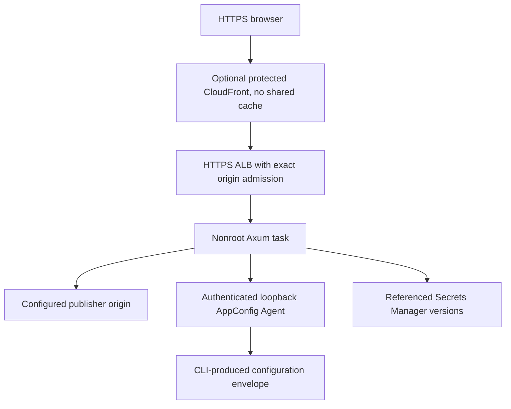

# Native AWS workload example

This example shows an Axum workload on AWS Fargate with AppConfig, Secrets Manager, an ALB and optional protected CloudFront Geo. It derives from the native workload Terraform and its reviewed deployer extraction. Operational deployment ownership stays in [trusted-server-deployer](https://github.com/stackpop/trusted-server-deployer), under `terraform/aws/` and `scripts/aws/`.

This is a closed-gate example, not an approved deployment recipe. It neither implements the deployer's complete setup plan nor qualifies an AWS account, application image or public ingress. No live deployment is required for the offline checks below.



Without CloudFront, explicit reviewer CIDRs govern ALB ingress. The application port remains ALB-only in either mode. A task public IP supplies outbound connectivity; this is not private-subnet Fargate.

## What is included

The root contains only active workload Terraform, fictional configuration fixtures and credential-free checks. It creates no operator role, protected state bucket, permission boundaries or image build/publisher. Certificates, hosted zone, digest-pinned images and immutable secret references remain operator inputs. Do not reuse another workload's state or resource identities.

All 40 AWS resource blocks directly depend on `terraform_data.draft_gate`. Its three source-controlled blockers cover scoped operator/locked state authority, final-image/nonroot-volume behavior and live ALB forwarding/auth/health. There is no input that declares those qualifications passed. The test helper removes blockers only in disposable mock copies. Never remove them merely because tests pass.

`terraform.tfvars.example` uses only fictional accounts, resource references, reserved documentation client CIDRs and placeholder image digests. Private VPC CIDRs are example network configuration, not an existing network. The AppConfig Agent image reference is a placeholder, not a verified official image. Never publish credentials, actual tfvars, state, saved plans, licensed data or private qualification records.

## Runtime image contract

Use the TS-owned runtime packaging in [`../../runtime/native-aws/`](../../runtime/native-aws/), not a local development image. Pin the final application image by digest and use the matching source revision's TS CLI for configuration. Required Axum features are `aws-appconfig-agent`, `aws-secrets-manager` and `geo-cloudfront` for the protected CloudFront path. These feature names are not evidence of runtime qualification.

The task expects:

- A Linux x86_64 application running as UID/GID `10001:10001`, listening on `0.0.0.0:8787`, with a read-only root filesystem and all Linux capabilities dropped.
- A writable, correctly owned `/run/trusted-server` task volume. The runtime entrypoint publishes literal `TS_NATIVE_BINDINGS_TOML` privately and passes `/run/trusted-server/native-bindings.toml` through `EDGEZERO__STORE_BINDINGS_FILE`.
- Optional `TS_NATIVE_GEO_PROFILE_TOML` containing the CloudFront provider, ALB peer CIDRs and credential-removal header name. It contains no expected credential value. The runtime publishes the profile and exports `TS_NATIVE_GEO_PROFILE_FILE`; absent profile means Geo Off, while an invalid explicit profile must fail before readiness.
- `EDGEZERO__ADAPTER__TRUSTED_PROXY_CIDRS` and `EDGEZERO__ADAPTER__FORWARDING_HEADER_FAMILY=x-forwarded` for checked forwarding. Geo admission and ordinary forwarded-header trust are separate checks.
- An authenticated official AppConfig Agent on loopback `127.0.0.1:2772`, sharing the selected token version with the app. ECS `START` dependency is ordering, not readiness. The selected image/provider must tolerate bounded cold Agent startup. No Agent disk-backup fallback is configured.
- Exact HTTP `200` on `/health` after startup validation, plus direct SIGTERM/request draining. Defaults are a 10-second application grace and 30-second container stop timeout. One stop-first task permits update downtime; this is not a high-availability design.

This root does not provision DynamoDB/celld EC persistence or its runtime bindings/IAM. Do not treat a local storage fallback as durable EC support. The application release's explicit EC storage requirements must be reconciled in the operational deployer before deployment. This example also does not configure a KV Geo database/provider; managed CloudFront Geo is the path represented here. IPv6 viewers remain disabled and unqualified in this template.

## Configuration and secrets

The matching TS CLI validates application semantics. Export reference-only TOML with `--no-env`, preserving the CLI's exact inner `BlobEnvelope` string, not its outer local key/value map:

```sh
ts config validate --manifest edgezero.toml --app-config /private/site.toml --no-env
ts config push --adapter axum --manifest edgezero.toml --app-config /private/site.toml --local --no-env --no-diff --yes
```

Terraform checks only envelope shape and the selected publisher binding. It does not duplicate TS authentication, indexing, signing, origin-protocol or secret-consumer policy. Example envelopes are offline fixtures, not substitutes for a fresh matching CLI export. Configuration changes require new immutable startup snapshots. ECS task rollback does not restore the shared latest AppConfig document; config reconciliation remains manual.

Application and Agent secrets use immutable Secrets Manager ARN/version references. Secret values do not belong in TOML, AppConfig or Terraform application inputs. The private CloudFront origin credential is an infrastructure exception and enters restricted Terraform state/plans despite `sensitive = true`. Keep its removal-header name stable across eligible rollback tasks. The operational deployer enforces saved-state/header continuity; direct use of this example bypasses that runner policy.

`preserve_publisher_hostname` defaults to `false`. With protected CloudFront enabled, set it to `true` only for an approved browser-proxy session that stays on `publisher_hostname` while connecting to `demo_hostname` with upstream host rewriting. CloudFront fixes `X-Forwarded-Host` to the configured publisher, never a viewer-selected value. The option has no effect without CloudFront and changes neither alias/certificates nor ALB Host/credential admission, Geo trust or no-shared-cache policy. Ordinary demo-host browsing should retain the default. Navigation, consent and vendor behavior still need separately approved browser acceptance.

## Offline checks

Use Terraform `1.16.2`, the locked AWS provider `6.64.0` and the repository's pinned Node. Run from the repository root:

```sh
terraform -chdir=deploy/examples/native-aws-workload fmt -check -recursive
terraform -chdir=deploy/examples/native-aws-workload init -backend=false -input=false -lockfile=readonly
node deploy/examples/native-aws-workload/test-draft.mjs
node --test deploy/examples/native-aws-workload/test-workflow.mjs
```

When using an external `TF_DATA_DIR`, pass the same absolute directory to initialization and the helper. The helper copies only an explicit public-file allowlist into disposable roots, strips inherited credentials/provider configuration, uses a filesystem-only provider mirror and never reads operator overrides, real state or private tfvars. Tests exercise the closed production gate, isolated task/Geo/settings plans, both fixed browser identities across all routing phases and a fictional gate-only delete plan. They never apply cloud resources.

The offline workflow has read-only repository permissions and no Environment, OIDC or cloud credentials. Schema/mock success is not proof of real IAM, Agent startup, Fargate volume ownership, TLS/DNS, credential stripping, Geo, browser behavior or complete cleanup.

## Operator ownership and cleanup

Keep any later deployment inputs and backend outside this checkout. State must be encrypted, versioned, protected and locked under a stable workload-specific key. Retire competing writers before any separately approved migration. Use the operational deployer for private plan validation and requested-versus-running task checks, not direct mutation from this example.

The named operator owns charges, image updates, deliberate shutdown and manual reconciliation. Deletion is explicit, not expiry. Externally supplied state infrastructure, boundaries, certificates, zones and application secrets remain independently owned. Workload logs follow the selected retention/deletion setting; external audit records are not erased by teardown. No deployment or cleanup operation is authorized by this example.
