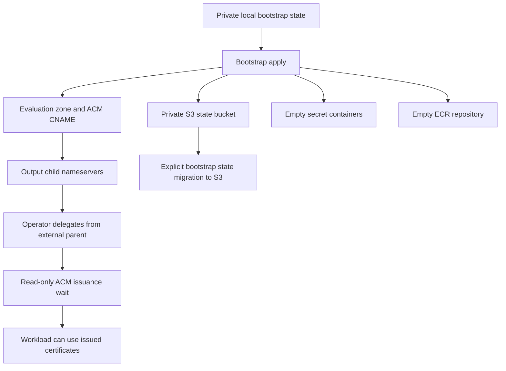

# AWS demo bootstrap

This third Terraform root owns installation prerequisites for the [workload and retained roots](../README.md). It creates a versioned, AES256-encrypted, HTTPS-only private S3 state bucket; an encrypted, immutable, scan-on-push ECR repository; evaluation DNS and two ACM certificate requests; and five empty Secrets Manager containers.

It creates no operator role, permission boundary, application image, secret value or application configuration. Use authorized deployment credentials. Terraform state and saved plans remain private even though this root never accepts secret values.

| Owned here                                                              | Lifetime                                                                                                                    |
| ----------------------------------------------------------------------- | --------------------------------------------------------------------------------------------------------------------------- |
| State bucket                                                            | Survives workload removal. Migrate bootstrap back to private local state before final bucket retirement.                    |
| ECR repository                                                          | Survives workload removal. Image publication is separate; nonempty repository deletion is disabled.                         |
| Dedicated zone named `demo_hostname`, if requested                      | Evaluation-only child zone. Its parent delegation is external. An existing supplied zone is read, never owned or deleted.   |
| Regional and us-east-1 ACM certificates and one validation CNAME        | Survive workload removal. Both requests cover the same hostname in the same account and share ACM's cross-region DNS token. |
| Four application secret containers and separate `agent_token` container | Values and immutable versions are seeded outside Terraform. Normal Secrets Manager recovery applies on deletion.            |



## First apply uses private local state

Use Terraform `1.16.2` and the committed AWS `6.64.0` lock file. From the repository root, set `TS_WORK` to an absolute, private directory outside the checkout. Copy `terraform.tfvars.example` there as `bootstrap.tfvars`, then replace its fictional inputs.

```sh
export TS_WORK=/absolute/private/demo-installation
ROOT=deploy/examples/native-aws-workload/bootstrap
umask 077
mkdir -p "$TS_WORK"
chmod 700 "$TS_WORK"
cp "$ROOT/terraform.tfvars.example" "$TS_WORK/bootstrap.tfvars"
# Edit the private copy before proceeding.
terraform -chdir="$ROOT" init -lockfile=readonly -backend-config="path=$TS_WORK/bootstrap.tfstate"
terraform -chdir="$ROOT" plan -var-file="$TS_WORK/bootstrap.tfvars" -out="$TS_WORK/bootstrap.tfplan"
terraform -chdir="$ROOT" show "$TS_WORK/bootstrap.tfplan"
# Review the saved plan. Run apply only after checking its account and resources.
terraform -chdir="$ROOT" apply "$TS_WORK/bootstrap.tfplan"
terraform -chdir="$ROOT" output -json > "$TS_WORK/bootstrap-output.json"
```

Keep `installation_name`, account, region, bucket and state paths stable on subsequent runs. The initial apply deliberately does not wait for ACM. Waiting here would block output of the nameservers needed to delegate a new zone.

## Delegate DNS, then wait for issuance

With `existing_route53_zone_id = null`, bootstrap creates a public child zone named exactly `demo_hostname`. Publish its `route53_name_servers` as an NS record at that hostname in the externally owned parent zone. This is not a publisher DNS cutover. Do not change production publisher records.

With an existing zone ID, confirm it is the authoritative public zone covering the evaluation hostname. Bootstrap creates only its validation CNAME in that zone. It must not recreate or redelegate the existing zone.

Check public delegation and CNAME resolution. Then run these read-only waiters with `AWS_REGION` set to the regional value in the private bootstrap tfvars:

```sh
aws acm wait certificate-validated --region "$AWS_REGION" \
  --certificate-arn "$(terraform -chdir="$ROOT" output -raw regional_certificate_arn)"
aws acm wait certificate-validated --region us-east-1 \
  --certificate-arn "$(terraform -chdir="$ROOT" output -raw viewer_certificate_arn)"
```

A waiter timeout does not require another certificate or another CNAME. Inspect external delegation and public validation records, fix their owner-controlled DNS path, then retry the read-only waiter. ACM uses the same validation token for the same hostname across AWS regions in one account, so Terraform owns exactly one CNAME. See [ACM DNS validation](https://docs.aws.amazon.com/acm/latest/userguide/dns-validation.html). <!-- allow-domain: docs.aws.amazon.com -->

## Migrate bootstrap state to S3

The `backend_configs` output contains distinct `bootstrap`, `retained` and `workload` objects. Each supplies `bucket`, `key`, `region`, `encrypt = true` and `use_lockfile = true`. Never share keys between roots or installations.

Convert these non-secret outputs into private backend configuration files:

```sh
node --input-type=module <<'JS'
import { readFileSync, writeFileSync } from "node:fs";
const work = process.env.TS_WORK;
const output = JSON.parse(readFileSync(work + "/bootstrap-output.json", "utf8"));
for (const [root, config] of Object.entries(output.backend_configs.value)) {
  const hcl = Object.entries(config)
    .map(([key, value]) => key + " = " + JSON.stringify(value))
    .join("\n") + "\n";
  writeFileSync(work + "/" + root + ".backend.hcl", hcl, { mode: 0o600 });
}
JS
printf 'terraform {\n  backend "s3" {}\n}\n' > "$ROOT/backend_override.tf"
terraform -chdir="$ROOT" init -lockfile=readonly -migrate-state -backend-config="$TS_WORK/bootstrap.backend.hcl"
terraform -chdir="$ROOT" state list
```

The ignored `backend_override.tf` replaces only bootstrap's checked-in local backend. Check the source and destination paths when Terraform prompts to copy state. Use `-migrate-state`, not `-reconfigure`, which does not migrate it. Verify the expected resources with `terraform state list` after migration. Keep the private local state and backup files secure until the destination state has been verified.

A resource list alone does not identify the backend. Check Terraform's initialization messages and its private backend metadata under `.terraform/terraform.tfstate`, or the selected `TF_DATA_DIR`. That metadata is a sensitive backend configuration cache, not the installation's resource-state document. Confirm the destination bucket and bootstrap key without publishing this file. Offline checks do not prove a full local-to-S3 state copy.

Initialize `retained/` and the workload separately with their respective private backend files. Their source already selects S3. Do not copy bootstrap's backend override into either root.

## Handoff

Use `route53_zone_id`, `regional_certificate_arn` and `viewer_certificate_arn` as workload inputs after issuance. Publish the final runtime-wrapper image to `ecr_repository_url`, then use its immutable digest as `application_image`. The repository output is not a runnable image. The Agent image remains a separate reviewed digest input.

`application_secret_arns` maps exactly `handler_password`, `publisher_proxy_secret`, `ec_passphrase` and `browser_forwarder_secret`. `agent_secret_arn` is separate. Seed values outside Terraform, record each resulting immutable version ID and hand only ARN/version references to the workload. Do not add `aws_secretsmanager_secret_version`, secret-value variables or seed files to this root.

The browser forwarder must receive the exact same bytes as its application secret. Its CLI accepts and strips one trailing line terminator from a token file; uploading that terminator into Secrets Manager would change the secret bytes. Generate a private token without a trailing LF, or remove it before seeding. Never reuse this token as the Agent token or CloudFront origin credential.

See the parent guide for retained storage, exact matching CLI envelope export, CloudFront CIDRs, image publication and browser acceptance. Bootstrap does not select the application's Geo routing phase or publisher-hostname forwarding mode.

## Final retirement

Workload removal is not installation retirement. Destroy the workload first so its ALB, CloudFront distribution, DNS alias and runtime consumers release bootstrap resources. Retire the retained table separately only after its owner has addressed identity erasure and allocator continuity; its protection settings deliberately prevent an ordinary destroy.

Before destroying bootstrap:

1. Save the required private records and make sure neither retained nor workload state still uses the bucket.
2. Remove only bootstrap's ignored override and migrate its current S3 state back to an explicit private local path:

   ```sh
   rm "$ROOT/backend_override.tf"
   terraform -chdir="$ROOT" init -lockfile=readonly -migrate-state -backend-config="path=$TS_WORK/bootstrap-retirement.tfstate"
   terraform -chdir="$ROOT" state list
   ```

   Verify the resource list, explicit local state file and cached backend metadata now identify the private local destination before deleting any remote state objects. Keep that local state for the remainder of retirement. Do not use `-reconfigure` or migrate back into the bucket being removed. The reverse cloud migration is also not covered by offline mock tests.

3. Explicitly retire ECR images and all bucket object versions, delete markers and leftover lock objects under the installation owner's data-retirement decision. A recursive current-object deletion alone does not empty a versioned bucket. Both `force_destroy` and `force_delete` are false, so Terraform does not silently erase this content.
4. For a bootstrap-created child zone, remove its externally owned parent NS delegation when retiring the evaluation name. Leave an existing shared zone and its parent delegation alone.
5. Plan and apply bootstrap destruction using its private tfvars and local backend:

   ```sh
   terraform -chdir="$ROOT" plan -destroy -var-file="$TS_WORK/bootstrap.tfvars" -out="$TS_WORK/bootstrap-destroy.tfplan"
   terraform -chdir="$ROOT" show "$TS_WORK/bootstrap-destroy.tfplan"
   # Review the saved destruction plan before applying it.
   terraform -chdir="$ROOT" apply "$TS_WORK/bootstrap-destroy.tfplan"
   ```

Secrets Manager uses its normal recovery window, currently 30 days by default, rather than forced immediate erasure. Names remain reserved while deletion is pending. A later installation must restore or finish retiring those secrets before reusing their names. Keep private retirement state and logs according to the operator's record-retention requirements.

## Offline checks

Copy only the public Terraform files, lock file and plan-only `tests/` fixture into a disposable root. Exclude operator overrides, credentials, private tfvars and state. Use a filesystem provider mirror and a private `TF_DATA_DIR`, then run:

```sh
terraform fmt -check -recursive
terraform init -backend=false -input=false -lockfile=readonly
terraform validate
terraform test
```

The static source checks also run without credentials:

```sh
node --test deploy/examples/native-aws-workload/bootstrap/test-bootstrap.mjs
```

The mock plans cover a new child zone and an existing zone, two-region certificates with one CNAME, protected state settings, separate state keys, the repository and five empty secret containers. They do not prove live delegation, certificate issuance, AWS permissions, image runtime behavior or successful cleanup.
