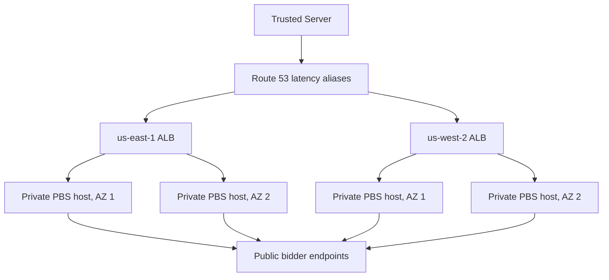

# PBS AWS example

This directory is the locally checked output of the Prebid Server AWS planning workflow. It is a reference for preparing infrastructure and operator inputs. It does not deploy PBS, inject runtime secrets, or change traffic.

## What it models



Each region has two AZs, one EC2 host per AZ, a public ALB, and one NAT gateway per AZ. Terraform creates regional Secrets Manager metadata but never stores credential values.

## Safe local walkthrough

These commands do not contact AWS. They require the pinned Terraform, Rust, and Node.js toolchains and Docker with the Compose plugin. The Node.js tests use only built-in modules; no npm install is needed. The development certificate test also needs OpenSSL. On Apple Silicon macOS, replace `cargo run_cli_linux` with `cargo run_cli_macos`. Other hosts can use `cargo run --package trusted-server-cli --target "$(rustc -vV | awk '/host:/ { print $2 }')" --`.

```bash
terraform fmt -check -recursive deploy/pbs-example
terraform -chdir=deploy/pbs-example init -backend=false -input=false -lockfile=readonly
terraform -chdir=deploy/pbs-example validate
terraform -chdir=deploy/pbs-example test -filter=tests/root_unit_test.tftest.hcl
terraform -chdir=deploy/pbs-example/modules/regional init -backend=false -input=false -lockfile=readonly
terraform -chdir=deploy/pbs-example/modules/regional validate
terraform -chdir=deploy/pbs-example/modules/regional test -filter=tests/security_unit_test.tftest.hcl
cargo run_cli_linux prebid server check \
  --deployment deploy/pbs-example/deployment.example.yaml \
  --json
docker compose \
  --env-file deploy/pbs-example/runtime/examples/compose.env \
  -f deploy/pbs-example/runtime/compose.yaml \
  config --quiet
bash -n deploy/pbs-example/scripts/smoke-runtime.sh
bash -n deploy/pbs-example/scripts/make-dev-mtls-certs.sh
env -u NODE_OPTIONS -u NODE_PATH node --test deploy/pbs-example/scripts/test-smoke-runtime.mjs
env -u NODE_OPTIONS -u NODE_PATH node --test deploy/pbs-example/scripts/test-make-dev-mtls-certs.mjs
```

The `PBS example checks` GitHub Actions workflow runs Terraform formatting, both readonly-lock initializations, validation, and both mocked test suites. It also checks JSON, shell syntax, Compose wiring, and development certificates. Changes to this example, `.tool-versions`, or the workflow trigger it. CI reads the Node.js version from `.tool-versions` and checks Docker Compose availability. Both Node.js commands clear inherited preload options and module paths. The tests pass only `PATH` and `HOME` plus explicit test inputs to subprocesses. The wiring test also parses `runtime/secret-bindings.example.json`. The CLI test suite separately loads and checks the committed deployment descriptor and its referenced inputs on every PR. The example owner must still run the descriptor command above when adapting inputs.

The Terraform tests mock AWS, including the apply tests that turn mTLS on and back off. The deployment descriptor and binding file contain fictional account, profile, secret, instance, and adapter identifiers for local validation only. Their pinned image digest identifies the upstream PBS Go v4.7.0 release, not a fictional image; preserve it unless deliberately selecting and verifying another release, and keep both files' image references identical. The wiring test renders Compose JSON and exercises the smoke script with fake lifecycle and health commands. It verifies the deployment all-interface binding, smoke-only loopback binding, and forced dummy input selectors without starting containers.

A separately approved `deploy/pbs-example/scripts/smoke-runtime.sh` run pulls and starts the pinned image with dummy values on loopback, checks `/status` and startup-log redaction, and sends no auction request. Static rendering and fake-command checks are not runtime startup evidence.

## Adapting the example

1. Copy this directory into an environment-specific deployment root.
2. Replace the fictional values from `terraform.tfvars.example` in a protected, ignored `.tfvars` file.
3. Replace `examplebidder` with adapters and credential mappings verified against the pinned PBS release and approved by each bidder.
4. Supply approved regional AMIs. Each AMI must contain the chosen OS, SSM agent, Docker, and Compose. This repository does not build the AMIs.
5. Run the local checks above.
6. Obtain separate authorization for AWS identity checks, Terraform plan, apply, and secret writes.
7. Follow `RUNBOOK.md` for the reviewed plan and apply process.

## Optional ALB mutual TLS

The regional HTTPS listeners use their existing public ACM certificates and Trusted Server CIDR allowlist. Client certificate verification is off by default. Enable it in a region by setting that region's `east_client_ca_bundle_s3_bucket` and `east_client_ca_bundle_s3_key` inputs or the corresponding `west_` pair. Leave both inputs null to turn verify mode off and remove the trust store. Terraform now manages the listener's verification mode and the load balancer's connection logs in every region, so applying this version turns off either setting if someone enabled it outside Terraform.

The PBS operator owns a private CA and keeps its key offline. The Trusted Server operator generates a key and sends a signing request to the CA owner. The CA issues a client certificate with the `clientAuth` extended key usage and about a one-year lifetime. Put the issued certificate in Fastly's Config Store and the key in its Secret Store. Put only the public CA bundle in S3 and pass Terraform its bucket and key, never private keys.

A bundle contains one or more PEM CA certificates with no blank lines. Grant the Terraform principal `s3:GetObject` on the bundle and upload each revision to a new key, such as `client-ca/bundle-v2.pem`. Overwriting an object at the same key does not update the trust store.

The optional `east_connection_logs_bucket` and `west_connection_logs_bucket` inputs work independently of mTLS. Create each bucket in the ALB's region with SSE-S3. Its policy must let `logdelivery.elasticloadbalancing.amazonaws.com` put objects under `AWSLogs/<account-id>/`. The `tls_verify_status` field shows whether the handshake succeeded and why a certificate was rejected.

Follow the [mTLS runbook](RUNBOOK.md#optional-alb-mutual-tls) to roll out one region at a time, rotate certificates or CAs, and turn off verification before withdrawing the client identity. Verify mode requires a client certificate on every request through the HTTPS listener, including `/status`. The target group's HTTP health check is unchanged.

To generate throwaway certificates for development, run:

```bash
deploy/pbs-example/scripts/make-dev-mtls-certs.sh
```

The script writes `ca.pem`, `ca.key`, `client.pem`, `client.key`, and `ca-bundle.pem` in the ignored `deploy/pbs-example/.dev-mtls/` directory. Pass an empty output directory as an argument to write them elsewhere. Do not use these keys or certificates in production.

## Generating real CLI inputs after apply

A successful apply produces actual instance IDs and regional secret ARNs. Render ignored operator files from those outputs instead of editing the fictional fixtures:

```bash
terraform output -raw deployment_descriptor_yaml > deployment.generated.yaml
terraform output -raw secret_bindings_json > runtime/secret-bindings.generated.json

ts prebid server check --deployment deployment.generated.yaml
ts prebid server status --deployment deployment.generated.yaml
```

Run these commands from this directory. `status` performs authenticated EC2 reads and requires separate authorization. Review both generated files before using them. They contain resource identifiers but no credential values.

An authorized operator can then write a complete regional secret value with `ts prebid server secrets set`, as documented in `RUNBOOK.md`.

## Stop boundary

The current workflow stops after infrastructure preparation and secret-value writes. It does not install a secret loader, resolve regional PBS YAML onto hosts, start or replace Compose, verify application health, or roll back a release. Those operations require a separately approved runtime implementation. A secret write alone does not update a running container.

See `DEPLOYMENT_PLAN.md` for decisions and limitations, and `RUNBOOK.md` for operator contracts.
