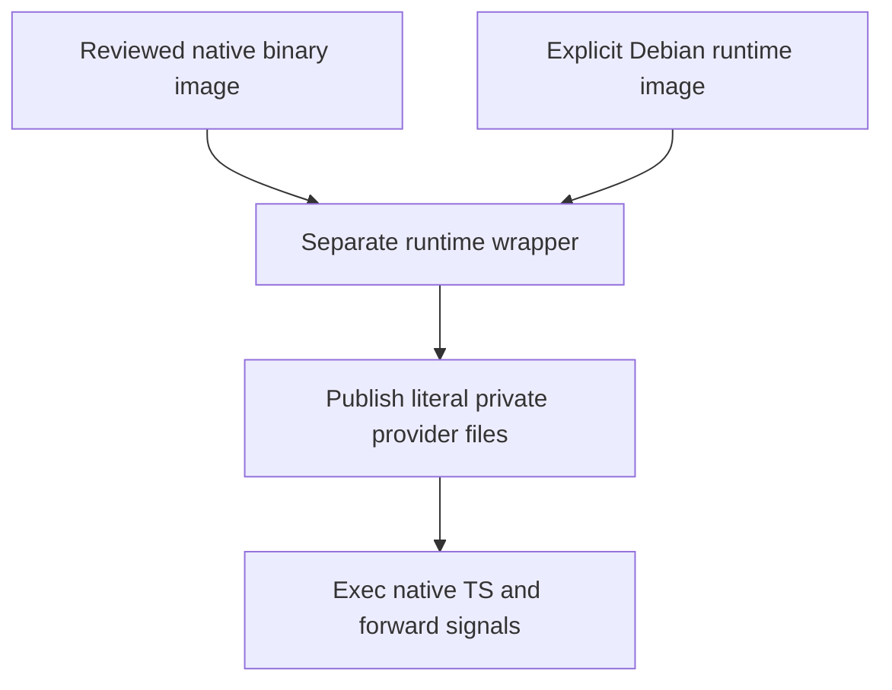

# Native AWS runtime wrapper

This is the existing demo's runtime wrapper, separate from the source-built
native image. Build at the repository root and supply two explicit digest
references: `TS_NATIVE_PROVIDER_IMAGE` supplies the application binary and input
manifest; `TS_NATIVE_RUNTIME_IMAGE` supplies the Debian 13 runtime. The wrapper
neither builds TS nor provisions infrastructure. An accepted reference must name
the image whose inputs and runtime checks were actually reviewed; syntax alone
is not qualification.

The image runs as UID/GID10001. `/run/trusted-server` must be an owned, writable
private mount. Its declared volume does not establish ownership on an ECS task
volume; that remains a deployment check. Keep the root filesystem read-only and
provide required writable temporary storage when selecting that runtime mode.

`TS_NATIVE_BINDINGS_TOML` contains provider identifiers/references, never secret
values. The entrypoint publishes it as a literal0600 file under the private
runtime directory. Optional `TS_NATIVE_GEO_PROFILE_TOML` is published the same
way. Empty explicitly selected Geo input fails rather than selecting Off. With
no profile content, inherited pointers cannot enable Geo. The application owns
validation of both formats.

After publication the wrapper removes those input-content variables and the
local-provider directory defaults, then execs the application. It never sources
or evaluates TOML. SIGTERM reaches the application directly. AWS credentials and
referenced secret values belong to the selected runtime providers, not build
arguments or public examples.



Run the retained local publication and signal tests with the repository Node:

```sh
node --test deploy/runtime/native-aws/test-entrypoint.mjs
```

These tests do not establish that a selected binary/runtime image combination,
ECS volume, IAM role or live front door has been qualified. No cloud operation
or live input change belongs to this review unit.
