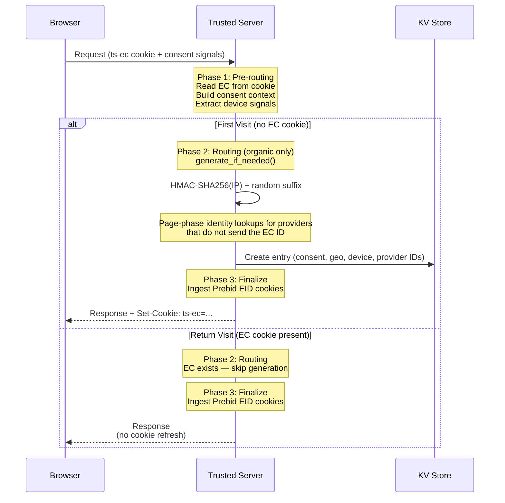
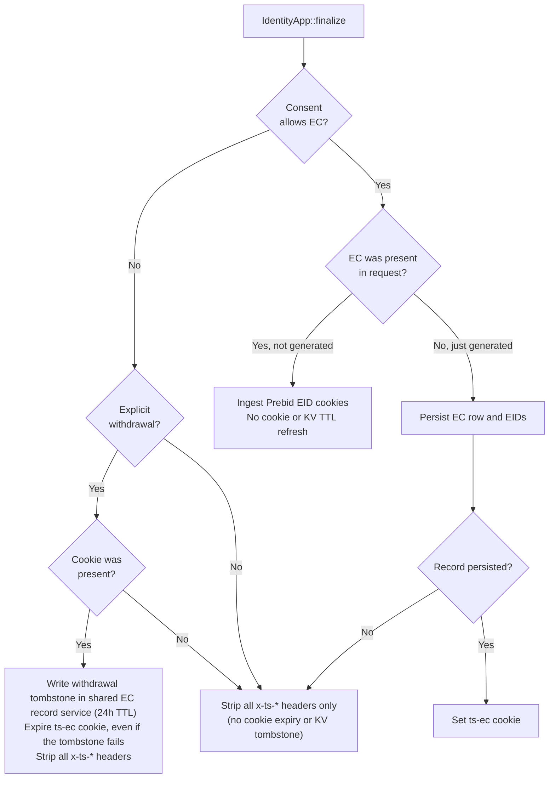
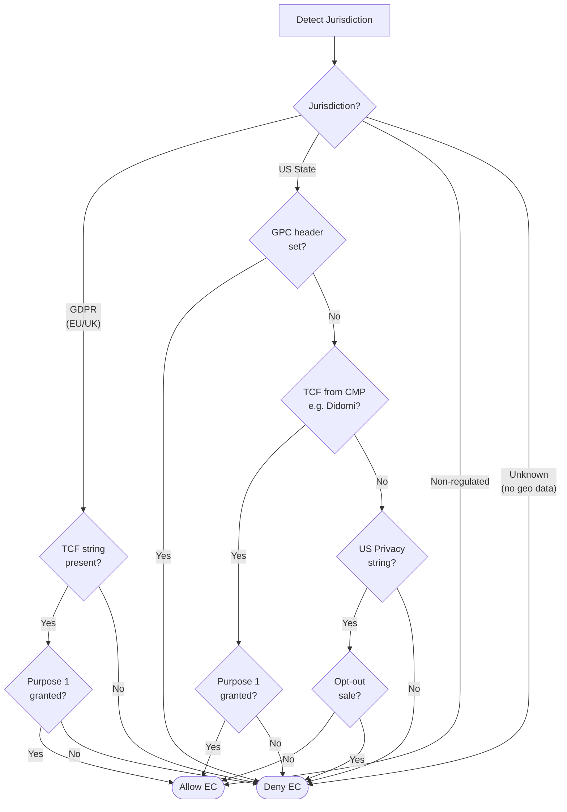
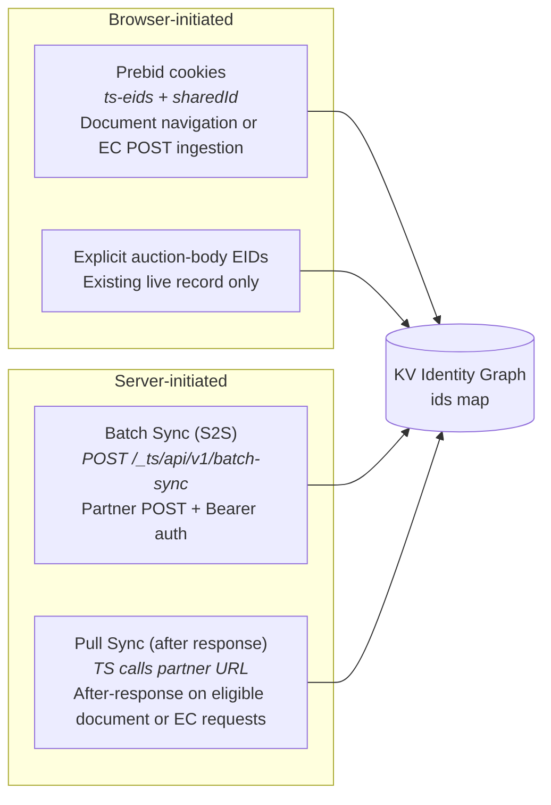
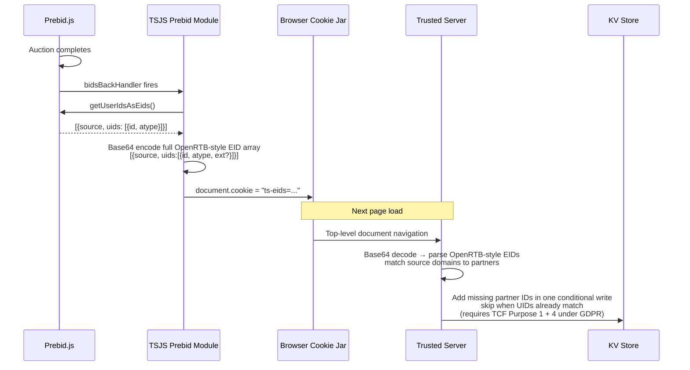

# Edge Cookies (EC)

Trusted Server persists a stable per-device identifier in a first-party
cookie on the publisher's domain. The cookie name is `ts-ec`. Trusted
Server also surfaces the current EC ID on the `x-ts-ec` response
header, and strips that header when the consent evaluation does not
permit EC use.

## Policy Posture

Trusted Server is technology. It is neutral on policy. The Edge Cookie
gives the deployer a cookie slot and configuration over the surrounding
attributes. The deployer determines the policy posture based on the
laws and contractual arrangements that apply to their deployment.
Privacy outcomes follow from that configuration, not from the cookie
mechanism itself.

For full operational onboarding (partner configuration, batch sync, identify, and auction verification), use the [EC Setup Guide](/guide/ec-setup-guide).

## How They Work

EC IDs are generated on first request using HMAC-SHA256 over the
normalized client IP and a configured secret, with a short random
suffix appended. On subsequent requests the value is read from the
`ts-ec` cookie and reused.

**Format:** `64-hex-hmac`.`6-alphanumeric-suffix`

**IP normalization:** IPv4 addresses pass through unchanged. IPv6
addresses are masked to the /64 prefix before hashing, so a device
that rotates its interface identifier under Privacy Extensions still
maps to a stable base.

### Determinism and Stability

| Scenario                                                    | Result                                               |
| ----------------------------------------------------------- | ---------------------------------------------------- |
| Same client IP, same secret, no cookie                      | Same 64-hex base; fresh suffix each mint.            |
| Same client IP, same secret, existing cookie                | Existing cookie value reused; no fresh mint.         |
| Same client IP, different secret                            | Different 64-hex base. Useful for rotating identity. |
| Multiple clients behind shared NAT, same secret, no cookies | Same 64-hex base; the suffix distinguishes them.     |

### Request Lifecycle

The shared application creates a new EC record before issuing its cookie on an eligible publisher document navigation of any method, or an admitted same-origin `POST /_ts/api/v1/ec`. Document classification uses `Sec-Fetch-Dest: document` or, without Fetch Metadata, an `Accept` header naming `text/html`. Fastly and Axum retain navigation eligibility on HTML error documents and exclude redirect statuses 301, 302, 303, 307 and 308. A navigation returning `304 Not Modified` retains its lifecycle permission even without Content-Type, because it validates the cached document. Positive identity cookies remain restricted to eligible document and EC responses; core-generated EC, configured SharedID/companion and mirror expiries may accompany any already-finalized response, as described below. An EC ID collision on create retries with a fresh ID, up to five attempts, inside that request's one creation write. Integration proxies and `/auction` use an existing EC but never mint one. Partner identify and batch-sync routes also skip generation. `/auction` may conditionally save explicit body EIDs into an existing live record without issuing positive identity cookies. During pre-routing, Trusted Server builds consent from request-local cookies, headers, geolocation, and policy defaults; it does not load consent from a separate KV store. The document-navigation flow below shows the default with `ec.sliding_refresh = false`. When enabled on Fastly or Axum, eligible consented returning document visits renew the same EC with the configured `ec.max_age_days` lifetime; record retention does not change. See [Configuration Reference](/guide/configuration#configurable-ec-lifetime-and-sliding-expiration-proposal) for the proposal restrictions and record-state limits.

Creation also checks the client's TLS fingerprint where the runtime supplies a trusted one. Trusted Server reads JA4 only through EdgeZero (`ctx.ja4()`): Fastly fills it from the client TLS connection, and Axum only from a trusted proxy header: EdgeZero's protected CloudFront path (`CloudFront-Viewer-JA4-Fingerprint`), or the header named by `EDGEZERO__ADAPTER__JA4_HEADER` from peers in `EDGEZERO__ADAPTER__JA4_TRUSTED_PROXY_CIDRS`. EdgeZero discards a value that is not a well-formed JA4 fingerprint, so it counts as no JA4. Cloudflare fills `ctx.ja4()` from Bot Management, but Cloudflare has no EC record store yet: it creates no ECs, its EC route answers `501` before identity is read, and the rule does not run there. When the JA4's TLS client family contradicts the browser family the User-Agent claims, the request creates no EC under either `ec.browser_gate` rule. That covers a browser User-Agent over a non-browser TLS stack and a User-Agent of one browser engine over another engine's stack, such as a Firefox User-Agent with a Chromium JA4. The family comes from the JA4 cipher-suite hash (its middle section), matched against a short table of public FoxIO JA4+ entries in `crates/trusted-server-core/src/ec/ja4_family.rs`. The table names Chromium, Firefox and Safari, and one non-browser stack: Python's own default TLS context. It lists no Go entry and no other Python entry, because those cipher lists are a TLS library's defaults that every program built on the library sends, including scanning and corporate proxies, so Go clients and Python clients that replace the default context are not checked. A JA4 the table does not list, a missing JA4 and a User-Agent that claims no browser never block, and iOS browsers are only checked against non-browser stacks. A TLS-intercepting proxy in front of a reader replaces the reader's JA4 with its own, so a listed non-browser proxy stack blocks creation for its users. Set `ec.ja4_contradiction_exempt = "non_browser"` to exempt non-browser TLS stacks while a browser-engine mismatch still blocks, or `"all"` to exempt every contradiction (see [EC Configuration](/guide/configuration#ec-configuration)). Only JA4 section 1 is stored; the rule reads the full value in memory. A contradiction is not stored and does not change the stored `known_browser` flag, which still comes only from the known-browser allowlist and feeds analytics.



### Response Finalization

After routing, the shared identity app evaluates consent and cookie presence. HTML document navigations of any method and nonredirect status, cached-document `304` responses, and EC route responses retain identity cookies. Explicit consent withdrawal is the privacy exception: every participating lifecycle response expires the browser EC cookie, regardless of method, status or content type, while persisting its tombstone. The diagram shows the default eligible-response branches with sliding renewal disabled; creation must persist before cookie issuance.



When consent cannot be verified for the current request — for example, unknown jurisdiction or missing/undecodable consent signals in a regulated region — Trusted Server fails closed for EC use by stripping EC headers, but it does **not** treat that as authoritative revocation of an already-issued EC.

## Consent Model

EC creation is gated by jurisdiction. The server detects jurisdiction from geolocation data attached to the request and applies the corresponding consent rules. Live consent comes from request-local signals (`euconsent-v2`, `__gpp`, `__gpp_sid`, `us_privacy`, `Sec-GPC`) plus geolocation and policy defaults; there is no separate consent KV fallback.



- **GDPR**: Opt-in required. TCF Purpose 1 (store/access device) must be explicitly consented. Writing browser-supplied Prebid EIDs into the identity graph additionally requires TCF Purpose 4 (personalized ads); see [Prebid EID Flow](#prebid-eid-flow). Without Purpose 4, server-side pull sync is also skipped, so the EC ID is not sent to pull-sync partners.
- **US State**: Opt-out model with three-tier fallback — GPC always blocks, then TCF if a CMP uses it, then US Privacy string, then fail-closed.
- **Non-regulated**: EC always allowed.
- **Unknown**: Fail-closed when jurisdiction cannot be determined.

The shared record service selected by `ec.storage` is the EC lifecycle store. It holds identity graph state, source-domain keyed partner UIDs, a minimal consent snapshot used for EC entry metadata, withdrawal tombstones, and completion markers that prevent stale point-read misses from rewriting completed tombstones. A marker key records the original tombstone's validity bound and is ignored at or after that time, even if its KV row has not expired yet. If the clock is unusable, the marker is ignored and withdrawal falls back to a strong root-existence check; only a confirmed existing root can be written. This prevents a stale marker from suppressing withdrawal when an expired EC key is created again. With a healthy store, repeated withdrawal of an already tombstoned EC ID leaves the row unchanged instead of refreshing its 24-hour TTL. Consent interpretation for each request remains based on the live request signals listed above.

## Partner Sync Channels

Partner identities share the record's `ids` map, but their write permissions differ. Browser cookies and explicit auction-body EIDs only fill missing UIDs. Accepted batch-sync and provider updates can replace UIDs for sources they are authorized to write; unchanged updates may be no-ops.



### Prebid EID Flow

Browser-resolved Prebid EIDs reach the identity graph when Trusted Server finalizes an eligible document navigation or admitted EC POST. It collects matched partner UIDs from two request-local sources, applied in this order so that, when both carry the same partner, the later source's UID is the candidate offered to KV:

1. the `ts-eids` cookie,
2. the SharedID cookie.

Explicit `eids` in an `/auction` body also conditionally fill missing partner UIDs in an existing live record, subject to consent, source ownership and opt-outs. That write never creates or revives an identity. Cookie fallback on `/auction` remains read-only; cookie ingestion occurs on an eligible document navigation or admitted EC POST.

These Prebid EID writes follow the same consent rule as bidstream EID forwarding: when a TCF signal is present, Purpose 1 (store/access device) and Purpose 4 (personalized ads) must both be consented, and when GDPR applies without a TCF signal the writes are withheld. A user who consents to Purpose 1 but not Purpose 4 keeps their EC, but no EIDs from the request are persisted.



Current TSJS writers preserve the full OpenRTB-style `{source, uids:[...]}` shape in `ts-eids`. The server remains backward-compatible with earlier flattened `{source, id, atype}` cookies during rollout, but new cookies use the structured `uids[]` form.

The SharedID cookie follows a similar path but is written directly by Prebid's SharedID module rather than by TSJS. The server reads the cookie named by the `storage.name` of the `sharedId` entry in [`integrations.prebid.managed_user_ids`](./configuration.md), and reads the legacy `sharedId` cookie when no such entry has storage settings. With `storage.type = "html5"` there is no cookie to read. The ID is stored under the `pubcid.org` partner, the source Prebid sends it under, or under a `sharedid.org` partner when only that one is configured. A record that still holds it under `sharedid.org` is moved to `pubcid.org` on its next write, keeping any SharedID already stored under `pubcid.org`. Bidders receive it once, as source `pubcid.org` with `atype` 1, whichever of the record, the cookies or the `/auction` body carried it. A `_pubcid_optout` cookie keeps the SharedID out of the record and out of bid requests.

When Prebid stores the SharedID in a cookie (`storage.type` `cookie` or `cookie&html5`), a consented top-level navigation writes that cookie back from the EC record if the request carries none or a different value, so the stored SharedID wins. The cookie uses Prebid's `storage.name` and the EC cookie domain, is not `HttpOnly`, and is `Secure; SameSite=Lax` for one year. The response also keeps Prebid's `<name>_cst` consent-hash companion consistent, so Prebid does not rewrite the cookie from script; an unchanged cookie and companion get no `Set-Cookie`. Creation is always on with cookie storage: a consented navigation from a reader with no SharedID and no `_pubcid_optout` gets a random UUID, stored in the same navigation's page-load write (by the `sharedid` identity provider when one is configured, otherwise as a browser-ingested ID), so it adds no KV write. A stored SharedID always wins over a different cookie value, on both paths. With TCF Purpose 4 denied the cookies are left alone; with EC consent denied or `_pubcid_optout` present both are expired.

Browser EID record persistence runs on eligible HTML document navigations through the publisher proxy and admitted EC POSTs. Navigation eligibility is method-neutral and includes HTML error documents and cached-document `304` responses without Content-Type. These operations carry one record-write permit, consumed by finalization; redirect statuses 301, 302, 303, 307 and 308 lose that permit. The shared application captures `ts-eids` from the first matching cookie across all Cookie header fields, preserving split-header input. Withdrawal tombstones, after-response provider updates and explicit auction-body updates have separate write authority. Auction-body updates require an existing live row and use one conditional write without retry or resurrection. A newly minted EC is persisted with the eligible page-phase provider results before its cookie is issued; failed creation drops those results. Providers that need an existing EC wait for a later eligible request. See [Identity providers](/guide/configuration#identity-providers). Authenticated batch sync is a separate authoritative mapping-write channel.

Browser cookies do not carry a trustworthy value timestamp or sequence. Trusted Server therefore adds missing partner IDs but does not replace a different stored UID from a browser-supplied EID, even on later eligible requests. Pull- or push-enabled partners can replace that value through their authoritative synchronization path. A cookie-only partner retains the stored UID until an authoritative freshness rule is introduced or the EC row expires.

### EID Seeding and Prebid Bidstream Forwarding

EIDs can reach the EC identity graph from either server-side pull sync or browser-side Prebid sync. During a Prebid-routed auction, Trusted Server combines those stored IDs with any same-request EIDs from Prebid.js, applies consent gating, and forwards the merged set to Prebid Server as OpenRTB `user.eids`. Prebid Server then passes those EIDs downstream to demand partners in its OpenRTB requests.

```mermaid
sequenceDiagram
    participant B as Browser / Prebid.js
    participant TSJS as TSJS Prebid Module
    participant TS as Trusted Server
    participant KV as EC KV Identity Graph
    participant PS as Prebid Server
    participant DSP as Downstream Partners / DSPs

    alt Pull sync seeds partner UID
        TS->>DSP: Pull sync lookup on a page navigation<br/>(EC ID)
        DSP-->>TS: Partner UID for EC
        TS->>KV: Upsert ids[source_domain] = UID
    else Prebid sync seeds browser EIDs
        B->>B: Prebid User ID modules resolve IDs
        B->>TSJS: getUserIdsAsEids()
        TSJS->>B: Write ts-eids cookie<br/>Base64 OpenRTB-style EIDs (size-capped)
        B->>TS: Next eligible request with ts-eids
        TS->>KV: Add missing matched partner UIDs<br/>defer different stored values
    end

    Note over B,TS: Prebid-routed auction
    B->>B: getUserIdsAsEids() for current auction
    B->>TS: POST /auction<br/>adUnits + eids[] + ts-ec cookie
    TS->>KV: Resolve EC-backed source-domain IDs
    KV-->>TS: Stored partner UIDs
    TS->>KV: Conditionally save explicit request eids[] to the live record<br/>TCF Purpose 1 + 4 under GDPR; no cookie-only persistence
    TS->>TS: Convert stored UIDs to EIDs<br/>Merge + dedupe with request eids[]<br/>Apply consent gating
    TS->>PS: OpenRTB request<br/>user.eids = merged EID set
    PS->>DSP: OpenRTB bid request<br/>EIDs preserved for bidders
    DSP-->>PS: OpenRTB bid response
    PS-->>TS: OpenRTB seatbid response
    TS-->>B: Auction response + x-ts-eids header when available
```

The relevant OpenRTB structure forwarded to Prebid Server and downstream partners is:

```json
{
  "user": {
    "id": "<ec-id-when-forwarding-is-allowed>",
    "ext": {
      "eids": [
        {
          "source": "id5-sync.com",
          "uids": [
            {
              "id": "ID5-abc123",
              "atype": 1
            }
          ]
        },
        {
          "source": "liveramp.com",
          "uids": [
            {
              "id": "LR-xyz789",
              "atype": 3,
              "ext": {
                "rtiPartner": "idl"
              }
            }
          ]
        }
      ]
    }
  }
}
```

Server-resolved EIDs and current-request Prebid EIDs are deduplicated by `source + uid.id`. Browser-supplied EIDs from cookies and explicit auction bodies only fill partner UIDs missing from the record; a different stored UID is kept, as described in [Prebid EID Flow](#prebid-eid-flow).

### Pull Sync on Navigations

Pull sync runs as an identity provider after an eligible document or admitted EC response for an existing live EC. The shared client-eligibility policy gates dispatch; under the default `ec.browser_gate = "lenient"`, missing native JA4 or User-Agent alone does not deny identity, but a trusted JA4 that contradicts the User-Agent does. Freshly minted ECs wait for a later eligible request. Before it became a provider, it also ran after `/auction` responses. It uses the after-response budget (`identity_after_response_budget_ms`, shared with the other after-response providers), so a slow partner never delays the page; a partner that answers after the budget is not filled, where each pull used to wait up to 15 seconds for a first byte. Its result reaches the row in the follow-up write and is served from the next page load. Like other after-response lookups, it never creates a row. Browser EID ingestion (`ts-eids` and the SharedID cookie) still fills a pull-sync partner's source when it holds no UID, and batch sync still accepts the partner's mappings, as before. A source that already holds any live UID, including a browser-supplied or batch-synced one, is not pulled again; a source with no UID is pulled at most `pull_sync_rate_limit` times per hour per EC hash (the IP-derived part of the EC ID, so ECs from one IP share it). A source is also not pulled while the EC row has no room left for a UID of the longest length pull sync accepts, so a full row is not pulled for on every navigation; pulling resumes once pruning frees room. On Fastly that limit is enforced as a per-minute budget of at least one, so values below 60 behave like 60 per hour. At most `pull_sync_concurrency` partners are pulled per navigation (0 means no limit), unlike before, when every eligible partner was pulled in batches of that size; a partner past the cap is logged as `skipped_concurrency_cap`. The partner order rotates every hour, so partners past the cap still get turns. When every pull-sync source is already held and no configured provider runs after the response, the after-response phase makes no KV read. A configured after-response provider always runs, so an opt-out or a changed ID in its own cookies is noticed while its sources hold live UIDs.

The former `ts-ec-pull-complete` completeness marker is retired. An eligible document or EC response to a request that still carries it expires the leftover cookie. The marker used to let a returning navigation skip reading the EC row before the origin response when no auction, browser EID cookie or withdrawal needed it; that navigation now reads the row. With the default inline mode the read overlaps the origin fetch.

On every participating lifecycle response, explicit withdrawal expires `ts-ec` independently of method, status or content type, even when the tombstone cannot be written (KV unavailable, CAS retries exhausted, or an unreadable row). A failed authoritative withdrawal is logged; the EC and compatibility consent endpoints return `503` so the caller knows the row may still be live. Positive identity cookies remain restricted to eligible document and EC responses; the core-generated expiry exceptions below accompany revocation.

Core-generated expiry cookies for `ts-ec`, the configured SharedID cookie and its `_cst` companion, and `__Host-ts-eids-mirror` may accompany any response that already runs identity finalization (WB-1). Origin-supplied identity cookies are filtered on ineligible responses; positive identity cookies remain restricted to eligible document and EC responses. Every response carrying an expiry cookie is private and carries no shared-cache directives. Fastly asset-only streaming routes continue to skip identity finalization.

### EID Mirror Cookie

Trusted Server can mirror provider-written UIDs into a JavaScript-readable cookie so client-side code can use them. The mirror is off by default: a partner's UIDs are mirrored only when it sets both `bidstream_enabled = true` and `mirror_enabled = true`. Setting `mirror_enabled` without `bidstream_enabled` is rejected at startup and by `ts config push`.

- **Name**: `__Host-ts-eids-mirror`
- **Attributes**: `Path=/; Secure; SameSite=Lax; Max-Age=31536000` (an independent 365-day lifetime), host-only (no `Domain`) and not `HttpOnly`
- **Contents**: unpadded base64url JSON `{"v":1,"eids":[{"source":"ids.example.com","uids":[{"id":"...","atype":1,"exp":1767225600}]}]}`, partners in `[[ec.partners]]` order, at most 3584 bytes; UIDs that do not fit are left out
- **Expiry**: every mirrored UID carries `exp`, at most 30 days ahead. The cap is the start of the current UTC day plus 30 days: a UID with a stated expiry gets the earlier of that expiry and the cap, and a UID with no stated expiry gets the cap. A mirror whose UIDs all reach the cap stays the same within a UTC day, so an unchanged returning reader gets a mirror `Set-Cookie` at most once per UTC day; a changed record or a stated expiry falling during the day can change it again. The 10-digit `exp` adds about 17 bytes to each UID, so a mirror near the 3584-byte budget may hold fewer UIDs than it would without it; UIDs that do not fit are left out as before.
- **Clock**: the page-load write and the mirror share one request time, read only for a navigation with an eligible response. Other steps, such as provider lookups, read the clock separately. If the clock cannot be read, the navigation writes no identity record and neither sets nor re-sets the mirror from a live record; a missing or withdrawn record still expires it, and so can the consent rules below.
- **Contents source**: live UIDs written by an identity provider. Ownerless UIDs, from browser ingest, batch sync or legacy pull sync, are never mirrored.
- **Pull-sync UIDs**: pull sync writes provider-owned UIDs, so a pull-sync partner with `mirror_enabled = true` has its UIDs mirrored. Any script on the page can read them, and the cookie is sent on every same-origin request, including to the publisher origin. Leave `mirror_enabled` off for a partner whose UIDs must not reach the page; its UIDs still reach the bidstream when `bidstream_enabled` is set.
- **Vendor consent**: a source's UIDs are left out while the request's TCF string denies the `tcf_vendor_id` of any configured provider claiming that source, enabled or disabled, or while a provider excludes that source where GDPR applies and the visit is in a GDPR jurisdiction, as they are from the bidstream. They are also left out while a provider's own cookies on the request record an opt-out for that source, even before the row is cleared.
- **Updates** (best effort): eligible HTML document and EC responses may rebuild or expire the mirror. Any finalized response may carry a core-generated mirror expiry when EC/EID consent is missing. An eligible response also expires an existing mirror when no live provider UID qualifies. If rebuilding is unavailable, a denied vendor, GDPR exclusion or cookie opt-out can still expire a mirror containing that source, or an undecodable mirror while any mirrored partner is withheld. Browsers without a mirror never receive an expiring mirror cookie. Otherwise, a KV read failure leaves the mirror untouched, and a mirror that cannot be built is skipped without failing the response.

Readers must drop UIDs whose `exp` (Unix seconds) has passed and strip `exp` before using a UID. Every mirrored UID carries `exp`.

## Configuration

Configure EC settings in the `[ec]` section of `trusted-server.toml`. See the [Configuration Reference](/guide/configuration) for the full surface and environment variable overrides.

The shipped configuration carries a local-development passphrase, and
known placeholder values are rejected at startup with a settings load
error, because an HMAC computed with a known secret can be forged by
anyone who knows it. Replace the development passphrase before
running outside local development.

## What Goes in the Cookie

The EC value is the deterministic HMAC base plus a random suffix. It
contains no name, email, account identifier, or other field supplied
by the user. The value is written back as `Set-Cookie` only when the
consent evaluation permits EC creation for the detected jurisdiction.
See [GDPR Compliance](/guide/gdpr-compliance) for how signals are
interpreted.

The value passes a base64url-compatible allowlist. The cookie envelope
sets `Path=/`, `Secure`, `HttpOnly`, `SameSite=Lax`, and a `Max-Age`.
`Domain` is computed as `.{publisher.domain}`. The separate
`cookie_domain` setting applies only to non-EC cookies.

## Operational Notes

- Rotate the secret periodically. Rotation produces a new 64-hex base
  for subsequent mints.
- Watch the logs for cookie value rejections, which happen when a
  `ts-ec` cookie value carries characters outside the allowlist.

## Runtime Behavior Notes

- By default, returning requests with consent and an existing `ts-ec` do not refresh the EC cookie or KV TTL. With `ec.sliding_refresh = true`, eligible consented Fastly/Axum document visits renew the same EC with `ec.max_age_days`; record retention remains unchanged.
- Newly generated ECs receive `Set-Cookie: ts-ec=...`.
- When consent is blocked but not explicitly withdrawn, Trusted Server strips EC response headers for that request but leaves any existing `ts-ec` cookie intact; cookie expiry and tombstones happen only on explicit withdrawal.
- `/_ts/api/v1/identify` is read-oriented and returns identity enrichment for the authenticated partner. It computes `cluster_size` only when the EC entry does not already store one.
- `/_ts/api/v1/batch-sync` validates every input, groups valid mappings by normalized EC ID, and applies the last valid UID for each group once. Group outcomes still account for every original input; infrastructure failures reject the failing and remaining groups. Mapping timestamps remain required for API compatibility but do not order writes. See the [API Reference](/guide/api-reference) for the complete contract.
- Pull sync fills missing partner UIDs only. Existing partner UIDs are not periodically refreshed because EC entries no longer store per-partner sync timestamps.

## Next Steps

- Follow the [EC Setup Guide](/guide/ec-setup-guide)
- [Configuration Reference](/guide/configuration)
- [GDPR Compliance](/guide/gdpr-compliance) for consent signal handling
- Configure [Ad Serving](/guide/ad-serving)
- [Collective Sync](/guide/collective-sync) for cross-publisher data sharing details and diagrams
