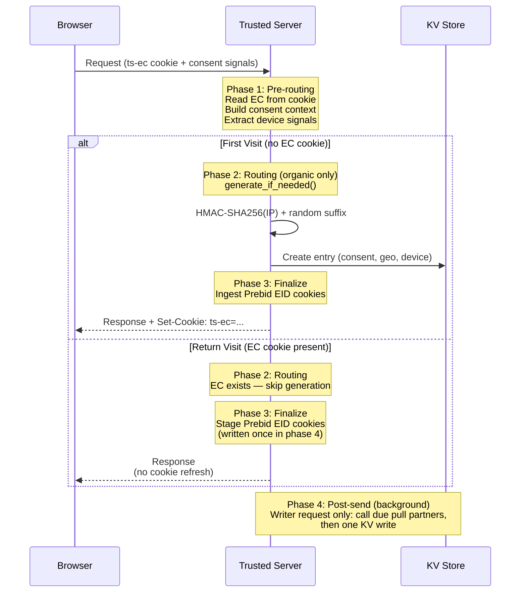
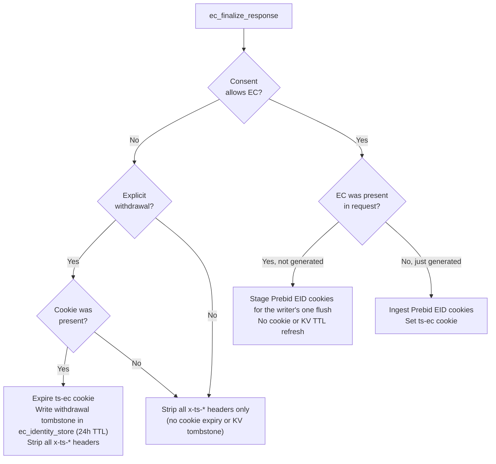
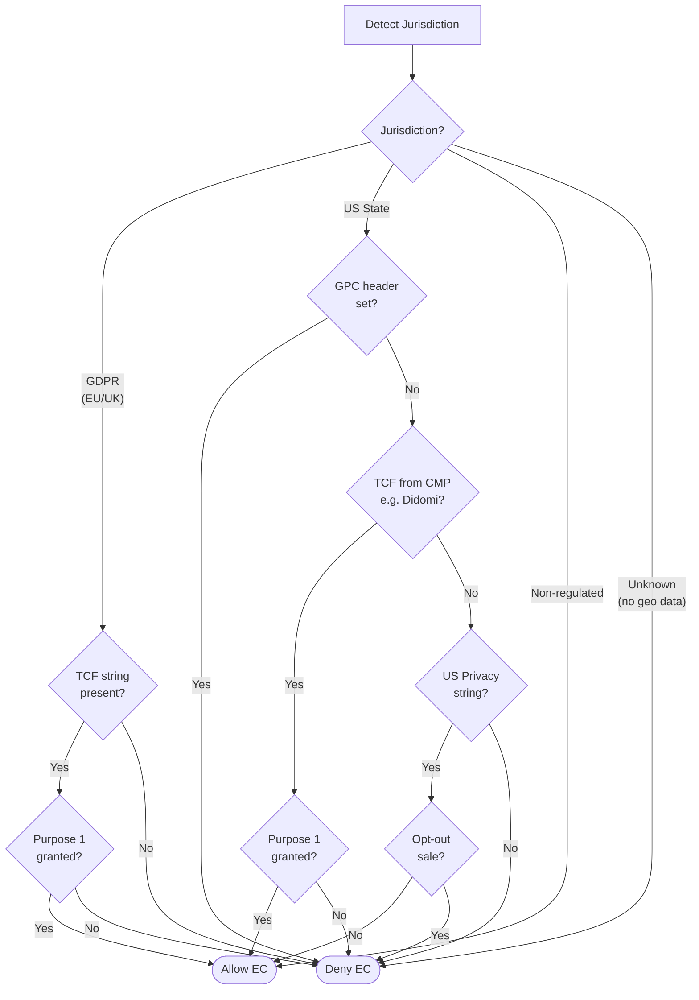
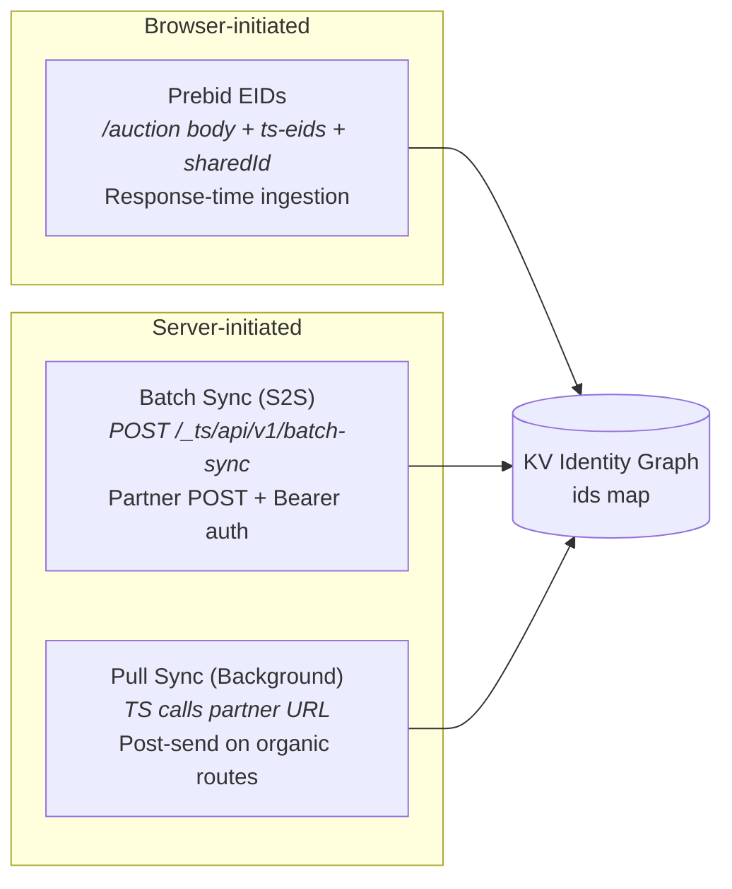
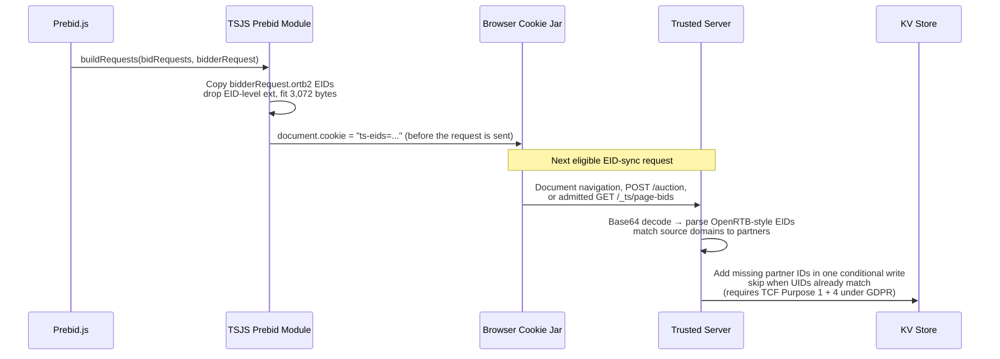
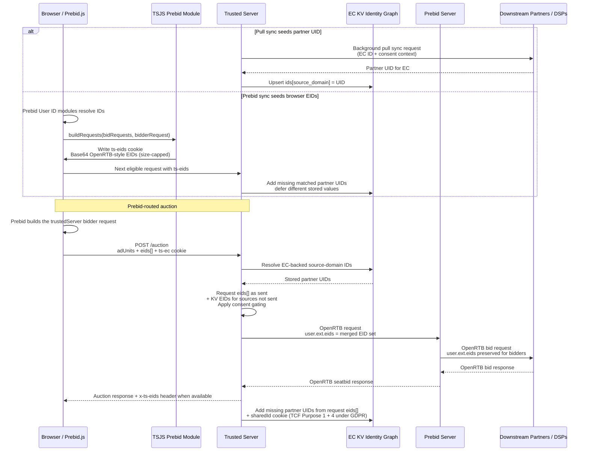

# Edge Cookies (EC)

Trusted Server persists a stable per-device identifier in a first-party
cookie on the publisher's domain. The cookie name is `ts-ec`. Trusted
Server also surfaces the current EC ID on the `x-ts-ec` response
header, and strips that header when the consent evaluation does not
permit EC use.

## Policy Posture

Trusted Server is technology. It is neutral on policy. The Edge Cookie
gives the deployer a cookie slot and configuration over the surrounding
attributes. The deployer determines the policy posture based on the
laws and contractual arrangements that apply to their deployment.
Privacy outcomes follow from that configuration, not from the cookie
mechanism itself.

For full operational onboarding (partner configuration, batch sync, identify, and auction verification), use the [EC Setup Guide](/guide/ec-setup-guide).

## How They Work

EC IDs are generated on first request using HMAC-SHA256 over the
normalized client IP and a configured secret, with a short random
suffix appended. On subsequent requests the value is read from the
`ts-ec` cookie and reused.

**Format:** `64-hex-hmac`.`6-alphanumeric-suffix`

**IP normalization:** IPv4 addresses pass through unchanged. IPv6
addresses are masked to the /64 prefix before hashing, so a device
that rotates its interface identifier under Privacy Extensions still
maps to a stable base.

### Determinism and Stability

| Scenario                                                    | Result                                               |
| ----------------------------------------------------------- | ---------------------------------------------------- |
| Same client IP, same secret, no cookie                      | Same 64-hex base; fresh suffix each mint.            |
| Same client IP, same secret, existing cookie                | Existing cookie value reused; no fresh mint.         |
| Same client IP, different secret                            | Different 64-hex base. Useful for rotating identity. |
| Multiple clients behind shared NAT, same secret, no cookies | Same 64-hex base; the suffix distinguishes them.     |

### Request Lifecycle

Every request passes through four phases. EC generation only happens on organic routes (publisher proxy, integration proxy, auction) — read-only endpoints like `/identify` and `/batch-sync` skip generation entirely. During pre-routing, Trusted Server builds consent from request-local cookies, headers, geolocation, and policy defaults; it does not load consent from a separate KV store.



### Response Finalization

After routing completes, the server evaluates consent state and cookie presence to decide what to do with the EC cookie on the response.



When consent cannot be verified for the current request — for example, unknown jurisdiction or missing/undecodable consent signals in a regulated region — Trusted Server fails closed for EC use by stripping EC headers, but it does **not** treat that as authoritative revocation of an already-issued EC.

## Consent Model

EC creation is gated by jurisdiction. The server detects jurisdiction from geolocation data attached to the request and applies the corresponding consent rules. Live consent comes from request-local signals (`euconsent-v2`, `__gpp`, `__gpp_sid`, `us_privacy`, `Sec-GPC`) plus geolocation and policy defaults; there is no separate consent KV fallback.



- **GDPR**: Opt-in required. TCF Purpose 1 (store/access device) must be explicitly consented. Writing browser-supplied Prebid EIDs into the identity graph additionally requires TCF Purpose 4 (personalized ads); see [Prebid EID Flow](#prebid-eid-flow). Without Purpose 4, server-side pull sync is also skipped, so the EC ID is not sent to pull-sync partners.
- **US State**: Opt-out model with three-tier fallback — GPC always blocks, then TCF if a CMP uses it, then US Privacy string, then fail-closed.
- **Non-regulated**: EC always allowed.
- **Unknown**: Fail-closed when jurisdiction cannot be determined.

The `ec_identity_store` KV store is the only EC lifecycle store. It holds identity graph state, source-domain keyed partner UIDs, a minimal consent snapshot used for EC entry metadata, withdrawal tombstones, and completion markers that prevent stale point-read misses from rewriting completed tombstones. A marker key records the original tombstone's validity bound and is ignored at or after that time, even if its KV row has not expired yet. If the clock is unusable, the marker is ignored and withdrawal falls back to a strong root-existence check; only a confirmed existing root can be written. This prevents a stale marker from suppressing withdrawal when an expired EC key is created again. With a healthy store, repeated withdrawal of an already tombstoned EC ID leaves the row unchanged instead of refreshing its 24-hour TTL. Consent interpretation for each request remains based on the live request signals listed above.

## Partner Sync Channels

Partner identities flow into the KV identity graph through three channels. Each writes to the same `ids` map in the KV entry via idempotent upsert logic: unchanged UIDs are accepted without a KV write, while different UIDs replace the stored value.



### Prebid EID Flow

Browser EIDs reach the identity graph when Trusted Server finalizes a
response. Which browser input it reads depends on the route:

- `POST /auction` reads only the client EIDs the auction itself used: its
  request body, or the `ts-eids` cookie when the body has none. An earlier
  page's cookie is never ingested next to a body.
- Publisher navigations, admitted `GET /_ts/page-bids` requests and newly
  generated ECs read the `ts-eids` cookie.
- Every route then applies the `sharedId` cookie last.

The TSJS Prebid adapter writes `ts-eids` in `buildRequests`, before each
`trustedServer` request is sent: the request's EIDs without EID-level `ext`,
trimmed to 3,072 bytes, as base64 of UTF-8 JSON. It clears the cookie when that
set is empty or when Prebid's TCF rules block `trustedServer`. Auctions that do
not include `trustedServer` leave it unchanged.

These Prebid EID writes follow the same consent rule as bidstream EID forwarding: when a TCF signal is present, Purpose 1 (store/access device) and Purpose 4 (personalized ads) must both be consented, and when GDPR applies without a TCF signal the writes are withheld. A user who consents to Purpose 1 but not Purpose 4 keeps their EC, but no EIDs from the request are persisted.



`ts-eids` holds OpenRTB-style `{source, uids:[...]}` entries, with `inserter`, `matcher` and `mm` when Prebid set them. The server validates each entry with the same rules as the `/auction` body and drops only what is malformed. Earlier flattened `{source, id, atype}` cookies are still accepted.

The `sharedId` cookie follows a similar path but is written directly by Prebid's SharedID module rather than by TSJS. The server reads it separately and maps it via the `sharedid.org` source domain.

Returning-user cookie persistence runs only on publisher document navigations, `POST /auction`, and admitted `GET /_ts/page-bids` SPA navigations. Static assets, analytics, integration requests, filter short circuits, and other subresources do not decode or persist these cookies. New EC creation remains eligible regardless of route because its backing row must include the request's initial IDs.

Each eligible request attempts at most one conditional cookie update. If another writer wins, Trusted Server reads the row once and does not write again from that request. A matching value completes the sync; an absent or different value is deferred.

Browser cookies and the `/auction` request body do not carry a trustworthy value timestamp or sequence. Trusted Server therefore adds missing partner IDs but does not replace a different stored UID from a browser-supplied EID, even on later eligible requests. Pull- or push-enabled partners can replace that value through their authoritative synchronization path. A cookie-only partner retains the stored UID until an authoritative freshness rule is introduced or the EC row expires.

### EID Seeding and Prebid Bidstream Forwarding

EIDs can reach the EC identity graph from either server-side pull sync or browser-side Prebid sync. During a Prebid-routed auction, Trusted Server combines those stored IDs with any same-request EIDs from Prebid.js, applies consent gating, and forwards the merged set to Prebid Server as OpenRTB `user.ext.eids`. Prebid Server then passes those EIDs downstream to demand partners in its OpenRTB requests.



The relevant OpenRTB structure forwarded to Prebid Server and downstream partners is:

```json
{
  "user": {
    "id": "<ec-id-when-forwarding-is-allowed>",
    "ext": {
      "eids": [
        {
          "source": "id5-sync.com",
          "uids": [
            {
              "id": "ID5-abc123",
              "atype": 1
            }
          ]
        },
        {
          "source": "liveramp.com",
          "uids": [
            {
              "id": "LR-xyz789",
              "atype": 3,
              "ext": {
                "rtiPartner": "idl"
              }
            }
          ]
        }
      ]
    }
  }
}
```

Browser EIDs are forwarded as sent; KV adds EIDs only for registered sources the browser did not send. Browser-supplied EIDs, from the `/auction` request body, the `ts-eids` cookie, or the `sharedId` cookie, only fill partner UIDs that are missing from KV; a different stored UID is kept, as described in [Prebid EID Flow](#prebid-eid-flow).

### One KV Write per EC-Bearing Request

At most one request per page view writes browser-driven identity changes to KV: a full page navigation from a returning visitor (a request that already carries a valid `ts-ec`). Every other route reads KV and stages its changes but never writes them:

- `/auction` and `/_ts/api/v1/identify` no longer write KV. `/_ts/page-bids` writes only as the single-page-app writer: a same-origin call from a real browser, at most once per `spa_writer_interval_sec` (300 seconds by default) since the row's last write, with browser EIDs and after-send providers only.
- The writer request collects every change from the page load: browser EIDs from the `ts-eids` and `sharedId` cookies, pull partner results and the cluster size. It sends the response first, then writes everything once, after send, with a generation check. A failed write is not retried as a whole.
- A new visitor's first request still creates the row before routing, as before.
- Two kinds of write are exempt because a withdrawal or removal must not be lost: the consent-withdrawal tombstone (with one more attempt after send when it fails before send), and a retry that writes only the removals of a failed flush.

Pull partners run in the same after-send step, from a visitor's second page load, because they need a returning visitor's row. A partner that fails backs off instead of being called on every request, and its pace is set by its `[ec.identity.providers.<pull-id>]` table (see the [Configuration Reference](/guide/configuration#identity-providers-ec-identity)).

The `ts-ec-pull-complete` completeness cookie no longer exists. Trusted Server neither sets nor reads it. A copy that a browser still holds is ignored and expires on its own within its one-hour `Max-Age`.

Each request also logs one `identity request measurement: ...` line after the response is sent. It carries the inbound `Cookie` header size in bytes, KV reads and writes labelled by route kind (`writer`, `stager` or `new_ec`), the flush outcome, the number of removals deferred to the pending key and of lost removals, and whether a withdrawal tombstone needed its after-send run and failed. It holds no EC ID, UID or cookie value. It replaces the `EID sync measurement: ...` line for returning visitors; that line is now logged only for a new EC.

### The `ts-eids-s` Mirror Cookie

`__Host-ts-eids-s` is a client-only mirror of the server-side IDs for page scripts. It is off by default; `[ec.identity] mirror_enabled = true` turns it on. The shim writes it from the `ext.ts_eids_s` member of `/auction` responses and the `ts_eids_s` member of `/_ts/page-bids` responses (see the [API Reference](/guide/api-reference)). The server never sets, reads or trusts it, and it strips it from requests to the origin and to Prebid Server.

- Attributes: `Path=/; Secure; SameSite=Lax`, no `Domain`, and not `HttpOnly`, because the shim writes it with `document.cookie`.
- Lifetime: a `Max-Age` of at most one day, and never past the earliest expiry of an ID it holds.
- Size: at most 2,048 bytes. When the IDs do not fit, whole sources are left out, lowest `cookie_priority` first, never part of a source.
- The shim now writes only registered (`[[ec.partners]]`) sources into `ts-eids`, and merges each auction's entries into the cookie per source instead of replacing it. A source an auction lacks stays in the cookie until it expires; a TCF block still clears it.

## Server-Side Identity Providers

Identity providers fetch or capture IDs on the server. Engineers who write one should read [Writing an Identity Provider](/guide/identity-providers). The sections below are for operators. Per-key reference is in the [Configuration Reference](/guide/configuration#identity-providers-ec-identity).

### Capture Provider Checklist

A capture provider reads responses that Trusted Server proxies for a vendor. A captured revocation, opt-out or clear is written to KV at once. A captured positive ID is counted in `capture_unpersisted`; when it comes from a browser whose consent allows the provider and differs from what KV holds, it is stored by the next writer navigation, through the `pending:<ec_id>` KV key. A removal whose KV writes all fail waits in the same key (`removal_deferred` on the measurement line) and is counted in `removal_lost` only when that key cannot take it either. Work through these steps before enabling one on a live service:

1. **Register every captured source.** Each source the provider declares has an `[[ec.partners]]` entry with `bidstream_enabled = true` and the right `openrtb_atype`.
2. **Move a source off pull sync first.** A source that is going to have an `owner` must not also have `pull_sync_enabled = true`. A pull-sync entry registers a generic pull provider that claims the source, and two providers cannot claim an owned source.
3. **Keep `sources` minimal.** The provider's `sources` list in `[ec.identity.providers.<id>]` holds only the sources it is the delivery path for. Its opt-out removes browser-ingested records of every source on the list, whoever produced them.
4. **Run the live acceptance check.** After a revocation is captured on a live page, look up the visitor's row with `GET /_ts/admin/ec` and confirm it shows the provider's `ps.o` and no record for the provider's sources. After the vendor issues again, confirm the row shows `ps.oc`, and that the next returning-visitor navigation ingests the source again. Use `GET /_ts/admin/eids` with the visitor's `ts-eids` cookie to preview what the browser would ingest. Read the `identity request measurement: ...` log line of the revocation request: `removal_lost` must stay at `0`, and `capture_unpersisted` shows the positive IDs a durable path would add.

### Revoke Scope

`revoke_scope` in `[ec.identity.providers.<id>]` decides how far a captured opt-out reaches. The default, `provider`, removes only that provider's records and, for a capture-only provider, the records of its listed sources that no provider wrote.

With `revoke_scope = "global"`, a captured opt-out runs the consent-withdrawal tombstone: the row is tombstoned, the `ts-ec` cookie is cleared, and everything is removed, provider opt-outs included. It also sets an `HttpOnly` `ts-ec-revoked` cookie holding a fingerprint of the visitor's consent (TCF purposes, US opt-outs and GPC). No new EC is minted while the visitor's consent matches it, so a CMP that still grants does not undo the revoke on the next page. Once the consent changes, the visitor starts again with a new EC and the marker is expired. Like a consent withdrawal, a captured removal or opt-out applies whatever the client, including one that fails the bot check. Only clearing an opt-out needs a real browser, because a clear re-enables IDs.

### Complete Provider EIDs

A provider can return more than one EID entry for a source, several UIDs per entry, and EID-level `inserter`, `matcher`, `mm` and `ext`. KV stores the whole set in the source's `eids` array, and the admin lookup (`GET /_ts/admin/ec`) shows it in the row's `ids` map, as stored (other row fields omitted):

```json
{
  "entry": {
    "ids": {
      "exampleid.example.com": {
        "w": "exampleid",
        "rv": "0123456789abcdef",
        "at": 1790000000,
        "eids": [
          {
            "uids": [
              { "id": "uid-a", "atype": 1, "ext": { "kind": "a" } },
              { "id": "uid-b" }
            ],
            "inserter": "exampleid.example.com",
            "matcher": "exampleid.example.com",
            "mm": 2
          },
          { "uids": [{ "id": "uid-c" }], "ext": { "segment": "x" } }
        ]
      }
    }
  }
}
```

Bidders receive the entries in that order, after the browser's entries. An entry that sets none of `inserter`, `matcher` and `mm` gets the provider's configured defaults at output. The `ext` data is stored only in KV and reaches bidders, `x-ts-eids` and the `__Host-ts-eids-s` mirror under the same consent gates as the UIDs. The mirror can be read by every script on the page.

`GET /_ts/api/v1/identify` is unchanged: it still returns one UID per source, the first UID of the first entry, with the partner's `openrtb_atype`.

### Rolling Back from Vendor Providers

To go back to the identity release without vendor providers:

1. Remove every `owner` key from `[[ec.partners]]` and every vendor `[ec.identity.providers.*]` table first, then push the config. The earlier release's validation rejects both. Pull-partner tables (`pull-...`) stay.
2. Deploy the earlier release.

After the rollback, multi-entry records stay readable but are not served while the provider that wrote them is not configured, and browser ingest may replace them. Each provider's `ps.o`, `ps.oc` and `ps.ov` (the opt-out, its clear and the removed-ID hashes) are kept, so opt-outs survive; the rest of its `ps` is pruned. Invalidated values can therefore be seeded once more, and stateful providers start over when rolled forward again.

Rolling back past the identity release is unsupported, because a release before it cannot read KV schema version 2.

## Configuration

Configure EC settings in the `[ec]` section of `trusted-server.toml`. See the [Configuration Reference](/guide/configuration) for the full surface and environment variable overrides.

The shipped configuration carries a local-development passphrase, and
known placeholder values are rejected at startup with a settings load
error, because an HMAC computed with a known secret can be forged by
anyone who knows it. Replace the development passphrase before
running outside local development.

## What Goes in the Cookie

The EC value is the deterministic HMAC base plus a random suffix. It
contains no name, email, account identifier, or other field supplied
by the user. The value is written back as `Set-Cookie` only when the
consent evaluation permits EC creation for the detected jurisdiction.
See [GDPR Compliance](/guide/gdpr-compliance) for how signals are
interpreted.

The value passes a base64url-compatible allowlist. The cookie envelope
sets `Path=/`, `Secure`, `HttpOnly`, `SameSite=Lax`, and a `Max-Age`.
`Domain` is computed as `.{publisher.domain}`. The separate
`cookie_domain` setting applies only to non-EC cookies.

## Cookies Forwarded to the Origin

`ts-ec` and `ts-eids` still reach the publisher origin. The
`__Host-ts-eids-s` mirror cookie does not: Trusted Server strips it from
the request before it forwards it, so the origin's `Cookie` header stays
the size it was before the mirror existed. An operator whose origin
rejects large `Cookie` headers can strip `ts-eids` as well with
`[ec] strip_eids_cookie_from_origin = true`. Prebid Server never receives
any Trusted Server identity cookie (`ts-ec`, `ts-eids`, or
`__Host-ts-eids-s`).

## Operational Notes

- Rotate the secret periodically. Rotation produces a new 64-hex base
  for subsequent mints.
- Watch the logs for cookie value rejections, which happen when a
  `ts-ec` cookie value carries characters outside the allowlist.

## Runtime Behavior Notes

- Returning requests with consent and an existing `ts-ec` do not refresh the EC cookie or KV TTL.
- Newly generated ECs receive `Set-Cookie: ts-ec=...`.
- When consent is blocked but not explicitly withdrawn, Trusted Server strips EC response headers for that request but leaves any existing `ts-ec` cookie intact; cookie expiry and tombstones happen only on explicit withdrawal.
- `/_ts/api/v1/identify` is read-oriented and returns identity enrichment for the authenticated partner. It computes `cluster_size` only when the EC entry does not already store one.
- `/_ts/api/v1/batch-sync` validates every input, groups valid mappings by normalized EC ID, and applies the last valid UID for each group once. Group outcomes still account for every original input; infrastructure failures reject the failing and remaining groups. Mapping timestamps remain required for API compatibility but do not order writes. See the [API Reference](/guide/api-reference) for the complete contract.
- Pull sync fills missing partner UIDs only, from a returning visitor's second page load. Existing partner UIDs are not periodically refreshed because EC entries no longer store per-partner sync timestamps.

## Next Steps

- Follow the [EC Setup Guide](/guide/ec-setup-guide)
- [Configuration Reference](/guide/configuration)
- [Writing an Identity Provider](/guide/identity-providers)
- [GDPR Compliance](/guide/gdpr-compliance) for consent signal handling
- Configure [Ad Serving](/guide/ad-serving)
- [Collective Sync](/guide/collective-sync) for cross-publisher data sharing details and diagrams
