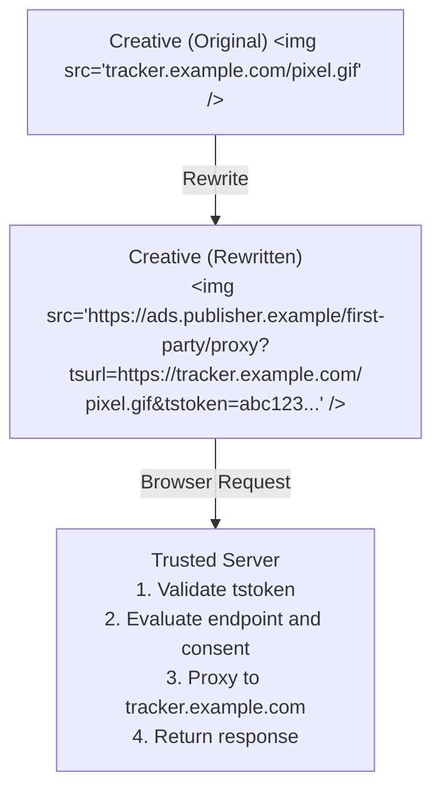

# First-Party Proxy

Learn how Trusted Server proxies third-party assets through first-party domains to give the deployer control over routing, security, and ad performance.

## Overview

The First-Party Proxy system rewrites third-party URLs in ad creatives to route through your domain, providing:

- **First-Party Routing** - Rewritten asset requests route through your domain
- **EC ID Disclosure** - Default-off, explicit endpoint grants
- **Creative Rewrites** - Automatic HTML/CSS URL transformation
- **Click Tracking** - First-party click redirects
- **Content Security** - Validated, signed URLs prevent tampering

## Generated URL authority

Routes remain path-based, but URLs emitted into rewritten creatives and
`/first-party/sign` or `/first-party/proxy-rebuild` responses are absolute on
`[publisher].public_origin`, for example
`https://ads.publisher.example/first-party/proxy?...`. Existing root-relative
signed proxy and click inputs remain accepted. The publisher SSAT/page-bids
path retains its explicit request-origin override. See
[public origin configuration](/guide/configuration#public_origin) for the default
authority, EC cookie scope, and coordinated upgrade/rollback warning.

## How It Works



## Core Endpoints

### `/first-party/proxy` - Signed Asset Proxy

Proxies third-party assets with automatic HTML/CSS rewriting.

For publisher-owned asset paths that should route directly to a configured origin without `tstoken`, use [Asset Routes](/guide/asset-routes). Asset routes support path-prefix matching, private S3 origins, and Fastly Image Optimizer profile tables.

**Request**:

```
GET /first-party/proxy?tsurl=https://example.com/ad.html&tstoken=signature
```

**Query Parameters**:
| Parameter | Required | Description |
|-----------|----------|-------------|
| `tsurl` | Yes | Base URL of the resource (without query params) |
| `tstoken` | Yes | HMAC-SHA256 signature of the full URL |
| `tsexp` | No | Unix timestamp expiration (30s default from signing) |
| _(others)_ | No | Original query parameters from target URL |

**Behavior**:

1. **Validates** the `tstoken` signature and fetch allowlist
2. **Evaluates** the current identity-endpoint policy before every upstream send.
   Removes reserved `ts-ec` query parameters unless the destination matches an
   explicit rule and a canonical existing cookie EC has current-request consent.
3. **Proxies** with fixed `User-Agent: TrustedServer/1.0`, client `Accept` and
   `Accept-Language` when valid/present, and supported normalized
   `Accept-Encoding`. Browser cookies, authorization, referrer, client IP, and
   other browser headers are not forwarded.
4. **Processes** response based on content type:
   - **HTML** (`text/html`) - Rewrites all URLs, returns `text/html`
   - **CSS** (`text/css`) - Rewrites `url()` values, returns `text/css`
   - **Images** - Detects pixels, sets `application/octet-stream` if missing
   - **Other** - Passthrough without modification

**Example**:

Original URL:

```
https://tracker.example.com/pixel.gif?campaign=123&uid=abc
```

Signed proxy URL:

```
https://ads.publisher.example/first-party/proxy?
  tsurl=https://tracker.example.com/pixel.gif&
  campaign=123&
  uid=abc&
  tstoken=HmacSha256Signature
```

Final proxied request with the default empty identity policy:

```
https://tracker.example.com/pixel.gif?campaign=123&uid=abc
```

### `/first-party/click` - Click Redirects

Handles click tracking with first-party redirects.

**Request**:

```
GET /first-party/click?tsurl=https://advertiser.example.com/landing&tstoken=signature
```

**Query Parameters**: Same as `/first-party/proxy`

**Behavior**:

1. **Validates** the `tstoken` signature
2. **Appends** the existing EC ID as `ts-ec` when available
3. **Issues** 302 redirect to target (browser navigates directly)
4. **Logs** click metadata:
   - Target URL base (`tsurl`)
   - Whether parameters were present
   - Full reconstructed URL
   - Referer, User-Agent
   - EC ID (if available)

**Example**:

Click URL in creative:

```html
<a
  href="https://ads.publisher.example/first-party/click?
  tsurl=https://advertiser.example.com/buy&
  product=widget&
  tstoken=signature"
>
  Buy Now
</a>
```

User clicks → Server responds:

```
HTTP/1.1 302 Found
Location: https://advertiser.example.com/buy?product=widget&ts-ec=xyz
```

::: tip Click vs Proxy
Use `/first-party/click` for navigational links (anchors) since it avoids downloading content. Use `/first-party/proxy` for embedded resources (images, scripts, iframes) that need to be rendered inline.
:::

### `/first-party/sign` - URL Signing

Generates signed proxy URLs for dynamic use cases. Before signing, Trusted Server checks the parsed target host against `proxy.allowed_domains`. Protocol-relative targets inherit the signing request's scheme before this check.

**Request (GET)**:

```
GET /first-party/sign?url=https://example.com/resource.jpg
```

**Request (POST)**:

```json
POST /first-party/sign
{
  "url": "https://example.com/resource.jpg?param=value"
}
```

**Response**:

```json
{
  "href": "https://ads.publisher.example/first-party/proxy?tsurl=https://example.com/resource.jpg&param=value&tstoken=signature&tsexp=1234567890",
  "base": "https://example.com/resource.jpg"
}
```

**Response Fields**:
| Field | Description |
|-------|-------------|
| `href` | Complete signed proxy URL ready to use |
| `base` | Original base URL (without query parameters) |

A host excluded by `rewrite.exclude_domains`, or outside a non-empty `rewrite.include_domains`, returns `502`. The creative runtime treats it as a non-policy failure and loads the URL directly. These checks run before `proxy.allowed_domains`.

A valid host outside a non-empty allowlist returns `403 Forbidden`. The creative runtime treats this response as a policy rejection and does not assign the attempted raw image or iframe URL. Network failures, malformed success responses, and non-403 errors keep the existing direct-load fallback. An empty allowlist permits every valid host.

This blocked-assignment behavior applies when the runtime intercepts a `src` setter or `setAttribute` call before native assignment. Markup inserted through `innerHTML` or `document.write` may begin a native load before the `MutationObserver` requests a signature. A later `403` does not retract that existing attribute.

**Expiration**:

- Default: 30 seconds from signing
- `tsexp` parameter included in signed URL
- Validation fails after expiration

**Example Usage**:

```javascript
// Client-side JavaScript dynamically signing URLs
fetch('/first-party/sign?url=' + encodeURIComponent(imageUrl))
  .then((r) => r.json())
  .then((data) => {
    img.src = data.href // Use signed URL
  })
```

### `/first-party/proxy-rebuild` - URL Modification

Re-signs an existing signed click URL after creative script adds or removes
query parameters. The original `tstoken` is validated before any change is
applied, and `tsurl`, `tstoken`, and `tsexp` may never be added or deleted.

JSON POST, GET navigation, and form-encoded POST navigation are supported,
differing only in transport and response.

**POST (JSON) — used by the click guard on a same-origin page**:

```
POST /first-party/proxy-rebuild
Content-Type: application/json

{
  "tsclick": "/first-party/click?tsurl=https%3A%2F%2Fexample.com&product=A&tstoken=sig1",
  "add": { "variant": "red" },
  "del": ["product"]
}
```

| Field     | Required | Description                                              |
| --------- | -------- | -------------------------------------------------------- |
| `tsclick` | Yes      | The signed click URL, root-relative or absolute          |
| `add`     | No       | Object of parameters to add; keys must not already exist |
| `del`     | No       | Array of parameter names to remove                       |

Responds `200` with the rebuilt URL and diagnostics:

```json
{
  "href": "https://ads.publisher.example/first-party/click?tsurl=https%3A%2F%2Fexample.com&variant=red&tstoken=sig2",
  "base": "https://example.com",
  "added": { "variant": "red" },
  "removed": ["product"]
}
```

**GET (query) — navigation recovery from an opaque-origin creative frame**:

```
GET /first-party/proxy-rebuild?tsclick=<url-encoded click>&add=<JSON object>&del=<JSON array>
```

| Parameter | Required | Description                                       |
| --------- | -------- | ------------------------------------------------- |
| `tsclick` | Yes      | URL-encoded signed click URL (not base64)         |
| `add`     | No       | URL-encoded JSON object, e.g. `{"variant":"red"}` |
| `del`     | No       | URL-encoded JSON array, e.g. `["product"]`        |

Responds `302` with the absolute rebuilt click URL in `Location`, on
`publisher.public_origin` or its `https://{publisher.domain}` fallback, with
`Cache-Control: no-store, private`. The browser continues to
`/first-party/click`, which then redirects to the advertiser.

**Form-encoded POST (navigation, no URL length limit)**: a `POST` carrying
`Content-Type: application/x-www-form-urlencoded` with the same fields is also
treated as a navigation and answered with the `302`. The click guard uses it
when the GET URL would exceed the platform's request-URL limit (Fastly Compute
rejects request URLs over 8192 bytes before the handler runs), which a long
signed click can do once nested inside another query string.

Creative iframes are sandboxed without `allow-same-origin`, giving them an
opaque origin whose `fetch` to this endpoint is cross-origin (`Origin: null`)
and blocked by CORS. The navigation forms exist for that case: navigations are not
subject to CORS, so the click guard navigates instead of fetching. Both forms
apply identical validation.

::: warning Use Cases
This endpoint is designed for advanced scenarios like A/B testing where you need to modify URLs without re-signing from scratch. Most implementations won't need this.
:::

## URL Signing & Validation

Trusted Server signs proxy and click URLs using the publisher `proxy_secret`. Signed URLs include a `tstoken` and may include `tsexp` for expiration.

For the detailed signing algorithm, validation steps, and security notes, see [Proxy Signing](/guide/proxy-signing).

## Content Type Handling

### HTML Rewriting

**Triggers**: Response `Content-Type: text/html`

**Process**:

1. Parse HTML with streaming processor
2. Rewrite absolute URLs to `/first-party/proxy` or `/first-party/click`
3. Preserve relative URLs unchanged
4. Sign all rewritten URLs with `tstoken`
5. Return as `text/html; charset=utf-8`

**Rewritten Elements**: See [Creative Processing](/guide/creative-processing) for full list.

### CSS Rewriting

**Triggers**: Response `Content-Type: text/css`

**Process**:

1. Parse CSS for `url(...)` values
2. Rewrite absolute URLs to `/first-party/proxy`
3. Sign URLs with `tstoken`
4. Return as `text/css; charset=utf-8`

**Example**:

```css
/* Original */
.banner {
  background: url(https://cdn.example.com/bg.jpg);
}

/* Rewritten */
.banner {
  background: url(https://ads.publisher.example/first-party/proxy?tsurl=https://cdn.example.com/bg.jpg&tstoken=sig);
}
```

### Image Handling

**Triggers**:

- Response `Content-Type` starts with `image/`, OR
- Request `Accept` header contains `image/`

**Process**:

1. Set `Content-Type: application/octet-stream` if missing
2. Detect likely pixels with heuristics:
   - `Content-Length` ≤ 256 bytes
   - URL contains `/pixel`, `/p.gif`, `/1x1`, `/track`
3. Log pixel detection (no response alteration)
4. Passthrough image data

**Logging**:

```
proxy: likely pixel detected size=43
```

### Passthrough (Other Types)

**Triggers**: Any other `Content-Type`

**Process**:

- Forward response without modification
- Preserve original `Content-Type`
- No HTML/CSS/URL rewriting
- Useful for: JSON, JavaScript, binary files, etc.

## Redirect Handling

The proxy automatically follows HTTP redirects:

**Supported Status Codes**:

- `301` - Moved Permanently
- `302` - Found
- `303` - See Other (switches to GET)
- `307` - Temporary Redirect
- `308` - Permanent Redirect

**Behavior**:

1. Follow up to **4 redirect hops** through EdgeZero's redirect follower,
   checking fetch permission before each send.
2. Check each redirect target before it is followed. A non-HTTPS target on a
   route that requires HTTPS fails with `403`, a target without a host fails
   with `502`, and a host outside `proxy.allowed_domains` fails with `403`. A
   target whose scheme is neither `http` nor `https` is not followed, and its
   redirect response is returned.
3. Independently re-evaluate each destination's identity grant; permission for
   one recipient does not authorize the next.
4. Remove carried or echoed reserved EC parameters and append exactly one
   authorized EC only when the next destination and current request qualify.
5. Send `301`, `302`, and `303` hops as a bodiless `GET` (a `HEAD` stays
   `HEAD`); `307` and `308` keep the method and body. A `301` or `302` that
   answers a method other than `GET`, `HEAD`, or `POST` is returned, not
   followed. Every hop sends the same approved headers.
6. Give each hop the request's own timeout, 15 s for a buffered response or 60 s
   for a streamed one, and the whole chain a 60 s deadline.
7. Strip `Authorization` and `Cookie` on a hop to another origin.
8. Fail a `Location` that carries userinfo with `502 Bad Gateway`.
9. Log each hop at `debug` without its query, and log a warning when a redirect
   response is returned instead of followed.
10. On the creative route, reject any terminal 3xx carrying `Location` with
    `502`, without exposing that header to the browser. This includes exhausted
    limits and redirect responses returned instead of followed.

Creative targets containing URL credentials are rejected. A 3xx without
`Location` is returned without creating a browser navigation. Click redirects
retain their separate existing navigation behavior.

## EC ID Disclosure

### Default-off endpoint grants

An empty or omitted `proxy.identity_endpoints` grants no EC disclosure. Images,
CSS, scripts, and iframe HTML receive no automatic EC merely because they are
proxied. File extensions and pixel detection do not grant identity. Fetch
permission remains separate: empty `allowed_domains` permits valid hosts, while
empty `identity_endpoints` denies identity everywhere.

Configure only reviewed HTTPS origin/path destinations:

```toml
# Default off: leave these entries absent until explicitly approved.
# [[proxy.identity_endpoints]]
# id = "impression-delivery"
# origin = "https://measurement.example.com"
# path_exact = "/events/impression"
#
# [[proxy.identity_endpoints]]
# id = "identity-api"
# origin = "https://identity.example.com"
# path_prefix = "/v1/identity/"
```

A matching endpoint still needs fetch permission. It always bypasses the
platform's upstream cache, including when identity is missing or withheld, so
an event is still fetched without EC. Once any hop visits an identity endpoint,
the final response is `Cache-Control: private, no-store`, including subsequent
resource hops and failures. All creative-route errors are private/no-store.

### Existing cookie and current consent

Disclosure requires a canonical valid existing `ts-ec` cookie, unexpired consent,
no GPC, and both the existing jurisdiction-based EC creation decision and EID
persistence decision. When TCF applies, effective Purpose 1 and Purpose 4 must
permit persistence after signal conflict handling. Unknown jurisdiction, required
missing/undecodable signals, undecoded TCF in proxy mode, explicit opt-out,
expiry, denied Purpose 4, or GPC withhold EC. Known non-regulated requests
without signals follow the existing creation/persistence decisions.

The creative proxy ignores raw `x-ts-ec`, never falls back to it, and does not
generate missing identity, refresh cookies, or perform identity-store I/O for
this disclosure decision. Existing adapter-owned withdrawal and marker
finalization remains authoritative; for example, Fastly may expire TS cookies
or tombstone a withdrawn record. Withholding alone does not delete a retained EC.

### Reserved query parameters

At every send, all reserved `ts-ec` pairs are removed, including values already
in the signed URL or echoed in a redirect. A matching, eligible request receives
exactly one canonical value. Query keys are percent-decoded once for reserved
matching: `ts%2Dec` is reserved, `TS-EC` is different, and nested encoding is not
recursively decoded. Unrelated query components are preserved at the authenticated
reconstructed-target/redirect boundary; signing may already have normalized the
initial query. A vendor signature covering a stripped EC parameter can break;
retaining forbidden EC is not a compatibility workaround.

### Click ID forwarding

`/first-party/click` and click rebuild retain their existing identity, signing,
navigation, and no-store behavior. Endpoint grants affect creative fetches only;
they do not enable query EC on managed integration assets or change intentional
identity in integration payloads.

## Configuration

### Publisher Settings

Configure proxy behavior in `trusted-server.toml`:

```toml
[publisher]
domain = "publisher.example"
cookie_domain = ".publisher.example"
origin_url = "https://origin.publisher.example"
proxy_secret = "publisher_proxy_secret"
```

`proxy_secret` is the key name in the Trusted Server secret store. Provision a
high-entropy value of at least 32 characters under `publisher_proxy_secret`.

### Asset Routes

Use `[[proxy.asset_routes]]` when a first-party path prefix should proxy directly to another asset origin.

```toml
[[proxy.asset_routes]]
prefix = "/assets/"
origin_url = "https://assets.example.com"
```

Asset routes are intended for publisher-owned paths, not third-party creative URLs. They support optional path rewrites, private S3 origin signing, and Fastly Image Optimizer metadata. See [Asset Routes](/guide/asset-routes) for full configuration and operational guidance.

### Proxy Allowlist

Restrict target hosts for signing and proxy fetching via the `[proxy]` section:

```toml
[proxy]
allowed_domains = [
  "assets.example.com",  # Exact match
  "*.cdn.example.com",   # Wildcard: cdn.example.com and all subdomains
]
```

**Semantics**: Trusted Server checks `allowed_domains` before `/first-party/sign` mints a token, before `/first-party/proxy` fetches the initial target, and before it follows each HTTP redirect (301/302/303/307/308). If the parsed target host does not match a pattern, Trusted Server blocks the operation with a 403 error.

**Wildcard matching**:

| Pattern              | Matches                                                            | Does not match           |
| -------------------- | ------------------------------------------------------------------ | ------------------------ |
| `assets.example.com` | `assets.example.com`                                               | `sub.assets.example.com` |
| `*.cdn.example.com`  | `cdn.example.com`, `static.cdn.example.com`, `a.b.cdn.example.com` | `evil-cdn.example.com`   |

- The `*` prefix matches the base domain and any subdomain at any depth.
- Matching is case-insensitive; entries are normalized to lowercase on startup.
- The wildcard requires a dot boundary. `*.example.com` does **not** match `evil-example.com`.
- A bare `"*"` entry is **not** valid and will be removed at startup with a warning. Use an empty list for open mode.

:::note Unicode / Internationalized Domain Names
Matching uses ASCII case-folding (`to_ascii_lowercase`). Internationalized domain names in Punycode form, such as `xn--bcher-kva.example.com`, are matched literally. The Unicode label and its Punycode equivalent are different strings, so add the Punycode form to `allowed_domains` when needed.
:::

**Default behavior**: When `allowed_domains` is omitted or empty, every valid host is permitted for signing, the initial fetch, and redirects. This default exists for development convenience and **must be overridden in production**.

::: danger Production Recommendation
Always set `allowed_domains` explicitly in production deployments. Without an allowlist, clients can sign and fetch valid URLs for arbitrary hosts, including redirect targets.

```toml
[proxy]
allowed_domains = [
  "assets.example.com",
  "*.cdn.example.com",
]
```

:::

### URL Rewrite Host Lists

Exclude specific domains from rewriting:

```toml
[rewrite]
exclude_domains = [
  "*.cdn.example.com",      # Wildcard pattern
  "first-party.example.com" # Exact match
]
```

URLs matching these patterns will NOT be rewritten to `/first-party/proxy`.

Limit asset rewriting to listed hosts:

```toml
[rewrite]
include_domains = ["assets.example.com", "*.img.example.com"]
```

When `include_domains` is non-empty, only asset URLs on matching hosts are
rewritten. `exclude_domains` wins when a host matches both lists, and
click-through links ignore `include_domains`.

### Streaming vs Buffered

Control whether responses are streamed or buffered:

```rust
// Integration code example
ProxyRequestConfig::new(url)
    .with_streaming()
```

**Streaming** (buffered rewrites disabled):

- Preserves origin compression (gzip/brotli)
- Lower memory usage
- No HTML/CSS URL rewriting
- Best for: large files, images, videos

**Buffered** (default):

- Enables HTML/CSS rewriting
- Decompresses response
- Higher memory usage
- Best for: ad creatives, landing pages

## Performance Optimization

### Compression

**Buffered Mode**:

- Decompresses origin response
- Processes content
- Returns uncompressed (Fastly can re-compress)

**Streaming Mode**:

- Preserves origin `Content-Encoding`
- No decompression/recompression overhead
- Passes through gzip/brotli/deflate

### Caching

Unmatched resources use the platform-default upstream cache policy and preserve
origin cache policy, including `Vary`, private/no-store directives, and applicable
validators. Identical static URLs across readers allow ordinary cache sharing,
but do not guarantee it: origin freshness, `Vary`, response headers, and platform
behavior still determine cacheability. The proxy does not force public caching.

Every identity-endpoint send uses upstream bypass, even without EC. Once visited,
the chain's final response remains private/no-store; validators, expiry/age, and
edge-cache directives are removed, and terminal privacy is reasserted after late
response-header changes. This cannot control caching or deduplication inside the
recipient's own service.

### Header Forwarding

Creative fetches use the same fixed resource profile on every hop:

| Header                                              | Behavior                          |
| --------------------------------------------------- | --------------------------------- |
| `User-Agent`                                        | Fixed `TrustedServer/1.0`         |
| `Accept`, `Accept-Language`                         | Valid client values when present  |
| `Accept-Encoding`                                   | Supported normalized encoding set |
| `Cookie`, `Authorization`, `x-ts-ec`                | Never forwarded                   |
| `Referer`, `X-Forwarded-For`, other browser headers | Never forwarded                   |

Origins depending on browser UA, referrer, or client IP need migration testing.
This profile does not promise anonymity: negotiation headers and vendor identity
already present elsewhere in a URL may identify a reader. Creative responses
strip upstream `Set-Cookie`, `Strict-Transport-Security`, `Clear-Site-Data`, and
CORS grants. An identity rule does not enable CORS. A separate stricter readable
asset capability is future work under #982; it is not part of this policy.

## Error Handling

### Common Errors

**Invalid Signature**:

```
HTTP 403 Forbidden
Forbidden: invalid tstoken
```

**Solutions**:

- Verify `proxy_secret` matches signing configuration
- Check URL reconstruction includes all parameters in correct order
- Ensure no URL encoding issues

**Expired URL**:

```
HTTP 502 Bad Gateway
tstoken expired
```

**Solutions**:

- URLs signed with `/first-party/sign` expire in 30s
- Re-sign URL if needed
- Check client/server clock sync

**Missing Parameters**:

```
HTTP 400 Bad Request
Missing required parameter: tsurl
```

**Solutions**:

- Ensure `tsurl` parameter is present
- Include `tstoken` in request
- Verify URL encoding is correct

### Redirect Limit

A terminal 3xx with `Location`, including one left after the four-hop limit,
returns `502` with private/no-store and no browser redirect. The proxy logs
`returning an unfollowed redirect response: LimitReached` when the limit stops
the chain. Reduce the origin's redirect chain and check every destination's
fetch permission.

## Inspect policy and migrate

Use inventory URLs to inspect the effective policy without sending a request:

```bash
ts config proxy explain https://measurement.example.com/events/impression --json --app-config trusted-server.toml --manifest edgezero.toml --no-env
```

`--app-config` chooses the local file; otherwise `<app.name>.toml` is resolved
beside `--manifest` (default `edgezero.toml`). Environment overlays apply unless
`--no-env` is set, using the existing app-config loader semantics. Explain shares
the runtime evaluator and performs no URL fetch, writes, or publication. It takes
no EC or consent cookie; `identity_eligibility: "conditional"` means a rule
matches, not that any reader has consent. JSON version 1 reports fetch permission,
rule ID, identity eligibility, headers, upstream/downstream cache policy, and
redirect handling without echoing URL queries/fragments. Allowed and blocked
decisions exit 0; malformed input or invalid configuration exits nonzero.

Validate reviewed grants with `ts config validate` before publishing them.
Audit observations are advisory and never automatically create identity grants.
See [identity endpoint configuration](/guide/configuration#proxyidentity_endpoints)
for matching and validation rules.

Deploy new binaries first, then publish endpoint configuration. An old config
immediately receives default-off disclosure and the new header/redirect behavior
on a new binary. Empty endpoint lists are omitted from stored JSON; older
binaries reject a nonempty field. The binary-first interval withholds identity;
use a separately configured blue/green service if that gap is unacceptable.
Avoid mixing different disclosure behavior in one traffic pool.

For rollback, first publish an old-compatible config without the field, then
roll back binaries. An old binary restores the old forwarding/header behavior,
which is a privacy regression requiring an operator decision.

Previously signed URLs reaching TS use the current policy on every fetch; removing
a rule revokes future EC disclosure without re-signing. Purge relevant shared
cache entries at activation where cached responses could skip evaluation. Server
changes cannot retract browser-held responses; bound rollout expectations by
existing TTLs. Immediate reevaluation needs a separately reviewed signed-URL
version/cache-busting transition.

## Security Considerations

### Token Security

**Do**:
✅ Use cryptographically strong `proxy_secret` (32+ bytes random)  
✅ Rotate secrets periodically  
✅ Validate expiration on all requests  
✅ Use constant-time comparison for signatures

**Don't**:
❌ Expose `proxy_secret` in client-side code  
❌ Reuse secrets across environments  
❌ Accept unsigned URLs  
❌ Skip validation for "trusted" domains

### URL Injection Prevention

Signed URLs prevent injection attacks:

```
Attacker tries:
  /first-party/proxy?tsurl=https%3A%2F%2Funtrusted.example.com&tstoken=forged

Trusted Server:
  1. Computes expected token for https://untrusted.example.com
  2. Compares with provided token
  3. Rejects if mismatch (403 Forbidden)
```

### Content Security

**Automatic Protection**:

- HTML/CSS rewriting routes URLs through signed first-party endpoints
- Data URIs are skipped (`data:`, `javascript:`, `blob:`)
- Protocol validation (only `http://` and `https://`)

**Considerations**:

- Origin content is still served (validate trusted sources)
- Streaming mode bypasses HTML inspection
- Enable CSP headers for additional protection

## Monitoring & Debugging

### Logging

Creative policy diagnostics use endpoint ID, normalized origin/path, and decision
reason. They omit EC, cookies, query strings, and complete final URLs. This is a
creative-route logging boundary, not repository-wide log redaction.

### Diagnostic Headers

Add custom headers for debugging:

```toml
[response_headers]
X-Proxy-Mode = "rewrite"
X-Debug-Build = "canary"
```

### Metrics to Track

**Key Metrics**:

- Proxy request count (total)
- Signature validation failures (rate)
- Redirect hops (average/max)
- Response time (p50/p95/p99)
- Content type distribution
- Pixel detection rate

## Next Steps

- Learn about [Creative Processing](/guide/creative-processing) for HTML rewriting details
- Review [Edge Cookies](/guide/edge-cookies) for identity management
- Set up [Configuration](/guide/configuration) for your deployment
- Explore [Integration Guide](/guide/integration-guide) for custom integrations
