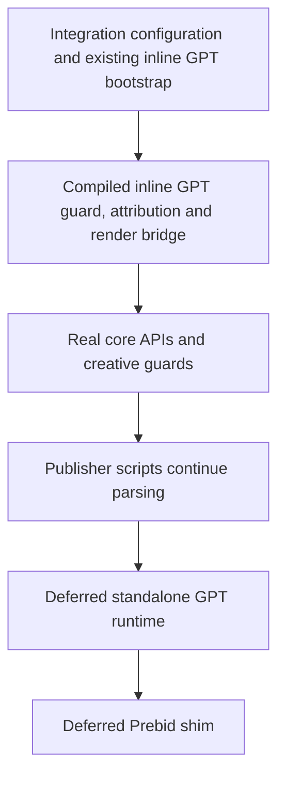
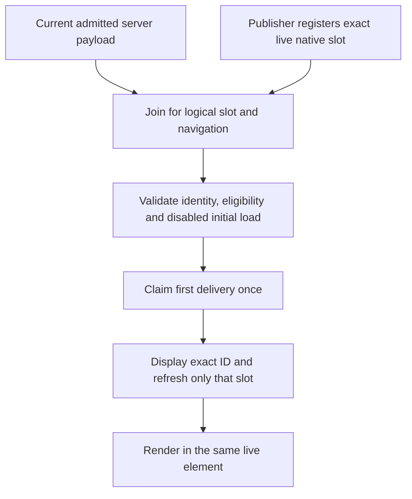

# Google Publisher Tags (GPT) Integration

**Category**: Ad Serving
**Status**: Production
**Type**: First-Party Ad Tag Delivery

## Overview

The GPT integration delivers Google Publisher Tags via the publisher's domain by proxying GPT's script cascade in first-party context. This avoids cross-origin script loads, improving performance and reducing friction with ad blockers and Intelligent Tracking Prevention.

## What is GPT?

Google Publisher Tags (GPT) is the JavaScript library publishers use to define and render ad slots served by Google Ad Manager. GPT loads scripts in a cascade:

1. `gpt.js` -- the thin bootstrap loader
2. `pubads_impl.js` -- the main GPT implementation (~640 KB)
3. `pubads_impl_*.js` -- lazy-loaded sub-modules (page-level ads, side rails, etc.)
4. Auxiliary scripts -- viewability, monitoring, error reporting

All of these are served from `securepubads.g.doubleclick.net`.

## How It Works

```
  Publisher HTML
  │
  ├─ <script src="securepubads.g.doubleclick.net/tag/js/gpt.js">
  │   ↓ (attribute rewriter)
  │   <script src="publisher.com/integrations/gpt/script">
  │
  ├─ Server fetches gpt.js from Google, serves it verbatim
  │
  ├─ Client-side shim intercepts dynamic script insertions
  │   ↓ (script guard)
  │   securepubads.g.doubleclick.net/pagead/…
  │   → publisher.com/integrations/gpt/pagead/…
  │
  └─ Server proxies cascade scripts from Google, serves verbatim
```

There are three layers:

1. **HTML attribute rewriting** (server-side) -- Rewrites `src`/`href` attributes on the initial `gpt.js` `<script>` tag to the first-party endpoint `/integrations/gpt/script`.

2. **Script proxy** (server-side) -- Fetches scripts from Google and serves them through the publisher's domain. Script bodies are served **verbatim** with no modification.

3. **Client-side shim** -- A script guard (`script_guard.ts`) uses six interception layers -- `document.write` interception, `HTMLScriptElement.prototype.src` property descriptor, `setAttribute` patch, `document.createElement` patch, DOM insertion patches, and a `MutationObserver` -- to catch GPT script URLs regardless of how they are set or inserted. The `document.write` layer is the most critical, as GPT's primary loading path uses `document.write` to synchronously inject `pubads_impl.js` into the HTML parser stream. This is the sole mechanism that routes GPT's cascaded script loads back through the proxy.

## Configuration

Add GPT configuration to `trusted-server.toml`:

```toml
[integrations.gpt]
enabled = true
gam_attribution_enabled = false
script_url = "https://securepubads.g.doubleclick.net/tag/js/gpt.js"
cache_ttl_seconds = 3600
rewrite_script = true
```

### Configuration Options

| Field                     | Type    | Required | Default                                                | Description                                                       |
| ------------------------- | ------- | -------- | ------------------------------------------------------ | ----------------------------------------------------------------- |
| `enabled`                 | boolean | No       | `true`                                                 | Enable/disable the integration                                    |
| `gam_attribution_enabled` | boolean | No       | `false`                                                | Add fixed page-level `ts=true` targeting for GAM cohort reporting |
| `script_url`              | string  | No       | `https://securepubads.g.doubleclick.net/tag/js/gpt.js` | URL for the GPT bootstrap script                                  |
| `cache_ttl_seconds`       | integer | No       | `3600`                                                 | Cache TTL for proxied scripts (60--86400s)                        |
| `rewrite_script`          | boolean | No       | `true`                                                 | Whether to rewrite GPT script URLs in HTML                        |

The environment override
`TRUSTED_SERVER__INTEGRATIONS__GPT__GAM_ATTRIBUTION_ENABLED` works only when
`gam_attribution_enabled` is already present under `[integrations.gpt]` in the
TOML file. The environment overlay cannot create a missing configuration leaf.

## Endpoints

- `GET /integrations/gpt/script` -- Serves the GPT bootstrap script (`gpt.js`)
- `GET /integrations/gpt/pagead/*` -- Proxies secondary GPT scripts and resources
- `GET /integrations/gpt/tag/*` -- Proxies tag-path resources

Successful proxy responses include the `X-GPT-Proxy: true` header for debugging.

## Features

- **Full cascade proxying**: Every script in GPT's loading chain is served first-party
- **Verbatim script delivery**: No server-side script modification -- scripts are proxied as-is
- **Client-side interception**: DOM-level script guard catches all dynamic script insertions
- **Configurable caching**: Tune TTL per deployment (default 1 hour, range 60s--24h)
- **HTML attribute rewriting**: Automatic rewrite of `src`/`href` attributes in publisher HTML
- **Protocol-aware**: The client-side shim matches the page's protocol (HTTP for local dev, HTTPS for production)

## Client-Side Shim

The GPT integration shares early interception and rendering code with its deferred runtime. Other integration combinations retain the synchronous unified TSJS bundle.

### Loading order

For pages without an enforced response Content Security Policy, GPT with core, creative and optionally the separately deferred Prebid integration uses this order:



The early entry runs inline, without another synchronous external fetch. It installs the real render bridge before core flushes queued callbacks or publisher scripts can request an eligible creative. Core's direct methods and immediate queue behavior remain available before the runtime arrives. The deferred GPT entry does not initialize core again, so early configuration and registered ad units survive takeover.

Any enforced `Content-Security-Policy` response header selects the original synchronous unified bundle instead of the new inline compiled entry. This includes headers from the actual origin response or `Settings.response_headers`, matched case-insensitively, even when empty, permissive or repeated. An origin response without CSP cannot cancel a configured policy. `Content-Security-Policy-Report-Only` alone does not select this fallback. Publishers with unchanged enforced response CSP therefore need no new compiled-script hash for this loading change: they keep the existing loading path. Policies that might permit deferral still use synchronous loading until separately evaluated.

Shared templates retain the loading choice and policy headers selected on the cold response and replay them on warm hits. Settings and core fingerprints invalidate older templates. This fallback checks response headers only; no meta-policy fallback is promised. It does not weaken CSP, add nonce handling or introduce an operator flag.

The existing inline GPT bootstrap remains responsible for provisional `adInit`, initial scheduling, publisher registration and navigation generations. The deferred runtime installs the richer initializer, publisher-slot handoff, SPA page-bids fetching and slim-Prebid loader. Both entries share the same guard and rendering implementations. A delayed or failed runtime does not remove the installed early renderer or authorize another initial request.

This still executes synchronous JavaScript. The raw GPT bootstrap alone is 56,429 source bytes, before the compiled early entry. Compare parser/paint timing and ad-startup timing with repeatable measurements; deferral is not a guarantee of better field Core Web Vitals.

The following combinations keep the original synchronous unified bundle. Unknown browser integrations also fall back rather than being silently deferred.

| Integration            | Early dependency retained by synchronous fallback                       |
| ---------------------- | ----------------------------------------------------------------------- |
| DataDome               | Dynamic SDK script and preload interception                             |
| Google Tag Manager     | Script interception plus fetch and beacon rewriting                     |
| Lockr                  | SDK interception and live API-host rewriting                            |
| Permutive              | SDK interception, endpoint rewriting and auction context registration   |
| Didomi                 | `didomiConfig.sdkPath` before the SDK reads it                          |
| Sourcepoint            | SDK interception, runtime configuration rewriting and consent mirroring |
| Osano                  | Initial consent mirroring and consent-event listeners                   |
| Testlight              | Immediate publisher queue behavior                                      |
| Active GPT diagnostics | GPT observation before publisher scripts                                |
| Enforced response CSP  | Existing script permissions and synchronous loading                     |

Rust-only integrations do not add browser modules to this list. Pages without GPT keep synchronous unified loading. Prebid's external bundle and shim retain their existing deferred execution order. Trusted GAM attribution and APS rendering-mode attributes stay on both executing entries, including the inline early tag.

### Script Guard

The script guard uses six interception layers to catch GPT script URLs regardless of how they are set or inserted into the DOM:

1. **`document.write` / `document.writeln`** -- GPT's primary loading mechanism. When `gpt.js` loads synchronously, it uses `document.write` to inject `<script src="...pubads_impl.js">` directly into the HTML parser stream. The guard intercepts these calls and rewrites URLs whose hostname is `securepubads.g.doubleclick.net` inside the HTML string before passing it to the native method.
2. **Property descriptor** on `HTMLScriptElement.prototype.src` -- intercepts `script.src = url` assignments. This catches GPT's async fallback path (used when `document.write` is unavailable, e.g. after page load or with `async` scripts).
3. **`setAttribute` patch** on `HTMLScriptElement.prototype` -- catches `script.setAttribute('src', url)` calls that bypass the property setter.
4. **`document.createElement` patch** -- tags every newly created `<script>` element with a per-instance `src` descriptor, ensuring coverage even if the prototype-level descriptor cannot be installed.
5. **DOM insertion patches** on `appendChild` / `insertBefore` -- catches scripts and `<link rel="preload">` elements whose `src`/`href` is already set at insertion time.
6. **`MutationObserver`** -- catches elements added via `innerHTML`, `.append()`, or other DOM methods, as well as attribute mutations on existing elements.

Intercepts scripts from `securepubads.g.doubleclick.net` and rewrites them to the first-party proxy.

### Command Queue Patch

Takes over `googletag.cmd` so every queued callback is wrapped before GPT executes it. This enables future hook points for:

- EC ID injection as page-level key-value targeting
- Consent gating of ad requests
- Ad-unit path rewriting for A/B testing

### Server slot handoff

For automatic placements in the initial server-rendered auction, the head bootstrap installs
`window.tsjs.adInit` before the compiled bundle arrives. It reads the
server-injected slot and bid state synchronously, defines a fallback GPT slot
on the actual inner div, and records the slot in `gptSlotHandoffs`. It never
defines a competing slot on an outer `-container` element. When publisher code
later calls `googletag.defineSlot` for the same placement, the idempotent wrapper
hands the existing inner-div binding back to GPT.

The bootstrap observes modern `googletag.setConfig({ disableInitialLoad: ... })`
and the legacy `pubads().disableInitialLoad()` call. If initial load is
disabled, it refreshes only the newly defined Trusted Server slots. It never
calls an unbounded `refresh()` that could refresh publisher-owned inventory.

`adInit` owns the initial document only. Server-side targeting and the Trusted
Server render bridge own the initial bid handoff and proven win/billing beacon
path. After load, the slim Prebid module owns scroll-triggered and refresh
auctions. SPA navigation obtains page bids through `GET /_ts/page-bids` (the
legacy `GET /__ts/page-bids` alias remains available); it does not use
`POST /auction` for that navigation flow.

### Publisher-registered initial delivery

Framework publishers can opt individual placements into
`initialization = "publisher_registered"`. The default, `auto`, retains the
existing automatic initializer and handoff behavior. Registration requires a
matched server, head bootstrap, runtime and publisher adapter. Do not enable it
on older artifacts that ignore the setting.

```toml
[[creative_opportunities.slot]]
id = "example-header"
div_id = "example-header-"
page_patterns = ["/example/*"]
formats = [{ width = 300, height = 250 }, { width = 300, height = 600 }]
initialization = "publisher_registered"
```

TS does not define a fallback for this placement. The publisher mounts the final
element, defines its native GPT slot, adds PubAdsService and delegates the first
delivery to TS. The final element ID need not match the configured prefix. Its
native slot must have the configured rendered GAM path. It must remain connected
with that ID through delivery and rendering.



#### Page setup and ownership

The publisher must disable initial loading before enabling services. This is
required even with SRA, because an enabled-load `display` can fetch unrelated
unfetched slots. TS does not change the page's load or SRA policy for registered
slots. Configure them in the publisher's existing GPT setup, not a second
component-level setup:

```js
googletag.cmd.push(() => {
  googletag.setConfig({ disableInitialLoad: true, singleRequest: true })
  // The publisher owns service setup and enables it once for the page.
  googletag.enableServices()
})
```

Before queuing a slot callback, capture `window.tsjs.navGeneration ?? 0`. Pass
that captured value, not a fresh generation read inside a callback from an older
route. Inside the callback, after native definition:

```js
const registration = window.tsjs.registerPublisherSlot({
  slotId: 'example-header',
  gptSlot: nativeSlot,
  navigationGeneration: capturedGeneration,
  eligibleFormats: [[300, 250]],
})
```

Check `publisherSlotRegistrationVersion === 1` as part of the matched publisher
integration. The publisher must not call the placement's initial `display`,
`refresh` or Prebid auction after handing it over. TS displays and explicitly
refreshes only that offered native slot. Genuinely later publisher refreshes keep
their ordinary Prebid behavior and refresh options.

The slot waits for an accepted current-navigation payload and foreground
scheduling. Head configuration, `load`, DOM stability, default bids and a failed
page-bids fetch do not authorize delivery. An accepted empty payload marks the
registration inactive. A page that never emits an admitted seam can remain waiting
until the publisher cancels it.

If the framework changes pathname before the full runtime arrives, the bootstrap
advances the same navigation generation and retires the old admission. New-route
registrations wait without a request. The bootstrap does not fetch page bids.
When the runtime takes over, it obtains the current route's payload through its
existing SPA endpoint without cancelling the new generation's waiting handles.
A pathname round trip is a new generation, not permission to reuse an earlier
payload. Ordinary startup without a prior navigation does not start another auction.

#### Responsive eligibility and React teardown

`eligibleFormats` contains finite positive integer size pairs from the same
publisher values used for the native definition or size mapping. It does not
change native GPT sizes or run another TS responsive engine. While pending, the
publisher synchronously cancels and re-registers when that effective set changes,
including while hidden and before foreground delivery resumes. Do not update it
in a later passive React effect. Set-equivalent reordering needs no update.

The following example uses public GPT types and assumes
`gam_network_id = "123456789"`. Its page-level setup above must already be
installed. The parent explicitly cancels and destroys before changing mounted
state. Route adapters must call the same teardown before navigation or removal;
layout cleanup is a backstop, not a replacement for that orchestration. Teardown
never waits behind a future GPT callback, and queued setup checks its own
cancellation flag and captured generation.

```tsx
import { useLayoutEffect, useRef, useState } from 'react'

type TeardownRef = { current: () => void }

export function ExampleRegisteredHeader({
  teardown,
}: {
  teardown: TeardownRef
}) {
  useLayoutEffect(() => {
    const ts = window.tsjs
    if (ts?.publisherSlotRegistrationVersion !== 1 || !ts.registerPublisherSlot)
      return
    const register = ts.registerPublisherSlot.bind(ts)
    const generation = ts.navGeneration ?? 0
    const compact: Array<[number, number]> = [[300, 250]]
    const expanded: Array<[number, number]> = [
      [300, 250],
      [300, 600],
    ]
    const wide = window.matchMedia('(min-width: 1024px)')
    let disposed = false
    let slot: googletag.Slot | null = null
    let registration: ReturnType<typeof register> | undefined
    let eligibility: Array<[number, number]> | undefined

    function updateEligibility() {
      if (disposed || !slot || (ts.navGeneration ?? 0) !== generation) return
      const next = wide.matches ? expanded : compact
      if (next === eligibility) return
      const status = registration?.getStatus().status
      if (
        status &&
        status !== 'waiting_payload' &&
        status !== 'waiting_delivery'
      )
        return
      registration?.cancel()
      eligibility = next
      registration = register({
        slotId: 'example-header',
        gptSlot: slot,
        navigationGeneration: generation,
        eligibleFormats: next,
      })
    }

    googletag.cmd.push(() => {
      if (disposed || (ts.navGeneration ?? 0) !== generation) return
      const mapping = googletag
        .sizeMapping()
        .addSize([1024, 0], expanded)
        .addSize([0, 0], compact)
        .build()
      if (!mapping) return
      // Use the rendered path for this configured placement and route.
      slot = googletag.defineSlot(
        '/123456789/example-header',
        expanded,
        'example-header-final'
      )
      if (!slot) return
      slot.defineSizeMapping(mapping).addService(googletag.pubads())
      wide.addEventListener('change', updateEligibility)
      // Capture updates eligibility before foreground delivery listeners run.
      document.addEventListener('visibilitychange', updateEligibility, true)
      updateEligibility()
    })

    function dispose() {
      if (disposed) return
      disposed = true
      registration?.cancel()
      wide.removeEventListener('change', updateEligibility)
      document.removeEventListener('visibilitychange', updateEligibility, true)
      if (slot) googletag.destroySlots([slot])
    }
    teardown.current = dispose
    return dispose
  }, [teardown])

  return <div id="example-header-final" />
}

export function ExamplePlacement() {
  const [mounted, setMounted] = useState(true)
  const teardown = useRef(() => {})
  return (
    <>
      {mounted && <ExampleRegisteredHeader teardown={teardown} />}
      <button
        onClick={() => {
          teardown.current()
          setMounted(false)
        }}
      >
        Remove placement
      </button>
    </>
  )
}
```

Use your publisher's existing TSJS and public GPT type declarations. The complete
framework fixture additionally checks native object identity, element identity,
request-time targeting, visible creative content and teardown ordering. A request
count alone does not establish visible delivery.

#### Status, cancellation and demand eligibility

`registration.getStatus()` returns a result discriminated by `status`:

- `waiting_payload` or `waiting_delivery`: pending; cancel before replacing the
  slot or changing its effective eligibility.
- `dispatching`, `requested` or `rendered`: the logical initial delivery is
  consumed for this navigation.
- `inactive`: the admitted payload omitted the placement or did not select this mode.
- `publisher_owned`: an earlier observed publisher claim won; TS does not overwrite it.
- `cancelled`: pending work was cancelled or invalidated.
- `rejected`: invalid input, stale/conflicting identity or enabled/unknown initial-load policy.
- `failed_after_dispatch`: a native invocation threw after delivery began. A
  request may already have occurred, so TS never automatically retries it.

Cancellation affects only that handle's record. An old handle cannot cancel a
replacement or a newer navigation. Cancelling after dispatch cannot undo a
request or reopen initial delivery. Destroy the native slot before removing its
div. Intentional replacement after a request belongs to the publisher's later
lifecycle; TS does not move the creative or rebind the old native object.

A TS bid participates only when a real TS renderer is installed and the winner's
finite positive dimensions match both configured and declared eligible formats.
Missing, unknown-size or incompatible bids still permit one ordinary GAM request.
An empty finite eligibility list permits GAM delivery without TS demand.

The raw inline GPT bootstrap has no creative renderer on its own. Supported
profiles also install the compiled early renderer before publisher scripts, so
registration can select eligible TS demand without waiting for the deferred
runtime. If no renderer was installed, registered delivery omits TS candidate
targeting and correlation and makes the single ordinary GAM request. GAM can fill it with a publisher creative or return
no-fill. TS fill is deliberately unavailable on that path. A later runtime load
does not add the excluded candidate, replace the ad or request it again.

#### Activation and verification

Publish the matched code with the mode unused first. Verify protocol version,
bootstrap and selected module hashes, publisher setup and explicit ownership.
Then activate only selected placements with the matching publisher adapter after
a separately approved real-GPT staging canary proves one initial request, correct
targeting, visible rendering, an unaffected unrelated slot and a legitimate later
refresh. Local stubs do not prove real-GAM behavior or publisher adoption.

A rejected or inactive handle is not automatically permission to start a competing
publisher request. Rollback is a separate compatible server/adapter/configuration
release decision, not an asynchronous fallback callback. Do not change ownership
or initialization mode inside an already-open document. This opt-in API does not
repair unmodified publishers or close all performance work in issue #854.

### Shared script-guard dispatcher

GPT's six interception layers register with the shared DOM insertion
dispatcher used by integration guards. Installation is idempotent. A candidate
URL is rewritten only when it matches GPT's accepted host/path rules; an
unmatched URL continues through the native DOM operation. If a descriptor or
prototype hook cannot be installed, the remaining layers still run, but the
integration does not claim complete interception for browser behavior outside
those guarded seams.

### GAM Treatment Attribution

Setting `gam_attribution_enabled = true` adds the fixed page-level GPT targeting
value `ts=true`. It is applied before publisher GPT initialization and remains
for the browser document's lifetime, so initial, lazy, refresh, publisher-owned,
and SPA-route requests inherit it unless another targeting consumer clears or
overrides the key. The attribution switch is independently controlled and
defaults to `false`, but the GPT integration's `enabled` master switch must also
be `true`.

This key is distinct from the existing slot-level `ts_initial=1` value.
`ts_initial` retains its current cleanup lifecycle; Trusted Server does not
clear the page-level `ts` value during Prebid refresh or SPA cleanup.

For an eligible publisher document whose activation script was not cloned,
`ts=true` means Trusted Server emitted the rewritten document head before the
GPT request. It does not prove that the response body completed, that a Trusted
Server bid won, or that an impression was caused by treatment. A publisher can
copy the activation script with `srcdoc` or `document.write`; treat any marker
on an unrewritten nested document as contamination, not attribution proof.

Before enabling attribution in a cohort:

1. Complete privacy and CSP review, create the reportable predefined `true`
   value in the target GAM network, and verify the chosen GAM reporting surface
   and billing approval.
2. Audit the short `ts` key across publisher GPT code, effective Prebid
   `bidderSettings[*].adserverTargeting` output (including
   `setTargetingForGPTAsync`), the effective creative-opportunity targeting map,
   and every GAM consumer that can affect eligibility, pricing, protection, or
   routing. Trusted Server accepts and forwards operator targeting verbatim; it
   does not reserve, filter, or intercept a slot-level `ts` key at runtime.
3. With treatment routing stopped, deploy attribution enabled and validate
   initial, lazy, refresh, publisher-owned, and SPA requests. Confirm every
   excluded path reports zero marked requests, then save a short paired-report
   dry run that satisfies the invariants below before starting the cohort.

For reporting, save one exact eligible universe: GAM network, inventory units,
routes, formats, time zone, date window, metrics, and all exclusions. Report A
is the nonduplicated total for that universe. Report B uses identical filters
and metrics plus exactly `ts=true`. If Enhanced Key-Value reporting is
unavailable, unapproved, or incompatible, use an exactly filtered legacy
key-value report and never sum its repeated key-value rows. Derive control as
`A - B`, and require `0 <= B <= A` for every metric. A violation invalidates the
whole report pair; never clamp a negative result. Use the same reporting-latency
and invalid-traffic maturation window for both reports.

GAM results are descriptive delivery attribution, not a causal treatment
effect. Aggregate monitoring and synthetic/manual samples can detect obvious
failures but cannot prove marker completeness on every production request
without request-correlated telemetry.

For a normal rollback, first stop and verify new treatment assignment at the
router, record a clean reporting boundary, and let already-open documents drain.
Exclude the drain interval, then set `gam_attribution_enabled = false` after
marked traffic reaches zero for the agreed interval. An emergency kill may flip
the setting immediately, but the affected interval and subsequent drain must be
treated as invalid for experiment reporting.

## Use Cases

### First-Party Ad Delivery

**Problem**: Third-party script loads from Google's domains are blocked by ad blockers and browser privacy features.

**Solution**: GPT integration routes all scripts through the publisher's domain, making them indistinguishable from first-party resources.

### Local Development

**Problem**: GPT scripts fail to load or behave differently in local development environments.

**Solution**: The integration works with both HTTP and HTTPS schemes. When running locally with Viceroy, the client-side shim produces `http://` URLs matching the dev server.

## Troubleshooting

### Scripts Not Loading Through Proxy

**Symptoms**: Network tab shows requests to `securepubads.g.doubleclick.net` instead of first-party domain.

**Solutions**:

- Verify `rewrite_script` is `true` in config
- Check that the TSJS bundle with the GPT shim is loaded **before** GPT
- Inspect console for "GPT guard: installing interception for Google ad scripts" log message

### Ads Not Rendering

**Symptoms**: Ad slots remain empty after proxying.

**Solutions**:

- Check the proxy responses have `200` status (look for `X-GPT-Proxy: true` header)
- Verify the `script_url` config points to the correct GPT endpoint
- Review server logs for upstream fetch failures
- Open [GPT Runtime Diagnostics](./gpt-diagnostics.md) with `?ts_console=1` to see the observed request, render, load, and delivery evidence per slot

## Implementation

- **Rust**: [crates/trusted-server-core/src/integrations/gpt.rs](https://github.com/IABTechLab/trusted-server/blob/main/crates/trusted-server-core/src/integrations/gpt.rs)
- **TypeScript**: [crates/trusted-server-js/lib/src/integrations/gpt/](https://github.com/IABTechLab/trusted-server/blob/main/crates/trusted-server-js/lib/src/integrations/gpt/)

## Next Steps

- Use [GPT Runtime Diagnostics](/guide/integrations/gpt-diagnostics) to inspect GPT lifecycle and Trusted Server delivery evidence in the browser
- Review [Integrations Overview](/guide/integrations-overview) for comparison with other integrations
- Check [Configuration Reference](/guide/configuration) for advanced options
- Learn about [First-Party Proxy](/guide/first-party-proxy) architecture
