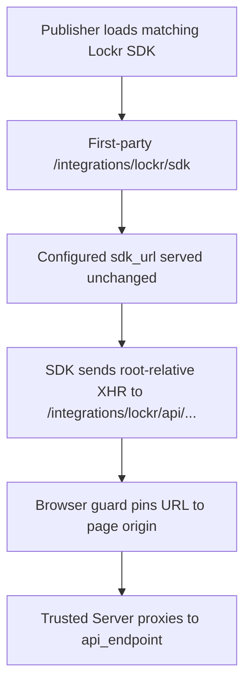

# Lockr integration

The Lockr integration serves the Lockr SDK and proxies its API requests through the publisher origin. It uses Lockr's dedicated trust-server SDK by default, rather than changing private SDK host fields at runtime.

## Configuration

Add the integration to `trusted-server.toml`:

```toml
[integrations.lockr]
enabled = true
app_id = "example-lockr-app-id"
```

The integration is off when the section is absent. When the section exists, `enabled` defaults to `true` and `app_id` must be nonempty. Use the application ID from your existing `lockr-signin-app_id` metadata. Keep the publisher's SDK loading, metadata, and initialization in place. The integration does not inject them.

| Field               | Default                                             | Behavior                                                                        |
| ------------------- | --------------------------------------------------- | ------------------------------------------------------------------------------- |
| `enabled`           | `true`                                              | Enable the integration when its section exists                                  |
| `app_id`            | Required                                            | Nonempty Lockr application ID                                                   |
| `api_endpoint`      | `https://identity.loc.kr`                           | Upstream API base URL                                                           |
| `sdk_url`           | `https://aim.loc.kr/identity-lockr-trust-server.js` | Upstream SDK fetched by the first-party SDK route                               |
| `cache_ttl_seconds` | `3600`                                              | SDK response `Cache-Control: public, max-age=...`, from `60` to `86400` seconds |
| `rewrite_sdk`       | `true`                                              | Rewrite matching SDK `src` and `href` attributes in server-processed HTML       |
| `rewrite_sdk_host`  | Unset                                               | Deprecated and ignored, including when set to `true`                            |
| `origin_override`   | Unset                                               | Override the `Origin` header sent to the upstream API                           |

`cache_ttl_seconds` controls downstream HTTP caching. The integration does not maintain a KV cache of SDK contents or identity mappings.

## SDK and API routing



| Route                       | Methods       | Behavior                                                                               |
| --------------------------- | ------------- | -------------------------------------------------------------------------------------- |
| `/integrations/lockr/sdk`   | `GET`         | Fetch `sdk_url` and serve its JavaScript unchanged                                     |
| `/integrations/lockr/api/*` | `GET`, `POST` | Append the path after `/integrations/lockr/api` and the query string to `api_endpoint` |

For example, `/integrations/lockr/api/example?mode=test` forwards to `https://identity.loc.kr/example?mode=test` with the default API endpoint. The proxy forwards POST bodies without changing them. It strips publisher `Authorization` and `Cookie` headers rather than leaking them upstream. `origin_override` replaces the incoming `Origin` header when configured.

### SDK URL rewriting

With `rewrite_sdk = true`, the server rewrites matching Lockr SDK URLs in HTML to an absolute first-party URL ending in `/integrations/lockr/sdk`, using the request scheme and request host. An external `<base href>` does not redirect the rewritten SDK load to another origin.

The Lockr browser module also intercepts matching dynamically inserted SDK scripts and preload or prefetch links. It rewrites them to `window.location.origin` plus `/integrations/lockr/sdk`. This interception remains active when `rewrite_sdk = false`; that setting controls server-side HTML attribute rewriting only.

These rewrites load the configured `sdk_url`, not necessarily the SDK version named by the original tag. They do not rewrite the fetched JavaScript or its API host.

### API guard limits

The default `identity-lockr-trust-server.js` SDK uses the relative API prefix `/integrations/lockr/api`. The browser module wraps `XMLHttpRequest.open` to turn root-relative URLs under that prefix into absolute page-origin URLs. This keeps those XHR requests first-party even when the page has an external `<base href>`.

The guard does not intercept `fetch` or `sendBeacon`. It does not reroute arbitrary absolute third-party API URLs. It neither changes private SDK host fields nor polls for SDK initialization.

## Migration from the SDK-host shim

The old SDK-host shim is no longer available. `rewrite_sdk_host` remains accepted for configuration compatibility, but has no effect.

- Use the default dedicated trust-server SDK, or set `sdk_url` to a build that sends API requests through `/integrations/lockr/api` itself.
- Custom SDK builds that depended on private-host mutation must implement their own proxy routing. The browser API guard cannot convert their absolute third-party API calls into first-party requests.
- Unreplaced legacy SDKs need their own proxy routing too. In particular, `rewrite_sdk = false` leaves static HTML SDK tags unchanged, even though matching dynamic SDK insertions remain intercepted.

The integration does not map EC IDs to Lockr identities, contribute Lockr EIDs to auctions, or provide a privacy vault. It also does not add a Lockr-specific consent gate. Keep consent handling and identity behavior in the publisher's SDK and CMP setup.

## Verification

In browser developer tools, check that the SDK loads from the page origin at `/integrations/lockr/sdk`, and that its API calls use `/integrations/lockr/api/...` on the same origin. Check a page with an external `<base href>` if your site uses one.

If API calls still go directly to a third-party host, inspect the actual SDK loaded. Check `sdk_url`, unreplaced static tags, and custom SDK routing rather than enabling `rewrite_sdk_host`.

See the [configuration reference](/guide/configuration) for the full integration settings.
