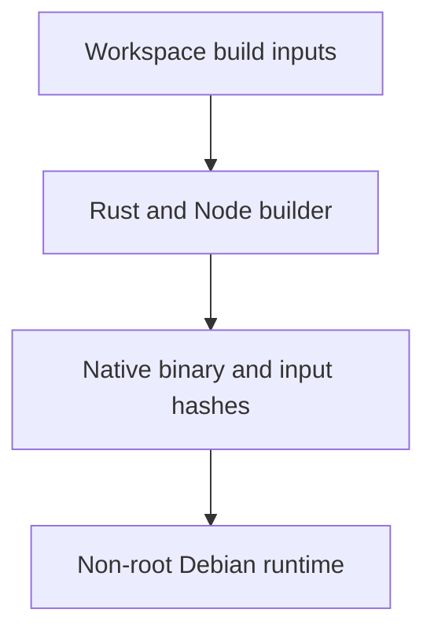

# Native container

Build the Axum adapter as a native Linux container from the workspace root:

```sh
docker build \
  --build-arg TRUSTED_SERVER__GIT_VERSION="$(git rev-parse HEAD)" \
  -t ts-native:local .
```

The multi-stage build uses pinned Rust 1.98.1 and Node 24.12.0 images. The Docker Node version is independent of the host Node version in `.tool-versions`. It installs JS dependencies with `npm ci` and builds fresh bundles through Cargo. Host `target`, `node_modules` and `dist` directories never enter the build context.



The runtime image contains the application binary, CA roots and runtime libraries, without Rust or Node. It runs as UID and GID `10001`, listens on port `8787` on all container interfaces, and uses `/config` and `/data` for runtime configuration and data. Mount configuration read-only and provide writable storage for `/data` and `/tmp` when using a read-only root filesystem. Supply configuration and secrets at runtime, never as image build arguments or files in the source checkout.

The `.dockerignore` file limits the build context to workspace build inputs. It excludes operator TOMLs, environment files, credentials and host build outputs. The image stores an input hash list at `/usr/local/share/ts-build-inputs.sha256`. `TRUSTED_SERVER__GIT_VERSION` supplies optional build metadata because `.git` is excluded.

## Optional AWS providers

Local providers are the default. Enable only the native AWS providers needed by the application:

```sh
docker build \
  --build-arg NATIVE_FEATURES=aws-appconfig-agent,aws-secrets-manager \
  -t ts-native:aws .
```

`NATIVE_FEATURES` accepts an empty value or a comma-separated selection of `aws-appconfig-agent`, `aws-secrets-manager`, `aws-dynamodb-ec`, `celld-ec` and `geo-cloudfront`. Compiling a provider does not select it. Validated runtime configuration selects EC storage, and a separate boot profile selects protected CloudFront Geo. Credentials and provider configuration belong in the runtime environment, not the image. The local-provider smoke test does not validate AWS access.

## Local smoke test

With Docker available, use the host Node version pinned in `.tool-versions`:

```sh
node scripts/test-native-container.mjs ts-native:local
```

The test creates a private Docker network, a synthetic publisher origin and temporary local configuration. It checks startup rejection for invalid configuration and missing secrets, the published listener, HTML rewriting, embedded JS, non-root execution, CA roots, writable mounts and SIGTERM draining with a request in flight. Fixtures use only `example.com` identities and synthetic secrets. The test removes its containers, network and temporary files on completion.

The `Native container` workflow builds the local-provider image and runs this test on relevant pull requests or manual dispatch. It does not publish an image or deploy a service.
