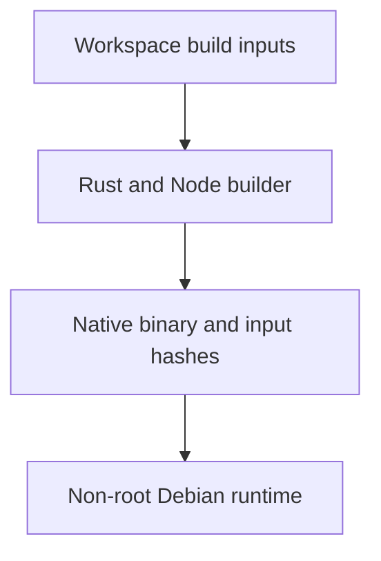

# Native container

Build the Axum adapter as a native Linux container from the workspace root:

```sh
docker build \
  --build-arg TRUSTED_SERVER__GIT_VERSION="$(git rev-parse HEAD)" \
  -t ts-native:local .
```

The multi-stage build uses pinned Rust 1.98.1 and Node 24.20.0 images. The build checks both versions against `.tool-versions`. It installs JS dependencies with `npm ci` and builds fresh bundles through Cargo. Host `target`, `node_modules` and `dist` directories never enter the build context.



The runtime image contains the application binary, CA roots and runtime libraries, without Rust or Node. It runs as UID and GID `10001`, listens on port `8787` on all container interfaces, and uses `/config` and `/data` for runtime configuration and data. Mount configuration read-only and provide writable storage for `/data` and `/tmp` when using a read-only root filesystem. Supply configuration and secrets at runtime, never as image build arguments or files in the source checkout.

The `.dockerignore` file limits the build context to workspace build inputs. It excludes operator TOMLs, environment files, credentials and host build outputs. The image stores an input hash list at `/usr/local/share/ts-build-inputs.sha256`. `TRUSTED_SERVER__GIT_VERSION` supplies optional build metadata because `.git` is excluded.

## Optional AWS providers

Local providers are the default. Enable only the native AWS providers needed by the application:

```sh
docker build \
  --build-arg NATIVE_FEATURES=aws-appconfig-agent,aws-secrets-manager \
  -t ts-native:aws .
```

`NATIVE_FEATURES` accepts an empty value or a comma-separated selection of `aws-appconfig-agent`, `aws-secrets-manager`, `aws-dynamodb-ec`, `celld-ec` and `geo-cloudfront`. Compiling a connector does not select it. The EC record layout and logical `trusted_server_kv` store are always declared. Select the connector in `EDGEZERO__STORE_BINDINGS_FILE` and reference that logical store with `ec.storage.provider="records"` in published application configuration. Without a remote binding, EdgeZero prepares its local record provider, so `/data` must remain writable even when identity storage is omitted from application configuration. A separate boot profile selects protected CloudFront Geo. Credentials and provider settings are runtime inputs, never image build arguments. See [Native EC persistence](./native-ec-persistence.md). The local-provider smoke below does not validate AWS access.

## Local smoke test

With Docker available, use the host Node version pinned in `.tool-versions`:

```sh
node scripts/test-native-container.mjs ts-native:local
```

The test creates a private Docker network, a synthetic publisher origin and temporary local configuration. It checks startup rejection for invalid configuration and missing secrets, the published listener, HTML rewriting, embedded JS, non-root execution, CA roots, writable mounts and SIGTERM draining with a request in flight. Fixtures use only `example.com` identities and synthetic secrets. The test removes its containers, network and temporary files on completion.

The missing-secret container uses a temporary seccomp profile that makes `bind` and `listen` fail with EPERM. It must still exit non-zero with both `Trusted Server initialization failed` and `is missing in trusted_server_secrets` in its log. Port probes and the absence of a ready lifecycle event are additional checks. A listener failure before secret validation cannot substitute for the required missing-secret diagnostic.

The `Native RC container` workflow builds the local-provider image and runs this test on relevant pull requests or manual dispatch. It does not publish an image or deploy a service.

## Local record persistence proof

Build with `NATIVE_FEATURES=aws-dynamodb-ec,geo-cloudfront`, then run against a disposable DynamoDB Local endpoint:

```sh
node scripts/test-native-ec-image.mjs \
  --image ts-native:records \
  --dynamodb http://127.0.0.1:8000
```

The same fixture accepts `--binary /absolute/path/trusted-server-axum` instead of an image. It supplies a prepared record binding, dummy AWS credentials, synthetic Geo/consent and an isolated table. It observes the SDK's native keys instead of reconstructing partition encoding. Checks cover acknowledgement-before-cookie, restart, withdrawal, a present past-TTL row racing a delayed CAS, denied and lost acknowledgements, and draining while storage waits. TTL eligibility is not a physical-deletion deadline.

Two SIGTERM cases exercise pending record writes. The request-time case requires the response to complete during drain. The after-response case uses a cookie-only SharedID provider: a returning navigation's full response completes while its conditional follow-up write remains paused. Both cases observe draining, wait another 250 ms, and verify that the process is still running and the selected write is still pending before release. Signal-to-exit observation is bounded by the configured three-second grace plus 500 ms for Docker delivery and observation.

After each process exits, the fixture reads the exact native row directly from DynamoDB and compares its complete value and generation with the acknowledged write. The after-response row must also retain the distinctive SharedID UID and advance its generation. The JSON proof retains both post-exit rows and the shutdown ordering. Its limitations list explicitly records `grace expiry not tested`: holding a write past the configured grace and checking timeout/cancellation remain a possible follow-up.

The fixture never builds/pulls or publishes an image, contacts hosted AWS, or runs a deployment wrapper. Binary-mode proof does not qualify the container build; image-mode proof does not qualify hosted IAM, release security, capacity or real browser consent transport.
