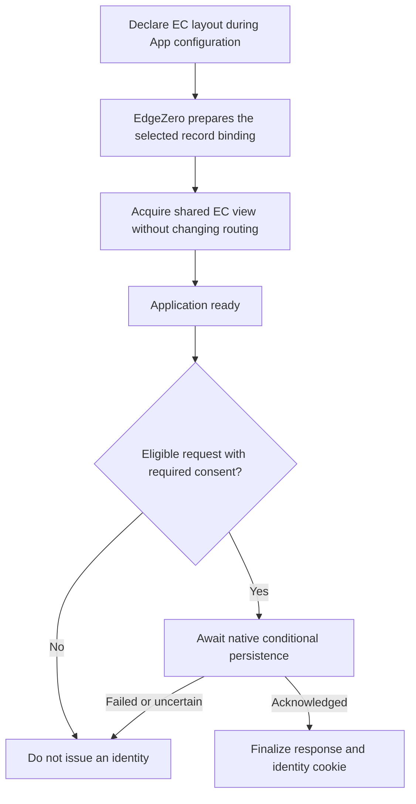

# Native EC persistence

Native EC persistence uses the shared core `RecordEcKvStore` over a prepared EdgeZero record binding. TS does not implement DynamoDB atomics, generation allocation or cursor decoding. The identity graph still owns consent, entry validation, collision handling and caller-specific conflict/recovery decisions.

Ordinary and record operations on that binding share value rows. An ordinary replacement clears metadata and invalidates old generations. Configuration and secret snapshots remain immutable; identity rows stay live.

Persistence does not grant consent. Keep the shared EC consent, bot, browser-navigation and withdrawal rules intact. A request can be eligible for an auction but ineligible for an EC. Missing qualifying consent in a jurisdiction that requires it must still prevent EC issuance. The operator owns genuine CMP signal transport; an empty integrations table is not necessarily a runtime defect.

The unified AWS example at `deploy/examples/native-aws-workload/README.md` combines the retained table and disposable Fargate workload. Its ordered setup covers input ownership, two locked state keys, retained `ec_storage` handoff, operator TOML, matching CLI envelope export and workload inputs. Operational deployment belongs in a separate, access-controlled deployer repository. Neither deployer access nor AWS credentials are needed to read the example or run its local checks.



## Select the prepared binding

Build with `aws-dynamodb-ec` or `celld-ec` for the corresponding default-off EdgeZero connector. The portable manifest and Axum startup always declare `trusted_server_kv` with the shared EC record layout before provider preparation. Select its provider through `EDGEZERO__STORE_BINDINGS_FILE`; without a remote binding, EdgeZero prepares its local persistent record provider. In that local-provider case, supply a writable `EDGEZERO__ADAPTER__DATA_DIR` even when application identity storage is disabled. Remote-only bindings do not require the directory.

Published application config selects the logical prepared store, not an endpoint or credentials:

```toml
[ec.storage]
provider = "records"
store = "trusted_server_kv"
```

A configured record reference must already have the declared layout and capability before initialization. An undeclared store ID or raw binding is an error, not permission to construct a provider late. Obsolete `TS_EC_RECORDS_ENABLED` and `TS_EC_DYNAMODB_ENABLED` switches are no longer read; migrate to the declared logical store and EdgeZero binding. Omitting `ec.storage` leaves identity without a graph, while the declared provider is still prepared. Omitted-provider and `provider="fastly"` compatibility references remain Fastly-only; Cloudflare and Spin reject unsupported EC storage during initialization.

Add this KV entry to the native store-bindings TOML already used for the application's config and secret stores:

```toml
version = 1

[kv.trusted_server_kv]
provider = "aws-dynamodb-records"
region = "us-east-1"
table = "example-retained-ec"
namespace = "example-staging"
```

Use the existing native binding-file selection mechanism. Keep its config/secret mappings in the same document. A raw `aws-dynamodb` binding does not satisfy the record requirement. Missing capability, a mismatched layout or failed selected-provider preparation is fatal before readiness, not permission to fall back to memory.

For celld, use the same logical ID with `provider = "celld-records"`, its endpoint/store and access policy in that native binding document. Run the EdgeZero-owned `services/celld-store` application on official, unmodified celld 0.6.3. The matching EdgeZero revision must provide record API version 1, scoped pagination and no-expiry support. Ordinary KV and records share its rows and retained namespace allocator. Old or KV-only services fail read-only preparation; no fork listener, downgrade or migration is used.

Region, table, namespace, credentials and endpoint behavior belong to EdgeZero's binding/provider configuration. The old `TS_EC_DYNAMODB_REGION`, `TS_EC_DYNAMODB_TABLE`, `TS_EC_DYNAMODB_NAMESPACE` and `TS_EC_DYNAMODB_LOCAL_ENDPOINT` do not configure another TS-owned provider. Tests use an explicitly isolated DynamoDB Local process with dummy credentials. No hosted IAM or deployment qualification is implied.

Fastly uses the same shared adapter and the logical `trusted_server_kv` declaration. Its compatibility `ec_store`/`provider="fastly"` references name logical IDs, not arbitrary physical store names. The application rejects undeclared IDs at startup. Request handling, response finalization and separately gated post-delivery pull sync retain the prepared handle; none reopens a store from settings. Link the desired physical Fastly store under that logical ID through the normal deployment workflow; these changes do not perform that operation.

## Key placement and generation lifetime

The application declares one stable `trusted-server-ec` layout:

- EC roots retain their full `<ip-hash>.<suffix>` keys and group by the complete `<ip-hash>.` prefix.
- Completion markers retain `__ts_ec_withdrawal_complete__:<ec-id>:<expiry>` and group by the marker namespace plus EC ID, ending in `:`.
- Layout resolution establishes placement. The graph still validates identity contents and marker expiry. A malformed marker is not silently accepted as proof of withdrawal.

DynamoDB uses a namespace/layout-qualified partition key for each declared group. Value and retained per-key generation rows have different sort-key kinds. There is no namespace-wide counter updated by every mutation. Add/CAS use native conditions, and deletion or TTL of a value must not reset its retained generation history. Failed conditional attempts may consume unused generations.

This is an explicit new record format, not a migration of the old `ec:{namespace}` and `ec-allocator:{namespace}` scheme. Reserve the table/namespace for the intended environment and retain allocator continuity through backup, restore and retirement. Do not restore an old allocator independently into an active dataset.

TTL visibility is provider-native. DynamoDB records remain visible until native physical deletion; TS consent and tombstone policy is not replaced by the TTL collector. No portable exact expiry deadline or new expiry envelope is added.

## Listing and errors

EC cluster counting supplies a complete hash partition, including its dot delimiter. Marker listing supplies its complete marker partition. The shared adapter follows native continuation through short or empty pages until the requested cap or authoritative end. Existing graph callers continue to reject saturated cleanup conservatively.

Strong partition Query and authoritative exact existence are separate from ordinary arbitrary-prefix/global Scan. An operator exposing ordinary global enumeration must account for its Scan cost and permission. Never scope a new policy to the obsolete single identity partition and global allocator.

Provider preparation and runtime operations use EdgeZero's bounded, single-attempt policies. Definitive Add/CAS rejection is normal contention. Ambiguous completion is an error, not a false rejection or an automatic replay. TS retains its explicit reread/merge/retry/defer policy; no new cookie is issued merely because an uncertain mutation might have committed.

## Eligibility and route boundaries

Persistence does not grant consent. Native eligibility uses trusted client metadata, consent and the shared navigation policy. Missing JA4 does not block creation; no User-Agent-only gate or fabricated TLS signal is used. Health checks, static assets, preflights and rejected authentication must not mint identities. Missing qualifying consent remains blocking. Synthetic local fixtures are not real publisher CMP acceptance.

Identify does not create identities. A withdrawal on an identity lifecycle request remains writable for privacy-hardened clients and tombstones the record. Identity cookies are only set or expired on successful HTML navigation or EC-route responses; other API responses remain cookie-free. Finalization is awaited before committing response headers.

The shared identity app owns identify, S2S batch sync and read-only admin lookup on the same record service. Provider and pull-sync orchestration is shared, with Axum follow-up work registered through EdgeZero's bounded, shutdown-drained after-response API. Broader provider and browser feature qualification remains #1581. Native administrative mutations remain unsupported.

## Browser hostname and consent transport

The example's `publisher.domain = "publisher.example.com"` yields an EC cookie domain of `.publisher.example.com`. Browsing at `https://ts-demo.example.com` rejects that cookie because the response URL is outside the cookie domain. EC uses `publisher.domain`, not `publisher.cookie_domain`. `X-Forwarded-Host` changes server-side request interpretation, not the browser's cookie-domain check.

The existing Terraform constraints require distinct publisher and demo hostnames. This documentation does not change the example values or validations. The operator must supply a supported cookie-compatible hostname arrangement within those constraints, or use the existing publisher-preserving browser proxy so the visible URL remains on the publisher while its upstream connects to the demo endpoint. With protected CloudFront, `preserve_publisher_hostname` opts into the fixed publisher forwarding identity for that proxy mode. It does not itself change the browser URL or make demo-host cookies valid.

The runtime already extracts and enforces standard consent signals, including TCF, GPP, US Privacy and GPC. Existing publisher CMP transport may be sufficient without a TS integration. An empty integrations table neither proves transport is missing nor proves it works. The operator must provide genuine signals and verify the initial decision, updates and withdrawal on the chosen browser path. Do not add fabricated consent, relax policy, or infer consent from protected geography.

Existing Sourcepoint GPP capture can mirror its supported signals and send scoped updates through `POST /_ts/consent`. That is an example of an existing transport, not a generic TCF bridge or a prescription to add Sourcepoint or another CMP integration. Verify the selected CMP and jurisdiction rather than assuming all standards share that update path.

Browser acceptance must inspect the visible URL, rejected-cookie diagnostics, stored `ts-ec` and its return on the next eligible request. Then verify genuine initial/no-consent behavior, a real CMP update reaching the server, and withdrawal producing durable tombstones and browser-cookie expiry. A `Set-Cookie` response header, a changed CMP UI or synthetic local consent alone is insufficient. See the browser hostname and consent qualification checklist in `deploy/examples/native-aws-workload/README.md`.

The unified example's `deploy/examples/native-aws-workload/retained/` root creates the retained table and exports `ec_storage`. It neither depends on nor attaches policies to a task role. The parent workload root creates its own role and attaches the exact-table, partition-scoped policy. Removing the workload must not remove the table or leave a retained-state reference to the deleted task role.

## Executed local acceptance and remaining deployment work

The native lifecycle suite now runs through the shared adapter over real persistent records. It covers persistence-before-cookie, app recreation, consent/route exclusions, withdrawal, orphan recovery, cancellation, metadata/body coherence, stale tokens and native page traversal. The explicit `record_dynamodb` target exercises independent native Add/CAS, allocator-only Query pages, concurrent identity updates and withdrawal through DynamoDB Local.

The real celld fixture exercises route persistence, process restart, withdrawal, stale-token rejection, concurrent updates and outage through the same adapter. The production-binary tests prepare records from native bindings and the published logical selector, exercise actual HTTP issuance and withdrawal, restart against retained service state and refuse readiness on service outage. They require `CELLD_EC_TEST_BINARY` pointing to official celld and `EDGEZERO_CELLD_STORE_SERVICE` pointing to `services/celld-store` in the same SDK revision used by the Rust dependencies. Missing prerequisites fail rather than skip. The stock-celld workflow checks out that dependency tag, verifies the official runtime digest and executes all three ignored integration cases through a nonzero sentinel check. Historical modified-celld receipts do not prove this path.

Fastly's WASM/Viceroy suite exercises the shared lifecycle and keeps response-finalization and post-delivery permissions separate. The separate SDK Viceroy independent-CAS race has a known emulator atomicity failure, deferred from this stock-celld integration. Do not describe that failed check as passing or as production Fastly qualification.

These checks do not qualify a rebuilt application image, retained infrastructure, workload credentials, installed IAM/boundary policies, capacity, fleet failover, restore or real browser consent transport. `scripts/test-native-ec-image.mjs` uses the prepared binding and observes SDK-selected keys. Its binary and local-image modes test the same new-format lifecycle and fault cases. A binary-mode receipt alone does not qualify an image build; neither mode qualifies a deployed runtime wrapper.

## Task permissions and the existing boundary

The runtime needs the following permissions on the exact table ARN:

| Actions                                                                                                | Scope                                                              |
| ------------------------------------------------------------------------------------------------------ | ------------------------------------------------------------------ |
| `dynamodb:DescribeTable`                                                                               | Exact table, no row condition; startup schema validation           |
| `dynamodb:GetItem`, `dynamodb:PutItem`, `dynamodb:DeleteItem`, `dynamodb:Query`, `dynamodb:UpdateItem` | Exact table and namespace/layout-qualified group partition pattern |

No task permission is needed for `Scan`, `CreateTable`, `DescribeTimeToLive`, `UpdateTimeToLive`, index creation or table deletion. Table creation and TTL configuration belong to the infrastructure operator. The template trusts the task with both value and allocator rows inside the selected namespace/layout. IAM cannot distinguish their sort-key kinds. The SDK retains allocator rows, but these permissions do not independently prevent the task from deleting or replacing them. Do not use this template as production allocator protection.

The workload's task inline policy and the externally owned permission boundary are separate layers. A boundary with an explicit `Deny`/`NotAction` read-action ceiling that excludes DynamoDB still denies the calls after an inline allow is attached.

Before any deployment, the boundary and workload owners must review both layers:

1. Review the boundary's action ceiling and constrained allows for only these six DynamoDB actions on the exact table and namespace/layout group pattern. Preserve unrelated restrictions. An action-ceiling edit alone does not grant permission.
2. Review the workload root's exact-table, partition-scoped inline policy and all effective denies, including organization and endpoint policies, with the actual task credentials.

The workload output `ec_task_policy_json` is a plan-known scoped allow document for that review, not a replacement boundary. Do not replace the boundary, add administrator access, remove explicit denies indiscriminately, or move application calls to the execution role. No DynamoDB execution-role change is needed. Existing Secrets Manager-only KMS statements do not authorize unrelated KMS use. DynamoDB uses default encryption at rest with an AWS-owned key here, with no new task KMS permissions. A customer-managed key is deferred and needs separate review.

## Retained infrastructure, disposable workload

Keep the nested EC Terraform root in its own retained state, separate from the service's disposable workload state. Both roots use S3 lockfile locking and require the operator to explicitly supply stable installation/workload-specific backend keys. For illustration only, `example-staging/retained.tfstate` and `example-staging/workload.tfstate` are distinct keys for one installation, not defaults. The retained key must differ from the workload key, and neither may reuse another environment's state. Backend bucket/region, encryption, versioning and access controls belong to the state owner. The retained root enables table deletion protection and Terraform `prevent_destroy`. Neither replaces a backup, retention or erasure policy.

Existing disposable-workload writers, manifests, inventory and cleanup code must not be assumed to know about DynamoDB. Provision this retained root through a separately reviewed operator path. Do not quietly add a retained table to automated disposable cleanup. If that ownership model changes, review creation grants, manifests, inventory, state and destruction together.

Stopping or replacing an ECS task must leave EC state available. Keep the selected backend live while issued identities and withdrawal obligations exist. Disabling it is not a safe persistence rollback; qualify a rollback that preserves those obligations before changing provider selection. The workload owns its role and policy attachment; retained state has no task-role dependency. Identity erasure, namespace retirement, backups and table removal require their own reviewed procedure. Never reset the generation allocator as part of routine row cleanup.

Application configuration and secrets are immutable startup snapshots. Rolling back an ECS task does not roll back the shared latest AppConfig document. The operator must manually reconcile compatible image/config/secret versions and retained storage selection; rollback automation is not provided. The example's single stop-first task also permits update downtime.

The workload still needs working regional HTTPS access to DynamoDB. This guide does not require a new NAT gateway or endpoint without checking the existing routing and endpoint policies. A read-only application root and ephemeral bindings volume can stay unchanged; neither stores the identity graph.

## Qualification before deployment

No AWS apply or live acceptance is implied by this guide. Local fixtures cannot prove installed IAM policies, capacity or real browser consent transport.

With an already-built `aws-dynamodb-ec,geo-cloudfront` native binary and DynamoDB Local running on loopback, run:

```sh
node scripts/test-native-ec-image.mjs \
  --binary /absolute/path/to/trusted-server-axum \
  --dynamodb http://127.0.0.1:8000
```

Alternatively, supply `--image LOCAL_IMAGE` instead of `--binary`. Linux image mode uses host networking and never pulls or builds an image. The fixture generates isolated envelopes and secrets, owns a unique local table, and writes JSON evidence. It calls the app executable directly, so it does not qualify a deployment bootstrap wrapper. Use `--help` for image executable and source-version assertions.

Before authorizing a deployment, retain evidence for the rebuilt image and these checks:

- Real conditional expressions against DynamoDB Local, including concurrent Add, stale CAS, delete/recreate, metadata, physically present past-TTL rows, marker keys and short or empty Query pages with continuation. A bounded list that cannot prove exhaustion must fail rather than return an unsafe short result.
- Native lifecycle tests proving persistence acknowledgement precedes new `Set-Cookie: ts-ec`, reuse survives application recreation, withdrawal writes a tombstone and expires the browser cookie, and an old EID update cannot undo withdrawal.
- Failure cases for denied, unavailable and uncertain writes. No phantom identity may be issued. Test readiness failure and current-thread runtime scheduling while storage is delayed.
- Existing route exclusions and consent rules. Health, static assets, preflight and rejected authentication must not mint identities. Missing qualifying consent must remain blocked. Synthetic local consent fixtures are not live-browser consent acceptance.
- The actual final image's provider selection, non-root/read-only execution, startup, readiness, normal HTTPS trust and shutdown behavior, plus affected Fastly/WASM compatibility after shared EC changes.

After separate AWS authorization, qualify the real task role with its retained boundary and inline policy. Prove allowed operations on the reviewed table/partitions and denial elsewhere, allocator retention, native TTL behavior and persistence across task replacement. Separately verify cookie acceptance and genuine initial/update/withdrawal CMP transport through the selected browser path. Do not relax privacy configuration or fabricate a live signal to make that acceptance pass.

## Deferred production considerations

PITR/backups and restore qualification, alarms, HA, autoscaling, private networking/NAT/endpoints, WAF, customer-managed keys, IPv6, image automation, bidder/partner integrations, signing/admin/S2S additions and rollback automation remain deferred. Backup choices must preserve allocator continuity and account for erasure obligations. Capacity, clock behavior, recovery and regional access need operator evidence before a production design can rely on them. These are considerations for separately approved work, not infrastructure or runtime additions in this example.

Review exact-table permissions, namespace/group scoping, retained state ownership and effective denies before any deployment. The application task role owns data access; do not move it to the execution role or remove unrelated boundaries. Do not add migration, apply infrastructure, publish images or deploy from these local test receipts.
