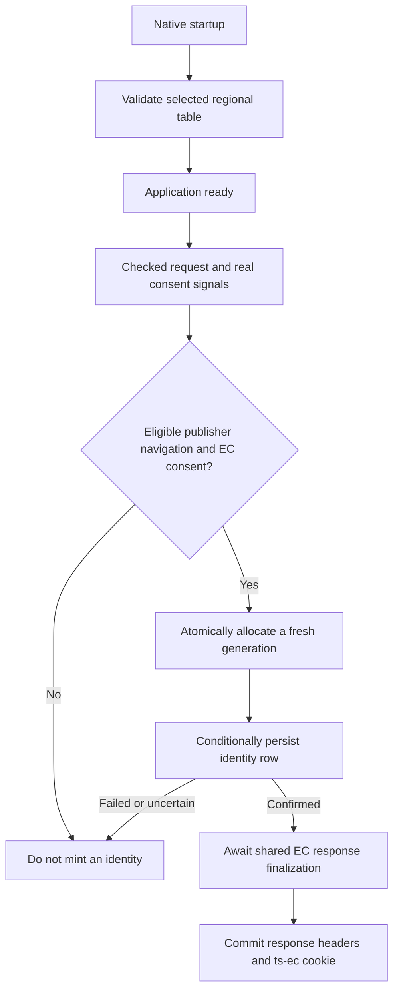

# Native EC persistence

The native Axum adapter can use dedicated DynamoDB or celld EC persistence. Build with `aws-dynamodb-ec` or `celld-ec` and select the provider explicitly in published `[ec.storage]` configuration. This is separate from ordinary byte KV and from immutable AppConfig or secret snapshots. A local database file on an ephemeral ECS volume is not a substitute for retained identity state.

Persistence does not grant consent. Keep the shared EC consent, bot, browser-navigation and withdrawal rules intact. A request can be eligible for an auction but ineligible for an EC. Missing qualifying consent in a jurisdiction that requires it must still prevent EC issuance. The operator owns genuine CMP signal transport; an empty integrations table is not necessarily a runtime defect.

The unified AWS example at `deploy/examples/native-aws-workload/README.md` combines the retained table and disposable Fargate workload. Its ordered setup covers input ownership, two locked state keys, retained `ec_storage` handoff, operator TOML, matching CLI envelope export and workload inputs. Operational deployment belongs in a separate, access-controlled deployer repository. Neither deployer access nor AWS credentials are needed to read the example or run its local checks.



## Native eligibility and route boundaries

Native eligibility uses checked effective client metadata from managed ingress and a user-agent platform/browser-engine heuristic. It does not invent Fastly TLS or JA4 headers. The browser heuristic is not spoof-resistant authentication. Only a GET publisher document navigation that passes integration request filters may issue a new identity. Health checks, static assets, preflights and rejected authentication do not mint ECs. Consent behavior is unchanged.

Native supplies the live graph and partner registry to existing auction, page-bids and integration routes, and to read-only identify. EID cookies and IDs supplied in auction bodies are supported. Identify does not create identities. The adapter awaits shared EC response finalization exactly once, including handled errors, before committing response headers.

Native admin EC management and lookup remain unsupported and require separate enablement. This work does not provide Fastly S2S batch or post-send pull-sync parity; those native routes and background tasks are not integrated here.

## Build and select the backend

The unified AWS example requires a final Axum image built with `aws-appconfig-agent,aws-secrets-manager,geo-cloudfront,aws-dynamodb-ec`, including the TS-owned runtime wrapper in `deploy/runtime/native-aws/README.md`. Image production is separate from provisioning. Record the final image's source, dependency and image digests. A historical AppConfig/Secrets Manager image qualification does not cover EC persistence merely because a provider was added to published configuration. Nonroot/read-only execution, writable volume ownership and bounded cold AppConfig Agent startup still need qualification.

Publish the non-secret selection in the existing Trusted Server app-config BlobEnvelope, through the same `ts config push`/AppConfig publication path used for other settings:

```toml
[ec.storage]
provider = "dynamodb"
region = "eu-west-2"
table = "example-retained-ec"
namespace = "example-staging"
```

For the AWS example, copy the retained root's `ec_storage` output into this TOML and pass that same object to the workload root. Export with the matching source revision's TS CLI and `--no-env`. AppConfig receives the exact inner `BlobEnvelope` string, not the CLI's outer local map. Terraform checks shape, publisher and exact storage agreement but publishes the original text; it must not reserialize config or calculate the envelope checksum.

Region, table and namespace are required. Preserve the exact existing table and namespace when migrating. Use the same region as the table; unrelated `AWS_REGION` values do not select the EC region. No provider or default binding is inferred on native. An ordinary KV declaration does not enable EC persistence. Selected-provider preparation must succeed before readiness. An error never permits fallback to memory, another provider or an unbacked cookie.

This is a hard cutover from native environment-only selection. `TS_EC_DYNAMODB_ENABLED=true` now fails before readiness with migration guidance, even if new config is also present. Malformed enablement also fails. Absent or `false` does not select a backend; orphaned old binding variables are ignored, not another source. Prepare and publish the new config, then remove the old enablement/region/table/namespace/endpoint launch inputs. There is no fallback reader.

Legacy `[ec] ec_store = "exact-binding"` remains supported on Fastly and inactive on other adapters. New Fastly config may use `[ec.storage] store = "exact-binding"`, with an omitted or explicit `fastly` provider. Both forms together are rejected. Cloudflare and Spin reject any explicit storage selection before routed application work. Shared parsing and publication do not resolve providers according to the CLI host. Missing storage stays absent when serialized, with no injected provider defaults.

Older binaries reject the new section. Deploy a compatible binary before publishing it; rollback requires an old-compatible config and matching binary together. A provider or namespace switch does not migrate identity data or withdrawal obligations.

The provider uses the standard AWS workload credential chain. In ECS, the application uses the task role. Keep credential values out of deployment inputs, logs, Terraform and container environment. The execution role still handles image pull, logs and task startup secrets, not application DynamoDB calls. Without a local-test selection, production preparation ignores configured endpoint overrides and uses the regional AWS endpoint. Local-only acceptance can set `local_endpoint = "http://127.0.0.1:8000"` inside `[ec.storage]`. This seam accepts only loopback HTTP with an explicit port and root path, bypasses the AWS config and credential chain, and uses dummy credentials. Never set it in a deployed task. In-process fixtures can also inject a client through the test preparation API.

The table is a single-region base table. Do not add Global Tables or route writes to different regions and assume the same CAS guarantees. A single namespace partition and generation counter can become hot; `PAY_PER_REQUEST` is not a throughput qualification.

## Browser hostname and consent transport

The example's `publisher.domain = "publisher.example.com"` yields an EC cookie domain of `.publisher.example.com`. Browsing at `https://ts-demo.example.com` rejects that cookie because the response URL is outside the cookie domain. EC uses `publisher.domain`, not `publisher.cookie_domain`. `X-Forwarded-Host` changes server-side request interpretation, not the browser's cookie-domain check.

The existing Terraform constraints require distinct publisher and demo hostnames. This documentation does not change the example values or validations. The operator must supply a supported cookie-compatible hostname arrangement within those constraints, or use the existing publisher-preserving browser proxy so the visible URL remains on the publisher while its upstream connects to the demo endpoint. With protected CloudFront, `preserve_publisher_hostname` opts into the fixed publisher forwarding identity for that proxy mode. It does not itself change the browser URL or make demo-host cookies valid.

The runtime already extracts and enforces standard consent signals, including TCF, GPP, US Privacy and GPC. Existing publisher CMP transport may be sufficient without a TS integration. An empty integrations table neither proves transport is missing nor proves it works. The operator must provide genuine signals and verify the initial decision, updates and withdrawal on the chosen browser path. Do not add fabricated consent, relax policy, or infer consent from protected geography.

Existing Sourcepoint GPP capture can mirror its supported signals and send scoped updates through `POST /_ts/consent`. That is an example of an existing transport, not a generic TCF bridge or a prescription to add Sourcepoint or another CMP integration. Verify the selected CMP and jurisdiction rather than assuming all standards share that update path.

Browser acceptance must inspect the visible URL, rejected-cookie diagnostics, stored `ts-ec` and its return on the next eligible request. Then verify genuine initial/no-consent behavior, a real CMP update reaching the server, and withdrawal producing durable tombstones and browser-cookie expiry. A `Set-Cookie` response header, a changed CMP UI or synthetic local consent alone is insufficient. See the browser hostname and consent qualification checklist in `deploy/examples/native-aws-workload/README.md`.

## Celld conditional records

Build the native adapter with `celld-ec` and publish an explicit binding:

```toml
[ec.storage]
provider = "celld"
endpoint = "https://stores.example.com:7780"
store = "checkout-identity"

[ec.storage.access]
mode = "authenticated"
token_env = "CHECKOUT_STORE_TOKEN"
```

The endpoint, service-owned alias and access policy use EdgeZero's pure celld settings. Do not publish a physical namespace or bearer token. The selected bootstrap variable is captured once during preparation; request paths do not reread it. Authenticated access requires HTTPS with normal certificate verification. Trusted-network access is an explicit alternative under the existing celld policy, never an authentication fallback.

The provider requires the additive conditional-record protocol and checks both store and record version headers before readiness. Ordinary raw celld KV and the `celld-kv` feature do not supply the EC contract. Missing compiled provider, invalid credentials, unsupported protocol and unavailable service all fail closed.

The typed client maps the unchanged EC trait onto body and opaque metadata, full-u64 server generations, atomic Add/Overwrite/IfGenerationMatch, exact physical existence, bounded strong prefix listing, TTL and hard deletion. A full list page is not proof of completeness. The server samples relative millisecond expiry inside the write transaction; finer positive client TTLs round upward. The core graph still owns every lifetime, tombstone and CAS retry. Transport does not replay uncertain mutations. Record cleanup must never reset the durable allocator. Raw KV keys and conditional record keys are separate datasets.

Run the real disposable local-server proof explicitly with an existing tested celld binary:

```sh
CELLD_EC_TEST_BINARY=/absolute/path/to/celld \
  cargo test --locked --target x86_64-unknown-linux-gnu \
  -p trusted-server-adapter-axum --features celld-ec \
  --test native_ec --test startup -- --include-ignored --test-threads=1

CELLD_EC_TEST_BINARY=/absolute/path/to/celld \
  cargo test --locked --target x86_64-unknown-linux-gnu \
  -p trusted-server-adapter-axum --features celld-ec,geo-cloudfront \
  --test native_acceptance \
  real_celld_envelope_drives_native_http_issuance_withdrawal_restart_and_outage \
  -- --ignored --test-threads=1
```

Missing prerequisites fail instead of silently skipping this selected check. Fixtures own temporary policy/data and loopback listeners, not operator configuration. They exercise the real typed client and graph through native issuance, EID update, withdrawal, restart, outage and published-envelope readiness. The second check drives actual native HTTP issuance from the published envelope using a real origin and celld, synthetic protected-ingress geography and isolated secret references. It covers application recreation, server restart and outage without replacing the graph with a memory double. Tests are serialized to keep subprocess listener ownership separate. Synthetic local geography and GPC inputs are not genuine live-browser consent acceptance. Same-disk fixture restart is not replicated disaster recovery or production storage qualification. The server's separate fresh-node-cache LTX proof does not certify a production object-store deployment either.

## Table and namespace ownership

The unified example's `deploy/examples/native-aws-workload/retained/` root creates the retained table and exports `ec_storage`. It neither depends on nor attaches policies to a task role. The parent workload root creates its own role and attaches the exact-table, partition-scoped policy. Removing the workload must not remove the table or leave a retained-state reference to the deleted task role.

| Item                | Required layout or owner                                                                                                |
| ------------------- | ----------------------------------------------------------------------------------------------------------------------- |
| Table               | String hash key `pk`, string range key `sk`, `PAY_PER_REQUEST`, no indexes or replicas                                  |
| Identity partition  | `pk=ec:{namespace}`, `sk` is the exact EC or withdrawal-marker key                                                      |
| Allocator partition | `pk=ec-allocator:{namespace}`, `sk=generation`, numeric generation counter only, no TTL                                 |
| Service TTL         | Enabled on numeric `ttl_epoch_s` for expiring identity/marker rows                                                      |
| Logical expiry      | `expires_at_ms` filters lookup/list results and expiry-sensitive write conditions; held-row existence stays physical    |
| Retained owner      | Named team/person owns state, table, namespace reservations, retention, allocator continuity, costs and decommissioning |
| Workload owner      | Owns the application task role, provider-enabled image and task environment                                             |

The namespace must be nonempty, at most 512 UTF-8 bytes, and contain no Unicode control characters. The runtime does not trim or normalize it. Backend keys must be nonempty, at most 1024 bytes, and contain no control characters; withdrawal-marker keys are supported.

Reserve both partition values together for exactly one app/environment. Reuse the namespace across task replacements that should share identities. Use a distinct reservation for a separate environment. Do not share a namespace between unrelated applications or use an ephemeral task/run ID as its identity.

The internal allocator is not part of EC prefix listing. It has no `ttl_epoch_s` or logical expiration. Never delete, expire or reset it while the namespace can be used again. A delete/recreate cycle must not reuse a generation that an in-flight stale writer still holds. Failed conditional writes may consume unused generations; gaps are harmless.

Retain the allocator with the graph through backup, restore and migration. Rewinding it independently of rows can break stale-CAS protection. Do not restore old state into an active namespace without an explicit continuity plan. This example does not implement migration or disaster recovery.

The graph owns live-row, tombstone and withdrawal-marker lifetimes. DynamoDB TTL only collects expired rows eventually. It does not define when a row stops authorizing EC use. `expires_at_ms` uses the application's UTC wall clock, so logical expiry and expiry-dependent Add/CAS conditions assume adequately synchronized task clocks. The deployment owner must qualify clock synchronization and skew across tasks. The backend adds no runtime skew guard or clock configuration. Current graph defaults are 31,536,000 seconds for live rows and 86,400 seconds for tombstones and completion markers. Do not apply a blanket TTL or cleanup job to the allocator partition.

Lookup and prefix listing hide logically expired rows. Authoritative `key_exists` instead uses a strongly consistent exact-key read to confirm physical row presence, including logically expired rows. This means the identity is still held, not that it is logically readable. The read validates the expiry format; malformed rows are errors, not absence. Physical presence never authorizes identity use, EIDs or cookie issuance. It lets the graph write a fresh-generation withdrawal tombstone even when a CAS captured `:now` before expiry but arrives afterward. Treating the expired, still-held root as absent would skip that tombstone and let the delayed CAS match the old generation and revive the identity or partner IDs.

## Task permissions and the existing boundary

The runtime needs the following permissions on the exact table ARN:

| Actions                                                                         | Scope                                                                      |
| ------------------------------------------------------------------------------- | -------------------------------------------------------------------------- |
| `dynamodb:DescribeTable`                                                        | Exact table, no row condition; startup schema validation                   |
| `dynamodb:GetItem`, `dynamodb:PutItem`, `dynamodb:DeleteItem`, `dynamodb:Query` | Exact table and `dynamodb:LeadingKeys` equal to `ec:{namespace}`           |
| `dynamodb:UpdateItem`                                                           | Exact table and `dynamodb:LeadingKeys` equal to `ec-allocator:{namespace}` |

No task permission is needed for `Scan`, `CreateTable`, `DescribeTimeToLive`, `UpdateTimeToLive`, index creation or table deletion. Table creation and TTL configuration belong to the infrastructure operator. The allocator does not require `GetItem`. The example uses separate row and allocator statements, so ordinary identity deletion cannot delete the allocator through this policy. IAM partition scoping does not enforce a particular `sk` or stop a compromised task from modifying permitted rows.

The workload's task inline policy and the externally owned permission boundary are separate layers. A boundary with an explicit `Deny`/`NotAction` read-action ceiling that excludes DynamoDB still denies the calls after an inline allow is attached.

Before any deployment, the boundary and workload owners must review both layers:

1. Review the boundary's action ceiling and constrained allows for only these six DynamoDB actions on the exact table and two partitions. Preserve unrelated restrictions. An action-ceiling edit alone does not grant permission.
2. Review the workload root's exact-table, partition-scoped inline policy and all effective denies, including organization and endpoint policies, with the actual task credentials.

The workload output `ec_task_policy_json` is a plan-known scoped allow document for that review, not a replacement boundary. Do not replace the boundary, add administrator access, remove explicit denies indiscriminately, or move application calls to the execution role. No DynamoDB execution-role change is needed. Existing Secrets Manager-only KMS statements do not authorize unrelated KMS use. DynamoDB uses default encryption at rest with an AWS-owned key here, with no new task KMS permissions. A customer-managed key is deferred and needs separate review.

## Retained infrastructure, disposable workload

Keep the nested EC Terraform root in its own retained state, separate from the service's disposable workload state. Both roots use S3 lockfile locking and require the operator to explicitly supply stable installation/workload-specific backend keys. For illustration only, `example-staging/retained.tfstate` and `example-staging/workload.tfstate` are distinct keys for one installation, not defaults. The retained key must differ from the workload key, and neither may reuse another environment's state. Backend bucket/region, encryption, versioning and access controls belong to the state owner. The retained root enables table deletion protection and Terraform `prevent_destroy`. Neither replaces a backup, retention or erasure policy.

Existing disposable-workload writers, manifests, inventory and cleanup code must not be assumed to know about DynamoDB. Provision this retained root through a separately reviewed operator path. Do not quietly add a retained table to automated disposable cleanup. If that ownership model changes, review creation grants, manifests, inventory, state and destruction together.

Stopping or replacing an ECS task must leave EC state available. Keep the selected backend live while issued identities and withdrawal obligations exist. Disabling it is not a safe persistence rollback; qualify a rollback that preserves those obligations before changing provider selection. The workload owns its role and policy attachment; retained state has no task-role dependency. Identity erasure, namespace retirement, backups and table removal require their own reviewed procedure. Never reset the generation allocator as part of routine row cleanup.

Application configuration and secrets are immutable startup snapshots. Rolling back an ECS task does not roll back the shared latest AppConfig document. The operator must manually reconcile compatible image/config/secret versions and retained storage selection; rollback automation is not provided. The example's single stop-first task also permits update downtime.

The workload still needs working regional HTTPS access to DynamoDB. This guide does not require a new NAT gateway or endpoint without checking the existing routing and endpoint policies. A read-only application root and ephemeral bindings volume can stay unchanged; neither stores the identity graph.

## Qualification before deployment

No AWS apply or live acceptance is implied by this guide. Local fixtures cannot prove installed IAM policies, capacity or real browser consent transport.

With an already-built `aws-dynamodb-ec,geo-cloudfront` native binary and DynamoDB Local running on loopback, run:

```sh
node scripts/test-native-ec-image.mjs \
  --binary /absolute/path/to/trusted-server-axum \
  --dynamodb http://127.0.0.1:8000
```

Alternatively, supply `--image LOCAL_IMAGE` instead of `--binary`. Linux image mode uses host networking and never pulls or builds an image. The fixture generates isolated envelopes and secrets, owns a unique local table, and writes JSON evidence. It calls the app executable directly, so it does not qualify a deployment bootstrap wrapper. Use `--help` for image executable and source-version assertions.

Before authorizing a deployment, retain evidence for the rebuilt image and these checks:

- Real conditional expressions against DynamoDB Local, including concurrent Add, stale CAS, delete/recreate, metadata, logical expiry before TTL deletion, marker keys and short or empty Query pages with continuation. A bounded list that cannot prove exhaustion must fail rather than return an unsafe short result.
- Native lifecycle tests proving persistence acknowledgement precedes new `Set-Cookie: ts-ec`, reuse survives application recreation, withdrawal writes a tombstone and expires the browser cookie, and an old EID update cannot undo withdrawal.
- Failure cases for denied, unavailable and uncertain writes. No phantom identity may be issued. Test readiness failure and current-thread runtime scheduling while storage is delayed.
- Existing route exclusions and consent rules. Health, static assets, preflight and rejected authentication must not mint identities. Missing qualifying consent must remain blocked. Synthetic local consent fixtures are not live-browser consent acceptance.
- The actual final image's provider selection, non-root/read-only execution, startup, readiness, normal HTTPS trust and shutdown behavior, plus affected Fastly/WASM compatibility after shared EC changes.

After separate AWS authorization, qualify the real task role with its retained boundary and inline policy. Prove allowed operations on the reviewed table/partitions and denial elsewhere, allocator retention, logical TTL and persistence across task replacement. Separately verify cookie acceptance and genuine initial/update/withdrawal CMP transport through the selected browser path. Do not relax privacy configuration or fabricate a live signal to make that acceptance pass.

## Deferred production considerations

PITR/backups and restore qualification, alarms, HA, autoscaling, private networking/NAT/endpoints, WAF, customer-managed keys, IPv6, image automation, bidder/partner integrations, signing/admin/S2S additions and rollback automation remain deferred. Backup choices must preserve allocator continuity and account for erasure obligations. Capacity, clock behavior, recovery and regional access need operator evidence before a production design can rely on them. These are considerations for separately approved work, not infrastructure or runtime additions in this example.
