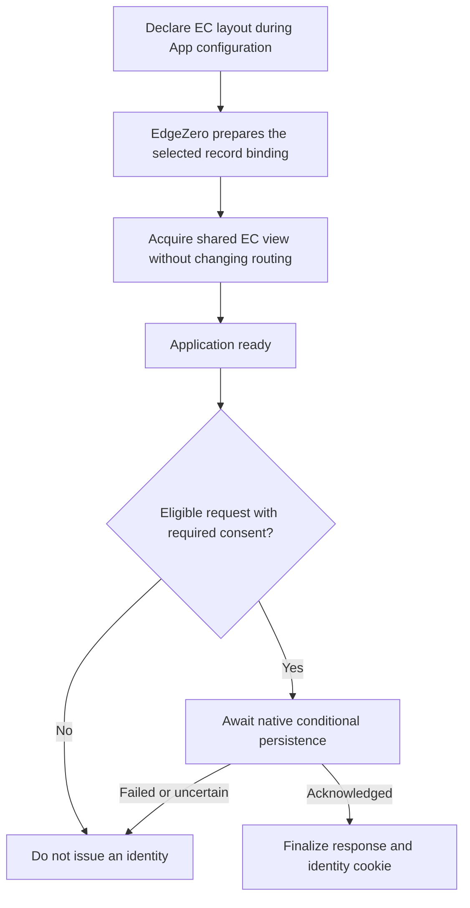

# Native EC persistence

Native EC persistence uses the shared core `RecordEcKvStore` over a prepared EdgeZero record binding. TS does not implement DynamoDB atomics, generation allocation or cursor decoding. The identity graph still owns consent, entry validation, collision handling and caller-specific conflict/recovery decisions.

Ordinary and record operations on that binding share value rows. An ordinary replacement clears metadata and invalidates old generations. Configuration and secret snapshots remain immutable; identity rows stay live.



## Select the prepared binding

Build the native adapter with `aws-dynamodb-ec`, which forwards to EdgeZero's default-off `aws-dynamodb-records` feature. For this adoption stage, `TS_EC_DYNAMODB_ENABLED=true` declares the EC record requirement before preparation. Absence or `false` leaves EC persistence disabled. Invalid values or selecting it without the compiled feature fail startup.

Add this KV entry to the native store-bindings TOML already used for the application's config and secret stores:

```toml
version = 1

[kv.trusted_server_kv]
provider = "aws-dynamodb-records"
region = "us-east-1"
table = "example-retained-ec"
namespace = "example-staging"
```

Use the existing native binding-file selection mechanism. Keep its config/secret mappings in the same document. A raw `aws-dynamodb` binding does not satisfy the record requirement. Missing capability, a mismatched layout or failed selected-provider preparation is fatal before readiness, not permission to fall back to memory.

Region, table, namespace, credentials and endpoint behavior belong to EdgeZero's binding/provider configuration. The old `TS_EC_DYNAMODB_REGION`, `TS_EC_DYNAMODB_TABLE`, `TS_EC_DYNAMODB_NAMESPACE` and `TS_EC_DYNAMODB_LOCAL_ENDPOINT` do not configure another TS-owned provider. Tests use an explicitly isolated DynamoDB Local process with dummy credentials. No hosted IAM or deployment qualification is implied.

## Key placement and generation lifetime

The application declares one stable `trusted-server-ec` layout:

- EC roots retain their full `<ip-hash>.<suffix>` keys and group by the complete `<ip-hash>.` prefix.
- Completion markers retain `__ts_ec_withdrawal_complete__:<ec-id>:<expiry>` and group by the marker namespace plus EC ID, ending in `:`.
- Layout resolution establishes placement. The graph still validates identity contents and marker expiry. A malformed marker is not silently accepted as proof of withdrawal.

DynamoDB uses a namespace/layout-qualified partition key for each declared group. Value and retained per-key generation rows have different sort-key kinds. There is no namespace-wide counter updated by every mutation. Add/CAS use native conditions, and deletion or TTL of a value must not reset its retained generation history. Failed conditional attempts may consume unused generations.

This is an explicit new record format, not a migration of the old `ec:{namespace}` and `ec-allocator:{namespace}` scheme. Reserve the table/namespace for the intended environment and retain allocator continuity through backup, restore and retirement. Do not restore an old allocator independently into an active dataset.

TTL visibility is provider-native. DynamoDB records remain visible until native physical deletion; TS consent and tombstone policy is not replaced by the TTL collector. No portable exact expiry deadline or new expiry envelope is added.

## Listing and errors

EC cluster counting supplies a complete hash partition, including its dot delimiter. Marker listing supplies its complete marker partition. The shared adapter follows native continuation through short or empty pages until the requested cap or authoritative end. Existing graph callers continue to reject saturated cleanup conservatively.

Strong partition Query and authoritative exact existence are separate from ordinary arbitrary-prefix/global Scan. An operator exposing ordinary global enumeration must account for its Scan cost and permission. Never scope a new policy to the obsolete single identity partition and global allocator.

Provider preparation and runtime operations use EdgeZero's bounded, single-attempt policies. Definitive Add/CAS rejection is normal contention. Ambiguous completion is an error, not a false rejection or an automatic replay. TS retains its explicit reread/merge/retry/defer policy; no new cookie is issued merely because an uncertain mutation might have committed.

## Eligibility and route boundaries

Persistence does not grant consent. Native eligibility uses checked client metadata and existing browser/navigation rules, not invented Fastly TLS or JA4 signals. Health checks, static assets, preflights and rejected authentication must not mint identities. Missing qualifying consent remains blocking. Synthetic local fixtures are not real publisher CMP acceptance.

Read-only identify does not create identities. Withdrawal remains writable for privacy-hardened clients, writes an authoritative tombstone, removes partner IDs and expires the browser cookie. Finalization is awaited before committing response headers.

Native admin EC management, Fastly S2S batch parity and post-send pull-sync integration are separate work.

## Executed local acceptance and remaining deployment work

The native lifecycle suite now runs through the shared adapter over real persistent records. It covers persistence-before-cookie, app recreation, consent/route exclusions, withdrawal, orphan recovery, cancellation, metadata/body coherence, stale tokens and native page traversal. The explicit `record_dynamodb` target exercises independent native Add/CAS, allocator-only Query pages, concurrent identity updates and withdrawal through DynamoDB Local.

These checks do not qualify a rebuilt application image, retained infrastructure, workload credentials, installed IAM/boundary policies, capacity, fleet failover, restore or real browser consent transport. The historical `test-native-ec-image.mjs` fixture targets the previous TS-owned backend and must be adapted before it can count as new-format image acceptance.

Review exact-table permissions, namespace/group scoping, retained state ownership and effective denies before any deployment. The application task role owns data access; do not move it to the execution role or remove unrelated boundaries. Do not add migration, apply infrastructure, publish images or deploy from these local test receipts.
