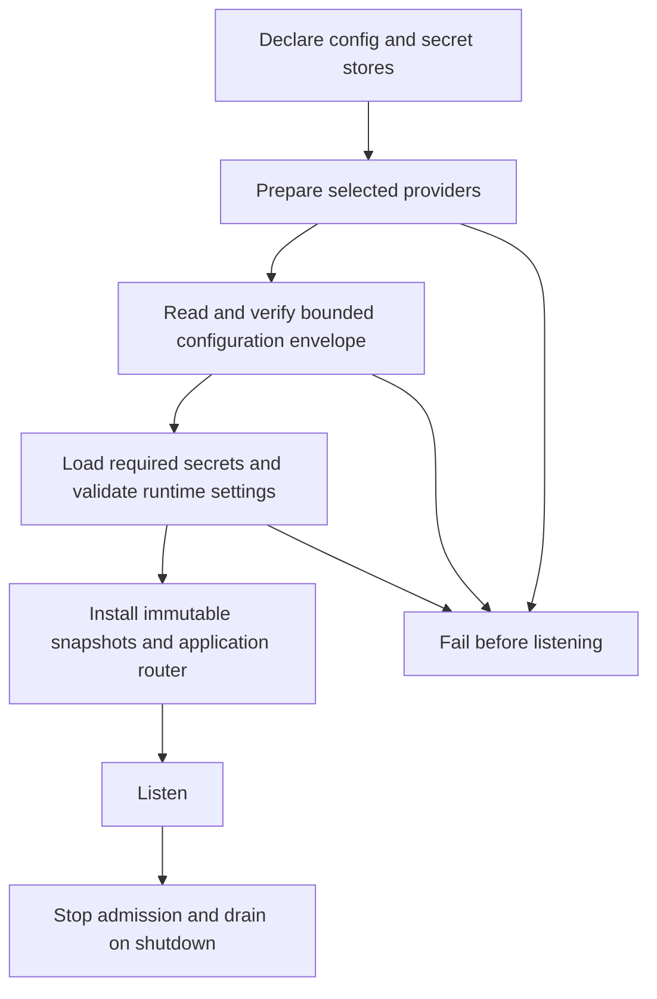

# Axum production startup

The Axum binary loads its config and secrets once, before it listens, from
stores that EdgeZero prepares: local files for development, or AWS AppConfig
and Secrets Manager in production. A missing or invalid input stops the process
with a non-zero exit before the port opens. On SIGTERM the server stops
accepting connections and finishes in-flight requests within a configured
grace.

The adapter uses the workspace EdgeZero pin; see
[the pinned version](./edgezero#pinned-version).

## Run locally

From the repository root, with `ts` built from this checkout:

```sh
cp trusted-server.example.toml trusted-server.toml
ts config push --adapter axum --local --no-diff --yes
EDGEZERO__ADAPTER__CONFIG_DIR="$PWD/.edgezero" \
EDGEZERO__SECRETS__HANDLER_PASSWORD="$(openssl rand -base64 32)" \
EDGEZERO__SECRETS__PUBLISHER_PROXY_SECRET="$(openssl rand -base64 32)" \
EDGEZERO__SECRETS__EC_PASSPHRASE="$(openssl rand -base64 32)" \
  cargo run -p trusted-server-adapter-axum
```

Leave one secret variable out to see startup fail before listening; the error
names the config field of the missing secret. [Getting started](./getting-started)
covers the development overlay and port settings.

## Startup sequence

The binary is `trusted-server-axum` in package
`trusted-server-adapter-axum`. EdgeZero owns provider preparation, the production
listener, admission and shutdown. TS owns application schema validation,
publisher authorization and the router built from resolved settings.



The declared identities are `trusted_server_config` and
`trusted_server_secrets`. The configuration key is `trusted_server_config`.
Required-provider and required-value failures prevent readiness. Startup bounds
envelope bytes, JSON structure, individual secret bytes, total backend bytes and
extraction time. Only deduplicated active secret references are loaded. Running
snapshots are immutable. Restart to adopt changed configuration or secrets.

Runtime loading preserves compatibility with previously published blobs,
including framing-header entries that response handling skips. Operator config
validation and publication still reject those entries. The native loader uses
TS's runtime validation policy, not operator publication validation.

Request-time store management writes, persistent signing-key management and
automatic key rotation are unavailable. Unsupported configured consumers, such
as enabled request signing, fail at startup. Axum has no Edge Cookie record
store or visitor geo yet. An AWS region is not a visitor's geography, and
missing geo keeps the existing consent behavior.

## Inputs

Use a disposable project directory containing `edgezero.toml` and an ordinary
`trusted-server.toml`. Keep secret references in config and private inputs
outside source control and image build contexts.

```sh
ts config validate
ts config push --adapter axum --local --no-diff --yes
```

The default output is
`.edgezero/local-config-trusted_server_config.json`, an outer key-to-string map.
Its `trusted_server_config` value is the serialized TS BlobEnvelope with version
and digest. AppConfig Agent returns that envelope document itself. Secrets
Manager returns each whole secret value, not a selected JSON field. Local
publication does not publish to AWS.

| Input                                       | Meaning                                       |
| ------------------------------------------- | --------------------------------------------- |
| `EDGEZERO__ADAPTER__CONFIG_DIR`             | Directory containing local configuration maps |
| `EDGEZERO__ADAPTER__HOST`                   | Listen address                                |
| `EDGEZERO__ADAPTER__PORT`                   | Listen port                                   |
| `EDGEZERO__ADAPTER__SHUTDOWN_GRACE_SECONDS` | In-flight drain grace                         |
| `EDGEZERO__ADAPTER__INGRESS__*`             | Framework ingress limits                      |
| `EDGEZERO__STORE_BINDINGS_FILE`             | Runtime-only provider selection and mappings  |
| `EDGEZERO__SECRETS__<KEY>`                  | Local secret value, key uppercased            |

Legacy `TRUSTED_SERVER_CONFIG_*`, `TRUSTED_SERVER_SECRET_*` and runtime
`TRUSTED_SERVER__*` settings cannot rescue missing prepared inputs. Typed CLI
configuration overlays remain part of config publication.

Native features `aws-appconfig-agent` and `aws-secrets-manager` independently
enable EdgeZero providers and default off. CLI features do not enable server
providers. The server creates no AWS resources; provision the AppConfig
profile and secrets before starting it.

## Request handling

TS captures its authenticated, publisher-bounded forwarding decision before
framework sanitation. Checked proxy provenance alone does not authorize a
publisher origin. Missing credentials, invalid credentials and outside-publisher
hosts cannot supply that origin. Forwarding fields and credentials do not reach
the publisher.

First-party proxy URLs retain the configured `publisher.public_origin`, falling
back to HTTPS and the publisher domain. Protocol-relative signing targets use
authenticated forwarding or runtime request information. An absolute request
target cannot replace managed ingress evidence, including an unavailable origin.

Outbound work uses the incoming EdgeZero client directly. There is no TS native
HTTP bridge, pending/select compatibility layer or fallback transport.

## Checks and limits

```sh
cargo test --locked -p trusted-server-adapter-axum --all-features
cargo test --locked -p trusted-server-core --lib
node --test 'scripts/tests/*.test.mjs'
```

Process tests use synthetic envelopes, secrets and local origins. They cover
startup rejection, legacy live-schema compatibility, snapshot isolation and
restart adoption, real routes, POST bodies, authenticated gateway isolation and
SIGTERM drain with an admitted response held at the origin.

The ignored real Next.js test requires its local fixture and
`NATIVE_NEXTJS_ORIGIN`. See the native test fixture README. An ignored result is
not a pass.

Provider acceptance needs Docker, a binary built with both provider features,
and disposable local AppConfig Agent and Moto (an AWS mock) containers. CI runs
only the helper unit tests above; run the full check locally:

```sh
cargo build --locked -p trusted-server-adapter-axum \
  --features aws-appconfig-agent,aws-secrets-manager
node scripts/test-native-providers.mjs /absolute/path/to/trusted-server-axum
```

These fixtures do not establish hosted, image, fleet or live-data acceptance.
Deployment and infrastructure migration are separate operations.

Keep `EDGEZERO__LOGGING__LEVEL` at `info` or quieter around operator inputs.
Dependency DEBUG/TRACE events can expose credential-source metadata, ARNs or
bodies.
AppConfig Agent diagnostics can include its request URL. This adapter does not
suppress dependency events.
