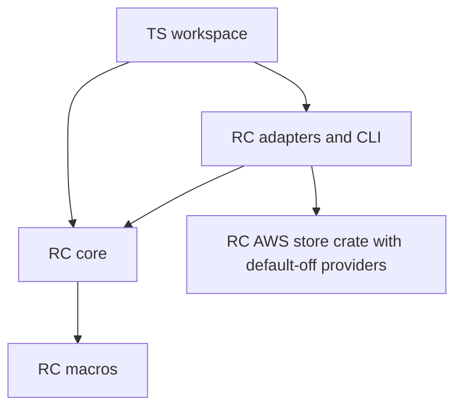
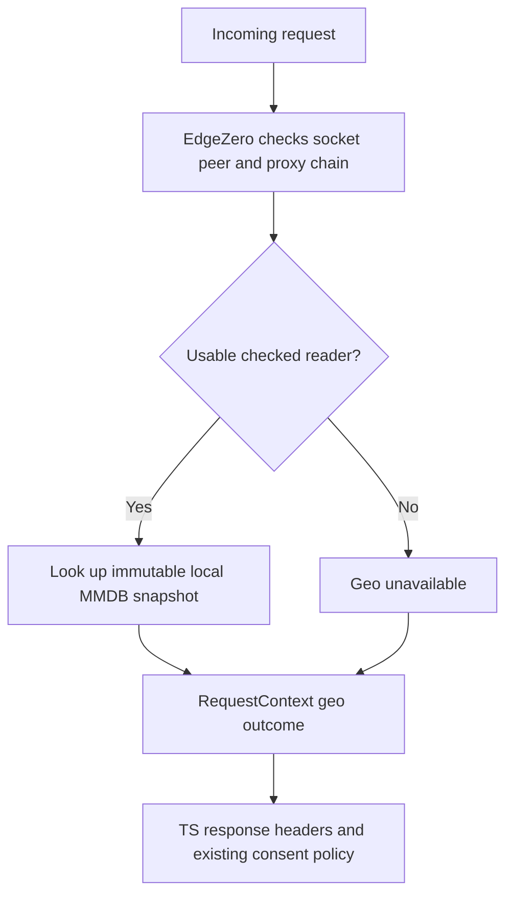
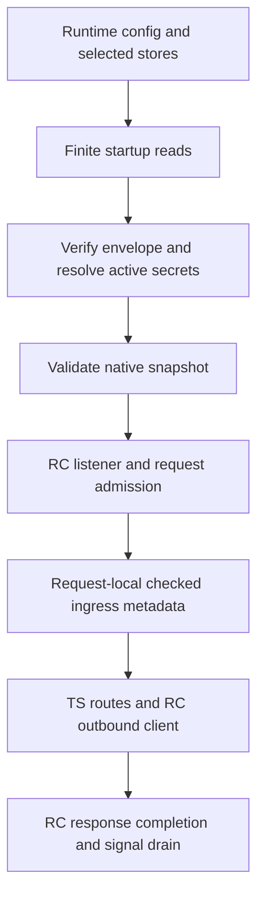

# Native EdgeZero RC demo

This is a compatibility/demo candidate, not production certification or an AWS
deployment. It starts from Trusted Server main
`6ef07ae52bec3e695ec57fe090243b1a281c314f` and pins EdgeZero to
`fda87556f5aab160711eb5244c1d1065a6bb48d6`. PRs #1410, #1411 and #1412,
including their #777 module/configuration/permission stack, are excluded.
Native Geo supports Off, a local GeoLite database, or protected CloudFront
assertions. Both built-in implementations are default-off and require an explicit
TS boot profile as well as their build feature.

The [validation record](./native-rc-validation.md) lists executed checks,
resolved failures and remaining limits.

The native entry point is `trusted-server-axum` in package
`trusted-server-adapter-axum`. It runs the RC production initializer and listener,
not the former environment-backed development router. Required configuration and
secret reads finish before listening. Selected-provider failures are fatal.
Running snapshots are immutable; restart to adopt a changed configuration or
secret. Management writes, native signing and automatic key rotation are outside
this demo. A configuration requiring unsupported stores or signing is rejected.

## Dependency graph

All six workspace EdgeZero declarations use one Git URL and the full revision
above. `cargo metadata --locked` resolves its core, macros, adapter crates, CLI
and AWS store crate to that single source.



Shared identities resolve to bytes `1.12.1`, Fastly/log-fastly `0.13.1`, Spin SDK
`7.0.0`, validator `0.21.0` and Worker `0.8.5`. ESI `0.7.2` uses the dependency-only
Fastly SDK patch at `75bfbb396d4cb7792610f1287cbec61675f13f38`; remove it when
upstream releases the SDK range change. TS cryptographic algorithms, crate
majors are unchanged. Existing populated Geo wire fields keep their names; partial
results omit unavailable detail. AWS SDK dependencies are
absent from the default native and all three WASM adapter graphs.

## Prepare the existing configuration envelope

Use a disposable project directory containing `edgezero.toml` and an ordinary
`trusted-server.toml`. Keep secrets as references in the configuration. The
tracked `trusted-server.example.toml` describes that existing schema. Do not copy
private operator configuration into build contexts or test fixtures.

With a separately built host `ts` CLI, use its existing local export:

```sh
ts config validate
ts config push --adapter axum --local --no-diff --yes
```

The default local output is
`.edgezero/local-config-trusted_server_config.json`. It is an outer key-to-string
JSON map. The `trusted_server_config` value is the existing serialized
BlobEnvelope, including its version and SHA-256, not a new configuration format.
Extract the same envelope as an operator publication input:

```sh
node --input-type=module -e '
import { readFileSync, writeFileSync } from "node:fs";
const map = JSON.parse(readFileSync(".edgezero/local-config-trusted_server_config.json", "utf8"));
const text = map.trusted_server_config;
if (typeof text !== "string") throw new Error("missing envelope");
JSON.parse(text);
writeFileSync("publication-envelope.json", text);
'
```

This extraction checks JSON shape only. TS startup verifies the envelope digest
and resolves active secret references. `ts config push --local` is not an AWS
publisher. Publishing the extracted document, provisioning providers, credentials,
IAM, TLS and release orchestration remain operator work outside this change.
AppConfig Agent supplies the envelope document itself, not the outer local map.
Secrets Manager supplies each whole secret value, not an arbitrary JSON field.

## Native launch inputs

The portable manifest and native Hooks declare only `trusted_server_config`
and `trusted_server_secrets`. A metadata test checks both native IDs against the
manifest. The unused generic `trusted_server_kv` declaration is removed, because
the RC correctly treats a declared ID as required. Remove obsolete
`trusted_server_kv` mappings from native binding files. Existing Fastly EC storage
continues through its separate backend. The default configuration key is
`trusted_server_config`. No EC graph or DynamoDB persistence is added.

Set these before launch:

| Input                                       | Meaning                                                                                               |
| ------------------------------------------- | ----------------------------------------------------------------------------------------------------- |
| `EDGEZERO__ADAPTER__CONFIG_DIR`             | Absolute directory containing `local-config-trusted_server_config.json` for the local config provider |
| `EDGEZERO__ADAPTER__DATA_DIR`               | Optional writable data directory; unused without native KV                                            |
| `EDGEZERO__ADAPTER__HOST`                   | Explicit listen address, `0.0.0.0` in containers                                                      |
| `EDGEZERO__ADAPTER__PORT`                   | Listen port, image default `8787`                                                                     |
| `EDGEZERO__ADAPTER__SHUTDOWN_GRACE_SECONDS` | RC in-flight drain grace                                                                              |
| `EDGEZERO__STORE_BINDINGS_FILE`             | Optional runtime-only TOML selecting providers and their mappings                                     |
| `EDGEZERO__SECRETS__<KEY>`                  | Local secret provider value, key uppercased                                                           |

Legacy `TRUSTED_SERVER_CONFIG_*`, `TRUSTED_SERVER_SECRET_*` and runtime
`TRUSTED_SERVER__*` values cannot rescue missing prepared inputs. Typed
`TRUSTED_SERVER__*` overrides still belong to the CLI configuration workflow.

The local RC secret provider reads process environment, not a mounted-secret
file API. For the local container example below, a runtime shell loads a trusted,
read-only mounted shell environment file, then `exec`s the binary as PID 1.
The file must contain only trusted shell assignments and be readable by UID 10001. This is not a general-purpose untrusted secret-file parser. Environment
secrets remain visible to Docker administrators. Remote Secrets Manager bindings
avoid this local file-to-environment bridge.

## Optional native Geo

Compile `geo-maxmind` for local IP lookup, `geo-cloudfront` for protected
assertions, or both to make either available. Select exactly one through a
separately delivered TS boot profile. EdgeZero does not read a Geo setting from
store bindings, publisher AppConfig or an `EDGEZERO__GEO__*` environment variable.
Set `TS_NATIVE_GEO_PROFILE_FILE` to the profile path. No profile means Off.
An unreadable/invalid selected profile or compiled-out provider fails startup.

### Local GeoLite lookup

Local lookup requires no AWS, ALB, CloudFront, origin credential or geographic
request headers. This is native Unix hosting support, not a WASM provider.

```toml
version = 1

[geo]
provider = "maxmind"
database_path = "/geo/GeoLite2-City.mmdb"
reader_ip_expectation = "forwarded_required"
```

The path must identify an extracted, regular MMDB file, not a gzip or tar archive.
Prefer an absolute path; relative paths resolve from the server's working directory.
Download and verify it outside the application, then mount it read-only and readable
by the runtime user, UID 10001 in the supplied image. The server has no downloader
and needs no MaxMind credentials. Do not commit or copy a production dataset into
this repository or its Docker build context.

Supported metadata types are `GeoLite2-City` and `GeoLite2-Country`.
City supplies country and optional first-level subdivision through this API.
Country supplies country only. Neither supplies city or coordinates to TS.

`reader_ip_expectation` is required:

- `forwarded_required` uses only a client resolved by EdgeZero's checked
  `Forwarded` or `X-Forwarded-For` handling. Use this behind reverse proxies.
  Missing/untrusted/unresolved forwarding leaves Geo unavailable. It does not
  fall back to geolocating the proxy.
- `peer_allowed` also permits the actual socket peer as the reader. Use it only
  when direct reader connections are intended.

For either forwarding header family, separately configure the actual trusted
proxy peers and trusted chain hops. For example, these are synthetic addresses,
not deployable provider ranges:

```sh
export EDGEZERO__ADAPTER__TRUSTED_PROXY_CIDRS=192.0.2.10/32,198.51.100.8/32
export EDGEZERO__ADAPTER__FORWARDING_HEADER_FAMILY=x-forwarded
export TS_NATIVE_GEO_PROFILE_FILE=/config/native-geo.toml
```

Use `forwarded` instead of `x-forwarded` for an ingress that owns the standard
`Forwarded` header. EdgeZero requires the actual TCP peer to be trusted, walks
the selected chain right-to-left across trusted hops, and stops at the first
untrusted address. Do not trust all private networks or a platform-wide range
merely to get a result. Network access controls must prevent unrelated callers
from impersonating the configured proxy peers. Raw geographic headers and
`Fly-Client-IP` do not override the selected local lookup.



EdgeZero reads and validates the selected database before application initialization,
listening and readiness. Missing, corrupt or unsupported databases fail startup
without falling back to Off. Replacing/deleting the source file does not change a
running snapshot. Publish a complete replacement and restart each process to adopt
updates. Measure startup time and peak memory with your chosen snapshot before
deployment. The upstream pinned reader has a known unused-metadata validation
limitation, tracked in EdgeZero issue #438; it does not authenticate the dataset.

Operators own GeoLite download/update, license and attribution requirements.
This product includes GeoLite Data created by MaxMind, available from
https://www.maxmind.com. <!-- allow-domain: www.maxmind.com -->

#### Fly.io and other reverse proxies

Fly's [request-header documentation](https://fly.io/docs/networking/request-headers/) <!-- allow-domain: fly.io -->
says its `X-Forwarded-For` ends with an app-assigned shared or dedicated IP.
For the generic chain walker to reach the reader, configure both the actual
socket-peer ranges and any deployment-controlled rightmost proxy hops, including
that app address where present. Use exact `/32` or `/128` addresses where possible.
Confirm the peer and chain on your deployment and retest when routing or assigned
addresses change. The docs do not establish a stable socket-peer allowlist, so
there is no built-in Fly CIDR default.

Start with `forwarded_required` and `x-forwarded`. Test a normal request, a forged
leftmost XFF entry, missing forwarding, and access that bypasses the intended
ingress. Do not enable Geo by trusting every peer. If your network cannot provide
a narrow authenticated ingress boundary, put a controlled proxy in front of TS
that normalizes forwarding and restrict access to it. This branch does not add a
Fly header parser or claim a verified live Fly deployment.

#### Test an operator snapshot locally

The normal adapter tests use tiny synthetic databases and require no account or
download. An ignored test also exercises a real operator snapshot through the
production binary. Supply a known IP/location pair from your dataset:

```sh
TS_TEST_GEOLITE_DATABASE=/absolute/path/to/GeoLite2-City.mmdb \
TS_TEST_GEO_IP="<known reader IP>" \
TS_TEST_GEO_COUNTRY="<expected two-letter country>" \
TS_TEST_GEO_REGION="<expected subdivision>" \
cargo test --locked -p trusted-server-adapter-axum --features geo-maxmind \
  --test startup operator_geolite_snapshot_resolves_checked_reader -- --ignored
```

Unset `TS_TEST_GEO_REGION` when the selected record has no subdivision.
The test uses a loopback trusted proxy and a synthetic app-address hop, requires
a forwarded reader and checks that a direct request stays unavailable.

### Protected CloudFront assertions

```toml
version = 1

[geo]
provider = "cloudfront"
alb_peer_cidrs = ["10.42.1.0/24", "10.42.2.0/24"]
origin_credential_header_name = "x-origin-example-removal"
```

Set `TS_NATIVE_GEO_PROFILE_FILE` to that file. With no profile, local hosting
remains Off. A selected invalid/unreadable profile or compiled-out provider
fails before readiness. The protected policy accepts actual ALB peer ranges and
only the credential removal name, never its expected value. Keep real header
names and values out of logs and public configuration. The deployment wrapper
can atomically render `TS_NATIVE_GEO_PROFILE_TOML` into its private runtime
volume, unset those content bytes, and export the file pointer.

The required front door is CloudFront with generated country/subdivision
headers, HTTPS to an exact-credential-gated ALB, CloudFront-only ALB ingress,
and an ALB-only private application port. Disable shared caching, including
cacheable errors. Ordinary forwarding trust and protected Geo source admission
are separate. See the [native deployment draft](../../deploy/native-demo/README.md)
for staged origin/DNS cutover and cleanup ownership.

TS reads only the immutable `RequestContext::geo()` result. Country-only data
has no invented city or coordinates. Missing, invalid or untrusted results stay
unavailable; US country without a recognized subdivision stays Unknown for
consent policy. Real geographic estimates do not grant consent. The existing
TCF/GPC/identity rules and unavailable identity KV remain unchanged.

The production options runner preserves SIGINT/SIGTERM and bounded drain. The
admitted error-response finalizer preserves Geo/TS headers on framework-rendered
errors without replacing EdgeZero's status, required headers or failure
classification. Pre-admission failures without a managed outcome remain outside
that finalizer.

## Build and run the image

Build from the workspace root. Rust `1.98.1`, Node `24.12.0` and the runtime base
have registry-resolved digest pins in `Dockerfile`. `npm ci` and `cargo build
--release --locked` run inside the builder. Host `target`, `node_modules` and
`dist` are excluded. The JS build script creates and validates fresh bundles in
its private Cargo `OUT_DIR` and embeds them in the actual TS binary.

```sh
docker build --build-arg TRUSTED_SERVER__GIT_VERSION="$(git rev-parse HEAD)" \
  -t ts-edgezero431-local:local .
# Optional, explicit store/Geo forwarding, default is local providers only:
docker build --build-arg TRUSTED_SERVER__GIT_VERSION="$(git rev-parse HEAD)" \
  --build-arg NATIVE_FEATURES=aws-appconfig-agent,aws-secrets-manager \
  -t ts-edgezero431-local:providers .
```

The recipe accepts `aws-appconfig-agent`, `aws-secrets-manager`,
`aws-dynamodb-ec`, `geo-cloudfront` and `geo-maxmind`. Add `geo-maxmind` to
`NATIVE_FEATURES` for local lookup or `geo-cloudfront` for protected assertions.
Compiling a provider alone does not select Geo. CLI features do not compile
server providers. Mount the profile and extracted MMDB separately from the
image, for example:

```sh
docker build --build-arg NATIVE_FEATURES=geo-maxmind -t ts-native-geo:local .
# Add these to the existing prepared-config/secret docker run command:
# --mount type=bind,src=/srv/ts/native-geo.toml,dst=/config/native-geo.toml,readonly
# --mount type=bind,src=/srv/ts/geo,dst=/geo,readonly
# -e TS_NATIVE_GEO_PROFILE_FILE=/config/native-geo.toml
```

The image's existing prepared configuration and secrets remain required. Build outputs include `/usr/local/share/ts-build-inputs.sha256`
for comparing the exact copied build inputs with later working-tree changes.
Digest-pinned bases do not make subsequent Debian security updates bit-reproducible.
Build from a clean committed checkout when supplying the existing git-version
build input. Without that optional input, an exported container tree has no git
metadata and omits `X-TS-Version` instead of inventing a version.

Prepare an absolute `DEMO_CONFIG_DIR` containing the outer local JSON map and a
`DEMO_SECRET_FILE` containing local synthetic assignments, for example
`EDGEZERO__SECRETS__EC_KEY=synthetic-ec-passphrase-at-least-32-bytes`. Its key names
must match the references in your envelope. Also supply the publisher proxy and
configured handler passwords. Then run:

```sh
docker run --rm --name ts-native-demo \
  --read-only --cap-drop=ALL --security-opt=no-new-privileges \
  --publish 127.0.0.1:8787:8787 \
  --mount "type=bind,src=$DEMO_CONFIG_DIR,dst=/config,readonly" \
  --mount "type=bind,src=$DEMO_SECRET_FILE,dst=/run/secrets/local.env,readonly" \
  --tmpfs /data:rw,noexec,nosuid,size=16m,uid=10001,gid=10001,mode=0700 \
  --tmpfs /tmp:rw,noexec,nosuid,size=16m,uid=10001,gid=10001,mode=0700 \
  --env EDGEZERO__ADAPTER__SHUTDOWN_GRACE_SECONDS=3 \
  --entrypoint /bin/sh ts-edgezero431-local:local \
  -ec 'set -a; . /run/secrets/local.env; exec /usr/local/bin/app'
```

The image runs as numeric `10001:10001`, includes CA roots, and contains no Node
or Rust toolchain. Read-only root is a launch constraint, not something an image
can force by itself. `/config` and any provider bindings or credentials must be
runtime-only mounts. `/data` and `/tmp` are explicit bounded writable mounts.
The synthetic smoke uses an isolated Docker network and a pinned Node origin
fixture container. Node exists only in that fixture and the builder, never the
TS runtime image. Ordinary deployments must supply their own permitted origin
and network policy.

## Repeatable acceptance

```sh
mkdir -p "$HOME/.cache/ts431-container-tmp"
TMPDIR="$HOME/.cache/ts431-container-tmp" \
  node scripts/test-native-container.mjs ts-edgezero431-local:local
```

The smoke creates synthetic fixtures only, starts a local HTML origin container
and uses randomly named owned containers, an isolated network and an ephemeral
published port. It checks
invalid-envelope and missing-secret failure before listen, health readiness,
page rewriting and the injected embedded TSJS URL, non-loopback container
reachability, runtime hardening and an in-flight SIGTERM drain with bounded normal
exit. It removes only its own containers, network and scratch directory, not
images, shared build caches or unrelated temporary files. It needs Docker, host
Node and published-port connectivity. Failed checks are failures, not skipped
acceptance.

Independent provider acceptance uses a separately built absolute-path native
binary with both AWS features enabled:

```sh
ABS_BINARY=/absolute/path/to/trusted-server-axum
node scripts/test-native-providers.mjs "$ABS_BINARY"
```

That script uses synthetic isolated AppConfig Agent and Secrets Manager fixtures,
not AWS accounts. Provider acceptance and native Next.js transport tests are
separate from the container smoke. The container smoke does not certify cloud
providers, auction outcomes, TLS, both architectures or production capacity.
The local image build and smoke were exercised on `linux/amd64` with Docker
Engine `29.7.2`. The `linux/arm64` image and optional AWS-feature image build
remain unverified here.

## Metadata and adapter limits



Native client IP and public URL metadata come from checked RC
`NativeIngressMetadata`. RequestInfo, URI and Host are normalized together from
those checked facts, including absolute-form request targets. Raw Forwarded-family
headers do not grant trust. Only
explicitly configured trusted proxies may supply forwarding metadata. Optional
native Geo comes from the independently protected CloudFront assertion path,
not the deployment region or raw reader/forwarding headers. No GeoIP database or
remote lookup ships with this provider. Country/subdivision results do not
reproduce Fastly city/coordinate precision, and consent remains fail-closed.

Keep `RUST_LOG` at `info` or quieter for ordinary runs. AWS SDK dependencies can
expose credential-source metadata, ARNs or bodies at DEBUG/TRACE, and AppConfig
Agent diagnostics can include the configured request URL. TS does not suppress
these dependency events. Do not enable verbose dependency logging around
operator credentials or sensitive configuration.

Fastly retains the raw SDK `/health`, `/_ts/debug/ja4` and feature-gated sandbox
metrics probe exceptions. They remain outside RC admission/egress accounting and
do not build the application. Native container evidence does not establish their
behavior. Spin migrates to exact SDK `7.0.0`, `wasm32-wasip2`, P3 `wasi:http`
`0.3.0` and Spin `>=4.1.0`; its component/host acceptance is independent of this
native image. No registry publication, cloud deployment or release automation is
part of this guide.
