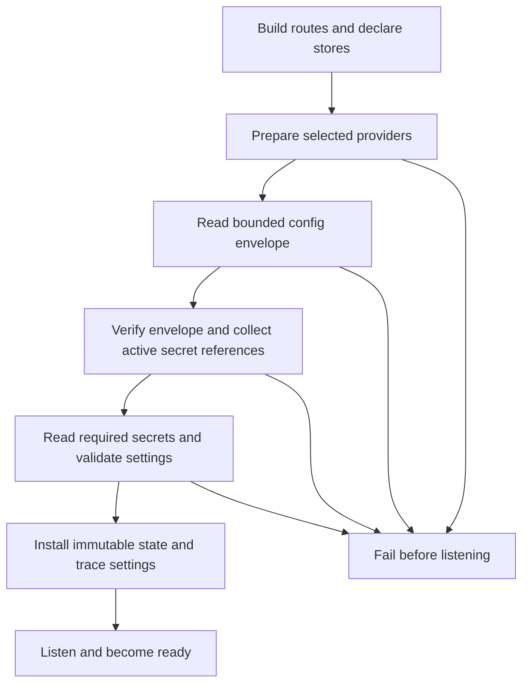

# Native prepared-store startup

This extracts the existing native demo onto the reviewed EdgeZero stack. It is
not production certification or an AWS deployment. The extraction starts from TS
main `6fbe64aa056a17d32b272d67df3dd89b21ce895f` and uses one exact public SDK revision,
`456313675b6a85e11acea870240f6a6d869f1137`. The original demo RC remains preserved.

The binary is `trusted-server-axum` in package
`trusted-server-adapter-axum`. It uses the framework production initializer,
listener, admission and signal/drain lifecycle. It does not load the former
legacy environment-backed development settings. Required configuration and
secret reads finish before listening; selected-provider failures are fatal.
Running snapshots are immutable. Restart to adopt changed inputs.

## Startup contract



Only `trusted_server_config` and `trusted_server_secrets` are declared by native
application metadata. The configuration key is `trusted_server_config`. The
metadata/manifest regression checks these identities. Generic runtime KV and
reader geography remain unavailable. This unit adds no native EC graph,
DynamoDB persistence, signing, automatic key rotation or management writes.
Configurations requiring unsupported native signing or dynamic external config
stores fail before readiness with an actionable error.

The SDK retains the application clock, extraction limits, listener and response
owner. The startup callback installs read-only configuration/secret snapshots and
application state. Trace settings are bound during that same callback, before
serving, because the pre-dispatch hook intentionally runs before router state
injection. Explicit-settings and explicit-services constructors remain test
seams, not alternate production provider fallbacks.

## Prepare the existing envelope

Use a disposable project directory containing `edgezero.toml` and an ordinary
`trusted-server.toml`. Keep secrets as references. The source-controlled
`trusted-server.example.toml` documents the schema; do not copy private operator
inputs into fixtures or build contexts.

The existing host CLI exports the local envelope:

```sh
ts config validate
ts config push --adapter axum --local --no-diff --yes
```

Its default output, `.edgezero/local-config-trusted_server_config.json`, is an
outer key-to-string JSON map. The `trusted_server_config` value is the serialized
TS BlobEnvelope with its version and digest. AppConfig Agent supplies that
envelope document itself, not the outer local map. Secrets Manager supplies each
whole secret value, not a selected JSON field. This is not a new config format
or an AWS publication command.

## Native inputs

| Input                                       | Meaning                                                     |
| ------------------------------------------- | ----------------------------------------------------------- |
| `EDGEZERO__ADAPTER__CONFIG_DIR`             | Directory containing the local configuration map            |
| `EDGEZERO__ADAPTER__HOST`                   | Explicit listen address                                     |
| `EDGEZERO__ADAPTER__PORT`                   | Listen port                                                 |
| `EDGEZERO__ADAPTER__SHUTDOWN_GRACE_SECONDS` | Existing framework in-flight drain grace                    |
| `EDGEZERO__STORE_BINDINGS_FILE`             | Optional runtime-only TOML selecting providers and mappings |
| `EDGEZERO__SECRETS__<KEY>`                  | Local secret provider value, key uppercased                 |

Legacy `TRUSTED_SERVER_CONFIG_*`, `TRUSTED_SERVER_SECRET_*` and runtime
`TRUSTED_SERVER__*` settings cannot rescue missing prepared inputs. Typed
`TRUSTED_SERVER__*` overlays still belong to the CLI configuration workflow.
Native features `aws-appconfig-agent` and `aws-secrets-manager` independently
forward the existing SDK providers and default off. CLI features do not enable
server providers. AWS dependencies remain native-only.

The local secret provider reads environment values. Runtime wrapping, image
production and sanitized infrastructure examples are separate review units.
This startup change neither parses an untrusted secret file nor provisions AWS.

## Request and transport contracts

Checked `NativeIngressMetadata` supplies the request-local client address and
public host/scheme. The adapter prepares the URL view, URI and Host from those
same checked facts, including absolute-form request targets. The original SDK
ingress record remains intact. Prepared URL metadata does not grant trace-origin
privileges. Raw Forwarded families never grant trust; only explicitly configured
trusted proxies can supply checked forwarding facts. Reader geography stays
unknown and consent remains fail-closed.

All network work uses the incoming request's shared `EdgeZeroHttpClient`. The
native profile selects the SDK's existing decoding policy and streamed-response
support, retaining the original native demo contract. The shared client's
standalone/default byte policy remains separate. There is no raw HTTP fallback,
second transport, custom batch driver, new timer or retry layer. Explicit caller
deadlines remain supported; unset total timeouts use the SDK default.

The retained native HTTP regressions cover redirects, duplicate headers/cookies,
SDK gzip decoding, request/response limits, POST replay, expired deadlines,
stream cancellation, bodyless representation length and total body deadlines.
The shared Core suite covers current pending/select correlation and cancellation.
The retired batch-driver event/index protocol belongs to SDK conformance rather
than a duplicate TS driver implementation.

## Checks and limits

```sh
cargo test --locked -p trusted-server-adapter-axum
cargo test --locked -p trusted-server-core --lib
node --test scripts/tests/test-native-providers.test.mjs
```

The native subprocess tests exercise verified envelopes, missing/tampered inputs,
secret validation, no legacy fallback, health/TSJS/page routes, immutable running
snapshots, restart adoption, guarded POST bodies and two-client checked-ingress
isolation. The real Next.js fixture remains an explicitly selected acceptance
test requiring `NATIVE_NEXTJS_ORIGIN`; an ignored test is not a pass.

Independent provider acceptance uses an explicitly built binary with both AWS
features and disposable local provider fixtures:

```sh
cargo build --locked -p trusted-server-adapter-axum \
  --features aws-appconfig-agent,aws-secrets-manager
node scripts/test-native-providers.mjs /absolute/path/to/trusted-server-axum
```

These checks use synthetic inputs, not an AWS account. They do not establish
cloud, publisher, auction, fleet, production security or image acceptance.
Historical qualification reports are not packaged as current approval.

Keep `RUST_LOG` at `info` or quieter around operator inputs. AWS dependency
DEBUG/TRACE events can expose credential-source metadata, ARNs or response
bodies; AppConfig Agent diagnostics can include the request URL. This adapter
does not suppress those dependency events. No deployment or live input switch is
part of this change.
