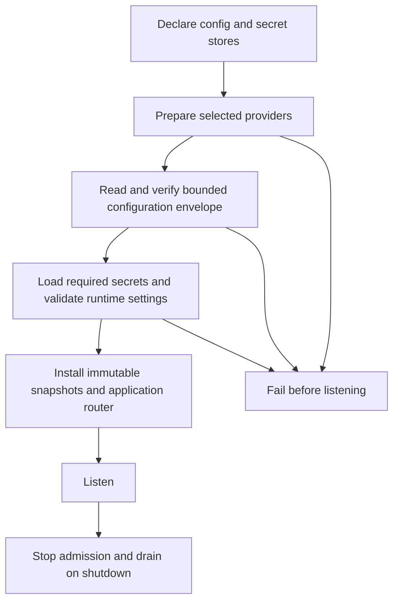

# Native prepared startup

The native adapter uses the published EdgeZero
`v0.0.12-rc-axum.202611.2` tag at
`4407d94130a9b752a70528b6c6f9c8fe3c10b81d`. It retains PR #1506's direct
outbound API and current-main application behavior. Historical demo results do
not qualify this combination.

## Prepared startup

The binary is `trusted-server-axum` in package
`trusted-server-adapter-axum`. EdgeZero owns provider preparation, the production
listener, admission and shutdown. TS owns application schema validation,
publisher authorization and the router built from resolved settings.



The declared identities are `trusted_server_config` and
`trusted_server_secrets`. The configuration key is `trusted_server_config`.
Required-provider and required-value failures prevent readiness. Startup bounds
envelope bytes, JSON structure, individual secret bytes, total backend bytes and
extraction time. Only deduplicated active secret references are loaded. Running
snapshots are immutable. Restart to adopt changed configuration or secrets.

Runtime loading preserves compatibility with previously published blobs,
including framing-header entries that response handling skips. Operator config
validation and publication still reject those entries. The native loader uses
TS's runtime validation policy, not operator publication validation.

Request-time store management writes, persistent signing-key management and
automatic key rotation are unavailable. Unsupported configured consumers fail
at startup. Native EC persistence remains separate. Reader Geo defaults Off;
the optional protected CloudFront selection below supplies country/subdivision
facts without granting consent. An AWS region is not visitor geography.

## Prepare local inputs

Use a disposable project directory containing `edgezero.toml` and an ordinary
`trusted-server.toml`. Keep secret references in config and private inputs
outside source control and image build contexts.

```sh
ts config validate
ts config push --adapter axum --local --no-diff --yes
```

The default output is
`.edgezero/local-config-trusted_server_config.json`, an outer key-to-string map.
Its `trusted_server_config` value is the serialized TS BlobEnvelope with version
and digest. AppConfig Agent returns that envelope document itself. Secrets
Manager returns each whole secret value, not a selected JSON field. Local
publication does not publish to AWS.

| Input                                       | Meaning                                       |
| ------------------------------------------- | --------------------------------------------- |
| `EDGEZERO__ADAPTER__CONFIG_DIR`             | Directory containing local configuration maps |
| `EDGEZERO__ADAPTER__HOST`                   | Listen address                                |
| `EDGEZERO__ADAPTER__PORT`                   | Listen port                                   |
| `EDGEZERO__ADAPTER__SHUTDOWN_GRACE_SECONDS` | In-flight drain grace                         |
| `EDGEZERO__ADAPTER__INGRESS__*`             | Framework ingress limits                      |
| `EDGEZERO__STORE_BINDINGS_FILE`             | Runtime-only provider selection and mappings  |
| `EDGEZERO__SECRETS__<KEY>`                  | Local secret value, key uppercased            |

Legacy `TRUSTED_SERVER_CONFIG_*`, `TRUSTED_SERVER_SECRET_*` and runtime
`TRUSTED_SERVER__*` settings cannot rescue missing prepared inputs. Typed CLI
configuration overlays remain part of config publication.

Native features `aws-appconfig-agent` and `aws-secrets-manager` independently
enable EdgeZero providers and default off. CLI features do not enable server
providers. This startup unit provisions nothing.

## Optional protected native Geo

Compile `geo-cloudfront` explicitly and set `TS_NATIVE_GEO_PROFILE_FILE` to a
separately delivered boot profile. Compiling the feature does not select it.
EdgeZero does not read this TS selection from publisher AppConfig, store bindings
or an `EDGEZERO__GEO__*` environment variable.

```toml
version = 1

[geo]
provider = "cloudfront"
alb_peer_cidrs = ["10.42.1.0/24", "10.42.2.0/24"]
origin_credential_header_name = "x-origin-example-removal"
```

An absent profile keeps Geo Off. An unreadable/invalid selected profile or a
compiled-out provider fails before readiness. The profile contains admitted
immediate ALB peer ranges and the credential header's removal name, never its
expected value. Diagnostics do not retain profile bytes or policy inputs.

This selection requires CloudFront-generated country/subdivision assertions,
HTTPS to an exact-credential-gated ALB, CloudFront-only ALB ingress and an ALB-only
private application port. EdgeZero does not authenticate an expected credential
value itself. The deployment must enforce that boundary. Disable shared caching,
including cacheable errors. Ordinary forwarding trust and protected Geo source
admission are independent. Provisioning and staged live-input changes are not
part of this feature.

TS reads the immutable `RequestContext::geo()` result, not raw Geo headers. A
located country/subdivision supplies one request-local snapshot to Core and
response finalization. Missing detail is absent rather than empty text or zero
coordinates. Complete populated Geo fields retain their existing flat wire
names. Unselected, untrusted and unavailable outcomes supply no location. US
without a recognized subdivision remains Unknown for existing consent policy.
Geographic estimates do not grant consent or change TCF/GPC/identity rules.

The admitted-error finalizer retains Geo/TS headers without replacing framework
status, required headers or failure classification. Pre-admission failures have
no managed outcome and remain outside that finalizer. The selected serving
provider is protected CloudFront, not the standalone EdgeZero KV Geo prototype. No
Geo database, remote lookup or licensed data is imported.

## Optional protected native Geo

Compile `geo-cloudfront` explicitly and set `TS_NATIVE_GEO_PROFILE_FILE` to a
separately delivered boot profile. Compiling the feature does not select it.
EdgeZero does not read this TS selection from publisher AppConfig, store bindings
or an `EDGEZERO__GEO__*` environment variable.

```toml
version = 1

[geo]
provider = "cloudfront"
alb_peer_cidrs = ["10.42.1.0/24", "10.42.2.0/24"]
origin_credential_header_name = "x-origin-example-removal"
```

An absent profile keeps Geo Off. An unreadable/invalid selected profile or a
compiled-out provider fails before readiness. The profile contains admitted
immediate ALB peer ranges and the credential header's removal name, never its
expected value. Diagnostics do not retain profile bytes or policy inputs.

This selection requires CloudFront-generated country/subdivision assertions,
HTTPS to an exact-credential-gated ALB, CloudFront-only ALB ingress and an ALB-only
private application port. EdgeZero does not authenticate an expected credential
value itself. The deployment must enforce that boundary. Disable shared caching,
including cacheable errors. Ordinary forwarding trust and protected Geo source
admission are independent. Provisioning and staged live-input changes are not
part of this feature.

TS reads the immutable `RequestContext::geo()` result, not raw Geo headers. A
located country/subdivision supplies one request-local snapshot to Core and
response finalization. Missing detail is absent rather than empty text or zero
coordinates. Complete populated Geo fields retain their existing flat wire
names. Unselected, untrusted and unavailable outcomes supply no location. US
without a recognized subdivision remains Unknown for existing consent policy.
Geographic estimates do not grant consent or change TCF/GPC/identity rules.

The admitted-error finalizer retains Geo/TS headers without replacing framework
status, required headers or failure classification. Pre-admission failures have
no managed outcome and remain outside that finalizer. The selected serving
provider is protected CloudFront, not the standalone EdgeZero KV Geo prototype. No
Geo database, remote lookup or licensed data is imported.

## Request handling

TS captures its authenticated, publisher-bounded forwarding decision before
framework sanitation. Checked proxy provenance alone does not authorize a
publisher origin. Missing credentials, invalid credentials and outside-publisher
hosts cannot supply that origin. Forwarding fields and credentials do not reach
the publisher.

First-party proxy URLs retain the configured `publisher.public_origin`, falling
back to HTTPS and the publisher domain. Protocol-relative signing targets use
authenticated forwarding or runtime request information. An absolute request
target cannot replace managed ingress evidence, including an unavailable origin.

Outbound work uses the incoming EdgeZero client directly. There is no TS native
HTTP bridge, pending/select compatibility layer or fallback transport.

## Checks and limits

```sh
cargo test --locked -p trusted-server-adapter-axum --all-features
cargo test --locked -p trusted-server-core --lib
node --test scripts/tests/test-native-providers.test.mjs
```

Process tests use synthetic envelopes, secrets and local origins. They cover
startup rejection, legacy live-schema compatibility, snapshot isolation and
restart adoption, real routes, POST bodies, authenticated gateway isolation and
SIGTERM drain with an admitted response held at the origin.

The ignored real Next.js test requires its local fixture and
`NATIVE_NEXTJS_ORIGIN`. See the native test fixture README. An ignored result is
not a pass.

Provider acceptance requires an explicitly built binary and disposable local
AppConfig Agent and Moto fixtures:

```sh
cargo build --locked -p trusted-server-adapter-axum \
  --features aws-appconfig-agent,aws-secrets-manager
node scripts/test-native-providers.mjs /absolute/path/to/trusted-server-axum
```

These fixtures do not establish hosted, image, fleet or live-data acceptance.
Deployment and infrastructure migration are separate operations.

Keep `RUST_LOG` at `info` or quieter around operator inputs. Dependency
DEBUG/TRACE events can expose credential-source metadata, ARNs or bodies.
AppConfig Agent diagnostics can include its request URL. This adapter does not
suppress dependency events.
