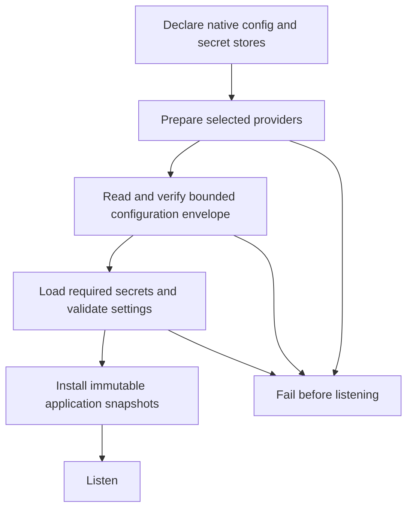

# Native demo baseline cleanup

This review sequence reconstructs the existing demo, not current-main forwarding
compatibility. Its TS starting point is historical main
`2dd968aeebeb2cc0d5110115f64e0ad58e2e1d13`, the contributor-documentation update
already merged into the original demo. The original final demo is TS
`2423a2ed2aefc2d4905219efd5910c9af5f2a930` plus separately preserved dirty inputs.
All selected EdgeZero declarations use the `ts-axum-rc-20261111` tag, which
resolves to the original public demo revision
`83d7a6296d285e135c4ea70021b19e6c8dca7e9f`, available in draft EdgeZero #431.

This is not a new qualification of that historical combination. Fresh checks
belong to the exact extracted units. Integration with today's TS main and
EdgeZero #462 is deferred. Existing PRs and original dirty worktrees remain
untouched. The separate Prebid relay/privacy work and excluded Geo implementation
are not dependencies of native startup.

## Prepared startup

The binary is `trusted-server-axum` in package
`trusted-server-adapter-axum`. It uses EdgeZero's production initializer,
listener and shutdown/drain lifecycle. It does not use the former environment
configuration fallback.



The declared identities are `trusted_server_config` and
`trusted_server_secrets`. The configuration key is `trusted_server_config`.
Selected-provider or required-value failures prevent readiness. Running snapshots
are immutable; restart to adopt changed configuration or secrets. Request-time
management writes, native signing and automatic key rotation are not supplied.
Unsupported configured consumers fail during startup.

This startup unit does not add native EC persistence or reader Geo. Those are
separate existing demo units. An AWS region is not a visitor's geography. Missing
Geo retains the existing fail-closed consent behavior.

## Prepare local inputs

Use a disposable project directory containing `edgezero.toml` and an ordinary
`trusted-server.toml`. The tracked `trusted-server.example.toml` documents the
schema. Keep secrets as references and keep private operator inputs outside
source control and image build contexts.

The existing host CLI exports the envelope:

```sh
ts config validate
ts config push --adapter axum --local --no-diff --yes
```

The default output is
`.edgezero/local-config-trusted_server_config.json`, an outer key-to-string map.
Its `trusted_server_config` value is the serialized TS BlobEnvelope with version
and digest. AppConfig Agent returns that envelope document itself, not the outer
local map. Secrets Manager returns each whole secret value, not a selected JSON
field. These are existing formats; this command does not publish to AWS.

| Input                                       | Meaning                                               |
| ------------------------------------------- | ----------------------------------------------------- |
| `EDGEZERO__ADAPTER__CONFIG_DIR`             | Directory containing local configuration maps         |
| `EDGEZERO__ADAPTER__HOST`                   | Listen address                                        |
| `EDGEZERO__ADAPTER__PORT`                   | Listen port                                           |
| `EDGEZERO__ADAPTER__SHUTDOWN_GRACE_SECONDS` | Existing in-flight drain grace                        |
| `EDGEZERO__STORE_BINDINGS_FILE`             | Optional runtime-only provider selection and mappings |
| `EDGEZERO__SECRETS__<KEY>`                  | Local secret value, key uppercased                    |

Legacy `TRUSTED_SERVER_CONFIG_*`, `TRUSTED_SERVER_SECRET_*` and runtime
`TRUSTED_SERVER__*` settings cannot rescue missing prepared inputs. Typed CLI
configuration overlays remain part of the configuration workflow.

Native features `aws-appconfig-agent` and `aws-secrets-manager` independently
forward the existing EdgeZero providers and default off. CLI features do not
enable server providers. Selected AWS dependencies stay native-only. Source-built
images, runtime wrapping and sanitized infrastructure examples are separate
review units; this startup unit provisions nothing.

## Request handling

Native reader address and public URL come from checked EdgeZero
`NativeIngressMetadata`. RequestInfo, URI and Host use the same checked facts,
including absolute-form request targets. Raw forwarding fields do not grant
trust. Only explicitly configured trusted proxies supply forwarding facts.

The existing native outbound bridge uses the incoming EdgeZero client and its
application clock. Retained tests cover guarded lazy uploads, request/response
bounds, native decoding, redirects, duplicate headers/cookies, cancellation and
body deadlines. This cleanup preserves that baseline transport implementation;
it does not add an alternate transport for the newer EdgeZero interfaces.

## Checks and limits

```sh
cargo test --locked -p trusted-server-adapter-axum --all-features
cargo test --locked -p trusted-server-core --lib
node --test scripts/tests/test-native-providers.test.mjs
```

Subprocess checks use synthetic envelopes, secrets and local origins. They cover
fail-before-listen behavior, immutable running snapshots and restart adoption,
health/TSJS/page routes, guarded POST bodies and checked two-gateway URL/client
isolation. The explicitly ignored Next.js test requires its local fixture and
`NATIVE_NEXTJS_ORIGIN`; an ignored test is not a pass.

Independent provider acceptance uses an explicitly built binary and disposable
local provider fixtures:

```sh
cargo build --locked -p trusted-server-adapter-axum \
  --features aws-appconfig-agent,aws-secrets-manager
node scripts/test-native-providers.mjs /absolute/path/to/trusted-server-axum
```

No current cloud, publisher, auction, fleet or image acceptance is implied by old
reports or local fixtures. Required broader checks remain necessary before
review readiness. No deployment or live input switch is part of this cleanup.

Keep `RUST_LOG` at `info` or quieter around operator inputs. Dependency
DEBUG/TRACE events can expose credential-source metadata, ARNs or bodies;
AppConfig Agent diagnostics can include its request URL. This adapter does not
suppress dependency events.
