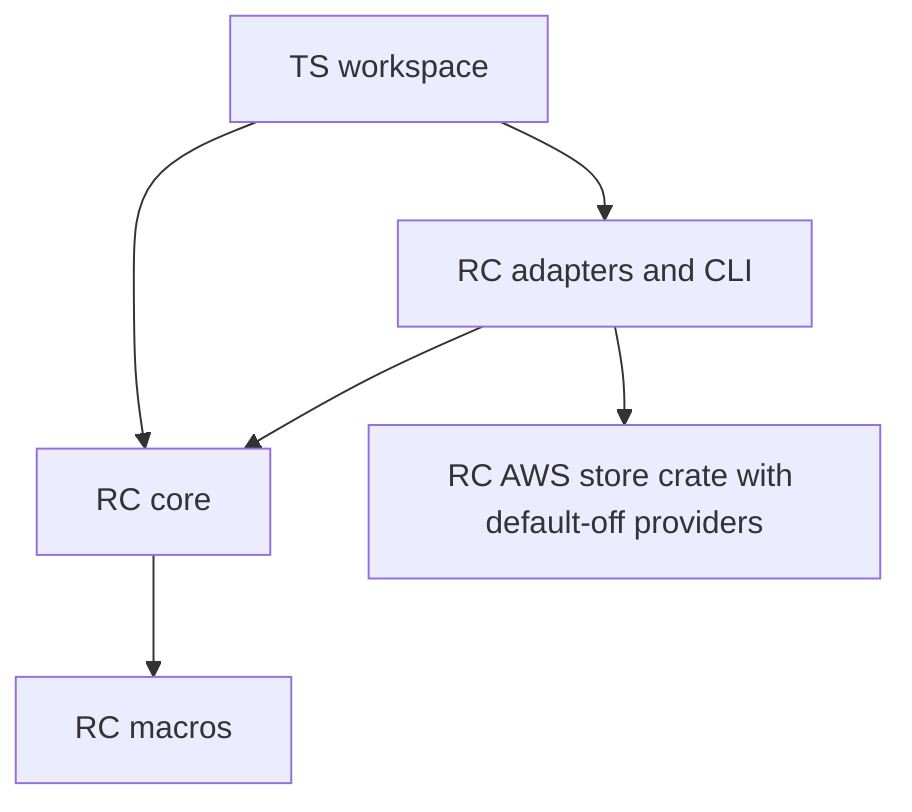
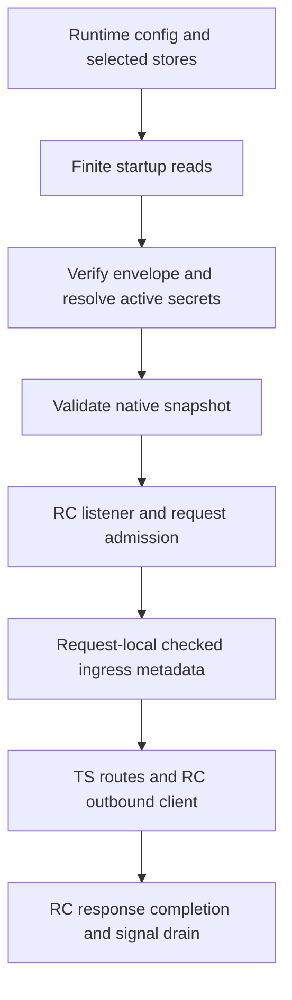

# Native EdgeZero RC demo

This is a compatibility/demo candidate, not production certification or an AWS
deployment. It starts from Trusted Server main
`6ef07ae52bec3e695ec57fe090243b1a281c314f` and pins EdgeZero to
`61bfe3b931fd97f5300287e4a91e33f32aa0fbee`. PRs #1410, #1411 and #1412,
including their #777 module/configuration/permission stack, are excluded.

The native entry point is `trusted-server-axum` in package
`trusted-server-adapter-axum`. It runs the RC production initializer and listener,
not the former environment-backed development router. Required configuration and
secret reads finish before listening. Selected-provider failures are fatal.
Running snapshots are immutable; restart to adopt a changed configuration or
secret. Management writes, native signing and automatic key rotation are outside
this demo. A configuration requiring unsupported stores or signing is rejected.

## Dependency graph

All six workspace EdgeZero declarations use one Git URL and the full revision
above. `cargo metadata --locked` resolves its core, macros, adapter crates, CLI
and AWS store crate to that single source.



Shared identities resolve to bytes `1.12.1`, Fastly/log-fastly `0.13.1`, Spin SDK
`7.0.0`, validator `0.21.0` and Worker `0.8.5`. ESI `0.7.2` uses the dependency-only
Fastly SDK patch at `75bfbb396d4cb7792610f1287cbec61675f13f38`; remove it when
upstream releases the SDK range change. TS cryptographic algorithms, crate
majors and serialized byte contracts are unchanged. AWS SDK dependencies are
absent from the default native and all three WASM adapter graphs.

## Prepare the existing configuration envelope

Use a disposable project directory containing `edgezero.toml` and an ordinary
`trusted-server.toml`. Keep secrets as references in the configuration. The
tracked `trusted-server.example.toml` describes that existing schema. Do not copy
private operator configuration into build contexts or test fixtures.

With a separately built host `ts` CLI, use its existing local export:

```sh
ts config validate
ts config push --adapter axum --local --no-diff --yes
```

The default local output is
`.edgezero/local-config-trusted_server_config.json`. It is an outer key-to-string
JSON map. The `trusted_server_config` value is the existing serialized
BlobEnvelope, including its version and SHA-256, not a new configuration format.
Extract the same envelope as an operator publication input:

```sh
node --input-type=module -e '
import { readFileSync, writeFileSync } from "node:fs";
const map = JSON.parse(readFileSync(".edgezero/local-config-trusted_server_config.json", "utf8"));
const text = map.trusted_server_config;
if (typeof text !== "string") throw new Error("missing envelope");
JSON.parse(text);
writeFileSync("publication-envelope.json", text);
'
```

This extraction checks JSON shape only. TS startup verifies the envelope digest
and resolves active secret references. `ts config push --local` is not an AWS
publisher. Publishing the extracted document, provisioning providers, credentials,
IAM, TLS and release orchestration remain operator work outside this change.
AppConfig Agent supplies the envelope document itself, not the outer local map.
Secrets Manager supplies each whole secret value, not an arbitrary JSON field.

## Native launch inputs

The portable manifest and native Hooks declare only `trusted_server_config`
and `trusted_server_secrets`. A metadata test checks both native IDs against the
manifest. The unused generic `trusted_server_kv` declaration is removed, because
the RC correctly treats a declared ID as required. Remove obsolete
`trusted_server_kv` mappings from native binding files. Existing Fastly EC storage
continues through its separate backend. The default configuration key is
`trusted_server_config`. No EC graph or DynamoDB persistence is added.

Set these before launch:

| Input                                       | Meaning                                                                                               |
| ------------------------------------------- | ----------------------------------------------------------------------------------------------------- |
| `EDGEZERO__ADAPTER__CONFIG_DIR`             | Absolute directory containing `local-config-trusted_server_config.json` for the local config provider |
| `EDGEZERO__ADAPTER__DATA_DIR`               | Optional writable data directory; unused without native KV                                            |
| `EDGEZERO__ADAPTER__HOST`                   | Explicit listen address, `0.0.0.0` in containers                                                      |
| `EDGEZERO__ADAPTER__PORT`                   | Listen port, image default `8787`                                                                     |
| `EDGEZERO__ADAPTER__SHUTDOWN_GRACE_SECONDS` | RC in-flight drain grace                                                                              |
| `EDGEZERO__STORE_BINDINGS_FILE`             | Optional runtime-only TOML selecting providers and their mappings                                     |
| `EDGEZERO__SECRETS__<KEY>`                  | Local secret provider value, key uppercased                                                           |

Legacy `TRUSTED_SERVER_CONFIG_*`, `TRUSTED_SERVER_SECRET_*` and runtime
`TRUSTED_SERVER__*` values cannot rescue missing prepared inputs. Typed
`TRUSTED_SERVER__*` overrides still belong to the CLI configuration workflow.

The local RC secret provider reads process environment, not a mounted-secret
file API. For the local container example below, a runtime shell loads a trusted,
read-only mounted shell environment file, then `exec`s the binary as PID 1.
The file must contain only trusted shell assignments and be readable by UID 10001. This is not a general-purpose untrusted secret-file parser. Environment
secrets remain visible to Docker administrators. Remote Secrets Manager bindings
avoid this local file-to-environment bridge.

## Build and run the image

Build from the workspace root. Rust `1.98.1`, Node `24.12.0` and the runtime base
have registry-resolved digest pins in `Dockerfile`. `npm ci` and `cargo build
--release --locked` run inside the builder. Host `target`, `node_modules` and
`dist` are excluded. The JS build script creates and validates fresh bundles in
its private Cargo `OUT_DIR` and embeds them in the actual TS binary.

```sh
docker build --build-arg TRUSTED_SERVER__GIT_VERSION="$(git rev-parse HEAD)" \
  -t ts-edgezero431-local:local .
# Optional, explicit server provider forwarding, default is local providers only:
docker build --build-arg TRUSTED_SERVER__GIT_VERSION="$(git rev-parse HEAD)" \
  --build-arg NATIVE_FEATURES=aws-appconfig-agent,aws-secrets-manager \
  -t ts-edgezero431-local:providers .
```

Only `aws-appconfig-agent` and `aws-secrets-manager` are accepted by this recipe.
CLI features do not compile server providers. There is no DynamoDB feature or EC
graph claim here. Build outputs include `/usr/local/share/ts-build-inputs.sha256`
for comparing the exact copied build inputs with later working-tree changes.
Digest-pinned bases do not make subsequent Debian security updates bit-reproducible.
Build from a clean committed checkout when supplying the existing git-version
build input. Without that optional input, an exported container tree has no git
metadata and omits `X-TS-Version` instead of inventing a version.

Prepare an absolute `DEMO_CONFIG_DIR` containing the outer local JSON map and a
`DEMO_SECRET_FILE` containing local synthetic assignments, for example
`EDGEZERO__SECRETS__EC_KEY=synthetic-ec-passphrase-at-least-32-bytes`. Its key names
must match the references in your envelope. Also supply the publisher proxy and
configured handler passwords. Then run:

```sh
docker run --rm --name ts-native-demo \
  --read-only --cap-drop=ALL --security-opt=no-new-privileges \
  --publish 127.0.0.1:8787:8787 \
  --mount "type=bind,src=$DEMO_CONFIG_DIR,dst=/config,readonly" \
  --mount "type=bind,src=$DEMO_SECRET_FILE,dst=/run/secrets/local.env,readonly" \
  --tmpfs /data:rw,noexec,nosuid,size=16m,uid=10001,gid=10001,mode=0700 \
  --tmpfs /tmp:rw,noexec,nosuid,size=16m,uid=10001,gid=10001,mode=0700 \
  --env EDGEZERO__ADAPTER__SHUTDOWN_GRACE_SECONDS=3 \
  --entrypoint /bin/sh ts-edgezero431-local:local \
  -ec 'set -a; . /run/secrets/local.env; exec /usr/local/bin/app'
```

The image runs as numeric `10001:10001`, includes CA roots, and contains no Node
or Rust toolchain. Read-only root is a launch constraint, not something an image
can force by itself. `/config` and any provider bindings or credentials must be
runtime-only mounts. `/data` and `/tmp` are explicit bounded writable mounts.
The synthetic smoke uses an isolated Docker network and a pinned Node origin
fixture container. Node exists only in that fixture and the builder, never the
TS runtime image. Ordinary deployments must supply their own permitted origin
and network policy.

## Repeatable acceptance

```sh
mkdir -p "$HOME/.cache/ts431-container-tmp"
TMPDIR="$HOME/.cache/ts431-container-tmp" \
  node scripts/test-native-container.mjs ts-edgezero431-local:local
```

The smoke creates synthetic fixtures only, starts a local HTML origin container
and uses randomly named owned containers, an isolated network and an ephemeral
published port. It checks
invalid-envelope and missing-secret failure before listen, health readiness,
page rewriting and the injected embedded TSJS URL, non-loopback container
reachability, runtime hardening and an in-flight SIGTERM drain with bounded normal
exit. It removes only its own containers, network and scratch directory, not
images, shared build caches or unrelated temporary files. It needs Docker, host
Node and published-port connectivity. Failed checks are failures, not skipped
acceptance.

Independent provider acceptance uses a separately built absolute-path native
binary with both AWS features enabled:

```sh
ABS_BINARY=/absolute/path/to/trusted-server-axum
node scripts/test-native-providers.mjs "$ABS_BINARY"
```

That script uses synthetic isolated AppConfig Agent and Secrets Manager fixtures,
not AWS accounts. Provider acceptance and native Next.js transport tests are
separate from the container smoke. The container smoke does not certify cloud
providers, auction outcomes, TLS, both architectures or production capacity.
The local image build and smoke were exercised on `linux/amd64` with Docker
Engine `29.7.2`. The `linux/arm64` image and optional AWS-feature image build
remain unverified here.

## Metadata and adapter limits



Native client IP and public URL metadata come from checked RC
`NativeIngressMetadata`. RequestInfo, URI and Host are normalized together from
those checked facts, including absolute-form request targets. Raw Forwarded-family
headers do not grant trust. Only
explicitly configured trusted proxies may supply forwarding metadata. Reader geo
is unavailable on native. An AWS region is not reader geography, and consent
remains fail-closed. This does not reproduce Fastly geo behavior.

Keep `RUST_LOG` at `info` or quieter for ordinary runs. AWS SDK dependencies can
expose credential-source metadata, ARNs or bodies at DEBUG/TRACE, and AppConfig
Agent diagnostics can include the configured request URL. TS does not suppress
these dependency events. Do not enable verbose dependency logging around
operator credentials or sensitive configuration.

Fastly retains the raw SDK `/health`, `/_ts/debug/ja4` and feature-gated sandbox
metrics probe exceptions. They remain outside RC admission/egress accounting and
do not build the application. Native container evidence does not establish their
behavior. Spin migrates to exact SDK `7.0.0`, `wasm32-wasip2`, P3 `wasi:http`
`0.3.0` and Spin `>=4.1.0`; its component/host acceptance is independent of this
native image. No registry publication, cloud deployment or release automation is
part of this guide.
