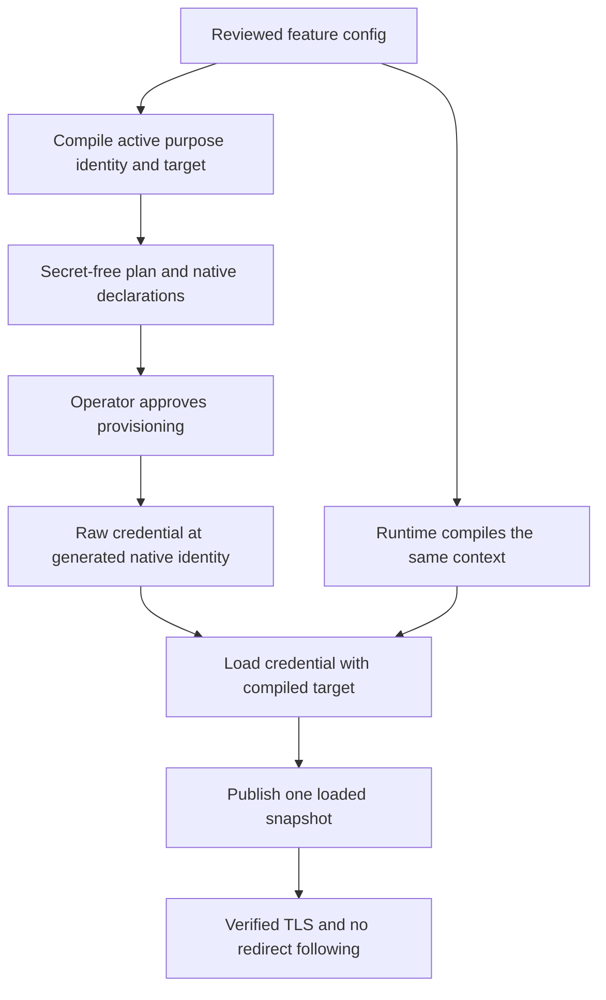

# Provision app credentials

App config contains feature settings, identities, and destinations. It contains no credential values or secret key names. Trusted Server derives a native key from each active purpose, identity, and approved destination or route policy. Provisioning that key authorizes that use.

::: warning Verify the deployment before migration
The implementation binds app credentials to their approved contexts. Application regression tests and local native-runtime checks do not certify a production deployment. Before rollout, verify isolated provider replacement/read-through, propagation and limits, config-writer IAM separation, protected provisioning CI, and the coordinated migration. Do not migrate production based on documentation or a presence check alone. Track deployment evidence in [#1479](https://github.com/IABTechLab/trusted-server/issues/1479).
:::

## Before provisioning

- Use a reviewed CLI build and matching binary, config, `edgezero.toml`, and adapter manifest. Install `jq` and the provider tools for native workflows.
- Separate config publishing from secret writing and deployment administration. A config-only publisher must not edit the trusted executable, deployment bindings, provider secrets, or code run with provisioning credentials. Verify that separation in the provider, not just in repository labels.
- Select an isolated deployment through the [existing deployment inputs](./secrets-ci#deployment-inputs). Keep one logical app-credential store, `trusted_server_secrets`.
- Obtain credentials outside TS. TS does not mint Tinybird tokens, partner tokens, DataDome keys, or AWS credentials. Do not reuse a credential value across purposes.
- Disable shell tracing and terminal/session recording before credential input. Never put values in command arguments, tracked files, plan files, or artifacts.

## Verify the config-only permission boundary

Use an isolated deployment and fictional credentials to test the actual config-publisher principal, not an administrator account. Record the principal, provider resources, operation, and allowed or denied result without recording credential bytes.

| Operation as the config publisher                                                 | Expected result |
| --------------------------------------------------------------------------------- | --------------- |
| Publish an ordinary app-config blob                                               | Allowed         |
| Read or replace native credential values                                          | Denied          |
| Add a credential binding or change its physical mapping                           | Denied          |
| Deploy a different executable or change component secret declarations             | Denied          |
| Execute or modify code with provisioning credentials without independent approval | Denied          |

A valid-checksum config edit must not grant any of the denied capabilities. In particular, never auto-approve or auto-provision a newly generated plan from the mutable live blob. An independently reviewed plan is required to authorize a changed destination.

These are deployment checks, not permissions enforced by the config checksum or the TS binary. If one principal has both config and secret/deployment administration, it is outside the config-only attacker model. Separate those permissions before relying on this boundary.

## Purpose, identity, and target



Keys have a reserved `ts1_` namespace. Use the CLI renderer, not a hand-written hash or naming recipe. Array order does not select a credential. Changing a partner domain, handler regex/username, pull endpoint, Tinybird host/dataset, DataDome endpoint, or authenticated S3 route policy selects a different binding. Computing its name grants no access without a value provisioned there.

| Fixed selector     | Active when                                | Bound identity or target                                            |
| ------------------ | ------------------------------------------ | ------------------------------------------------------------------- |
| `publisher.proxy`  | Always                                     | App, inbound proxy URL HMAC                                         |
| `ec.passphrase`    | Always                                     | App, EC identity derivation                                         |
| `ec.inbound`       | Partner `api_token_enabled = true`         | Normalized partner source domain                                    |
| `ec.pull`          | Partner pull sync enabled                  | Partner domain and exact HTTPS pull endpoint                        |
| `handler.password` | Each handler                               | Exact regex and username                                            |
| `clientip.shared`  | Trusted-client-IP section present          | App, front-door authentication                                      |
| `tinybird.auction` | Tinybird enabled                           | Events endpoint and exact dataset                                   |
| `datadome.server`  | Integration and Protection enabled         | Exact Protection endpoint                                           |
| `datadome.bypass`  | Protection and test bypass enabled         | App, separate inbound bypass                                        |
| `s3.access-id`     | S3 route auth                              | Route prefix, HTTPS origin, rewrite, region, effective query policy |
| `s3.secret`        | S3 route auth                              | Same route policy, separate purpose                                 |
| `s3.session`       | S3 auth and `session_token_enabled = true` | Same route policy, separate purpose                                 |

Disabled uses make no secret reads. A missing enabled binding fails loading; it never silently turns authentication off. Removed credential properties are errors even on disabled features. See the [migration table](./secret-binding-migration#removed-properties).

Outbound endpoints must use HTTPS DNS names. Do not use IP literals, userinfo, queries, fragments, percent escapes, dot segments, or whitespace. Pull paths preserve case and slash distinctions. A nonempty pull allowlist may contain only the endpoint hostname; it is an assertion, not authorization. Authenticated exports require certificate verification regardless of `proxy.certificate_check`, and never follow redirects.

## First Fastly setup with Tinybird

Start from `trusted-server.example.toml` copied to an operator-owned `trusted-server.toml`. It already supplies the publisher, EC, and admin-handler settings. Add:

```toml
[tinybird]
enabled = true
api_host = "api.tinybird.example.com"
auction_dataset = "auction_events_raw"
```

The host is fictional. Use your reviewed regional Events API DNS host in private configuration, optionally followed by an HTTPS port, such as `api.tinybird.example.com:8443`. Do not include a scheme, path, userinfo, query, or fragment. The shared endpoint parser builds `https://{api_host}/v0/events`, removes explicit port `443`, and preserves other valid ports. It rejects forbidden original syntax before normalization. A changed nondefault port selects a different binding. Obtain an APPEND token restricted to that dataset through Tinybird administration. Do not add a token-name property.

1. Set `service_id` in the selected `fastly.toml`, or supply `FASTLY_SERVICE_ID`. If both are set they must agree. Supply `FASTLY_API_TOKEN` through your protected credential mechanism, not shell history. Select physical stores explicitly for isolated environments.
2. Run `ts provision --adapter fastly` to create or reuse the selected resources. Secret planning resolves resources read-only; it cannot create them.
3. Generate and review the complete plan:

   ```bash
   ts secrets plan --adapter fastly --app-config trusted-server.toml \
     --no-env --out bindings.json
   jq . bindings.json
   ```

   Check every active entry, not just Tinybird. Review the purpose, owning path, subject, exact endpoint/dataset or route policy, native identity, service, physical store names and provider IDs. Unset store selectors use logical-name defaults, which appear in the plan. Plans are secret-free but disclose deployment metadata, so restrict access.

4. Provision interactively:

   ```bash
   ts secrets set tinybird.auction --adapter fastly \
     --app-config trusted-server.toml --no-env --plan bindings.json
   ```

   Confirm the displayed target and create/replace action, type `yes`, then paste the raw credential at the hidden prompt. There is no value argument. Provision the required `publisher.proxy`, `ec.passphrase`, and each `handler.password` binding too. For example:

   ```bash
   ts secrets set publisher.proxy --adapter fastly \
     --app-config trusted-server.toml --no-env --plan bindings.json
   ts secrets set ec.passphrase --adapter fastly \
     --app-config trusted-server.toml --no-env --plan bindings.json
   ts secrets set handler.password --adapter fastly \
     --app-config trusted-server.toml --no-env --plan bindings.json
   ```

   Use independently generated high-entropy values. Keep the EC and proxy values stable unless intentionally rotating EC IDs or signed URLs. Multiple handlers cause an interactive subject list; automation must copy the generated `entry_id` into `--binding`.

5. Check presence, push the matching config, and use the existing managed application-release deployment. Do not use plain `fastly compute publish` to bypass logical store linking.

   ```bash
   ts secrets check --adapter fastly --app-config trusted-server.toml \
     --no-env --plan bindings.json
   ts config push --adapter fastly --app-config trusted-server.toml --no-env --no-diff
   ```

   Use [Fastly deployment](./fastly) for the managed release command. `set` does not push config, link stores, deploy, activate a version, or refresh state.

6. Recreate application state, including reusable Fastly sandboxes. Exercise an actual approved auction request and verify the expected row at the intended dataset. Tinybird emission is Fastly-only and fire-and-forget. A successful app response or storage write does not prove delivery; the sink does not observe Tinybird's response. Verify TLS and no-follow separately with isolated test endpoints.

A plan is not a signature or approval. `set` and `check` recompile and compare the complete plan against current config, overlays, compiler/mapping versions, and resolved resources before credential input or writes. If anything changes, generate and approve a new plan. `--no-env` disables ordinary app-config overlays only, not deployment selectors or provider authentication.

## Plan fields and repeated roles

`plan` supports `fastly`, `axum`, `cloudflare`, and `spin`. Common flags are `--app-config`, `--manifest`, `--no-env`, and `--out`. `--manifest` defaults to `EDGEZERO_MANIFEST`, otherwise `edgezero.toml`. Without `--app-config`, the file is `<app.name>.toml` beside that manifest. `--service-id` is Fastly-only.

The JSON records `plan_version`, `compiler_version`, `binding_abi`, `native_mapping_version`, `effective_config_sha256`, `environment_overlay`, `resources`, and `entries`. Each entry contains `entry_id`, `compiled` context metadata, and `native` with `native_name` and `declarations`. Entry IDs select compiled bindings; they are not configurable labels or additional hash inputs.

```bash
jq -r '.entries[] | [.entry_id, .compiled.descriptor_id, .native.native_name] | @tsv' bindings.json
```

For a repeated role, copy the reviewed ID. Never choose the first array element merely because it comes first:

```bash
# BINDING_ID is the selected entry_id from the reviewed plan, not a secret key.
ts secrets set ec.inbound --binding "$BINDING_ID" --adapter fastly \
  --app-config trusted-server.toml --no-env --plan bindings.json
```

## Axum native environment input

Direct `ts secrets set --adapter axum` is unsupported. Generate the actual runtime environment names:

```bash
ts secrets plan --adapter axum --app-config trusted-server.toml \
  --no-env --out bindings-axum.json
jq -r '.entries[].native.native_name' bindings-axum.json
```

Review the plan and map each listed name to its intended credential. In a private Bash launching shell, load each value without printing it:

```bash
set +x
set -euo pipefail
while IFS= read -r name; do
  IFS= read -r -s -p "Credential for $name: " value </dev/tty
  printf '\n' >/dev/tty
  export "$name=$value"
  unset value
done < <(jq -r '.entries[].native.native_name' bindings-axum.json | sort -u)
ts secrets check --adapter axum --app-config trusted-server.toml \
  --no-env --plan bindings-axum.json
# Start the reviewed prebuilt runtime from THIS shell, not a build subprocess.
exec trusted-server-axum
```

First install the matching reviewed `trusted-server-axum` binary on `PATH` and supply the config-envelope environment variable using the [Axum setup](./getting-started#option-b-axum-dev-server). `export` here is a Bash builtin, not a command carrying a credential on subprocess argv. Do not run this loop as a child script and expect it to export into its parent. A production supervisor must inject the generated names into the actual process environment through its protected secret mechanism. Avoid dumping process environments. `check` examines only its own process environment; it cannot inspect a remote process or verify credential bytes. Restart Axum to load replacements.

## Cloudflare native Worker secrets

Direct `set` and native presence `check` are unsupported for Cloudflare. Generate and review names from the selected Worker manifest:

```bash
ts secrets plan --adapter cloudflare --app-config trusted-server.toml \
  --no-env --out bindings-cloudflare.json
jq -r '.entries[].native.native_name' bindings-cloudflare.json
```

For each reviewed binding, select its generated name and invoke Wrangler's hidden input. Use the same explicit Wrangler config and environment as the deployed Worker:

```bash
# NATIVE_NAME is copied from the reviewed entry, never derived by hand.
wrangler secret put "$NATIVE_NAME" --config crates/trusted-server-adapter-cloudflare/wrangler.toml
```

Wrangler creates or updates a secret and may deploy a new Worker version. Coordinate this with the matching config and binary; do not accidentally update the live Worker during migration. Do not put credentials in `[vars]` or commit `.dev.vars`. Also configure the nested `TRUSTED_SERVER_CONFIG` bridge described in [Cloudflare](./cloudflare). Inspect provider secret-name inventory without retrieving values, then test a fresh Worker instance and an approved request. TS `check` exits nonzero with `unsupported`; generated names do not prove the Worker has bindings.

A role able to deploy arbitrary Worker code can read its secrets. A config-only publishing role therefore cannot also hold Worker deployment/secret rights. Use a constrained publishing service where provider permissions cannot enforce that split.

## Spin native variables

Direct `set` and native presence `check` are unsupported for Spin. Generate a plan and extract declarations:

```bash
ts secrets plan --adapter spin --app-config trusted-server.toml \
  --no-env --out bindings-spin.json
jq -r '.entries[].native.declarations[]' bindings-spin.json
```

Merge every generated `[variables.<name>]` application declaration and every generated entry under `[component.trusted-server.variables]` into the selected `spin.toml`. TOML cannot repeat the same table header: combine all component entries in that one table. Keep `required = true`, `secret = true`, and no plaintext defaults. Regenerate and review the plan after changing the manifest, because its fingerprint changes.

The generated name includes TS's existing store/key escaping; do not replace it with the raw `ts1_` key. Both declaration levels are required. `secret = true` does not encrypt storage.

For an isolated local run, Spin's environment variable provider reads `SPIN_VARIABLE_` followed by the uppercase application variable name. Inject values into the launching shell:

```bash
set +x
set -euo pipefail
while IFS= read -r name; do
  IFS= read -r -s -p "Credential for $name: " value </dev/tty
  printf '\n' >/dev/tty
  export "SPIN_VARIABLE_${name^^}=$value"
  unset value
done < <(jq -r '.entries[].native.native_name' bindings-spin.json | sort -u)
spin up --from crates/trusted-server-adapter-spin/spin.toml
```

Supply the matching config to Spin's `default` KV store with `EDGEZERO__STORES__CONFIG__TRUSTED_SERVER_CONFIG__NAME=default`; see [Spin](./spin). For deployed use, configure a protected Spin variable provider through deployment administration and remove unprotected fallback/default values. Verify actual component lookup, generated-name limits, provider value limits, and config-writer permissions. These native rehearsals remain gated, not inferred from host tests. See [Spin application variables](https://spinframework.dev/v4/variables). <!-- allow-domain: spinframework.dev -->

## Checks, rotation, and troubleshooting

| Operation                  | What it proves                                                    | What it does not prove                                           |
| -------------------------- | ----------------------------------------------------------------- | ---------------------------------------------------------------- |
| `plan`                     | Current compiled metadata and rendering                           | Operator approval or native runtime acceptance                   |
| Fastly `check`             | Reviewed-input agreement and name presence through metadata       | Stored bytes, recipient acceptance, TLS, delivery, state refresh |
| Axum `check`               | Reviewed-input agreement and current-process environment presence | Remote launcher injection or runtime validity                    |
| Cloudflare/Spin `check`    | Reviewed-input comparison, then unsupported nonzero result        | Native binding presence                                          |
| Actual fresh-state request | Only the exercised runtime path                                   | All adapters, IAM separation, or global revocation               |

Same-context rotation replaces the value at the same generated name. There is no generation selector. Arrange recipient overlap where supported, otherwise a maintenance cutover. Recreate states; storage confirmation is not fleet-wide activation. Pause affected state creation/traffic for nontransactional S3 multi-key updates and verify the complete credential set before resuming.

A target or identity change requires a new reviewed plan and binding. Delete retired keys/declarations within an owned window, replace retained states, account for in-flight requests, and verify retired-config replay fails on fresh state. New keys do not revoke old ones. Revoke at the recipient if earlier exposure is suspected. Follow the [migration and rollback procedure](./secret-binding-migration).

For a stale-plan error, compare approved config, overlay policy, CLI version, manifest, service, and physical selectors. Never bypass it by copying a key into config. For missing credentials, provision the selected active role in the mapped store, not another purpose's key. Bearer credentials must be nonempty RFC 6750 b64tokens; a newline from `echo` is invalid, not trimmed. Use `printf '%s'` for [CI stdin](./secrets-ci).

If a write fails after an uncertain provider outcome, stop. Reconcile through provider metadata and an isolated fresh-state test before explicitly retrying the same reviewed context. Do not blindly retry, delete the old value, or authorize a new target to work around a provider error. Request signing and key rotation keep their separate `signing_keys`/`jwks_store` paths; this workflow does not migrate them.
