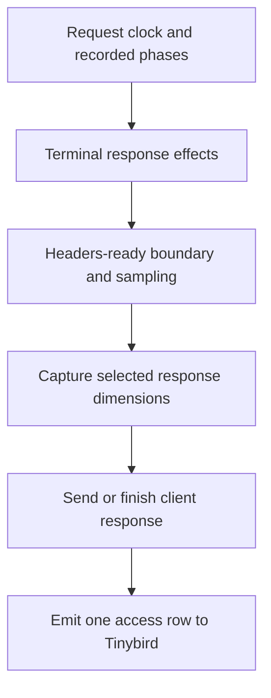

# Auction and access telemetry

Trusted Server can emit bounded auction observations and sampled request-timing
rows directly to Tinybird. Both sinks are opt-in and currently wired only by the
Fastly adapter. Axum can emit the `Server-Timing` response header, but not Tinybird
rows. Cloudflare and Spin collect timings for GPT diagnostics only; their
`server_timing_enabled` and `tinybird.access_enabled` settings have no effect on
header or access-row emission.

## Auction data path

The request entry point derives coarse `DeviceSignals`. Auction execution
combines those signals with request and navigation facts in an
`AuctionObservationContext`. The terminal auction outcome is converted into
an `AuctionEventBatch` containing summary, provider-call, and bid rows.
Fastly serializes the batch as NDJSON and starts one Tinybird Events API
request to the configured auction datasource.

Emission is best effort. Failure to construct or start telemetry is logged and
must not change the customer response. The sink drops the in-flight handle
after dispatch; it does not wait for Tinybird's response. Each batch is limited
to 512 rows and `tinybird.max_body_bytes` bytes. The Fastly backend uses
two-second first-byte and between-byte timeouts.

## Auction privacy boundary

Telemetry records operational auction facts, not the EC identifier. The event
model includes coarse device classification, auction source and outcome,
provider status and timing, slot dimensions, media type, seat, price,
currency, win state, and selected creative identifiers. Tests reject the
request's derived EC ID from serialized NDJSON.

`browser_family` is a coarse User-Agent classification. Recognized values
are `chrome`, `safari`, `firefox`, `edge`, and `opera`; unrecognized
clients produce no value. Edge, Opera, and iOS-specific tokens are matched
before generic Chrome or Safari tokens so embedded UA tokens do not
misclassify them.

## Access data path

Fastly attaches one request clock, records phases, and stamps the headers-ready
boundary after applying terminal response effects. Access sampling is uniform per
response: one random draw is made before constructing the snapshot, using the
configured `access_sample_rate`. Each selected response emits one row after its
buffered response has been handed to the client transport or its stream has been
finished. The row stores the same sample rate; joins to auction rows therefore
represent only the sampled access population.

Auction-wait duration measures collection only after at least one provider request
started. When no provider launched, `auction_wait_ms` is null and
`auction_wait_placement` is `none`; collection and summary emission still run.
A measured wait under one millisecond is `0`, with its actual placement retained.

Emission is best effort. Serialization, body-size, transport, and non-2xx failures
are logged and the row is dropped without changing the delivered response. Access
ingestion currently waits for Tinybird's reply after client delivery, unlike the
auction sink. Its backend has a one-second connect timeout and two-second
first-byte and between-byte timeouts. This wait keeps a reusable sandbox occupied
before it can accept its next request and counts toward its lifetime. Ingest is
not included in `request_elapsed_ms`.

## Access privacy boundary

The new `access_logs_v2` datasource has a configured 30-day TTL. Its 30 columns
contain:

- Event timestamp, normalized HTTP method, response status, and sampling rate.
- Fastly service ID, publisher domain, deployment environment, POP, country, and
  `ts_version`, which is the Fastly service configuration version, not a Trusted
  Server release identifier.
- Coarse route class and bounded route template, body mode, and template-cache
  state. Publisher paths collapse to `/`, `/other/*`, or an operator-allowlisted
  section such as `/news/*`; named routes retain parameter placeholders.
- App-build, filter, geo, KV, origin, template-cache, auction-wait, and stream
  durations, plus headers-ready and request-completion offsets and response bytes
  accepted by the transport. Unrecorded timings are null. A status of 200 does not
  establish that a streamed body completed successfully.
- Auction wait placement, dispatch/collection/commit offsets, and a random auction
  UUID. The UUID joins to `auction_events_raw.auction_id`, where coarse device
  class and browser family can also be present. Disabled auctions have no access
  UUID; active consent-denied observations retain their join key without launch
  milestones.

Access rows contain no raw path, query string, IP address, User-Agent, cookie,
EC ID, or creative content. Configuring a route section preserves that operator
value, so allowlist only content categories, not usernames or other identifiers.
The legacy `access_logs_raw` dataset is preserved separately, without backfilling
its raw paths into the new privacy-bounded dataset.

## Configuration and rollout

Both sinks require `tinybird.enabled = true` and the regional API host.
`auction_enabled` defaults to true for existing configurations. Set it to false
for access-only telemetry. The auction sink defaults to `auction_events_raw` and
requires that datasource's APPEND token key in `auction_token_secret`.

To enable access telemetry, deploy `access_logs_v2` first, create its
`ts_access_v2_ingest` APPEND token, and store the token value in the platform's
default app-config secret store. Set `access_enabled = true`,
`access_dataset = "access_logs_v2"`, `access_token_secret` to the stored key name,
and a positive `access_sample_rate`, such as `0.05`. Token values are resolved
when runtime settings load; only key names belong in config. Existing configs
that explicitly name `access_logs_raw` must change their dataset and token before
enabling this sink. The default body limit is 1 MiB and the minimum accepted limit
is 1 KiB; an individual row exceeding the configured limit is dropped.

Deploy the datasource before the emitting binary, then push the opt-in config
only after every serving binary understands it. Check ingestion freshness and
workspace quarantine before switching dashboards to the new datasource. Remote
deployment checks are required; source/schema alignment alone does not validate
a workspace cutover.

Before rolling back to a pre-observability binary, disable access telemetry,
remove the non-default `[observability]` table, and re-push compatible config. An
access-only deployment must also disable the Tinybird master switch. Keep both
datasources during rollback; do not drop or recreate the legacy dataset.

The exact settings and secret-handling dispositions are in
[Configuration](/guide/configuration#tinybird). Token provisioning and the
versioned cutover are described in
[`tinybird/README.md`](https://github.com/IABTechLab/trusted-server/blob/main/tinybird/README.md).
