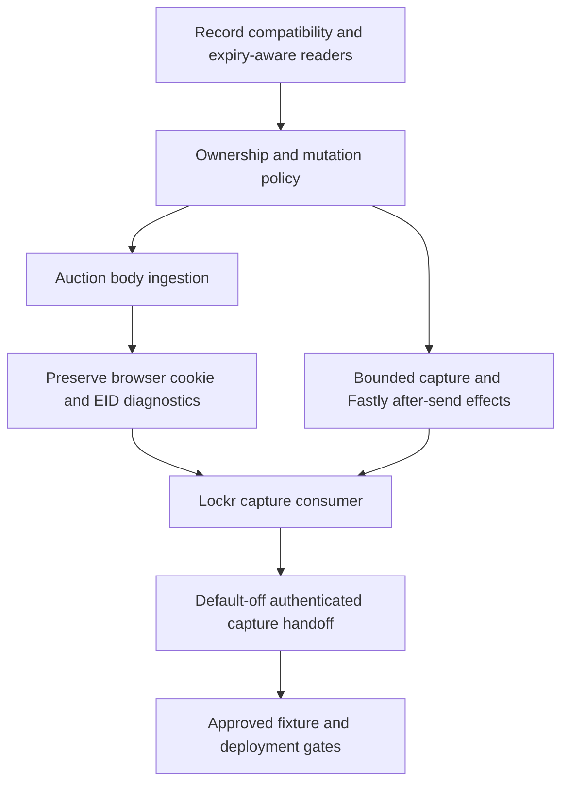

# Server-side identity foundation and Lockr capture implementation plan

**Status:** Milestones 1–6 implemented in the draft change. Local verification is recorded below, with the default-off capture handoff checked separately. Provider activation and deployment compatibility remain gated; this is not live acceptance.

**Specs:** [Foundation](../specs/2026-10-09-server-side-identity-foundation-design.md), [Lockr capture](../specs/2026-10-08-lockr-identity-capture-design.md), [KV snapshot and recovery](../specs/2026-07-10-kv-eid-request-snapshot-ec-recovery-design.md). The [existing LiveRamp browser design](../specs/2026-08-21-liveramp-integration-design.md) does not approve a native resolver.

**Goal:** Persist registered browser auction EIDs and trusted Lockr proxy observations on an existing, consenting EC row, retain expiry and writer metadata through every mutation, and expose only usable records to later auctions. Keep the response intact and send it before capture writes on Fastly. Retain browser-written `ts-eids` and EID diagnostics; retire them in a separate PR. The optional authenticated `ts-eids-s` handoff carries bounded pending capture only. No root creation by acquisition or new provider fetch loop.



## Boundaries and starting code (pre-implementation baseline)

- Core EC owns record and mutation policy: `ec/kv_types.rs` stores schema-v1 `KvPartnerId { uid }`; `ec/kv.rs` has browser `sync_eid_cookie_updates_from_snapshot` with one CAS plus one conflict read, and authoritative `apply_partner_id_updates`, `upsert_partner_ids_from_snapshot`, `upsert_partner_id`, `upsert_partner_id_if_exists`. `ec/batch_sync.rs` calls the last method; `ec/pull_sync.rs` aggregates fill-missing responses. `ec/generation.rs`, `ec/finalize.rs` and `ec/admin.rs` participate in creation, recovery, withdrawal and administrative reads. `ec/identify.rs` separately returns partner UIDs without using `resolve_partner_ids`; include it in expiry-aware reader coverage. Audit every write/serialize site before enabling metadata. Tombstoning deliberately removes identity payload; ordinary mutations must not.
- `ec/registry.rs` builds `PartnerRegistry` from `settings.rs` `EcPartner`; `config.rs::validate_settings_for_deploy` and `validate_settings_for_runtime` are the shared CLI push/validate and startup validation boundaries. `integrations/registry.rs::IntegrationRegistration` and `IntegrationRegistry::with_plan` own capability discovery. Do not introduce a parallel vendor list.
- `auction/endpoints.rs::handle_auction` parses body EIDs, falls back to `ts-eids`, loads an `EcKvSnapshot` and hands it to finalization; its orchestration error path currently returns `Err`. `ec/finalize.rs::ec_finalize_response` currently ingests cookie EIDs plus `sharedId`. `ec/prebid_eids.rs` already normalizes EIDs into source-keyed updates; `ec/eids.rs::resolve_partner_ids` supplies registered KV IDs. `openrtb.rs::Eid` currently has only `source` and `uids`.
- `integrations/lockr.rs::handle_api_proxy` buffers POST bytes once, forwards them and returns the upstream response uninspected. It currently logs a full target URL, including query, which must be redacted before captured traffic is enabled. `integrations/mod.rs::collect_response_bounded` is destructive on overflow and cannot be used for capture pass-through. Fastly `app.rs::EcFinalizeState` carries request context, while `main.rs::edgezero_main` removes extensions before conversion and sends before `run_edgezero_pull_sync_after_send`.
- `auction/formats.rs` emits EID diagnostic headers; `ec/finalize.rs` clears them on withdrawal; `constants.rs::INTERNAL_HEADERS` strips inbound variants. The JS writer is `trusted-server-js/lib/src/integrations/prebid/index.ts::syncPrebidEidsCookie`; `ec/admin.rs` has an EID-cookie diagnostic endpoint. `cookies/template_cache_policy.rs` and `publisher.rs` still recognize the cookie. Inventory these consumers before deleting a constant or admin diagnostic. See also `adapter-fastly/src/app.rs` cookie extraction and `auction/types.rs` stale cookie documentation.

## Check discipline

Each numbered milestone contains smaller red/green steps. Finish and check one step before starting the next; do not change every listed file at once. Add the regression, observe failure, implement the step, then rerun it and adjacent tests. Compatibility tests for already-correct behavior must stay green rather than be forced to fail.

Use these focused commands from the repository root, replacing the example filter with the affected module or regression:

```bash
cargo test-fastly ec::kv_types::tests
cargo test-fastly ec::kv::tests
cargo test-fastly auction::endpoints::tests
cargo test-fastly integrations::lockr::tests
cargo test-axum <test-filter>
HOST_TARGET="$(rustc -vV | awk '/host:/ { print $2 }')"
cargo test --package trusted-server-cli --target "$HOST_TARGET" <test-filter>
(cd crates/trusted-server-js/lib && npx vitest run test/integrations/prebid/index.test.ts)
```

`scripts/test-cli.sh` takes a host target, not a test filter, and runs the full CLI suite plus browser fixtures. Reserve it for the final integration gate. Verify each selected filter actually executes its intended tests. A compile-only check does not prove persistence. Reuse passing evidence while relevant source, fixtures, config and environment remain unchanged. Run broader suites and target-matched lint at stable integration checkpoints, not after each edit.

### 1. Land compatible lifecycle records and reads, without managed writes

**Files:** `crates/trusted-server-core/src/ec/{mod.rs,kv_types.rs,kv.rs,eids.rs,identify.rs,admin.rs,prebid_eids.rs,finalize.rs,generation.rs,batch_sync.rs,pull_sync.rs}`, `crates/trusted-server-core/src/auction/endpoints.rs`, plus existing tests in those files. Change an existing writer only where the audit finds UID-only reconstruction or equality, stale metadata inherited by a replacement UID, or a mutation-policy bypass. Keep schema version 1 and optional/defaulted `expires_at`, `writer`, `revision` fields. A legacy UID-only record has unknown expiry and no inferred provider provenance. Do not implement `updated_at`, `invalidated_at`, attempt state or a refresh scheduler without a current consumer; reserve invalidation semantics for the later provider delivery.

- Red: decode old schema-v1 fixtures; reject unsupported schema; serialize a record with metadata across browser same-UID/different-UID paths, batch push, single partner push, bulk pull, generation/recovery and admin-related round trips. Demonstrate the current UID-only replacement strips metadata. Add equal-UID/different-expiry and equal-UID/equal-metadata cases. Check withdrawal removes payload, not a partial record.
- Green: preserve the existing record where the UID is unchanged, and give legacy authoritative UID replacements an explicit policy that does not inherit a different UID's old expiry. Source ownership will later reject conflicting writes. Assign a non-reused opaque revision for every material managed record change; do not bump on no-op. Test a change that later restores the earlier UID/expiry: it must not restore the earlier revision. Store a known expiry in seconds, reject already-expired `Issued`, retain it when a same-UID observation omits expiry. Do not mistake the existing `KvConsent.updated` for provider freshness.
- Red then green: centralize record usability and test `now < expires_at` versus `now >= expires_at` through `ec/eids.rs::resolve_partner_ids`, `ec/identify.rs` and publisher, `/auction`, SPA `/_ts/page-bids` callers. Obtain usable time through `ec::checked_current_timestamp`, not the epoch-zero failure fallback in `current_timestamp`. Test unavailable time explicitly; a known-expiry record cannot be declared usable without a usable clock. Keep unknown-expiry compatibility unchanged. Suppress an auction-body UID identical to the unusable stored UID before merge, using normalized source matching; a different valid body UID remains current-request-only. No cleanup write on reads. Admin inspection may show retained expired records and their metadata; it is not a delivery API.
- Check: filtered `cargo test-fastly` record, CAS, resolution, publisher and auction tests. Read back serialized KV state in storage tests. **Gate:** do not activate metadata-producing writers until all deployed readers and _all_ old writers have drained. Old binaries discard unknown fields and old readers forward expired UIDs. A passing new-binary test is not a deployment-compatibility proof.

### 2. Validate source owners and separate mutation classes

**Files:** `crates/trusted-server-core/src/settings.rs`, `config.rs`, `ec/{mod.rs,registry.rs,kv.rs,pull_sync.rs,pull_sync_marker.rs,batch_sync.rs}`, `integrations/{registry.rs,mod.rs}`, `crates/trusted-server-cli/src/run.rs` validation tests, `trusted-server.example.toml`; config, registry and KV tests nearby. Add `ec/identity.rs` for common outcomes, trusted update types and the shared acquisition service, and `integrations/identity.rs` for capability contracts and later bounded inspection. These are proposed new paths, not existing modules. Add `identity_owner` to source policy and a capture descriptor with finite source claims to integration registration. Keep disabled acquisition descriptors discoverable, so a `capture_identity = false` kill switch does not invalidate config. No production resolver, named identifier intake, synthetic resolver HTTP protocol or rate-limit state now.

- Red: duplicate/missing/non-claiming owner, disabled owner descriptor, owner with enabled pull or push API conflict, unauthorized integration claiming a source and forged browser metadata. Exercise all three boundaries: `ts config validate`, `ts config push`, and startup `validate_settings_for_runtime`/`IntegrationRegistry::with_plan`. Ensure deploy validation works on unresolved secret references. Existing unowned sources retain legacy push/pull behavior; owned sources must reject legacy authoritative push and skip legacy pull completeness and dispatch, not merely suppress one write after making an outbound request. Resolve the legacy-write configuration decision below before implementing its acceptance rules. `api_token` authenticates read-only `identify` as well as writable `batch-sync`; token presence alone does not prove a conflicting writer. Tests must cover the approved read/write policy without accidentally removing identify access. Update the effective pull-partner set used by completeness, dispatch and `pull_sync_marker.rs` fingerprinting together; an ownership migration must not leave a stale completeness cookie suppressing an eligible legacy pull.
- Green: descriptor claims and runtime registry are one source of truth; validate source policy against claims in the shared deploy/runtime validation functions. Shared service validates trusted origin, registered source, owner, UID length/source count, consent and full EC-ID-bound snapshot. Implement the capture-used `Issued`, `NoChange` and approved withdrawal actions; reserve the remaining outcome contracts without an unused active resolver. Test expiry again at mutation time, because a token can expire between capture and post-send persistence. Browser update cannot set authority or lifecycle metadata. Keep `ec/kv.rs` browser one-CAS/one-conflict-read/no-retry policy distinct from authoritative bounded CAS/re-merge. Authoritative replacement preserves unrelated sources and never creates a missing, failed or tombstoned root. Same UID with changed expiry is a write; unchanged UID and lifecycle metadata is not. A stale result tied to a prior revision must be rejected when revision-conditional mutation becomes necessary; do not expose an unused resolver callback merely to test an imagined provider.
- Check: filtered `cargo test-fastly` config, registry, push/pull and KV tests; host CLI validation tests. Inspect log assertions for redaction.

### 3. Persist browser body once while preserving cookie/header transport

**Files:** `crates/trusted-server-core/src/{auction/endpoints.rs,auction/formats.rs,auction/types.rs,openrtb.rs,ec/prebid_eids.rs,ec/finalize.rs,ec/admin.rs,ec/eids.rs,constants.rs,cookies/template_cache_policy.rs,publisher.rs}`, `crates/trusted-server-adapter-fastly/src/{app.rs,main.rs}`, `crates/trusted-server-js/lib/src/integrations/prebid/index.ts` and its existing tests; update operator docs at `docs/guide/integrations/prebid.md` and `docs/guide/configuration.md` for changed transport. Limit other adapters to compile/behavior parity; they currently have no EC KV graph.

- Red: registered body EIDs enrich an existing root even on no-bid or handled auction-provider error; unknown sources remain current-request-only; no-token/consent-denied/missing/failed/tombstone roots do not write or recover. Prove one combined browser finalization attempt with `sharedId`, using the auction snapshot rather than a second unconditional KV read. Directly reuse the EID-to-update normalization in `ec/prebid_eids.rs`, not a fake cookie. Stage normalized updates in `EcContext` or a typed response effect before dispatch so `Err` paths retain them through the adapter's error conversion; inspect `app.rs` response-finalization behavior rather than assuming an error response keeps extensions.
- Green: keep normal EC finalization timing and publisher-only orphan recovery, including conservative cookie ingestion. Extend `Eid` with optional string `inserter`/`matcher` and an OpenRTB-compatible integer `mm`, omitted only when absent. Update both the manual parser in `parse_client_auction_eids` and `merge_auction_eids`, not only serde derives. Explicit body-supplied provenance wins over reconstructed KV provenance; preserve empty `matcher` and supplied zero-valued `mm`. Keep existing UID merge precedence and retain UID `ext` for the current auction. Update affected struct constructors and serialization tests. KV-derived EIDs retain registry `atype` and reconstruct fixed Lockr ID5 provenance only from the persisted `lockr` writer. Keep the mapping in `integrations/lockr.rs`, not a source-only attribution table. Different browser UIDs suppress reconstruction for a mixed-origin EID without changing UID merging. Preserve source/UID caps and consent gates. Filter the matching known-expired body UID before merging.
- Retain `/auction` body-or-cookie fallback, publisher/SPA readers, browser cookie ingestion, JS writer, EID header emission and authenticated local admin diagnostics. Store the raw cookie privately/redacted in `EcContext`; combine cookie → staged body → direct `sharedId` into one snapshot/CAS mutation without adapter argument threading. Preserve expiry, metadata, ownership, consent and pending-capture protection. Restore the one-day 3,072-byte cookie cap, deterministic tail UID/source trimming and stale clearing, without install-time cleanup or trimming the body. Restore bounded 4,096-byte EID response headers and conditional truncation marker. Keep inbound stripping, EC/consent headers and authenticated admin namespace/fallback guards. Retirement, diagnostic consumer inventory and transition cleanup belong in a separate PR.
- Check: filtered `cargo test-fastly` auction/finalize/admin/publisher tests, JS Prebid tests, `rg -n 'ts-eids|x-ts-eids'` review of remaining intentional compatibility references. Verify before/after request cookies and response cache privacy through Fastly tests.

### 4. Add bounded shared capture and one Fastly post-send executor

**Files:** `crates/trusted-server-core/src/integrations/{identity.rs,registry.rs,mod.rs}`, `crates/trusted-server-core/src/ec/{identity.rs,mod.rs,kv.rs,finalize.rs}`, `crates/trusted-server-adapter-fastly/src/{app.rs,main.rs}`; tests beside the boundary. Start with a synthetic capture fixture, not Lockr. A capability declares exact method/path/source claims and interprets a bounded decoded response. The framework associates it with the actual proxied upstream result; inbound client headers/JSON cannot select trusted acquisition.

- Red: 64 KiB original **and separate** 64 KiB decoded JSON cap at exact boundary and +1, compressed expansion, unsupported encoding, decoder failure, malformed capture, streamed oversized response with original prefix replayed, absent or misleading `Content-Length`, and byte-for-byte response/header preservation including encoding and length. Include an oversized single stream chunk and upstream read failure; replay consumed bytes and preserve the underlying stream error rather than manufacturing a capture error response. `collect_response_bounded` cannot be reused because it consumes oversize streams. Bound added capture buffers and decoder working memory; do not copy an oversized incoming chunk into an inspection buffer. Account for retained stream chunks and parser overhead too. No full decompression first.
- Green: inspect only selected proxy responses. A capture failure is a no-op, not a 502 or rewritten body. Stage cloneable effects holding full EC ID, source-validated trusted origin and `EcKvSnapshot`; consume them once before response conversion drops extensions. Before send, expose an approved captured withdrawal to normal finalization so it expires `ts-ec`, removes identity headers and suppresses enrichment. After send, run its existing-key-only tombstone work unless request finalization already handled that identity. A tombstone-only after-send handler cannot change the cookie already sent to the browser. Keep one shared Fastly executor for captured work, with no Lockr-specific branch. Apply withdrawal before capture enrichment and hand **persisted** resulting snapshots to legacy pull sync. `NotRead` may fetch after send; missing and failed never authorize creation. CAS conflicts may refresh, but no unbounded retry or zero-read claim. No-token queues no mutation. If finalization already tombstoned the root, suppress a second tombstone; do not turn a provider timeout into withdrawal.
- Check: filtered `cargo test-fastly` registry/capture/KV/entrypoint tests with a recording send and KV backend. Prove send precedes capture write, no response-byte changes, full-ID association across rotation, failed-write snapshot stays failed, no-token no capture KV work and resulting snapshot changes pull eligibility. Exercise settings-snapshot/reload, finalization-failure and fallback send branches. Failed or withdrawn state must suppress subsequent pull disclosure, not reuse the original live snapshot. Test Axum/Cloudflare/Spin behavior only where an EC KV graph exists; document before-send or unsupported capture on adapters lacking a post-send hook rather than promising persistence.

### 5. Implement Lockr capture behind explicit approval gates

**Files:** `crates/trusted-server-core/src/integrations/lockr.rs`, shared acquisition consent handling in `crates/trusted-server-core/src/{consent/mod.rs,consent/types.rs,ec/consent.rs,ec/identity.rs}`, its tests and sanitized fixtures under its existing test module or a dedicated `crates/trusted-server-core/tests/fixtures/lockr/` directory; `trusted-server.example.toml` and `docs/guide/integrations/lockr.md` for confirmed configuration and operator behavior. Register capture only, not a resolver. Add default-true `capture_identity` kill switch without removing the ownership descriptor. Keep SDK, settings and unlisted paths on the existing proxy path; inspect exact POST `page-view`, `generate-tokens`, `refresh-tokens`, `sync-no-hem-ids`, `revoke-consent` paths. Reuse the already buffered POST bytes for request consent without changing forwarding.

- Fixture gate before enabling each mapping: sanitized SDK `tokenMappings` and `tokenSourceMappings` **and** response examples prove token shape, key/source/type, expiry unit and consent contract. Start with ID5, using `id5id`, `id5-sync.com` and `atype=1`, after its fixture and consent gates pass; decode URL-encoded JSON `advertising_token.universal_uid`, associate `ids.<key_name>.eid` when present, reject mismatched source/oversized UID, convert `identity_expires` milliseconds to seconds and reject expired issue. Do not infer LiveRamp, UID2, EUID, First ID, Yahoo, Criteo or Epsilon token decoding from ID5; leave each unmapped until its own fixture passes. Panorama source/type remains disabled until Lockr confirms it. No arbitrary provider provenance or `ext` is stored in KV. Reconstruct fixed `inserter="Lockr-For-Publishers"`, `matcher=""`, `mm=2` for usable Lockr-written ID5 records without a new field or mutation; other writers and sources remain unattributed.
- Red: exact route and method selection, aimTokens-only and associated EID, unknown key, source mismatch, non-2xx/malformed/no-token no invalidation, missing/extended expiry, repeat equal observation no write, original/decoded overflow with unchanged proxy response. Consent tests include populated opt-out, malformed non-empty strings, empty optional strings, cookie/body conflict, GPC and otherwise permissive/non-regulated or proxy-mode request policy. Map Lockr's buffered `gppString`, `consentString` and `ccpaString` into named shared consent inputs. Reuse shared decoders and request jurisdiction/expiration policy. Require explicit parse success for populated signals; the existing decoder's absent decoded value or a permissive jurisdiction must not turn malformed body consent into permission. Empty fields impose no positive permission, and body consent can restrict but never override denied request consent. Keep this acquisition check separate from approved explicit withdrawal handling. Never log UID, query-bearing URL, consent string or token; audit shared consent display and error logs as well as Lockr logs. Remove the current full-target-URL logging/error attachment in `lockr.rs` on captured paths, and audit shared error formatting.
- Withdrawal is gated separately: only after Lockr confirms 2xx application-success semantics **and** whether revoke is global EC withdrawal or per-source invalidation. Test revoke despite denied acquisition consent, finalization precedence, cookie expiry and existing-key-only tombstone if global scope is approved. Until then, leave revoke capture disabled and let ordinary request consent withdrawal continue; never infer withdrawal from empty tokens or a network error. Clarify ordering if overlapping SDK calls can return older tokens after newer ones; absent a provider sequence, CAS order is observation order only.
- Check: filtered `cargo test-fastly` Lockr parser/proxy/post-send tests with synthetic responses; no live IDs in fixtures. Then run approved publisher test-route acceptance: consent, unchanged original response, delayed KV readback of UID/source/expiry/writer/revision without exporting values, later bidder payload source presence, same-UID extension, known-expired omission including matching body UID, negative consent and approved revoke. Record statuses, counts and booleans only. Capture stays off for a source until its fixture, consent, ownership and compatibility gates pass.

### 6. Restore bounded capture availability and retry without cookie authority over stored records

**Files:** `ec/identity_handoff_codec.rs`, `ec/identity_handoff.rs`, `ec/identity_handoff_tests.rs`, shared context/effects/KV/finalization, auction resolution, integration dispatch, Fastly request admission, settings/app-config validation, cookie forwarding/cache policy and operator docs.

- Implemented default-off `[ec.identity_handoff]`, dedicated secret-store signing keys, safe active/rotation IDs and deploy/runtime validation. Runtime keys decode to exactly 32 bytes and cannot reuse EC passphrase material. Disabled provisioned keys still resolve and validate.
- Implemented a publisher/full-EC-bound, versioned HMAC-SHA256 envelope. The complete signed value is bounded to 2,048 bytes. Entries retain absolute deadlines of at most five minutes, shortened by provider expiry. Oversized entries are dropped whole; multi-source eviction removes earliest deadlines first. Response Max-Age derives from retained signed entries, not pre-truncation candidates.
- Shared finalization issues capture handoff before send without an added KV read, revalidates incoming entries, retires acknowledgements/conflicts and clears empty or rejected cookies only when one was present. Cookie responses are private/no-store, preserve upstream body/encoding and exclude the handoff from auction-provider Cookie forwarding and template cache keys.
- All shared auction callers can deliver an eligible entry for an absent or known-expired source from a loaded, consenting full-ID-bound snapshot. Usable stored IDs win; empty records block delivery. A valid same-UID refresh or different captured UID can supply the auction over an expired record without changing KV metadata or the original handoff deadline. Issuance and reconciliation retain this fallback; replay remains absent-source-only. Current consent, capture kill switch, source claims/ownership, clock and expiry still apply. Eligibility retains existing KV read consistency; no strong-read or instant cross-POP withdrawal guarantee is added.
- Browser ingestion cannot strip authenticated pending capture expiry/writer metadata. Matching captures retain the original pending deadline and known expiry when the provider omits it. That pending expiry only fills an absent source and cannot change any stored expiry. A new direct capture supersedes pending replay for its source; existing-source persistence refresh remains direct capture only.
- At most one eligible replay batch is staged for a browser persistence route or an observed permitted Lockr proxy request, including `NoChange`. Body denial clears the handoff and cannot borrow cookie permission. Fastly enables the feature only with its admitted EC/KV finalization graph; other adapters remain unsupported.
- The existing shared executor sends first, then proves the root and applies fill-absent-only CAS before legacy pull work. Conflicts recheck source absence and withdrawal. Replay never creates a root, replaces UIDs/metadata or extends the original deadline. Successful persistence is acknowledged on a later response. No provider refetch, durable queue or unconditional first-auction guarantee.

## Release and rollback

1. Ship optional schema-v1 metadata-aware readers and **every** metadata-preserving writer first, with managed acquisition off. Verify mixed-record fixtures. Obtain deployment propagation and old-invocation drain evidence; old UID-only readers ignore expiry and old writers erase metadata. Confirm operator procedure before the first managed write.
2. Treat browser writer/revision output as metadata activation too; complete the compatibility gate before enabling any path that produces lifecycle metadata. Activate body persistence in a coordinated server release while retaining browser cookie and diagnostic compatibility. Verify body/no-cookie persistence, body-over-cookie precedence and lifecycle-safe cookie ingestion. Defer transport retirement, consumer inventory and any cleanup transition to a separate PR.
3. Deploy synthetic capture framework inactive and verify Fastly send ordering. Although the Lockr setting defaults to true, explicitly deploy `capture_identity = false` until approval and compatibility gates pass; ownership validation must still work. On an approved route, add one confirmed Lockr source with owner and `atype` after resolving conflicting legacy writes or pull configuration. Enable capture, measure source-only counts, KV readback and later auction visibility. Canary first; do not claim first-auction guarantees or automatic retry.
4. Safe immediate mitigation after activation is `capture_identity = false` or removing ownership through an **approved migration**; disabling capture alone does not erase stored expiry. Rolling back to a UID-only binary is unsafe until managed writes stop and expiry-aware read/metadata compatibility is explicitly resolved. Do not automatically transfer owner on module failure. DSR deletion and global consent withdrawal remain authoritative over acquired records.
5. At intermediate checkpoints, run only suites affected by the completed milestone. At the final stable implementation checkpoint, run `cargo fmt --all -- --check`, `cargo test-fastly`, `cargo test-fastly-reuse`, `cargo test-axum`, `cargo test-cloudflare`, `cargo test-spin`, `./scripts/test-cli.sh`, JS tests/build/format, integration parity and affected target-matched clippy aliases per `AGENTS.md`. Reuse unchanged passing results rather than repeat this matrix at every checkpoint. Confirm CI and approved live-route evidence separately. Core tests are not a substitute for an observed deployed post-send KV write and later auction. Handoff activation additionally requires dedicated publisher key provisioning/rotation and approved delayed-visibility, failure-repair, cleanup and withdrawal checks. Keep `ec.identity_handoff.enabled = false` until those gates pass.

## Decisions and remaining approval gates

- The foundation requests revision-conditional invalidation tests but defers `invalidated_at`, invalidation storage and active resolver to later work. Does the first capture delivery need an invalidation marker at all? This plan avoids dead state and blocks source-specific revoke until scope is approved. Native LiveRamp and its intake/refresh questions remain deferred in [#1245](https://github.com/IABTechLab/trusted-server/issues/1245). Cross-browser linkage needs a separate approved design; #1245 is not authorization to build it.
- Implemented ownership policy: reject owned sources with legacy pull enabled. Keep `api_token` read-only for `identify`; reject owned-source batch writes with 403 before limiter/storage. Ownership is validated through deploy/config-push/runtime/startup paths, even with acquisition disabled. Operator ownership migration and invocation drain still need confirmation.
- Restored `/_ts/admin/eids` as authenticated local cookie diagnostics on all four adapters; no-store/nosniff and unknown-admin fallback denial remain. Browser cookie readers/writer and diagnostic emission are retained alongside body persistence and the authenticated capture handoff. Transport retirement and external consumer migration are deferred to a separate PR.
- Confirm deployment drain/rollback for mixed binary versions, external uses of `x-ts-eids` headers, Lockr fixtures and each enabled provider mapping, Lockr consent requirements and revoke semantics/scope. Clarify overlapping SDK response ordering. None is settled by local tests.

## Local implementation verification (2026-10-09)

- `cargo test-fastly`: 219 adapter tests and 2,924 core tests passed, with six core tests ignored; shared-crate and doc tests also passed. `cargo test-fastly-reuse`: 219 passed.
- `cargo test-axum`, `cargo test-cloudflare`, `cargo test-spin`: passed, including authenticated retirement and fallback protection routes. These adapters do not claim post-send KV capture persistence.
- `./scripts/test-cli.sh`: host CLI suite and all four required ignored browser-fixture filters passed. Native `template_build_digest`: ten tests passed.
- Full JS Vitest suite: 48 files, 1,186 tests passed, no type errors. Focused Prebid transport suite: 288 passed.
- Target-matched Clippy passed for Fastly, Axum, Cloudflare native/WASM, Spin native/WASM, CLI and codegen, plus native build-digest tests. Fastly, Axum and Cloudflare development builds passed.
- Recording tests use the actual shared send executor: send sees unchanged KV; factory runs after send; persisted lifecycle state matches the context snapshot consumed by later pull. No effects never opens storage; unavailable storage sends once and leaves KV/context unchanged. Transport tests preserve response parts/bytes and stream errors across independent wire/decoded caps and gzip failures.
- Ownership/config, restrictive consent, missing/failed/withdrawn/full-ID isolation, CAS/no-op/ABA/expiry, browser one-finalization, expiry bypass and withdrawal tests passed. Independent bounded source review found no additional verified privacy/concurrency defect.

Not verified: real provider acceptance, sanitized provider-approved mappings/fixtures, consent/revoke scope approval, overlapping response ordering, deployment propagation/drain, remote CI or external diagnostic consumers. Synthetic fixtures are not provider approval. Keep both Lockr capture switches explicitly false until their independent gates pass. Native LiveRamp, refresh/invalidation scheduling, durable retry and cross-browser linking remain deferred.

## Writer-based provenance follow-up verification

- Adopted the fixed Lockr ID5 provenance values for issuance and refresh. No KV schema, acquisition policy or rollout switch changed.
- Added failing regressions before implementation. Native `cargo test -p trusted-server-core --target x86_64-unknown-linux-gnu lockr_provenance` now passes all three tests: stored source/writer eligibility, persisted KV-to-bidder payload with no mutation, and mixed-origin browser UID handling. The existing body-provenance regression also passes with explicit fields overriding reconstructed values.
- `cargo test-fastly`: 219 adapter tests and 2,933 core tests passed, with six core tests ignored; shared-crate and doc tests also passed.
- `cargo clippy-fastly`, `cargo fmt --all -- --check`, scoped Prettier checks for the updated specs/plan/guide, and `git diff --check` passed.
- Other adapter suites, the CLI/browser-fixture suites, remote CI and live provider acceptance were not rerun for this follow-up. Capture remains gated as above.

## Authenticated capture handoff verification (2026-10-12)

- Native `cargo test -p trusted-server-core --target x86_64-unknown-linux-gnu --lib`: 2,981 passed. The handoff/config/codec subset has 40 tests. It covers signed bounds/bindings/rotation, secret resolution and dedicated key material, response bytes/cache policy, absent-source delivery, metadata protection, replay/acknowledgement, retained expired records, same-UID changed-expiry conflicts, concurrent capture/withdrawal, deadline rechecks and no-token proxy repair/body denial.
- `cargo test-fastly`: 219 adapter tests and 2,975 core tests passed, with six native-only core tests ignored; shared-crate and doc tests passed. `cargo test-fastly-reuse`: 219 passed. An initial Fastly run found that the newly added example prose was contiguous with an uncommentable TOML block. Added a blank-line separator and reran the entire core/Fastly suite successfully.
- `cargo test-axum`, `cargo test-cloudflare`, `cargo test-spin`, `./scripts/test-cli.sh`, integration parity and native build-digest tests passed. CLI verification includes all four required ignored browser-fixture filters. Other adapters remain unsupported for handoff issuance/replay.
- All target-matched Clippy aliases passed, including native build-digest lint. Fastly/Axum/Cloudflare builds passed. Full JS Vitest, JS formatting and bundle build passed, with 48 files and 1,186 tests. Full docs and non-docs Markdown formatting, Rust formatting and whitespace checks passed.
- Executed safety proof: no handoff becomes auction input without valid authentication, current policy and an observed live consenting root. Proxy and shared-finalizer tests inspect original response bytes, cookie policy and auction provenance. Missing/failed/withdrawn/full-ID mismatch, disabled capture, tampering and unknown clock do not deliver.
- Executed safety proof: replay cannot replace any stored source or revive a concurrent withdrawal. Tests read back stored state after CAS conflicts and prove send precedes mutation. Provider expiry/writer survive replay, expired deadlines do not write, and `NoChange` retains the original signed deadline. Matching capture retains pending expiry/deadline; omitted provider expiry fills only an absent source and cannot override a newer stored expiry. Existing expiry changes win even when the UID matches. A planned PBS transport regression proves that all consent-forwarding modes strip the handoff, including opaque headers with whitespace around its name.
- Executed consistency limit: a simulated stale live snapshot can deliver its pending handoff despite an authoritative withdrawal elsewhere. The subsequent CAS rejects replay and preserves the tombstone. This is the existing snapshot-read consistency limit, not a strong-read or instant cross-POP withdrawal guarantee; deployed propagation/frequency remains unverified.

Not verified: remote CI, live provider acceptance, actual cross-POP visibility/withdrawal timing, operational key provisioning/rotation, provider-approved fixture sizes, consent/revoke scope, overlapping SDK response ordering or metadata-compatible deployment drain. Keep handoff default-off and Lockr capture explicitly disabled until the applicable rollout gates pass.

## Expired-source auction fallback verification

Tested state: `16b6d09a` plus the expired-source fallback worktree changes in the two handoff Rust files, both specs, this plan, configuration/Lockr guides and the example configuration. Native checks ran on `x86_64-unknown-linux-gnu`; Fastly checks ran on `wasm32-wasip1` through Viceroy. SHA-256 fingerprints of the Rust inputs are `61ba327154ad9c0669f6b17c3c199250d3343c6c4eeca0a4c9eff17a8ef2f16f` for `identity_handoff.rs` and `df8a85b886f347b2307be2cc6a0a5a330fd60251739c01d43376b740fec501db` for `identity_handoff_tests.rs`.

- Three new regressions first failed against the old behavior: expired-source delivery, issuance over an expired stored record, and the exact expiry boundary. A fourth failing regression identified that a matching UID without refreshed provider expiry must not bypass its known stored expiry. All four now pass.
- `cargo test -p trusted-server-core --lib ec::identity`: 44 passed. `cargo test -p trusted-server-core --lib`: 2,995 passed.
- `cargo test-fastly`: 219 adapter and 2,989 core tests passed, with six native-only core tests ignored; shared-crate and doc tests also passed. `cargo test-fastly-reuse`: 219 passed.
- `cargo test-axum`, `cargo test-cloudflare`, `cargo test-spin`, `cargo test --manifest-path crates/trusted-server-integration-tests/Cargo.toml --test parity`, `./scripts/test-cli.sh` including all required ignored browser-fixture filters, and `cargo test -p trusted-server-core --test template_build_digest` passed.
- All target-matched Clippy aliases in `AGENTS.md`, native build-digest Clippy, Rust formatting, full JS tests/build/format, docs formatting and non-docs Markdown formatting passed. JS results remain reusable after the final Rust-only expiry guard: 50 files and 1,209 tests passed. Gate commands, outcomes, elapsed times and logs are recorded in `/tmp/pr1260-expired-gates-summary.txt` and `/tmp/pr1260-expired-other-gates-summary.txt`.
- Executed delivery proof: auction resolution and browser merging use authenticated capture for expired matching or different UIDs, preserve Lockr provenance, and reject expired handoffs, empty records, unknown clocks, request denial and disabled policy. A matching known-expired UID needs a known refreshed expiry. Usable and unknown-expiry stored records retain precedence.
- Executed persistence proof: reconciliation keeps the original signed deadline over expired stored state without staging a replay write. Read-back after send preserves stored UID, expiry, writer, revision and generation. Fresh direct capture still writes after send, then a later request clears its acknowledged cookie. Existing absent-source replay and concurrent withdrawal/CAS tests remain passing.

No cookie codec, revision-ordering mechanism, persistence replacement policy or rollout default changed. First-auction timing, live provider acceptance, cross-POP consistency, key operations and deployment drain remain unverified. Keep rollout gates unchanged.

## Browser-cookie and diagnostic restoration verification

Checks ran against `16b6d09a` plus the expiry fallback and browser-cookie restoration worktree changes before commit and push. This checkpoint supersedes the earlier transport-retirement decision, not the capture or lifecycle contracts.

- Restored the bounded one-day browser `ts-eids` writer, body-or-cookie auction fallback, publisher/SPA readers, response-time cookie ingestion, authenticated local admin diagnostics and bounded EID response headers. Retirement is deferred to a separate PR. Adapter cookie threading was not reintroduced; request-local cookie state is private/redacted in `EcContext`.
- Executed safety proof: body beats cookie, direct `sharedId` wins last, registered cookie-only sources persist, matching expired cookie UIDs do not reach bidders, and browser input cannot replace managed UID/expiry/writer/revision metadata. A cookie matching authenticated pending capture cannot persist an unknown-expiry browser record before send; trusted replay retains provider expiry and the Lockr writer after send. Existing consent, root, ownership, CAS and withdrawal gates remain intact.
- Native core: 3,008 tests passed. Fastly: 219 adapter and 3,002 core tests passed, with six native-only core tests ignored; shared-crate and doc tests passed. Reusable Fastly, Axum, Cloudflare, Spin, integration parity, native build-digest and CLI tests passed. The CLI helper executed all four required ignored browser-fixture filters.
- JS: 50 files and 1,210 tests passed, with no type errors. Build and formatting passed. Restoring the cookie writer raised the measured shim to 41,007 bytes; its documented size guard is now 42,000 bytes rather than 41,000. Separate Prebid-free artifact assertions remain intact.
- All target-matched Clippy aliases, native build-digest Clippy, Rust formatting, docs formatting and non-docs Markdown formatting passed. Initial Axum checks found a test-only `serde_json` dependency assumption, removed without adding a dependency. Clippy found one missing documentation backtick, corrected before successful rechecks. Logs and final outcomes are in `/tmp/pr1260-restore-rust-gates-summary.txt` and `/tmp/pr1260-restore-*.log`.

Not verified: remote CI, live/provider acceptance, cross-POP visibility/withdrawal timing, key operations and metadata-compatible deployment drain. Restoring browser transport does not guarantee first-auction availability or change rollout defaults.
