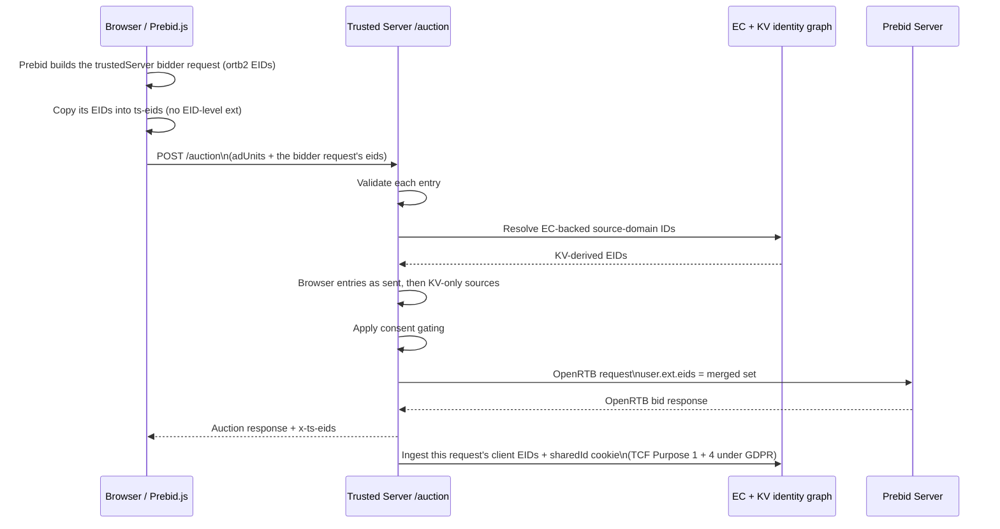

# Prebid EID Fidelity Implementation Plan

> **For agentic workers:** REQUIRED SUB-SKILL: Use superpowers:subagent-driven-development (recommended) or superpowers:executing-plans to implement this plan task-by-task. Steps use checkbox (`- [ ]`) syntax for tracking.

**Goal:** Make the `trustedServer` Prebid adapter forward to `/auction`, and copy into `ts-eids`, exactly the EIDs Prebid.js gives that bidder, with their OpenRTB 2.6 EID-level fields. Validate them once on the server, forward browser entries as sent, and ingest into KV only the set the auction used.

**Architecture:** A new pure TSJS module (`integrations/prebid/eids.ts`) copies `bidderRequest.ortb2.user.ext.eids` and `user.eids` as plain data within a 64 KiB UTF-8 budget. It also builds the `ts-eids` cookie value from that set without EID-level `ext`. The adapter writes or clears the cookie in `buildRequests`, and a `tcf2Enforcement` listener clears it when Prebid's TCF rules block `trustedServer`. On the server, a new `ec/client_eids.rs` parser validates each body or cookie entry on its own. `merge_auction_eids` forwards browser entries unchanged and adds KV entries only for registered sources the browser did not send. Finalization ingests only the auction's own client set on `/auction`. TS stops writing Prebid `userSync` settings, which fixes the forced `auctionDelay: 0`.

**Tech Stack:** Rust 1.95 (`trusted-server-core`, `trusted-server-adapter-fastly`), serde_json 1.0.150 with `raw_value`, TypeScript + Vitest 4.0.18, jsdom 28.1.0, Prebid.js 10.26.0 (bundled npm dependency).

**Spec:** `docs/superpowers/specs/2026-10-18-prebid-eid-fidelity-design.md` (branch `spec/1246-prebid-eid-fidelity`). Read it before starting. Section numbers in this plan (for example "spec 4.4") refer to it. Where this plan and the spec disagree, the spec wins. Stop and report the disagreement instead of picking one.

## Global Constraints

Copied from the spec. Every task implicitly includes these.

- Follow `AGENTS.md` at the repo root for commands, style, error handling and CI gates. Bare `cargo test` / `cargo build` fail at the workspace root by design; use the aliases.
- Prebid.js is pinned to **10.26.0** by `crates/trusted-server-js/lib/package-lock.json`. Read Prebid behavior from `crates/trusted-server-js/lib/node_modules/prebid.js/`, not from a newer checkout.
- **`ts-eids` stays.** It remains a browser-written first-party cookie that TS reads before KV (product requirement, spec O1). **`x-ts-eids` stays** (spec G7). Never remove either.
- **No new configuration** (spec 4.10). `MAX_AUCTION_EIDS_BYTES` and the server limits are constants.
- TSJS budget: `MAX_AUCTION_EIDS_BYTES = 65,536`, measured in UTF-8 bytes with `TextEncoder`, never with JavaScript string length.
- Cookie: at most **3,072** encoded bytes; attributes exactly `Path=/; Secure; SameSite=Lax; Max-Age=86400`; standard padded base64 of the UTF-8 bytes of the JSON array; never EID-level `ext`.
- Server rules (spec 4.4): `source`, `inserter`, `matcher` are strings, not blank by `str::trim`, at most **255** UTF-8 bytes. `uids[].id` is a string, not blank, at most **512** bytes. `atype` and `mm` are integers from **0 to 2,147,483,647** (`4`, `4.0` and `4e0` are equal). UID-level and EID-level `ext` are JSON objects of at most **2,048** bytes as compact JSON. Keep the first **32** valid UIDs per entry and the first **64** entries after dropping duplicates.
- TSJS does no EID validation beyond serialization. The server validates body and cookie with one parser.
- Never log UID values, in TSJS or Rust. Logs carry source names, field names and counts only.
- Never read `bidderRequest.auctionId`. Prebid hides it from adapters by default.
- Use only example or fictional data in code, tests, comments and docs (`example.com` domains). The real Prebid source names the spec lists (`adserver.org`, `liveramp.com`, `pubcid.org`, `id5-sync.com`, `51d.es`) are public protocol identifiers and may appear in tests that model those modules.
- Test discipline (spec 7.1), checked in every task:
  1. **Red first.** Run each new test against unchanged code and see it fail for the expected reason. For a regression net that already passes, temporarily revert the line it guards, see it fail, then restore. Record every red result in the red log (see "Before you start").
  2. **Pair absence with presence.** Every "X is missing" assertion sits next to a "control Y is present" assertion on the same request, cookie or output.
  3. **Compare EID payloads whole:** `toEqual` in Vitest, full `serde_json::Value` equality in Rust. No `objectContaining`, `toMatchObject`, `.contains()` or length-only checks on EID payloads.
  4. **Check the cookie environment.** Preset a cookie and read it back before asserting "cleared" or "unchanged".
  5. **Use raw JSON text** in Rust parser tests where spelling matters (`4.0`, `4e0`, `-0`, large numbers, lone surrogates, exact byte lengths). This is an intended exception to the `json!` preference in `AGENTS.md`.
  6. **Write Rust test literals that assert EID-level fields with every `Eid` field spelled out.** Never use `..Default::default()` there.
- Commits: sentence case, imperative, no `fix:`/`feat:` prefixes, no bracketed tags, `git commit --signoff -S`, multiple `-m` flags for paragraphs, no heredoc, no AI attribution lines. Commit only on the implementation branch.

---

## Background

Read spec sections 1 (defects D1 to D9), 3.2 (how Prebid builds a bidder's EIDs), 3.4 (current data flow), 3.7 (TCF and the `trustedServer` adapter) and 4 (architecture). In short:

- The shim's `collectAuctionEids()` (`crates/trusted-server-js/lib/src/integrations/prebid/index.ts:1891-1914`) reads `pbjs.getUserIdsAsEids()`. That returns IDs restricted to other bidders and IDs Prebid redacted for `trustedServer` (D1). It also misses everything set through `ortb2` (D2), and drops `inserter`, `matcher`, `mm` and EID-level `ext` (D3).
- `buildRequests` (`index.ts:2357`) ignores its second argument, `bidderRequest`. Its `ortb2` is exactly what Prebid lets `trustedServer` see, already scoped and redacted.
- `syncPrebidEidsCookie()` (`index.ts:2982-3009`) rebuilds the cookie in `bidsBackHandler` from a different call (D5).
- `installUserIdModules()` (`index.ts:2881-2898`) forces `auctionDelay: 0` and other `userSync` values on `window.load` (D4).
- Rust: `Eid` (`crates/trusted-server-core/src/openrtb.rs:66-75`) has only `source` and `uids`. The body parser (`auction/endpoints.rs:491-562`) and cookie parser (`ec/prebid_eids.rs:33-47`, `:282-322`) validate differently, and one bad string fails the whole body (D8). `merge_auction_eids` (`auction/endpoints.rs:564-622`) folds by source with KV first (D9). Finalization ingests the cookie next to the body on `/auction` (`ec/finalize.rs:80-90`).

The staged `fix/1246` work mentioned in older notes is superseded (spec O4). Do not commit it or build on it. Branch `fix/1246-collect-ortb2-eids` has no commits beyond `main`.

## File map

| File                                                                                                                                 | Responsibility                                       | Tasks      |
| ------------------------------------------------------------------------------------------------------------------------------------ | ---------------------------------------------------- | ---------- |
| `Cargo.toml` (workspace, line 105)                                                                                                   | serde_json `raw_value` feature                       | 2          |
| `crates/trusted-server-core/src/openrtb.rs`                                                                                          | `Eid` fields, `PartialEq`, `Eid::new`                | 1          |
| `crates/trusted-server-core/src/ec/client_eids.rs` (new)                                                                             | The one parser for body and cookie entries           | 2          |
| `crates/trusted-server-core/src/ec/mod.rs`                                                                                           | `pub(crate) mod client_eids;`                        | 2          |
| `crates/trusted-server-core/src/migration_guards.rs`                                                                                 | Fastly-SDK guard list entry                          | 2          |
| `crates/trusted-server-core/src/auction/formats.rs`                                                                                  | `AdRequest.eids` as raw JSON; `x-ts-eids` test       | 1, 3       |
| `crates/trusted-server-core/src/auction/endpoints.rs`                                                                                | Body/cookie resolution, merge, endpoint tests        | 1, 3, 4, 5 |
| `crates/trusted-server-core/src/ec/prebid_eids.rs`                                                                                   | Cookie decode through the shared parser; diagnostics | 1, 3, 5    |
| `crates/trusted-server-core/src/ec/finalize.rs`                                                                                      | KV ingestion input selection                         | 1, 5       |
| `crates/trusted-server-core/src/publisher.rs`                                                                                        | Navigation/page-bids merge test                      | 4          |
| `crates/trusted-server-core/src/{ec/eids.rs, ec/identify.rs, auction/test_support.rs, integrations/prebid.rs}`                       | `Eid::new` call sites                                | 1          |
| `crates/trusted-server-core/src/integrations/{prebid.rs, aps.rs}`, `src/auction/openrtb/tests.rs`                                    | Outbound serialization tests                         | 1          |
| `crates/trusted-server-adapter-fastly/src/app.rs`                                                                                    | Adapter-layer cookie extraction test                 | 5          |
| `crates/trusted-server-js/lib/test/fixtures/auction-body-eids.txt`, `ts-eids-cookie.txt` (new)                                       | Cross-language fixtures                              | 3, 6, 7    |
| `crates/trusted-server-js/lib/src/integrations/prebid/eids.ts` (new)                                                                 | Collector, cookie value fitting and encoding         | 6          |
| `crates/trusted-server-js/lib/test/integrations/prebid/eids.test.ts` (new)                                                           | Unit tests for `eids.ts`                             | 6          |
| `crates/trusted-server-js/lib/src/core/auction.ts`                                                                                   | `AuctionEid` becomes `unknown`                       | 7          |
| `crates/trusted-server-js/lib/src/integrations/prebid/index.ts`                                                                      | Adapter glue, TCF listener, deletions                | 7, 8       |
| `crates/trusted-server-js/lib/test/integrations/prebid/index.test.ts`                                                                | Canary, adapter tests, self-init tests               | 7, 8       |
| `crates/trusted-server-js/lib/test/core/request.test.ts`                                                                             | `requestAds` sends no `eids`                         | 7          |
| `crates/trusted-server-js/lib/test/prebid-eid-fidelity.test.mjs` (new)                                                               | Real-Prebid JSDOM arms (spec 7.5)                    | 9          |
| `crates/trusted-server-js/lib/src/integrations/prebid/user_id_modules.{ts,json}`, `test/integrations/prebid/user_id_modules.test.ts` | Delete resolver and `eidSources` (O6)                | 10         |
| `docs/guide/integrations/prebid.md`, `lockr.md`, `edge-cookies.md`, `ec-setup-guide.md`, `api-reference.md`, `configuration.md`      | Docs (spec 8.6)                                      | 11         |
| `docs/superpowers/implementation-notes/2026-10-18-prebid-eid-fidelity.md` (new)                                                      | Red log (spec 7.1 rule 1, A12)                       | all        |

Commit order follows spec 8.1: Rust (Tasks 1 to 5), TSJS (6 to 8), the real-Prebid suite (9), registry (10), docs (11). All of it ships as one pull request.

## Before you start

- [ ] **Step 1: Create the implementation branch from the spec branch.**

The spec and this plan live on `spec/1246-prebid-eid-fidelity`. They must be committed there before you branch. If `git status --short` in that branch's checkout still lists them as untracked, stop and ask the user to commit the spec PR first.

Use superpowers:using-git-worktrees to create a worktree for a new branch `feat/1246-prebid-eid-fidelity` cut from `spec/1246-prebid-eid-fidelity`. All commands below run from that worktree's root unless a step says otherwise.

- [ ] **Step 2: Confirm the baseline is green.**

Run:

```bash
cargo test-fastly
(cd crates/trusted-server-js/lib && npm ci && npx vitest run)
```

Expected: both PASS. If either fails, stop and report. Do not build on a red baseline.

- [ ] **Step 3: Create the red log.**

Create `docs/superpowers/implementation-notes/2026-10-18-prebid-eid-fidelity.md`:

```markdown
# Prebid EID Fidelity Implementation Notes

Red log for the tests this work adds or changes (spec 7.1 rule 1, A12). Each
entry names the test, the command, and the failure seen before the change, or,
for a regression net, the line temporarily reverted and the failure it caused.

## Environment

- Date: <YYYY-MM-DD>
- Branch: `feat/1246-prebid-eid-fidelity`
- Rust: <output of `rustc --version`>
- Node: <output of `node --version`>
```

Fill in the three values. Every "Run it and see it fail" step below appends a `## Task N` section with this shape:

````markdown
## Task N: <task name>

Command:

```bash
<the exact command>
```

Failures:

- `<test name>`: <the assertion or compiler message, one line>
````

Keep only the identifying line of each failure, not whole stack traces, and never paste UID values from real pages.

---

## Rust test commands

Core and Fastly adapter tests run on `wasm32-wasip1` under Viceroy through `cargo test-fastly`. **`cargo test-axum` does not run core tests.** To filter, put the name after `--`, for example `cargo test-fastly -- client_eids`. The filter applies to every test binary in the alias.

---

### Task 1: `Eid` carries OpenRTB 2.6 EID-level fields

Spec: 4.4 (last paragraph), 4.7, 7.4 ("Serialization", "`auction/formats.rs`"), A5, A11.

**Files:**

- Modify: `crates/trusted-server-core/src/openrtb.rs:66-88` (`Eid`, `Uid`) and its tests module (`:193`)
- Modify: `crates/trusted-server-core/src/auction/test_support.rs` (shared EID fixture helpers)
- Modify: every `Eid { … }` struct literal (26 literals in 9 files, listed in Step 5)
- Test: `crates/trusted-server-core/src/openrtb.rs`, `src/auction/formats.rs`, `src/integrations/prebid.rs`, `src/integrations/aps.rs`, `src/auction/openrtb/tests.rs`

**Interfaces:**

- Produces:

  ```rust
  #[derive(Debug, Clone, PartialEq, Serialize, Deserialize)]
  #[serde(deny_unknown_fields)]
  pub struct Eid {
      pub source: String,
      pub uids: Vec<Uid>,
      pub inserter: Option<String>,
      pub matcher: Option<String>,
      pub mm: Option<i32>,
      pub ext: Option<serde_json::Value>,
  }
  impl Eid { pub fn new(source: String, uids: Vec<Uid>) -> Self }
  // Uid gains PartialEq; its fields are unchanged.
  ```

  Test helpers in `crate::auction::test_support`: `repeated_source_provenance_eids() -> Vec<Eid>` and `repeated_source_provenance_eids_json() -> serde_json::Value`.

- [ ] **Step 1: Add the shared test helpers.**

Append to `crates/trusted-server-core/src/auction/test_support.rs`. Add `use serde_json::json;` to its imports if it is not there. `Eid` and `Uid` are already imported, since line 95 builds an `Eid`.

```rust
/// Two entries for one source with different EID-level fields, the way
/// Prebid sends them (spec 3.2), for outbound serialization tests.
pub(crate) fn repeated_source_provenance_eids() -> Vec<Eid> {
    vec![
        Eid {
            source: "ids.example.com".to_string(),
            uids: vec![Uid {
                id: "fictional-uid".to_string(),
                atype: Some(1),
                ext: None,
            }],
            inserter: Some("inserter-a.example.com".to_string()),
            matcher: Some("ids.example.com".to_string()),
            mm: Some(4),
            ext: None,
        },
        Eid {
            source: "ids.example.com".to_string(),
            uids: vec![Uid {
                id: "fictional-uid".to_string(),
                atype: Some(1),
                ext: None,
            }],
            inserter: Some("inserter-b.example.com".to_string()),
            matcher: Some("matcher-b.example.com".to_string()),
            mm: Some(2),
            ext: Some(json!({ "segments": ["s1"] })),
        },
    ]
}

/// [`repeated_source_provenance_eids`] as the JSON every outbound path must
/// emit in `user.ext.eids`.
pub(crate) fn repeated_source_provenance_eids_json() -> serde_json::Value {
    json!([
        {
            "source": "ids.example.com",
            "uids": [{ "id": "fictional-uid", "atype": 1 }],
            "inserter": "inserter-a.example.com",
            "matcher": "ids.example.com",
            "mm": 4
        },
        {
            "source": "ids.example.com",
            "uids": [{ "id": "fictional-uid", "atype": 1 }],
            "inserter": "inserter-b.example.com",
            "matcher": "matcher-b.example.com",
            "mm": 2,
            "ext": { "segments": ["s1"] }
        }
    ])
}
```

- [ ] **Step 2: Write the failing tests.**

In the `tests` module of `src/openrtb.rs` (add `use serde_json::json;` if missing):

```rust
    #[test]
    fn eid_serializes_openrtb_provenance_fields_when_present() {
        let eid = Eid {
            source: "ids.example.com".to_owned(),
            uids: vec![Uid {
                id: "uid-1".to_owned(),
                atype: Some(1),
                ext: Some(json!({ "rtiPartner": "TDID" })),
            }],
            inserter: Some("inserter.example.com".to_owned()),
            matcher: Some("matcher.example.com".to_owned()),
            mm: Some(4),
            ext: Some(json!({ "segments": ["s1"] })),
        };

        let serialized = serde_json::to_value(&eid).expect("should serialize EID");

        assert_eq!(
            serialized,
            json!({
                "source": "ids.example.com",
                "uids": [{ "id": "uid-1", "atype": 1, "ext": { "rtiPartner": "TDID" } }],
                "inserter": "inserter.example.com",
                "matcher": "matcher.example.com",
                "mm": 4,
                "ext": { "segments": ["s1"] }
            }),
            "should serialize every EID-level field"
        );
    }

    #[test]
    fn eid_without_provenance_fields_serializes_as_before() {
        let eid = Eid::new(
            "ids.example.com".to_owned(),
            vec![Uid {
                id: "uid-1".to_owned(),
                atype: Some(1),
                ext: None,
            }],
        );

        let serialized = serde_json::to_string(&eid).expect("should serialize EID");

        assert_eq!(
            serialized, r#"{"source":"ids.example.com","uids":[{"id":"uid-1","atype":1}]}"#,
            "an EID without EID-level fields should serialize byte-identically to before"
        );
    }

    #[test]
    fn eid_deserializes_provenance_fields_and_keeps_rejecting_unknown_keys() {
        let parsed: Eid = serde_json::from_str(
            r#"{"source":"ids.example.com","uids":[{"id":"uid-1"}],"inserter":"inserter.example.com","matcher":"matcher.example.com","mm":3,"ext":{"k":"v"}}"#,
        )
        .expect("should deserialize EID-level fields");

        assert_eq!(
            parsed,
            Eid {
                source: "ids.example.com".to_owned(),
                uids: vec![Uid {
                    id: "uid-1".to_owned(),
                    atype: None,
                    ext: None,
                }],
                inserter: Some("inserter.example.com".to_owned()),
                matcher: Some("matcher.example.com".to_owned()),
                mm: Some(3),
                ext: Some(json!({ "k": "v" })),
            },
            "should read every EID-level field"
        );
        assert!(
            serde_json::from_str::<Eid>(r#"{"source":"ids.example.com","uids":[],"unknown":1}"#)
                .is_err(),
            "should keep deny_unknown_fields"
        );
    }
```

In the `tests` module of `src/auction/formats.rs` (it already imports `Eid`, `Uid` and `json`; add `use base64::{Engine as _, engine::general_purpose::STANDARD as BASE64};` and `use crate::auction::test_support::{repeated_source_provenance_eids, repeated_source_provenance_eids_json};` if missing). Put it next to `response_includes_eid_headers_when_eids_present` (`:813`):

```rust
    #[test]
    fn eid_header_carries_provenance_fields_and_repeated_sources() {
        let mut request = make_auction_request();
        request.user.eids = Some(repeated_source_provenance_eids());

        let response =
            convert_to_openrtb_response(&make_empty_result(), &make_settings(), &request, true)
                .expect("should build response");

        let header = response
            .headers()
            .get(&HEADER_X_TS_EIDS)
            .and_then(|value| value.to_str().ok())
            .expect("should include x-ts-eids");
        let decoded: serde_json::Value = serde_json::from_slice(
            &BASE64.decode(header).expect("should decode x-ts-eids base64"),
        )
        .expect("should parse x-ts-eids JSON");
        assert_eq!(
            decoded,
            repeated_source_provenance_eids_json(),
            "x-ts-eids should show both entries with their own EID-level fields"
        );
    }
```

In `src/integrations/prebid.rs` tests, next to `to_openrtb_includes_eids_from_auction_request` (`:6862`), importing the two helpers from `crate::auction::test_support`:

```rust
    #[test]
    fn to_openrtb_forwards_eid_provenance_fields_and_repeated_sources() {
        let provider = PrebidAuctionProvider::new(base_config());
        let mut auction_request = create_test_auction_request();
        auction_request.user.eids = Some(repeated_source_provenance_eids());
        let settings = make_settings();
        let request = build_test_request();
        let context = create_test_auction_context(&settings, &request);

        let openrtb = provider.to_openrtb(
            &auction_request,
            &context,
            None,
            make_request_info(&context),
        );

        let serialized = serde_json::to_value(&openrtb).expect("should serialize OpenRTB request");
        assert_eq!(
            serialized["user"]["ext"]["eids"],
            repeated_source_provenance_eids_json(),
            "Prebid Server should receive both entries with their own EID-level fields"
        );
    }
```

In `src/integrations/aps.rs` tests, next to `builds_aps_openrtb_request_with_explicit_privacy_policy` (`:2309`):

```rust
    #[test]
    fn aps_request_forwards_eid_provenance_fields_and_repeated_sources() {
        let provider = ApsAuctionProvider::new(config());
        let mut auction_request = canonical_parity_auction_request();
        auction_request.user.eids = Some(repeated_source_provenance_eids());
        let settings = create_test_settings();
        let services = noop_services();
        let downstream = http::Request::builder()
            .uri("https://publisher.example/auction")
            .body(EdgeBody::empty())
            .expect("should build downstream request");
        let context = AuctionContext {
            settings: &settings,
            request: &downstream,
            timeout_ms: 321,
            transport_timeout_ms: 321,
            provider_responses: None,
            services: &services,
        };

        let openrtb = provider.build_openrtb_request(&auction_request, &context);

        let serialized = serde_json::to_value(&openrtb).expect("should serialize request");
        assert_eq!(
            serialized["user"]["ext"]["eids"],
            repeated_source_provenance_eids_json(),
            "APS should receive both entries with their own EID-level fields"
        );
    }
```

In `src/auction/openrtb/tests.rs` (the config-first path, `auction/openrtb.rs:372`):

```rust
#[test]
fn standard_profile_forwards_eid_provenance_fields_and_repeated_sources() {
    let mut request = canonical_parity_auction_request();
    request.user.eids = Some(crate::auction::test_support::repeated_source_provenance_eids());

    let built = build_with_request("standard", json!({}), request, None);

    let serialized = serde_json::to_value(&built).expect("should serialize request");
    assert_eq!(
        serialized["user"]["ext"]["eids"],
        crate::auction::test_support::repeated_source_provenance_eids_json(),
        "config-first providers should receive both entries with their own EID-level fields"
    );
}
```

- [ ] **Step 3: Run them and see them fail.**

Run: `cargo test-fastly --no-run 2>&1 | grep -E "^error" | sort | uniq -c`
Expected: compile errors `struct 'Eid' has no field named 'inserter'` (also `matcher`, `mm`, `ext`), `no function or associated item named 'new'`, and `binary operation '==' cannot be applied to type 'Eid'`. Record them in the red log under `## Task 1`.

- [ ] **Step 4: Extend `Eid` and `Uid`.**

Replace `Eid` and the derive line of `Uid` in `src/openrtb.rs`:

````rust
/// An Extended User ID entry from an identity provider.
///
/// Mirrors `OpenRTB` 2.6 §3.2.27. Browser entries keep the EID-level fields
/// Prebid set; KV-resolved entries leave them empty.
#[derive(Debug, Clone, PartialEq, Serialize, Deserialize)]
#[serde(deny_unknown_fields)]
pub struct Eid {
    /// Identity provider domain (e.g. `"id5-sync.com"`).
    pub source: String,
    /// One or more user IDs from this provider.
    pub uids: Vec<Uid>,
    /// Entity that inserted the IDs into the request (`eid.inserter`).
    #[serde(default, skip_serializing_if = "Option::is_none")]
    pub inserter: Option<String>,
    /// Entity that matched the IDs (`eid.matcher`). Absent means `source`.
    #[serde(default, skip_serializing_if = "Option::is_none")]
    pub matcher: Option<String>,
    /// Match method (`eid.mm`). Vendor values from 500 up are passed through.
    #[serde(default, skip_serializing_if = "Option::is_none")]
    pub mm: Option<i32>,
    /// Provider-specific extension data, e.g. `LiveIntent` `segments`.
    #[serde(default, skip_serializing_if = "Option::is_none")]
    pub ext: Option<Value>,
}

impl Eid {
    /// Builds an [`Eid`] without EID-level fields.
    ///
    /// Use this for EIDs that never carry provenance, such as KV-resolved
    /// partner IDs.
    ///
    /// # Examples
    ///
    /// ```
    /// use trusted_server_core::openrtb::{Eid, Uid};
    ///
    /// let eid = Eid::new(
    ///     "ids.example.com".to_owned(),
    ///     vec![Uid { id: "uid-1".to_owned(), atype: Some(1), ext: None }],
    /// );
    /// assert_eq!(eid.inserter, None);
    /// ```
    #[must_use]
    pub fn new(source: String, uids: Vec<Uid>) -> Self {
        Self {
            source,
            uids,
            inserter: None,
            matcher: None,
            mm: None,
            ext: None,
        }
    }
}
````

and change `Uid`'s derive to `#[derive(Debug, Clone, PartialEq, Serialize, Deserialize)]`.

- [ ] **Step 5: Replace every struct literal with `Eid::new`.**

Run: `cargo test-fastly --no-run 2>&1 | grep -E "missing fields .*inserter" -A3`

Convert each flagged `Eid { source: S, uids: U }` to `Eid::new(S, U)`. Do not add values. The compiler should flag these 26 literals (`git grep -n "Eid {" crates/trusted-server-core/src` lists them):

| File                      | Lines                                    | Kind                                          |
| ------------------------- | ---------------------------------------- | --------------------------------------------- |
| `auction/endpoints.rs`    | 533, 585                                 | production (rewritten again in Tasks 3 and 4) |
| `auction/endpoints.rs`    | 1657, 1666, 1674, 1695, 1703, 1722, 1730 | tests (rewritten in Task 4)                   |
| `auction/formats.rs`      | 816                                      | test                                          |
| `auction/test_support.rs` | 95                                       | test helper                                   |
| `ec/eids.rs`              | 67                                       | production (`to_eids`)                        |
| `ec/identify.rs`          | 127                                      | production                                    |
| `ec/finalize.rs`          | 1118, 1520, 1528, 1598                   | tests                                         |
| `ec/prebid_eids.rs`       | 297, 328                                 | production (297 is deleted in Task 3)         |
| `ec/prebid_eids.rs`       | 639, 647                                 | tests                                         |
| `integrations/prebid.rs`  | 6866, 6874, 6882                         | tests                                         |
| `openrtb.rs`              | 396, 420                                 | tests                                         |

For example, `ec/eids.rs:67` becomes:

```rust
        .map(|item| {
            Eid::new(
                item.source_domain.clone(),
                vec![Uid {
                    id: item.uid.clone(),
                    atype: Some(item.openrtb_atype),
                    ext: None,
                }],
            )
        })
```

and `auction/endpoints.rs:585` becomes `merged.push(Eid::new(eid.source.clone(), Vec::new()));`. `trusted-server-openrtb/src/generated.rs` has its own, unrelated `Eid`. Leave it alone.

Run `cargo check-axum && cargo check-cloudflare` as well, since target-gated code may hold more literals.

- [ ] **Step 6: Run the tests.**

Run: `cargo test-fastly -- eid`
Expected: PASS, including the five new tests.

Then run the golden serialization tests unchanged (A5): `cargo test-fastly -- golden wire_fixture builds_aps_openrtb_request`
Expected: PASS with no edits to `integrations/prebid.rs:9994`, `:10033`, `integrations/aps.rs:2400` or the fixtures in `auction/openrtb/tests.rs`. If any golden string needs editing, stop: serialization is no longer byte-identical.

- [ ] **Step 7: Gates and commit.**

Run: `cargo fmt --all -- --check && cargo clippy-fastly && cargo clippy-axum && cargo test-fastly`
Expected: clean.

```bash
git add crates/trusted-server-core/src docs/superpowers/implementation-notes/2026-10-18-prebid-eid-fidelity.md
git commit --signoff -S -m "Carry OpenRTB EID-level fields on Eid" -m "Eid gains inserter, matcher, mm and ext, each skipped when absent, so serialization without them is byte-identical. Eid::new replaces the struct literals that never carry these fields."
```

---

### Task 2: One parser for browser EIDs

Spec: 4.4 (the rules table and notes), 7.1 rules 7 and 10, 7.4 (`ec/client_eids.rs`, `migration_guards.rs`).

**Files:**

- Modify: `Cargo.toml:105` (workspace)
- Create: `crates/trusted-server-core/src/ec/client_eids.rs`
- Modify: `crates/trusted-server-core/src/ec/mod.rs:32-51` (module list)
- Modify: `crates/trusted-server-core/src/migration_guards.rs:76-92` (guard list)

**Interfaces:**

- Consumes: `Eid`, `Uid` (Task 1); `crate::ec::kv_types::MAX_UID_LENGTH` (512).
- Produces, in `crate::ec::client_eids`:

  ```rust
  pub(crate) const MAX_CLIENT_EID_ENTRIES: usize = 64;
  pub(crate) const MAX_CLIENT_UIDS_PER_ENTRY: usize = 32;
  pub(crate) const MAX_CLIENT_EID_LABEL_BYTES: usize = 255;
  pub(crate) const MAX_CLIENT_EID_EXT_BYTES: usize = 2048;
  pub(crate) fn parse_client_eids(raw: &serde_json::value::RawValue) -> Vec<Eid>;
  ```

  Task 3 calls `parse_client_eids` for the body and the cookie. Per spec 8.4, if PR #1382 lands first, this becomes `pub`.

- [ ] **Step 1: Enable `raw_value` and add the module with a stub.**

In the workspace `Cargo.toml`, change line 105 from `serde_json = "1.0.149"` to:

```toml
serde_json = { version = "1.0.149", features = ["raw_value"] }
```

In `src/ec/mod.rs`, add `pub(crate) mod client_eids;` in alphabetical order, after `pub mod batch_sync;`.

In `src/migration_guards.rs`, add after the `"ec/batch_sync.rs"` entry:

```rust
        ("ec/client_eids.rs", include_str!("ec/client_eids.rs")),
```

Create `src/ec/client_eids.rs` with the module doc, the constants and a stub, so the tests in Step 2 compile and fail on their assertions:

```rust
//! Parsing and validation of browser-supplied EIDs.
//!
//! The `/auction` request body and the `ts-eids` cookie carry the same
//! OpenRTB-style EID array, which TSJS copies from the EIDs Prebid placed in
//! the `trustedServer` bidder request. Both go through [`parse_client_eids`],
//! so a malformed entry or field costs only itself, whichever transport or
//! client sent it.
//!
//! Rules, per entry:
//!
//! - The entry parses on its own and is a JSON object, or it is dropped.
//! - `source` is a string, not blank, at most [`MAX_CLIENT_EID_LABEL_BYTES`]
//!   UTF-8 bytes, or the entry is dropped.
//! - `uids` holds at least one valid UID, or the entry is dropped. The first
//!   [`MAX_CLIENT_UIDS_PER_ENTRY`] valid UIDs are kept.
//! - `uids[].id` is a string, not blank, at most `MAX_UID_LENGTH` bytes, or
//!   the UID is dropped. `uids[].atype` is an integer from 0 to `i32::MAX`;
//!   `uids[].ext` is an object of at most [`MAX_CLIENT_EID_EXT_BYTES`] as
//!   compact JSON. An invalid `atype` or `ext` drops only that field.
//! - `inserter` and `matcher` follow the `source` rule, `mm` the `atype` rule
//!   and `ext` the UID `ext` rule. An invalid value drops only that field.
//! - Unknown keys are ignored. Order is preserved and a source may repeat.
//!
//! An entry equal to an earlier kept entry is dropped, and then the first
//! [`MAX_CLIENT_EID_ENTRIES`] entries are kept. "Blank" means empty or only
//! whitespace by `str::trim`. "Integer" means a JSON number with no fractional
//! part, so `4`, `4.0` and `4e0` are the same value.

use serde_json::Value as JsonValue;
use serde_json::value::RawValue;

use crate::openrtb::{Eid, Uid};

use super::kv_types::MAX_UID_LENGTH;

/// Maximum number of entries kept from one browser EID array.
pub(crate) const MAX_CLIENT_EID_ENTRIES: usize = 64;

/// Maximum number of valid UIDs kept per entry.
pub(crate) const MAX_CLIENT_UIDS_PER_ENTRY: usize = 32;

/// Maximum UTF-8 length of `source`, `inserter` and `matcher`.
pub(crate) const MAX_CLIENT_EID_LABEL_BYTES: usize = 255;

/// Maximum compact-JSON length of an EID-level or UID-level `ext` object.
pub(crate) const MAX_CLIENT_EID_EXT_BYTES: usize = 2048;

/// Parses and validates browser-supplied EID entries from an `/auction` body
/// or a `ts-eids` cookie.
///
/// See the module documentation for the rules.
#[must_use]
pub(crate) fn parse_client_eids(raw: &RawValue) -> Vec<Eid> {
    let _ = (raw, MAX_UID_LENGTH);
    Vec::new()
}
```

The stub's `let _ = …` keeps the imports used. Step 4 replaces it.

- [ ] **Step 2: Write the failing tests.**

Append to `src/ec/client_eids.rs`. Inputs whose JSON spelling matters are raw text (spec 7.1 rule 7). Expected outputs are full `serde_json::Value`s.

```rust
#[cfg(test)]
mod tests {
    use std::sync::{Mutex, Once};

    use serde_json::json;

    use super::*;

    fn parse(text: &str) -> Vec<Eid> {
        let raw = RawValue::from_string(text.to_owned()).expect("should capture raw JSON");
        parse_client_eids(&raw)
    }

    fn parsed_json(text: &str) -> JsonValue {
        serde_json::to_value(parse(text)).expect("should serialize parsed EIDs")
    }

    fn good(source: &str) -> String {
        format!(r#"{{"source":"{source}","uids":[{{"id":"uid-{source}"}}]}}"#)
    }

    fn good_json(source: &str) -> JsonValue {
        json!({ "source": source, "uids": [{ "id": format!("uid-{source}") }] })
    }

    /// An `ext` object whose compact JSON is exactly `bytes` long.
    fn ext_of_len(bytes: usize) -> String {
        // `{"k":""}` is 8 bytes.
        format!(r#"{{"k":"{}"}}"#, "x".repeat(bytes - 8))
    }

    static CAPTURED_LOGS: Mutex<Vec<String>> = Mutex::new(Vec::new());
    static INSTALL_LOGGER: Once = Once::new();

    struct CapturingLogger;

    impl log::Log for CapturingLogger {
        fn enabled(&self, metadata: &log::Metadata<'_>) -> bool {
            metadata.level() <= log::Level::Debug
        }

        fn log(&self, record: &log::Record<'_>) {
            if self.enabled(record.metadata()) {
                CAPTURED_LOGS
                    .lock()
                    .expect("should lock captured logs")
                    .push(record.args().to_string());
            }
        }

        fn flush(&self) {}
    }

    fn install_capturing_logger() {
        INSTALL_LOGGER.call_once(|| {
            log::set_logger(&CapturingLogger).expect("should install the capturing test logger");
            log::set_max_level(log::LevelFilter::Debug);
        });
    }

    fn captured_logs() -> Vec<String> {
        CAPTURED_LOGS
            .lock()
            .expect("should lock captured logs")
            .clone()
    }

    #[test]
    fn keeps_a_valid_entry_with_every_field() {
        let parsed = parsed_json(
            r#"[{"source":"ids.example.com","inserter":"inserter.example.com","matcher":"matcher.example.com","mm":4,"ext":{"segments":["s1"]},"uids":[{"id":"uid-1","atype":1,"ext":{"rtiPartner":"TDID"}}]}]"#,
        );

        assert_eq!(
            parsed,
            json!([{
                "source": "ids.example.com",
                "inserter": "inserter.example.com",
                "matcher": "matcher.example.com",
                "mm": 4,
                "ext": { "segments": ["s1"] },
                "uids": [{ "id": "uid-1", "atype": 1, "ext": { "rtiPartner": "TDID" } }]
            }]),
            "should keep every valid field"
        );
    }

    #[test]
    fn yields_nothing_for_a_payload_that_is_not_an_array() {
        for text in [r#"{"source":"ids.example.com"}"#, r#""text""#, "null", "1", "true"] {
            assert_eq!(parsed_json(text), json!([]), "should ignore non-array payload {text}");
        }
    }

    #[test]
    fn drops_only_the_entry_that_does_not_parse() {
        // `\ud800` is a lone surrogate escape: serde_json rejects it when the
        // element is parsed on its own.
        let bad_entries = [
            r#"{"source":"bad-\ud800.example.com","uids":[{"id":"u"}]}"#,
            r#"{"source":"bad.example.com","uids":[{"id":"u-\ud800"}]}"#,
            r#"{"source":"bad.example.com","inserter":"i-\ud800","uids":[{"id":"u"}]}"#,
            r#"{"source":"bad.example.com","matcher":"m-\ud800","uids":[{"id":"u"}]}"#,
            r#"{"source":"bad.example.com","ext":{"k-\ud800":1},"uids":[{"id":"u"}]}"#,
            r#"{"source":"bad.example.com","ext":{"k":"v-\ud800"},"uids":[{"id":"u"}]}"#,
            r#"{"source":"bad.example.com","uids":[{"id":"u","ext":{"k-\ud800":1}}]}"#,
            r#"{"source":"bad.example.com","uids":[{"id":"u","ext":{"k":"v-\ud800"}}]}"#,
        ];
        for bad in bad_entries {
            let text = format!("[{},{bad},{}]", good("a.example.com"), good("b.example.com"));

            assert_eq!(
                parsed_json(&text),
                json!([good_json("a.example.com"), good_json("b.example.com")]),
                "should drop only the unparsable entry {bad}"
            );
        }
    }

    #[test]
    fn drops_entries_that_are_not_objects() {
        let text = format!(r#"[1,"text",null,[],true,{}]"#, good("a.example.com"));

        assert_eq!(
            parsed_json(&text),
            json!([good_json("a.example.com")]),
            "should keep only the object entry"
        );
    }

    #[test]
    fn validates_source() {
        let source_255 = format!("a{}", "é".repeat(127));
        let source_256 = "é".repeat(128);
        let text = format!(
            r#"[{{"uids":[{{"id":"u"}}]}},{{"source":7,"uids":[{{"id":"u"}}]}},{{"source":"   ","uids":[{{"id":"u"}}]}},{{"source":"{source_256}","uids":[{{"id":"u"}}]}},{{"source":"{source_255}","uids":[{{"id":"u"}}]}}]"#
        );

        assert_eq!(
            parsed_json(&text),
            json!([{ "source": source_255, "uids": [{ "id": "u" }] }]),
            "should keep only a non-blank string source of at most 255 UTF-8 bytes"
        );
    }

    #[test]
    fn drops_an_entry_without_a_valid_uid() {
        let text = format!(
            r#"[{{"source":"no-uids.example.com"}},{{"source":"string-uids.example.com","uids":"u"}},{{"source":"empty-uids.example.com","uids":[]}},{{"source":"bad-uids.example.com","uids":[{{"id":""}},7]}},{}]"#,
            good("a.example.com")
        );

        assert_eq!(
            parsed_json(&text),
            json!([good_json("a.example.com")]),
            "should drop entries whose uids hold no valid UID"
        );
    }

    #[test]
    fn validates_uid_ids() {
        let id_512 = "x".repeat(512);
        let id_513 = "x".repeat(513);
        let text = format!(
            r#"[{{"source":"ids.example.com","uids":[{{"id":7}},{{"id":"  "}},{{"id":"{id_513}"}},{{"atype":1}},{{"id":"{id_512}"}}]}}]"#
        );

        assert_eq!(
            parsed_json(&text),
            json!([{ "source": "ids.example.com", "uids": [{ "id": id_512 }] }]),
            "should keep only a non-blank string id of at most 512 bytes"
        );
    }

    #[test]
    fn keeps_the_first_32_valid_uids() {
        let uids: Vec<String> = [r#"{"id":""}"#.to_owned(), r#"{"id":7}"#.to_owned()]
            .into_iter()
            .chain((0..33).map(|index| format!(r#"{{"id":"u{index}"}}"#)))
            .collect();
        let text = format!(r#"[{{"source":"ids.example.com","uids":[{}]}}]"#, uids.join(","));

        let expected_uids: Vec<JsonValue> = (0..32).map(|index| json!({ "id": format!("u{index}") })).collect();
        assert_eq!(
            parsed_json(&text),
            json!([{ "source": "ids.example.com", "uids": expected_uids }]),
            "should keep the first 32 valid UIDs, not counting invalid ones"
        );
    }

    #[test]
    fn reads_atype_and_mm_as_integers_in_range() {
        let accepted = [
            ("4", 4),
            ("4.0", 4),
            ("4e0", 4),
            ("-0", 0),
            ("0", 0),
            ("2147483647", 2_147_483_647),
            ("2147483647.0", 2_147_483_647),
            ("571187", 571_187),
        ];
        for (spelling, value) in accepted {
            let text = format!(
                r#"[{{"source":"ids.example.com","mm":{spelling},"uids":[{{"id":"u","atype":{spelling}}}]}}]"#
            );

            assert_eq!(
                parsed_json(&text),
                json!([{ "source": "ids.example.com", "mm": value, "uids": [{ "id": "u", "atype": value }] }]),
                "should accept {spelling} as {value}"
            );
        }

        let rejected = [
            "2147483648",
            "9007199254740993",
            "18446744073709551616",
            "1.5",
            "-1",
            "1e300",
            r#""1""#,
            "null",
            "true",
        ];
        for spelling in rejected {
            let text = format!(
                r#"[{{"source":"ids.example.com","mm":{spelling},"uids":[{{"id":"u","atype":{spelling}}}]}}]"#
            );

            assert_eq!(
                parsed_json(&text),
                json!([{ "source": "ids.example.com", "uids": [{ "id": "u" }] }]),
                "should drop only the fields for {spelling}"
            );
        }
    }

    #[test]
    fn validates_ext_objects_and_their_size() {
        let ext_2048 = ext_of_len(2048);
        let ext_2049 = ext_of_len(2049);
        let text = format!(
            r#"[{{"source":"keep.example.com","ext":{ext_2048},"uids":[{{"id":"u","ext":{ext_2048}}}]}},{{"source":"big.example.com","ext":{ext_2049},"uids":[{{"id":"u","ext":{ext_2049}}}]}},{{"source":"shape.example.com","ext":[1],"uids":[{{"id":"u","ext":"text"}}]}}]"#
        );
        let kept_ext: JsonValue = serde_json::from_str(&ext_2048).expect("should parse ext");

        assert_eq!(
            parsed_json(&text),
            json!([
                { "source": "keep.example.com", "ext": kept_ext, "uids": [{ "id": "u", "ext": kept_ext }] },
                { "source": "big.example.com", "uids": [{ "id": "u" }] },
                { "source": "shape.example.com", "uids": [{ "id": "u" }] }
            ]),
            "should keep objects of at most 2048 compact bytes and drop only the bad fields"
        );
    }

    #[test]
    fn validates_inserter_and_matcher() {
        let label_255 = format!("a{}", "é".repeat(127));
        let label_256 = "é".repeat(128);
        let text = format!(
            r#"[{{"source":"keep.example.com","inserter":"{label_255}","matcher":"{label_255}","uids":[{{"id":"u"}}]}},{{"source":"drop.example.com","inserter":"{label_256}","matcher":"  ","uids":[{{"id":"u"}}]}},{{"source":"type.example.com","inserter":7,"matcher":null,"uids":[{{"id":"u"}}]}}]"#
        );

        assert_eq!(
            parsed_json(&text),
            json!([
                { "source": "keep.example.com", "inserter": label_255, "matcher": label_255, "uids": [{ "id": "u" }] },
                { "source": "drop.example.com", "uids": [{ "id": "u" }] },
                { "source": "type.example.com", "uids": [{ "id": "u" }] }
            ]),
            "should keep non-blank strings of at most 255 bytes and drop only the bad fields"
        );
    }

    #[test]
    fn drops_duplicates_before_the_entry_cap() {
        let mut entries: Vec<String> = (0..64)
            .map(|index| good(&format!("s{index}.example.com")))
            .collect();
        // Equal to entry 0 once validated: unknown keys are ignored.
        entries.insert(
            1,
            r#"{"source":"s0.example.com","uids":[{"id":"uid-s0.example.com"}],"unknown":true}"#
                .to_owned(),
        );
        let text = format!("[{}]", entries.join(","));

        let expected: Vec<JsonValue> = (0..64)
            .map(|index| good_json(&format!("s{index}.example.com")))
            .collect();
        assert_eq!(
            parsed_json(&text),
            JsonValue::Array(expected),
            "a duplicate should not take one of the 64 places"
        );
    }

    #[test]
    fn keeps_the_first_64_entries() {
        let entries: Vec<String> = (0..70)
            .map(|index| good(&format!("s{index}.example.com")))
            .collect();
        let text = format!("[{}]", entries.join(","));

        let expected: Vec<JsonValue> = (0..64)
            .map(|index| good_json(&format!("s{index}.example.com")))
            .collect();
        assert_eq!(parsed_json(&text), JsonValue::Array(expected), "should keep the first 64 entries");
    }

    #[test]
    fn keeps_order_and_repeated_sources_and_ignores_unknown_keys() {
        let parsed = parsed_json(
            r#"[{"source":"b.example.com","uids":[{"id":"u","unknown":1}],"unknown":2},{"source":"a.example.com","mm":1,"uids":[{"id":"u"}]},{"source":"a.example.com","mm":2,"uids":[{"id":"u"}]}]"#,
        );

        assert_eq!(
            parsed,
            json!([
                { "source": "b.example.com", "uids": [{ "id": "u" }] },
                { "source": "a.example.com", "mm": 1, "uids": [{ "id": "u" }] },
                { "source": "a.example.com", "mm": 2, "uids": [{ "id": "u" }] }
            ]),
            "should keep wire order and both same-source entries"
        );
    }

    #[test]
    fn logs_dropped_entries_and_fields_by_name_and_source_without_values() {
        install_capturing_logger();

        let parsed = parsed_json(
            r#"[{"source":"log-a.example.com","mm":-1,"uids":[{"id":"secret-uid-a","atype":"1"}]},{"source":"log-b.example.com","uids":[{"id":""}]}]"#,
        );

        assert_eq!(
            parsed,
            json!([{ "source": "log-a.example.com", "uids": [{ "id": "secret-uid-a" }] }]),
            "should keep the entry and drop only its invalid fields"
        );
        let logs = captured_logs();
        for (field, source) in [
            ("`mm`", "log-a.example.com"),
            ("`atype`", "log-a.example.com"),
            ("without a valid UID", "log-b.example.com"),
        ] {
            assert!(
                logs.iter().any(|line| line.contains(field) && line.contains(source)),
                "should log {field} for {source}; captured: {logs:?}"
            );
        }
        assert!(
            !logs.iter().any(|line| line.contains("secret-uid-a")),
            "should never log a UID value"
        );
    }
}
```

The logger is process-global. Only this module installs one, and each assertion matches on a source name unique to its test, so parallel tests do not interfere.

- [ ] **Step 3: Run them and see them fail.**

Run: `cargo test-fastly -- client_eids`
Expected: every test except `yields_nothing_for_a_payload_that_is_not_an_array` FAILS, because the stub returns no entries. Record the failures. That one passing test is a regression net: Step 4 must keep it passing.

- [ ] **Step 4: Implement the parser.**

Replace the stub `parse_client_eids` with:

```rust
/// Parses and validates browser-supplied EID entries from an `/auction` body
/// or a `ts-eids` cookie.
///
/// See the module documentation for the rules. Anything other than a JSON
/// array yields no entries.
///
/// # Performance
///
/// Parses each element into a [`JsonValue`] once. Duplicate detection is
/// quadratic in the kept entries, which are capped at
/// [`MAX_CLIENT_EID_ENTRIES`].
#[must_use]
pub(crate) fn parse_client_eids(raw: &RawValue) -> Vec<Eid> {
    // Capturing elements as raw JSON does not validate string escapes, so an
    // element holding a lone surrogate fails only its own parse below.
    let Ok(elements) = serde_json::from_str::<Vec<Box<RawValue>>>(raw.get()) else {
        log::debug!("Client EIDs: payload is not a JSON array; ignoring it");
        return Vec::new();
    };

    let mut eids: Vec<Eid> = Vec::new();
    for element in &elements {
        if eids.len() >= MAX_CLIENT_EID_ENTRIES {
            log::debug!(
                "Client EIDs: keeping the first {MAX_CLIENT_EID_ENTRIES} entries; dropping the rest"
            );
            break;
        }
        let Some(eid) = parse_client_eid(element) else {
            continue;
        };
        if eids.contains(&eid) {
            log::debug!(
                "Client EIDs: dropping a duplicate entry for source '{}'",
                eid.source
            );
            continue;
        }
        eids.push(eid);
    }
    eids
}

fn parse_client_eid(element: &RawValue) -> Option<Eid> {
    let entry = match serde_json::from_str::<JsonValue>(element.get()) {
        Ok(JsonValue::Object(entry)) => entry,
        Ok(_) => {
            log::debug!("Client EIDs: dropping an entry that is not a JSON object");
            return None;
        }
        Err(_) => {
            log::debug!("Client EIDs: dropping an entry that does not parse");
            return None;
        }
    };

    let Some(source) = entry.get("source").and_then(parse_client_eid_label) else {
        log::debug!("Client EIDs: dropping an entry without a valid `source`");
        return None;
    };

    let uids: Vec<Uid> = match entry.get("uids") {
        Some(JsonValue::Array(raw_uids)) => raw_uids
            .iter()
            .filter_map(|raw_uid| parse_client_uid(raw_uid, &source))
            .take(MAX_CLIENT_UIDS_PER_ENTRY)
            .collect(),
        _ => Vec::new(),
    };
    if uids.is_empty() {
        log::debug!("Client EIDs: dropping source '{source}' without a valid UID");
        return None;
    }

    let inserter = parse_optional_field(&entry, "EID", "inserter", &source, parse_client_eid_label);
    let matcher = parse_optional_field(&entry, "EID", "matcher", &source, parse_client_eid_label);
    let mm = parse_optional_field(&entry, "EID", "mm", &source, parse_client_eid_integer);
    let ext = parse_optional_field(&entry, "EID", "ext", &source, parse_client_eid_ext);

    Some(Eid {
        source,
        uids,
        inserter,
        matcher,
        mm,
        ext,
    })
}

fn parse_client_uid(raw: &JsonValue, source: &str) -> Option<Uid> {
    let JsonValue::Object(uid) = raw else {
        log::debug!("Client EIDs: dropping a UID that is not an object for source '{source}'");
        return None;
    };

    let Some(id) = uid
        .get("id")
        .and_then(JsonValue::as_str)
        .filter(|id| !id.trim().is_empty())
        .filter(|id| id.len() <= MAX_UID_LENGTH)
    else {
        log::debug!("Client EIDs: dropping a UID without a valid `id` for source '{source}'");
        return None;
    };

    Some(Uid {
        id: id.to_owned(),
        atype: parse_optional_field(uid, "UID", "atype", source, parse_client_eid_integer),
        ext: parse_optional_field(uid, "UID", "ext", source, parse_client_eid_ext),
    })
}

/// Applies `parse` to `key` when it is present, logging the field name and
/// source, never the value, when the value is invalid.
fn parse_optional_field<T>(
    object: &serde_json::Map<String, JsonValue>,
    scope: &str,
    key: &str,
    source: &str,
    parse: impl Fn(&JsonValue) -> Option<T>,
) -> Option<T> {
    let value = object.get(key)?;
    let parsed = parse(value);
    if parsed.is_none() {
        log::debug!("Client EIDs: dropping invalid {scope} `{key}` for source '{source}'");
    }
    parsed
}

/// Reads `source`, `inserter` or `matcher`: a string that is not blank and at
/// most [`MAX_CLIENT_EID_LABEL_BYTES`] long, kept as supplied.
fn parse_client_eid_label(value: &JsonValue) -> Option<String> {
    value
        .as_str()
        .filter(|label| !label.trim().is_empty())
        .filter(|label| label.len() <= MAX_CLIENT_EID_LABEL_BYTES)
        .map(str::to_owned)
}

/// Reads `atype` or `mm`: a JSON number with no fractional part, from 0 to
/// `i32::MAX`.
fn parse_client_eid_integer(value: &JsonValue) -> Option<i32> {
    let number = value.as_number()?;
    if let Some(integer) = number.as_i64() {
        return i32::try_from(integer).ok().filter(|integer| *integer >= 0);
    }
    if number.is_u64() {
        // Above `i64::MAX`, so above the accepted range.
        return None;
    }
    // serde_json reads `4.0`, `4e0` and `-0` as floats.
    let float = number.as_f64()?;
    if float.fract() != 0.0 || !(0.0..=f64::from(i32::MAX)).contains(&float) {
        return None;
    }
    // Integral and within `0..=i32::MAX`, so the conversion is exact.
    Some(float as i32)
}

/// Reads an `ext`: a JSON object of at most [`MAX_CLIENT_EID_EXT_BYTES`] as
/// compact JSON.
fn parse_client_eid_ext(value: &JsonValue) -> Option<JsonValue> {
    if !value.is_object() {
        return None;
    }
    let compact_len = serde_json::to_vec(value).ok()?.len();
    (compact_len <= MAX_CLIENT_EID_EXT_BYTES).then(|| value.clone())
}
```

- [ ] **Step 5: Run the tests.**

Run: `cargo test-fastly -- client_eids migration_guards`
Expected: PASS. If `drops_only_the_entry_that_does_not_parse` fails because serde_json accepted a lone surrogate, check that `Cargo.lock` still pins serde_json 1.0.150, then stop and report. The design depends on per-element rejection (spec D8).

- [ ] **Step 6: Gates and commit.**

Run: `cargo fmt --all -- --check && cargo clippy-fastly && cargo clippy-axum && cargo clippy-cloudflare && cargo clippy-spin-native && cargo test-fastly`
Expected: clean. `raw_value` is workspace-wide (spec 4.4 notes the one side effect), so lint every adapter.

```bash
git add Cargo.toml crates/trusted-server-core/src/ec docs/superpowers/implementation-notes/2026-10-18-prebid-eid-fidelity.md crates/trusted-server-core/src/migration_guards.rs
git commit --signoff -S -m "Add one parser for browser-supplied EIDs" -m "ec::client_eids parses each array element on its own, so one malformed entry or field costs only itself. It validates sources, UIDs, atype, EID-level provenance fields and ext sizes, drops duplicates before the 64-entry cap, and logs field names and sources but never values."
```

---

### Task 3: Body and cookie go through the shared parser

Spec: 4.4 ("Callers"), 7.1 rule 8, 7.4 (`ec/prebid_eids.rs`, `auction/endpoints.rs`), A4.

**Files:**

- Create: `crates/trusted-server-js/lib/test/fixtures/auction-body-eids.txt`, `crates/trusted-server-js/lib/test/fixtures/ts-eids-cookie.txt`
- Modify: `crates/trusted-server-core/src/auction/formats.rs:43-47` (`AdRequest.eids`)
- Modify: `crates/trusted-server-core/src/auction/endpoints.rs` (imports `:8-23`, constants `:38-40`, `handle_auction` `:293-300`, `resolve_client_auction_eids` and the old parser `:472-562`, tests)
- Modify: `crates/trusted-server-core/src/ec/prebid_eids.rs` (module doc `:1-9`, structs `:32-52`, `decode_prebid_eids_cookie` `:78-97`, `DecodedCookieEids` `:99-127`, `structured_cookie_*` `:282-322`, tests)

**Interfaces:**

- Consumes: `crate::ec::client_eids::parse_client_eids(&RawValue) -> Vec<Eid>` (Task 2).
- Produces:
  - `AdRequest { pub eids: Option<Box<serde_json::value::RawValue>>, .. }`
  - `pub(crate) fn resolve_client_auction_eids(raw: Option<&RawValue>, cookie_value: Option<&str>) -> Option<Vec<Eid>>`. An empty parse result counts as absent, so the cookie is used. Callers: `handle_auction` and `publisher.rs:5541`, which passes `None`.
  - Fixture files that Tasks 6 and 7 assert TSJS reproduces exactly.

- [ ] **Step 1: Create the cross-language fixtures.**

The input behind both files is defined in Task 6 (`FIXTURE_EIDS`): three entries, with a lone surrogate in the middle entry's UID `id`, non-Latin-1 text in the first entry's `inserter` and UID `ext`, and an EID-level `ext` on the last entry. The `.txt` extension keeps Prettier from rewriting them (`crates/trusted-server-js/lib/package.json:15`).

Create `crates/trusted-server-js/lib/test/fixtures/auction-body-eids.txt` with exactly this one line (471 bytes as UTF-8, no trailing newline). The `\ud800` is six literal ASCII characters:

```text
{"adUnits":[{"code":"div-gpt-1","mediaTypes":{"banner":{"sizes":[[300,250]]}},"bids":[{"bidder":"trustedServer","params":{}}]}],"eids":[{"source":"first.example.com","inserter":"inserter-€.example.com","matcher":"first.example.com","mm":3,"uids":[{"id":"first-uid","atype":1,"ext":{"label":"日本"}}]},{"source":"bad.example.com","uids":[{"id":"bad-\ud800-uid","atype":1}]},{"source":"last.example.com","ext":{"segments":["s1"]},"uids":[{"id":"last-uid","atype":3}]}]}
```

Create `crates/trusted-server-js/lib/test/fixtures/ts-eids-cookie.txt` with exactly this one line (412 bytes, no trailing newline):

```text
W3sic291cmNlIjoiZmlyc3QuZXhhbXBsZS5jb20iLCJpbnNlcnRlciI6Imluc2VydGVyLeKCrC5leGFtcGxlLmNvbSIsIm1hdGNoZXIiOiJmaXJzdC5leGFtcGxlLmNvbSIsIm1tIjozLCJ1aWRzIjpbeyJpZCI6ImZpcnN0LXVpZCIsImF0eXBlIjoxLCJleHQiOnsibGFiZWwiOiLml6XmnKwifX1dfSx7InNvdXJjZSI6ImJhZC5leGFtcGxlLmNvbSIsInVpZHMiOlt7ImlkIjoiYmFkLVx1ZDgwMC11aWQiLCJhdHlwZSI6MX1dfSx7InNvdXJjZSI6Imxhc3QuZXhhbXBsZS5jb20iLCJ1aWRzIjpbeyJpZCI6Imxhc3QtdWlkIiwiYXR5cGUiOjN9XX1d
```

Verify the bytes:

```bash
sha256sum crates/trusted-server-js/lib/test/fixtures/auction-body-eids.txt crates/trusted-server-js/lib/test/fixtures/ts-eids-cookie.txt
```

Expected (if an editor added a trailing newline, remove it and re-run):

```text
9266631df92f77c462b39c33e37e699a62fd8822afeb9cf1b3a2850c4eea785c  crates/trusted-server-js/lib/test/fixtures/auction-body-eids.txt
e63a610fa5c7006065f8016e853069ed9e5fc34f50025c9670d1972ed7173079  crates/trusted-server-js/lib/test/fixtures/ts-eids-cookie.txt
```

The cookie decodes to the body's `eids` array with the last entry's EID-level `ext` removed. It keeps the `\ud800` escape as ASCII, so the server drops the middle entry from the cookie as well.

- [ ] **Step 2: Write the failing endpoint tests.**

In the `tests` module of `src/auction/endpoints.rs`, add next to `EidCapturingProvider` (`:1259`):

```rust
    const AUCTION_BODY_FIXTURE: &str =
        include_str!("../../../trusted-server-js/lib/test/fixtures/auction-body-eids.txt");
    const TS_EIDS_COOKIE_FIXTURE: &str =
        include_str!("../../../trusted-server-js/lib/test/fixtures/ts-eids-cookie.txt");

    /// Provider that records the full EID set its auction request carried,
    /// then fails its launch so no real transport handle is needed.
    struct EidRecordingProvider {
        eids: Arc<Mutex<Option<JsonValue>>>,
    }

    #[async_trait::async_trait(?Send)]
    impl AuctionProvider for EidRecordingProvider {
        fn provider_name(&self) -> &str {
            "eid_recording_provider"
        }

        async fn request_bids(
            &self,
            request: &AuctionRequest,
            _context: &AuctionContext<'_>,
        ) -> Result<ProviderRequestOutcome, Report<TrustedServerError>> {
            *self.eids.lock().expect("should lock recorded eids") = Some(
                serde_json::to_value(&request.user.eids).expect("should serialize recorded eids"),
            );
            Err(Report::new(TrustedServerError::Auction {
                message: "record only".to_string(),
            }))
        }

        async fn parse_response(
            &self,
            _response: PlatformResponse,
            _response_time_ms: u64,
        ) -> Result<AuctionResponse, Report<TrustedServerError>> {
            panic!("parse_response must not run when the launch fails");
        }

        fn timeout_ms(&self) -> u32 {
            100
        }

        fn backend_name(&self, _services: &RuntimeServices, _timeout_ms: u32) -> Option<String> {
            Some("record-backend".to_string())
        }
    }

    /// Runs `/auction` with an allowed EC and returns the EIDs the provider
    /// received: `None` when no provider was called (the request was
    /// rejected), `Some(Value::Null)` when it carried no EIDs.
    async fn recorded_auction_eids(body: Vec<u8>, ts_eids_cookie: Option<&str>) -> Option<JsonValue> {
        let settings = create_test_settings();
        let mut orchestrator = AuctionOrchestrator::new(AuctionConfig {
            enabled: true,
            providers: AuctionConfig::legacy_provider_map(&["eid_recording_provider"]),
            timeout_ms: 2000,
            mediator: None,
            ..Default::default()
        });
        let recorded = Arc::new(Mutex::new(None));
        orchestrator.register_provider(Arc::new(EidRecordingProvider {
            eids: Arc::clone(&recorded),
        }));
        let ec_id = format!("{}.fixtur", "a".repeat(64));
        let mut ec_context = make_ec_context(Jurisdiction::NonRegulated, Some(&ec_id));
        let mut builder = Request::builder()
            .method("POST")
            .uri("https://test-publisher.com/auction");
        if let Some(cookie) = ts_eids_cookie {
            builder = builder.header(header::COOKIE, format!("{COOKIE_TS_EIDS}={cookie}"));
        }
        let req = builder
            .body(EdgeBody::from(body))
            .expect("should build auction request");

        // The recording provider fails its launch; the assertion is on what
        // it received, not on the auction result.
        let _ = handle_auction(
            &settings,
            &orchestrator,
            None,
            None,
            &mut ec_context,
            &noop_services(),
            req,
        )
        .await;

        recorded.lock().expect("should lock recorded eids").clone()
    }

    fn ad_units_only_body() -> Vec<u8> {
        serde_json::to_vec(&json!({
            "adUnits": [{ "code": "div-gpt-1", "mediaTypes": { "banner": { "sizes": [[300, 250]] } } }]
        }))
        .expect("should serialize body")
    }

    /// The two parsable entries of the fixture input, as providers receive
    /// them. The cookie copy has no EID-level `ext` on the last entry.
    fn fixture_good_entries(with_eid_ext: bool) -> JsonValue {
        let mut last = json!({
            "source": "last.example.com",
            "uids": [{ "id": "last-uid", "atype": 3 }]
        });
        if with_eid_ext {
            last["ext"] = json!({ "segments": ["s1"] });
        }
        json!([
            {
                "source": "first.example.com",
                "inserter": "inserter-€.example.com",
                "matcher": "first.example.com",
                "mm": 3,
                "uids": [{ "id": "first-uid", "atype": 1, "ext": { "label": "日本" } }]
            },
            last
        ])
    }

    #[tokio::test]
    async fn tsjs_auction_body_fixture_drops_only_the_unparsable_entry() {
        let recorded = recorded_auction_eids(
            AUCTION_BODY_FIXTURE.trim_end().as_bytes().to_vec(),
            None,
        )
        .await;

        assert_eq!(
            recorded,
            Some(fixture_good_entries(true)),
            "the request should be accepted and carry the two good entries unchanged"
        );
    }

    #[tokio::test]
    async fn tsjs_cookie_fixture_drops_only_the_unparsable_entry() {
        let recorded =
            recorded_auction_eids(ad_units_only_body(), Some(TS_EIDS_COOKIE_FIXTURE.trim_end())).await;

        assert_eq!(
            recorded,
            Some(fixture_good_entries(false)),
            "the cookie's good entries should reach the provider without the bad one"
        );
    }

    #[tokio::test]
    async fn auction_body_eid_level_fields_reach_the_auction_request() {
        let eids = json!([{
            "source": "adserver.org",
            "inserter": "adserver.org",
            "matcher": "adserver.org",
            "mm": 4,
            "uids": [{ "id": "fictional-tdid", "atype": 1, "ext": { "rtiPartner": "TDID" } }]
        }]);
        let body = serde_json::to_vec(&json!({
            "adUnits": [{ "code": "div-gpt-1", "mediaTypes": { "banner": { "sizes": [[300, 250]] } } }],
            "eids": eids
        }))
        .expect("should serialize body");

        assert_eq!(
            recorded_auction_eids(body, None).await,
            Some(eids),
            "EID-level fields from the body should reach the provider unchanged"
        );
    }

    #[tokio::test]
    async fn auction_uses_the_cookie_when_no_body_entry_is_valid() {
        let cookie_entries = json!([{ "source": "cookie.example.com", "uids": [{ "id": "cookie-uid" }] }]);
        let cookie = BASE64.encode(serde_json::to_vec(&cookie_entries).expect("should serialize cookie"));
        let body = serde_json::to_vec(&json!({
            "adUnits": [{ "code": "div-gpt-1", "mediaTypes": { "banner": { "sizes": [[300, 250]] } } }],
            "eids": [{ "source": "", "uids": [{ "id": "body-uid" }] }]
        }))
        .expect("should serialize body");

        assert_eq!(
            recorded_auction_eids(body, Some(&cookie)).await,
            Some(cookie_entries),
            "a body whose entries are all invalid should count as absent"
        );
    }
```

In `src/ec/prebid_eids.rs` tests, add:

```rust
    #[test]
    fn structured_cookie_keeps_eid_level_fields() {
        let entries = json!([{
            "source": "adserver.org",
            "inserter": "adserver.org",
            "matcher": "adserver.org",
            "mm": 4,
            "uids": [{ "id": "fictional-tdid", "atype": 1 }]
        }]);

        let decoded = parse_prebid_eids_cookie(&encode_json(&entries)).expect("should decode cookie");

        assert_eq!(
            serde_json::to_value(&decoded).expect("should serialize decoded EIDs"),
            entries,
            "should keep EID-level fields from the cookie"
        );
    }

    #[test]
    fn structured_cookie_drops_a_mistyped_field_instead_of_the_whole_cookie() {
        let encoded = encode_json(&json!([
            { "source": "a.example.com", "uids": [{ "id": "a-uid", "atype": "1" }] },
            { "source": "b.example.com", "uids": [{ "id": "b-uid", "atype": 3 }] }
        ]));

        let decoded = parse_prebid_eids_cookie(&encoded).expect("should decode cookie");

        assert_eq!(
            serde_json::to_value(&decoded).expect("should serialize decoded EIDs"),
            json!([
                { "source": "a.example.com", "uids": [{ "id": "a-uid" }] },
                { "source": "b.example.com", "uids": [{ "id": "b-uid", "atype": 3 }] }
            ]),
            "a mistyped atype should drop only that field"
        );
    }

    #[test]
    fn structured_cookie_isolates_an_unparsable_entry() {
        let raw = r#"[{"source":"a.example.com","uids":[{"id":"a-uid"}]},{"source":"bad.example.com","uids":[{"id":"bad-\ud800"}]}]"#;

        let decoded = parse_prebid_eids_cookie(&BASE64.encode(raw)).expect("should decode cookie");

        assert_eq!(
            serde_json::to_value(&decoded).expect("should serialize decoded EIDs"),
            json!([{ "source": "a.example.com", "uids": [{ "id": "a-uid" }] }]),
            "a lone surrogate should cost only its own entry"
        );
    }

    #[test]
    fn structured_cookie_applies_the_entry_cap() {
        let entries: Vec<serde_json::Value> = (0..65)
            .map(|index| json!({ "source": format!("s{index}.example.com"), "uids": [{ "id": "u" }] }))
            .collect();

        let decoded = parse_prebid_eids_cookie(&encode_json(&serde_json::Value::Array(entries.clone())))
            .expect("should decode cookie");

        assert_eq!(
            serde_json::to_value(&decoded).expect("should serialize decoded EIDs"),
            serde_json::Value::Array(entries[..64].to_vec()),
            "the body's 64-entry cap should apply to the cookie"
        );
    }

    #[test]
    fn structured_cookie_diagnostics_report_raw_uid_strings() {
        let registry = make_registry(vec![("example", "example.com")]);
        let oversized = "x".repeat(MAX_UID_LENGTH + 1);
        let encoded = encode_json(&json!([{ "source": "example.com", "uids": [{ "id": oversized }] }]));

        let analysis = analyze_prebid_eids_cookie(&encoded, &registry).expect("should decode cookie");

        assert!(analysis.eids.is_empty(), "an oversized UID should not survive validation");
        assert_eq!(
            analysis
                .diagnostic_sources
                .iter()
                .map(|source| (source.source.clone(), source.uids.clone()))
                .collect::<Vec<_>>(),
            vec![("example.com".to_owned(), vec![oversized])],
            "diagnostics should still report the raw source and UID so admin can say no valid UID"
        );
    }
```

- [ ] **Step 3: Run them and see them fail.**

Run: `cargo test-fastly -- tsjs_ auction_body_eid_level auction_uses_the_cookie structured_cookie`
Expected before the change:

- `tsjs_auction_body_fixture_drops_only_the_unparsable_entry` FAILS with `None`: the whole body is rejected.
- `tsjs_cookie_fixture_drops_only_the_unparsable_entry` FAILS with `Some(Null)`: the whole cookie is rejected.
- `auction_body_eid_level_fields_reach_the_auction_request` FAILS: the fields are dropped.
- `auction_uses_the_cookie_when_no_body_entry_is_valid` PASSES today. It is a regression net. Prove it in Step 7.
- The `structured_cookie_*` tests FAIL: the cookie is rejected or the fields are dropped, except `structured_cookie_diagnostics_report_raw_uid_strings`, a regression net.

Record all of this.

- [ ] **Step 4: Capture `eids` as raw JSON.**

In `src/auction/formats.rs`, add `use serde_json::value::RawValue;` and change the field:

```rust
    /// Browser EIDs, captured as raw JSON so a malformed entry (for example a
    /// lone surrogate escape) cannot fail the whole body. Each entry is
    /// validated on its own by the shared client EID parser.
    pub eids: Option<Box<RawValue>>,
```

`AdRequest` has no `flatten` or untagged enum. Do not add one: either breaks raw capture. The `eids: None` initializers in `formats.rs` (`:275`, `:628` and the tests) compile unchanged.

- [ ] **Step 5: Route body and cookie through `parse_client_eids`.**

In `src/auction/endpoints.rs`:

1. Delete the three constants at `:38-40`, `parse_client_auction_eids` (`:491-537`) and `parse_client_auction_uid` (`:539-562`).
2. Change the imports: add `use serde_json::value::RawValue;` and `use crate::ec::client_eids::parse_client_eids;`, and change `use crate::openrtb::{Eid, Uid};` to `use crate::openrtb::Eid;`. Remove `use serde_json::Value as JsonValue;` if the compiler reports it unused.
3. Replace `resolve_client_auction_eids`:

```rust
/// Resolves the request's browser EIDs: the `/auction` body when it has a
/// valid entry, else the `ts-eids` cookie.
///
/// Both go through the shared client EID parser, so the same rules and caps
/// apply to each, and a malformed entry costs only itself.
pub(crate) fn resolve_client_auction_eids(
    raw: Option<&RawValue>,
    cookie_value: Option<&str>,
) -> Option<Vec<Eid>> {
    raw.map(parse_client_eids)
        .filter(|eids| !eids.is_empty())
        .or_else(|| parse_cookie_auction_eids(cookie_value))
}
```

4. In `handle_auction` (`:294-297`), pass `body.eids.as_deref()` instead of `body.eids.as_ref()`.
5. The existing test `resolve_client_auction_eids_prefers_request_body_over_cookie` (`:1484`) no longer compiles, because it passes a `JsonValue`. Replace its `let raw = json!([...]);` with:

```rust
        let raw = serde_json::value::to_raw_value(&json!([
            {
                "source": "id5-sync.com",
                "uids": [{ "id": "body_uid", "atype": 1 }]
            }
        ]))
        .expect("should capture raw EIDs");
```

Call it as `resolve_client_auction_eids(Some(raw.as_ref()), Some(&encoded))`, and replace its field-by-field assertions with whole-value equality:

```rust
        assert_eq!(
            serde_json::to_value(&resolved).expect("should serialize resolved EIDs"),
            json!([{ "source": "id5-sync.com", "uids": [{ "id": "body_uid", "atype": 1 }] }]),
            "should use the request body when it has valid entries"
        );
```

In `src/ec/prebid_eids.rs`:

1. Replace the module doc (`:1-9`):

```rust
//! Prebid EID cookie ingestion.
//!
//! Parses the `ts-eids` cookie written by the TSJS Prebid integration and
//! syncs matched partner UIDs to the KV identity graph.
//!
//! The current cookie holds a base64-encoded JSON array of OpenRTB-style EID
//! objects, validated entry by entry with the same parser as the `/auction`
//! body (`ec::client_eids`). The earlier flattened payload shape
//! (`{source, id, atype}` per entry) is still accepted.
```

2. Delete `StructuredCookieEid` and `StructuredCookieUid` (`:32-47`), `structured_cookie_eids_to_openrtb` and `structured_cookie_uid_to_openrtb` (`:282-322`). Add `use serde_json::value::RawValue;` and `use super::client_eids::parse_client_eids;`.
3. Change the enum variant to `Structured(Box<RawValue>)`.
4. In `decode_prebid_eids_cookie`, replace the structured parse:

```rust
    let structured = serde_json::from_slice::<Box<RawValue>>(&bytes)
        .map_err(|e| format!("JSON parse failed: {e}"))?;
    Ok(DecodedCookieEids::Structured(structured))
```

5. In `impl DecodedCookieEids`, change the `Structured` arms:

```rust
            Self::Structured(raw) => raw_diagnostic_sources(raw),
```

```rust
            Self::Structured(raw) => parse_client_eids(&raw),
```

and add below the impl:

```rust
/// Reports every source and raw UID string in a structured cookie, before
/// validation, so admin diagnostics can tell "no partner" from "no valid UID".
fn raw_diagnostic_sources(raw: &RawValue) -> Vec<DiagnosticEidSource> {
    let Ok(elements) = serde_json::from_str::<Vec<Box<RawValue>>>(raw.get()) else {
        return Vec::new();
    };

    elements
        .iter()
        .filter_map(|element| {
            let JsonValue::Object(entry) = serde_json::from_str::<JsonValue>(element.get()).ok()?
            else {
                return None;
            };
            let source = entry
                .get("source")
                .and_then(JsonValue::as_str)
                .filter(|source| !source.is_empty())?
                .to_owned();
            let uids = entry
                .get("uids")
                .and_then(JsonValue::as_array)
                .map(|uids| {
                    uids.iter()
                        .filter_map(|uid| uid.get("id").and_then(JsonValue::as_str))
                        .map(str::to_owned)
                        .collect()
                })
                .unwrap_or_default();
            Some(DiagnosticEidSource { source, uids })
        })
        .collect()
}
```

- [ ] **Step 6: Remove the tests of the deleted body parser.**

Delete these tests from `src/auction/endpoints.rs`. Task 2's `client_eids` tests cover the same rules for both transports. Keep `resolve_client_auction_eids_falls_back_to_ts_eids_cookie`.

- `parse_client_auction_eids_ignores_malformed_entries` (`:1509`)
- `parse_client_auction_eids_caps_sources_and_uids` (`:1535`)
- `parse_client_auction_eids_drops_whitespace_and_oversized_uids` (`:1565`)
- `parse_client_auction_eids_preserves_pair_atype` (`:1585`)
- `parse_client_auction_eids_preserves_uid_ext_and_sanitizes_invalid_atype` (`:1603`)

- [ ] **Step 7: Run the tests and prove the regression nets.**

Run: `cargo test-fastly -- tsjs_ auction_body_eid_level auction_uses_the_cookie structured_cookie resolve_client_auction_eids admin prebid_eids`
Expected: PASS.

Then prove the two nets that passed before the change:

- Temporarily delete `.filter(|eids| !eids.is_empty())` from `resolve_client_auction_eids` and run `cargo test-fastly -- auction_uses_the_cookie`. It must FAIL (`Some(Null)`). Restore the line.
- Temporarily make `raw_diagnostic_sources` return `Vec::new()` and run `cargo test-fastly -- structured_cookie_diagnostics`. It must FAIL. Restore it.

Record both in the red log.

- [ ] **Step 8: Gates and commit.**

Run: `cargo fmt --all -- --check && cargo clippy-fastly && cargo clippy-axum && cargo test-fastly && cargo test-axum`
Expected: clean.

```bash
git add crates/trusted-server-core/src crates/trusted-server-js/lib/test/fixtures/auction-body-eids.txt crates/trusted-server-js/lib/test/fixtures/ts-eids-cookie.txt docs/superpowers/implementation-notes/2026-10-18-prebid-eid-fidelity.md
git commit --signoff -S -m "Validate body and cookie EIDs with the shared parser" -m "AdRequest captures eids as raw JSON so a lone surrogate in one entry no longer rejects the whole /auction body. The ts-eids structured branch uses the same parser, so a mistyped field or bad entry costs only itself and the body's caps apply to the cookie. Admin diagnostics still report raw sources and UIDs."
```

---

### Task 4: Forward browser entries as sent; KV fills absent sources

Spec: 4.5 (rules and the seven cases), D9, 7.4 ("Merge", "`publisher.rs`"), A3.

**Files:**

- Modify: `crates/trusted-server-core/src/auction/endpoints.rs:564-622` (`merge_auction_eids`) and its tests (`:1655-1753`)
- Test: `crates/trusted-server-core/src/publisher.rs` (tests module)

**Interfaces:**

- Consumes: `crate::ec::partner::normalize_partner_source_domain(&str) -> Result<String, String>`.
- Produces: `merge_auction_eids(client_eids: Option<Vec<Eid>>, resolved_eids: Option<Vec<Eid>>) -> Option<Vec<Eid>>`. The signature is unchanged, the behavior is new. `publisher.rs:5549` calls it unchanged.

- [ ] **Step 1: Write the failing merge tests.**

In `src/auction/endpoints.rs` tests, replace the three existing `merge_auction_eids_*` tests (`:1655-1753`) with:

```rust
    const SOURCE_S: &str = "ids.example.com";
    const SOURCE_T: &str = "other.example.com";

    fn kv_eid(source: &str, id: &str, atype: i32) -> Eid {
        Eid::new(
            source.to_owned(),
            vec![Uid {
                id: id.to_owned(),
                atype: Some(atype),
                ext: None,
            }],
        )
    }

    /// A browser entry, every field spelled out (spec 7.1 rule 9).
    fn browser_eid(
        source: &str,
        id: &str,
        atype: Option<i32>,
        inserter: Option<&str>,
        mm: Option<i32>,
    ) -> Eid {
        Eid {
            source: source.to_owned(),
            uids: vec![Uid {
                id: id.to_owned(),
                atype,
                ext: None,
            }],
            inserter: inserter.map(str::to_owned),
            matcher: None,
            mm,
            ext: None,
        }
    }

    fn merged_json(client: Option<Vec<Eid>>, kv: Option<Vec<Eid>>) -> JsonValue {
        serde_json::to_value(merge_auction_eids(client, kv)).expect("should serialize merged EIDs")
    }

    #[test]
    fn merge_case_1_forwards_a_browser_entry_with_its_fields() {
        let merged = merged_json(
            Some(vec![browser_eid(SOURCE_S, "u1", None, Some("inserter-1.example.com"), Some(1))]),
            None,
        );

        assert_eq!(
            merged,
            json!([{ "source": SOURCE_S, "inserter": "inserter-1.example.com", "mm": 1, "uids": [{ "id": "u1" }] }]),
            "a browser entry should go out with its EID-level fields"
        );
    }

    #[test]
    fn merge_case_2_keeps_the_browser_atype_for_a_shared_uid() {
        let merged = merged_json(
            Some(vec![browser_eid(SOURCE_S, "u1", Some(1), Some("inserter-1.example.com"), Some(1))]),
            Some(vec![kv_eid(SOURCE_S, "u1", 3)]),
        );

        assert_eq!(
            merged,
            json!([{ "source": SOURCE_S, "inserter": "inserter-1.example.com", "mm": 1, "uids": [{ "id": "u1", "atype": 1 }] }]),
            "KV's operator-configured atype should not override the browser's"
        );
    }

    #[test]
    fn merge_case_3_drops_the_stale_kv_uid_for_a_browser_source() {
        let merged = merged_json(
            Some(vec![browser_eid(SOURCE_S, "u1", None, Some("inserter-1.example.com"), Some(1))]),
            Some(vec![kv_eid(SOURCE_S, "u0", 3)]),
        );

        assert_eq!(
            merged,
            json!([{ "source": SOURCE_S, "inserter": "inserter-1.example.com", "mm": 1, "uids": [{ "id": "u1" }] }]),
            "KV's value for a source the browser sends should not be forwarded"
        );
    }

    #[test]
    fn merge_case_4_appends_kv_sources_the_browser_did_not_send() {
        let merged = merged_json(
            Some(vec![browser_eid(SOURCE_S, "u1", None, None, None)]),
            Some(vec![kv_eid(SOURCE_T, "t1", 3)]),
        );

        assert_eq!(
            merged,
            json!([
                { "source": SOURCE_S, "uids": [{ "id": "u1" }] },
                { "source": SOURCE_T, "uids": [{ "id": "t1", "atype": 3 }] }
            ]),
            "browser entries should come first and KV-only sources after"
        );
    }

    #[test]
    fn merge_case_5_keeps_same_source_entries_with_different_fields_apart() {
        let merged = merged_json(
            Some(vec![
                browser_eid(SOURCE_S, "u1", None, Some("inserter-1.example.com"), Some(1)),
                browser_eid(SOURCE_S, "u1", None, Some("inserter-2.example.com"), Some(2)),
            ]),
            None,
        );

        assert_eq!(
            merged,
            json!([
                { "source": SOURCE_S, "inserter": "inserter-1.example.com", "mm": 1, "uids": [{ "id": "u1" }] },
                { "source": SOURCE_S, "inserter": "inserter-2.example.com", "mm": 2, "uids": [{ "id": "u1" }] }
            ]),
            "two browser entries for one source should stay two entries"
        );
    }

    #[test]
    fn merge_case_6_matches_sources_as_the_registry_normalizes_them() {
        let merged = merged_json(
            Some(vec![browser_eid("IDS.Example.com.", "u1", None, None, None)]),
            Some(vec![kv_eid(SOURCE_S, "u0", 3)]),
        );

        assert_eq!(
            merged,
            json!([{ "source": "IDS.Example.com.", "uids": [{ "id": "u1" }] }]),
            "a browser source differing only in case or a trailing dot should suppress KV's"
        );
    }

    #[test]
    fn merge_case_7_forwards_kv_entries_when_the_browser_sent_none() {
        let merged = merged_json(None, Some(vec![kv_eid(SOURCE_S, "u0", 3), kv_eid(SOURCE_T, "t1", 3)]));

        assert_eq!(
            merged,
            json!([
                { "source": SOURCE_S, "uids": [{ "id": "u0", "atype": 3 }] },
                { "source": SOURCE_T, "uids": [{ "id": "t1", "atype": 3 }] }
            ]),
            "KV entries should be forwarded unchanged without browser EIDs"
        );
    }

    #[test]
    fn merge_drops_entries_without_uids() {
        let empty_browser = Eid::new(SOURCE_S.to_owned(), Vec::new());
        let empty_kv = Eid::new(SOURCE_T.to_owned(), Vec::new());

        assert_eq!(
            merged_json(Some(vec![empty_browser]), Some(vec![empty_kv])),
            JsonValue::Null,
            "entries without UIDs should be dropped, leaving no EIDs"
        );
    }

    #[test]
    fn merge_auction_eids_deduplicates_client_and_resolved_ids() {
        let merged = merged_json(
            Some(vec![kv_eid("id5-sync.com", "ID5_abc", 1)]),
            Some(vec![kv_eid("id5-sync.com", "ID5_abc", 1), kv_eid("liveramp.com", "LR_xyz", 3)]),
        );

        assert_eq!(
            merged,
            json!([
                { "source": "id5-sync.com", "uids": [{ "id": "ID5_abc", "atype": 1 }] },
                { "source": "liveramp.com", "uids": [{ "id": "LR_xyz", "atype": 3 }] }
            ]),
            "the browser's id5 entry should go out once, followed by KV's liveramp"
        );
    }

    #[test]
    fn merge_auction_eids_does_not_union_kv_uids_into_a_browser_source() {
        let merged = merged_json(
            Some(vec![browser_eid("sharedid.org", "shared_client", None, None, None)]),
            Some(vec![kv_eid("sharedid.org", "shared_server", 3)]),
        );

        assert_eq!(
            merged,
            json!([{ "source": "sharedid.org", "uids": [{ "id": "shared_client" }] }]),
            "KV's UID for a source the browser sends should not be added to it"
        );
    }

    #[test]
    fn merge_auction_eids_keeps_browser_metadata_on_conflict() {
        let client = Eid::new(
            "adserver.org".to_owned(),
            vec![Uid {
                id: "shared_uid".to_owned(),
                atype: Some(1),
                ext: Some(json!({ "provider": "client" })),
            }],
        );
        let resolved = Eid::new(
            "adserver.org".to_owned(),
            vec![Uid {
                id: "shared_uid".to_owned(),
                atype: Some(3),
                ext: Some(json!({ "provider": "server" })),
            }],
        );

        assert_eq!(
            merged_json(Some(vec![client]), Some(vec![resolved])),
            json!([{
                "source": "adserver.org",
                "uids": [{ "id": "shared_uid", "atype": 1, "ext": { "provider": "client" } }]
            }]),
            "the browser's atype and ext should win over KV's"
        );
    }
```

- [ ] **Step 2: Write the failing publisher test.**

Add to the `tests` module of `src/publisher.rs`. Add any of these imports the module does not already have: `crate::auction::test_support::canonical_parity_auction_request`, `crate::consent::ConsentContext`, `crate::consent::jurisdiction::Jurisdiction`, `crate::cookies::parse_cookies_to_jar`, `crate::ec::EcKvSnapshot`, `crate::ec::kv_types::{KvEntry, KvPartnerId}`, `crate::platform::test_support::noop_services`, `crate::redacted::Redacted`, `crate::settings::EcPartner`, `base64::{Engine as _, engine::general_purpose::STANDARD as BASE64}`.

```rust
    fn eid_merge_partner(source_domain: &str) -> EcPartner {
        EcPartner {
            name: format!("Partner {source_domain}"),
            source_domain: source_domain.to_owned(),
            openrtb_atype: EcPartner::default_openrtb_atype(),
            bidstream_enabled: true,
            api_token: Some(Redacted::new(format!(
                "token-{source_domain}-32-bytes-minimum-value"
            ))),
            batch_rate_limit: EcPartner::default_batch_rate_limit(),
            pull_sync_enabled: false,
            pull_sync_url: None,
            pull_sync_allowed_domains: vec![],
            pull_sync_ttl_sec: EcPartner::default_pull_sync_ttl_sec(),
            pull_sync_rate_limit: EcPartner::default_pull_sync_rate_limit(),
            ts_pull_token: None,
        }
    }

    #[test]
    fn body_less_auction_eids_put_cookie_entries_first_and_kv_only_sources_after() {
        let ec_id = format!("{}.navmrg", "a".repeat(64));
        let registry = PartnerRegistry::from_config(&[
            eid_merge_partner("ids.example.com"),
            eid_merge_partner("other.example.com"),
        ])
        .expect("should build partner registry");
        let mut entry = KvEntry::tombstone(1000);
        entry.consent.ok = true;
        entry.ids.insert(
            "ids.example.com".to_owned(),
            KvPartnerId { uid: "kv-stale".to_owned() },
        );
        entry.ids.insert(
            "other.example.com".to_owned(),
            KvPartnerId { uid: "kv-other".to_owned() },
        );
        let snapshot = EcKvSnapshot::Present {
            ec_id: ec_id.clone(),
            entry: Box::new(entry),
            generation: None,
        };
        let ec_context = EcContext::new_for_test(
            Some(ec_id.clone()),
            ConsentContext {
                jurisdiction: Jurisdiction::NonRegulated,
                ..ConsentContext::default()
            },
        );
        let cookie_entries = json!([{
            "source": "ids.example.com",
            "inserter": "inserter-1.example.com",
            "mm": 1,
            "uids": [{ "id": "browser-fresh", "atype": 1 }]
        }]);
        let cookie = BASE64.encode(serde_json::to_vec(&cookie_entries).expect("should serialize cookie"));
        let jar = parse_cookies_to_jar(&format!("{COOKIE_TS_EIDS}={cookie}"));
        let services = noop_services();
        let mut auction_request = canonical_parity_auction_request();
        // No TCF signal and no GDPR, so the consent gate passes the merged set.
        auction_request.user.consent = None;
        auction_request.user.eids = None;

        apply_auction_eids_and_device(
            &mut auction_request,
            &AuctionEidTargeting {
                cookie_jar: Some(&jar),
                ec_id: Some(ec_id.as_str()),
                kv_snapshot: &snapshot,
                partner_registry: Some(&registry),
                ec_context: &ec_context,
                services: &services,
                geo: None,
                path_label: "Test",
            },
        );

        assert_eq!(
            serde_json::to_value(&auction_request.user.eids).expect("should serialize EIDs"),
            json!([
                {
                    "source": "ids.example.com",
                    "inserter": "inserter-1.example.com",
                    "mm": 1,
                    "uids": [{ "id": "browser-fresh", "atype": 1 }]
                },
                {
                    "source": "other.example.com",
                    "uids": [{ "id": "kv-other", "atype": EcPartner::default_openrtb_atype() }]
                }
            ]),
            "navigation and page-bids auctions should forward the cookie entry as sent, then KV-only sources"
        );
    }
```

If `publisher.rs` tests already import `serde_json::json` under another name, or already define a partner helper, reuse it instead of adding a duplicate.

- [ ] **Step 3: Run them and see them fail.**

Run: `cargo test-fastly -- merge_ body_less_auction_eids`
Expected FAIL against the old merge: cases 1 to 6 and the three rewritten tests (fields dropped, KV first, UIDs unioned, KV atype wins), and the publisher test. `merge_case_7_forwards_kv_entries_when_the_browser_sent_none` and `merge_drops_entries_without_uids` pass today. They are regression nets for Step 5. Record everything.

- [ ] **Step 4: Rewrite the merge.**

Replace `merge_auction_eids` in `src/auction/endpoints.rs`. Add `use crate::ec::partner::normalize_partner_source_domain;`, change `use std::collections::HashMap;` to `use std::collections::{HashMap, HashSet};`, and remove `use crate::ec::kv_types::MAX_UID_LENGTH;` once it is unused:

```rust
/// Merges the request's browser EIDs with KV-resolved partner EIDs.
///
/// Browser entries are forwarded as parsed, in wire order, never altered or
/// combined: they are what Prebid sent the `trustedServer` adapter, and a
/// source may repeat with different EID-level fields. KV entries are appended
/// after them, only for registered sources no browser entry carries. Sources
/// are compared as the partner registry normalizes them (lowercase, trailing
/// dot removed). For a source the browser sends, KV's UIDs, `atype` and `ext`
/// are not used: KV keeps the first value it stored, so it is the staler copy.
/// Entries without UIDs are dropped.
pub(crate) fn merge_auction_eids(
    client_eids: Option<Vec<Eid>>,
    resolved_eids: Option<Vec<Eid>>,
) -> Option<Vec<Eid>> {
    let mut merged: Vec<Eid> = client_eids
        .into_iter()
        .flatten()
        .filter(|eid| !eid.uids.is_empty())
        .collect();
    let browser_sources: HashSet<String> = merged
        .iter()
        .filter_map(|eid| normalize_partner_source_domain(&eid.source).ok())
        .collect();

    for eid in resolved_eids.into_iter().flatten() {
        if eid.uids.is_empty() {
            continue;
        }
        let carried_by_browser = normalize_partner_source_domain(&eid.source)
            .is_ok_and(|source| browser_sources.contains(&source));
        if !carried_by_browser {
            merged.push(eid);
        }
    }

    if merged.is_empty() {
        None
    } else {
        Some(merged)
    }
}
```

Update the comment above the call in `handle_auction` (`:345-346`) to: "Forward the browser entries as sent, append KV entries for registered sources the browser did not send, then apply consent gating."

- [ ] **Step 5: Run the tests and prove the nets.**

Run: `cargo test-fastly -- merge_ body_less_auction_eids`
Expected: PASS.

Prove the two nets:

- Temporarily replace `merged.push(eid);` with `let _ = eid;` and run `cargo test-fastly -- merge_case_7`. It must FAIL. Restore.
- Temporarily remove `.filter(|eid| !eid.uids.is_empty())` and run `cargo test-fastly -- merge_drops_entries_without_uids`. It must FAIL. Restore.

Record both.

- [ ] **Step 6: Gates and commit.**

Run: `cargo fmt --all -- --check && cargo clippy-fastly && cargo clippy-axum && cargo test-fastly`
Expected: clean.

```bash
git add crates/trusted-server-core/src docs/superpowers/implementation-notes/2026-10-18-prebid-eid-fidelity.md
git commit --signoff -S -m "Forward browser EIDs as sent and fill only absent sources from KV" -m "Browser entries reach providers unchanged, in wire order, with repeated sources kept apart. KV adds entries only for registered sources the browser did not send, so its stale UID and operator atype no longer override the browser's."
```

---

### Task 5: KV ingestion on `/auction` reads only the auction's own client set

Spec: 4.6, 7.1 rule 11, 7.4 ("Fastly adapter and `ec/finalize.rs`"), A2 (KV part), A8.

**Files:**

- Modify: `crates/trusted-server-core/src/ec/finalize.rs:79-150` (both ingestion branches) and tests
- Modify: `crates/trusted-server-core/src/ec/prebid_eids.rs:129-161` (`collect_eid_updates` doc comment only)
- Test: `crates/trusted-server-core/src/auction/endpoints.rs`, `crates/trusted-server-core/src/ec/finalize.rs`, `crates/trusted-server-adapter-fastly/src/app.rs`

**Interfaces:**

- Consumes: `EcContext::eid_sync_source() -> Option<EidSyncSource>` and `EcContext::client_eids() -> Option<&[Eid]>`, both existing.
- Produces: a private `browser_eid_input(&EcContext, Option<&str>) -> (Option<&str>, Option<&[Eid]>)` in `ec/finalize.rs`. `collect_eid_updates` keeps its signature.

- [ ] **Step 1: Write the failing core-layer tests.**

In `src/auction/endpoints.rs` tests, next to `auction_body_eids_reach_kv_even_when_the_ts_eids_cookie_is_absent` (`:807`):

```rust
    const COOKIE_ONLY_SOURCE: &str = "cookie-only.example.com";

    fn ingestion_registry(extra_source: &str) -> PartnerRegistry {
        PartnerRegistry::from_config(&[
            counting_test_partner(COOKIE_ONLY_SOURCE),
            counting_test_partner(extra_source),
        ])
        .expect("should build partner registry")
    }

    fn cookie_only_ts_eids() -> String {
        BASE64.encode(
            serde_json::to_vec(&json!([
                { "source": COOKIE_ONLY_SOURCE, "uids": [{ "id": "cookie-uid" }] }
            ]))
            .expect("should serialize cookie"),
        )
    }

    fn seeded_graph(ec_id: &str) -> KvIdentityGraph {
        let graph = KvIdentityGraph::in_memory("test_store");
        let mut live = crate::ec::kv_types::KvEntry::tombstone(1000);
        live.consent.ok = true;
        graph.create(ec_id, &live).expect("should seed live row");
        graph
    }

    fn stored_ids(graph: &KvIdentityGraph, ec_id: &str) -> Vec<(String, String)> {
        let (stored, _) = graph
            .get(ec_id)
            .expect("should read store")
            .expect("row should exist");
        stored
            .ids
            .iter()
            .map(|(source, id)| (source.clone(), id.uid.clone()))
            .collect()
    }

    #[tokio::test]
    async fn auction_ingests_its_body_eids_and_not_a_cookie_only_source() {
        let settings = create_test_settings();
        let mut orchestrator = AuctionOrchestrator::new(AuctionConfig {
            enabled: true,
            providers: AuctionConfig::legacy_provider_map(&["eid_capturing_provider"]),
            timeout_ms: 2000,
            mediator: None,
            ..Default::default()
        });
        orchestrator.register_provider(Arc::new(EidCapturingProvider {
            had_eids: Arc::new(std::sync::Mutex::new(None)),
        }));
        let registry = ingestion_registry("body.example.com");
        let ec_id = format!("{}.ingbdy", "a".repeat(64));
        let graph = seeded_graph(&ec_id);
        let mut ec_context = make_ec_context(Jurisdiction::NonRegulated, Some(&ec_id));
        ec_context.set_eid_sync_source(crate::ec::EidSyncSource::Auction);
        let cookie = cookie_only_ts_eids();
        let req = Request::builder()
            .method("POST")
            .uri("https://test-publisher.com/auction")
            .header(header::COOKIE, format!("{COOKIE_TS_EIDS}={cookie}"))
            .body(EdgeBody::from(
                serde_json::to_vec(&json!({
                    "adUnits": [{ "code": "div-gpt-ad-1", "mediaTypes": { "banner": { "sizes": [[300, 250]] } } }],
                    "eids": [{ "source": "body.example.com", "uids": [{ "id": "body-uid" }] }]
                }))
                .expect("should serialize body"),
            ))
            .expect("should build auction request");

        let _ = handle_auction(
            &settings,
            &orchestrator,
            Some(&graph),
            Some(&registry),
            &mut ec_context,
            &noop_services(),
            req,
        )
        .await;
        let mut response = http::Response::new(EdgeBody::empty());
        crate::ec::finalize::ec_finalize_response(
            &settings,
            &mut ec_context,
            Some(&graph),
            &registry,
            Some(&cookie),
            None,
            &mut response,
        );

        assert_eq!(
            stored_ids(&graph, &ec_id),
            vec![("body.example.com".to_owned(), "body-uid".to_owned())],
            "KV should learn the body's source and not the cookie-only source"
        );
    }

    #[tokio::test]
    async fn disabled_auction_ingests_nothing_from_the_cookie_but_keeps_shared_id() {
        let settings = create_test_settings();
        let orchestrator = AuctionOrchestrator::new(AuctionConfig {
            enabled: false,
            ..Default::default()
        });
        let registry = ingestion_registry("sharedid.org");
        let ec_id = format!("{}.ingdis", "a".repeat(64));
        let graph = seeded_graph(&ec_id);
        let mut ec_context = make_ec_context(Jurisdiction::NonRegulated, Some(&ec_id));
        ec_context.set_eid_sync_source(crate::ec::EidSyncSource::Auction);
        let cookie = cookie_only_ts_eids();
        let req = Request::builder()
            .method("POST")
            .uri("https://test-publisher.com/auction")
            .header(header::COOKIE, format!("{COOKIE_TS_EIDS}={cookie}"))
            .body(EdgeBody::from(ad_units_only_body()))
            .expect("should build auction request");

        let _ = handle_auction(
            &settings,
            &orchestrator,
            Some(&graph),
            Some(&registry),
            &mut ec_context,
            &noop_services(),
            req,
        )
        .await;
        let mut response = http::Response::new(EdgeBody::empty());
        crate::ec::finalize::ec_finalize_response(
            &settings,
            &mut ec_context,
            Some(&graph),
            &registry,
            Some(&cookie),
            Some("shared-cookie-id"),
            &mut response,
        );

        assert_eq!(
            stored_ids(&graph, &ec_id),
            vec![("sharedid.org".to_owned(), "shared-cookie-id".to_owned())],
            "an /auction that resolved no client set should ingest only the sharedId cookie"
        );
    }

    #[test]
    fn navigation_ingests_the_cookie_only_source() {
        // Control for the two tests above: the registry does match the
        // cookie-only source when the route reads the cookie.
        let settings = create_test_settings();
        let registry = ingestion_registry("body.example.com");
        let ec_id = format!("{}.ingnav", "a".repeat(64));
        let graph = seeded_graph(&ec_id);
        let mut ec_context = make_ec_context(Jurisdiction::NonRegulated, Some(&ec_id));
        ec_context.set_eid_sync_source(crate::ec::EidSyncSource::Navigation);
        let cookie = cookie_only_ts_eids();
        let mut response = http::Response::new(EdgeBody::empty());

        crate::ec::finalize::ec_finalize_response(
            &settings,
            &mut ec_context,
            Some(&graph),
            &registry,
            Some(&cookie),
            None,
            &mut response,
        );

        assert_eq!(
            stored_ids(&graph, &ec_id),
            vec![(COOKIE_ONLY_SOURCE.to_owned(), "cookie-uid".to_owned())],
            "a navigation should ingest the cookie's registered source"
        );
    }
```

`ad_units_only_body` comes from Task 3. If `AuctionConfig` has no `Default` for `enabled: false`, copy the field list from the enabled config above with `enabled: false` and `providers: AuctionConfig::legacy_provider_map(&[])`.

In `src/ec/finalize.rs` tests, next to `finalize_generated_ec_persists_eid_updates` (`:1297`):

```rust
    #[test]
    fn finalize_generated_ec_without_sync_source_ingests_the_ts_eids_cookie() {
        let settings = create_test_settings();
        let ec_id = sample_ec_id("genck1");
        let graph = KvIdentityGraph::in_memory("test_store");
        let live = KvEntry::new(
            &granting_consent(),
            None,
            current_timestamp(),
            &settings.publisher.domain,
        );
        graph
            .create(&ec_id, &live)
            .expect("should seed generated row");
        let mut ec_context =
            make_context(Some(&ec_id), None, false, true, Jurisdiction::NonRegulated);
        ec_context.set_kv_snapshot(graph.load_snapshot(&ec_id));
        let registry = PartnerRegistry::from_config(&[make_partner("ids.example.com")])
            .expect("should build registry");
        let eids_cookie = base64::engine::general_purpose::STANDARD.encode(
            serde_json::to_vec(&serde_json::json!([
                { "source": "ids.example.com", "uids": [{ "id": "cookie-uid" }] }
            ]))
            .expect("should serialize test cookie payload"),
        );
        let mut response = empty_response();

        ec_finalize_response(
            &settings,
            &mut ec_context,
            Some(&graph),
            &registry,
            Some(&eids_cookie),
            None,
            &mut response,
        );

        let (stored, _) = graph
            .get(&ec_id)
            .expect("should read store")
            .expect("row should remain");
        assert_eq!(
            stored
                .ids
                .iter()
                .map(|(source, id)| (source.as_str(), id.uid.as_str()))
                .collect::<Vec<_>>(),
            vec![("ids.example.com", "cookie-uid")],
            "a new EC with no sync source should ingest the cookie"
        );
    }
```

Change `finalize_recovers_orphaned_ec_when_purpose_four_denial_empties_updates` (`:1096`). Under the new rule a navigation ingests the cookie, not the client set, so its EID must arrive through the cookie. Delete the `ec_context.set_client_eids(vec![…]);` statement (`:1118-1125`), add before the `ec_finalize_response` call:

```rust
        let eids_cookie = base64::engine::general_purpose::STANDARD.encode(
            serde_json::to_vec(&serde_json::json!([
                { "source": "id5-sync.com", "uids": [{ "id": "ID5_should_not_persist", "atype": 1 }] }
            ]))
            .expect("should serialize test cookie payload"),
        );
```

and pass `Some(&eids_cookie)` as the fifth argument of that call (it is `None` today, `:1136`).

- [ ] **Step 2: Write the adapter-layer test.**

In `crates/trusted-server-adapter-fastly/src/app.rs` tests, next to `dispatch_limits_returning_user_eid_sync_to_eligible_routes` (`:2300`):

```rust
    #[test]
    fn auction_route_carries_the_raw_ts_eids_cookie_to_finalization() {
        let router = test_router();
        let eids_cookie = base64::engine::general_purpose::STANDARD.encode(
            serde_json::json!([{ "source": "ids.example.com", "uids": [{ "id": "example-uid" }] }])
                .to_string(),
        );
        let mut request = browser_request(Method::POST, "/auction", "empty");
        request.headers_mut().insert(
            header::COOKIE,
            HeaderValue::from_str(&format!("ts-eids={eids_cookie}"))
                .expect("should build cookie header"),
        );

        let response = route(&router, request);

        let state = response
            .extensions()
            .get::<super::EcFinalizeState>()
            .expect("auction responses should carry EC finalization state");
        assert_eq!(
            state.eids_cookie.as_deref(),
            Some(eids_cookie.as_str()),
            "the adapter should hand finalization the raw ts-eids cookie"
        );
        assert_eq!(
            state.ec_context.eid_sync_source(),
            Some(EidSyncSource::Auction),
            "finalization should know this was an /auction request"
        );
    }
```

This test does not assert the client set. Setting one needs an allowed EC, which no adapter test arranges (spec 7.1 rule 11).

- [ ] **Step 3: Run them and see them fail.**

Run: `cargo test-fastly -- ingests_ cookie_only_source finalize_generated_ec_without_sync_source finalize_recovers_orphaned_ec auction_route_carries_the_raw`
Expected before the change:

- `auction_ingests_its_body_eids_and_not_a_cookie_only_source` FAILS: KV also holds `cookie-only.example.com`.
- `disabled_auction_ingests_nothing_from_the_cookie_but_keeps_shared_id` FAILS for the same reason.
- `navigation_ingests_the_cookie_only_source`, `finalize_generated_ec_without_sync_source_ingests_the_ts_eids_cookie`, the edited orphan test and `auction_route_carries_the_raw_ts_eids_cookie_to_finalization` PASS. They are regression nets, proved in Step 6.

Record this.

- [ ] **Step 4: Select the ingestion input by sync source.**

In `src/ec/finalize.rs`, add `use crate::openrtb::Eid;` and, below `ec_finalize_response`:

```rust
/// Chooses the browser EID input KV ingestion reads for this request.
///
/// `/auction` ingests only the client set the auction itself used (its body,
/// else its `ts-eids` cookie, as `handle_auction` resolved it). A cookie from
/// an earlier page is then never ingested next to a scoped body, and an
/// `/auction` that resolved no client set ingests nothing from the cookie.
/// Every other route, and requests with no sync source, read the cookie.
fn browser_eid_input<'a>(
    ec_context: &'a EcContext,
    eids_cookie: Option<&'a str>,
) -> (Option<&'a str>, Option<&'a [Eid]>) {
    match ec_context.eid_sync_source() {
        Some(EidSyncSource::Auction) => (None, ec_context.client_eids()),
        _ => (eids_cookie, None),
    }
}
```

In the returning-user branch (`:82-92`), replace the `collect_eid_updates(…)` call inside `.map(|_| …)` with:

```rust
                .map(|_| {
                    let (cookie_input, client_input) = browser_eid_input(ec_context, eids_cookie);
                    collect_eid_updates(cookie_input, sharedid_cookie, client_input, registry)
                })
```

In the generated-EC branch (`:141-149`):

```rust
        let (cookie_input, client_input) = browser_eid_input(ec_context, eids_cookie);
        let updates = gate_eid_updates_by_consent(
            collect_eid_updates(cookie_input, sharedid_cookie, client_input, registry),
            ec_context.consent(),
        );
```

Update the doc comment of `ec_finalize_response` where it describes `eids_cookie`: "`eids_cookie` should be the raw value of the `ts-eids` cookie extracted from the request before routing consumes it. `/auction` responses ignore it in favor of the request's own client set."

In `src/ec/prebid_eids.rs`, replace the doc comment of `collect_eid_updates` (`:129-137`):

```rust
/// Collects validated request-local partner updates without performing KV I/O.
///
/// Finalization passes either the `ts-eids` cookie or the request's own client
/// EIDs, never both: `/auction` passes the client set it used, every other
/// route the cookie. The `sharedId` cookie is applied last, so it wins over a
/// Prebid EID for the same partner. With repeated sources, the later entry's
/// first valid UID is the candidate for that partner.
```

- [ ] **Step 5: Run the tests.**

Run: `cargo test-fastly -- ingests_ cookie_only_source finalize_ auction_route_carries_the_raw prebid_eids`
Expected: PASS, including every existing `finalize_*` test.

- [ ] **Step 6: Prove the regression nets.**

- Temporarily change `browser_eid_input`'s fallback arm to `_ => (None, ec_context.client_eids()),` and run `cargo test-fastly -- cookie_only_source finalize_generated_ec_without_sync_source finalize_recovers_orphaned_ec`. All three must FAIL. Restore.
- Temporarily change `crates/trusted-server-adapter-fastly/src/app.rs:420` to `let eids_cookie: Option<String> = None;` and run `cargo test-fastly -- auction_route_carries_the_raw`. It must FAIL. Restore.

Record both.

- [ ] **Step 7: Gates and commit.**

Run: `cargo fmt --all -- --check && cargo clippy-fastly && cargo clippy-axum && cargo test-fastly && cargo test-fastly-reuse`
Expected: clean.

```bash
git add crates/trusted-server-core/src crates/trusted-server-adapter-fastly/src/app.rs docs/superpowers/implementation-notes/2026-10-18-prebid-eid-fidelity.md
git commit --signoff -S -m "Ingest only the auction's own client EIDs on /auction" -m "Finalization chooses its browser input by sync source. /auction reads the client set the auction used, so a cookie from an earlier page is not ingested next to a scoped body. Other routes keep reading ts-eids, and the sharedId cookie is still applied last."
```

---

## TSJS test commands

From `crates/trusted-server-js/lib`: `npx vitest run <file> -t "<name pattern>"` for one test, `npx vitest run` for everything, `npm run format` for the Prettier check (`npm run format:write` fixes). The JSDOM suites (`test/*.test.mjs`) build real artifacts and take minutes.

---

### Task 6: Pure EID collector and cookie value builder

Spec: 4.2 (collection steps 1 to 4), 4.3 (content, size, encoding, failure), 7.1 rules 4, 6 and 8, 7.2, A9.

**Files:**

- Create: `crates/trusted-server-js/lib/src/integrations/prebid/eids.ts`
- Create: `crates/trusted-server-js/lib/test/fixtures/eid-fixture-input.ts`
- Create: `crates/trusted-server-js/lib/test/integrations/prebid/eids.test.ts`

**Interfaces:**

- Consumes: `test/fixtures/ts-eids-cookie.txt` (Task 3).
- Produces, in `src/integrations/prebid/eids.ts`:

  ```ts
  export const MAX_AUCTION_EIDS_BYTES = 65_536
  export const MAX_EID_COOKIE_BYTES = 3072
  export interface EidCollectionStats {
    forwarded: number
    unserializable: number
    overBudget: number
  }
  export interface FittedEidCookie {
    value: string | undefined
    droppedSources: string[]
    trimmedSources: string[]
  }
  export function collectBidderEids(
    bidderRequest: unknown,
    stats?: EidCollectionStats
  ): unknown[] | undefined
  export function fitEidCookie(eids: readonly unknown[]): FittedEidCookie
  ```

  `collectBidderEids` keeps the spec 4.2 signature, plus an optional `stats` out-parameter for the debug log in spec 4.12. Task 7 calls both functions from `buildRequests`.

- Produces, in `test/fixtures/eid-fixture-input.ts`: `export const FIXTURE_EIDS` (used by Task 7).

- [ ] **Step 1: Add the fixture input and a stub module.**

`test/fixtures/eid-fixture-input.ts`:

```ts
/**
 * The fixed input behind `auction-body-eids.txt` and `ts-eids-cookie.txt`
 * (spec 7.1 rule 8). The middle entry's UID `id` holds a lone UTF-16
 * surrogate, which `JSON.stringify` writes as the escape `\ud800` and the
 * server drops for that entry only. The first entry has non-Latin-1 text in
 * `inserter` and in a UID `ext`. The last has an EID-level `ext`, which the
 * cookie omits. Key order matters: the fixtures are exact bytes.
 */
export const FIXTURE_EIDS = [
  {
    source: 'first.example.com',
    inserter: 'inserter-€.example.com',
    matcher: 'first.example.com',
    mm: 3,
    uids: [{ id: 'first-uid', atype: 1, ext: { label: '日本' } }],
  },
  { source: 'bad.example.com', uids: [{ id: 'bad-\ud800-uid', atype: 1 }] },
  {
    source: 'last.example.com',
    ext: { segments: ['s1'] },
    uids: [{ id: 'last-uid', atype: 3 }],
  },
]
```

`src/integrations/prebid/eids.ts`, a stub so the tests fail on assertions rather than on a missing import:

```ts
/** UTF-8 byte budget for the EIDs forwarded in one `/auction` body. */
export const MAX_AUCTION_EIDS_BYTES = 65_536

/** Maximum length of the base64 `ts-eids` cookie value. */
export const MAX_EID_COOKIE_BYTES = 3072

/** Counts reported by {@link collectBidderEids} for debug logging. */
export interface EidCollectionStats {
  /** Entries copied into the result. */
  forwarded: number
  /** Entries dropped because they could not be serialized. */
  unserializable: number
  /** Entries dropped because the byte budget was exhausted. */
  overBudget: number
}

/** A fitted `ts-eids` cookie value and the sources trimming touched. */
export interface FittedEidCookie {
  /** Base64 cookie value, or `undefined` when nothing fits. */
  value: string | undefined
  /** Sources removed whole. */
  droppedSources: string[]
  /** Sources that lost UIDs but stayed in the cookie. */
  trimmedSources: string[]
}

export function collectBidderEids(
  _bidderRequest: unknown,
  _stats?: EidCollectionStats
): unknown[] | undefined {
  return undefined
}

export function fitEidCookie(_eids: readonly unknown[]): FittedEidCookie {
  return { value: undefined, droppedSources: [], trimmedSources: [] }
}
```

- [ ] **Step 2: Write the failing tests.**

`test/integrations/prebid/eids.test.ts`:

```ts
import fs from 'node:fs'
import path from 'node:path'
import { fileURLToPath } from 'node:url'

import { describe, expect, it } from 'vitest'

import {
  collectBidderEids,
  fitEidCookie,
  MAX_AUCTION_EIDS_BYTES,
  MAX_EID_COOKIE_BYTES,
  type EidCollectionStats,
} from '../../../src/integrations/prebid/eids'
import { FIXTURE_EIDS } from '../../fixtures/eid-fixture-input'

function deepFreeze<T>(value: T, seen = new WeakSet<object>()): T {
  if (value !== null && typeof value === 'object' && !seen.has(value)) {
    seen.add(value)
    for (const child of Object.values(value)) {
      deepFreeze(child, seen)
    }
    Object.freeze(value)
  }
  return value
}

/** A bidder request shaped as Prebid passes it: frozen `ortb2`, `auctionId` hidden. */
function bidderRequest(user: unknown): unknown {
  return deepFreeze({
    bidderCode: 'trustedServer',
    auctionId: null,
    ortb2: { user },
  })
}

function freshStats(): EidCollectionStats {
  return { forwarded: 0, unserializable: 0, overBudget: 0 }
}

function utf8Length(text: string): number {
  return new TextEncoder().encode(text).length
}

/** An entry whose `JSON.stringify` is exactly `bytes` UTF-8 bytes long. */
function entryOfBytes(source: string, bytes: number, filler = 'x'): unknown {
  const base = JSON.stringify({ source, uids: [{ id: '' }] })
  const fillerBytes = utf8Length(filler)
  return {
    source,
    uids: [{ id: filler.repeat((bytes - utf8Length(base)) / fillerBytes) }],
  }
}

function decodeCookie(value: string | undefined): unknown {
  expect(value, 'should produce a cookie value').toBeDefined()
  return JSON.parse(
    new TextDecoder().decode(
      Uint8Array.from(atob(value!), (char) => char.charCodeAt(0))
    )
  )
}

function readFixture(name: string): string {
  return fs
    .readFileSync(
      path.resolve(
        path.dirname(fileURLToPath(import.meta.url)),
        '../../fixtures',
        name
      ),
      'utf8'
    )
    .trimEnd()
}

const EXT_EID = {
  source: 'ext.example.com',
  uids: [{ id: 'ext-uid', atype: 1 }],
}
const USER_EID = {
  source: 'user.example.com',
  uids: [{ id: 'user-uid', atype: 1 }],
}

describe('collectBidderEids', () => {
  it('reads ortb2.user.ext.eids', () => {
    expect(
      collectBidderEids(bidderRequest({ ext: { eids: [EXT_EID] } }))
    ).toEqual([EXT_EID])
  })

  it('reads ortb2.user.eids, where RTD modules can write after normalization', () => {
    expect(collectBidderEids(bidderRequest({ eids: [USER_EID] }))).toEqual([
      USER_EID,
    ])
  })

  it('reads user.ext.eids before user.eids', () => {
    const request = bidderRequest({
      ext: { eids: [EXT_EID] },
      eids: [USER_EID],
    })
    expect(
      Object.isFrozen((request as { ortb2: { user: object } }).ortb2.user),
      'the input should be frozen as Prebid passes it'
    ).toBe(true)

    expect(collectBidderEids(request)).toEqual([EXT_EID, USER_EID])
  })

  it.each([
    ['no user', bidderRequest(undefined)],
    ['an empty user', bidderRequest({})],
    [
      'non-array paths',
      bidderRequest({ ext: { eids: 'x' }, eids: { source: 'x' } }),
    ],
    ['no ortb2', deepFreeze({ bidderCode: 'trustedServer' })],
  ])('returns undefined for %s', (_label, request) => {
    expect(collectBidderEids(request)).toBeUndefined()
  })

  it.each([undefined, null, 'request', 7])(
    'returns undefined for a bidder request that is not an object: %s',
    (request) => {
      expect(collectBidderEids(request)).toBeUndefined()
    }
  )

  it('returns plain-data copies without undefined fields', () => {
    const openPair = {
      source: 'openpair.example.com',
      inserter: undefined,
      matcher: undefined,
      mm: 3,
      uids: [{ id: 'pair-uid', atype: 571187 }],
    }

    const result = collectBidderEids(
      bidderRequest({ ext: { eids: [openPair] } })
    )

    expect(
      result,
      'undefined provenance fields should disappear'
    ).toStrictEqual([
      {
        source: 'openpair.example.com',
        mm: 3,
        uids: [{ id: 'pair-uid', atype: 571187 }],
      },
    ])
    expect(
      result![0],
      'the result should be a copy, not Prebid’s object'
    ).not.toBe(openPair)
  })

  it('drops an entry whose serialization throws and keeps the others', () => {
    const circular: Record<string, unknown> = {}
    circular.self = circular
    const stats = freshStats()

    const result = collectBidderEids(
      bidderRequest({
        ext: {
          eids: [
            EXT_EID,
            {
              source: 'circular.example.com',
              ext: circular,
              uids: [{ id: 'c' }],
            },
            {
              source: 'bigint.example.com',
              uids: [{ id: 'b', atype: BigInt(10) }],
            },
            USER_EID,
          ],
        },
      }),
      stats
    )

    expect(result).toEqual([EXT_EID, USER_EID])
    expect(stats).toEqual({ forwarded: 2, unserializable: 2, overBudget: 0 })
  })

  it('keeps a set that fits the UTF-8 budget exactly', () => {
    const first = entryOfBytes(
      'first.example.com',
      MAX_AUCTION_EIDS_BYTES - 100
    )
    const second = entryOfBytes('second.example.com', 100)
    const stats = freshStats()

    expect(
      collectBidderEids(
        bidderRequest({ ext: { eids: [first, second] } }),
        stats
      )
    ).toEqual([first, second])
    expect(stats).toEqual({ forwarded: 2, unserializable: 0, overBudget: 0 })
  })

  it('drops the entry that crosses the budget and every entry after it', () => {
    const first = entryOfBytes(
      'first.example.com',
      MAX_AUCTION_EIDS_BYTES - 100
    )
    const second = entryOfBytes('second.example.com', 101)
    const third = entryOfBytes('third.example.com', 60)
    const stats = freshStats()

    expect(
      collectBidderEids(
        bidderRequest({ ext: { eids: [first, second, third] } }),
        stats
      )
    ).toEqual([first])
    expect(stats).toEqual({ forwarded: 1, unserializable: 0, overBudget: 2 })
  })

  it('measures the budget in UTF-8 bytes, not JavaScript string length', () => {
    const ascii = entryOfBytes('ascii.example.com', 40_000)
    // `€` is one UTF-16 code unit and three UTF-8 bytes: 53 bytes of JSON
    // around 10,000 of them.
    const multibyte = entryOfBytes('multibyte.example.com', 30_053, '€')
    expect(
      JSON.stringify(ascii).length + JSON.stringify(multibyte).length,
      'precondition: the set fits by JavaScript length'
    ).toBeLessThan(MAX_AUCTION_EIDS_BYTES)

    expect(
      collectBidderEids(bidderRequest({ ext: { eids: [ascii, multibyte] } }))
    ).toEqual([ascii])
  })

  it('keeps order and repeated sources', () => {
    const a1 = { source: 'a.example.com', mm: 1, uids: [{ id: 'u' }] }
    const b = { source: 'b.example.com', uids: [{ id: 'u' }] }
    const a2 = { source: 'a.example.com', mm: 2, uids: [{ id: 'u' }] }

    expect(
      collectBidderEids(bidderRequest({ ext: { eids: [a1, b, a2] } }))
    ).toEqual([a1, b, a2])
  })

  it('forwards a lone surrogate unchanged for the server to drop', () => {
    const result = collectBidderEids(
      bidderRequest({ ext: { eids: FIXTURE_EIDS } })
    )

    expect(result).toEqual(FIXTURE_EIDS)
    expect(
      JSON.stringify(result),
      'JSON.stringify should write the escape'
    ).toContain('"bad-\\ud800-uid"')
  })

  it('passes the Prebid module shapes from spec 3.5 through as plain data', () => {
    const fiftyOneDegrees = [
      { source: '51d.es', mm: 1, uids: [{ id: 'device-1', atype: 1 }] },
      { source: '51d.es', mm: 2, uids: [{ id: 'device-2', atype: 1 }] },
    ]
    const openPair = {
      source: 'openpair.example.com',
      inserter: undefined,
      matcher: undefined,
      uids: [{ id: 'p' }],
    }
    const liveIntent = {
      source: 'liveintent.com',
      ext: { segments: ['s1', 's2'] },
      uids: [{ id: 'li', atype: 3 }],
    }
    const oneKey = {
      source: 'paf.example.com',
      ext: { preferences: { use_browsing_for_personalization: true } },
      uids: [{ id: 'ok', atype: 1 }],
    }
    const pair = {
      source: 'google.com',
      uids: [{ id: 'pair-id', atype: 571187 }],
    }

    const result = collectBidderEids(
      bidderRequest({
        ext: { eids: [openPair, liveIntent, oneKey, pair] },
        eids: fiftyOneDegrees,
      })
    )

    expect(result).toStrictEqual([
      { source: 'openpair.example.com', uids: [{ id: 'p' }] },
      liveIntent,
      oneKey,
      pair,
      ...fiftyOneDegrees,
    ])
  })
})

describe('fitEidCookie', () => {
  it('removes EID-level ext and drops the duplicates that creates, comparing with sorted keys', () => {
    const withExt = {
      source: 'a.example.com',
      ext: { segments: ['s1'] },
      uids: [{ id: 'a' }],
    }
    const reordered = { uids: [{ id: 'a' }], source: 'a.example.com' }
    const other = {
      source: 'b.example.com',
      uids: [{ id: 'b', ext: { kept: true } }],
    }

    const fitted = fitEidCookie([withExt, reordered, other])

    expect(decodeCookie(fitted.value)).toEqual([
      { source: 'a.example.com', uids: [{ id: 'a' }] },
      other,
    ])
    expect(fitted.droppedSources).toEqual([])
    expect(fitted.trimmedSources).toEqual([])
  })

  it('does not modify the entries it is given', () => {
    const entry = {
      source: 'a.example.com',
      ext: { segments: ['s1'] },
      uids: [{ id: 'a' }, { id: 'b' }],
    }
    const snapshot = structuredClone(entry)

    fitEidCookie([entry])

    expect(entry).toEqual(snapshot)
  })

  it('drops whole tail sources until the cookie fits', () => {
    const long = 'x'.repeat(400)
    const entries = [0, 1, 2, 3, 4, 5, 6].map((index) => ({
      source: `s${index}.example.com`,
      uids: [{ id: long, atype: 1 }],
    }))

    const fitted = fitEidCookie(entries)

    expect(fitted.value!.length).toBeLessThanOrEqual(MAX_EID_COOKIE_BYTES)
    expect(decodeCookie(fitted.value)).toEqual(entries.slice(0, 5))
    expect(fitted.droppedSources).toEqual(['s6.example.com', 's5.example.com'])
    expect(fitted.trimmedSources).toEqual([])
  })

  it('trims UIDs from the last source before dropping it', () => {
    const long = 'x'.repeat(400)
    const uids = Array.from({ length: 10 }, (_, index) => ({
      id: `${long}${index}`,
      atype: 1,
    }))

    const fitted = fitEidCookie([{ source: 'ids.example.com', uids }])

    expect(decodeCookie(fitted.value)).toEqual([
      { source: 'ids.example.com', uids: uids.slice(0, 5) },
    ])
    expect(fitted.droppedSources).toEqual([])
    expect(fitted.trimmedSources).toEqual(['ids.example.com'])
  })

  it('reports a source trimmed and then dropped only as dropped', () => {
    const huge = 'y'.repeat(2500)
    const kept = {
      source: 'kept.example.com',
      uids: [{ id: 'kept', atype: 1 }],
    }

    const fitted = fitEidCookie([
      kept,
      {
        source: 'dropped.example.com',
        uids: Array.from({ length: 3 }, (_, index) => ({
          id: `${huge}${index}`,
          atype: 1,
        })),
      },
    ])

    expect(decodeCookie(fitted.value)).toEqual([kept])
    expect(fitted.droppedSources).toEqual(['dropped.example.com'])
    expect(fitted.trimmedSources).toEqual([])
  })

  it.each([
    ['a string', 'x'.repeat(4000), '(malformed entry)'],
    [
      'an object without a uids array',
      { source: 'no-uids.example.com', blob: 'x'.repeat(4000) },
      'no-uids.example.com',
    ],
  ])('removes a last entry that is %s whole', (_label, last, droppedLabel) => {
    const small = { source: 'small.example.com', uids: [{ id: 's' }] }

    const fitted = fitEidCookie([small, last])

    expect(decodeCookie(fitted.value)).toEqual([small])
    expect(fitted.droppedSources).toEqual([droppedLabel])
  })

  it('removes a null last entry whole before trimming the entry before it', () => {
    const big = {
      source: 'big.example.com',
      uids: [{ id: 'y'.repeat(1500) }, { id: 'z'.repeat(1500) }],
    }

    const fitted = fitEidCookie([big, null])

    expect(decodeCookie(fitted.value)).toEqual([
      { source: 'big.example.com', uids: [big.uids[0]] },
    ])
    expect(fitted.droppedSources).toEqual(['(malformed entry)'])
    expect(fitted.trimmedSources).toEqual(['big.example.com'])
  })

  it('returns no value when nothing fits', () => {
    const fitted = fitEidCookie([
      { source: 'huge.example.com', uids: [{ id: 'h'.repeat(5000) }] },
    ])

    expect(fitted).toEqual({
      value: undefined,
      droppedSources: ['huge.example.com'],
      trimmedSources: [],
    })
  })

  it('encodes non-Latin-1 text as UTF-8 base64 that round-trips', () => {
    const entries = [
      {
        source: 'ids.example.com',
        inserter: 'inserter-€',
        uids: [{ id: '日本' }],
      },
    ]
    expect(
      () => btoa(JSON.stringify(entries)),
      'precondition: btoa alone throws here'
    ).toThrow()

    expect(decodeCookie(fitEidCookie(entries).value)).toEqual(entries)
  })

  it('matches btoa output for ASCII payloads', () => {
    const entries = [
      { source: 'ids.example.com', uids: [{ id: 'ascii-uid', atype: 1 }] },
    ]

    expect(fitEidCookie(entries).value).toBe(btoa(JSON.stringify(entries)))
  })

  it('produces exactly the ts-eids-cookie fixture for the fixture input', () => {
    const collected = collectBidderEids(
      bidderRequest({ ext: { eids: FIXTURE_EIDS } })
    )

    expect(fitEidCookie(collected!).value).toBe(
      readFixture('ts-eids-cookie.txt')
    )
  })
})
```

- [ ] **Step 3: Run them and see them fail.**

Run: `cd crates/trusted-server-js/lib && npx vitest run test/integrations/prebid/eids.test.ts`
Expected: every test FAILS except the four `returns undefined …` and `… not an object` cases and `does not modify the entries it is given`, which the stub passes trivially. Record the failures. Step 4 must keep those passing; with the real implementation they test real behavior.

- [ ] **Step 4: Implement `eids.ts`.**

Replace the stub's two functions and add the helpers. Keep the constants and interfaces. Put the file header comment at the top:

```ts
// Plain-data copies of the EIDs Prebid placed in the `trustedServer` bidder
// request, and the `ts-eids` cookie value built from them.
//
// Pure functions: nothing here reads `pbjs`, the DOM or the clock. The server
// validates every entry of the body and the cookie alike (spec 4.4), so this
// module checks nothing beyond what serialization needs.

const utf8Encoder = new TextEncoder()

function isRecord(value: unknown): value is Record<string, unknown> {
  return value !== null && typeof value === 'object' && !Array.isArray(value)
}

/**
 * Returns the arrays Prebid may hold EIDs in, in reading order:
 * `ortb2.user.ext.eids`, then `ortb2.user.eids`. RTD modules write after
 * Prebid normalizes first-party data, so `user.eids` can hold entries too.
 * Prebid redacts both paths for the bidder, so reading both does not widen
 * what `trustedServer` receives.
 */
function bidderEidArrays(bidderRequest: unknown): unknown[][] {
  if (!isRecord(bidderRequest) || !isRecord(bidderRequest.ortb2)) {
    return []
  }
  const user = bidderRequest.ortb2.user
  if (!isRecord(user)) {
    return []
  }
  const arrays: unknown[][] = []
  if (isRecord(user.ext) && Array.isArray(user.ext.eids)) {
    arrays.push(user.ext.eids)
  }
  if (Array.isArray(user.eids)) {
    arrays.push(user.eids)
  }
  return arrays
}

function serializeEntry(entry: unknown): string | undefined {
  try {
    // `undefined` and functions serialize to `undefined`; treat them as
    // unserializable like a circular object or a BigInt.
    return JSON.stringify(entry)
  } catch {
    return undefined
  }
}

/**
 * Copies the EIDs Prebid placed in a `trustedServer` bidder request.
 *
 * Reads `ortb2.user.ext.eids` then `ortb2.user.eids`, copies each entry
 * through a JSON round trip so the result is plain data (`undefined` fields
 * disappear), drops entries that cannot be serialized, and keeps entries in
 * order while their serializations total at most
 * {@link MAX_AUCTION_EIDS_BYTES} UTF-8 bytes, dropping the rest. Entries are
 * not merged and not validated.
 *
 * @param bidderRequest the second `buildRequests` argument
 * @param stats filled with counts for debug logging, when given
 * @returns the copied entries, or `undefined` when none remain
 */
export function collectBidderEids(
  bidderRequest: unknown,
  stats?: EidCollectionStats
): unknown[] | undefined {
  const collected: unknown[] = []
  let usedBytes = 0
  let budgetExhausted = false
  let unserializable = 0
  let overBudget = 0

  for (const entries of bidderEidArrays(bidderRequest)) {
    for (const entry of entries) {
      const serialized = serializeEntry(entry)
      if (serialized === undefined) {
        unserializable += 1
        continue
      }
      const bytes = utf8Encoder.encode(serialized).length
      if (budgetExhausted || usedBytes + bytes > MAX_AUCTION_EIDS_BYTES) {
        budgetExhausted = true
        overBudget += 1
        continue
      }
      usedBytes += bytes
      collected.push(JSON.parse(serialized))
    }
  }

  if (stats) {
    stats.forwarded = collected.length
    stats.unserializable = unserializable
    stats.overBudget = overBudget
  }
  return collected.length > 0 ? collected : undefined
}

function withoutEidExt(entry: unknown): unknown {
  if (!isRecord(entry) || !('ext' in entry)) {
    return entry
  }
  const copy: Record<string, unknown> = {}
  for (const [key, value] of Object.entries(entry)) {
    if (key !== 'ext') {
      copy[key] = value
    }
  }
  return copy
}

/** JSON with object keys sorted at every level, for equality checks. */
function canonicalJson(value: unknown): string {
  if (Array.isArray(value)) {
    return `[${value.map(canonicalJson).join(',')}]`
  }
  if (isRecord(value)) {
    return `{${Object.keys(value)
      .sort()
      .map((key) => `${JSON.stringify(key)}:${canonicalJson(value[key])}`)
      .join(',')}}`
  }
  return JSON.stringify(value) ?? 'null'
}

function cookieLabel(entry: unknown): string {
  return isRecord(entry) && typeof entry.source === 'string'
    ? entry.source
    : '(malformed entry)'
}

function encodeUtf8Base64(text: string): string {
  let binary = ''
  for (const byte of utf8Encoder.encode(text)) {
    binary += String.fromCharCode(byte)
  }
  return btoa(binary)
}

/**
 * Builds the `ts-eids` cookie value from a request's collected EIDs.
 *
 * Removes each entry's EID-level `ext`, drops entries that become identical
 * (compared with sorted keys), then trims from the tail until the standard
 * padded base64 of the JSON array's UTF-8 bytes is at most
 * {@link MAX_EID_COOKIE_BYTES} long: drop UIDs from the last entry, then the
 * entry itself, and repeat. A last entry that is not an object with a `uids`
 * array is removed whole. The input is not modified.
 *
 * @param eids the entries forwarded in the `/auction` body
 * @returns the cookie value, or `undefined` when nothing fits, and the
 *   sources trimming touched
 */
export function fitEidCookie(eids: readonly unknown[]): FittedEidCookie {
  const seen = new Set<string>()
  const payload: unknown[] = []
  for (const entry of eids) {
    const stripped = withoutEidExt(entry)
    const key = canonicalJson(stripped)
    if (seen.has(key)) {
      continue
    }
    seen.add(key)
    payload.push(
      isRecord(stripped) && Array.isArray(stripped.uids)
        ? { ...stripped, uids: [...stripped.uids] }
        : stripped
    )
  }

  const dropped = new Set<string>()
  const trimmed = new Set<string>()
  while (payload.length > 0) {
    const value = encodeUtf8Base64(JSON.stringify(payload))
    if (value.length <= MAX_EID_COOKIE_BYTES) {
      return {
        value,
        droppedSources: [...dropped],
        trimmedSources: [...trimmed],
      }
    }

    const last = payload[payload.length - 1]
    if (isRecord(last) && Array.isArray(last.uids) && last.uids.length > 1) {
      last.uids = last.uids.slice(0, -1)
      trimmed.add(cookieLabel(last))
      continue
    }

    payload.pop()
    const label = cookieLabel(last)
    dropped.add(label)
    // A source trimmed and then dropped is reported once, as dropped.
    trimmed.delete(label)
  }

  return {
    value: undefined,
    droppedSources: [...dropped],
    trimmedSources: [...trimmed],
  }
}
```

The spread copies made for entries with a `uids` array are fresh objects, so `last.uids = …` never touches the caller's entries.

- [ ] **Step 5: Run the tests.**

Run: `cd crates/trusted-server-js/lib && npx vitest run test/integrations/prebid/eids.test.ts`
Expected: PASS. If the fixture test fails, compare `fitEidCookie(...).value` with the file character by character. The fixture is fixed by Task 3 and the Rust tests. Fix the code, not the file.

- [ ] **Step 6: Format and commit.**

Run: `cd crates/trusted-server-js/lib && npm run format:write && npm run format && npx vitest run test/integrations/prebid/eids.test.ts`
Expected: format clean, tests PASS.

```bash
git add crates/trusted-server-js/lib/src/integrations/prebid/eids.ts crates/trusted-server-js/lib/test/integrations/prebid/eids.test.ts crates/trusted-server-js/lib/test/fixtures/eid-fixture-input.ts docs/superpowers/implementation-notes/2026-10-18-prebid-eid-fidelity.md
git commit --signoff -S -m "Add a pure collector for the trustedServer bidder request's EIDs" -m "collectBidderEids copies ortb2.user.ext.eids and user.eids as plain data within a 64 KiB UTF-8 budget. fitEidCookie builds the ts-eids value without EID-level ext, trimmed to 3,072 bytes and encoded as UTF-8 base64."
```

---

### Task 7: The adapter forwards the bidder request's EIDs and owns `ts-eids` in `buildRequests`

Spec: 4.2 (`buildRequests` steps 1 to 5, deletions), 4.3 (when, overlapping auctions, TCF block), 4.11, 4.12, 7.1 rules 2 to 6 and 10, 7.3, A1, A7.

**Files:**

- Modify: `crates/trusted-server-js/lib/src/core/auction.ts:23-41` (`AuctionUid`, `AuctionEid`)
- Modify: `crates/trusted-server-js/lib/src/integrations/prebid/index.ts`: imports (`:26-35`), `PbjsGlobal` (`:37-45`), `MAX_OPENRTB_ATYPE` (`:151-153`), `PrebidUserIdEid` (`:1012-1015`), `sanitizeAuctionUid` (`:1076-1101`), `collectAuctionEids` (`:1891-1914`), adapter registration and `buildRequests` (`:2347-2376`), the chained `bidsBackHandler` (`:2537-2541`), and the cookie section (`:2900-3009`)
- Test: `crates/trusted-server-js/lib/test/integrations/prebid/index.test.ts`, `crates/trusted-server-js/lib/test/core/request.test.ts`

**Interfaces:**

- Consumes: `collectBidderEids`, `fitEidCookie`, `EidCollectionStats` (Task 6); `FIXTURE_EIDS` and both fixture files.
- Produces: `buildRequests(validBidRequests, bidderRequest?: unknown)`; a `pbjs.onEvent('tcf2Enforcement', …)` listener registered once per page in `installPrebidNpm`; `export type AuctionEid = unknown`. `AuctionUid` is deleted.

- [ ] **Step 1: Install the D1 canary and the cookie environment check.**

In `test/integrations/prebid/index.test.ts`:

1. In the `vi.hoisted` block (`:240-341`), add before `mockGetUserIdsAsEids`:

```ts
// D1 canary (spec 7.1 rule 3): an ID only pbjs.getUserIdsAsEids() knows. It
// must never reach an /auction body or ts-eids.
const CANARY_EID = {
  source: 'canary.example.com',
  uids: [{ id: 'canary-uid', atype: 1 }],
}
// Every /auction body the trustedServer adapter builds, recorded at the
// adapter so no test can bypass the canary check.
const auctionBodyLog = { bodies: [] as string[], total: 0 }
```

Change `mockGetUserIdsAsEids` to return the canary:

```ts
const mockGetUserIdsAsEids = vi.fn(
  () =>
    [CANARY_EID] as Array<{
      source: string
      uids?: Array<{ id: string; atype?: number }>
    }>
)
```

and `mockRegisterBidAdapter` to record built bodies:

```ts
const mockRegisterBidAdapter = vi.fn(
  (
    _bidder: unknown,
    code: string,
    spec: { buildRequests?: (...args: unknown[]) => { data?: unknown } }
  ) => {
    if (code !== 'trustedServer' || typeof spec?.buildRequests !== 'function')
      return
    const buildRequests = spec.buildRequests
    spec.buildRequests = function (this: unknown, ...args: unknown[]) {
      const request = buildRequests.apply(this, args)
      auctionBodyLog.bodies.push(String(request?.data))
      auctionBodyLog.total += 1
      return request
    }
  }
)
```

Add `CANARY_EID` and `auctionBodyLog` to the object `vi.hoisted` returns and to the destructuring at `:198`.

2. In the four describe-level `beforeEach` blocks that reset the mock (`:580-581`, `:3363-3364`, `:4465-4466`, `:7552-7553`), change `mockGetUserIdsAsEids.mockReturnValue([]);` to `mockGetUserIdsAsEids.mockReturnValue([CANARY_EID]);`.

3. Add `afterAll` and `beforeAll` to the `vitest` import. After the file-level `beforeEach` (`:370-376`) add the shared helpers and hooks:

```ts
function readTsEidsCookie(): string | undefined {
  return document.cookie.match(/(?:^|; )ts-eids=([^;]*)/)?.[1] || undefined
}

function decodeBase64Utf8(value: string): string {
  return new TextDecoder().decode(
    Uint8Array.from(atob(value), (char) => char.charCodeAt(0))
  )
}

function decodedTsEidsCookie(): unknown {
  const value = readTsEidsCookie()
  return value === undefined ? undefined : JSON.parse(decodeBase64Utf8(value))
}

function presetTsEidsCookie(value: string): void {
  document.cookie = `ts-eids=${value}; Path=/; Secure; SameSite=Lax; Max-Age=60`
  expect(readTsEidsCookie(), 'the preset ts-eids cookie should read back').toBe(
    value
  )
}

beforeAll(() => {
  // jsdom silently drops a Secure cookie on a non-HTTPS URL other than
  // localhost (spec 7.1 rule 5). Prove the shim's attributes survive here.
  document.cookie = 'ts-eids-probe=1; Path=/; Secure; SameSite=Lax; Max-Age=60'
  expect(
    document.cookie,
    'shim cookie attributes should be readable here'
  ).toContain('ts-eids-probe=1')
  document.cookie = 'ts-eids-probe=; Path=/; Max-Age=0'
})

afterEach(() => {
  expect(
    mockGetUserIdsAsEids(),
    'a test switched the getUserIdsAsEids canary off'
  ).toEqual([CANARY_EID])
  for (const body of auctionBodyLog.bodies) {
    expect(
      body,
      'the getUserIdsAsEids canary leaked into an /auction body'
    ).not.toContain(CANARY_EID.source)
  }
  auctionBodyLog.bodies.length = 0
  const cookie = readTsEidsCookie()
  if (cookie !== undefined) {
    let readable = cookie
    try {
      readable = decodeBase64Utf8(cookie)
    } catch {
      // A preset non-base64 test value; check it as written.
    }
    expect(
      readable,
      'the getUserIdsAsEids canary leaked into ts-eids'
    ).not.toContain(CANARY_EID.source)
  }
})

afterAll(() => {
  expect(
    auctionBodyLog.total,
    'the canary should have inspected at least one /auction body'
  ).toBeGreaterThan(0)
})
```

4. Add the shared test inputs next to `TestAdapterSpec` (`:215`). Add these imports at the top: `fs` from `node:fs`, `path` from `node:path`, `fileURLToPath` from `node:url`, and `FIXTURE_EIDS` from `../../fixtures/eid-fixture-input`.

```ts
function deepFreeze<T>(value: T, seen = new WeakSet<object>()): T {
  if (value !== null && typeof value === 'object' && !seen.has(value)) {
    seen.add(value)
    for (const child of Object.values(value)) {
      deepFreeze(child, seen)
    }
    Object.freeze(value)
  }
  return value
}

/**
 * A bidder request shaped as Prebid passes it to buildRequests: a frozen
 * `ortb2` and `auctionId: null`, as Prebid's proxy hides it by default.
 */
function prebidBidderRequest(
  user: Record<string, unknown>
): Record<string, unknown> {
  return deepFreeze({
    bidderCode: 'trustedServer',
    auctionId: null,
    ortb2: { user },
  })
}

function trustedServerBidRequests(): Array<Record<string, unknown>> {
  return [
    {
      adUnitCode: 'div-gpt-1',
      bidder: 'trustedServer',
      mediaTypes: { banner: { sizes: [[300, 250]] } },
      params: {},
    },
  ]
}

function readFixture(name: string): string {
  return fs
    .readFileSync(
      path.resolve(
        path.dirname(fileURLToPath(import.meta.url)),
        '../../fixtures',
        name
      ),
      'utf8'
    )
    .trimEnd()
}
```

- [ ] **Step 2: Delete or rewrite the tests that encode the old collector.**

In `describe('adapter spec')` (`:2385`):

- `buildRequests includes current Prebid EIDs in the /auction payload` (`:2419`): delete. Step 3 covers it.
- `forwards the opaque LiveRamp envelope as a liveramp.com EID` (`:2462`): rewrite so the envelope arrives in the bidder request:

```ts
it('forwards an opaque LiveRamp envelope from the bidder request unchanged', () => {
  const spec = getAdapterSpec()
  const liveramp = {
    source: 'liveramp.com',
    uids: [{ id: 'opaque-test-envelope', atype: 3 }],
  }

  const request = spec.buildRequests(
    trustedServerBidRequests(),
    prebidBidderRequest({ ext: { eids: [liveramp] } })
  )

  expect(JSON.parse(String(request.data)).eids).toEqual([liveramp])
})
```

- `drops empty and malformed LiveRamp envelope values` (`:2489`): delete. TSJS no longer validates (spec O2). Task 2's tests cover the server.
- `never writes an opaque LiveRamp envelope to logs` (`:2516`): delete. Step 3's logging test replaces it.
- `buildRequests clears stale ts-eids cookie when current Prebid EIDs are absent` (`:2546`): delete. Step 3 replaces it.
- `buildRequests preserves uid ext and sanitizes invalid atype values` (`:2563`): delete. Server-side rules are covered in Task 2.

In `describe('requestBids shim')`, delete the cookie-sync tests that depend on `bidsBackHandler`: `syncs a structured ts-eids cookie after bidsBackHandler` (`:3160`), `preserves an opaque LiveRamp envelope in the ts-eids cookie` (`:3192`), `trims an oversized ts-eids cookie …` (`:3218`), `logs a source whose UIDs were partially trimmed but retained` (`:3265`), `reports a source trimmed and then dropped only as dropped` (`:3305`) and `clears ts-eids cookie after bidsBackHandler when no current EIDs remain` (`:3341`). Task 6 covers the trim rules. Step 3 covers the adapter's cookie and trim log.

Then search the file for `mockGetUserIdsAsEids.mockReturnValue(`. The only matches left should be the four `beforeEach` lines from Step 1.

- [ ] **Step 3: Write the failing adapter tests.**

Inside `describe('adapter spec')`:

```ts
it('forwards bidderRequest.ortb2 EIDs with EID-level fields, user.ext.eids first', () => {
  const spec = getAdapterSpec()
  const extEid = {
    source: 'adserver.org',
    inserter: 'adserver.org',
    matcher: 'adserver.org',
    mm: 4,
    uids: [{ id: 'fictional-tdid', atype: 1, ext: { rtiPartner: 'TDID' } }],
  }
  const userEid = {
    source: '51d.es',
    mm: 1,
    uids: [{ id: 'fictional-device', atype: 1 }],
  }

  const result = spec.buildRequests(
    trustedServerBidRequests(),
    prebidBidderRequest({ ext: { eids: [extEid] }, eids: [userEid] })
  )

  expect(
    JSON.parse(String(result.data)).eids,
    'should forward both paths as sent'
  ).toEqual([extEid, userEid])
  expect(
    mockGetUserIdsAsEids,
    'should never read getUserIdsAsEids'
  ).not.toHaveBeenCalled()
  expect(
    mockGetConfig.mock.calls.some(([key]) => key === 'ortb2'),
    'should never read the global ortb2 config'
  ).toBe(false)
})

it('sends exactly the auction-body fixture for the fixture input', () => {
  const spec = getAdapterSpec()

  const result = spec.buildRequests(
    trustedServerBidRequests(),
    prebidBidderRequest({ ext: { eids: FIXTURE_EIDS } })
  )

  expect(
    String(result.data),
    'TSJS should produce the Rust fixture byte for byte'
  ).toBe(readFixture('auction-body-eids.txt'))
})

it('writes exactly the ts-eids fixture for the fixture input', () => {
  const spec = getAdapterSpec()

  spec.buildRequests(
    trustedServerBidRequests(),
    prebidBidderRequest({ ext: { eids: FIXTURE_EIDS } })
  )

  expect(readTsEidsCookie()).toBe(readFixture('ts-eids-cookie.txt'))
})

it('writes ts-eids from the body set without EID-level ext', () => {
  const spec = getAdapterSpec()
  const withExt = {
    source: 'liveintent.example.com',
    ext: { segments: ['s1'] },
    uids: [{ id: 'li-uid', atype: 3 }],
  }
  const plain = {
    source: 'ids.example.com',
    uids: [{ id: 'ids-uid', atype: 1 }],
  }

  const result = spec.buildRequests(
    trustedServerBidRequests(),
    prebidBidderRequest({ ext: { eids: [withExt, plain] } })
  )

  expect(
    JSON.parse(String(result.data)).eids,
    'the body keeps EID-level ext'
  ).toEqual([withExt, plain])
  expect(
    decodedTsEidsCookie(),
    'the cookie copies the body set without EID-level ext'
  ).toEqual([
    { source: 'liveintent.example.com', uids: [{ id: 'li-uid', atype: 3 }] },
    plain,
  ])
})

it('clears ts-eids before the request when the bidder request holds no EIDs', () => {
  const spec = getAdapterSpec()
  presetTsEidsCookie('preset-value')

  const result = spec.buildRequests(
    trustedServerBidRequests(),
    prebidBidderRequest({})
  )

  const payload = JSON.parse(String(result.data))
  expect(payload.adUnits[0].code, 'the request should still be built').toBe(
    'div-gpt-1'
  )
  expect(payload.eids, 'the body should carry no eids').toBeUndefined()
  expect(readTsEidsCookie(), 'the cookie should be cleared').toBeUndefined()
})

it('sends no eids and leaves ts-eids alone without a bidder request object', () => {
  const debugSpy = vi.spyOn(log, 'debug').mockImplementation(() => {})
  const spec = getAdapterSpec()
  presetTsEidsCookie('preset-value')

  const result = spec.buildRequests(trustedServerBidRequests())

  expect(JSON.parse(String(result.data)).adUnits[0].code).toBe('div-gpt-1')
  expect(JSON.parse(String(result.data)).eids).toBeUndefined()
  expect(readTsEidsCookie(), 'the cookie should be unchanged').toBe(
    'preset-value'
  )
  expect(
    debugSpy.mock.calls.some(
      ([message]) =>
        typeof message === 'string' && message.includes('no bidder request')
    ),
    'should explain at debug level'
  ).toBe(true)
})

it('lets the later of two overlapping requests own ts-eids', () => {
  const spec = getAdapterSpec()
  const first = { source: 'first.example.com', uids: [{ id: 'first-uid' }] }
  const second = { source: 'second.example.com', uids: [{ id: 'second-uid' }] }

  spec.buildRequests(
    trustedServerBidRequests(),
    prebidBidderRequest({ ext: { eids: [first] } })
  )
  spec.buildRequests(
    trustedServerBidRequests(),
    prebidBidderRequest({ ext: { eids: [second] } })
  )

  expect(decodedTsEidsCookie()).toEqual([second])
})

it('forwards ortb2 EIDs and writes ts-eids without the User ID module', () => {
  const spec = getAdapterSpec()
  const original = mockPbjs.getUserIdsAsEids
  mockPbjs.getUserIdsAsEids =
    undefined as unknown as typeof mockGetUserIdsAsEids
  try {
    const lockrId5 = {
      source: 'id5-sync.com',
      inserter: 'inserter.example.com',
      mm: 2,
      uids: [{ id: 'fictional-id5', atype: 1 }],
    }

    const result = spec.buildRequests(
      trustedServerBidRequests(),
      prebidBidderRequest({ ext: { eids: [lockrId5] } })
    )

    expect(JSON.parse(String(result.data)).eids).toEqual([lockrId5])
    expect(decodedTsEidsCookie()).toEqual([lockrId5])
  } finally {
    mockPbjs.getUserIdsAsEids = original
  }
})

it('logs EID counts and the cookie decision at debug level, never values', () => {
  log.setLevel('debug')
  const spies = [
    vi.spyOn(log, 'debug').mockImplementation(() => {}),
    vi.spyOn(log, 'info').mockImplementation(() => {}),
    vi.spyOn(log, 'warn').mockImplementation(() => {}),
    vi.spyOn(log, 'error').mockImplementation(() => {}),
  ]
  try {
    const spec = getAdapterSpec()

    spec.buildRequests(
      trustedServerBidRequests(),
      prebidBidderRequest({
        ext: {
          eids: [
            { source: 'ids.example.com', uids: [{ id: 'secret-uid-value' }] },
          ],
        },
      })
    )

    expect(spies[0]).toHaveBeenCalledWith(
      '[tsjs-prebid] forwarding bidder EIDs',
      {
        forwarded: 1,
        unserializable: 0,
        overBudget: 0,
        cookie: 'written',
      }
    )
    const logged = spies.flatMap((spy) => spy.mock.calls).flat()
    expect(
      logged.some((value) =>
        String(JSON.stringify(value)).includes('secret-uid-value')
      ),
      'no log argument may contain a UID value'
    ).toBe(false)
  } finally {
    log.setLevel('warn')
  }
})

it('keeps the trim log when the cookie had to drop sources', () => {
  const debugSpy = vi.spyOn(log, 'debug').mockImplementation(() => {})
  const spec = getAdapterSpec()
  const long = 'x'.repeat(400)
  const entries = [0, 1, 2, 3, 4, 5, 6].map((index) => ({
    source: `s${index}.example.com`,
    uids: [{ id: long, atype: 1 }],
  }))

  const result = spec.buildRequests(
    trustedServerBidRequests(),
    prebidBidderRequest({ ext: { eids: entries } })
  )

  expect(
    JSON.parse(String(result.data)).eids,
    'the body keeps every entry'
  ).toEqual(entries)
  expect(decodedTsEidsCookie(), 'the cookie keeps what fits').toEqual(
    entries.slice(0, 5)
  )
  expect(debugSpy).toHaveBeenCalledWith(
    '[tsjs-prebid] ts-eids cookie exceeded 3072 bytes; dropped sources: s6.example.com, s5.example.com'
  )
  expect(debugSpy).toHaveBeenCalledWith(
    '[tsjs-prebid] forwarding bidder EIDs',
    { forwarded: 7, unserializable: 0, overBudget: 0, cookie: 'trimmed' }
  )
})
```

Inside `describe('prebid/installPrebidNpm')`, outside `adapter spec`:

```ts
it('exposes the getUserIdsAsEids canary on the pbjs the shim uses', () => {
  const pbjs = installPrebidNpm() as unknown as {
    getUserIdsAsEids?: () => unknown
  }

  expect(pbjs.getUserIdsAsEids).toBe(mockGetUserIdsAsEids)
  expect(pbjs.getUserIdsAsEids?.()).toEqual([CANARY_EID])
})

function tcfEnforcementHandler(): (event: unknown) => void {
  installPrebidNpm()
  const registration = mockOnEvent.mock.calls.find(
    ([event]) => event === 'tcf2Enforcement'
  )
  expect(
    registration,
    'the shim should listen for tcf2Enforcement'
  ).toBeDefined()
  return registration![1] as (event: unknown) => void
}

it.each([
  ['biddersBlocked', { biddersBlocked: ['trustedServer'], eidsBlocked: [] }],
  ['eidsBlocked', { biddersBlocked: [], eidsBlocked: ['trustedServer'] }],
])(
  'clears ts-eids when tcf2Enforcement lists trustedServer in %s',
  (_list, blocked) => {
    const handler = tcfEnforcementHandler()
    presetTsEidsCookie('preset-value')

    handler({
      storageBlocked: [],
      analyticsBlocked: [],
      ufpdBlocked: [],
      geoBlocked: [],
      ...blocked,
    })

    expect(readTsEidsCookie()).toBeUndefined()
  }
)

it('leaves ts-eids alone when tcf2Enforcement lists only other bidders', () => {
  const handler = tcfEnforcementHandler()
  presetTsEidsCookie('preset-value')

  handler({ biddersBlocked: ['appnexus'], eidsBlocked: ['appnexus'] })

  expect(readTsEidsCookie()).toBe('preset-value')
})

it('leaves ts-eids alone when an auction builds no trustedServer request', () => {
  mockRequestBids.mockImplementation(
    (opts?: { bidsBackHandler?: () => void }) => {
      opts?.bidsBackHandler?.()
    }
  )
  presetTsEidsCookie('preset-value')
  const pbjs = installPrebidNpm()

  pbjs.requestBids({
    adUnits: [{ bids: [{ bidder: 'appnexus', params: {} }] }],
  } as unknown as RequestBidsArg)

  expect(mockRequestBids, 'the auction should have run').toHaveBeenCalled()
  expect(
    readTsEidsCookie(),
    'only buildRequests may write or clear the cookie'
  ).toBe('preset-value')
})
```

In `test/core/request.test.ts`, inside `describe('request.requestAds')`:

```ts
it('sends no eids in the /auction body', async () => {
  globalThis.fetch = vi.fn().mockResolvedValue({
    ok: true,
    status: 200,
    headers: { get: () => 'application/json' },
    json: async () => ({ seatbid: [] }),
  })
  const { addAdUnits } = await import('../../src/core/registry')
  const { requestAds } = await import('../../src/core/request')
  document.body.innerHTML = '<div id="slot1"></div>'
  addAdUnits({ code: 'slot1', mediaTypes: { banner: { sizes: [[300, 250]] } } })

  requestAds()
  await flushRequestAds()

  const [, init] = (globalThis.fetch as ReturnType<typeof vi.fn>).mock
    .calls[0] as [string, RequestInit]
  const body = JSON.parse(String(init.body)) as Record<string, unknown>
  expect(body.adUnits, 'the body should carry the ad unit').toEqual([
    {
      code: 'slot1',
      mediaTypes: { banner: { sizes: [[300, 250]] } },
      bids: [],
    },
  ])
  expect(
    body,
    'requestAds should leave EIDs to the ts-eids cookie'
  ).not.toHaveProperty('eids')
})
```

- [ ] **Step 4: Run them and see them fail.**

Run: `cd crates/trusted-server-js/lib && npx vitest run test/integrations/prebid/index.test.ts test/core/request.test.ts`
Expected before the change:

- Every new `adapter spec` test FAILS. The old collector ignores the bidder request and forwards the canary, so the shared `afterEach` also reports `the getUserIdsAsEids canary leaked into an /auction body` for every test that builds a request.
- The two `clears ts-eids when tcf2Enforcement …` cases FAIL: no listener is registered.
- `leaves ts-eids alone when an auction builds no trustedServer request` FAILS: `main`'s `bidsBackHandler` writes the canary into the cookie.
- `leaves ts-eids alone when tcf2Enforcement lists only other bidders` FAILS at `tcfEnforcementHandler`: no registration.
- `exposes the getUserIdsAsEids canary …` and `sends no eids in the /auction body` PASS. They are positive controls and nets. Prove the second in Step 7.

Record a representative failure for each test.

- [ ] **Step 5: Make `AuctionEid` opaque.**

In `src/core/auction.ts`, delete `AuctionUid` (`:23-28`) and replace `AuctionEid` (`:30-34`):

```ts
/**
 * An auction-level EID entry forwarded to the server.
 *
 * TSJS forwards the entries Prebid placed in the `trustedServer` bidder
 * request as plain data and the server validates each one, so the server
 * defines the contract.
 */
export type AuctionEid = unknown
```

- [ ] **Step 6: Rewire the adapter.**

In `src/integrations/prebid/index.ts`:

1. Imports: change `import type { AuctionBid, AuctionEid } from '../../core/auction';` to `import type { AuctionBid } from '../../core/auction';`, and add:

```ts
import {
  collectBidderEids,
  fitEidCookie,
  MAX_EID_COOKIE_BYTES,
  type EidCollectionStats,
} from './eids'
```

2. `PbjsGlobal` (`:37-45`) no longer needs the `getUserIdsAsEids` extension:

```ts
/** Prebid.js public API surface (type-only; erased at build time). */
type PbjsGlobal = typeof _pbjsDefault
```

3. Delete `MAX_OPENRTB_ATYPE` and its two comment lines (`:151-153`), `PrebidUserIdEid` (`:1012-1015`), `sanitizeAuctionUid` (`:1076-1101`) and `collectAuctionEids` (`:1891-1914`). Keep `isDefined`, which other code uses.

4. In the adapter registration, replace `buildRequests` (`:2357-2376`):

```ts
    buildRequests(
      validBidRequests: TrustedServerBidRequest[],
      bidderRequest?: unknown
    ): TrustedServerRequest {
      log.debug('[tsjs-prebid] buildRequests', { count: validBidRequests.length });
      const requestScopedBidRequests = [...validBidRequests];
      const auctionEids = forwardBidderEids(bidderRequest);
      const payload = buildAdRequest(validBidRequests, { eids: auctionEids });
      return {
        method: 'POST',
        url: auctionEndpoint,
        data: JSON.stringify(payload),
        options: { contentType: 'application/json' },
        // Keep bid requests on the request object so interpretResponse can
        // map bids without relying on shared mutable adapter state.
        bidRequests: requestScopedBidRequests,
        tsjsBidRequests: requestScopedBidRequests,
      };
    },
```

5. Right after the `registerBidAdapter(…)` call closes (`:2389`), register the TCF listener:

```ts
// Prebid never calls buildRequests for a bidder its TCF rules block, so
// without this a ts-eids cookie written before consent changed would live
// for its full day. Prebid emits the event at AUCTION_END, before
// bidsBackHandler.
const prebidEvents = pbjs as unknown as {
  onEvent?: (event: string, handler: (payload: unknown) => void) => void
}
if (typeof prebidEvents.onEvent === 'function') {
  prebidEvents.onEvent('tcf2Enforcement', (payload) => {
    if (tcfBlocksTrustedServer(payload)) {
      clearPrebidEidsCookie()
      log.debug(
        '[tsjs-prebid] cleared ts-eids: Prebid TCF rules blocked trustedServer'
      )
    }
  })
}
```

6. In the `requestBids` wrapper (`:2537-2541`), remove `syncPrebidEidsCookie();`. Replace the comment above the chained handler with `// Chain a bidsBackHandler to register this auction's publisher bids before the publisher's handler runs.`

7. Replace the cookie section from the `Prebid EID cookie sync` banner (`:2900`) through `syncPrebidEidsCookie` (`:3009`) with:

```ts
// ---------------------------------------------------------------------------
// Prebid EID forwarding and the ts-eids cookie
// ---------------------------------------------------------------------------

/** Cookie name for persisted Prebid EIDs. */
const EID_COOKIE_NAME = 'ts-eids'

/** Cookie max-age in seconds (1 day). */
const EID_COOKIE_MAX_AGE = 86400

/** What `buildRequests` did with `ts-eids`, for debug logs. */
type EidCookieDecision = 'written' | 'trimmed' | 'cleared'

/** Clears any previously persisted Prebid EIDs cookie. */
function clearPrebidEidsCookie(): void {
  document.cookie = `${EID_COOKIE_NAME}=; Path=/; Secure; SameSite=Lax; Max-Age=0`
}

/**
 * Logs which EID sources the cookie had to drop or trim UIDs from, if any.
 * Debug level: `/auction` sends the untrimmed set in the request body, so a
 * trimmed cookie is expected steady state rather than a warning.
 */
function logTrimmedEidSources(
  droppedSources: string[],
  trimmedSources: string[]
): void {
  if (droppedSources.length === 0 && trimmedSources.length === 0) {
    return
  }
  const parts: string[] = []
  if (droppedSources.length > 0) {
    parts.push(`dropped sources: ${droppedSources.join(', ')}`)
  }
  if (trimmedSources.length > 0) {
    parts.push(`trimmed uids from sources: ${trimmedSources.join(', ')}`)
  }
  log.debug(
    `[tsjs-prebid] ts-eids cookie exceeded ${MAX_EID_COOKIE_BYTES} bytes; ${parts.join('; ')}`
  )
}

/**
 * Writes `ts-eids` from the EIDs of the `trustedServer` request being built:
 * the same entries without EID-level `ext`, fitted to the cookie size cap.
 * Clears the cookie when nothing fits or encoding fails, so it never holds a
 * set that no longer matches the latest request.
 */
function writePrebidEidsCookie(eids: unknown[]): EidCookieDecision {
  try {
    const fitted = fitEidCookie(eids)
    logTrimmedEidSources(fitted.droppedSources, fitted.trimmedSources)
    if (fitted.value === undefined) {
      clearPrebidEidsCookie()
      return 'cleared'
    }
    document.cookie = `${EID_COOKIE_NAME}=${fitted.value}; Path=/; Secure; SameSite=Lax; Max-Age=${EID_COOKIE_MAX_AGE}`
    return fitted.droppedSources.length > 0 || fitted.trimmedSources.length > 0
      ? 'trimmed'
      : 'written'
  } catch {
    log.warn('[tsjs-prebid] failed to write the ts-eids cookie; clearing it')
    clearPrebidEidsCookie()
    return 'cleared'
  }
}

/**
 * Collects the EIDs Prebid placed in this `trustedServer` bidder request and
 * mirrors them into `ts-eids` synchronously, before Prebid sends the request,
 * so the server never falls back to a stale cookie for it.
 *
 * `bidderRequest.ortb2` is what Prebid lets `trustedServer` see: global
 * first-party data merged with its own bidder fragment, IDs restricted to
 * other bidders excluded, activity controls applied. Nothing else is read:
 * not `getUserIdsAsEids()`, not the `ortb2` config, not `auctionId`.
 */
function forwardBidderEids(bidderRequest: unknown): unknown[] | undefined {
  if (bidderRequest === null || typeof bidderRequest !== 'object') {
    log.debug(
      '[tsjs-prebid] buildRequests got no bidder request; sending no EIDs and leaving ts-eids unchanged'
    )
    return undefined
  }

  const stats: EidCollectionStats = {
    forwarded: 0,
    unserializable: 0,
    overBudget: 0,
  }
  const eids = collectBidderEids(bidderRequest, stats)
  let cookie: EidCookieDecision
  if (eids) {
    cookie = writePrebidEidsCookie(eids)
  } else {
    clearPrebidEidsCookie()
    cookie = 'cleared'
  }
  log.debug('[tsjs-prebid] forwarding bidder EIDs', { ...stats, cookie })
  return eids
}

/** Whether a `tcf2Enforcement` payload says Prebid blocked `trustedServer` or its EIDs. */
function tcfBlocksTrustedServer(payload: unknown): boolean {
  if (payload === null || typeof payload !== 'object') {
    return false
  }
  const { biddersBlocked, eidsBlocked } = payload as {
    biddersBlocked?: unknown
    eidsBlocked?: unknown
  }
  return [biddersBlocked, eidsBlocked].some(
    (blocked) => Array.isArray(blocked) && blocked.includes(ADAPTER_CODE)
  )
}
```

Function declarations are hoisted, so `installPrebidNpm` may call these even though they appear later in the file, as it already does with `clearPrebidEidsCookie`.

- [ ] **Step 7: Run the tests and prove the net.**

Run: `cd crates/trusted-server-js/lib && npx vitest run test/integrations/prebid/index.test.ts test/integrations/prebid/eids.test.ts test/core/request.test.ts test/core/auction.test.ts`
Expected: PASS, including the canary `afterEach` and `afterAll`.

Prove the `requestAds` net: temporarily change `src/core/request.ts:45` to `const payload = { ...buildAdRequest(adUnits, { eids: [{ source: 'net.example.com', uids: [{ id: 'net' }] }] }), config };` and run `npx vitest run test/core/request.test.ts -t "sends no eids"`. It must FAIL. Restore it, and record the result.

- [ ] **Step 8: Full JS suite, including the artifact size bound.**

Run: `cd crates/trusted-server-js/lib && npx vitest run && npm run format`
Expected: PASS. `test/prebid-artifact-integration.test.mjs` asserts the served shim stays under 41,000 characters (`:313`). This task removes about as much code as it adds. If that assertion fails, report the new size instead of raising the bound. The bound exists to catch a value-import of Prebid.

- [ ] **Step 9: Commit.**

```bash
git add crates/trusted-server-js/lib/src crates/trusted-server-js/lib/test docs/superpowers/implementation-notes/2026-10-18-prebid-eid-fidelity.md
git commit --signoff -S -m "Forward the trustedServer bidder request's EIDs and write ts-eids in buildRequests" -m "buildRequests reads bidderRequest.ortb2 instead of getUserIdsAsEids(), so IDs restricted to other bidders or redacted for trustedServer are no longer forwarded, and ortb2 EIDs such as Lockr's ID5 now arrive with their EID-level fields. The cookie copies each request's set before it is sent and is cleared when Prebid's TCF rules block trustedServer. bidsBackHandler no longer touches it."
```

---

### Task 8: Stop writing Prebid `userSync` settings

Spec: D4, 4.9 ("Change" and "Effects"), 7.3 (last two bullets), A6.

**Files:**

- Modify: `crates/trusted-server-js/lib/src/integrations/prebid/index.ts` (`installUserIdModules` `:2874-2898`, self-init `:3011-3035`)
- Test: `crates/trusted-server-js/lib/test/integrations/prebid/index.test.ts` (`describe('prebid self-init user ID module timing')` `:8049-8091`, and the `preserves publisher userSync …` test `:1318`)

**Interfaces:**

- Produces: `installUserIdModules` is removed from the module's exports. Before deleting it, run `git grep -n installUserIdModules crates docs` and confirm that only `index.ts`, its test and docs reference it.

- [ ] **Step 1: Write the failing tests.**

Replace `describe('prebid self-init user ID module timing', …)` (`:8049-8091`) with:

```ts
describe('prebid self-init writes no Prebid userSync settings', () => {
  const userSyncCalls = () =>
    mockSetConfig.mock.calls.filter(
      ([arg]) => arg !== null && typeof arg === 'object' && 'userSync' in arg
    )

  const setReadyState = (value: DocumentReadyState) => {
    Object.defineProperty(document, 'readyState', { value, configurable: true })
  }

  beforeEach(() => {
    vi.resetModules()
    mockSetConfig.mockClear()
  })

  afterEach(() => {
    setReadyState('complete')
  })

  it('writes no userSync when the bundle loads after window load', async () => {
    setReadyState('complete')

    await import('../../../src/integrations/prebid/index')

    expect(
      mockSetConfig,
      'the shim should still apply its own config'
    ).toHaveBeenCalledWith({
      debug: false,
    })
    expect(
      userSyncCalls(),
      'TS should leave userSync to the publisher and Prebid'
    ).toEqual([])
  })

  it('writes no userSync when window load fires after install', async () => {
    setReadyState('loading')

    await import('../../../src/integrations/prebid/index')
    window.dispatchEvent(new Event('load'))

    expect(
      mockSetConfig,
      'the shim should still apply its own config'
    ).toHaveBeenCalledWith({
      debug: false,
    })
    expect(
      userSyncCalls(),
      'TS should leave userSync to the publisher and Prebid'
    ).toEqual([])
  })
})
```

In `preserves publisher userSync and autoRefresh=%s when seeding late IDs` (`:1318`), extend the effective config so the existing exact assertions also cover `syncDelay` and `filterSettings` (spec 7.3):

```ts
const userSync = {
  userIds: [],
  auctionDelay: 300,
  syncDelay: 50,
  filterSettings: { image: { bidders: '*', filter: 'include' } },
  syncEnabled: false,
  autoRefresh,
}
```

- [ ] **Step 2: Run them and see them fail.**

Run: `cd crates/trusted-server-js/lib && npx vitest run test/integrations/prebid/index.test.ts -t "writes no userSync|preserves publisher userSync"`
Expected: both `writes no userSync …` tests FAIL with one `userSync` call (`auctionDelay: 0`, `syncDelay: 3000`, `filterSettings.all`). The extended `preserves publisher userSync …` PASSES. It is a net for the seeding path, proved in Step 4. Record this.

- [ ] **Step 3: Delete `installUserIdModules` and its load hook.**

In `src/integrations/prebid/index.ts`, delete `installUserIdModules` and its doc comment (`:2874-2898`). Replace the self-init block (`:3011-3035`) with:

```ts
// Self-initialize when loaded in a browser (same pattern as other integrations).
if (typeof window !== 'undefined') {
  installPrebidNpm()
  // When the external bundle failed to load, installPrebidNpm bailed out and
  // pbjs.requestBids is undefined. Installing the refresh handler anyway
  // would clear TS-applied GPT targeting on every publisher refresh and then
  // fail to run the replacement auction — leave GPT untouched instead.
  if (hasPrebidJsApi()) {
    installRefreshHandler()
  }
  // TS writes no userSync values beyond managed userIds (and autoRefresh on a
  // late seed), so the publisher's or Prebid's auctionDelay applies from the
  // first auction.
}
```

Leave the managed seeding's `autoRefresh: true` write (`:2248-2256`) unchanged (spec 4.9).

- [ ] **Step 4: Run the tests and prove the net.**

Run: `cd crates/trusted-server-js/lib && npx vitest run test/integrations/prebid/index.test.ts`
Expected: PASS.

Prove the seeding net: temporarily change `...(isRecord(effectiveUserSync) ? effectiveUserSync : {}),` (`:2242`) to `...{},` and run `npx vitest run test/integrations/prebid/index.test.ts -t "preserves publisher userSync"`. It must FAIL. Restore it, and record the result.

- [ ] **Step 5: Full JS suite, format, commit.**

Run: `cd crates/trusted-server-js/lib && npx vitest run && npm run format`
Expected: PASS.

```bash
git add crates/trusted-server-js/lib/src/integrations/prebid/index.ts crates/trusted-server-js/lib/test/integrations/prebid/index.test.ts docs/superpowers/implementation-notes/2026-10-18-prebid-eid-fidelity.md
git commit --signoff -S -m "Stop overriding the publisher's Prebid userSync settings" -m "installUserIdModules forced auctionDelay 0, syncDelay 3000, syncsPerBidder 5 and iframe syncs for every bidder on window.load. Prebid accumulates userSync settings, so every later auction ran without waiting for pending IDs. TS now writes only managed userIds and, on a late seed, autoRefresh."
```

---

### Task 9: Prove D1, D3, D4 and the TCF behavior with real Prebid.js

Spec: 7.5 (harness work and the four arms), 7.1 rules 1, 2, 5 and 12, O8, A1, A6, A7, A10.

Unit tests can only check what a mocked `pbjs` receives. These arms evaluate the real generated bundle and the real shim in a JSDOM page, the way `test/prebid-artifact-integration.test.mjs` and `test/prebid-consent-enforcement.test.mjs` do, and capture `/auction` bodies. CI runs them with the rest of Vitest.

They go in one new suite file. Spec 7.5 allows "extending one suite or sharing helpers", and a separate file leaves the two existing suites' tests untouched. The new file combines the consent suite's `__tcfapi` stub with the artifact suite's body capture.

**Files:**

- Create: `crates/trusted-server-js/lib/test/prebid-eid-fidelity.test.mjs`

**Interfaces:**

- Consumes: `main` from `build-prebid-external.mjs` and `moduleBuildOptions` from `build-module-options.mjs`, used as the artifact suite does at `test/prebid-artifact-integration.test.mjs:16-66`.

The arms must fail against `main` (spec 7.1 rule 1). The shim is built from `src/` in `beforeAll`, so Step 3 proves red by building it from `main`'s sources.

Harness facts checked while writing this plan (jsdom 28.1.0, Prebid 10.26.0):

- A `<link rel="stylesheet">` whose interceptor response is held keeps `document.readyState` at `loading` and delays `window.load` until it resolves.
- jsdom 28.1.0 exposes `TextEncoder` and `TextDecoder` on the page window, so the harness need not copy them.
- Prebid's `ajax` binds `window.fetch` when the bundle is evaluated (`src/ajax.ts:8-9`), so the fetch spy must exist before `eval(bundleCode)`.
- `tcf2Enforcement` carries `biddersBlocked` and `eidsBlocked` arrays (`modules/tcfControl.ts:319-336`). `pbjs.getEvents()` returns `{ eventType, args }` records.
- unifiedId accepts `params.url`. It reads `{ "TDID": … }` and emits `adserver.org` with `inserter`/`matcher` `adserver.org`, `mm: 4`, `atype: 1` and UID `ext.rtiPartner: "TDID"` (`modules/unifiedIdSystem.js:36-90`, `libraries/uid1Eids/uid1Eids.js`).
- sharedId emits `pubcid.org` with `atype: 1`. identityLink emits `liveramp.com` with `atype: 3` and has GVL ID 97.

- [ ] **Step 1: Write the suite.**

`test/prebid-eid-fidelity.test.mjs`:

```js
// @vitest-environment node

// Real Prebid.js arms for the trustedServer EID contract (spec 7.5). Unit
// tests mock window.pbjs; this suite evaluates the generated external bundle
// and the served shim together in a JSDOM page and captures /auction bodies.
// Every arm except the D4 control fails against a shim built from main.

import fs from 'node:fs'
import os from 'node:os'
import path from 'node:path'
import { fileURLToPath } from 'node:url'

import { JSDOM, requestInterceptor } from 'jsdom'
import { afterAll, beforeAll, describe, expect, it, vi } from 'vitest'

import { moduleBuildOptions } from '../build-module-options.mjs'
import { main } from '../build-prebid-external.mjs'

const __dirname = path.dirname(fileURLToPath(import.meta.url))
const libDir = path.resolve(__dirname, '..')

const PAGE_ORIGIN = 'https://pub.example.com'
const HOLD_LOAD_PATH = '/hold-window-load.css'
const UNIFIED_ID_PATH = '/unified-id'
const UNIFIED_ID_DELAY_MS = 200
const IDENTITY_LINK_GVL_ID = 97

const CONTROL_EID = {
  source: 'control.example.com',
  uids: [{ id: 'control-uid', atype: 1 }],
}
const PRESET_COOKIE_EIDS = [
  { source: 'preset.example.com', uids: [{ id: 'preset-uid' }] },
]
const LIVERAMP_EID = {
  source: 'liveramp.com',
  uids: [{ id: 'fictional-idl-envelope', atype: 3 }],
}
const UNIFIED_ID_EID = {
  source: 'adserver.org',
  inserter: 'adserver.org',
  matcher: 'adserver.org',
  mm: 4,
  uids: [{ id: 'fictional-tdid', atype: 1, ext: { rtiPartner: 'TDID' } }],
}
// The only safe form of a trustedServer TCF exception (spec 3.7).
const FULL_BASIC_ADS_RULE = {
  purpose: 'basicAds',
  enforcePurpose: true,
  enforceVendor: true,
  softVendorExceptions: ['trustedServer'],
}

let outputDirectory
let bundleCode
let shimCode

beforeAll(async () => {
  outputDirectory = fs.mkdtempSync(
    path.join(os.tmpdir(), 'trusted-server-prebid-eids-')
  )
  await main([
    '--modules-json',
    JSON.stringify({
      bidder: ['appnexusBidAdapter'],
      userId: ['sharedIdSystem', 'unifiedIdSystem', 'identityLinkIdSystem'],
    }),
    '--out',
    outputDirectory,
  ])
  const manifest = JSON.parse(
    fs.readFileSync(path.join(outputDirectory, 'manifest.json'), 'utf8')
  )
  bundleCode = fs.readFileSync(
    path.join(outputDirectory, manifest.filename),
    'utf8'
  )

  const { build } = await import('vite')
  await build(
    moduleBuildOptions({
      name: 'prebid',
      entryPath: path.join(libDir, 'src', 'integrations', 'prebid', 'index.ts'),
      outDir: outputDirectory,
    })
  )
  shimCode = fs.readFileSync(
    path.join(outputDirectory, 'tsjs-prebid.js'),
    'utf8'
  )
}, 240_000)

afterAll(() => {
  fs.rmSync(outputDirectory, { recursive: true, force: true })
})

function tcfData(vendorConsents) {
  return {
    gdprApplies: true,
    tcString: 'CPexampleTCStringForTests',
    eventStatus: 'tcloaded',
    cmpStatus: 'loaded',
    apiVersion: '2',
    purpose: {
      consents: { 1: true, 2: true, 3: true, 4: true },
      legitimateInterests: {},
    },
    vendor: { consents: vendorConsents, legitimateInterests: {} },
    publisher: { restrictions: {} },
    specialFeatureOptins: {},
  }
}

/** A CMP that answers at once: Purposes 1 to 4 consented, the given vendors only. */
function tcfApi(vendorConsents) {
  let nextListenerId = 1
  return (command, _version, callback) => {
    if (command === 'addEventListener') {
      callback(
        { ...tcfData(vendorConsents), listenerId: nextListenerId++ },
        true
      )
    } else if (command === 'getTCData') {
      callback(tcfData(vendorConsents), true)
    } else if (command === 'removeEventListener') {
      callback(true, true)
    }
  }
}

/**
 * A publisher page whose window.load is held by a stylesheet until
 * releaseLoad(). Every fetch goes to a spy, installed before the bundle is
 * evaluated, that records /auction bodies and answers the unifiedId endpoint
 * after UNIFIED_ID_DELAY_MS.
 */
function createPage({ cookies = [], vendorConsents } = {}) {
  let releaseHeldLoad
  const loadHeld = new Promise((resolve) => {
    releaseHeldLoad = resolve
  })
  const dom = new JSDOM(
    `<!doctype html><html><head><link rel="stylesheet" href="${PAGE_ORIGIN}${HOLD_LOAD_PATH}"></head><body></body></html>`,
    {
      url: `${PAGE_ORIGIN}/article`,
      runScripts: 'outside-only',
      pretendToBeVisual: true,
      resources: {
        interceptors: [
          requestInterceptor(async (request) => {
            if (new URL(request.url).pathname === HOLD_LOAD_PATH) {
              await loadHeld
              return new Response('', {
                status: 200,
                headers: { 'Content-Type': 'text/css' },
              })
            }
            return new Response('', { status: 204 })
          }),
        ],
      },
    }
  )
  const pageWindow = dom.window

  // jsdom drops Secure cookies on non-HTTPS origins (spec 7.1 rule 5).
  pageWindow.document.cookie = 'ts-eids-probe=1; Path=/; Secure; SameSite=Lax'
  expect(
    pageWindow.document.cookie,
    'Secure cookies should work on the page origin'
  ).toContain('ts-eids-probe=1')
  pageWindow.document.cookie = 'ts-eids-probe=; Path=/; Max-Age=0'
  for (const cookie of cookies) {
    pageWindow.document.cookie = cookie
  }

  const auctionBodies = []
  pageWindow.fetch = vi.fn(async (resource, init) => {
    const url = new URL(
      typeof resource === 'string' ? resource : resource.url,
      PAGE_ORIGIN
    )
    if (url.pathname === '/auction') {
      const body =
        init?.body ??
        (typeof resource === 'object'
          ? await resource.clone().text()
          : undefined)
      auctionBodies.push(JSON.parse(body))
    }
    if (url.pathname === UNIFIED_ID_PATH) {
      await new Promise((resolve) => setTimeout(resolve, UNIFIED_ID_DELAY_MS))
      return new Response(JSON.stringify({ TDID: 'fictional-tdid' }), {
        status: 200,
        headers: { 'Content-Type': 'application/json' },
      })
    }
    return new Response('{}', {
      status: 200,
      headers: { 'Content-Type': 'application/json' },
    })
  })
  pageWindow.Request = class PageRequest extends Request {
    constructor(resource, init) {
      super(
        typeof resource === 'string'
          ? new URL(resource, PAGE_ORIGIN).href
          : resource,
        init
      )
    }
  }
  pageWindow.Headers = Headers
  pageWindow.Response = Response
  pageWindow.AbortController = AbortController
  if (!('isSecureContext' in pageWindow)) {
    pageWindow.isSecureContext = true
  }
  if (vendorConsents) {
    pageWindow.__tcfapi = tcfApi(vendorConsents)
  }

  // Mirror the server's head-injected state.
  pageWindow.eval('window.pbjs = { que: [], cmd: [] };')
  pageWindow.__tsjs_prebid = { clientSideBidders: [], serverSideBidders: [] }

  return {
    pageWindow,
    auctionBodies,
    install() {
      pageWindow.eval(bundleCode)
      pageWindow.eval(shimCode)
    },
    async releaseLoad() {
      releaseHeldLoad()
      await vi.waitFor(() =>
        expect(pageWindow.document.readyState).toBe('complete')
      )
    },
    async close() {
      releaseHeldLoad()
      // Let in-flight User ID work settle before jsdom tears down.
      await new Promise((resolve) =>
        setTimeout(resolve, UNIFIED_ID_DELAY_MS + 100)
      )
      pageWindow.close()
    },
  }
}

function readTsEidsCookie(pageWindow) {
  const value = pageWindow.document.cookie.match(/(?:^|; )ts-eids=([^;]*)/)?.[1]
  if (!value) {
    return undefined
  }
  return JSON.parse(
    new TextDecoder().decode(
      Uint8Array.from(atob(value), (char) => char.charCodeAt(0))
    )
  )
}

function presetTsEidsCookie() {
  return `ts-eids=${btoa(JSON.stringify(PRESET_COOKIE_EIDS))}; Path=/; Secure; SameSite=Lax`
}

function requestBids(pageWindow, adUnits) {
  return new Promise((resolve) => {
    pageWindow.pbjs.requestBids({
      adUnits,
      timeout: 1000,
      bidsBackHandler: () => resolve(),
    })
  })
}

/** An ad unit with no publisher bidders: the shim adds only trustedServer. */
function trustedServerAdUnits() {
  return [
    {
      code: 'ad-slot-1',
      mediaTypes: { banner: { sizes: [[300, 250]] } },
      bids: [],
    },
  ]
}

/** An ad unit with a client-side bidder that has a GVL ID (appnexus, 32). */
function clientBidderAdUnits() {
  return [
    {
      code: 'ad-slot-1',
      mediaTypes: { banner: { sizes: [[300, 250]] } },
      bids: [{ bidder: 'appnexus', params: { placementId: 1 } }],
    },
  ]
}

function tcfEnforcementResults(pageWindow) {
  return pageWindow.pbjs
    .getEvents()
    .filter((event) => event.eventType === 'tcf2Enforcement')
    .map((event) => event.args)
}

describe('trustedServer EIDs with real Prebid.js', () => {
  it('D1: never forwards an ID restricted to another bidder', async () => {
    const page = createPage({
      cookies: ['_sharedid=fictional-shared-id; Path=/'],
    })
    try {
      page.install()
      page.pageWindow.pbjs.setConfig({
        userSync: {
          auctionDelay: 300,
          userIds: [
            {
              name: 'sharedId',
              bidders: ['appnexus'],
              storage: { type: 'cookie', name: '_sharedid', expires: 30 },
            },
          ],
        },
        ortb2: { user: { ext: { eids: [CONTROL_EID] } } },
      })

      await requestBids(page.pageWindow, trustedServerAdUnits())

      expect(
        page.pageWindow.pbjs.getUserIdsAsEids().map((eid) => eid.source),
        'precondition: the restricted module produced its ID'
      ).toContain('pubcid.org')
      expect(
        page.auctionBodies.map((body) => body.eids),
        'the /auction body should carry the control and not the restricted ID'
      ).toEqual([[CONTROL_EID]])
      expect(
        readTsEidsCookie(page.pageWindow),
        'ts-eids should copy the body set'
      ).toEqual([CONTROL_EID])
    } finally {
      await page.close()
    }
  }, 60_000)

  it('D3: forwards same-source entries separately with their own EID-level fields', async () => {
    const first = {
      source: 'ids.example.com',
      inserter: 'inserter-a.example.com',
      mm: 2,
      ext: { segments: ['s1'] },
      uids: [{ id: 'ids-uid', atype: 1 }],
    }
    const second = {
      source: 'ids.example.com',
      inserter: 'inserter-b.example.com',
      matcher: 'matcher-b.example.com',
      mm: 3,
      uids: [{ id: 'ids-uid', atype: 1 }],
    }
    const page = createPage()
    try {
      page.install()
      page.pageWindow.pbjs.setConfig({
        ortb2: { user: { ext: { eids: [first, second] } } },
      })

      await requestBids(page.pageWindow, trustedServerAdUnits())

      expect(page.auctionBodies.map((body) => body.eids)).toEqual([
        [first, second],
      ])
      const { ext: _eidExt, ...firstWithoutExt } = first
      expect(
        readTsEidsCookie(page.pageWindow),
        'ts-eids should hold both entries without EID-level ext'
      ).toEqual([firstWithoutExt, second])
    } finally {
      await page.close()
    }
  }, 60_000)

  it('D4: the first auction after window.load waits for a pending User ID module', async () => {
    const page = createPage()
    try {
      page.install()
      expect(
        page.pageWindow.document.readyState,
        'step 1 starts before load'
      ).toBe('loading')
      await page.releaseLoad()

      page.pageWindow.pbjs.setConfig({
        userSync: {
          userIds: [
            {
              name: 'unifiedId',
              params: { url: `${PAGE_ORIGIN}${UNIFIED_ID_PATH}` },
            },
          ],
        },
      })
      expect(
        page.pageWindow.document.readyState,
        'step 2 runs after load'
      ).toBe('complete')
      expect(
        page.pageWindow.pbjs.getConfig('userSync').auctionDelay,
        "Prebid's default auctionDelay should apply"
      ).toBe(500)

      await requestBids(page.pageWindow, trustedServerAdUnits())

      expect(
        page.auctionBodies.map((body) => body.eids),
        'the first /auction should carry the delayed unifiedId'
      ).toEqual([[UNIFIED_ID_EID]])
    } finally {
      await page.close()
    }
  }, 60_000)

  it('D4 control: the first auction before window.load waits, on every build', async () => {
    const page = createPage()
    try {
      page.install()
      page.pageWindow.pbjs.setConfig({
        userSync: {
          userIds: [
            {
              name: 'unifiedId',
              params: { url: `${PAGE_ORIGIN}${UNIFIED_ID_PATH}` },
            },
          ],
        },
      })
      expect(
        page.pageWindow.document.readyState,
        'the auction runs before load'
      ).toBe('loading')

      await requestBids(page.pageWindow, trustedServerAdUnits())

      // A projection, not the full entry: main drops EID-level fields, and
      // this control must pass on main and on the branch alike.
      expect(
        page.auctionBodies.map((body) =>
          (body.eids ?? []).map((eid) => [
            eid.source,
            eid.uids.map((uid) => uid.id),
          ])
        ),
        'the spy and the module should deliver unifiedId to the first auction'
      ).toEqual([[['adserver.org', ['fictional-tdid']]]])
    } finally {
      await page.close()
    }
  }, 60_000)

  async function runTcfPage({ withRule }) {
    const page = createPage({
      cookies: ['idl_env=fictional-idl-envelope; Path=/', presetTsEidsCookie()],
      vendorConsents: { [IDENTITY_LINK_GVL_ID]: true },
    })
    page.install()
    expect(
      readTsEidsCookie(page.pageWindow),
      'precondition: ts-eids is preset'
    ).toEqual(PRESET_COOKIE_EIDS)
    page.pageWindow.pbjs.setConfig({
      consentManagement: {
        gdpr: {
          cmpApi: 'iab',
          timeout: 500,
          ...(withRule ? { rules: [FULL_BASIC_ADS_RULE] } : {}),
        },
      },
      userSync: {
        auctionDelay: 300,
        userIds: [
          {
            name: 'identityLink',
            params: { pid: '999', notUse3P: true },
            storage: { type: 'cookie', name: 'idl_env', expires: 15 },
          },
        ],
      },
      ortb2: { user: { ext: { eids: [CONTROL_EID] } } },
    })
    await requestBids(page.pageWindow, clientBidderAdUnits())
    return page
  }

  it('TCF: without an exception no client EIDs reach TS and ts-eids is cleared', async () => {
    const page = await runTcfPage({ withRule: false })
    try {
      expect(
        tcfEnforcementResults(page.pageWindow).some((result) =>
          result.biddersBlocked.includes('trustedServer')
        ),
        'positive control: Prebid blocked trustedServer'
      ).toBe(true)
      expect(page.auctionBodies, 'no /auction request should be sent').toEqual(
        []
      )
      expect(
        readTsEidsCookie(page.pageWindow),
        'ts-eids should be cleared'
      ).toBeUndefined()
    } finally {
      await page.close()
    }
  }, 60_000)

  it('TCF: with the full basicAds rule TS gets its EIDs and other bidders stay blocked', async () => {
    const page = await runTcfPage({ withRule: true })
    try {
      // Prebid appends module EIDs after ortb2 entries (spec 3.2 step 3).
      expect(page.auctionBodies.map((body) => body.eids)).toEqual([
        [CONTROL_EID, LIVERAMP_EID],
      ])
      const results = tcfEnforcementResults(page.pageWindow)
      expect(
        results.some((result) => result.biddersBlocked.includes('appnexus')),
        'the rule must not switch off enforcement for other bidders'
      ).toBe(true)
      expect(
        results.some((result) =>
          result.biddersBlocked.includes('trustedServer')
        ),
        'trustedServer should not be blocked with the rule'
      ).toBe(false)
    } finally {
      await page.close()
    }
  }, 60_000)
})
```

- [ ] **Step 2: Run it on the branch.**

Run: `cd crates/trusted-server-js/lib && npx vitest run test/prebid-eid-fidelity.test.mjs`
Expected: PASS.

If an arm fails, find out why in `node_modules/prebid.js` before changing anything. Do not relax an assertion to make it pass. Some failures need reporting rather than fixing, for example a different EID order from Prebid, sharedId not producing an ID from the preset cookie, or identityLink needing more storage config to read `idl_env`. Report those in the red log and to the user with the Prebid source line, and change the test only if the spec's expectation still holds.

- [ ] **Step 3: Prove every arm fails against `main`, except the D4 control.**

Build the shim from `main`'s sources for one run, then restore:

```bash
BASE=$(git merge-base HEAD main)
git show "$BASE":crates/trusted-server-js/lib/src/integrations/prebid/index.ts > crates/trusted-server-js/lib/src/integrations/prebid/index.ts
git show "$BASE":crates/trusted-server-js/lib/src/core/auction.ts > crates/trusted-server-js/lib/src/core/auction.ts
(cd crates/trusted-server-js/lib && npx vitest run test/prebid-eid-fidelity.test.mjs)
git checkout -- crates/trusted-server-js/lib/src/integrations/prebid/index.ts crates/trusted-server-js/lib/src/core/auction.ts
git status --short crates/trusted-server-js/lib/src
```

Expected against `main`:

- D1 FAILS: the body carries `pubcid.org` from `getUserIdsAsEids()`, not the control.
- D3 FAILS: no `eids`, because `main` never reads `ortb2`.
- D4 FAILS at the `auctionDelay` assertion: `0`, not `500`.
- The D4 control PASSES.
- TCF without an exception FAILS: `main`'s `bidsBackHandler` rewrites `ts-eids` with `liveramp.com`.
- TCF with the rule FAILS: the body carries `liveramp.com` only.

The final `git status` must show `src/` clean. Record each result. If an arm passes against `main`, it does not discriminate. Stop and report instead of committing it (spec 7.1 rule 1).

- [ ] **Step 4: Commit.**

```bash
git add crates/trusted-server-js/lib/test/prebid-eid-fidelity.test.mjs docs/superpowers/implementation-notes/2026-10-18-prebid-eid-fidelity.md
git commit --signoff -S -m "Prove the trustedServer EID contract with real Prebid.js" -m "A JSDOM suite evaluates the generated bundle and the served shim and captures /auction bodies. It covers a bidder-restricted ID, same-source entries with their own fields, the first auction after window.load, and TCF with and without the full trustedServer exception. Every arm except the timing control fails against main."
```

---

### Task 10: Delete the dead EID-to-module resolver

Spec: D6, O6, 7.7 (CLI tests).

**Files:**

- Modify: `crates/trusted-server-js/lib/src/integrations/prebid/user_id_modules.json` (drop every `eidSources` key)
- Modify: `crates/trusted-server-js/lib/src/integrations/prebid/user_id_modules.ts` (`:1-60`, `:104-145`)
- Test: `crates/trusted-server-js/lib/test/integrations/prebid/user_id_modules.test.ts`

**Interfaces:**

- Removes: `resolvePrebidUserIdModulesFromEids`, `PrebidUserIdEidLike`, `PrebidUserIdModuleResolution`, and `PrebidUserIdModuleRegistryEntry.eidSources`. Run `git grep -n -E "resolvePrebidUserIdModulesFromEids|eidSources|PrebidUserIdEidLike" crates` first. Only these three files may match. The CLI's `PrebidUserIdModuleRegistryEntry` (`crates/trusted-server-cli/src/prebid_bundle.rs:211-215`) reads only `moduleName` and `configNames`, without `deny_unknown_fields`, so the JSON change does not affect it.

- [ ] **Step 1: Write the failing test.**

In `user_id_modules.test.ts`, add:

```ts
it('carries no EID source metadata', () => {
  expect(
    registry.modules.length,
    'the registry should still list modules'
  ).toBeGreaterThan(0)
  expect(
    registry.modules
      .filter((entry) => 'eidSources' in entry)
      .map((entry) => entry.moduleName),
    'no entry should keep eidSources'
  ).toEqual([])
})
```

- [ ] **Step 2: Run it and see it fail.**

Run: `cd crates/trusted-server-js/lib && npx vitest run test/integrations/prebid/user_id_modules.test.ts -t "no EID source metadata"`
Expected: FAIL, listing every module. Record it.

- [ ] **Step 3: Delete the resolver and the data.**

1. In `user_id_modules.json`, delete the `"eidSources": […]` line from every module entry. Keep `moduleName`, `configNames`, any `notes`, and `defaultPreset`.
2. In `user_id_modules.ts`, delete `eidSources` from `PrebidUserIdModuleRegistryEntry`. Also delete `PrebidUserIdEidLike`, `PrebidUserIdModuleResolution`, `DEFAULT_PREBID_USER_ID_MODULES`, `MODULE_SORT_ORDER`, `stableModuleSort`, `normalizeSource`, `hasLiveIntentProvider` and `resolvePrebidUserIdModulesFromEids`. Keep `PREBID_USER_ID_MODULE_REGISTRY`, `knownUserIdConfigNames`, `findUserIdModuleEntry`, `userIdConfigNameAliases` and `userIdSubmoduleKey`. Delete a helper only after `git grep` shows no other use.
3. In `user_id_modules.test.ts`, delete the `resolvePrebidUserIdModulesFromEids` import, the `sampleEids` fixture and the five resolver tests: `resolves the target-site EID sample …`, `maps the Google PAIR EID source …`, `maps LiveRamp EIDs …`, `maps unknown LiveIntent provider-backed sources …` and `reports unknown non-LiveIntent sources`. Keep the rest.

- [ ] **Step 4: Run the JS and CLI tests.**

Run:

```bash
(cd crates/trusted-server-js/lib && npx vitest run test/integrations/prebid/user_id_modules.test.ts test/prebid-user-id-registry.test.mjs test/build-prebid-external.test.mjs && npm run format)
./scripts/test-cli.sh
```

Expected: PASS.

- [ ] **Step 5: Commit.**

```bash
git add crates/trusted-server-js/lib/src/integrations/prebid/user_id_modules.json crates/trusted-server-js/lib/src/integrations/prebid/user_id_modules.ts crates/trusted-server-js/lib/test/integrations/prebid/user_id_modules.test.ts docs/superpowers/implementation-notes/2026-10-18-prebid-eid-fidelity.md
git commit --signoff -S -m "Delete the unused EID-to-module resolver" -m "Only tests read resolvePrebidUserIdModulesFromEids and the registry's eidSources. The data could not be made correct, since several modules share sources. The CLI and bundle builder read only module and config names."
```

---

### Task 11: Documentation

Spec: 8.6, 3.7 (the full rule and its warning), 8.2.

**Files:**

- Modify: `docs/guide/integrations/prebid.md`, `docs/guide/integrations/lockr.md`, `docs/guide/edge-cookies.md`, `docs/guide/ec-setup-guide.md`, `docs/guide/api-reference.md`, `docs/guide/configuration.md`

Use only example domains. Replace each passage named below with the text given.

- [ ] **Step 1: `docs/guide/integrations/prebid.md`.**

(a) Under `## User ID Modules`, replace the first paragraph (`:662-664`, "Prebid.js can expose … when they are available.") with:

```markdown
Prebid.js places the EIDs each bidder may receive in that bidder's
`bidderRequest.ortb2`: User ID module output, `setConfig({ortb2})` and
`setBidderConfig` data, and RTD output, with IDs restricted to other bidders
left out and Prebid's activity controls applied. The `trustedServer` adapter
forwards exactly the `user.ext.eids` and `user.eids` entries in its own bidder
request, with their `inserter`, `matcher`, `mm` and `ext`. It never reads
`pbjs.getUserIdsAsEids()`, which also returns IDs restricted to other bidders.

### Timing and `userSync`

Trusted Server writes no Prebid `userSync` settings other than the managed
`userIds` entries below (and `autoRefresh` when a late CMP answer seeds them).
The publisher's `auctionDelay`, `syncDelay`, `syncsPerBidder` and
`filterSettings`, or Prebid's defaults, apply from the first auction. Prebid's
default `auctionDelay` is 500 ms: an auction waits up to that long while User
ID modules are still resolving, and not at all once they have settled. Set
`auctionDelay` and `filterSettings` in your own Prebid configuration if the
defaults do not suit you. Prebid's default allows image user syncs only.
Vendors that write `ortb2` after their own network call, such as the Lockr
SDK, are not awaited; their IDs reach later requests.
```

(b) In `### A settled CMP result, not a callable API`, replace "with `userSync.autoRefresh` briefly enabled so Prebid initializes modules added after its first pass." (`:342-343`) with "with `userSync.autoRefresh` enabled so Prebid initializes modules added after its first pass. Because Prebid accumulates `userSync` settings, `autoRefresh` then stays enabled for the rest of the page."

(c) In `### Resolution timing and data flow` (`:842-861`), replace steps 1 to 5 with:

```markdown
1. Prebid places the `liveramp.com` entry in the `trustedServer` bidder
   request's `ortb2.user.ext.eids`.
2. The adapter forwards that entry in the `/auction` body and, before sending
   the request, copies the body's EIDs (without EID-level `ext`) into the
   bounded `ts-eids` cookie.
3. Trusted Server consent-gates it and forwards it to Prebid Server as
   `user.ext.eids`.
4. After the response, the same `/auction` request ingests the body entry into
   an EC/KV partner configured with `source_domain = "liveramp.com"`, when that
   partner UID is not already stored.
5. Requests without an EID body, such as `GET /_ts/page-bids` and page
   navigations, read and ingest the `ts-eids` cookie.

Where GDPR applies and Prebid's TCF enforcement is active, Prebid sends the
`trustedServer` adapter no bid requests unless the publisher grants it an
exception (see [TCF and the `trustedServer` adapter](#tcf-and-the-trustedserver-adapter)),
and the adapter clears `ts-eids`, so no browser EIDs reach Trusted Server.
```

(d) Replace the `## Identity Forwarding` section from its first line (`:937`) through the end of `### What reaches Prebid Server` (`:991`) with:

````markdown
## Identity Forwarding

Trusted Server combines browser EIDs with the EC/KV identity graph:

1. **Browser EIDs** are the entries Prebid placed in the `trustedServer`
   bidder request. The adapter sends them in the `/auction` body as plain data
   and copies them, without EID-level `ext`, into the `ts-eids` cookie before
   the request is sent.
2. **Server-side EIDs** are resolved from the EC/KV identity graph for
   partners with `bidstream_enabled = true`.
3. Browser entries are forwarded first, exactly as sent. KV adds entries only
   for registered sources the browser did not send.
4. Consent gating applies to the merged set, which goes out as `user.ext.eids`
   and is echoed in the `x-ts-eids` response header.
5. After the response, `/auction` adds matched partner UIDs that KV does not
   yet hold from its own client set (the body, or the cookie when the body has
   none), then from the `sharedId` cookie. Other routes read the `ts-eids`
   cookie instead.

The server validates every browser entry on its own, whether it came in the
body or the cookie. A malformed entry or field is dropped and the rest of the
request proceeds. Identity-graph writes follow the same consent rule as
bidstream forwarding: under GDPR, TCF Purpose 1 and Purpose 4 must both be
consented.

### Identity flow



### Merge rules

- Browser entries are forwarded in the order Prebid sent them and are never
  altered or combined. A source can appear in more than one entry, for example
  `adserver.org` from two modules with different `matcher` values.
- KV adds one entry for each registered source no browser entry carries.
  Sources are compared case-insensitively, ignoring a trailing dot.
- For a source the browser sends, KV's stored UID and its configured
  `openrtb_atype` are not used.
- Consent gating is applied to the merged set before forwarding.

### What reaches Prebid Server

The downstream Prebid Server request includes:

- `user.id` when EC forwarding is allowed
- `user.ext.eids` with the browser entries and their `inserter`, `matcher`,
  `mm` and `ext`, followed by KV-only sources
- forwarded browser cookies (subject to consent-forwarding mode)

Before rolling this out, send one request with a repeated source and all four
EID-level fields to each configured provider in staging and confirm it is
accepted.

### TCF and the `trustedServer` adapter

The `trustedServer` adapter has no GVL ID. Where GDPR applies and Prebid's TCF
enforcement is active (the publisher configures `consentManagement.gdpr`, or
Trusted Server enables it for managed User IDs), Prebid's default rules remove
`trustedServer` from the auction and withhold its EIDs. Trusted Server then
receives no browser EIDs from the adapter, and the adapter clears `ts-eids`
when Prebid reports the block.

Granting `trustedServer` an exception is the publisher's decision. Use only
the full rule:

```js
pbjs.setConfig({
  consentManagement: {
    gdpr: {
      // ...the publisher's existing CMP settings...
      rules: [
        {
          purpose: 'basicAds',
          enforcePurpose: true,
          enforceVendor: true,
          softVendorExceptions: ['trustedServer'],
        },
      ],
    },
  },
})
```

::: warning
A publisher rule replaces Prebid's default rule for that purpose. A rule
written as `{ purpose: 'basicAds', softVendorExceptions: ['trustedServer'] }`,
without `enforcePurpose: true` and `enforceVendor: true`, switches off both
checks for **every** bidder. Do not use `vendorExceptions`, which also skips
the purpose check.
:::

With the full rule, `trustedServer` still needs Purpose 2 consent and skips
only the vendor check. A publisher that sets `eidsRequireP4Consent` must also
add the same full rule for `personalizedAds`; without it `trustedServer` gets
bid requests with no EIDs and `ts-eids` is cleared after every auction.
````

(e) Under `### OpenRTB request construction`, replace the bullet "Merges current-request browser EIDs with KV-resolved EIDs and forwards the deduplicated result as `user.ext.eids`" (`:1056`) with "Forwards the browser EIDs as sent, followed by KV-resolved EIDs for registered sources the browser did not send, as `user.ext.eids`".

- [ ] **Step 2: `docs/guide/integrations/lockr.md`.**

Replace the `### Extended ID (EID) Support` section (`:89-111`) with:

````markdown
### Extended ID (EID) Support

The Lockr SDK writes its ID5 EID into Prebid's first-party data with
`pbjs.setConfig({ ortb2: { user: { ext: { eids } } } })`. Prebid includes it in
the `trustedServer` bidder request, and the adapter forwards it to `/auction`
with its EID-level fields, for example:

```json
{
  "source": "id5-sync.com",
  "inserter": "inserter.example.com",
  "mm": 2,
  "uids": [{ "id": "fictional-id5-id", "atype": 1 }]
}
```

The SDK writes the EID after its own network call, so the first auction on a
page may run before it is available. Later auctions include it, and requests
without an EID body get it from the `ts-eids` cookie and KV.

To store the ID in the EC identity graph, register the source:

```toml
[[ec.partners]]
name = "ID5 via Lockr"
source_domain = "id5-sync.com"
bidstream_enabled = true
```

Where GDPR applies and Prebid's TCF enforcement is active, Prebid sends the
`trustedServer` adapter no EIDs unless the publisher grants the exception
described in
[TCF and the `trustedServer` adapter](./prebid.md#tcf-and-the-trustedserver-adapter).
````

Replace the three solution bullets under `### Missing EID in Bid Requests` (`:227-229`) with:

```markdown
- Confirm `pbjs.getEvents()` shows a `bidRequested` event for `trustedServer`
  whose `ortb2.user.ext.eids` contains the `id5-sync.com` entry
- Under GDPR, confirm the publisher's Prebid config grants `trustedServer` the
  full TCF exception
- Decode the `/auction` response's `x-ts-eids` header to see what was forwarded
```

- [ ] **Step 3: `docs/guide/edge-cookies.md`.**

(a) In `### Prebid EID Flow`, replace the first paragraph and numbered list (`:151-157`, from "Browser-resolved Prebid EIDs reach the identity graph…" through the paragraph ending "…such as `GET /_ts/page-bids` and page navigations.") with:

```markdown
Browser EIDs reach the identity graph when Trusted Server finalizes a
response. Which browser input it reads depends on the route:

- `POST /auction` reads only the client EIDs the auction itself used: its
  request body, or the `ts-eids` cookie when the body has none. An earlier
  page's cookie is never ingested next to a body.
- Publisher navigations, admitted `GET /_ts/page-bids` requests and newly
  generated ECs read the `ts-eids` cookie.
- Every route then applies the `sharedId` cookie last.

The TSJS Prebid adapter writes `ts-eids` in `buildRequests`, before each
`trustedServer` request is sent: the request's EIDs without EID-level `ext`,
trimmed to 3,072 bytes, as base64 of UTF-8 JSON. It clears the cookie when that
set is empty or when Prebid's TCF rules block `trustedServer`. Auctions that do
not include `trustedServer` leave it unchanged.
```

(b) In the sequence diagram that follows (`:160-180`), replace the four lines from `Prebid->>Prebid: Auction completes` through `TSJS->>B: document.cookie = "ts-eids=..."` with:

```text
    Prebid->>TSJS: buildRequests(bidRequests, bidderRequest)
    TSJS->>TSJS: Copy bidderRequest.ortb2 EIDs<br/>drop EID-level ext, fit 3,072 bytes
    TSJS->>B: document.cookie = "ts-eids=..." (before the request is sent)
```

(c) Replace the paragraph "Current TSJS writers preserve the full OpenRTB-style …" (`:182`) with: "`ts-eids` holds OpenRTB-style `{source, uids:[...]}` entries, with `inserter`, `matcher` and `mm` when Prebid set them. The server validates each entry with the same rules as the `/auction` body and drops only what is malformed. Earlier flattened `{source, id, atype}` cookies are still accepted."

(d) In the `### EID Seeding and Prebid Bidstream Forwarding` diagram (`:205-228`), replace `B->>TSJS: getUserIdsAsEids()` with `B->>TSJS: buildRequests(bidRequests, bidderRequest)`, `B->>B: getUserIdsAsEids() for current auction` with `B->>B: Prebid builds the trustedServer bidder request`, `TS->>TS: Convert stored UIDs to EIDs<br/>Merge + dedupe with request eids[]<br/>Apply consent gating` with `TS->>TS: Request eids[] as sent<br/>+ KV EIDs for sources not sent<br/>Apply consent gating`, and `TS->>KV: Add missing partner UIDs from request eids[]<br/>+ ts-eids/sharedId cookies (TCF Purpose 1 + 4 under GDPR)` with `TS->>KV: Add missing partner UIDs from request eids[]<br/>+ sharedId cookie (TCF Purpose 1 + 4 under GDPR)`.

(e) Replace the sentence "Server-resolved EIDs and current-request Prebid EIDs are deduplicated by `source + uid.id`." (`:266`) with "Browser EIDs are forwarded as sent; KV adds EIDs only for registered sources the browser did not send."

- [ ] **Step 4: `docs/guide/ec-setup-guide.md`.**

After the "Expected decoded payload contains:" list in the `x-ts-eids` verification step (`:186-189`), add:

```markdown
When the request also carries browser EIDs, the decoded header lists them
first, exactly as the `trustedServer` adapter sent them (including `inserter`,
`matcher` and `mm`), followed by KV-only partner sources. The browser copies
the same EIDs, without EID-level `ext`, into the `ts-eids` cookie, which
navigations and `GET /_ts/page-bids` ingest. `/auction` ingests its own body
EIDs instead of the cookie.
```

- [ ] **Step 5: `docs/guide/api-reference.md`.**

(a) In `### POST /auction`, insert before `#### PBS stored-request intent`:

````markdown
#### Browser EIDs (`eids`)

The optional `eids` array carries OpenRTB 2.6 EID objects from the browser:

```json
{
  "eids": [
    {
      "source": "ids.example.com",
      "inserter": "inserter.example.com",
      "matcher": "ids.example.com",
      "mm": 4,
      "ext": { "segments": ["s1"] },
      "uids": [
        { "id": "fictional-uid", "atype": 1, "ext": { "partner": "example" } }
      ]
    }
  ]
}
```

Each entry is validated on its own. A malformed entry or field is dropped and
the request proceeds; only a malformed body outside `eids` rejects the request.

| Field                 | Rule                                                     |
| --------------------- | -------------------------------------------------------- |
| entry                 | JSON object that parses on its own                       |
| `source`              | string, not blank, at most 255 UTF-8 bytes               |
| `uids`                | at least one valid UID; the first 32 valid UIDs are kept |
| `uids[].id`           | string, not blank, at most 512 bytes                     |
| `uids[].atype`, `mm`  | integer from 0 to 2,147,483,647                          |
| `uids[].ext`, `ext`   | JSON object, at most 2,048 bytes as compact JSON         |
| `inserter`, `matcher` | string, not blank, at most 255 bytes                     |
| array                 | duplicates dropped, then the first 64 entries kept       |

Entries keep their order and a source may repeat. When the body has no valid
entry, the `ts-eids` cookie is used with the same rules. Browser EIDs are used
only for a request with an allowed EC.

The response's `x-ts-eids` header carries the consent-gated EIDs sent to
providers, base64-encoded JSON including EID-level fields, capped at 4,096
bytes. `x-ts-eids-truncated: true` marks a truncated value.
````

(b) In `### GET /\_ts/admin/eids` (`:904`), append to the first paragraph: "Cookie entries are validated one by one with the `/auction` body rules, so a mistyped field drops only that field, and the returned `eids` include `inserter`, `matcher` and `mm` when present. The `ingest.unmatched` diagnostics still read the raw cookie, before validation."

- [ ] **Step 6: `docs/guide/configuration.md`.**

After the `::: tip Partner keying` block (`:651-653`), add:

```markdown
`openrtb_atype` sets the `atype` of EIDs that Trusted Server builds from KV.
It applies only where KV supplies a source the browser did not send; for a
source in the browser's EIDs, the browser's own entry and `atype` are
forwarded instead.
```

- [ ] **Step 7: Format and check links.**

Run:

```bash
(cd docs && npm run format)
docs/node_modules/.bin/prettier --config docs/.prettierrc --check "*.md" ".claude/**/*.md" ".github/**/*.md" "crates/**/*.md" "scripts/**/*.md" "tinybird/**/*.md"
git grep -n -E "getUserIdsAsEids|contribute_eids|deduplicat" docs/guide
```

Expected: format clean (fix with `npm run format:write` and the same Prettier command with `--write` in place of `--check`). The `git grep` should list only historical or Prebid-API mentions that are still correct. Rewrite any line that describes TS reading `getUserIdsAsEids()` or deduplicating by source. If `docs/` uses VitePress dead-link checking (`cd docs && npm run build`), run it to confirm the new `#tcf-and-the-trustedserver-adapter` anchor resolves.

- [ ] **Step 8: Commit.**

```bash
git add docs/guide
git commit --signoff -S -m "Document Prebid EID forwarding, the ts-eids writer and the TCF exception" -m "Guides now describe forwarding the trustedServer bidder request's EIDs, the browser-first merge, per-entry validation, KV ingestion inputs by route, TS no longer setting userSync, and the full trustedServer TCF rule with its warning."
```

---

### Task 12: Final verification and hand-off

Spec: 7.6, 7.7, 8.2, 8.3, A12, A13.

- [ ] **Step 1: Run every CI gate (spec 7.7, `AGENTS.md` "CI Gates").**

```bash
cargo fmt --all -- --check
cargo clippy-fastly && cargo clippy-axum && cargo clippy-cloudflare && cargo clippy-cloudflare-wasm && cargo clippy-spin-native && cargo clippy-spin-wasm && cargo clippy-cli && cargo clippy-codegen
cargo test-fastly && cargo test-fastly-reuse && cargo test-axum && cargo test-cloudflare && cargo test-spin
cargo test --manifest-path crates/trusted-server-integration-tests/Cargo.toml --test parity
(cd crates/trusted-server-js/lib && npx vitest run && npm run format)
(cd docs && npm ci && npm run format)
docs/node_modules/.bin/prettier --config docs/.prettierrc --check "*.md" ".claude/**/*.md" ".github/**/*.md" "crates/**/*.md" "scripts/**/*.md" "tinybird/**/*.md"
cargo test -p trusted-server-core --test template_build_digest && cargo clippy -p trusted-server-core --test template_build_digest -- -D warnings
scripts/lint-wasm-clock.sh
./scripts/test-cli.sh
```

Expected: all PASS. Report any failure with its output. Do not call the work done while a gate fails.

- [ ] **Step 2: Check the red log is complete (A12).**

`docs/superpowers/implementation-notes/2026-10-18-prebid-eid-fidelity.md` must have a `## Task N` entry for Tasks 1 to 10. Every test added or changed must appear either with its failure before the change, or as a regression net with the reverted line and its failure. Run `(cd docs && npm run format)` again if you edited it, and commit it if it changed:

```bash
git add docs/superpowers/implementation-notes/2026-10-18-prebid-eid-fidelity.md
git commit --signoff -S -m "Complete the Prebid EID fidelity red log"
```

- [ ] **Step 3: Hand the live check to the user (spec 7.6).**

The user runs these steps through `ts dev proxy` on a page with Lockr and the default User ID preset. Give them the list and report only what they observe:

1. On a `main` build, record `pbjs.getConfig('userSync').auctionDelay` before the first `requestBids` and after `window.load`, note when the CMP answered, and record the sources of the first `/auction` body.
2. On the branch, record the same. Expect the publisher's or Prebid's delay throughout, and asynchronous User ID sources (criteo, LiveIntent) in the first body when they resolve within that delay. Lockr's ID5 may still be missing from the first auction.
3. Decode an `/auction` response's `x-ts-eids` and the cookie with `JSON.parse(new TextDecoder().decode(Uint8Array.from(atob(value), (c) => c.charCodeAt(0))))`. The header's browser entries should equal the request body's, with their own `inserter`, `matcher` and `mm`, followed by KV-only sources. The cookie should equal the body without EID-level `ext`, subject to the trim.
4. `/_ts/admin/eids` (authenticated) lists the cookie's `adserver.org` entries with their own fields.
5. Compare `pbjs.getEvents()` `bidRequested` events for `trustedServer` with the `/auction` bodies. The entries should match.

If step 1 shows `main`'s first auction already ran with a delay above 0, say that D4 on that page had another cause. Do not claim a fix (spec 4.9).

- [ ] **Step 4: Prepare the pull request text. Do not open the PR or push unless the user asks.**

The implementation PR is based on `spec/1246-prebid-eid-fidelity`. It links the spec and issue #1246 and lists, from spec 8.2:

- Bidders: browser entries first, KV-only sources after. KV's value and `atype` are no longer sent for a browser source, and repeated sources are no longer folded.
- Publishers: TS stops overwriting `syncEnabled`, `filterSettings`, `syncsPerBidder`, `syncDelay` and `auctionDelay`, and no longer force-enables iframe syncs. Auctions wait up to `auctionDelay` (500 ms by default) while IDs are pending. A late managed seed still leaves `autoRefresh: true`.
- Server-side bidders folded into `trustedServer`: IDs restricted to them are no longer forwarded.
- GDPR traffic without a `trustedServer` exception: the cookie is cleared instead of written from `getUserIdsAsEids()`. Body-less routes and KV ingestion lose browser EIDs for that traffic, including the IdentityLink flow.
- Cookie contents: `ortb2` EIDs and provenance fields, never EID-level `ext`, written at request time without a Purpose 1 check of its own.
- KV ingestion on `/auction` no longer reads the cookie next to the body.
- Operator actions (spec 8.3): the staging check of repeated sources and the four fields per provider before production, regenerating bundles with a baked-in shim, telling publishers about `userSync`, and the full TCF rule (plus `personalizedAds` with `eidsRequireP4Consent`).
- Follow-ups (spec 8.5), filed or listed: the Prebid.js identityLink fix (D7), `sharedId` ingestion ignoring restrictions, TS's TCF identity, per-bidder EID forwarding through PBS `eidpermissions`, KV refresh rules, restoring `autoRefresh`, gating the cookie write on Purpose 1, a server-written cookie, and a lenient parse of the rest of the `/auction` body.

---

## Spec coverage

| Spec item                                        | Task                                                                                                                       |
| ------------------------------------------------ | -------------------------------------------------------------------------------------------------------------------------- |
| D1, G1 (scoped EIDs only)                        | 7, 9 (D1 arm)                                                                                                              |
| D2 (`ortb2` EIDs, #1246)                         | 6, 7, 9 (D3 and TCF-rule arms)                                                                                             |
| D3 (EID-level fields)                            | 1, 2, 3, 6, 7, 9                                                                                                           |
| D4, G6 (`auctionDelay`)                          | 8, 9 (D4 arm and control)                                                                                                  |
| D5, G2 (cookie copies the body set)              | 6, 7                                                                                                                       |
| D6, O6 (dead registry)                           | 10                                                                                                                         |
| D7 (identityLink upstream)                       | Out of scope; follow-up in the PR text (Task 12)                                                                           |
| D8, G5 (isolation, budget, one parser)           | 2, 3, 6                                                                                                                    |
| D9, G4, O3 (browser-first merge)                 | 4                                                                                                                          |
| G3, O7 (KV input selection)                      | 5                                                                                                                          |
| G7 (`x-ts-eids` with fields)                     | 1                                                                                                                          |
| 3.7, O9 (TCF listener, full rule)                | 7, 9, 11                                                                                                                   |
| 4.4 (`raw_value`, guard list, admin diagnostics) | 2, 3                                                                                                                       |
| 4.7 (golden bytes unchanged)                     | 1 (Step 6)                                                                                                                 |
| 4.12 (observability)                             | 2, 7                                                                                                                       |
| 7.1 rules 1 to 12                                | Global Constraints; each task's red step; 3 (rule 8 Rust); 6 and 7 (rule 8 TSJS); 5 (rule 11); 7 (rule 3); 9 (rule 12)     |
| 7.6 live check                                   | 12                                                                                                                         |
| 7.7 CI gates                                     | 12                                                                                                                         |
| 8.6 docs                                         | 11                                                                                                                         |
| A1 to A13                                        | A1: 7, 9. A2: 3, 5, 7. A3: 4. A4: 2, 3. A5: 1. A6: 8, 9. A7: 7, 9. A8: 5. A9: 6. A10: 9. A11: 1. A12: red log, 12. A13: 12 |
