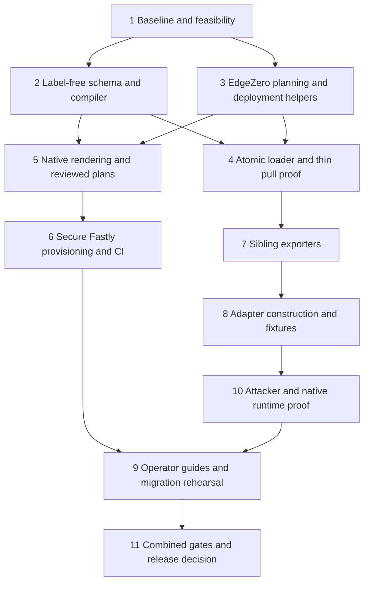

# Context-derived secret bindings implementation plan

## Governing contract and status

Implement [Context-derived secret bindings](../specs/2026-10-16-issue-1037-context-derived-secret-bindings-design.md) for [issue #1037](https://github.com/IABTechLab/trusted-server/issues/1037). This plan supersedes the earlier slot/protected-JSON implementation plan. Credentials stay raw native values. Operators configure feature activation, identity, and destination, not credential names. Core derives lookup identities and publishes credentials with their compiled targets. First-release tooling includes secure Fastly writes using existing deployment configuration and secret-free rendering/native provisioning instructions for all four adapters.

This plan was written against runtime base `5bc38862512c5c71085b5052bc3e528ee9b9987d`, documentation commit `ceaf43cdac230abfe48a6aa825c532f0b9b34ed9`, and EdgeZero v0.0.9 at `f7176742d46aa4d1a04ce4588b606afda388fd30`. Those are historical investigation inputs, not the implementation dependency pin.

Implementation is now under review on `feature/1037-secret-bindings`. The compiler, loading/export paths, provisioning commands, guides, and native fixtures below exist. EdgeZero is pinned to published revision `4f645b1e705d295117c93f4c74db12e5692ffb34`, companion [draft PR #444](https://github.com/IABTechLab/edgezero/pull/444). Host and simulator checks do not replace native TLS/no-follow, IAM, protected CI, provider propagation/limits, or migration proof. Those unperformed checks remain release gates; this plan is not release evidence.

Success means config-only mutations cannot read another role's credential or send an authorized credential to a new destination. Failed loading publishes no new snapshot and creates no backend or HTTP request. Provisioning success means the tool writes only the reviewed generated binding in the resolved deployment; it does not imply external credential validity or immediate runtime refresh.

## Boundaries and exclusions

- One core descriptor/compiler owns the twelve purposes, activation, subject extraction, endpoint policy, and versioned encoder. Tooling and runtime use it.
- Remove all twelve reference properties from unresolved config. Add only `ec.partners[*].api_token_enabled=false` and S3 `auth.session_token_enabled=false` for former optional credentials. Preserve existing activation elsewhere.
- Keep `trusted_server_secrets` and existing trusted physical mappings. Reuse `edgezero.toml`, `fastly.toml`, service-selection rules, deploy selectors, and provider authentication. Do not add a deployment descriptor or a second environment-selection system.
- The private loaded snapshot is outbound authority. Plain settings, public helper constructors, and resolved shadow fields cannot enable credential export.
- No JSON records, arbitrary labels, owner IDs, generation selectors, legacy-key retries, inline-value fallback, automatic rotation, credential discovery, background reconciliation, or secret-management service.
- Direct first-release `set` support is required for Fastly. Other adapters require real native lookup proof, generated declarations, and tested secure provisioning guides. Reject unsupported direct writes before reading input. Do not imply four-provider write automation has shipped.
- Preserve unrelated app behavior, request-signing/management paths, consent/KV/pull scheduling, and Tinybird fire-and-forget emission. Do not add Tinybird emitters to other adapters.
- Use fictional fixtures only. Never inspect real credentials or overwrite operator-owned `trusted-server.toml` while developing this change.

## Delivery order

Each numbered step should produce a reviewable commit or tightly related commits. Prerequisite experiments are not intermediate security releases. Do not deploy a partially scoped implementation that retains mutable credential destinations.



### 1. Establish fixtures and prove prerequisite feasibility

Read the spec, `AGENTS.md`, `.cargo/config.toml`, `TESTING.md`, manifests, current config loader/exporter code, and pinned EdgeZero source. Re-fetch the issue/comments if implementation starts after this planning revision. Record the exact source state, dependency revision, tools, and available provider environments.

Inspect EdgeZero `edgezero-core/src/app_config.rs`, both raw walkers in `edgezero-cli/src/config.rs`, and `edgezero-adapter-spin/src/cli.rs`. Demonstrate that an opt-in plan can represent implicit required credentials with no scalar reference leaves. Validate it through real validate/push/diff consumers, not an isolated trait mock.

Inspect Fastly service resolution, `effective_deploy_environment`, resource lookup/linking, secure provider transport, and existing provisioning in `edgezero-adapter-fastly/src/cli.rs`. Identify the smallest host-usable helper/operation to share with TS. Prove manifest/environment conflict handling, physical-name-to-ID resolution, and secure create/replace input with fictional data. Do not assume the Fastly CLI accepts a secret safely on argv or that a create operation implements replacement. Verify installed/provider-supported behavior before selecting the write mechanism.

Check the actual TS native mappings in each adapter's `src/platform.rs`. Verify generated key/name lengths, application/component declarations, protected value sources, provider limits, and config-writer permission separation in isolated environments. The core key remains 56 ASCII bytes; the inspected Spin mapping produces a 92-byte name with the default logical store. These lengths are inputs to native tests, not proof of acceptance.

Add counting store/backend/HTTP fixtures and a valid-checksum mutation helper using the production envelope constructor. Start with core load/pull tests and reuse existing fake services. Keep a prerequisite result table with source/path/executed/runtime evidence. Missing provider tools, permissions, or environments remain blockers, not assumed passes.

Completion: the hook and native renderer have an executable fictional-data path; Fastly target resolution and a secure write strategy are established; unverified native/IAM facts are listed before substantial integration or tooling work.

### 2. Implement the label-free schema and shared compiler

Primary files are `crates/trusted-server-core/src/config.rs`, `settings.rs`, `secret_resolution.rs`, and a new `src/secret_bindings.rs` module registered in `src/lib.rs`. Use one module initially. Share ordinary settings models where safe, but separate unresolved config serialization/deserialization from resolved credential state.

1. Add pre-normalization rejection of the twelve removed reference properties, including in dynamic DataDome config. Report only schema path and fixed migration category, even if a property contains a real secret or generated key. Reject known removed properties on disabled features too. Do not silently drop them through `serde(skip)` or unknown-field acceptance.
2. Add boolean-only `api_token_enabled` and `session_token_enabled`, default false. Preserve existing pull boolean/string normalization. Missing required enabled bindings are load failures, not feature-disable signals. Disabled uses perform no reads. Preserve malformed-parent validation and empty omitted partner arrays.
3. Remove legacy S3 reference defaults, materialize ordinary auth aliases/defaults and effective query policy, and preserve ignored deprecated store selectors and discarded Tinybird access-log placeholder behavior.
4. Define descriptors for the spec's twelve fixed CLI IDs/scopes with owning paths, activation, normalized subjects, exports, and credential validators. The descriptors represent implicit roles rather than existing secret leaves. Remove reference-string uniqueness checks; retain partner-domain and resolved-token-hash collision checks.
5. Compile private requests and targets. Implement the exact label-free `trusted-server-secret-binding-v1` framing, checked u32 lengths/counts, full SHA-256, and lowercase unpadded base32. Do not include array position, operator labels, CLI selection IDs, provider IDs, or credentials in the digest.
6. Implement shared strict endpoint parsing before URL parsing/trimming erases rejected syntax. Preserve exact handler regex/username and dataset bytes, normalized partner domains, and every bound S3 route-policy component.
7. Keep unresolved serialization feature-only. Resolved credentials never serialize to config envelopes. Existing resolved Rust fields may remain private/redacted validation state, not deserializable credential inputs or outbound authority.

Tests cover every purpose, framing boundaries, UTF-8 byte lengths, checked integer conversion helpers, optional route markers, normalization cases, aliases/defaults, reordering, equal-context deduplication, both new flags, removed-property injection, and safe diagnostics. Confirm the revised fictional vector `ts1_2hsjuldwgmfhyotnokgn5mqrao6xnkyo3dwva33hez4vx43yvcjq` independently in Rust. Do not accept the earlier label-bearing draft vector.

Completion: unresolved config with no secret names compiles deterministic active requests without secret reads, and serializes without values/references. Golden fixtures pin all twelve contexts and accepted/rejected normalization behavior.

### 3. Ship the EdgeZero prerequisite and reuse deployment resolution

Add a default-compatible opt-in active-credential lookup plan in EdgeZero core. Entries need fixed descriptor identity, concrete owning field path, logical store ID, and generated key. Exact public names follow upstream conventions. A missing hook preserves current behavior for other applications. An opted-in implicit-role app must not be forced to retain fake scalar leaves.

Reconcile both `run_adapter_typed_checks` and `typed_secret_checks` with the plan. Keep metadata coverage, logical store declarations, selected/all-adapter validation, redaction, native-name validation, and collision checks. Validate push/diff/validate consumers and serialization. Core/TS owns activation and expected descriptor coverage; EdgeZero need not independently rediscover TS policy from raw TOML.

Expose or extend narrow host-usable Fastly deployment helpers rather than copying private dependency internals into TS. Reuse service selection, checked physical selectors, native resource resolution, and sanitized provider transport. Preserve the existing distinction between provisioning's manifest/environment conflict check and explicit managed-deploy service selection. Do not change existing command precedence as a side effect of adding secrets commands.

Publish the companion release and update every workspace EdgeZero pin plus `Cargo.lock` together. Record the actual tag/revision. Local path patches may support experiments only, not release claims.

Tests cover legacy/default applications, implicit-role applications, descriptor completeness, omitted/disabled fields, duplicate exact versus colliding lookups, Spin final native names, unchanged feature-only serialization, and no credential-bearing error output. Test existing deployment inputs with manifest-only service, environment-only service, conflicting service values, explicit supported service selection, unset selector defaults, physical selector changes, and staging isolation.

Completion: TS's real typed validate/push/diff paths handle implicit bindings, other apps retain existing behavior, and shared Fastly helpers resolve the same deployment used by existing lifecycle commands. The published pin is a release dependency.

### 4. Build an atomic loader and prove the thin pull path

Update `config_payload.rs`, `settings_data.rs`, `secret_resolution.rs`, `config.rs`, and runtime preparation in `settings.rs`. After checksum verification, reject removed fields, validate structure, materialize defaults, and compile all active requests/targets. Look up only generated keys in the trusted mapped default store. Validate credential bytes/representation and ordinary settings, then publish private nonserializable `LoadedConfig` with settings and resolved uses together.

Prebuild sensitive Bearer headers and validate DataDome form/S3 material before backend creation. Preserve native error suppression, exact credential bytes through repeated preparation, all-or-nothing publication, and existing successful-state retention. No fallback to raw references, earlier draft names, alternate stores, or partially rebuilt state.

Integrate `ec/registry.rs`, `ec/partner.rs`, and `ec/pull_sync.rs` first. Replace loose outbound URL/token authority with a validated optional resolved use associated with the partner's compiled identity. The presence of that use enables export; plain settings cannot construct it. Preserve inbound token hashing, consent, batching, rate limiting, EC-ID validation, and KV behavior.

Build GET requests from the compiled endpoint and exactly one runtime `ec_id`. Force verified TLS independently of `proxy.certificate_check`; never follow redirects. Remove the request-builder panic path. Ensure registry rebuilds cannot manufacture a bound use from loose values.

Tests run through production envelope reconstruction and dispatch with store/backend/HTTP spies. Mutating URL plus allowlist, partner domain, TLS toggle, or removed token property must not recover the old credential. Unauthorized loads create no backend/send. An approved initial request receiving 3xx is a separate one-send/no-follow test, not a load rejection.

Completion: an actual load-to-pull path enforces private construction and snapshot pairing before broad sibling integration.

### 5. Add native rendering and reviewed binding plans

Add `Secrets` in `crates/trusted-server-cli/src/run.rs`, register `src/commands/secrets/` in `commands/mod.rs`, and reuse `src/app_config.rs` path/overlay helpers and the pure core compiler. Do not resolve secrets merely to generate a plan. If sharing requires an unresolved-loading helper, add that narrow helper rather than using resolved `Settings` as provisioning authority.

Proposed interface:

```bash
ts secrets plan --adapter fastly --app-config trusted-server.toml --out bindings.json
ts secrets check --adapter fastly --app-config trusted-server.toml --plan bindings.json
```

Support secret-free planning/rendering for Fastly, Axum, Cloudflare, and Spin. Reuse each TS adapter's real native mapping or a host-usable shared implementation with equivalence tests. Do not substitute EdgeZero's generic mapping for TS's runtime bridges. Validate final declarations and collisions with legacy/signing/management resources where namespaces overlap.

Version the plan document separately from the key ABI. Include fixed descriptor IDs, concrete owning paths, tool-generated entry IDs for repeated roles, normalized context, derived/native identities, required declarations, compiler/ABI versions, effective unresolved config fingerprint and overlay policy, plus resolved deployment resources. Fingerprint effective serialized config, not arbitrary absolute checkout paths, so approved inputs can move between developer and CI workspaces. Do not snapshot unrelated environment variables, credentials, or provider tokens.

Resolve the existing manifest selection and supported service flags using shared lifecycle helpers. Honor deployment environment selectors and their logical-name defaults. Resolve physical resource IDs from selected names before writing. Record service/store IDs in the plan so a renamed/recreated resource cannot silently change the target. Native resource lookup is read-only and cannot create/link stores during plan generation.

On set/check, recompile and compare the full relevant plan, config, overlays, compiler/mapping versions, and resolved native identities. Reject mismatches before secret input or provider mutation. A plan checksum detects drift, not approval. Never evaluate shell fragments or commands stored in a plan. Repeated roles require unambiguous selection; an interactive subject list or explicit generated `--binding` ID is acceptable, not a new operator-chosen label or array index.

`check` reports declaration/binding existence without retrieving values where supported. Distinguish unsupported checks, missing bindings, and provider errors with documented nonzero outcomes. Do not claim authentication, delivery, TLS, or warm-state validation from presence alone.

Completion: operators can identify every binding without calculating a key, selecting a wrong implicit role, or exposing values. Changing config, overlay policy, service/store selectors, provider identities, or plan contents causes safe rejection.

### 6. Implement secure Fastly writes and the CI entry point

Proposed interface:

```bash
ts secrets set tinybird.auction --adapter fastly --app-config trusted-server.toml --plan bindings.json
```

Use the existing Fastly service/store resolver and authenticated provider operation chosen in step 1. Show purpose, compiled subject, exact destination/dataset or route policy, selected service/physical store, and create/replace action. Confirm the reviewed operation, then accept hidden terminal input; `--stdin --yes` provides the noninteractive path. Reject unsupported adapters, inactive roles, ambiguous selections, stale plans, target conflicts, and missing provider authentication before accepting the value.

Validate the supplied value with the role's shared validator and provider limits before mutation. Preserve bytes, including significant whitespace for credential kinds that allow it. Reject a trailing newline for Bearer roles rather than silently trimming it. The value must not appear in argv, environment copies created by the CLI, plan/declaration files, debug logs, request/response dumps, panic messages, or error-stack attachments. Reuse the existing Prebid Server secret command's interaction/testing patterns where helpful, not its AWS JSON credential format or deployment descriptor.

Use exact resolved provider IDs for mutation. Same-context `set` is an explicit create/replace at the same deterministic name, not creation of another slot. Test repeat execution, cancellation, permission errors, invalid values, provider replacement/propagation, and failure after an uncertain write. Do not implement blind retries after uncertain outcomes or automatic writes to a newly inferred context. Keep provider errors sanitized and report whether storage was confirmed or remains uncertain. There is no deploy, resource linking, config push, recipient-side token creation, or automatic runtime refresh in this command.

Add executable fictional-input CLI tests that intercept subprocess argv/stdin/output and count provider mutations. Add an isolated Fastly write/read-through-runtime smoke against the reviewed resource. Metadata/presence checks alone do not prove that the stored bytes are the supplied bytes.

The CI path uses the same command, not a second provider integration. Add a tested example Bash script using `set +x`, `set -euo pipefail`, required-input checks, and `printf '%s'` piped to `--stdin --yes`. Provider authentication and store selectors come from the approved deployment environment. A protected GitHub Actions example must use trusted immutable CLI/workflow code, a reviewed config/plan revision, protected provisioning credentials, no untrusted PR execution, and serialization for a shared binding. Make the trust boundary concrete: config-only publishers cannot edit code that executes with secret-writer credentials. Use a separately controlled provisioning repository when repository permissions cannot enforce that split.

Completion: an operator can provision Tinybird on Fastly without typing its native key; the same reviewed operation can run noninteractively without exposing values or authorizing a changed destination. Other providers have explicit unsupported-write behavior, not hidden fallback.

### 7. Bind sibling exporters without changing unrelated behavior

DataDome files are `crates/trusted-server-core/src/integrations/datadome.rs`, `integrations/datadome/protection.rs`, and necessary registry/startup plumbing. Remove config-populated credential-name authority and require the private loaded use for enabled Protection. Use its exact derived `/validate-request` target and safely form-encoded `Key`. Keep bypass in its separate inbound-only scope and preserve remote failure policy. Eliminate trimming of resolved bytes during repeated startup preparation.

Tinybird files are `crates/trusted-server-adapter-fastly/src/tinybird.rs` and its `app.rs` construction. Replace `auction_sink_from_settings`/loose token-host authority with the loaded use. Build `/v0/events` plus exactly one encoded dataset query from the compiled target. Preserve batching, body-size limits, disabled no-op behavior, verified TLS, and fire-and-forget operation. Test no-follow without claiming response observation. Other adapters validate the enabled binding but do not acquire new emitters.

S3 files are `crates/trusted-server-core/src/proxy.rs`, `s3_sigv4.rs`, route preparation in `settings.rs`, and image-optimizer preflight branches. Associate all active credential roles with the same compiled route subject and separate scopes. Check final origin/method before signing or backend creation, including HEAD/GET preflight. Host overrides and proxy rewriting cannot change bound authority. Require verified TLS for authenticated routes, preserve request-dependent object paths/permitted queries, and leave unauthenticated routes unchanged. Redact access IDs, signatures, and session/secret keys.

Completion: no current outbound credential consumer enables itself from plain settings; all send methods/authorities/paths/queries match compiled contexts across primary and preflight paths.

### 8. Integrate adapters, retained state, and fictional fixtures

Update `crates/trusted-server-adapter-{fastly,axum,cloudflare,spin}/src/app.rs`, core loader callers, and Fastly `src/main.rs`. Carry the loaded snapshot through registries, exporter construction, diagnostics, fallback finalization, retained/reusable sandbox state, and post-response pull sync. A failed rebuild publishes nothing and cannot pair new settings with old credentials. In-flight requests keep their captured snapshot.

Settings-only host/test helpers may build non-exporting state. Enabled exporters require fixtures that pass the production compiler/loader. Do not expose a public arbitrary-bound-use constructor for the integration-test crate; `cfg(test)` visibility in core does not automatically extend to that crate.

Migrate relevant fixtures/comments in `trusted-server.example.toml`, `.env.example`, `fastly.toml`, adapter Wrangler/Spin manifests, `scripts/generate-integration-viceroy-configs.sh`, existing smoke scripts, and `crates/trusted-server-integration-tests/tests/common/config.rs` plus environment helpers. Use the compiler/renderer to generate keys, not hand-maintained hashes. Keep values fictional/raw, remove reference properties, set optional activation flags deliberately, and preserve one logical secret store. Do not edit operator-owned files or conflate request-signing fixtures with app credentials.

Completion: all construction/reload paths enforce the loaded-use rule, examples represent the new schema, and real native lookup names match generated declarations.

### 9. Write operator guides and rehearse migration

Documentation is a required implementation milestone, not optional cleanup. Create these pages and link them from the Operator sidebar in `docs/.vitepress/config.mts`:

| New guide                                | Required contents and verification                                                                                                                                                                                                                                                                                                                                                                 |
| ---------------------------------------- | -------------------------------------------------------------------------------------------------------------------------------------------------------------------------------------------------------------------------------------------------------------------------------------------------------------------------------------------------------------------------------------------------- |
| `docs/guide/secrets.md`                  | Label-free TOML, purpose/identity/target model, prerequisites and permissions, fixed selectors, plan review, interactive Fastly setup, generated native provisioning for Axum/Cloudflare/Spin, presence checks, runtime verification, rotation/retirement, and troubleshooting. Rehearse every provider walkthrough with fictional values.                                                         |
| `docs/guide/secrets-ci.md`               | Secure stdin Bash, protected GitHub Actions workflow, existing environment variables/service selection, trusted-code/approval boundary, immutable config/plan inputs, repeated-role selection, serialized writes, failure/retry handling, and no secrets in logs/artifacts. Parse examples and exercise the script through the real CLI with fake provider transport before isolated CI rehearsal. |
| `docs/guide/secret-binding-migration.md` | All twelve removed properties, optional-flag conversions, new-schema config and generated names/declarations, provisioning-first isolated cutover, mixed-version config separation, legacy cleanup, state recreation, same-context rotation limits, coordinated S3 maintenance, retired-context replay, recipient-side revocation, and unsafe downgrade warning.                                   |

Update existing `docs/guide/configuration.md`, `cli.md`, `fastly.md`, `axum-dev.md`, `cloudflare.md`, `spin.md`, `telemetry.md`, `integrations/datadome.md`, `asset-routes.md`, `collective-sync.md`, `ec-setup-guide.md`, onboarding/getting-started references as affected, `tinybird/README.md`, `TESTING.md`, example comments, CLI help, and `CHANGELOG.md`. Search by old property names and raw-reference instructions instead of mechanically editing every document. Correct the stale inline-secret description for trusted client IP. Keep request-signing/key-rotation docs clear about their separate store path.

The Fastly guide must explain `fastly.toml` service identity, `FASTLY_SERVICE_ID` conflict behavior, `FASTLY_API_TOKEN`, `EDGEZERO_MANIFEST`, physical `__NAME` selectors, logical resource links, managed application-release deployment, and why `--staging` alone does not isolate stores. No new deployment TOML, manual hash derivation, manual logical-link creation, or profile-only authentication advice.

The first tutorial starts from an enabled Tinybird section with no token-name property, obtains a restricted append token outside TS, reviews a generated plan, provides the value securely, provisions, recreates state, and verifies an actual approved request. Explain that TS does not mint a Tinybird token. Other providers must include complete generated-name/declaration/input steps, including Spin application/component declarations and secure providers. An Axum child process cannot export variables into its parent; demonstrate environment injection through its actual launcher instead.

Rehearse migration against isolated resources, with a reviewed new config and existing raw values supplied securely. Old and new binaries require compatible separate config snapshots/stores during mixed rollout. New keys do not revoke old context keys. Delete retired bindings and replace retained states within an owned window, then verify old-config replay fails on fresh state. Same-context replacement has no selectable generation: use recipient overlap where supported or a maintenance cutover. Pause affected state creation/traffic during nontransactional S3 updates and verify the full set before resuming.

Completion: an engineer following only the guides can provision a fictional deployment without inventing a secret key or guessing an environment/store, and can explain what checks do and do not prove. Every proposed interface matches implemented help/tests before docs describe it as available.

### 10. Execute attacker, lifecycle, and native-runtime proof

Add focused `secret_bindings` and `secret_scoping_attacker` tests. These are proposed filters; check that they execute nonzero tests. Use valid-checksum mutated envelopes and immutable native fixtures for config-only attacks. Keep separate trusted-provider/input failure tests.

| Area                                 | Mutations or scenario                                                                                                                                                     | Required evidence                                                                                                                                |
| ------------------------------------ | ------------------------------------------------------------------------------------------------------------------------------------------------------------------------- | ------------------------------------------------------------------------------------------------------------------------------------------------ |
| Removed inputs and scope confinement | Inject old reference properties containing publisher/inbound/handler/native/generated keys; enable a different purpose where only another scope is provisioned            | Schema-only rejection or missing derived binding; no source-purpose lookup, backend, or HTTP request                                             |
| Identity and target binding          | Change partner domain, handler regex/username, pull URL plus allowlist, DataDome target, Tinybird host/dataset, or every S3 route-policy component                        | Changed context never reads the old key; zero unauthorized sends; complete already-provisioned identity selection is a positive case             |
| Encoding/native mapping              | Golden vectors, optional markers, defaults, reordering, aliases, final-name collisions, provider limits                                                                   | CLI/runtime/native agreement; no silent truncation, renaming, merging, or legacy retry                                                           |
| Activation and structure             | Both new boolean flags/defaults, missing enabled credential, disabled uses, absent arrays/objects, malformed parents, removed property on disabled feature                | Exactly the required active lookups; missing required value never silently disables auth; structural/migration errors occur before reads         |
| Transport and representation         | Invalid Bearer/header bytes, DataDome form characters, S3 signing/preflight, Host override, TLS toggle, bad certificate, backend reuse, all redirect statuses             | Preflight rejection before backend where applicable; verified TLS; one send per approved operation; zero sends to Location or wrong authority    |
| Provisioning                         | Alter plan/config/overlay/compiler/manifest/service/store resource; ambiguous role; unsupported adapter; cancellation; provider auth/write failure; uncertain replacement | No preflight-failure mutation or secret input; exact reviewed ID on success; safe outcomes and no value on argv/logs/artifacts                   |
| Snapshot and lifecycle               | Failed rebuild, old/new/in-flight state, same-name replacement, policy change/retirement, S3 maintenance, mixed-version config, rollback                                  | No cross-snapshot pair; fresh state observes intended binding; replay of retired context fails after deletion; no immediate global refresh claim |
| Operator and CI                      | Guide walkthroughs, protected stdin workflow, deployment selectors, default-store fallback, missing CI inputs, repeat execution                                           | Same command path and reviewed plan; no new names on repeat; isolated resources, no production mutation, safe transcripts                        |

Use TLS fixtures with fictional DNS names and isolated trusted test roots where the runtime permits it. Never weaken production TLS policy to make a test pass. Separate TLS handshakes from credential-bearing HTTP requests, and separate a valid initial request returning 3xx from pre-request load rejection. Capture sensitive test values in memory and redact assertion failures.

Run actual secret reads and HTTPS/no-follow flows on Axum, Viceroy/Fastly with isolated platform smoke, Wrangler/workerd, and Spin. Extend existing `scripts/smoke-{axum,fastly,cloudflare,spin}.sh` and integration harnesses rather than inventing a second full framework. Cloudflare/Spin host route tests and Noop stores do not execute native bindings. Test provider permissions, secure input, native limits, and mapping separately from simulator transport. An unavailable environment blocks its proof.

Completion: every spec acceptance criterion maps to named passing tests or an explicit release blocker. No security release claim rests only on source inspection, compilation, model hashes, or host route parity.

### 11. Run combined checks and decide release readiness

At each coherent step run focused checks for the behavior just changed. Reuse current passing evidence while inputs are unchanged. Before implementation handoff, inspect the combined diff for raw app-config lookups, bypass constructors, loose credential consumers, unsafe subprocess arguments, logging, leftover draft/reference behavior, and local dependency patches.

Existing focused commands include:

```bash
cargo test -p trusted-server-core secret_resolution
cargo test -p trusted-server-core config_payload
cargo test -p trusted-server-core ec::registry
cargo test -p trusted-server-core ec::pull_sync
cargo test -p trusted-server-core integrations::datadome
cargo test -p trusted-server-core s3_sigv4
cargo test -p trusted-server-core proxy::tests
./scripts/test-cli.sh
```

After adding the proposed suites:

```bash
cargo test -p trusted-server-core secret_bindings
cargo test -p trusted-server-core secret_scoping_attacker
cargo test-fastly secret_bindings
cargo test-fastly tinybird
cargo test-axum secret_bindings
cargo test-cloudflare secret_bindings
cargo test-spin secret_bindings
```

These package-scoped core commands run natively with the inspected Cargo config. Fastly uses Viceroy; Cloudflare/Spin aliases above are host checks, not native-provider proof. Run the real smoke/rehearsal matrix separately. Before final implementation handoff, run the repository's target-matched gates:

```bash
cargo fmt --all -- --check
cargo check-fastly
cargo check-axum
cargo check-cloudflare
cargo check-spin
cargo clippy-fastly
cargo clippy-axum
cargo clippy-cloudflare
cargo clippy-cloudflare-wasm
cargo clippy-spin-native
cargo clippy-spin-wasm
cargo clippy-cli
cargo clippy-codegen
cargo test-fastly
cargo test-fastly-reuse
cargo test-axum
cargo test-cloudflare
cargo test-spin
cargo test --manifest-path crates/trusted-server-integration-tests/Cargo.toml --test parity
cargo test -p trusted-server-core --test template_build_digest
cargo clippy -p trusted-server-core --test template_build_digest -- -D warnings
scripts/lint-wasm-clock.sh
(cd crates/trusted-server-js/lib && npx vitest run && npm run format && node build-all.mjs)
(cd docs && npm run lint && npm run format && npm run build)
docs/node_modules/.bin/prettier --config docs/.prettierrc --check "*.md" ".claude/**/*.md" ".github/**/*.md" "crates/**/*.md" "scripts/**/*.md" "tinybird/**/*.md"
```

Use the host-target CLI helper and pinned tools from the repository. Do not run cross-runtime `cargo clippy --workspace --all-features`. Install missing dependencies through repository conventions. Parse TOML/JSON/YAML examples, check Bash syntax, test all new CLI examples against implemented help/fixtures, and run the existing CLI URL-host linter with its actual current syntax if documentation tooling requires it. Do not claim an empty test filter or unavailable linter passed.

## Release evidence and blockers

Keep one evidence record with `check | tested revision and input fingerprints | environment | outcome | log`. Separate source/path inspection, host execution, simulator results, and native deployed-runtime proof.

The two highest-risk facts remain unproven until implementation executes: every enabled export path is confined to one loaded credential/target snapshot, and actual native mappings/transports/provisioning preserve the reviewed authorization. The cheapest first proofs are the loader/store/backend spy slice and the real EdgeZero/native-renderer/Fastly-write prerequisite slice.

Release requires the published dependency pin, all twelve active-role tests, zero unauthorized sends, real native reads and TLS/no-follow tests on all four runtimes, secure Fastly provisioning/replacement proof, tested CI input/trust boundaries, operator-guide rehearsals, migration/retirement/rollback evidence, and verified config-only versus secret-writer permission separation. Missing native environments, unsupported provider replacement constraints, or unavailable coordinated S3 cutover are blockers, not reasons to restore arbitrary names or raw-key fallback.

Planning and documentation checks do not establish these runtime results. Stop before implementation until the user requests it.
