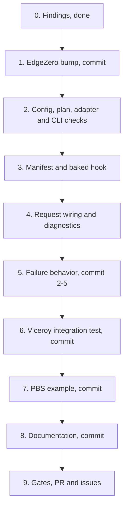

# Auction Provider mTLS Implementation Plan

> **For agentic workers:** REQUIRED SUB-SKILL: Use superpowers:subagent-driven-development (recommended) or superpowers:executing-plans to implement this plan task-by-task. Steps use checkbox (`- [ ]`) syntax for tracking.

**Goal:** An auction provider with `mtls = true` presents the `auction-providers` client certificate on Fastly, other adapters and the CLI refuse that config for those adapters, and the PBS AWS example can require the certificate at its ALB.

**Spec:** `docs/superpowers/specs/2026-11-24-auction-provider-mtls-design.md`.

**Status:** Implemented on this branch; checkboxes are not updated. Task 7 was delegated to a worker. Departures from the plan are recorded in the spec and the commit messages.

**Branch:** `feat/1650-auction-provider-mtls`, stacked on #1540 (`baseline/aws-examples-20261110`). One PR whose body says `Closes #1650`; GitHub won't auto-close it from a stack branch, so close #1650 by hand when the change reaches `main`.

Tasks 2 to 5 are one commit, so no commit accepts `mtls = true` on Fastly without presenting the certificate. Work through them in order and commit at the end of task 5.

## 0. Findings

Collected while writing the spec and from a review by a second agent, against EdgeZero tag `v0.0.12-rc-identity.202611.1` (`b3a45dfb`).

- [x] **Bump compiles.** With the seven root dependencies and the Axum `edgezero-store-aws` dev-dependency moved to the tag, `cargo check-fastly --all-targets` and `cargo check -p trusted-server-adapter-axum --all-targets` pass with no new warnings. `Cargo.lock` changes the EdgeZero sources and dependency lists, and also re-resolves some dependencies of `colored`, `gix-imara-diff`, `prost-*` and `winapi-util`. Logs: `~/.cache/ts-1650/bump-check-*.log`. Tests and the other adapters are task 1.
- [x] **`Hooks::manifest()` defaults to `Absent`.** Trusted Server implements `Hooks` by hand in all four adapters, so the identity policy would be empty. On Fastly, `App::from_router` (EdgeZero `app.rs:480`) is the only runtime reader of the hook. EdgeZero's Axum, Cloudflare and Spin adapters read it for geo and runtime variables. The `app!` macro and EdgeZero's round-trip test use `serde_json::to_string` of the manifest with `Manifest::from_baked_json`, the approach task 3 copies.
- [x] **The request client keeps the policy.** `request_outbound_client` takes `ctx.http_client()` and calls `with_proxy_marker(false)`, which sets one field and keeps the rest.
- [x] **Identity error stages.** Core preflight raises `Undeclared` and `RequiresHttps` (EdgeZero `outbound/dispatch.rs:111-150`) into that slot's preflight result. Fastly preparation raises `HostNotAllowed`, `MaterialMissing` and `MaterialInvalid` before backend registration and before origin I/O (EdgeZero Fastly `outbound.rs:750-783`). `Unsupported` comes from option validation. SDK `builder.finish()` errors are registration failures with provider-failure detail.
- [x] **Settlement.** `EdgeError::ClientIdentity` has no `provider_failure_detail`, so `failed_to_launch` is false and `settle_bidder_slot` returns `provider_transport_failed_response` after `log_request_failure`.
- [x] **Opaque log.** `outbound_error` (`crates/trusted-server-core/src/outbound.rs:253-282`) attaches the `EdgeError` with `attach_opaque`, so `{report:?}` shows only the generic status and kind. `ClientIdentityError`'s `Display` names the origin or the material slot and never key bytes or PEM.
- [x] **Secret Store reads.** EdgeZero Fastly reads the key once per cold backend registration (`outbound.rs:697-709,1123-1144,1185-1214`). The backend registry is sandbox-wide and keeps old chain fingerprints. Trusted Server reads its own signing keys from the Secret Store (`request_signing/signing.rs:145`, `rotation.rs`).
- [x] **CLI capability gate.** `ensure_capabilities` warns `optional capability 'outbound-client-identity' unavailable` for Axum, Cloudflare and Spin, then calls `validate_client_identities`, which is the default `Ok(())` for those adapters. Fastly's validation requires both identity stores to resolve; Trusted Server declares defaults for both.
- [x] **TS CLI per-adapter validation.** `ts config push` and `diff` use `ProviderlessAppConfig` for non-Fastly adapters (`crates/trusted-server-cli/src/run.rs:147-169`, `checked_app_config.rs:60-90`), which rejects enabled identity providers. The `mtls` check joins it.
- [x] **Store safety.** The Trusted Server CLI deletes no Config Store keys; pushes go through EdgeZero, whose garbage collection removes only orphaned chunk entries.
- [x] **Disabled plans.** `compile_auction_plan` (`auction/mod.rs:58-69`) compiles every provider before applying `enabled`.
- [x] **Test support.** `ScriptedHttpClient`'s `RecordedRequest` does not record the identity. `HttpClient::with_client_identity_policy` is public, so tests can attach a policy. `ScriptedReply::error` scripts a per-URI error.
- [x] **Integration harness.** `tests/integration.rs` has `TlsAssetOrigin`: a loopback rustls origin with an `rcgen` CA, trusted by Viceroy through `SSL_CERT_FILE`. `rcgen` and `rustls` are already dev-dependencies. `viceroy_config_with_app_config` (`integration.rs:1375-1381`) writes one simple key into the generated `trusted_server_config` contents; dotted keys such as `auction-providers.certificate` must be quoted. The Viceroy template already defines the `trusted_server_secrets` secret store. The auction fixture `enable_auction` (`tests/common/config.rs:212-236`) hardcodes `profile = "standard"` and `routing = "all_eligible"`, which `prebid-server` forbids (`auction/plan.rs:310-317`).
- [x] **Viceroy.** The harness runs `viceroy` from `PATH`, and CI installs stock 0.21.0 (`.github/actions/setup-integration-test-env/action.yml`). Upstream 0.21.0 applies `client_cert` on dynamic HTTPS backends; EdgeZero's patch changes only body readiness and timeout readback. The local `viceroy` is 0.17.0. Viceroy reports a rejected handshake as `InternalError` (Viceroy#727), so tests prove rejection from the origin's records.
- [x] **PBS example.** AWS provider 6.64.0 (lock file) supports `aws_lb_trust_store`, `mutual_authentication` on `aws_lb_listener` and `connection_logs` on `aws_lb`. `mutual_authentication` is optional and computed, and only updates on a diff (`listener.go:397-401,810-812`); trust store deletion waits for disassociation (`trust_store.go:218-231`); a removed `connection_logs` block is suppressed (`load_balancer.go:118-145`); the trust store updates only when its arguments change (`trust_store.go:193-208`). Regional `var.name` is 1 to 28 characters and allows consecutive hyphens (`modules/regional/variables.tf:31-37`); AWS trust store names are 1 to 32 characters with no leading, trailing or consecutive hyphens. Mocked tests are `tests/root_unit_test.tftest.hcl` and `modules/regional/tests/security_unit_test.tftest.hcl`. `.github/workflows/pbs-example.yml` runs formatting, readonly-lock init, validate, both test suites and the Node smoke test. The root `.gitignore` ignores `*.pem` only. Terraform 1.16.2 is local.

## 1. EdgeZero bump

- [ ] Keep the working-tree change from task 0: `Cargo.toml` (seven entries), `crates/trusted-server-adapter-axum/Cargo.toml` (`edgezero-store-aws`), `Cargo.lock`.
- [ ] Run `cargo test-fastly`, `cargo test-fastly-reuse`, `cargo test-axum`, `cargo test-cloudflare`, `cargo test-spin`, `cargo check-cloudflare`, `cargo check-spin`, `cargo test -p trusted-server-core --test template_build_digest`, and the CLI tests for the host target. Fastly runs use Viceroy 0.21.0 (see task 6).
- [ ] Run every clippy alias from `AGENTS.md` and `cargo fmt --all -- --check`.
- [ ] Fix anything the newer EdgeZero breaks, in this commit only. Record each fix in the commit body.
- [ ] Commit: `Move EdgeZero to the rc-identity tag with client identities`.

## 2. Config, plan, adapter and CLI checks

Files: `crates/trusted-server-core/src/auction/plan.rs`, the adapters' `src/app.rs`, `crates/trusted-server-cli/src/checked_app_config.rs`, every auction `ProviderConfig` literal the compiler reports.

- [ ] Add a public constant `AUCTION_PROVIDERS_CLIENT_IDENTITY = "auction-providers"` beside the plan types.
- [ ] `ProviderConfig.mtls: bool` with `#[serde(default, skip_serializing_if = "is_false")]` and a doc comment matching `allow_insecure_http`'s.
- [ ] `ProviderPlan.client_identity: Option<ClientIdentityName>`, set from `ClientIdentityName::new(AUCTION_PROVIDERS_CLIENT_IDENTITY)` when `mtls` is true. Map a construction error to a configuration error, without `expect`.
- [ ] In `AuctionPlan::compile`, reject `mtls = true` when the canonical endpoint's scheme is `http`: ``provider `<id>` sets mtls but its endpoint is not https``.
- [ ] Add `provider.client_identity.is_some()` to the tuple in `validate_fastly_backend_bound`, and update its doc comment.
- [ ] Add `pub fn reject_auction_mtls(plan: &AuctionPlan, adapter: &str) -> Result<(), Report<TrustedServerError>>`. It checks every compiled provider, whether or not the plan is enabled, and fails listing the `mtls` provider IDs in plan order: ``auction providers `a`, `b` set mtls, but the <adapter> adapter cannot present client certificates``.
- [ ] Call it in `trusted-server-adapter-axum/src/app.rs`, `-cloudflare/src/app.rs` and `-spin/src/app.rs`, right after `compile_auction_plan`. Fastly does not call it.
- [ ] In `ProviderlessAppConfig::validate`, compile the auction plan from the checked settings and call `reject_auction_mtls(&plan, "target")`, adding a validation error beside the identity-provider one. Fastly's `CheckedAppConfig` path is unchanged.
- [ ] Add `mtls: false` to each auction `ProviderConfig` struct literal the compiler reports. Literals of other `*ProviderConfig` types are untouched.
- [ ] Tests in `plan.rs`:
  - `mtls` absent parses as false; `true` parses.
  - Serializing omits `mtls` when false and keeps `mtls = true`.
  - The plan carries `auction-providers` for `mtls = true` and `None` otherwise.
  - `mtls = true` fails to compile with an `http` endpoint under `allow_insecure_http = true`, and with a loopback `http://127.0.0.1` endpoint.
  - The Fastly bound counts two providers that differ only in `mtls` as two.
  - `reject_auction_mtls` passes a plan without `mtls`, fails a disabled plan that has an `mtls` provider, and fails naming every `mtls` provider.
- [ ] Adapter tests, beside each adapter's `enabled_identity_provider_fails_startup` in `src/app.rs`: Axum, Cloudflare and Spin each fail assembly for settings with one `mtls` provider and name it; Fastly's `startup_state` accepts the same settings.
- [ ] CLI tests: `ProviderlessAppConfig` rejects a config with an `mtls` provider; `CheckedAppConfig` accepts it.

## 3. Manifest and baked hook

Files: `edgezero.toml`, `crates/trusted-server-core/build.rs`, a core module for the baked manifest, `crates/trusted-server-adapter-fastly/src/app.rs`.

- [ ] In `edgezero.toml`, add `[capabilities] optional = ["outbound-client-identity"]` above `[capabilities.outbound]`, and `[capabilities.outbound.client-identities.auction-providers]` after it, with a comment saying it binds to the default config and secret stores and that `mtls` selects it.
- [ ] In `build.rs`, write `serde_json::to_string(loader.manifest())` to `OUT_DIR/edgezero-manifest.json` next to the existing outputs. Add `serde_json` to `[build-dependencies]` (it is already a normal dependency, which `template_build_digest` needs).
- [ ] Add `pub fn baked_edgezero_manifest() -> BakedManifest` in core: a `static OnceLock<BakedManifest>` filled from `Manifest::from_baked_json(include_str!(concat!(env!("OUT_DIR"), "/edgezero-manifest.json")))`.
- [ ] Override `fn manifest() -> BakedManifest` in the Fastly adapter's `impl Hooks for TrustedServerApp`, returning it, with a doc comment that names the identity policy as the reason.
- [ ] Tests:
  - Core: the baked manifest is `Present`, declares `auction-providers` with no store overrides, and lists `outbound-client-identity` as optional.
  - Fastly: assemble the app the way production does (`App::from_router::<TrustedServerApp>`) and assert the request client's identity policy contains `auction-providers`, not just a direct `from_baked` call. Extend the existing `edgezero.toml` test near `app.rs:1782` if it fits.
  - `cargo test -p trusted-server-core --test template_build_digest` and `cargo test -p trusted-server-cli --test config_store_defaults` (host target) still pass.

## 4. Request wiring and diagnostics

Files: `crates/trusted-server-core/src/auction/provider.rs`, `crates/trusted-server-core/src/outbound.rs`, `crates/trusted-server-core/src/test_support/scripted_client.rs`.

- [ ] In `GenericOpenRtbProvider`'s request builder, after `.cache_policy(OutboundCachePolicy::Bypass)`, add `.client_identity(name.clone())` when `self.plan.client_identity` is `Some`.
- [ ] In `outbound_error`, when the error is `EdgeError::ClientIdentity { name, reason }`, also attach a printable diagnostic, for example `ClientIdentityFailure` displaying `<name>: <reason>`, before the opaque attachment. Nothing else about the report changes.
- [ ] `RecordedRequest` gains `client_identity: Option<String>`, filled from the dispatch request's `client_identity()` metadata name. Update `assert_transport` and similar helpers only if they compare whole records.
- [ ] A test-support helper that returns the scripted client's `HttpClient` with a `ClientIdentityPolicy` declaring `auction-providers`.
- [ ] Tests:
  - A provider with `mtls = true` records `Some("auction-providers")`; one without records `None`.
  - With the identity set, method, URI, headers, body, timeout and cache policy equal the request without it.
  - The response parses and matches the provider as before.
  - `outbound_error` on a `ClientIdentity` error: the report's debug text contains the name and reason (`private key is missing`, and a `HostNotAllowed` origin with its port), and carries no PEM marker.

## 5. Failure behavior

File: orchestrator tests in `crates/trusted-server-core/src/auction/orchestrator.rs`.

- [ ] Two providers, A with `mtls = true` and B without, both returning bids.
  - **Undeclared:** the client has no identity policy. A fails in core preflight. Assert A's response is the transport-failed no-bid response, B's bids are present, and the client recorded no request to A.
  - **Material missing:** the client has the policy and A's URI is scripted with `ScriptedReply::error(EdgeError::client_identity(.., MaterialMissing(..)))`. Assert the same outcome and exactly one request to A, so there is no retry.
- [ ] One provider with `mtls = true` failing alone completes the auction without bids and does not hit the all-launch-failed path.
- [ ] Run `cargo test-fastly`, `cargo test-fastly-reuse`, `cargo test-axum`, `cargo test-cloudflare`, `cargo test-spin`, the CLI tests, the clippy aliases and `cargo fmt --all -- --check`.
- [ ] Commit tasks 2 to 5: `Present a client certificate on auction providers that set mtls`.

## 6. Viceroy integration test

Files: `crates/trusted-server-integration-tests/tests/integration.rs`, `tests/common/config.rs`.

- [ ] Install stock Viceroy 0.21.0 outside the user's tools: `cargo install viceroy --version 0.21.0 --locked --root ~/.cache/ts-1650/viceroy-stock`. Runs put `~/.cache/ts-1650/viceroy-stock/bin` first on `PATH`. A pass on the patched local build (`~/.cache/rc-refresh-20261110/target-viceroy-repair/debug`) is extra evidence, not a substitute.
- [ ] `MtlsPbsOrigin`: build on `TlsAssetOrigin`'s setup. A server CA and `127.0.0.1` leaf as today, plus a client CA and a client leaf with the `clientAuth` EKU. The rustls server config uses `WebPkiClientVerifier` with the client CA as its only root. It answers `POST /openrtb2/auction` with an OpenRTB response whose seats match the routed bidders, and records accepted requests and handshake failures separately.
- [ ] Fixtures: let a provider fixture choose `profile`, `routing` and `mtls`. The PBS provider uses `profile = "prebid-server"` with explicit `[auction.bidders.<id>]` routes; the plain loopback bidder keeps `standard` and `all_eligible`.
- [ ] `with_fastly_runtime_extras` in `tests/common/trace_boundary.rs` takes the extra entries and writes quoted keys: `"auction-providers.certificate"` and `"auction-providers.hosts"` (`https://127.0.0.1:<port>`) in the generated `trusted_server_config` contents, and an `auction-providers.private-key` entry in `[[local_server.secret_stores.trusted_server_secrets]]`.
- [ ] Cases, ignored like the other Viceroy cases, with `SSL_CERT_FILE` set to the server CA:
  - **With identity:** bids from the PBS seats and the plain bidder come back, each attributed to its provider; the origin recorded one accepted request with a client certificate.
  - **Without identity** (`mtls = false` to the same origin): only the plain bidder's bids come back; the origin recorded a failed handshake and no request.
  - **Missing key** (`mtls = true`, no secret entry): only the plain bidder's bids come back; the origin recorded no connection.
- [ ] Run with `./scripts/integration-tests.sh`, or the narrower `cargo test --manifest-path crates/trusted-server-integration-tests/Cargo.toml --test integration -- --ignored <name>` after the script has built the artifacts.
- [ ] Commit: `Test auction provider mTLS against a client-certificate origin in Viceroy`.

## 7. PBS example

Files under `deploy/pbs-example/`, `.github/workflows/pbs-example.yml`, `.claude/skills/planning-prebid-aws/references/terraform.md`.

- [ ] Root `variables.tf`: `east_client_ca_bundle_s3_bucket`, `east_client_ca_bundle_s3_key`, `west_…` pairs and `east_connection_logs_bucket`, `west_connection_logs_bucket`, all `string`, default `null`. Validate that each pair is both set or both null.
- [ ] Root `main.tf`: pass `client_ca_bundle` (an object of bucket and key, or null) and `connection_logs_bucket` to each module.
- [ ] Regional `variables.tf`: `client_ca_bundle` (`object({ bucket = string, key = string })`, default null) and `connection_logs_bucket` (string, default null).
- [ ] Regional `load_balancing.tf`:
  - `aws_lb_trust_store.clients` with `count`, and a name that meets AWS's rules for every valid `var.name`: collapse consecutive hyphens, keep within 32 characters with a short suffix such as `-mtls`, and stay unique in the region.
  - Always render `mutual_authentication` on `aws_lb_listener.https`: `mode = "verify"` with the trust store ARN when inputs are set, `mode = "off"` otherwise.
  - Always render `connection_logs` on `aws_lb.main`, with `enabled` set from the input and the bucket when set.
- [ ] `terraform.tfvars.example`: commented examples with fictional bucket names and a versioned bundle key, such as `client-ca/bundle-v1.pem`.
- [ ] Tests:
  - Regional: without inputs, no trust store and `mode = "off"`; with them, a trust store from the bundle and verify mode; a sequence of runs going from verify to off; connection logs enabled only with a bucket; the trust store name for a 28-character name with consecutive hyphens.
  - Root: a half-set pair fails validation for each region; both regions receive their own inputs.
- [ ] `scripts/make-dev-mtls-certs.sh [output-dir]`: bash, `set -euo pipefail`, `umask 077`, `openssl`. The default output directory is `deploy/pbs-example/.dev-mtls/`, added to `.gitignore` with its `.key` files. Writes `ca.pem` and `ca.key` (`basicConstraints = critical,CA:TRUE`, `keyUsage = critical,keyCertSign,cRLSign`), `client.key`, `client.pem` (`extendedKeyUsage = clientAuth`, one year) and `ca-bundle.pem`. Refuses a non-empty output directory and prints a development-only banner.
- [ ] `scripts/test-make-dev-mtls-certs.mjs`: runs the script in a temporary directory with only `PATH` and `HOME`, checks the files and their modes, checks `openssl verify -CAfile ca.pem -purpose sslclient client.pem`, checks the bundle has no blank lines, and checks that a second run refuses. Add it to the workflow's runtime step and to the README's safe walkthrough.
- [ ] `README.md`, `RUNBOOK.md`, `DEPLOYMENT_PLAN.md`, following the spec's PBS AWS example and Rollout and rollback sections:
  - inputs, CA ownership, issuance and upload under a new key for each bundle version
  - the connection-log bucket policy and SSE-S3 prerequisite, the S3 read permission, and the bundle format
  - turning verify on one region at a time, turning it off before removing the trust store, and reading connection logs
  - that `/status` through the public listener needs a client certificate in verify mode
  - rotation, revocation by bundle replacement or CA rotation, and that no key material enters Terraform
- [ ] Skill reference: offer the mTLS option and its inputs.
- [ ] Run the README's safe walkthrough commands. `git diff --exit-code` on both lock files.
- [ ] Commit: `Add optional ALB mutual TLS to the PBS AWS example`.

## 8. Documentation

- [ ] `docs/guide/auction-orchestration.md`: the `mtls` row in the provider field table; the https rule; the backend-bound note; a "Provider mTLS" section covering:
  - the certificate flow and the three Fastly entries, with their size caps and the Config Store entry count
  - the Secret Store read budget from the spec
  - key-first rotation, rollout and rollback order
  - troubleshooting from the log line's reasons, and adapter support
- [ ] `docs/guide/integrations/prebid.md`: a short note linking to that section.
- [ ] `docs/guide/configuration.md` and `trusted-server.example.toml`: the field, commented out.
- [ ] `fastly.toml` `[local_server]` and `crates/trusted-server-integration-tests/fixtures/configs/viceroy-template.toml`: commented entries for the three identity keys.
- [ ] `docs/guide/error-reference.md`: the `reject_auction_mtls` startup and CLI errors, the `http` endpoint compile error, and the runtime log line with each reason.
- [ ] Fictional hosts only. Run the domain lint and the docs formatter (`docs/.prettierrc`).
- [ ] Commit: `Document auction provider mTLS`.

## 9. Gates, PR and issues

- [ ] All gates in `AGENTS.md`, `./scripts/integration-tests.sh` on stock Viceroy 0.21.0, the PBS example walkthrough, and the docs checks. Save logs under `~/.cache/ts-1650/`.
- [ ] Draft the PR body (`Closes #1650`, base `baseline/aws-examples-20261110`), the rewritten #1650 description, and a `trusted-server-deployer` provisioning issue in `~/Projects/stackpop/drafts/`. Show all three to the user before posting.
- [ ] Push, open the PR, edit #1650, and open the deployer issue.
- [ ] After merge: the staging run in the spec's Qualification section, recorded on #1650. Close #1650 by hand when the change reaches `main`.
