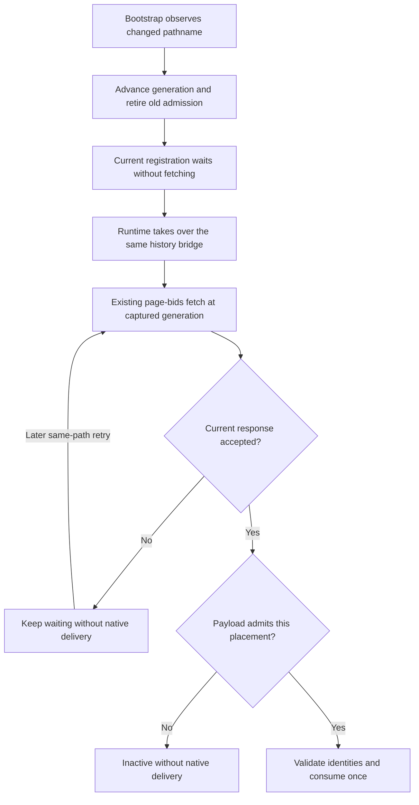

# Publisher-registered initial delivery implementation review

## Target and coverage

Reviewed the implementation, fixtures, CI and operator guides against
`5bc38862512c5c71085b5052bc3e528ee9b9987d`. All four independent read-only lanes
inspected the same 32 paths, including the complete contents of 17 untracked
files. Each reviewer verified this fingerprint before and after inspection:

`669bfc753a5b4360f856adfa0a38dbecb7c097c49846048f13c3dee58916ae42`

The coordinator recomputed it after collecting the reports. Historical planning
and review records were excluded from this implementation fingerprint. The
approved spec and plan supplied intent. No reviewer changed source or ran Cargo,
builds or browsers.

Correctness, architecture and style reported no findings. The coordinator
verified the one code-smell candidate against all three cited implementations.

## R1. Repeated Prebid artifact byte verification

- Kind: maintenance, code-smells lane. Low priority and nonblocking.
- Issue: the offline runner, framework spec and launcher separately read the
  manifest and verify the selected bundle's SHA-256 and SHA-384 SRI. A future
  verification-rule change needs three updates.
- Evidence: `browser/publisher-registration/run.cjs:57-100`,
  `browser/tests/nextjs/publisher-registration.spec.ts:148-156`, and
  `scripts/test-publisher-registration.sh:165-181`. Browser paths are relative to
  `crates/trusted-server-integration-tests/`.
- Recommendation: a small pure CommonJS helper could share byte verification,
  while callers retain their different schema, filename and module policies.
- Disposition: leave unchanged in this PR. There is no current verification or
  delivery defect. A shared helper adds a dependency across three test entrypoints
  and is not required for the requested ownership fix. This remains a follow-up,
  not a reason to weaken or skip any check.

## Safety evidence and limits

The final shared contract passed 794 tests with zero skips on matching source and
test hashes. It exercises exact native/element ownership, consumption before
mutation, cancelled/stale callbacks, candidate exclusion, real history changes,
one navigation handler, current-generation catch-up and same-generation retry.
The coordinator's original raw-browser probe now leaves B at generation one,
waiting for payload with zero native requests. A late renderer cannot restore an
excluded consumed TS candidate through the retained bid map.

The architecture review confirmed the bootstrap has no second page-bids client.
Runtime takes over the existing history bridge and fetch/apply operation without
another generation increment. Record-derived mappings retain their ownership
rules; provider loopback overrides remain isolated to test configuration. The
public contract requires known disabled initial loading and publisher-owned
native destruction.

Pre-runtime navigation follows this sequence:

Style checks passed for the selected docs, workflow, fixture code, shell, Rust
example and JavaScript syntax. Current scoped lint/format evidence was reused
only after checking its input hashes. Source inspection and local contract tests
do not prove real GPT/GAM behavior or production adoption.

Full command results, built-artifact browser/framework checks, Rust gates and
remaining external limits belong in the linked
[validation record](2026-10-27-854-publisher-registered-initial-delivery-validation.md).
The external detailed lane reports are under
`/tmp/ts-854-implementation/implementation-review-*.md`. No hosted CI,
production deployment, real-GPT staging or CWV result is implied by this review.
