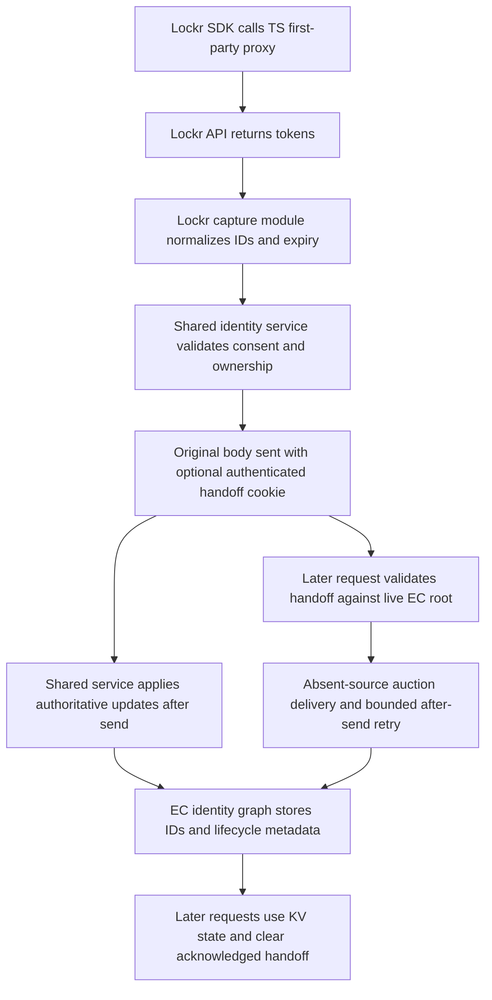

# Proxy-side identity capture for lockr-issued IDs

Status: ID5-only capture implemented in the draft change, awaiting code review.
Provider fixtures, consent approval, revocation semantics and live acceptance
remain gated; rollout configuration explicitly disables capture. The default-off
`ts-eids-s` handoff is implemented in the draft change, with separate local
verification in the implementation plan. Depends on the
[server-side identity foundation](2026-10-09-server-side-identity-foundation-design.md).
See the [implementation plan and verification](../plans/2026-10-09-server-side-identity-foundation-and-lockr.md).

Issue: [#1246](https://github.com/IABTechLab/trusted-server/issues/1246).

The foundation owns capability registration, common identity outcomes, source
ownership, lifecycle records, consent/mutation policy and adapter execution.
It also owns auction-body ingestion and retirement of `ts-eids` and the EID
diagnostic headers. This spec defines Lockr's capture behavior using those
contracts; it does not introduce a separate identity service or KV writer.

Related: [KV EID request snapshot and EC recovery](2026-07-10-kv-eid-request-snapshot-ec-recovery-design.md)
defines existing snapshot and root safety rules retained by the foundation.

## 1. Purpose and agreed direction

The lockr SDK obtains partner IDs, ID5 today and other providers by
configuration, and hands them to Prebid through
`pbjs.setConfig({ortb2: {user: {ext: {eids}}}})`. Trusted Server collects auction
EIDs from `pbjs.getUserIdsAsEids()`, which only reports the Prebid User ID
module. The lockr IDs therefore reach client-side bidders but do not reach the
server-side auction or the EC identity graph. This was measured on the
production publisher route on 2026-10-06 in Safari and reconfirmed on
2026-10-08 in Chrome, direct versus TS matched arm. Six captured `/auction`
payloads contained no `id5-sync.com` entry while the same page carried the ID
in `ortb2.user.ext.eids`.

Capture those IDs in the first-party proxy response from lockr's API. Submit
common identity outcomes to the shared service, which persists them under the
visitor's existing EC ID after sending the response on Fastly.

The lockr SDK still runs in the browser. Capture does not depend on Prebid
configuration or the TS JavaScript EID collector. `ts-ec` remains the browser's
identity pointer. Reintroduce `ts-eids-s` as an optional, short-lived authenticated
capture handoff through the shared identity service, not a long-lived identity
store or restoration of the browser-written `ts-eids` cookie.

For a source absent from a live, consenting EC row, a request carrying the handoff
can use the captured ID before its post-send write becomes visible and can stage
a bounded persistence retry. An auction that starts before the capture response
installs the cookie can still miss it. Existing-source refresh still waits for
the direct capture update; stale cookie replay must not replace stored state.
Without handoff opt-in, the implemented KV-only behavior remains unchanged.
There is no durable capture retry queue.

## 2. Observed lockr flow

All lockr API traffic on a TS page goes through `/integrations/lockr/api/*`,
proxied by `handle_api_proxy` in
`crates/trusted-server-core/src/integrations/lockr.rs` to
`https://identity.loc.kr`. The trust-server SDK build hard-codes
`host: "/integrations/lockr/api"`, so no client shim is involved in routing.

Measured call sequence after the publisher's consent gate opens:

| Order | Request                                                                 | Carries                                                                                                                            |
| ----- | ----------------------------------------------------------------------- | ---------------------------------------------------------------------------------------------------------------------------------- |
| 1     | `GET /integrations/lockr/sdk`                                           | SDK body, 118,542 bytes                                                                                                            |
| 2     | `POST .../publisher/app/v2/identityLockr/settings`                      | Request `{appID}`; response publisher settings                                                                                     |
| 3     | `POST .../publisher/app/v2/identityLockr/page-view`                     | Request `LTID`, existing provider tokens, consent strings and page context; first-issue response `aimTokens[]` and `ids.<key>.eid` |
| 4     | `POST .../refresh-tokens`, `.../generate-tokens`, `.../sync-no-hem-ids` | Later token updates                                                                                                                |
| 5     | `POST .../revoke-consent`                                               | `LTID` and `optOutReason`                                                                                                          |

Measured `page-view` response on first issue, with identifier values elided:

```json
{
  "success": true,
  "data": true,
  "pvStatus": true,
  "aimTokens": [
    {
      "advertising_token": "%7B%22universal_uid%22%3A%22ID5*...%22%7D",
      "identity_expires": 1791315739717,
      "key_name": "id5id",
      "settings": { "dropCookie": false, "dropLocalStorage": false }
    }
  ],
  "ids": {
    "id5id": {
      "eid": {
        "source": "id5-sync.com",
        "uids": [
          {
            "id": "ID5*...",
            "atype": 1,
            "ext": { "linkType": 1, "pba": "..." }
          }
        ]
      }
    }
  }
}
```

The response is 603 bytes. The SDK writes provider cookie and localStorage
`id5id`, and exposes the EID to Prebid with `inserter: "Lockr-For-Publishers"`,
`matcher: ""`, `mm: 2`. Those provider-owned browser stores are not removed.

The integration XHR carries `ts-ec` and publisher consent cookies to TS. The
proxy does not forward publisher cookies or authorization to lockr. Its body
carries lockr's own consent strings. The route already builds an `EcContext`
and attaches `EcFinalizeState`; Fastly already has post-send execution.

Today the upstream response body is not inspected. `/auction` body EIDs are
used for that auction, while cookie EIDs are persisted by finalization. The
foundation changes the latter contract to direct auction-body ingestion before
retiring the cookie path.

## 3. Requirements and non-goals

1. Capture lockr-issued IDs without requiring the Prebid User ID module or
   a TS browser capture module.
2. Implement the foundation's optional capture capability only. Lockr has no
   active server-side resolver in this delivery.
3. Preserve original proxy body bytes and encoding/length headers. With shared
   handoff enabled, finalization may add `ts-eids-s` and cache privacy headers.
   No Fastly capture or handoff-replay KV write runs before send.
4. Submit authoritative `Issued` outcomes for owned, registered sources;
   subsequent SDK token responses use the same path.
5. Preserve known provider expiry through the foundation's lifecycle record.
   Suppress expired IDs on later auctions without a hot-path cleanup write.
6. Translate explicit consent revocation separately from token acquisition,
   including when current request consent no longer allows identity use.
7. Retain consent, size, UID, root and tombstone safety requirements from the
   foundation. A failed capture must not break the SDK call.
8. Reconstruct the fixed ID5 OpenRTB provenance on later auctions only for
   usable records whose persisted acquisition writer is `lockr`.
9. Offer immediate absent-source delivery and bounded retry through the
   foundation's authenticated capture handoff, without weakening live-root,
   consent, ownership, expiry or stale-replay rules.

Out of scope: server-to-server calls to lockr, identifier intake, cross-browser
linking, changing Prebid provider discovery, direct ID5 or LiveRamp proxies,
OpenRTB provenance/provider `ext` storage, and client-side delivery of KV IDs.

## 4. Capture implementation

### 4.1 Registration and response handling

Register `LockrIntegration` through `.with_identity_capture()` alongside its
existing proxy and attribute rewriter. Its identity descriptor claims the
confirmed source mappings in section 4.2. It registers no resolver capability.
`capture_identity = false` disables observation and Lockr handoff delivery/retry
while preserving the descriptor needed to validate configured source ownership.
Usable records already persisted in KV retain their existing delivery rules.

The capture paths are exact POST paths relative to `/integrations/lockr/api`:

- `/publisher/app/v2/identityLockr/page-view`
- `/publisher/app/v2/identityLockr/generate-tokens`
- `/publisher/app/v2/identityLockr/refresh-tokens`
- `/publisher/app/v2/identityLockr/sync-no-hem-ids`
- `/publisher/app/v2/identityLockr/revoke-consent`

The foundation handles bounded inspection and response preservation. Apply its
independent 64 KiB original-body and 64 KiB decoded-JSON limits. Compressed
responses must be decoded incrementally; overflow, unsupported encoding or
decode failure skips capture and forwards original bytes and headers unchanged.
The SDK and unlisted API paths retain existing handling.

Extract request-body consent signals from the POST bytes already buffered for
forwarding. Supply them to the shared service without consuming the request
again or modifying the forwarded payload. The integration does not write KV,
set identity cookies or run its own background dispatch.

### 4.2 Token normalization

For token endpoints, read `aimTokens[]` and associated
`ids.<key_name>.eid`. Prefer the EID's source and UID, validating the source
against the mapping for that known key. When only `aimTokens[]` is present,
map `key_name` using the SDK's `tokenMappings` and `tokenSourceMappings`:

| `key_name`                 | `source`                    | Expected `atype` |
| -------------------------- | --------------------------- | ---------------- |
| `id5id`                    | `id5-sync.com`              | 1                |
| `_lr_env`                  | `liveramp.com`              | 3                |
| `__uid2_advertising_token` | `uidapi.com`                | 3                |
| `__euid_advertising_token` | `euid.eu`                   | 3                |
| `firstid`                  | `first-id.fr`               | 1                |
| `connectId`                | `yahooinc.com`              | 3                |
| `panoramaId`               | `panorama.com`, unconfirmed | 1                |
| `cto_bidid`                | `criteo.com`                | 3                |
| `_publink`                 | `epsilon.com`               | 3                |

Do not enable the unconfirmed Panorama mapping until lockr confirms the source
and type. Unknown keys and mismatched sources are dropped with redacted debug
logging. An arbitrary EID source cannot expand Lockr's registered claims.

For ID5, decode the URL-encoded JSON `advertising_token` and extract
`universal_uid`. Submit one valid UID per source using the existing non-empty,
512-byte UID limit. Source and aggregate caps are enforced by the foundation.
Decode all supported provider token shapes using sanitized SDK/response
fixtures before enabling their mappings; the ID5 shape alone is not evidence
that every provider uses the same token encoding.

Convert associated `identity_expires` from milliseconds to Unix seconds and
include it in `Issued`. Drop a token already expired at capture time. The
foundation stores known expiry and filters expired values on every later
auction path. Missing expiry remains unknown; it does not erase a known expiry
for the same UID.

Unlike the earlier standalone draft, expiry is not discarded after parsing.
This depends on the foundation's metadata-compatible storage rollout, not a
Lockr-specific KV schema or timer. Lockr does not actively refresh records:
new expiry or replacement tokens arrive through later SDK responses.

A response with valid tokens produces `Issued`; a valid response with no new
tokens produces `NoChange`. Non-2xx or malformed token responses skip capture.
Neither an empty token response nor a fetch failure invalidates stored IDs.

### 4.3 Consent and ownership

The shared service requires allowed EC consent, a valid existing `ts-ec`,
a registered source owned by `lockr`, and a live consenting root at mutation.
Integration XHRs never generate or recover an identity.

Lockr supplies its request-body `gppString`, `consentString` and `ccpaString`
when populated. Empty optional fields are absent signals, not positive consent.
Malformed non-empty signals fail closed; valid opt-outs cannot be overridden
by allowed cookie consent. The shared consent layer interprets these signals,
not a second Lockr-specific consent engine. Confirm any additional broker or
provider-purpose requirements before enabling the relevant mappings.

Failed token gating leaves the response intact and queues no enrichment.
Browser submissions of the same source remain conservative foundation inputs;
they cannot choose the `lockr` writer identity or replace a stored owned record.

### 4.4 Explicit withdrawal

The current provider contract assumes a successful 2xx `revoke-consent` response
means explicit publisher-level identity withdrawal. Translate it into the
foundation's `ConsentWithdrawn` outcome with global EC scope. Confirm both the
application-success semantics and the scope with lockr before rollout; a
provider-specific opt-out must not be widened into a global withdrawal.

This outcome does not pass through token-consent eligibility: revocation must
still work after consent becomes denied. The shared finalizer expires `ts-ec`
and any capture handoff cookie, and the service applies the existing-key-only
tombstone path. Normal request withdrawal takes precedence and suppresses
duplicate work. Lockr never clears or recreates a root independently.

### 4.5 Shared persistence and auction delivery

The shared service stages trusted capture effects with the full EC ID and
snapshot. Fastly extracts them before response conversion, sends the response,
then applies them before legacy pull sync. Lockr has no private
`DeferredIdentityUpdates` type, adapter branch or mutation function.

The service applies authoritative replacement for the configured owner,
preserving unrelated sources and rejecting withdrawn roots. Same UID and same
lifecycle metadata skip writes; a changed known expiry can require a write even
if the UID is unchanged. Pass the resulting persisted snapshot to later work.

Integration requests can carry a `NotRead` snapshot. The first required lookup
then happens after send; generation refresh or CAS conflict can add reads.
Persistence is best-effort and costs execution time without holding Fastly
response bytes. Other adapters follow the foundation's supported timing and
KV capability rules.

Auctions resolve usable registered records from KV, deriving `atype` from the
source registry. Set the registry type to the confirmed mapping. Carry the
persisted record's `writer` through resolution. For `source = "id5-sync.com"`
and `writer = "lockr"`, reconstruct the fixed SDK provenance:

```json
{
  "inserter": "Lockr-For-Publishers",
  "matcher": "",
  "mm": 2
}
```

This delivery adopts these values for Lockr ID5 issuance and refresh. The mapping
belongs to the Lockr integration and adds no KV fields. Do not infer it from
`identity_owner`, source alone, or current capture configuration. Browser,
legacy, other-writer and unknown-origin records remain without reconstructed
Lockr provenance; other sources are not covered by this ID5 mapping. Disabling
new capture does not remove provenance from already stored usable Lockr records.

Explicit browser provenance retains current-request merge precedence, including
an empty `matcher` and zero-valued `mm`. If browser input adds a different UID
for the same source, omit reconstructed provenance for that merged EID rather
than attribute all its UIDs to Lockr. Keep existing UID merging unchanged.
Provider `ext` and extra UIDs are still not stored in KV.

### 4.6 Short-lived capture handoff

Use the foundation's section 8.2 contract for `ts-eids-s`. The shared service,
not `LockrIntegration`, authenticates the envelope, sets the cookie, resolves
eligible auction IDs, stages retry and reconciles acknowledgement. Start with
ID5 only; no unconfirmed mapping becomes eligible through the cookie.

Each entry binds the publisher, full EC ID, acquisition module `lockr`, registered
source, UID, optional provider expiry and fixed handoff deadline. The foundation
implements a five-minute lifetime and a 2,048-byte cap for the complete authenticated
value. Provider expiry can shorten that lifetime. Cookie reads, retries, merging
and no-token responses do not extend it. Keep `Secure; HttpOnly; SameSite=Lax`;
base64 and `HttpOnly` alone do not authenticate replay.

Create entries only from acquisitions that pass the existing capture consent,
source-claim and ownership gates. Normal deferred capture persistence still runs
if cookie creation fails. A `NotRead` snapshot at capture does not force an added
pre-send lookup, but it also does not prove root eligibility for later delivery.

On later requests, validate the handoff against current policy and the existing
full-ID-bound snapshot. An absent source on a live, consenting root may use the
handoff UID for a bidstream-enabled auction and stage fill-absent-only persistence
after send. Recheck absence, consent, provider expiry and the original handoff
deadline at mutation time. A matching persisted UID, writer and effective expiry
acknowledges the entry. A conflicting existing record wins and
retires the handoff; expired or invalidated records also block replay. No handoff
replaces a stored UID, extends its expiry, changes its writer or creates a root.
This first version does not accelerate refresh of an existing source.

Snapshot eligibility retains existing KV read consistency. A stale live snapshot
that lacks the source can still deliver the handoff before it observes a newer
record or withdrawal elsewhere. Replay uses generation-checked writes and cannot
replace that newer record or revive its tombstone. Current request consent always
applies; the handoff does not promise instant cross-POP withdrawal propagation.

Authenticated, eligible ID5 handoff entries use the fixed Lockr provenance from
section 4.5. Do not infer acquisition authority from an unsigned cookie or current
configured ownership. Browser mixed-origin and explicit-field precedence remain
unchanged. Provider `ext` is not added to the cookie.

A later request carrying an existing valid entry may retry a missed first-issue
write even if its Lockr response contains no new tokens. Retry is shared, bounded
and conditional; it is not another provider call. Remove acknowledged, conflicting,
expired or unauthorized entries on a subsequent response, clearing the cookie
when none remain. After-send success cannot alter a cookie already sent.
Withdrawal or EC rotation invalidates the handoff. No cookie permits delivery
from a missing, unreadable or withdrawn root.

The original standalone draft proposed an unsigned source/UID array lasting up
to 30 days, with
cookie-first precedence and generic cookie ingestion. Do not restore it as-is.
It omitted expiry needed by its own merge rules and offered no authenticated
full-EC binding or stale-replay contract. The revised handoff restores useful
absent-source availability and retry while keeping lifecycle policy in EC.

The existing `ts-eids` fallback was largely redundant with normal `/auction`
body submission and did not merge missing sources into a valid body. Restoring
its late-browser-ID ingestion benefit is a separate decision, not part of this
capture handoff.

## 5. Data flow and freshness



| Event                              | Persistence                                                                                 | Auction availability                                                                        |
| ---------------------------------- | ------------------------------------------------------------------------------------------- | ------------------------------------------------------------------------------------------- |
| First issue, source absent         | Authoritative update after send; eligible handoff can stage a later fill-absent retry       | After cookie installation on a qualifying live-root request, or once KV exposes the record  |
| SDK refresh, source already stored | Authoritative replacement or expiry update after send; replay cannot replace existing state | Existing usable KV record until the new state is visible                                    |
| Provider or handoff expiry         | No read-triggered cleanup write                                                             | Expired handoff is rejected; known-expired stored IDs remain omitted                        |
| Explicit global revoke             | EC and handoff cookies expired; existing-key-only tombstone                                 | Later requests stop using the identity; dispatched auctions cannot be recalled              |
| Returning visitor, no new token    | No new capture effect; valid pending handoff can independently stage replay                 | Existing usable KV state, or an eligible absent-source handoff before its original deadline |

Inspection can retain 64 KiB of original bytes and 64 KiB of decoded JSON, plus
bounded stream/decoder overhead. While pending, the handoff adds up to 2,048
cookie-value bytes plus cookie-name/separator overhead to same-origin requests.
Cleanup requires a later request that observes acknowledgement or ineligibility;
otherwise the fixed deadline ends the handoff.

Cookie repair is best-effort, limited to absent sources and dependent on another
qualifying request within that deadline. Once the handoff expires, a returning
`page-view` with no token cannot repair a missed capture. Later token-bearing
responses, browser-body submissions or separately authorized partner paths keep
their existing mutation rules. Expiry-aware omission does not initiate a Lockr
fetch. Without shared handoff opt-in, availability still waits for KV visibility.

## 6. Configuration

Add `capture_identity` under `[integrations.lockr]`, default `true`, as the
publisher capture kill switch. It also disables Lockr handoff delivery and retry,
but does not disable browser-body ingestion, expiry-aware KV reads or normal EC
consent withdrawal. Shared handoff is separately opt-in and defaults off; its
publisher key/configuration contract must be approved before implementation.
Capture alone must not silently enable a new cookie.

Capturing a source requires its foundation source policy, for example:

```toml
[[ec.partners]]
name = "ID5"
source_domain = "id5-sync.com"
openrtb_atype = 1
bidstream_enabled = true
identity_owner = "lockr"
```

`identity_owner` is implemented by the foundation and validated at deployment and runtime.
Check the publisher registry and disable conflicting legacy authoritative paths
before enabling the owner. Missing registration or another selected owner means
Lockr does not persist the source or issue an eligible handoff entry. The handoff
cannot forward an unregistered captured ID. Valid browser-body EIDs can still
reach their current auction under the foundation's existing forwarding rules.

## 7. Error handling

Use the foundation's redaction, bounds and root safety policy:

- Non-2xx, malformed JSON, unknown key, mismatched source or invalid token:
  preserve the response, drop the affected acquisition, no raw-token log.
- Original or decoded size overflow, unsupported encoding or decode failure:
  skip capture and replay the original response unchanged.
- Denied token consent, missing EC, missing registration or owner mismatch:
  no enrichment; the SDK call still succeeds independently.
- Missing, unreadable or withdrawn root: no creation or resurrection.
- Post-send persistence failure: redacted log; an already-issued handoff may
  support a later bounded retry until its original deadline. No immediate retry,
  durable queue or change to the already-sent response.
- Invalid signature, expired handoff, EC/publisher mismatch, disabled capture or
  changed ownership: no handoff delivery or retry; no unsigned fallback.
- Cookie creation or size failure: preserve direct deferred capture and the
  upstream body; do not turn cookie failure into an SDK error.
- No tokens: `NoChange`, not invalidation or withdrawal. An independently valid
  pending handoff can still be reconciled and replayed.

## 8. Verification

Foundation tests own shared registration, browser migration, metadata
compatibility, buffering limits, mutation rules and adapter timing. Lockr tests
prove that this consumer reaches those paths correctly:

- Exact POST path selection; SDK, settings and unlisted paths unchanged.
- `aimTokens` only, associated `ids.*.eid`, URL-encoded ID5 JSON, each enabled
  provider token shape, unknown keys, mismatched sources and oversized UIDs.
- Millisecond expiry conversion, already-expired rejection, missing expiry and
  same-UID expiry extension; known expiry survives the persisted record.
- Original and decoded cap overflow, including compressed expansion, skips
  Lockr effects while retaining response bytes and encoding headers.
- No-token observation produces no new direct capture mutation; incoming handoff
  replay is independently validated. Non-2xx/malformed token responses cannot
  invalidate existing records.
- Populated body opt-outs, malformed signals, empty optional fields and cookie
  consent conflicts exercise shared consent policy without modifying forwarding.
- Explicit revoke works with denied consent, chooses the confirmed withdrawal
  scope and does not duplicate request-finalization tombstones.
- Owned/registered sources persist; unregistered or differently owned sources
  do not; browser input cannot impersonate Lockr authority.
- Persisted Lockr ID5 writer reconstructs `inserter`, empty `matcher` and `mm=2`
  in later bidder-facing payloads without a KV mutation. Configured ownership
  alone, browser/legacy/unknown writers and other sources do not acquire these
  fields. Existing expiry, withdrawal and bidstream gates still apply.
- Matching body UIDs retain reconstructed provenance unless explicit body fields
  override it. Different body UIDs suppress reconstruction for the merged EID,
  without dropping UIDs or explicit body provenance.
- Capture effects execute after Fastly send through the foundation, not a
  separate Lockr adapter implementation; persisted snapshot handoff is retained.
- Capture handoff defaults off; enabling it emits only the bounded authenticated
  `ts-eids-s`, never the retired `ts-eids` or diagnostic EID headers. Provider
  browser stores and existing publisher credential stripping remain unchanged.
- With capture KV visibility held back, an installed valid handoff reaches a
  later live-root auction for an absent registered source. An earlier auction,
  root-read failure or existing stored source receives no handoff guarantee.
- No-token requests can repair pending absent-source capture after send; changed
  UID/expiry/writer, expired stored records, CAS conflicts and withdrawal cannot
  be overwritten by replay. Acknowledgement cleanup waits for a later response.
- Tampered/oversized cookies, expiry, wrong full EC, owner/capture changes and
  key rotation exercise foundation rejection and cleanup without SDK failure.

Live acceptance on an approved publisher test route:

1. Fresh profile, grant consent and wait for `page-view`.
2. Confirm unchanged upstream body/encoding and, with handoff explicitly enabled,
   authenticated `ts-eids-s` plus private/no-store response handling. Confirm
   `ts-eids` and diagnostic EID headers remain absent.
3. Allow for post-send work and KV visibility. Inspect the session's admin EC
   record for the registered source and lifecycle metadata, without exporting IDs.
4. Trigger a later auction and inspect bidder-facing payload evidence, including
   the stored Lockr ID5 record's `inserter`, empty `matcher` and `mm=2`. Do not
   require the browser body to contain a server-added ID or rely on `x-ts-eids`.
5. Observe a later request clearing an acknowledged handoff. Reload with no new
   tokens: unchanged UID and expiry do not cause a capture write. Separately
   inject a failed first-issue write and confirm an eligible pending handoff
   repairs the absent source after a no-token request, without extending its
   deadline or overwriting an existing record.
6. Trigger SDK refresh: confirm changed UID or expiry persists after visibility.
7. Exercise known expiry in a controlled fixture and confirm omission, including
   a stale matching UID resubmitted in a browser auction body.
8. Trigger confirmed global revoke: EC and handoff cookies expire, tombstone
   exists and later enrichment or handoff replay cannot revive it.
9. On an approved controlled fixture, delay first-issue KV visibility and prove
   handoff delivery for an absent source after cookie installation. Verify
   rejection after deadline, root-read failure and EC rotation. Measure later
   auction coverage; do not infer an unconditional next-auction guarantee.

No live identifiers, placement settings or credentials belong in fixtures or
committed validation notes. Keep sanitized status/source/count evidence only.

## 9. Rollout

1. Deliver the foundation, including metadata-preserving writers/readers,
   source ownership, browser-body migration and `ts-eids` cookie/header retirement.
2. Confirm Lockr path, provider token shapes, consent and revoke contracts using
   sanitized fixtures; leave unconfirmed source mappings disabled.
3. Register the capture consumer and its `capture_identity` kill switch.
4. Configure the affected registered sources with `identity_owner = "lockr"`
   and their confirmed `atype`, after resolving conflicting authoritative paths.
5. Complete the foundation's deployment compatibility gate before activation.
6. Provision the shared handoff's dedicated publisher signing keys through
   app-config secret handling. Keep its opt-in off until provider-approved fixture
   sizes, rotation and deployed auction/replay/cache-privacy checks pass.
7. Enable capture and separately opt into handoff on an approved test route.
   Run live acceptance, including delayed visibility, failed-write repair,
   acknowledgement cleanup, expiry extension and withdrawal.

Disabling capture stops new observations; it does not make already stored
expiry metadata safe for an older UID-only binary. Follow the foundation's
rollback contract. Disabling capture also stops Lockr handoff delivery and retry;
turning handoff off alone leaves direct capture and usable KV delivery intact.
Local synthetic tests cover the handoff's codec, policy and proxy/send/replay paths.
They do not prove provider approval or deployed availability.

## 10. Open questions and future work

1. Confirm the Panorama source/type and all enabled provider token shapes with
   lockr. Do not infer them solely from the measured ID5 example.
2. Confirm request-body consent details and any additional broker/provider
   permission requirements.
3. Confirm successful revoke response semantics and whether withdrawal is
   global or source-specific before enabling that outcome.
4. Confirm token ordering when SDK requests overlap. The foundation does not
   infer provider issuance order from edge wall clocks. Handoff signatures also
   do not establish order; first-version replay never replaces an existing source.
5. Verify publisher-scoped signing-key provisioning and rotation on deployment.
   The approved implementation uses a five-minute lifetime and 2,048-byte
   complete signed-value cap. Validate provider-approved fixture sizes including
   binding, expiry and signature overhead before enabling it. Immediate existing-source refresh through a
   cookie requires a later revision-bound design, not cookie-first precedence.

Known expiry persistence is implemented by the foundation. Arbitrary OpenRTB provenance storage
remains outside this delivery; the fixed Lockr ID5 mapping is reconstructed from
the persisted writer instead. Active Lockr resolution from `ltid`, direct provider
capture and client-side consumers require separate follow-up specs; no current
S2S contract is assumed.
