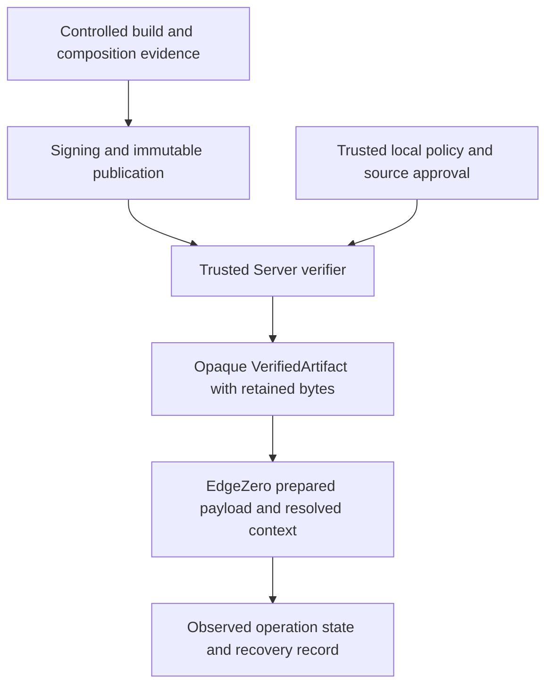

# Release artifact attestation and verified consumption

## Phasing — 2026-10-22

This is the phased rework of [#1262](https://github.com/IABTechLab/trusted-server/pull/1262), frozen at `122b78664b1235c717e9208fd200f9a9b0c335df`. The reviewed contract below is retained as the destination design. This section controls phase applicability; historical statements about first-release gates and PR ownership below refer to the original combined proposal. No new spec approval cycle is introduced by reducing scope.

**Phase 1 contributes to #1235 (D7 settings pending):** tag-triggered builds of Fastly wasm, three native CLI binaries and three production Axum binaries; SLSA provenance and a shipped, attested SBOM for each binary; draft/upload/publish of an immutable release with `SHA256SUMS`; GitHub CLI verification pinned to the reusable `release-build.yml` signer and predicate; and CI enforcement of configuration independence. Operators deploy the verified release bytes. Reproducibility is not a Phase 1 claim or gate. The source-version and fresh JS mechanisms already on main are reused.

The phase boundaries follow [aram356's round-1 architecture review](https://github.com/IABTechLab/trusted-server/pull/1262#pullrequestreview-5484754857):

| Reviewer boundary                                                            | Phase ownership                                                                                                                                                                             |
| ---------------------------------------------------------------------------- | ------------------------------------------------------------------------------------------------------------------------------------------------------------------------------------------- |
| 1. Controlled build and composition evidence                                 | Phase 1: standard pinned, locked builds and conservative Cargo/npm SBOMs. Phase 2.1–2.7 and 2.9: reviewed controlled recipes, qualification, composition and candidate evidence from #1262. |
| 2. Signing and immutable publication                                         | Phase 1: actions/attest and an immutable GitHub Release. Phase 2.8: the reviewed publication owner.                                                                                         |
| 3. Trusted Server verifier library, trusted local policy and source approval | Phase 1: users invoke GitHub's gh attestation verify. Phase 2.10: the reviewed custom consumer and policy from #1262.                                                                       |
| 4. Opaque VerifiedArtifact with retained bytes                               | Phase 2.10: the reviewed consumer retains verified bytes; no custom verified value is required for Phase 1.                                                                                 |
| 5. EdgeZero prepared payload and resolved context                            | Later phase, not started; does not block #1235.                                                                                                                                             |
| 6. Observed operation state and recovery record                              | Later phase, not started; does not block #1235.                                                                                                                                             |

Native reproduction is deferred to Phase 2+, where it is measured, not a release gate. Fastly-first byte-for-byte reproducibility is a later phase; Phase 1 makes no reproducibility claim. One artifact's reproduction therefore cannot hold up the first attested release.

Phase 1 publishes SPDX 2.3 for a conservative selected-Cargo-target and installed-npm-build-tree inventory, with the final binary hash. CycloneDX is only an intermediate generator format. Complete composition qualification below remains Phase 2+; Phase 1 does not claim exact retained-code or native-source closure.

### Phase 1 input audit and operator evidence

The Phase 1 audit against main at `f9281917a7260b723f5f22175911c6d2147ef650`
supplements the historical input table below without changing its destination
requirements. Source references: [core build inputs](https://github.com/IABTechLab/trusted-server/blob/f9281917a7260b723f5f22175911c6d2147ef650/crates/trusted-server-core/build.rs),
[JS private output](https://github.com/IABTechLab/trusted-server/blob/f9281917a7260b723f5f22175911c6d2147ef650/crates/trusted-server-js/build.rs),
[JS module options](https://github.com/IABTechLab/trusted-server/blob/f9281917a7260b723f5f22175911c6d2147ef650/crates/trusted-server-js/lib/build-all.mjs),
[Axum dependency features](https://github.com/IABTechLab/trusted-server/blob/f9281917a7260b723f5f22175911c6d2147ef650/crates/trusted-server-adapter-axum/Cargo.toml),
and [CLI version output](https://github.com/IABTechLab/trusted-server/blob/f9281917a7260b723f5f22175911c6d2147ef650/crates/trusted-server-cli/src/run.rs).

- Rust is pinned to **1.98.1**. The tracked `Cargo.toml`, `Cargo.lock`,
  `.cargo/config.toml`, tool pins, source tree and release profile remain inputs.
- Workspace build scripts include core and JS plus the new CLI and Fastly owner `build.rs` files.
  Core also reads `build_support/git_version.rs`, its source tree, the root
  manifest/lockfile and tracked `edgezero.toml`. The latter supplies the logical
  `trusted_server_config` store ID, not a physical deployment binding.
- JS inputs include `build/bundle_set.rs`, its declared source/manifests/lockfile,
  `lib/build-all.mjs` and its indirect `lib/build-module-options.mjs` import.
  Fresh npm installation precedes compilation. Cargo embeds modules through
  generated `OUT_DIR/tsjs_modules.rs` from private `OUT_DIR/tsjs-dist`;
  `crates/trusted-server-js/dist/` is not the release input. Phase 1 rejects the development
  `TSJS_SKIP_BUILD`, `TSJS_PREBUILT_DIR` and `TSJS_TEST` overrides.
- Production includes also cover the GPT bootstrap, CLI consent stub, CLI ad-template collector and
  fictional example-config scaffolds. The CLI and locked EdgeZero dependency
  contain developer checkout fallbacks via `CARGO_MANIFEST_DIR`; removing these
  remains a later recipe requirement. Tracked OpenRTB generated source is an
  ordinary Rust input, not ambient protobuf generation during this build.
- Cargo supplies package/target facts and `OUT_DIR`; core's Git resolver reads
  source refs unless overridden. Phase 1 already supplies the validated full
  source SHA through `TRUSTED_SERVER__GIT_VERSION`. Locked EdgeZero CLI at
  `85d933b8044dec29fe9e4685cae194eaf0290911` additionally generates its
  linked-adapter registry from its own manifest and feature selection.
- Axum has no own build script or compile-time `env!`/`include_*` inputs.
  Its normal release dependency enables core defaults only; `test-utils` is
  dev-only. Shared logical IDs and JS inputs above remain compiled inputs;
  application configuration and secrets are runtime inputs. This audit does
  not claim the deferred complete native compiler/library closure.

For the R-OFFLINE decision below, Phase 1 uses the guide's
[offline bundle verification](../../guide/release-verification.md#verify-bundles-offline)
with independently obtained roots and source pins. Offline success is build
proof, not current official membership or deployment authorization.

For #161, release Fastly `x-ts-version` is the full 40-character source commit;
`ts --version` labels package version, source commit, target and variant. The executable
digest is verified externally; exposing it at runtime remains with #161.
The [verification guide](../../guide/release-verification.md) records these facts
and the maintainer settings gates. Local Viceroy execution proves a local route,
not submission to a Fastly service.

**Phase 2+ retains all remaining requirements:** two-build reproducibility, confined recipes, platform qualification, authenticated tool/image acquisition, complete composition/SPDX coverage, candidate collection/index, the custom consumer, publication owner, Task 14 same-commit validation, and Cloudflare/Spin distributions plus full custom-verifier qualification of Axum. These slices remain closed to production selection and signing until separately qualified and authorized.

**Phase 1 Axum extension:** the original four asset names remain unchanged;
three named Axum variants extend this slice to seven binaries and 29 files.
GNU builds enforce a maximum glibc requirement of 2.34; musl is fully static.
The cohort records this explicit extension, but tools/policy and the frozen v1
index schema remain unchanged. Phase 1 emits no index. The later index/consumer
slices need a reviewed seven-artifact amendment, including new target/capability
forms; see the [compatibility audit](../plans/binary-attestations-phase1-compatibility.md)
and slice-map annotations.

### Phase 1 review notes

Phase 1 is **part of #1235**, pending D7 maintainer settings. These notes supersede
historical phase applicability, not the retained destination requirements.
Goals, Non-goals, R-COHORT and R-BOUNDS refer to the original four-artifact design;
this slice explicitly includes seven binaries / 29 files, including Axum and
Linux ARM64. Its original four public names stay unchanged; no v1 index is emitted.
The Node producer helpers and inline publisher are interim exceptions to the
retained Rust-producer constraint, replaced by slices 2.5 (recipes/inspection),
2.6 (composition/SPDX) and 2.8 (publication). The frozen Status and tool versions
below describe #1262, not current Phase 1 implementation status.

Current tool pins: Rust 1.98.1, Node 24.20.0, Fastly CLI 16.0.0, Viceroy 0.21.0;
verification uses GitHub CLI 2.102.0. The reusable release-build.yml is the signer.
Slice 2.3 immutable build facts are reused from introducing commit
`bfb697404551a28217af8906024506095bcd9559` and revision
`6d0efda7210983021ab3c9efe8a0a3190e9eb81b`, as retained at the frozen source.
Core's resolver and new CLI/Fastly owner build scripts validate
`TRUSTED_SERVER__RELEASE_BUILD=1` and the full lowercase source SHA.
Cargo supplies the owning target/package; features supply the variant. Tags and
run IDs stay external. CLI now labels package/source/target/variant; Fastly queues
the same immutable facts through existing startup diagnostics in reuse mode only; single mode retains the source response header without per-request build-fact logs. The source audit
permits exactly this release control, GIT_VERSION and Cargo-owned BUILD_TARGET,
not deployment values. CLI source-resource cleanup remains deferred.

Axum binding is runtime-only: `EDGEZERO__ADAPTER__HOST` defaults to loopback;
containers can set `0.0.0.0`, with runtime `EDGEZERO__ADAPTER__PORT` or the compatible `PORT` override. Both values are validated, and conflicting values fail startup. The smoke uses
bridge networking and reaches the process through a published host port.
TLS termination, graceful shutdown and request/resource limits remain follow-up.

Publication requires `RELEASE_PUBLICATION_ENABLED=true` only after maintainers
confirm immutable releases and the v\* tag ruleset. There is no settings token or
prepublication settings API call, following the reviewed signing boundary;
postpublication immutable=true readback fails loudly. Hyphenated tags are
prereleases and never Latest. Stable tags are normal releases with `make_latest: legacy`, allowing GitHub to choose Latest by version/date rather than forcing backports to Latest. Eligibility of
rc-branch tags is an unresolved maintainer decision; Phase 1 does not implement
the destination branch-ancestry/ruleset validator or authorize rc tags.

The phase labels on requirement headings below apply only to the reduced Phase 1 subset described above; all additional clauses and requirements marked Phase 2+ remain deferred. The original assurance profiles, custom verifier, retained evidence graph and reproduction gates do not block the first Phase 1 release. The [implementation plan](../plans/2026-10-13-attested-release-implementation.md#phasing--2026-10-22) contains the acceptance mapping and exhaustive slice inventory.

**Issue:** [#1235 — Publish attested release binaries with build provenance and SBOMs](https://github.com/IABTechLab/trusted-server/issues/1235)

**Date:** 2026-10-09. **Review revision:** 2026-10-12.

**Status:** Draft for maintainer review. As directed on 2026-10-13, this specification, its implementation plans and implementation share PR #1262 on `spec/1235-release-attestation`; no separate implementation PR is opened. Contract/code approval is required before merge and all selected qualification gates remain required before official release enablement. Requirements below describe proposed behavior, not an existing release pipeline. The [feasibility audit](2026-10-12-1235-release-attestation-feasibility.md) records measured prototypes, missing implementations and unresolved hosted/provider qualifications; document review alone is not feasibility proof.

**Producer implementation constraint (2026-10-14):** Introduced release producer tooling MUST use the small domain-specific host-only `crates/trusted-server-release` Rust 2024/1.95.0 workspace member, excluded from default members and independent of core/CLI/JS crates. No introduced Python tooling is permitted. Existing Node JS collection and thin POSIX wrappers remain; native approved-source Rust bootstrap is independently authenticated and supplies no official binary proof for itself. `ts` remains the consumer, and the [migration addendum](2026-10-14-release-tooling-rust-migration.md) preserves every qualification, acquisition and evidence gate. The producer is not a fifth canonical asset or a generic attestation/publisher abstraction.

**Implementation baseline:** `44c5b5620bfb1f82e5b959ab5ba8ec69c7091e52` includes #1213 and #1214, both merged on 2026-10-12. Release implementation extends their source-version and isolated JS/prebuilt mechanisms. The feasibility audit used the earlier `7f6056bf83eb96aa4167efca64d43280299fba73` snapshot with then-open PR overlays; those historical probes are not current release qualification.

**Related work:** [#1213](https://github.com/IABTechLab/trusted-server/pull/1213), [#1214](https://github.com/IABTechLab/trusted-server/pull/1214), [#161](https://github.com/IABTechLab/trusted-server/issues/161), [#1179](https://github.com/IABTechLab/trusted-server/pull/1179), [#799](https://github.com/IABTechLab/trusted-server/pull/799), [#1045](https://github.com/IABTechLab/trusted-server/pull/1045), [#1084](https://github.com/IABTechLab/trusted-server/pull/1084), and [#167](https://github.com/IABTechLab/trusted-server/pull/167).

## Problem

Publishers and vendors need evidence that distributed binaries were built from reviewed source, and operators need a route that submits the verified bytes. Ordinary CI publishes no attested distribution. Source deployment delegates to build-capable EdgeZero/Fastly commands. Fastly build annotation can also change Cargo's wasm output.

The previous draft coupled four-target reconstruction and all-adapter enablement to the first release. This contract instead selects assurance requirements per artifact before execution. Required evidence remains mandatory; an optional measurement cannot quietly become a claim that it passed. Build provenance, publication, local authorization and remote execution are separate claims.

## Goals

1. Publish Fastly wasm and three Linux/macOS operator CLI executables with build provenance, artifact-specific SPDX SBOMs, bundles and immutable release membership.
2. Enforce configuration independence and fresh locked inputs, including one shared, twice-built JS module set.
3. Require complete-byte Fastly A/B equality; report native CLI comparisons without making native reproducibility a first-release prerequisite.
4. Document exact verification and a byte-preserving Fastly production route first, then integrate production/staging through a new EdgeZero API.
5. Provide stable build facts and deployment observations for #161 without claiming publisher authorization or remote execution proof.

## Non-goals

Operator reconstruction, retained-input archives, automated offline deployment, Cloudflare/Spin/Axum distributions, standalone tsjs assets, external rebuild witnesses and SLSA Build Level 3 require follow-up specifications. Runtime/configuration attestation, publisher enrollment, variable permission-policy distribution, request signing and vendor endorsements remain with their owners. Windows, Linux ARM64, containers, Apple notarization and self-update are excluded from this distribution.

Offline build-evidence verification is documented here, but cannot establish fresh official release membership and cannot authorize `ts deploy --release`. The external Prebid bundle remains outside the embedded artifact's SBOM. CLI commands that need source resources retain documented prerequisites.

## Contract vocabulary and ownership

MUST, MUST NOT, SHOULD and MAY have the meanings in BCP 14, only when capitalized. Each numbered requirement is normative. Rationale, rollout ordering, informational records and deferred investigations do not add implicit acceptance gates.

Canonical **Build A** is the selected output proposed for publication. **Build B** is a fresh comparison build: complete-byte equality is mandatory for Fastly and the shared JS set, while native CLI B reports a bounded measurement.

“Retained” specifies its object: an owned byte copy held by the verifier; JS module bytes observed in the final executable; archived reconstruction inputs (deferred); or durable deployment recovery state. These claims are distinct.

The **declared insensitive envelope** lists recipe inputs qualified to vary without changing output bytes. A **terminal outcome** records `matched`, `mismatched`, `failed` or `unavailable` before the deadline. An **action-scoped verified value** holds verified bytes and approval for one supported operation and context; it grants no unrelated deployment authority. Requirement headings below provide stable R-ID links; T-1 through T-13 identify the test families in the traceability table.

| Owner                   | Responsibility                                                                                                                                                                    |
| ----------------------- | --------------------------------------------------------------------------------------------------------------------------------------------------------------------------------- |
| Release tooling         | Controlled builds, composition evidence, required comparison gates, signing and immutable publication                                                                             |
| Trusted Server verifier | Fixed release policy; distinct checks of build evidence, official publication and consumer/action authorization; construction of an opaque `VerifiedArtifact` retaining the bytes |
| EdgeZero                | Prepared payload integrity, resolved provider context, concrete lifecycle operations and durable known/unknown outcomes; no IAB release-policy decisions                          |
| Consumer                | Trusted verifier bootstrap, approved source/tag/action/context and credentials                                                                                                    |
| #161                    | Publisher authority, loaded configuration claims, signing/freshness and runtime transport                                                                                         |



## 1. Threat model and claim limits

| Threat                                   | Capability                                                     | Defending checks                                                                                                                                                           | Residual trust or limitation                                                                                      |
| ---------------------------------------- | -------------------------------------------------------------- | -------------------------------------------------------------------------------------------------------------------------------------------------------------------------- | ----------------------------------------------------------------------------------------------------------------- |
| TH-1 Asset/mirror tampering              | Replace executable, index or companions                        | R-INDEX, R-EVIDENCE, R-PUBLICATION: signed digests, exact subjects and release membership; negative proof families T-8, T-9                                                | Authentic malicious source is still malicious                                                                     |
| TH-2 Malicious evidence transfer         | Substitute roots, policy, approved commit or offline pins      | R-POLICY, R-BOOTSTRAP, R-OFFLINE: obtain trust inputs independently of supplied evidence; negative proof families T-8, T-9, T-10                                           | A compromised trusted transfer channel defeats its pins                                                           |
| TH-3 Compromised dependency/build script | Generate altered code or fetch undeclared inputs               | R-INPUTS, R-JS, R-SBOM, R-BUILD: locked materials, controlled environment, observed/declarative coverage, no build credentials; negative proof families T-2, T-3, T-4, T-5 | Locks authenticate origin, not safety; same malicious input can reproduce                                         |
| TH-4 Rogue tag pusher                    | Tag unapproved source or bypass checks                         | R-SOURCE, R-PUBLISH: branch/source authorization, same-commit validation, restricted tag authority; negative proof families T-7                                            | Authorized maintainers and bypass actors remain trusted                                                           |
| TH-5 Compromised runner image/compiler   | Produce altered bytes and consistent A/B results               | R-BUILD, R-SIGN: checked environment identities, hosted runners, separated signing permissions; negative proof families T-4, T-7                                           | A/B is project-controlled repeatability, not independent builder trust                                            |
| TH-6 Compromised operator host           | Replace gh/ts, retained files or runtime; lie about deployment | R-BOOTSTRAP, R-DEPLOY, R-RECOVERY: trusted bootstrap, retained handles, pre-upload equality, recorded observations; negative proof families T-9, T-11, T-12                | Local checks cannot establish honest remote execution against this host                                           |
| TH-7 GitHub compromise                   | Misstate workflow identity, source or immutable membership     | R-POLICY, R-EVIDENCE, R-PUBLICATION: constrained identities and Sigstore evidence; negative proof families T-7, T-8, T-9                                                   | GitHub/OIDC, applicable roots and release authority are trust roots; this design does not defeat their compromise |

Build provenance establishes that the constrained workflow produced a digest. Immutable release evidence establishes publication membership. A/B records measured equality under declared conditions. None proves absence of vulnerabilities, truthful configuration claims, publisher/domain authority or that submitted bytes execute at every edge location. SLSA Build Level 2 is an implementation target; a local reusable workflow alone does not establish Level 3.

## 2. Selected artifacts and assurance profiles

### R-COHORT

**Phase:** 1 for the reduced acceptance subset in Phasing; remaining clauses are Phase 2+.

`scripts/release/release-cohort.json` MUST select the complete artifact set and required assurance profile before jobs execute. The first cohort is `phase1-fastly-cli`. Every selected artifact MUST have successful canonical Build A, build provenance, SBOM, composition validation, shared JS input equality, artifact-specific retained-JS coverage and immutable publication. A failure of any selected requirement MUST block publication; the workflow MUST NOT shrink the set or lower a profile after failure.

| Asset                         | Package / target                                  | Required profile             | Compatibility qualification                                                                |
| ----------------------------- | ------------------------------------------------- | ---------------------------- | ------------------------------------------------------------------------------------------ |
| `trusted-server-fastly.wasm`  | `trusted-server-adapter-fastly` / `wasm32-wasip1` | `provenance-sbom-repeatable` | Fastly production defaults; variant `default`                                              |
| `ts-x86_64-unknown-linux-gnu` | `trusted-server-cli` / `x86_64-unknown-linux-gnu` | `provenance-sbom`            | glibc floor 2.34; clean UBI 9 (RHEL 9 family), Ubuntu 22.04 and Debian 12 startup fixtures |
| `ts-aarch64-apple-darwin`     | `trusted-server-cli` / `aarch64-apple-darwin`     | `provenance-sbom`            | macOS loader deployment target 13.0; initial release qualification on hosted macOS 15 only |
| `ts-x86_64-apple-darwin`      | `trusted-server-cli` / `x86_64-apple-darwin`      | `provenance-sbom`            | Same loader floor and macOS 15 qualification; actual Intel startup fixture required        |

### R-PLATFORM

**Phase:** 1 for the reduced acceptance subset in Phasing; remaining clauses are Phase 2+.

Recipes MUST use explicit packages/targets and recorded effective features/release profile. A pinned Linux builder with glibc no newer than 2.34 MUST establish the GNU compatibility floor; scheduling it on Ubuntu 24.04 does not establish a 2.39 floor. Native link inspection MUST validate the actual ELF GLIBC symbol ceiling and reject undeclared libraries and runner-only absolute paths.

GNU recipe completion MUST derive its forbidden host and execution paths from the bound checkout, retained JS, materials, Rust tools, whole Cargo state and target roots, plus the host-only output root. The whole Cargo state includes `HOME`, `TMPDIR` and `CARGO_HOME`. Completion MUST inspect and scan the same bounded, nofollow-read bytes, verify their recorded size and SHA-256, reject those paths and `/boundary/`, and require a fixed remapped prefix before recording success. A standalone ELF inspection records structural facts; it does not establish this build-path property.

The GNU build boundary MUST expose ordinary writable storage only through its checked roots: `/tmp` MUST be an empty read-only tmpfs, private IPC MUST omit `/dev/shm`, and selected images MUST declare no implicit writable volumes. Actual controls MUST demonstrate denied writes outside the roots and successful bound-`TMPDIR` write/read/removal, followed by full JS and Cargo compatibility runs. Generic `/tmp/` runtime lookup strings, such as the locked browser dependency's default search location, MUST NOT alone be classified as runner identity. This Linux refinement does not relax macOS inspection or qualify its filesystem boundary.

macOS MUST use a recorded matching-host recipe initially; a reviewed ARM-to-Intel cross recipe MAY replace it only after full CLI build and Intel execution qualification. `MACOSX_DEPLOYMENT_TARGET=13.0` MUST be explicit. It is a loader/ABI floor, not a claim that macOS 13/14 execution is qualified.

The initial required startup matrix is macOS 15 on ARM64 and Intel. macOS 13 hosted runners have retired and macOS 14 is retiring; neither is a first-release test gate. Broader runtime support requires separately available execution hosts and evidence. Schema `compatibility.minimum_version` records the loader/libc floor; `build-evidence.compatibility_tests` records the actually qualified OS, architecture and outcome. Intel execution remains mandatory on an Intel host. `macos-15-intel` availability MUST NOT be assumed indefinitely: qualify a replacement execution host or review removal of the target before that runner becomes unavailable. Failure to establish these baselines blocks this cohort before its first tag; it does not justify advertising untested compatibility. A static musl distribution is an alternative requiring a reviewed cohort/target change.

### R-VARIANT

**Phase:** 2+.

The first Fastly artifact MUST retain the existing default, single-request production variant, with `reusable-sandbox` disabled. This is a deliberate conservative shipping choice pending deployed reuse qualification, not a claim that reuse is publisher configuration. There is no Fastly `test` feature. A second attested `reusable-sandbox` variant, or promotion to the default after the four runtime bounds and reuse lifecycle pass qualification, requires a reviewed cohort/policy change. Operators requesting reuse MUST receive an explicit unsupported-variant diagnostic rather than be told an unattested custom build is official.

Native CLI A/B outcome is reported as `matched`, `mismatched`, `failed` or `unavailable`. Its measurement job MUST reach a bounded terminal outcome, but equality is not required by `provenance-sbom`. A later change can promote an individual target after qualification. No profile in this contract claims separately bootstrapped operator reconstruction.

## 3. Configuration independence and complete build inputs

### R-CONFIG

**Phase:** 1 for the reduced acceptance subset in Phasing; remaining clauses are Phase 2+.

Operator configuration MUST NOT be compiled into release binaries. Publisher domains, account/service IDs, physical bindings, active settings, secrets, selected integrations, configuration revisions and deployment-variable permission policy MUST enter at runtime. All artifacts MUST use the tracked repository `edgezero.toml` unchanged. Logical store identifiers, product defaults and the fictional CLI scaffold are source-defined product inputs shared by all operators. The scaffold MUST NOT be an active-config fallback. The permission work in #1045/#1084 MUST resolve any conflicting embedded variable-policy design before release enablement; this contract does not choose its distribution protocol.

### R-INPUTS

**Phase:** 1 for the reduced acceptance subset in Phasing; remaining clauses are Phase 2+.

Build evidence MUST record every input class below, with selected identities/digests and roles. Introducing an input requires updating the inventory in the same implementation PR. Generic SLSA provenance is not assumed to enumerate these transitively.

| Input                        | Scope and control                                                                                                                                                              |
| ---------------------------- | ------------------------------------------------------------------------------------------------------------------------------------------------------------------------------ |
| Git source snapshot          | Exact peeled tag commit and tracked bytes of workspace/crate manifests, Rust/TS/JS source, embedded assets, build scripts, and release scripts                                 |
| Cargo resolution             | Root `Cargo.lock`, registry checksums, exact git revisions, resolved package/features, target and host dependency roles                                                        |
| npm resolution               | JS `package.json` and `package-lock.json`, pinned Node and bundled npm version, installed package versions and integrity metadata                                              |
| Toolchain configuration      | `rust-toolchain.toml`, `.tool-versions`, `.cargo/config.toml`, Rust compiler/LLVM/sysroot identity, Node/npm identity                                                          |
| Build recipe                 | Package and binary target, target triple, explicit feature policy, release profile including current `debug = 1`, linker/native compiler settings and any byte transformations |
| Repository EdgeZero manifest | Entire tracked `edgezero.toml`, default logical configuration ID derived by core, and the manifest digest                                                                      |
| Core template build digest   | All non-editor regular files under `core/src`, core `build.rs`/`Cargo.toml`, and root `Cargo.toml`/`Cargo.lock`/`edgezero.toml`; normalized relative paths and original bytes  |
| Embedded/generated JS        | Fresh core and discovered integration IIFEs, exact module IDs/digests, and the generated Rust module table copied into `OUT_DIR`                                               |
| Other embedded assets        | Core GPT bootstrap, CLI browser collector/consent scripts, and the repository-root `trusted-server.example.toml` scaffold embedded by the CLI                                  |
| OpenRTB bindings             | Checked-in generated bindings and their tracked sources; normal releases do not regenerate protobuf or invoke an ambient `protoc`                                              |
| Dependency-generated code    | Build-script and proc-macro outputs, including EdgeZero CLI adapter registrations derived from its pinned manifest and enabled features                                        |
| Release build facts          | Validated source commit supplied after environment sanitization; target/package version from Cargo; variant derived by the owning adapter/product; release tag stays external  |
| Native build inputs          | Runner image version, SDK/Xcode where applicable, linker, compiler/assembler, build tools, vendored native library metadata, and linked external libraries                     |
| Paths and environment        | Checkout/build paths, `CARGO_MANIFEST_DIR`, `OUT_DIR`, sanitized compiler/native-tool settings, explicit Vite mode, and permitted release environment values                   |

`TEMPLATE_BUILD_DIGEST` includes complete raw manifest bytes and ordinary non-editor core source files, including untracked files. It is a template/cache compatibility input, not an executable digest or provenance. Fresh checkouts MUST contain only expected source/materials; generated outputs MUST remain outside source-only directories. Before/after checks MUST detect tracked-input changes and unexpected source-directory files.

### R-ENV

**Phase:** 2+.

Release preflight MUST audit inherited variables before clearing them and reject `TSJS_SKIP_BUILD` with any value. It MUST NOT evade this audit by starting under an empty environment. Hosted/setup exports such as `RUSTFLAGS` or `VCPKG_INSTALLATION_ROOT` MUST be rejected unless their exact values and tool/path identities are explicitly reviewed and qualified.

After auditing, the recipe MUST remove inherited operator `TRUSTED_SERVER__*` and `EDGEZERO__*`, sanitize the child environment, and reinject validated `TRUSTED_SERVER__RELEASE_BUILD=1` and the approved `TRUSTED_SERVER__GIT_VERSION`. Cargo supplies target/package facts and the owning product derives the typed variant (R-FACTS). Compiler/Cargo profile/linker flags, wrappers, Cargo home/configuration layers, native build selectors, `NODE_OPTIONS`, npm/Vite overrides and environment-file loading MUST be selected or rejected by the recipe. No ambient compiler wrapper is allowed. Release Vite mode MUST be explicit. Build jobs MUST have no provider/signing credentials. Wall-clock times, run IDs, publisher identity and final checksum MUST NOT be embedded. `SOURCE_DATE_EPOCH` MUST derive from the approved commit's committer timestamp.

The CLI's compiled developer checkout fallback (`CARGO_MANIFEST_DIR`) MUST be disabled for official releases; explicit/current-checkout discovery can remain for documented source-dependent commands. Rust remapping does not rewrite arbitrary `env!` strings. CLI help, version and `config init` MUST run outside a checkout.

## 4. Shared JS build and artifact repeatability

### R-JS

**Phase:** 1 for the reduced acceptance subset in Phasing; remaining clauses are Phase 2+.

Release work MUST extend #1214's private output, expected-module validation, checked test failures and `TSJS_PREBUILT_DIR`; it MUST NOT add a parallel `TSJS_RELEASE_BUILD` fallback mode. One release-wide JS job MUST independently run two fresh locked installations/builds with pinned Node/npm. Both MUST reject any skip flag, missing npm, failed `npm ci`, test failure, missing/empty/extra modules or changed source. Both actual A/B Vitest processes MUST unconditionally receive `TRUSTED_SERVER__RELEASE_JS_TESTS=1` and run all registered tests and type checks; a developer opt-out MUST NOT suppress them. Ordinary development skips only the two slow Git collector fixtures by default; ordinary CI opts into the full suite. Each build owns its installation/output directory and includes required build dependencies.

The two JS runs MUST compare final bytes for core plus every sorted tracked integration entry point. Only on equality MAY the job publish its Build A bundles and `tsjs-inventory.json`. That version-1 inventory MUST record sorted module IDs, filename, size, SHA-256, contributing source/package identities and tool/lifecycle identities. Each Rust build MUST consume these current-run bundles through absolute `TSJS_PREBUILT_DIR` and `TRUSTED_SERVER__TSJS_PREBUILT_INVENTORY` paths and a checked expected inventory, validate the exact set/digests of bytes copied into `OUT_DIR`, and run no npm.

The first cohort MUST declare only `fastly-production` for Fastly until the integrated staging milestone is qualified. Adding `fastly-staging` requires a reviewed cohort and consumer-policy update. An artifact capability MUST intersect with an implemented local transport; downloaded metadata cannot enable an unavailable operation.

The collector MUST verify identical prepared JS input inventories across all builds that compile the JS crate. Each artifact MUST separately record which module bytes remain in its final file. Claimed retained modules MUST match the shared inventory; a CLI executable MAY retain none after linking. Copies into `OUT_DIR` are build inputs and MUST NOT alone be called final embedded code, nor force unused JS into the CLI to satisfy an equality check.

The shared JS set is a declared input to Rust builds. Sharing it means the Rust A/B pair does not independently test npm/Vite; the separate JS A/B gate supplies that evidence. Installed package inventory and permitted lifecycle outputs MUST be recorded separately from lockfile archive integrity. A platform esbuild binary removed from the prepared installation MUST cause the network-denied bundle phase to fail instead of downloading a replacement.

### R-BUILD

**Phase:** 2+.

Container-backed builds and final-artifact startup MUST acknowledge a full immutable container ID before a separate attached start. Cleanup MUST stop, remove and confirm absence by that ID after execution failures as well as success. Failed or ambiguous creation MUST remain fatal and MUST NOT authorize a start; a name-based absence observation cannot resolve an in-flight creation request. The bounded timeout regression MUST exercise the same lifecycle as real execution.

`scripts/release/build.sh` and `scripts/release/release-tools.json` at the approved source commit MUST define the executable recipes and checked tool/environment identities. A downloaded descriptor is informational and MUST NOT supply commands. Rust builds MUST use `--locked` (or `--frozen` after verified source preparation), a fresh target directory and checked dependency material. Compiled Cargo/JS outputs MUST NOT be restored from earlier runs. Verified download caches MAY be reused only after archive checksum/revision validation and fresh extraction. The compile/bundle phases MUST enforce network denial with a qualified OS/container boundary, including build-script/lifecycle downloads; a positive unconfined socket control and denied confined socket probe MUST run for each selected recipe. Cargo/npm offline flags, proxy settings or lockfiles alone do not enforce process network denial. Historical local macOS `sandbox-exec` prototypes demonstrated socket denial; replacement Rust boundaries and the full hosted native recipe still require qualification; preparation is a separate network-enabled phase. Required native/system SDK identities and code transformations MUST be checked before compilation.

### R-REPEAT

**Phase:** 2+.

Fastly Build A and Build B MUST run in separate fresh hosted jobs with independent source/dependency materialization and Cargo outputs. Each MUST include every final byte transformation from the recipe. Build B MUST differ from A in each qualified insensitive input: checkout directory, Unix user where supported, umask, `TZ` and locale, start time and Cargo job count. `release-tools.json` MUST list the selected A and B values. The rebuild record MUST mark each dimension `varied`, `normalized` when the recipe pins it internally, or `not-varied` when the runner cannot change it. Only `varied` dimensions count as independence evidence.

The collector MUST select outputs by the artifact ID and transfer digest returned by each expected job in the current run, verify artifact REST metadata's current workflow run/repository/source SHA, reject reused A/B IDs, validate source/recipe records, and byte-compare complete final wasm. Producing job/attempt association MUST come from the expected upload-step outputs and trusted workflow dependency topology; the artifact API does not expose an independent job/attempt-origin field. Transfer digest is the Actions archive digest, separately checked from final executable SHA-256; transfer mismatch warnings MUST be promoted to failure. It MUST NOT use artifact names as the sole binding. Missing output, inconsistent checked inputs or unequal bytes MUST block the entire selected release. No comparison-time stripping, normalization or excluded byte regions is allowed.

Native CLI comparison MUST use the same fresh-job/result-binding discipline, but a recorded nonmatching or unavailable B result does not block its profile. Build A and its composition/smoke checks remain mandatory. A signed measurement stating failure MUST NOT be relabeled success.

### R-NATIVE

**Phase:** 2+.

Native records MUST capture compiler, linker, archiver, SDK/sysroot, native source/libraries and relevant options. Linux SHOULD use a content-derived build ID. A future native repeatability-profile qualification MUST cover canonical rustup paths, OSO debug paths/mtimes, a tested content-derived UUID policy and any required ad-hoc signature. Random/disabled UUIDs or removing signatures only for comparison are not acceptable shortcuts. Developer ID signing, notarization and stapling remain outside scope. These controls support native measurements; they do not imply operator reconstruction is supported.

## 5. Artifact-specific SPDX composition

### R-SBOM

**Phase:** 1 for the reduced acceptance subset in Phasing; remaining clauses are Phase 2+.

The repository-owned Rust producer command `trusted-server-release generate-sbom`, implemented in `crates/trusted-server-release/src/spdx.rs`, MUST emit SPDX 2.3 JSON for each canonical executable from selected Cargo JSON build messages, an unfiltered Cargo metadata identity catalog and explicit-target Cargo tree evidence, the JS lockfile and Rollup contribution inventory, plus declared-and-validated native inputs. Target-filtered metadata can omit dependencies compiled for the host during a cross-build; catalog membership alone MUST NOT establish contribution. Syft and a `RUSTC_WRAPPER` are not required. This settles the generator; its fixture proof precedes release enablement.

Coverage MUST distinguish observed Rust units, embedded JS contributors, validated native components, external runtime requirements and build materials/tools. With explicit `--target`, Cargo output layout, target kind, package ID and features MUST distinguish host build scripts/proc macros from target units, including a package built in both contexts. Metadata/tree edges MUST be reconciled with actual compiled membership; ambiguous source/unit joins MUST fail. Cargo metadata features are package-level unions, so effective per-unit features MUST come from compiler messages and explicit-target output context. This is a conservative component inventory, not a promise to recover an exact compiler unit dependency DAG from package metadata. Uncompiled dev-only packages MUST NOT be claimed as runtime contributors. Compiled code later eliminated by linking MAY remain in the conservative inventory; exact final function reachability is not claimed.

The Rollup hook MUST record package/source contributions and virtual/plugin-generated origins. Final bundle hashes MUST be computed after Vite/esbuild transformations. Type-only imports and modules eliminated by Rollup MUST NOT create runtime components. Later minification can remove more code; contribution evidence MUST state this conservative limit. The embedded Prebid shim is covered; a type-only reference to externally distributed `prebid.js` MUST NOT claim that bundle is embedded. Build-only npm dependencies and native bundler tools remain build material even when called dev dependencies.

Native records MUST bind origin, version/revision, source or linked-library digest, selection policy and validation evidence. The current CLI graph includes AWS-LC, ring and bundled SQLite. The release recipe MUST set `AWS_LC_SYS_USE_SYSTEM=0` and reject conflicting OpenSSL/pkg-config discovery overrides, or explicitly select and digest a reviewed system library. Target-suffixed AWS-LC selectors MUST also be rejected or explicitly selected; a target-specific value can override generic `AWS_LC_SYS_USE_SYSTEM=0`. The recipe MUST set `LIBSQLITE3_SYS_USE_PKG_CONFIG=0` and reject unreviewed SQLCipher/loadable-extension selection; a nonzero pkg-config selector can bypass SQLite's bundled feature. It MUST validate SQLite bundled selection and capture actual native outputs/link directives; a Rust invocation graph alone cannot discover these components. Dynamically linked platform libraries MUST be reported as external requirements, not embedded bytes. Rust sysroot identity MUST also be recorded.

SPDX root checksum MUST equal the final executable SHA-256. Package IDs MUST include source/revision or installation location where name/version is ambiguous. SPDX relationships MUST distinguish artifact contributors from build tools/materials. Modules compiled as inputs but absent from the final executable MUST remain build material rather than be claimed as embedded JS. Raw substring presence and known source/link behavior supply a conservative retained-byte check for the current uncompressed strings; they do not establish function reachability. Cargo manifests/license files and npm metadata supply licenses; unknown licenses MUST be `NOASSERTION`. Schema, unique IDs, endpoints, coverage and the attestation predicate-size limit MUST be validated; an oversized or incomplete SBOM MUST block publication. Each published SBOM MUST equal the parsed document carried by its artifact's SBOM attestation.

## 6. Build facts and #161 handoff

### R-FACTS

**Phase:** 1 for the reduced acceptance subset in Phasing; remaining clauses are Phase 2+.

One immutable build-fact mechanism MUST extend merged #1213. Absence of `TRUSTED_SERVER__RELEASE_BUILD` selects development behavior; any present value other than exactly `1` MUST fail. The trusted recipe MUST set `TRUSTED_SERVER__RELEASE_BUILD=1` after inherited-environment audit and sanitation.

Release Rust builds MUST receive absolute `TSJS_PREBUILT_DIR` and `TRUSTED_SERVER__TSJS_PREBUILT_INVENTORY` paths, validate the inventory and copied bytes, expose its raw digest as `TRUSTED_SERVER__TSJS_INVENTORY_SHA256`, and MUST NOT run npm. Rust Cargo builds MUST reject any presence of `TSJS_SKIP_BUILD`, including empty, `0` and `1`; Node development build/Vitest entry points preserve its development behavior when release control is absent.

The recipe MUST supply `TRUSTED_SERVER__GIT_VERSION` as the approved full source commit after sanitation, and release builds MUST reject missing/malformed values and prohibit ambient `.git` tag/branch fallback. Development fallback from #1213 MAY remain outside release execution and MUST be recorded as a development input.

A typed `BuildInfo` MUST derive target from Cargo `TARGET` through `TRUSTED_SERVER__BUILD_TARGET`, package version from `CARGO_PKG_VERSION` and variant/features in the owning adapter/product. Core cannot infer a Fastly feature that is not forwarded to it. Caller-supplied target/variant strings MUST NOT override these derived facts. `TEMPLATE_BUILD_DIGEST` remains separately named.

The release tag/version MUST stay external in the release index, not be compiled into bytes. Two tags on one source commit can therefore refer to identical bytes. `ts --version` MUST label the fields as `ts package=<pkg> source=<identity> target=<triple> variant=default`; it MUST NOT imply the workspace's current `0.1.0` is the external release version. `X-TS-Version` is the approved full source commit in release mode. Development retains #1213's override/tag/branch/short-commit display behavior. A development checked inventory validates its own commit syntax and hashes but MUST NOT compare that source to the development display label. Fastly emits owning package/target/variant facts through its existing startup diagnostics; no additional response header or attestation authority is introduced. Fastly service version uses `X-TS-Fastly-Version`. Neither header is a binary checksum or remote execution proof.

For the selected default Fastly artifact, settings load per request. Only a future qualified reusable variant retains settings for its sandbox lifetime. #161 MUST distinguish artifact identity, observed service/version and the configuration snapshot actually used; fetching the latest store after a request does not establish that snapshot. Build facts contain no secrets or active configuration. Deployment request-signing keys/JWKS remain unrelated to release signing.

## 7. Source eligibility, workflow and immutable publication

### R-SOURCE

**Phase:** 1 for the reduced acceptance subset in Phasing; remaining clauses are Phase 2+.

`.github/workflows/release.yml` MUST accept protected `v*` tag pushes and strict stable/prerelease SemVer, including schema-supported build metadata. Official tags MUST be lightweight, so the verified tag target is the source commit; annotated tags MUST be rejected, not confused with their peeled commits. The current reviewed `eligible_branches` is exactly `["main"]`. Eligibility MUST use the actual remote branch tip and commit ancestry, with governance validation of active branch/tag rulesets and bypass actors. Local remote-ref lookalikes MUST NOT supply that authority.

A future exact `rc/YYYYMM` branch requires maintainer review of its tracked cohort entry and governance inclusion before use, plus actual remote-tip ancestry and ruleset/bypass validation. A regex match or a candidate checkout that lists its own branch MUST NOT approve itself. The tag ruleset and branch policy MUST constrain creation/update/deletion and bypass actors.

Eligibility MUST run trusted release validation at the exact tag commit for every required AGENTS.md gate. `test.yml`/`format.yml` currently lack push coverage for RC branches, so successful push-to-main checks MUST NOT be the only path. Implementation MUST expose reviewed `workflow_call` validation jobs or equivalent explicit same-commit release jobs. It MUST enumerate required jobs and reject skipped/cancelled/PR-only/fork results. A tag immediately after merge MUST wait for these release validation jobs with a checked deadline (initially 90 minutes), then fail with a rerun diagnostic on timeout. It MUST NOT publish using an unrelated passing check name.

### R-SIGN

**Phase:** 1 for the reduced acceptance subset in Phasing; remaining clauses are Phase 2+.

The local `.github/workflows/release-build.yml` at the caller's source revision MUST own build orchestration, collector validation and file attestations. Build/lifecycle execution MUST occur without OIDC/attestation writes. Signing MUST consume only validated current-run job outputs and MUST NOT compile untrusted source. The authenticated build boundary is the complete workflow invocation, not just the collector. No caller-supplied command, script, arbitrary path/repository or provenance predicate is accepted. All actions MUST be SHA-pinned; tools MUST have exact version/digest pins in `scripts/release/release-tools.json`.

| Job                                       | Permissions                                                                                         |
| ----------------------------------------- | --------------------------------------------------------------------------------------------------- |
| Eligibility/validation/build/compare      | `contents: read`; `actions: read` / `checks: read` only for actual validation/artifact lookup needs |
| Validated artifact and index signing      | `contents: read`, `id-token: write`, `attestations: write`; `actions: read` if collecting outputs   |
| Draft upload/final publish/reconciliation | `contents: write`; no OIDC, provider credential or repository settings token                        |

File attestations MUST NOT request `artifact-metadata: write`; no container storage record is being created. Each canonical artifact MUST get two pinned `actions/attest` invocations: build provenance with the executable and metadata subjects, then SPDX mode with the executable subject and published SBOM as predicate. `sbom-path` does not also create separate build provenance. The collector MUST verify all bundles before index signing.

### R-PUBLISH

**Phase:** 1 for the reduced acceptance subset in Phasing; remaining clauses are Phase 2+.

Maintainers MUST enable immutable releases and active tag rules before first publication and record approval of release authority. No `RELEASE_SETTINGS_READ_TOKEN` is introduced. A tag-scoped concurrency group MUST serialize publication without cancelling a publishing run. The publication job MUST create/resume a matching draft, upload the complete asset set, re-download and verify it, publish, then read `immutable == true` using `GITHUB_TOKEN` and verify the GitHub release attestation. It MUST NOT report success before that final check.

If a release is confirmed mutable, the job MUST mark publication failed, remove that still-mutable release if authorized by the workflow's release-write role, and raise a release incident with the result. An indeterminate response MUST trigger reconciliation, not blind deletion. This is detection/recovery, not a guarantee that a transient mutable publication was never visible; consumers require immutable signed membership and therefore reject it. Published immutable releases MUST NOT be overwritten or retagged. Defects require an advisory and new version.

A rerun MUST refuse an already published tag. A partial draft MAY resume only when source/tag and all existing asset digests match the intended set. Conflicting bytes require explicit recovery. A failed optional CLI comparison is reportable; a failed required profile leaves no published release.

## 8. Distribution schema and evidence graph

### R-INDEX

**Phase:** 2+.

The normative [release-index v1 JSON Schema](schemas/release-index-v1.schema.json) MUST be evaluated with the JSON Schema Draft 2020-12 dialect and defines closed kinds, roles, targets, variants, profiles and capabilities. The governing schema raw bytes MUST remain unchanged absent an explicit reviewed schema amendment. Its retained `$comment` pins Draft 2020-12; Rust `KnownSchema` explicitly selects that dialect with offline evaluation, and committed positive/negative tests exercise the actual governing schema.

Producer and consumer MUST additionally require `recipe_source_commit` and `cohort_source_commit` to equal the independently approved `source_commit`, and enforce exact cohort membership, unique safe asset names, expected package/target/variant/profile combinations and equality of each size/digest with actual bytes. These repeated v1 source/recipe/cohort equalities intentionally expose the joins; a different revision requires a future reviewed amendment. Structural v1 compatibility may accept `fastly-staging`, but current producer/consumer policy and cohort MUST semantically reject it until reviewed enablement. Tasks 3, 13 and 17 MUST test that rejection. SemVer metadata and schema fields MUST NOT be narrowed without review.

Unknown schema versions, duplicate JSON keys, duplicate/conflicting identities, traversal names, unknown capabilities and mismatched JS inventories MUST fail. No executable asset is an archive in this cohort.

Release-wide assets are `release-index.json`, `release-index.provenance.sigstore.json`, `tsjs-inventory.json` and `SHA256SUMS`. Each executable has `<asset>.spdx.json`, `<asset>.provenance.sigstore.json`, `<asset>.sbom.sigstore.json`, `<asset>.build-evidence.json`, `<asset>.build-recipe.json` and `<asset>.rebuild-check.json`. The index MUST name and digest companions and the JS inventory. It MUST NOT include its own digest/bundle; those identities are external. `SHA256SUMS` MUST cover every other published asset, never itself, and is only a convenience until authenticated by release membership. No `release-inputs.tar.zst` is promised here.

| Document                      | Version-1 field contract / status                                                                                                                                                                                                                                                                                                                                                                                                                                                                                                                                                                                                                                                                            |
| ----------------------------- | ------------------------------------------------------------------------------------------------------------------------------------------------------------------------------------------------------------------------------------------------------------------------------------------------------------------------------------------------------------------------------------------------------------------------------------------------------------------------------------------------------------------------------------------------------------------------------------------------------------------------------------------------------------------------------------------------------------ |
| `release-cohort.json`         | Producer policy: `schema_version` integer 1; `cohort` fixed string; `eligible_branches` unique exact branch strings; `artifacts` exact schema artifact combinations and required profiles. Source-controlled, never selected by downloaded metadata                                                                                                                                                                                                                                                                                                                                                                                                                                                          |
| `release-tools.json`          | Producer policy: `schema_version` 1; `tools` sorted records of name/version/SHA-256/acquisition identity; `environments` checked image/SDK identities; `recipes` script paths/digests and effective configuration                                                                                                                                                                                                                                                                                                                                                                                                                                                                                            |
| `tsjs-inventory.json`         | `schema_version` 1; `source_commit` 40 lowercase hex; `modules` sorted unique records with `id`, `filename`, `size` nonnegative integer, `sha256` 64 lowercase hex and contribution records; tool/material records                                                                                                                                                                                                                                                                                                                                                                                                                                                                                           |
| `<asset>.build-evidence.json` | `schema_version` 1; `source_commit`, `target`, `variant`, `artifact_sha256`; `js_inventory_sha256`; `prepared_modules` sorted input records and `compatibility_tests` records of actual OS/architecture/environment/outcome; `embedded_modules` sorted unique records of `id`, `filename`, nonnegative integer `size` and 64-character lowercase hex `sha256`, observed in the final executable and matched to the shared inventory; absence after linking is explicitly recorded, while `OUT_DIR` copies are prepared input evidence; `inputs`, `rust_units`, `js_contributors`, `native_components`, `external_requirements`, `tools` arrays containing identity/digest/role evidence from R-INPUTS/R-SBOM |
| `<asset>.build-recipe.json`   | Informational: version 1; recipe source commit/script/tool identities and selected effective settings. MUST NOT be executed as a supplied program                                                                                                                                                                                                                                                                                                                                                                                                                                                                                                                                                            |
| `<asset>.rebuild-check.json`  | Informational to consumers: version 1; profile, recipe/source/JS digest; A/B run/job/artifact IDs and transfer digests; environments, final size/SHA-256 or bounded failure status; outcome enum `matched`, `mismatched`, `failed`, `unavailable`                                                                                                                                                                                                                                                                                                                                                                                                                                                            |
| Operation record/receipt      | Private lifecycle observation under R-RECOVERY, not a public claim schema. #161 owns any future authenticated receipt use; no normative `verified-publication.json`                                                                                                                                                                                                                                                                                                                                                                                                                                                                                                                                          |

These JSON files MUST use UTF-8, reject duplicate keys/nonfinite numbers and use safe relative asset names. Digests bind exact distributed file bytes; verifiers MUST NOT reserialize before hashing. Arrays with set semantics MUST have deterministic order. Producer tooling and the Trusted Server wrapper MUST implement strict parsed SBOM-document equality (object key order ignored, array order significant, duplicate keys rejected); it is not substituted for file-byte digest checks. gh verifies a predicate and returns it; it supplies no SBOM-file comparison operation. Duplicate keys MUST be rejected before signing as well as before consumer comparison. Informational descriptors/measurements remain authenticated companions, but consumers MUST NOT execute them or infer independent trust from their contents.

### R-EVIDENCE

**Phase:** 2+.

Every successful verification MUST establish all equalities below:

| Edge                                       | Required equality/check                                                                                                                                                                                                                                                                                         |
| ------------------------------------------ | --------------------------------------------------------------------------------------------------------------------------------------------------------------------------------------------------------------------------------------------------------------------------------------------------------------- |
| Local policy → index                       | Repository, exact tag/source commit, cohort, package/kind/role/target/variant/profile/capability equal the approved local contract; recipe/cohort revisions equal approved source, and producer policy identity matches the locally computed current-policy identity or the trusted historical-policy allowlist |
| Index provenance → index                   | Exact index subject SHA-256; approved certificate/source/builder/caller constraints                                                                                                                                                                                                                             |
| Index → executable/companions/JS inventory | Exact names, lengths and SHA-256; no unlisted code or conflicting identity                                                                                                                                                                                                                                      |
| Artifact provenance → executable/metadata  | Expected executable, SBOM, build evidence, recipe and rebuild-check all present as exact subjects; no extra unapproved subjects                                                                                                                                                                                 |
| SBOM attestation → executable/document     | Executable subject SHA-256; SPDX predicate equals published parsed SPDX; SPDX root checksum equals executable                                                                                                                                                                                                   |
| Build evidence → JS inventory              | Prepared input digest/table equals shared inventory; each claimed final retained module matches that inventory and per-artifact final-byte evidence                                                                                                                                                             |
| GitHub release evidence → distribution     | Verified release statement binds repository/tag/target and consumed signed subject names/digests; signed index sizes equal actual bytes and REST asset sizes (release subjects have no size field)                                                                                                              |
| Consumer → action                          | Approved source, local operation and service/environment/context before constructing the action-scoped verified value                                                                                                                                                                                           |

The recipe and rebuild records are authenticated for audit, but consumers do not rerun a project-controlled comparison or treat its JSON outcome as an independent authorization authority. The reviewed producer workflow enforces the profile; consumers enforce its identity and selected profile.

## 9. Fixed verifier policy, bootstrap and online commands

### R-POLICY

**Phase:** 2+.

`crates/trusted-server-cli/release-policy.json` MUST be a tracked, embedded policy with `policy_version` integer and an external SHA-256 of its exact bytes. Only a reviewed CLI release MAY update it. Index `policy_version`/`policy_sha256` identify the producer policy tracked at `source_commit`, not a downloadable replacement for the consumer policy. The consumer MUST match that pair to independently trusted source-policy bytes, then accept either its own policy version and externally computed exact-byte digest, or a differing producer identity in a separately embedded reviewed historical allowlist. The current policy MUST NOT contain its own SHA-256 or be required to list itself; this avoids a self-hash cycle. Its own acceptance constraints always remain in force. New CLI policies MUST explicitly retain or retire historical identities; the index cannot pick its verifier policy by declaring a hash. Downloaded indexes, operator configuration, roots or arbitrary forwarded gh flags MUST NOT redefine it. The policy MUST fix GitHub host/repository numeric IDs, certificate identities/issuer, source/builder/caller semantics, supported artifact/profile/action combinations and resource bounds. Automation MUST also approve a source commit/tag; an index cannot approve its own source.

Task 17 MUST obtain producer-policy bytes from an independently approved source snapshot or the fixed official GitHub Contents API endpoint `https://api.github.com/repos/IABTechLab/trusted-server/contents/crates/trusted-server-cli/release-policy.json?ref=<independently-approved-40-character-commit>`, using `Accept: application/vnd.github.raw+json`. The ref MUST come from independent full-commit approval, never the index. Fetching MUST use an explicit read-only credential, the 1 MiB policy bound, and the overall verification deadline. Arbitrary hosts/paths and redirects that change that origin/path or forward credentials MUST be rejected. The producer hash/version MUST be computed from those approved-source bytes before applying the consumer's own compiled constraints. Offline checks require an independently transferred approved source-policy snapshot and establish build proof only, never official deployment. [GitHub Contents API](https://docs.github.com/en/rest/repos/contents#get-repository-content) documents raw media and explicit commit refs. <!-- allow-domain: api.github.com -->

The initial verified tool contract is GitHub CLI **2.97.0** and `actions/attest` **4.2.2** (SHA `1e69f48acb82d1966a394da916b4c1698aa569d6`). Implementation MUST record platform gh binary digests in `release-tools.json` and qualify this exact version. Other versions MUST fail with a compatibility diagnostic until a reviewed policy/tools update qualifies them. This is an exact supported version, not an unspecified minimum. Checking the version string is not proof that an executable is trustworthy.

| Authenticated expectation               | Required value                                                                                                                                                                |
| --------------------------------------- | ----------------------------------------------------------------------------------------------------------------------------------------------------------------------------- |
| Repository / owner IDs                  | `950860906` / `82903538`, with `IABTechLab/trusted-server` on `github.com`                                                                                                    |
| Certificate SAN / provenance builder ID | `https://github.com/IABTechLab/trusted-server/.github/workflows/release-build.yml@refs/tags/<tag>`                                                                            |
| Certificate issuer                      | `https://token.actions.githubusercontent.com`                                                                                                                                 |
| Source ref / source digest              | Exact `refs/tags/<tag>` / independently approved 40-character commit                                                                                                          |
| Build signer digest                     | Same source commit for this same-revision local reusable workflow                                                                                                             |
| Provenance predicate / build type       | `https://slsa.dev/provenance/v1` / `https://actions.github.io/buildtypes/workflow/v1`                                                                                         |
| Caller / external parameters            | Exactly `workflow: {ref: "refs/tags/<tag>", repository: "https://github.com/IABTechLab/trusted-server", path: ".github/workflows/release.yml"}`; no arbitrary inputs/commands |
| Source resolved dependency              | `git+https://github.com/IABTechLab/trusted-server@refs/tags/<tag>` with `gitCommit` equal to approved commit                                                                  |
| Event / runner                          | `push` / `github-hosted`                                                                                                                                                      |
| Invocation                              | Repository Actions run/attempt identity consistent across collected evidence; no cross-run substitution                                                                       |

Certificate-backed fields MUST be checked using the pinned gh verifier. Build-type/caller/external-parameter/source-material/subject semantics MUST additionally be checked in successfully verified provenance, not merely inferred from certificate success. Unexpected required structures or missing constraints MUST fail. Policy fixtures MUST use actual output from the pinned action/toolkit; upgrading it requires explicit fixture review. A future separately protected Level 3 builder changes the signer identity: a reviewed policy update MUST define which CLI versions and releases accept it, document the migration and retain verification of supported historical identities. There is no distinct builder/source revision in today's local workflow layout.

For both provenance and SPDX proofs, post-success gh JSON certificate checks MUST require `sourceRepositoryIdentifier`, `sourceRepositoryOwnerIdentifier`, `buildConfigURI`, `buildConfigDigest`, `buildTrigger` and `runInvocationURI` to match the numeric repository IDs, exact caller `release.yml@refs/tags/<tag>`, approved commit, `push` event and allowed shared run/attempt above. These fields are flattened under `verificationResult.signature.certificate` in the pinned verifier. Provenance `runDetails.metadata.invocationId` MUST equal the certificate run URI. SPDX has no SLSA workflow fields; it uses these certificate constraints plus subject/document checks, not an invented provenance predicate.

### R-BOOTSTRAP

**Phase:** 2+.

Consumers MUST obtain gh through a trusted installation channel, use it plus their approved policy to verify the downloaded `ts` executable before first execution, then let verified `ts` drive gh. The exact qualified gh 2.97.0 executable MUST be privately selected through an authenticated installation path, resolved once and retained as the invocation target. Ambient `brew upgrade gh` is diagnostic only: an unsupported resulting version MUST fail, and version text alone MUST NOT authenticate it. A future reviewed list of qualified versions is a policy/tools amendment, not current broadening.

A consumer compiled with policy v1 MUST reject an unsupported producer policy v2. A newer consumer MAY accept an explicitly reviewed historical v1 identity pair, but MUST enforce its own current bounds and constraints throughout verification. A source-built CLI can run checks but has no official binary/policy assurance until its bytes independently verify. A compromised operator PATH/host remains outside the guarantee.

Online operations require GitHub authentication even for public artifacts. The integrated verifier MUST accept only an explicitly supplied `GH_TOKEN` or, as fallback, `GITHUB_TOKEN`, for a read-only public-repository request. It MUST pass the selected credential only as `GH_TOKEN` to the child, clear `GH_HOST`, enterprise tokens, inherited `GH_CONFIG_DIR` and other gh overrides, and set isolated private `GH_CONFIG_DIR` and `XDG_STATE_HOME` directories, a reviewed nonempty `HOME` and disabled prompts. Configuration isolation alone does not isolate gh telemetry/device state; an omitted home/state path can write relative to the current directory. Stored `gh auth login` credentials are not silently inherited; the diagnostic MUST explain the explicit-token requirement. Provider credentials MUST NOT reach gh. Normal direct gh commands can use their own trusted login configuration, but integrated behavior follows this narrower contract. The child environment MUST otherwise use reviewed OS/runtime variables and no dynamic-loader injection settings.

### R-BOUNDS

**Phase:** 2+.

Each gh child MUST have a 120-second wall-clock deadline, at most 128 MiB of JSON stdout and 1 MiB of stderr; an integrated verification attempt MUST have a 15-minute overall deadline. Before parsing/invoking gh, index/policy/inventory files MUST be at most 1 MiB, each bundle/build companion at most 32 MiB, SPDX SBOM at most the pinned action's 16 MiB limit, and trusted-root snapshot at most 1 MiB, and each executable at most 512 MiB. The integrated verifier MUST verify one retained, membership-checked bundle per invocation and accept exactly one matching attestation result; JSON output includes both bundle and parsed predicate, so its bound is larger than the input bound. Metadata nesting MUST be limited to 64 levels and the cohort to four executables with their declared companions. Timeout, cancellation, oversize input/output, parser ambiguity, failed exit or incomplete JSON MUST fail, terminate/reap children and construct no `VerifiedArtifact`. Bounds can change only through reviewed policy. Diagnostic output MUST exclude credentials and secret context.

### R-PUBLICATION

**Phase:** 2+.

Online verification MUST combine pinned gh signature verification with explicit REST and verified-statement policy checks; successful gh exit statuses alone are insufficient. `release verify-asset` matches the file digest even when its local name differs, does not check raw tag type or the API immutable flag, and does not authenticate an asset-size field. The wrapper MUST compare signed subject names/digests, independently approved source/type, REST immutable state and index/actual/API lengths. Online verification MUST verify the GitHub immutable release, confirm its lightweight tag object is a commit, match the signed release target to the approved commit, authenticate index provenance before using its fields, verify R-EVIDENCE, and verify immutable membership for every consumed asset. Successful verification of one predicate MUST NOT stand in for all predicates. Only then, after local action/context authorization, MAY the library construct private `VerifiedArtifact` with retained bytes. No provider write, secret/config creation or build hook is allowed during verification.

The following fictional release example shows the primitive commands. They require the approved gh version and authentication. `<reviewed-40-character-commit>` comes from trusted consumer approval checked against the signed lightweight release target, not from the downloaded index. The literal #1235 D4 `--signer-workflow .../release.yml` fails because the certificate SAN names `release-build.yml`. Naming `release-build.yml` satisfies only the basic compatible prefix check; its prefix semantics do not meet this contract's exact-identity policy; `--cert-identity` is used instead. These flags are mutually exclusive.

```sh
RELEASE_TAG=v1.2.0
REVIEWED_COMMIT='<reviewed-40-character-commit>'
SIGNER="https://github.com/IABTechLab/trusted-server/.github/workflows/release-build.yml@refs/tags/$RELEASE_TAG"

gh release download "$RELEASE_TAG" \
  -R github.com/IABTechLab/trusted-server \
  --pattern 'trusted-server-fastly.wasm*' \
  --pattern 'release-index*' --pattern tsjs-inventory.json --pattern SHA256SUMS

gh release verify "$RELEASE_TAG" -R github.com/IABTechLab/trusted-server

verify_build() {
  gh attestation verify "$1" \
    -R IABTechLab/trusted-server --hostname github.com \
    --cert-identity "$SIGNER" \
    --cert-oidc-issuer https://token.actions.githubusercontent.com \
    --source-ref "refs/tags/$RELEASE_TAG" --source-digest "$REVIEWED_COMMIT" \
    --signer-digest "$REVIEWED_COMMIT" --deny-self-hosted-runners \
    --predicate-type https://slsa.dev/provenance/v1 --format json
}

verify_build release-index.json
verify_build trusted-server-fastly.wasm

gh attestation verify trusted-server-fastly.wasm \
  -R IABTechLab/trusted-server --hostname github.com \
  --cert-identity "$SIGNER" \
  --cert-oidc-issuer https://token.actions.githubusercontent.com \
  --source-ref "refs/tags/$RELEASE_TAG" --source-digest "$REVIEWED_COMMIT" \
  --signer-digest "$REVIEWED_COMMIT" --deny-self-hosted-runners \
  --predicate-type https://spdx.dev/Document/v2.3 --format json

gh release verify-asset "$RELEASE_TAG" release-index.json \
  -R github.com/IABTechLab/trusted-server
gh release verify-asset "$RELEASE_TAG" trusted-server-fastly.wasm \
  -R github.com/IABTechLab/trusted-server
gh release verify-asset "$RELEASE_TAG" trusted-server-fastly.wasm.spdx.json \
  -R github.com/IABTechLab/trusted-server
```

The full R-EVIDENCE checks, JSON Schema validation and membership checks for remaining companions/JS inventory are still required; these commands alone do not construct a verified capability. The implementation MUST provide `ts release verify <tag> --asset <asset> --expected-source-commit <commit>` as a read-only complete online policy check, using the same verifier library as deployment. It MUST report policy version/digest, source, asset digest and required profile, and distinguish optional comparison outcomes. It does not export an offline publication-authorization record.

## 10. Offline evidence limits

### R-OFFLINE

**Phase:** 2+.

Offline build verification MUST use securely transported roots, an independently approved source commit and artifact SHA-256, and published provenance/SBOM bundles. Roots or digest pins supplied alongside arbitrary evidence MUST NOT become trust inputs. Preparation MAY obtain a root snapshot with `gh attestation trusted-root --hostname github.com`; artifacts/bundles are downloaded online. A file-mode bundle verification does not need GitHub authentication. Verification MUST work with network access denied and apply the same fixed certificate/source/predicate bounds.

```sh
RELEASE_TAG=v1.2.0
REVIEWED_COMMIT='<reviewed-40-character-commit>'
SIGNER="https://github.com/IABTechLab/trusted-server/.github/workflows/release-build.yml@refs/tags/$RELEASE_TAG"

gh attestation verify trusted-server-fastly.wasm \
  -R IABTechLab/trusted-server --hostname github.com \
  --bundle trusted-server-fastly.wasm.provenance.sigstore.json \
  --custom-trusted-root trusted_root.jsonl \
  --cert-identity "$SIGNER" \
  --cert-oidc-issuer https://token.actions.githubusercontent.com \
  --source-ref "refs/tags/$RELEASE_TAG" --source-digest "$REVIEWED_COMMIT" \
  --signer-digest "$REVIEWED_COMMIT" --deny-self-hosted-runners \
  --predicate-type https://slsa.dev/provenance/v1 --format json
```

Apply equivalent checks to index and SBOM bundles, use SPDX predicate type for the latter, compare the independent executable pin and all authenticated companion digests, and compare the SPDX document. Offline success establishes build evidence and approved byte identity only. It does not re-establish GitHub release membership, current release state or fresh revocation. `gh release verify-asset` requires the API; `gh attestation verify` is not an offline verifier for GitHub's release-attestation certificate profile. Automated offline official deployment and a `verified-publication.json` protocol are deferred; `ts deploy --release --offline` MUST be rejected in this cohort.

## 11. Fastly verified-byte consumption and recovery

### R-DEPLOY

**Phase:** 2+.

Canonical identity is SHA-256 of final `trusted-server-fastly.wasm`, not a publisher-specific tarball. The new `ts deploy --adapter fastly --release <tag>` path MUST verify before side effects, retain the verified bytes in private owned storage and bypass source-build and manifest deploy overrides. Artifact flags without `--release`, unsupported variants/adapters, conflicting package/source arguments, arbitrary passthrough hooks and offline deployment MUST fail. A local `--artifact <path>` MAY be used only when its retained bytes equal the authenticated official asset and all online checks succeed. Matching source/version strings alone are insufficient.

A delayed EdgeZero API MUST NOT block raw release publication or documented manual verified-byte production deployment. Integrated production/staging is separate completion item AC-8 below, not a prerequisite to build/sign/publish. Source deployment remains available for development/custom distributions, with an explicit diagnostic that canonical identity has not been established.

### R-PACK

**Phase:** 2+.

Packing MUST use a validated deployment-only manifest derived from the selected publisher-owned manifest and retained verified wasm in a fresh private directory. The sanitized package name MUST be nonempty and MUST NOT equal `package`; that reserved name collides with the generic archive. With pinned Fastly CLI 15.1.0 and an accepted name, `compute pack --wasm-binary` writes `pkg/<sanitized-name>.tar.gz` and also an unrelated `pkg/package.tar.gz`; it can sweep pre-existing package contents.

The chosen archive MUST have exactly `<name>/`, `<name>/bin/`, `<name>/bin/main.wasm` and `<name>/fastly.toml`. Inspection MUST reject links, traversal, duplicates, extra entries or mismatched manifest/wasm bytes, with bounded extraction. The archive MUST be selected by validated name and contents, not a guessed generic filename. Recheck retained archive/member digests immediately before submission.

The deployment-only manifest MUST exclude `[local_server]`, inline fixture settings/secrets, active app-config payloads and build hooks; preserve only reviewed provider envelope/resource-reference fields. The original operator manifest is not silently edited. Fastly pack and `compute validate` can succeed on non-wasm bytes and neither strips local fixtures, so they MUST NOT be used as proof of wasm validity or privacy.

Producer validation MUST parse the actual final core module with a pinned validator and execute an application request under pinned Viceroy; `/health` alone bypasses app settings. Live provider/runtime validation remains separate. Tar metadata is nondeterministic: package SHA-256 identifies this operation's envelope, not the canonical release.

### R-CONTEXT

**Phase:** 2+.

Before any provider mutation, the integrated route MUST resolve an existing service, selected base version, approved logical config ID, physical resource mapping and runtime selectors, and compare declarations with observed links/selectors on that exact version. Existing-service `[setup]` declarations alone do not provision or update bindings. New-service provisioning MUST be a separate supported operation, otherwise fail read-only. Store/config/secrets push remains separately authorized and MUST NOT be hidden in verification.

After clone/upload, the route MUST validate actual bindings and selectors on the exact returned draft version before staging or activation. Production MUST preserve intended config mappings; staging MUST use a verified isolated config mapping and selectors rather than silently retain inherited production links. Missing logical IDs, absent links, contradictory observed selectors or incomplete isolation MUST fail before activation/stage. Staging isolation here covers app-config mappings/selectors, not automatic isolation of KV/Secret Stores or external side effects. The approved context MUST explicitly declare shared versus isolated resources, and secret validation MUST use references/presence/metadata, not pretend write-only secret plaintext can be read back. Participating operations MUST serialize at service/shared-resource scope; an environment-only lock does not cover shared production/staging resources or other operators. Mutable context MUST be revalidated at the applicable phase; this is not a transaction or a guarantee against concurrent provider changes.

### R-EDGEZERO

**Phase:** 2+.

The pinned EdgeZero adapter interface is `execute(AdapterAction, &[String]) -> Result<(), String>`; context is string tokens and outcomes are logs. Implementing `deploy_prebuilt` requires a new additive request/result API and reviewed upstream work. Its initial scope MUST be Fastly only. The request MUST contain retained package/path/size/SHA-256, existing service ID, selected base version, production/staging mode and resolved manifest/store context. The result MUST contain service ID, exact version if known, last confirmed phase, whether mutation was attempted and known/unknown outcomes.

EdgeZero MUST own concrete clone/upload/context-validation/stage/activation operations and payload integrity without implementing official release policy. It MUST NOT run `compute build`, `compute publish`, `compute update --autoclone --version=active` as a combined guessed-version path, or infer the uploaded version from whichever version is now active/highest. It MUST inspect the exact selected version and capture the version returned by its own clone/upload operation. `compute deploy` activates internally and cannot expose the required draft-binding validation boundary, so the integrated API cannot be implemented by merely wrapping its exit status.

### R-RECOVERY

**Phase:** 2+.

Before first mutation, the integrated route MUST durably persist a restricted operation journal plus retained package/evidence and original resolved context. The journal MUST bind a unique operation ID, policy/source/artifact/package identities, intended service/base version/mode/mappings, previous active version when observed, last confirmed phase and mutation/uncertainty state. It MUST exclude credentials, resolved secrets and active configuration payloads. Immediately before every clone, upload, selector/link write, stage or activation request, the journal MUST atomically persist and flush a pending/attempted marker and explicit uncertainty. A crash between request transmission and response MUST NOT leave a false no-mutation claim. Confirm responses in atomic durable updates through `Prepared → VersionAllocated → Uploaded → ContextBound → Staged/Activated`; allocated version and uploaded package are distinct observations. An abrupt interruption MUST leave enough durable intent/state for inspection.

After any attempted write, retained recovery inputs MUST survive temporary-directory cleanup, a failed final receipt write and process termination until explicit reconciliation or abandonment. Before the first write, failed preparation MAY clean up. The consumer MUST serialize operations for the same service and any shared resources across environments; no distributed lock is promised. EdgeZero owns read-only reconciliation of exact observed/allocated versions and uncertain writes. The operator/orchestrator owns the retry, explicit rollback or abandonment decision. Recovery MUST NOT rebuild from today's edited manifest, blindly retry activation/upload or guess a rollback target. If the first clone commits but its response is lost before the allocated version is known, reconciliation MAY remain unresolved: the endpoint exposes no documented caller operation ID/idempotency key. Candidate versions, timestamps or matching packages are not unique ownership proof. Recovery MUST preserve unknown and MUST NOT adopt, activate, delete or roll back a guessed candidate. The local operation ID is not a provider transaction ID. Local receipt output MAY summarize observations but is non-normative for #161 and proves neither publisher authority nor live execution.

The proposed integrated interface is new work:

```sh
ts deploy --adapter fastly --service-id '<service-id>' \
  --release v1.2.0 --expected-source-commit '<reviewed-40-character-commit>' \
  --receipt deployment-receipt.json

ts deploy --adapter fastly --service-id '<service-id>' --staging \
  --release v1.2.0 --expected-source-commit '<reviewed-40-character-commit>' \
  --receipt staged-deployment-receipt.json
```

### Manual production route during integration

### R-MANUAL

**Phase:** 1 for the reduced acceptance subset in Phasing; remaining clauses are Phase 2+.

Operator guidance MUST provide verification, private-directory packing, R-PACK inspection, observed existing-service binding checks and an explicit production submission command before the first release. A lower-level verified-byte transport can use:

```sh
fastly compute pack --wasm-binary ./trusted-server-fastly.wasm
fastly compute deploy --package './pkg/<sanitized-name>.tar.gz' \
  --service-id '<service-id>' --version '<selected-base-version>' --no-default-domain
```

Run in a private directory with exactly the validated deployment-only `fastly.toml`; inspect the package before deployment. At pinned 15.1.0, `compute deploy` clones an active/locked version and activates production, has no staging mode, and can successfully skip deployment when the selected version already has the same package hash. No upload/new version/activation can be inferred from exit zero. It reads a working-directory manifest before the packaged one and otherwise may create a random default domain; explicit service selection, the inspected integer `--version` and `--no-default-domain` are required here. The operator MUST serialize manual changes to that service and its shared resources across environments and recheck the selected version's bindings; omitting `--version` resolves active at execution time and falls back to latest if no active version exists, which can select a different version from the inspected one. `[setup]` stores are applied only for new services. Built-in availability checks do not establish application correctness.

This manual route preserves inspected wasm bytes but does not supply the integrated preactivation binding check, staging isolation or durable structured outcome. Operators MUST document that limit, record the version actually reported, and independently inspect binding/context rather than claim the integrated contract passed. The proposed integrated route is the eventual default; this documented verified-byte production route satisfies #1235's initial artifact-deployment choice while upstream integration is pending.

## 12. Follow-up ownership and stable adapter invariants

### R-FOLLOWUP

**Phase:** 2+.

Additional adapter support MUST preserve configuration outside canonical bytes, external complete-byte SHA-256 identity, verification and action authorization before provider mutation/process start, and artifact-specific provenance/SBOM, reproducibility policy, runtime/binding, readiness and recovery proof. It MUST be selected in a reviewed cohort/policy before execution. One adapter's successful proof MUST NOT qualify another. These invariants do not make additional adapters part of #1235's acceptance or require a cumulative nine-artifact launch.

The following are investigation inputs for separate specs, not approved transports/ABIs in this contract:

| Follow-up                                                                                                                          | Questions and proof to resolve                                                                                                                                                                                                                                                                                                                                                                                                                                                                                                                                                                                                                                                                                                                                                                        |
| ---------------------------------------------------------------------------------------------------------------------------------- | ----------------------------------------------------------------------------------------------------------------------------------------------------------------------------------------------------------------------------------------------------------------------------------------------------------------------------------------------------------------------------------------------------------------------------------------------------------------------------------------------------------------------------------------------------------------------------------------------------------------------------------------------------------------------------------------------------------------------------------------------------------------------------------------------------- |
| Reproducible operator rebuild                                                                                                      | Retained authenticated source/dependency/tool inputs, legally obtainable SDKs, separately bootstrapped replay and offline official-release policy. Consider a supported library verification of GitHub-signed release attestations rather than a consumer-authored publication record. Promote native comparison gates individually                                                                                                                                                                                                                                                                                                                                                                                                                                                                   |
| Cloudflare (existing [KV/Worker-variable mismatch #1140](https://github.com/IABTechLab/trusted-server/issues/1140), deferred here) | Define final executable modules and inventory subjects (prefer raw module assets plus `modules.json` unless an archive is justified). The Worker reads `TRUSTED_SERVER_CONFIG` and caches settings, while current EdgeZero config push writes KV; these channels MUST be reconciled in the adapter spec with explicit config-envelope/secret references and positive/negative publisher-request fixtures. Define prepared version upload and explicit activation identities                                                                                                                                                                                                                                                                                                                           |
| Cloudflare build/transport                                                                                                         | Verify/preseed worker-build 0.8.5 tools: wasm-bindgen matching locked 0.2.126, Binaryen 130 and esbuild 0.28.1 (distinct from the JS lockfile). Account for `WASM_BINDGEN_BIN`, `WASM_OPT_BIN`, `ESBUILD_BIN`, cache/download fallbacks, `CUSTOM_SHIM`, `RUN_TO_COMPLETION`, coredump switches, minification, optimization, panic-unwind and producers metadata. Current `build.sh` installs without `--locked` and loads operator env. For inheritance, investigate `bindings_inherit=strict`. Ordinary script/Upload Version inheritance is latest-uploaded-only; an explicit non-latest `version_id` requires the beta Workers API Versions endpoints and a separately reviewed API contract. Do not prescribe that beta field for the ordinary endpoint; latest uploaded can differ from deployed |
| Spin                                                                                                                               | `spin-sdk` 6.0.0 locks `wasip3` with WASI `0.3.0-rc-2026-03-15`. A `wasm32-wasip2` compiler target alone does not define a compatible ABI. Pin/test that exact world and runtime, migrate all owning targets/manifests/CI/commands together, and reassess RC support lifetime. Existing secret `default = ""` fields serialize into published locked-app data; define unresolved secret references. Default OCI composition and current-time annotations MUST not silently transform the canonical component; registry manifest identity is observed separately                                                                                                                                                                                                                                       |
| Axum                                                                                                                               | Define direct verified local launch and a tested bridge from EdgeZero's local config envelope to runtime selectors/config variables and secret references. The binary uses `PORT` and loopback, not the source launcher's adapter port or `axum.toml`; a living error router is not readiness. Require an application request, child cleanup and signal handling. No generic remote deployment implied                                                                                                                                                                                                                                                                                                                                                                                                |
| #161                                                                                                                               | Publisher authority, actual loaded snapshot, claims/freshness, remote execution limits and optional authenticated deployment observations. Fastly default is per-request; reusable Fastly/Axum/Cloudflare/Spin have distinct snapshot lifetimes                                                                                                                                                                                                                                                                                                                                                                                                                                                                                                                                                       |

The Cloudflare configuration mismatch and inaccurate configuration comments predate this spec. Runtime repair is separate work; no issue is automatically opened by this document.

## Feasibility evidence and implementation dependencies

The [feasibility audit](2026-10-12-1235-release-attestation-feasibility.md) covers every requirement and identifies concrete implementation boundaries. Local JS/wasm/native builds, application execution and pinned gh primitives were exercised. Hosted production recipes, full real-artifact SBOM coverage, GNU/Intel qualification, actual project signing/publication and live Fastly submission remain unproven release gates. Approval of prose does not waive them. The audit records the known unavailable old-macOS matrix, final-CLI JS distinction, primitive verifier limits, manifest fixture leakage and irreducible first-clone uncertainty corrected here.

## Test plan and requirement traceability

These are implementation acceptance tests, not tests claimed to pass in this specification and implementation PR. Every normative requirement maps below to a test family and acceptance item. D1–D8 refer to the eight “Done when” bullets of #1235 in their original order.

| Requirements                                                          | Test family and essential positive/negative cases                                                                                                                                                                                                                                                                                                                                                                                                                                                  | Acceptance | #1235 Done when               |
| --------------------------------------------------------------------- | -------------------------------------------------------------------------------------------------------------------------------------------------------------------------------------------------------------------------------------------------------------------------------------------------------------------------------------------------------------------------------------------------------------------------------------------------------------------------------------------------- | ---------- | ----------------------------- |
| R-COHORT, R-PLATFORM, R-VARIANT                                       | T-1 exact four assets/profiles; no downgrade on required failure; CLI B mismatch reported; Fastly failure blocks; ELF symbol/link/runtime checks; macOS 15 ARM/Intel startup; old-OS claims remain unqualified; reject unsupported reuse                                                                                                                                                                                                                                                           | AC-1, AC-2 | D1, D3                        |
| R-CONFIG, R-INPUTS, R-ENV                                             | T-2 build with differing fictional publisher inputs gives identical permitted bytes; operator values absent; unchanged repository manifest; inventory covers embedded roots/generated assets/native inputs; prohibited flags/files/env fail                                                                                                                                                                                                                                                        | AC-2       | D2, D5                        |
| R-JS                                                                  | T-3 #1214 private prebuilt path; skip absent/empty/0/1; missing npm, failed install/test, stale/empty/extra module; inventory tampering; two JS builds differ; cross-artifact digests differ; missing esbuild with network denied                                                                                                                                                                                                                                                                  | AC-3       | D5                            |
| R-BUILD, R-REPEAT, R-NATIVE                                           | T-4 separate run/job/ID/digest binding; wrong-run/artifact substitution; fresh outputs; varied declared ambient inputs; final wasm equality/no normalized comparison; native A/B outcomes and signature/path observations; enforced socket-denial controls                                                                                                                                                                                                                                         | AC-3       | D3, D6                        |
| R-SBOM                                                                | T-5 actual target and host proc-macro/build roles, dual-role package, dev exclusion, real JS contribution, Prebid type-only exclusion, plugin helper, AWS-LC/SQLite/ring native coverage and forbidden system selection, SPDX relationship/root/predicate equality and size limit                                                                                                                                                                                                                  | AC-4       | D3, D4                        |
| R-FACTS                                                               | T-6 target/feature ownership; malformed/missing commit fails without git fallback; source header vs service version; two tags on same commit do not change bytes; no final checksum/config/run timestamp embedded                                                                                                                                                                                                                                                                                  | AC-5       | D2                            |
| R-SOURCE, R-SIGN, R-PUBLISH                                           | T-7 approved main/RC tag; unauthorized RC and annotated tag rejected; pending/cancelled/skipped/path-filtered/wrong-commit checks; timeout; untrusted caller; permission separation; matching/conflicting draft reruns; immutable/mutable/unknown publish state                                                                                                                                                                                                                                    | AC-6       | D3, D7                        |
| R-INDEX, R-EVIDENCE, R-POLICY                                         | T-8 schema positive fixture and unknown enums/version/extra field/duplicate keys/names/traversal; tampered subjects/companions; policy cannot self-select; wrong caller/build type/material/source/builder/prefix lookalike, trailing control characters, actual size limits; no extra unapproved subjects                                                                                                                                                                                         | AC-4, AC-7 | D3, D4                        |
| R-BOOTSTRAP, R-BOUNDS, R-PUBLICATION                                  | T-9 verified CLI first-use fixture; absent token; isolated gh config/host; unsupported tool; hangs/cancel/oversize/nesting/partial JSON; unpublished or mutable artifact; source approval mismatch; all fail before provider mutation                                                                                                                                                                                                                                                              | AC-7       | D4, D6                        |
| R-OFFLINE                                                             | T-10 pinned roots/source/digest with networking denied; artifact/predicate tampering; hostile transferred roots; offline build success cannot construct official-deploy capability; offline deployment rejected                                                                                                                                                                                                                                                                                    | AC-7       | D4 (specified offline limits) |
| R-DEPLOY/R-PACK integrated portion, R-CONTEXT, R-EDGEZERO, R-RECOVERY | T-11 retained-file substitution/package/member mutation; all four Fastly pack members plus extra manifest-only archive; observed links disagree; exact draft mismatch prevents activation; staging isolation; no source hooks; exact/unknown outcomes; interrupted selector writes, first-clone/send-before-response crashes including indistinguishable candidate allocations, secret/reference privacy, shared-resource isolation boundaries and final receipt failure; read-only reconciliation | AC-8       | D6 (integrated enhancement)   |
| R-DEPLOY/R-PACK manual portion, R-MANUAL                              | T-12 provider-free pack/member equality; documented native production limits including skipped upload and manifest precedence; authorized disposable-service production test with submitted wasm equality                                                                                                                                                                                                                                                                                          | AC-9       | D6                            |
| R-FOLLOWUP                                                            | T-13 docs/policy reject unsupported adapters/actions; #1235 criteria contain no adapter migration, operator replay or offline deploy gate; January supersession link                                                                                                                                                                                                                                                                                                                               | AC-10      | D1                            |
| Operator/CLI/changelog guidance                                       | T-12 manual-route instructions and T-13 unsupported-action diagnostics; document source-header identity and bootstrap prerequisites                                                                                                                                                                                                                                                                                                                                                                | AC-9       | D8                            |

Implementation changes MUST run appropriate target-matched tests/lints after each behavioral change and the complete AGENTS.md CI gates before PR handoff. The deferred AC-8 milestone additionally requires upstream EdgeZero API/lifecycle tests; those are not a prerequisite for the AC-9 manual route. No real customer/domain/secret fixture data is permitted. PR #1262 contains implementation as well as documents/schema/plans. Document/schema formatting, committed positive/negative fixtures, reference/traceability checks and automated design review accompany implementation tests; these do not establish pending hosted qualification or maintainer approval.

## Rollout

1. Review this contract and its plans, then implement on the same `spec/1235-release-attestation` branch and PR #1262. Approve the contract/code together before merge; this explicitly replaces the separate-spec-PR delivery procedure for this work, without waiving qualification or release authorization. Extend merged #1214/#1213 and reconcile permission-config separation.
2. Prototype Fastly A/B equality, shared JS output, SBOM native/host/JS fixtures and CLI compatibility baselines with throwaway recipes. Record feasibility and review any cohort change before production work; this step does not promise replay of nonexistent retained inputs.
3. Implement reviewed release recipes/tools/cohort, JS inventory, composition generator, facts, validation, measurements, schema/policy, signing and immutable publication. Remove obsolete claims that configuration is baked into wasm from CI workflows, the integration-test setup action, adapter comments/tests and integration helpers, not just `test.yml`.
4. Prepare governance/settings/tag rules, trusted gh/CLI bootstrap and documentation. Exercise publication and verification in a disposable public repository using policy fixtures for that repository; no production-policy override is added. Document/validate the manual verified-byte Fastly production route. Publish the first eligible four-artifact release after all its selected requirements pass.
5. Implement the separate Fastly-only EdgeZero prebuilt request/result and recovery lifecycle, review/pin that upstream revision, then adopt integrated online production/staging in `ts`. Upstream delay does not block step 4, and MUST NOT cause the artifact path to rebuild.
6. Update `docs/guide/getting-started.md`, `docs/guide/edgezero.md`, `docs/guide/error-reference.md` and `docs/guide/cli.md`, annotate #1213's historical header goals, add `docs/guide/release-verification.md` and navigation, and update `CHANGELOG.md`. Document platform/tool/token prerequisites, policy identities, manual/integrated distinctions, offline limits and optional comparison results. Historical source builds MUST NOT be relabeled attested.
7. Follow-up specs independently qualify operator reconstruction, offline deployment, each other adapter and stronger builder isolation. #161 continues publisher/config/runtime work; none gates #1235 closure.

## Acceptance criteria

- [ ] **AC-1:** Spec, plans and implementation reviewed/approved together in PR #1262; implementation records the selected cohort/profiles before release execution.
- [ ] **AC-2:** Configuration independence, complete input inventory, selected variant and qualified CLI compatibility hold for every selected Build A.
- [ ] **AC-3:** The two fresh JS builds produce byte-identical bundles. Fastly Build A and Build B produce byte-identical `trusted-server-fastly.wasm`. Each native CLI Build B records `matched`, `mismatched`, `failed` or `unavailable` before its deadline; its result MUST NOT change whether that CLI's mandatory A, SBOM or provenance checks pass.
- [ ] **AC-4:** Per-artifact provenance/SPDX/bundles/index/checksums and composition coverage pass their exact evidence and schema checks.
- [ ] **AC-5:** Source facts reconcile #1213, derive target/variant correctly and keep release tags, service versions and final digests distinct.
- [ ] **AC-6:** Approved main (or future explicitly reviewed exact RC) lightweight `v*` tags run same-commit gates and publish the exact immutable verified distribution with least-privilege authority.
- [ ] **AC-7:** Trusted bootstrap, complete online verification, bounded subprocesses and offline build-evidence checks pass; unsupported offline official deployment fails before writes.
- [ ] **AC-8 (integration milestone):** New reviewed/pinned EdgeZero Fastly API supports byte-preserving online production/staging, observed context validation and durable recovery. This item tracks the subsequent integrated enhancement and MUST NOT keep #1235 open when AC-9 satisfies its deployment choice.
- [ ] **AC-9:** Operator verification/CLI/changelog guidance and the manual verified-byte production route are implemented and validated; ordinary source builds cannot be mistaken for canonical bytes.
- [ ] **AC-10:** January binary-attestation guidance is superseded; #161 and deferred adapter/reconstruction scopes are explicit and unsupported actions fail.

#1235 can close when AC-1 through AC-7, AC-9 and AC-10 satisfy its D1–D8 criteria. AC-8 remains a separately tracked integration milestone if upstream work is delayed. There is no requirement to implement Cloudflare, Spin, Axum, native CLI reproducibility, retained archives or operator replay to close #1235.

## Appendix A. Review disposition and rationale

This table accounts for all 32 inline comments in [review 5484754857](https://github.com/IABTechLab/trusted-server/pull/1262#pullrequestreview-5484754857). It records proposed spec resolution; GitHub conversations are not automatically marked resolved and maintainer acceptance is still required.

| Review concern                                        | Resolution / requirement                                                                                                                                                                                                                |
| ----------------------------------------------------- | --------------------------------------------------------------------------------------------------------------------------------------------------------------------------------------------------------------------------------------- |
| Reusable sandbox (4243031371)                         | R-VARIANT retains current production default and plans qualified attested reuse; R-FACTS corrects snapshot lifetime; removes nonexistent test feature                                                                                   |
| All-artifact reproducibility gate (4243031376)        | R-COHORT/R-REPEAT select Fastly equality, native observation; reconstruction/offline deploy deferred                                                                                                                                    |
| Repository-root scaffold (4243031380)                 | R-INPUTS names the external-to-CLI-crate repository-root input                                                                                                                                                                          |
| Ambient variation and job output binding (4243031389) | R-REPEAT varies declared-insensitive inputs and binds artifact IDs/digests to job outputs                                                                                                                                               |
| Distinct assurance dimensions (4243031391)            | Profiles chosen before execution; claim/threat tables retain independent limits                                                                                                                                                         |
| CLI host baselines (4243031395)                       | R-PLATFORM keeps glibc 2.34 as a qualification target not yet demonstrated; macOS loader floor 13 with initial hosted-15 qualification, matching-host recipes first; cross-build requires full qualification and actual Intel execution |
| Index/schema and informational records (4243031397)   | R-INDEX links closed JSON Schema and field contracts; recipe/rebuild consumer semantics informational; receipts private observations                                                                                                    |
| #1214 fit (4243031404)                                | R-JS adds release delta to private prebuilt interface, no competing strict mode                                                                                                                                                         |
| One identical release-wide tsjs set (4243031409)      | R-JS twice-builds one shared set, checks prepared inputs and separately checks modules actually retained after linking                                                                                                                  |
| Compiler wrapper/Syft cost (4243031418)               | R-SBOM uses Cargo/lock/Rollup evidence and a repository-owned SPDX generator                                                                                                                                                            |
| Native and esbuild coverage (4243031423)              | R-SBOM declares/validates actual native selection; R-JS tests denied fallback download                                                                                                                                                  |
| Release branches and in-progress CI (4243031426)      | R-SOURCE approves exact main/RC policy and runs bounded same-commit release validation                                                                                                                                                  |
| Local signer/source revision (4243031429)             | R-POLICY pins equal signer/source revisions and defines future identity migration                                                                                                                                                       |
| Attestation permission (4243031433)                   | R-SIGN removes `artifact-metadata: write` for file subjects                                                                                                                                                                             |
| Settings token (4243031442)                           | R-PUBLISH uses governance plus actual immutable release check/recovery; no settings-read secret                                                                                                                                         |
| gh prerequisites and bootstrap (4243031449)           | R-BOOTSTRAP specifies token/env/path/trust chain; exact qualified gh version                                                                                                                                                            |
| Normative evidence graph (4243031456)                 | R-EVIDENCE/R-POLICY fix all digest/source/builder/caller/action constraints                                                                                                                                                             |
| Annotated tag commit confusion (4243031459)           | R-SOURCE requires lightweight tags and explicit commit-object validation                                                                                                                                                                |
| Prefix signer match (4243031464)                      | R-POLICY/commands use exact SAN `--cert-identity`                                                                                                                                                                                       |
| Resource bounds (4243031467)                          | R-BOUNDS supplies concrete limits/deadlines, failure and child cleanup                                                                                                                                                                  |
| Offline observation protocol cost (4243031470)        | R-OFFLINE retains bundle/pin checks; offline official deployment/record deferred                                                                                                                                                        |
| Actual EdgeZero surface (4243031476)                  | R-EDGEZERO sizes new Fastly-only API and bypasses existing build/log/version fallbacks                                                                                                                                                  |
| Observed binding validation (4243031479)              | R-CONTEXT checks existing base version and exact resulting draft before stage/activation                                                                                                                                                |
| Pack archive facts (4243031481)                       | R-PACK specifies four prefixed entries, fresh directory and separate manifest-only archive                                                                                                                                              |
| Durable recovery ownership (4243031485)               | R-RECOVERY persists before mutation, survives failures/crashes and assigns reconciliation/retry ownership                                                                                                                               |
| Native deploy limits (4243031488)                     | R-MANUAL documents production activation, skip, domain creation and manifest precedence                                                                                                                                                 |
| Derived facts / #1213 (4243031494)                    | R-FACTS uses established name, source-only override, Cargo/adapter derivation, external release tag                                                                                                                                     |
| Cloudflare config mismatch (4243031498)               | §12 preserves concrete binding-channel investigation and fixture prerequisites for separate adapter spec                                                                                                                                |
| Spin ABI and OCI facts (4243031502)                   | §12 records exact WASI 0.3 RC dependency, secret defaults and composition/annotation caveats; no premature migration gate                                                                                                               |
| Rollout dependencies (4243031506)                     | Feasibility precedes recipes; publication/manual route precedes independent upstream integration                                                                                                                                        |
| Stale config assertions beyond CI (4243031509)        | Rollout step 3 explicitly covers workflows/action/adapter comments/tests/helpers                                                                                                                                                        |
| Phase 2 closure scope (4243031515)                    | R-FOLLOWUP/acceptance remove cumulative adapter gates from #1235                                                                                                                                                                        |

Body-level findings are addressed by the threat model, BCP 14 requirements, requirement→test→acceptance→issue mapping, named producer-policy paths and the January supersession banner. Deferred Cloudflare notes are retained in §12 rather than lost during scope reduction.

Verified-byte deployment is selected first because it directly preserves an attested subject without requiring an operator SDK/compiler. Fastly A/B adds affordable measured repeatability; native CLI reconstruction has separate linker/SDK/availability costs. Selected required profiles remain blocking, so this is a reviewed assurance split, not a fail-open release. A custom whole-lockfile SBOM or bare wasm scan misses target/host/JS/native selection; an extra compiler wrapper does not solve native library provenance. A complete-package attestation would vary with publisher metadata, so raw wasm identity and observed package identity stay separate. A future independent builder strengthens a different threat boundary than matching project-controlled builds.

## Appendix B. Supersession and primary references

This draft supersedes the binary-attestation direction in [the January proposal](2026-01-15-attestation-design.md); after approval it is the implementation contract for those sections. January runtime/configuration examples remain historical reference for #161, not approved claims, embedded active-config guidance or self-reported executable proof.

- [Original issue](https://github.com/IABTechLab/trusted-server/issues/1235), [review](https://github.com/IABTechLab/trusted-server/pull/1262#pullrequestreview-5484754857), [JS PR #1214](https://github.com/IABTechLab/trusted-server/pull/1214), [version PR #1213](https://github.com/IABTechLab/trusted-server/pull/1213).
- GitHub [artifact attestations](https://docs.github.com/en/actions/concepts/security/artifact-attestations), [immutable releases](https://docs.github.com/en/code-security/concepts/supply-chain-security/immutable-releases), [release verification](https://docs.github.com/en/code-security/how-tos/secure-your-supply-chain/secure-your-dependencies/verify-release-integrity), and [reusable workflow limits](https://docs.github.com/en/actions/how-tos/secure-your-work/use-artifact-attestations/increase-security-rating).
- gh 2.97.0 [exact/prefix identity policy](https://github.com/cli/cli/blob/55dbb4dc6b7edb10b48e3d7fc5bccd32318d1b55/pkg/cmd/attestation/verify/policy.go) and [tag-target lookup](https://github.com/cli/cli/blob/55dbb4dc6b7edb10b48e3d7fc5bccd32318d1b55/pkg/cmd/release/shared/fetch.go); [verifier manual](https://cli.github.com/manual/gh_attestation_verify), [bundle download](https://cli.github.com/manual/gh_attestation_download), [trusted roots](https://cli.github.com/manual/gh_attestation_trusted-root). <!-- allow-domain: cli.github.com -->
- Pinned [attest 4.2.2 dependency lock](https://github.com/actions/attest/blob/1e69f48acb82d1966a394da916b4c1698aa569d6/package-lock.json) and matching [toolkit provenance semantics](https://github.com/actions/toolkit/blob/7987771a2b727fe14b36351f6c877fa3a56b9c36/packages/attest/src/provenance.ts).
- Pinned [Sigstore certificate summary fields](https://github.com/sigstore/sigstore-go/blob/v1.2.2/pkg/fulcio/certificate/summarize.go).
- [SLSA build requirements](https://slsa.dev/spec/v1.2/build-requirements), [SPDX relationships](https://spdx.github.io/spdx-spec/v2.3.1/relationships-between-SPDX-elements/), [BCP 14 keyword clarification](https://www.rfc-editor.org/rfc/rfc8174.html). <!-- allow-domain: spdx.github.io, www.rfc-editor.org -->
- Cargo [build messages](https://doc.rust-lang.org/cargo/reference/external-tools.html), [metadata](https://doc.rust-lang.org/cargo/commands/cargo-metadata.html), [source remapping](https://doc.rust-lang.org/rustc/remap-source-paths.html) and [Apple targets](https://doc.rust-lang.org/rustc/platform-support/apple-darwin.html); [Rollup output hooks](https://rollupjs.org/plugin-development/), [npm ci](https://docs.npmjs.com/cli/v11/commands/npm-ci/). <!-- allow-domain: rollupjs.org, docs.npmjs.com -->
- Fastly 15.1.0 [packing](https://github.com/fastly/cli/blob/v15.1.0/pkg/commands/compute/pack.go), [deployment](https://github.com/fastly/cli/blob/v15.1.0/pkg/commands/compute/deploy.go), [build annotation](https://github.com/fastly/cli/blob/v15.1.0/pkg/commands/compute/build.go).
- Pinned EdgeZero [adapter surface](https://github.com/stackpop/edgezero/blob/683202c66948146ec360f490126f1d60f920288b/crates/edgezero-adapter/src/registry.rs), [Fastly lifecycle](https://github.com/stackpop/edgezero/blob/683202c66948146ec360f490126f1d60f920288b/crates/edgezero-adapter-fastly/src/cli.rs), [CLI dispatch](https://github.com/stackpop/edgezero/blob/683202c66948146ec360f490126f1d60f920288b/crates/edgezero-cli/src/lib.rs).
- [Cloudflare binding inheritance](https://developers.cloudflare.com/workers/configuration/multipart-upload-metadata/), [worker-build pipeline](https://github.com/cloudflare/workers-rs/blob/v0.8.5/worker-build/src/main.rs), [tool versions](https://github.com/cloudflare/workers-rs/blob/v0.8.5/worker-build/src/versions.rs); existing [Axum bridge guidance](../../guide/axum-dev.md).

Tool availability and API semantics MUST be revalidated at implementation pin selection. Incompatible changes require reviewed policy/spec updates rather than silent fallback.

## Current baseline clarification

The retained §12 investigation table records an earlier source baseline; its
Cloudflare, Spin and Axum implementation descriptions are not current Phase 1
release claims. At Phase 1 source `20152315c01dd5fddcfc84b969f8e9993b0bfc69`:

- `Cargo.lock` selects `spin-sdk` **7.0.0** and `wasip3`
  **0.7.1+wasi-0.3.0**, rather than the older versions recorded in that table.
- `crates/trusted-server-adapter-cloudflare/build.sh` installs `worker-build`
  with **`--locked`**. Its other build-input and environment questions remain
  part of the deferred investigation.
- The Phase 1 Axum runtime bind/default/validation notes above supersede the
  table's older loopback/`PORT` description; container binding and both port
  names are covered by the operator guide and runtime checks.

Cloudflare and Spin distributions remain outside the seven-binary Phase 1
cohort. These observations update the investigation baseline; they do not add
qualification or deployment claims for either adapter.

## Review log

- **Round 1 (2026-10-28, fresh independent AI source review of `20152315c`):** No
  blocking Phase 1 findings. Checked the complete phased spec against release
  workflows, build helpers, operator guidance, configuration/build-facts paths
  and all four adapters. Identified historical Cloudflare/Spin investigation
  facts and an older Axum description; the append-only current-baseline note
  above records their disposition without changing the retained destination
  requirements. Explicitly deferred phases were assessed as deferred scope.
  This was a read-only source review, not a new runtime qualification run.
- **Round 2 (2026-10-28, a second fresh independent AI source review of
  `20152315c` plus the current-baseline clarification):** No blocking Phase 1
  findings. Rechecked the complete spec against workflows, producer helpers,
  configuration/build facts, operator guidance, compatibility notes and all
  four adapters. Confirmed the seven-binary/29-file contract and its signing,
  SPDX, failure/recovery, test-scope and adapter boundaries. The baseline
  clarification matches current source; later destination requirements remain
  deferred as documented. This was a read-only source review, not a new runtime
  qualification run. Human maintainer design approval and repository settings
  remain open gates.
