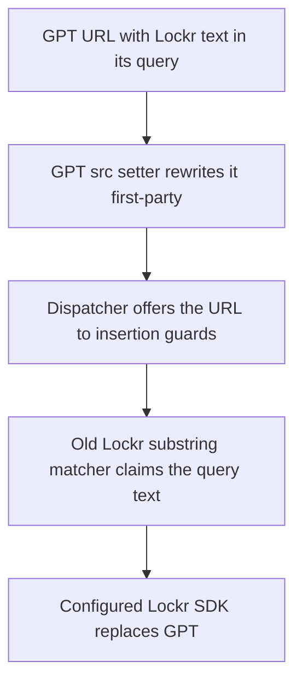

# Lockr and Permutive SDK URL ownership

Status: Implemented and independently reviewed. Validation results are recorded below.

Issue: [#1199](https://github.com/IABTechLab/trusted-server/issues/1199).

## Problem and invariant

The browser Lockr guard claims any script URL containing `aim.loc.kr`, including
another vendor's query string, a path segment, or a lookalike hostname. The
server matcher is narrower but still searches the entire string. Both Permutive
matchers have the same host-substring defect. Full-string extension checks also
miss genuine SDK URLs with query strings.

With all six insertion guards installed, a GPT URL whose query mentions Lockr
has two claimants. GPT rewrites `script.src` at assignment time, preserving the
query. Lockr then claims the first-party URL at insertion and replaces GPT with
the configured Lockr SDK. Changing dispatcher order cannot fix that path.



For the URL cases covered by this change, each original vendor URL must have
exactly its expected claimant, or none for an unowned URL. Lockr and Permutive
must make the same ownership decision in browser and Rust code. Recognition
must depend on the parsed vendor hostname and SDK pathname, never a vendor name
elsewhere in the URL.

## Scope

Change only the Lockr and Permutive URL matchers, their tests, the shared URL
fixture, and the relevant integration documentation. Leave dispatcher behavior,
other vendors' matching rules, logging, configuration, upstream SDK serving,
and proxy destinations unchanged.

Issue #1247 and Lockr initialization, polling, and shim behavior are excluded.
In particular, do not edit `src/integrations/lockr/index.ts` in the JS library.

## Matching contract

Use the browser `URL` parser and Rust's existing `url::Url` dependency. Keep the
input normalization and parsing policy shared within each language. Keep vendor
hostname and pathname checks local to each integration. Do not redesign shared
guards.

### Input forms

- Reject literal NULs in raw matcher inputs: HTML replaces them with U+FFFD,
  unlike direct URL-property assignment, which can trim them. A leading NUL
  makes the markup URL a publisher-relative path, so rejecting it matches the
  browser. A NUL after the authority can leave the vendor hostname and SDK
  pathname intact: markup `//aim.loc.kr/<NUL>identity-lockr.js` loads
  `https://aim.loc.kr/%EF%BF%BDidentity-lockr.js` from the vendor, while server
  matching leaves it unowned. That fail-open case is accepted.
- Before checking the prefix, apply the browser URL preprocessing rules: trim
  leading/trailing C0 controls and space (U+0001–U+0020), then remove tab, LF, and
  CR throughout the input. Do not trim Unicode whitespace such as U+FEFF or
  U+0085. These boundary cases remain in the shared corpus.
- Server matching reads the attribute text lol_html returns, which differs from
  what a browser resolves. Character references stay encoded, so
  `https:&#x2F;&#x2F;aim.loc.kr&#x2F;identity-lockr.js` (mustache.js escapes `/`
  this way) is not recognized and the browser loads the vendor SDK directly,
  while `https://static.example.com&quest;@aim.loc.kr/identity-lockr.js` is
  claimed although the browser loads another host. A leading U+FEFF is dropped,
  so the "Lockr BOM whitespace" input is claimed in served HTML although a
  browser resolves it as a publisher path. Reading decoded attribute values
  belongs in the HTML processor, for every attribute rewriter, and is out of
  scope here. Follow-up [#1480](https://github.com/IABTechLab/trusted-server/issues/1480)
  tracks character-reference decoding and the leading-BOM discrepancy.
- Require an explicit HTTP(S) scheme followed by two authority separators, or
  two separators for a protocol-relative URL. Each separator may be `/` or `\`,
  matching browser HTTP(S) backslash handling. Scheme matching is case-insensitive.
  Leave path/query interpretation to the native parser rather than replacing
  backslashes globally.
- Reject base-dependent shorthand such as `https:host/path` and `https:/host/path`
  in raw/server matching. Whether those forms resolve to a vendor host or a
  publisher path depends on the document scheme and base URL. Dynamic insertion
  guards can recognize the DOM-resolved URL, but static markup using these forms
  can still load the vendor SDK directly.
- Accept absolute HTTP and HTTPS URLs, including uppercase schemes and hosts.
  After preprocessing and the authority check, malformed means rejected by the
  native URL parser. Normal parser normalization is allowed, but runtimes differ:
  Node and Chromium accept some punycode labels rejected by Rust's `url` crate
  and jsdom; Chromium also normalizes some fullwidth-percent encoded-dot host
  spellings rejected by those runtimes. These remain fail-open recognition
  limits, not a promise to recognize every browser-loadable spelling.
- Accept protocol-relative URLs by adding `https:` before parsing. Ownership is
  independent of the page's HTTP/HTTPS scheme.
- Reject empty, malformed, non-network, relative-path, and bare-host inputs.
  A bare hostname is not an authority in a browser script attribute. The DOM
  resolves relative attributes before insertion handlers see them; on a normal
  publisher page they remain publisher URLs and must not be claimed.
- Match the parsed hostname, not the authority string. A port does not change
  hostname ownership. User information must not make an unrelated host match.
- Use exact hostname boundaries. Do not strip a trailing dot or invent extra
  hostname aliases. Rely on the parsers' normal hostname normalization.
- Inspect the parsed pathname without percent-decoding it. Query strings and
  fragments do not participate in SDK recognition. Preserve existing
  case-insensitive ASCII SDK path matching.

### Lockr

The hostname must be exactly `aim.loc.kr` or `identity.loc.kr`. The lowercased
pathname must contain `identity-lockr` and end in `.js`.

This retains the existing Rust SDK path family, including versioned and
trust-server SDK names, rather than introducing a new basename allowlist. It
intentionally stops claiming unrelated scripts or assets on the Lockr host.

### Permutive

The hostname must be exactly `cdn.permutive.com`, or have a nonempty subdomain
prefix before `.edge.permutive.app`. The lowercased pathname must end in
`-web.js`. Neither the bare `edge.permutive.app` hostname nor a lookalike suffix
such as `.edge.permutive.app.example.com` matches.

### Rewriting and compatibility

Recognition of query-bearing and fragment-bearing SDK URLs is new for the Rust
Lockr matcher, browser Lockr on `identity.loc.kr`, and both Permutive matchers.
Cover both Lockr hosts explicitly. Those URLs must now take the existing proxy
route. This does not forward their query or fragment to upstream: Lockr
and Permutive serve the SDK selected by existing integration configuration.
Keep `/integrations/lockr/sdk` and `/integrations/permutive/sdk` unchanged.

Malformed inputs fail without throwing or preventing another guard from running.
Narrowing non-network and bare-host strings is intentional. Preserve normal
absolute and protocol-relative SDK URLs, and case-insensitive matching.

## Files and test data

Runtime changes belong in:

- `crates/trusted-server-js/lib/src/integrations/lockr/script_guard.ts`
- `crates/trusted-server-js/lib/src/integrations/permutive/script_guard.ts`
- `crates/trusted-server-core/src/integrations/lockr.rs`
- `crates/trusted-server-core/src/integrations/permutive.rs`
- `crates/trusted-server-core/src/integrations/sdk_url.rs`
- `crates/trusted-server-js/lib/src/shared/sdk_url.ts`

Rust corpus loading and attribute-rewrite assertions are shared in the test-only
`crates/trusted-server-core/src/integrations/sdk_url_test_support.rs` module.
Direct private-matcher assertions remain in each integration's tests.

Create `crates/trusted-server-js/lib/test/fixtures/sdk-url-ownership.json`. Each
case records a descriptive name, input URL, and expected integration ID or null.
An optional `insertionOwner` records a different expectation after native DOM URL
resolution. In particular, raw matchers reject shorthand schemes. With the
fixture's `https:` shorthand and jsdom's `http:` page, script and link URL getters
resolve them to absolute vendor URLs before insertion. On an `https:` publisher
page, the same inputs resolve to publisher paths and remain unowned.
Rust tests and raw browser claimant tests use `owner`; DOM insertion tests use
`insertionOwner` when present. This distinguishes parser input policy from the
browser's existing attribute-resolution behavior. An optional `serverHtmlOwner`
records a different expectation once lol_html has read the attribute from
markup; the Rust HTML tests use it when present.
Use fictional publisher/customer data. Public vendor hosts are necessary here
to test the actual hard-coded ownership rules, not illustrative customer URLs.
Import the same fixture in Vitest and Rust's inline test modules using the
existing `aps-renderer-v1.json` include/import convention.

The corpus must cover:

- Canonical URLs for all six guards: Permutive, Lockr, Sourcepoint, GTM,
  DataDome, and GPT.
- Both Lockr hosts and both Permutive host families.
- Real SDK paths with query strings, fragments, uppercase text, protocol-relative
  forms, and ports.
- Other vendors' URLs mentioning either affected vendor in queries or paths.
- Host prefixes, suffixes, path mentions, and user-information lookalikes.
- Unrelated resources on genuine vendor hosts and wrong SDK extensions.
- Already-rewritten first-party GPT URLs whose query mentions a vendor host.
- Empty/malformed, relative, bare-host, shorthand-scheme, and non-network inputs.
- Trailing-dot hostnames, percent-encoded SDK path text, the bare
  `edge.permutive.app` host, and C0/space/Unicode whitespace boundaries.
- Tab/CR/LF preprocessing, backslash and mixed authority separators, and
  normalized lookalike/user-information/path/query negatives.
- NUL-containing raw attributes versus DOM URL properties and HTML tokenization.

Replace stale comments pointing to Rust line numbers with pointers to this
shared corpus.

## Regression tests

### Matcher and server tests

For each corpus case, run both Rust matchers and assert whether the expected
owner equals that integration. Run the corresponding JS guards against the
same input URL so parser decisions cannot drift behind duplicated case lists.
Also assert server attribute rewrite actions for matching and nonmatching cases,
including `src` and `href`, while retaining disabled-rewrite coverage. Check
attribute-routing eligibility before calling the rewriter. For every corpus
case, also tokenize actual script/link markup with lol_html and assert the
output: the SDK route when the case's server HTML owner is that integration,
and the unchanged markup otherwise.

### All-guard ownership and insertion tests

Install all six real guards. Examine every registered handler against the
original corpus URL, using a fresh untouched element per handler and passing the
raw URL directly in the candidate. Do not initialize it through `script.src`,
which would let GPT's assignment patches hide a claimant. This also prevents
mutations by one handler influencing another. Assert the exact claimant ID list,
not only a successful final rewrite. Do this entirely in test code without adding a new
production dispatcher API.

Separately exercise actual insertion through both `script.src = url` and native
`Element.prototype.setAttribute.call(script, 'src', url)`, then append the node.
Assert the final first-party route or unchanged attribute. Account for ordinary
DOM relative-URL resolution separately from the raw matcher assertion. Exercise
shorthand URLs with both HTTP and HTTPS document bases in
`test/shared/sdk_url.test.ts`; same-scheme shorthand must remain a publisher path.

Include the issue's three reproduced Lockr collision cases in
`test/integrations/lockr/url_collision.test.ts`. Force Lockr ahead of GPT/GTM in
test-only handler ordering as well as using normal dispatcher order. Reversing
installation alone is insufficient because priorities and IDs set dispatch order.
Ensure tests clean up guards, GPT's extra patches/observer, and dispatcher state.

Cover preload and prefetch script links for both affected integrations, including
query-bearing valid SDKs and false positives, through append and insertBefore.

## Delivery and validation

1. Record an independent fresh-context review of this spec, verify its findings,
   and revise the contract where warranted before implementation.
2. Add the shared corpus and regression tests. Confirm the relevant cases fail
   against the original matchers before fixing runtime code.
3. Apply the four matcher corrections and run focused JS and native Rust tests.
4. Update the Lockr/Permutive guides with SDK ownership and query behavior.
5. Run broader suites and repository-required handoff gates. Reuse passing checks
   while their relevant inputs remain unchanged. Record failures and unavailable
   checks explicitly and keep the pull request in draft.

Focused checks from the JS library directory:

```sh
npx vitest run test/integrations/lockr test/integrations/permutive test/shared/sdk_url.test.ts test/shared/dom_insertion_dispatcher.test.ts
```

Focused checks from the repository root, using the pinned Rust toolchain
and core's default feature set:

```sh
cargo test -p trusted-server-core integrations::lockr::tests
cargo test -p trusted-server-core integrations::permutive::tests
cargo fmt --all -- --check
```

At the combined checkpoint, run the full JS suite, JS lint/format/build, docs
format, and the CI gates specified in `AGENTS.md`, including target-matched
adapter tests/clippy and integration parity. Cargo builds depend on the JS
crate, whose build script installs missing npm dependencies and builds bundles;
coordinate those commands instead of running competing dependency installs.

## Independent review

A fresh-context reviewer read this spec, the full
issue, and current code without conversation history or edits. It found no
blocking defects. Its suggestions were accepted: bypass GPT assignment patches
in raw claimant tests, add explicit trailing-dot/encoded-path/bare-edge-host
fixture rows, and document query/fragment recognition on browser Lockr's
`identity.loc.kr` host. Its open questions about whitespace and malformed URL
spellings were resolved by the explicit common input rules above.

A second fresh-context correctness review inspected the implementation, tests,
fixture, and guides, traced the insertion and server rewrite paths, and ran the
focused JS tests. It reported no findings.

## Validation results

The original regression tests failed against the substring matchers before the
ownership fixes. The normalization regressions also failed before expanding the
common preprocessing policy. The shared corpus now contains 106 cases, including
23 normalization positives and negatives. The all-guard test expands them into
1,390 ownership and insertion checks across both handler orders and DOM paths.

| Check                                                                                                         | Result                                                                                           |
| ------------------------------------------------------------------------------------------------------------- | ------------------------------------------------------------------------------------------------ |
| Full JS suite, `npx vitest run --maxWorkers=4`                                                                | Passed, 2,640 tests across 52 files; scoped Vitest type assertions pass                          |
| JS `npm run lint`, `npm run format`, `npm run build`                                                          | Passed                                                                                           |
| Native Lockr and Permutive inline test modules                                                                | Passed, 11 and 9 tests, including the shared corpus and attribute rewriting                      |
| `cargo test-fastly`, `cargo test-fastly-reuse`, `cargo test-axum`, `cargo test-cloudflare`, `cargo test-spin` | Passed (the Fastly aliases in CI with the pinned Viceroy); existing ignored tests remain ignored |
| All eight target-specific clippy aliases listed in `AGENTS.md`                                                | Passed                                                                                           |
| Integration parity test                                                                                       | Passed                                                                                           |
| Native template build-digest tests and clippy                                                                 | Passed                                                                                           |
| `cargo fmt --all -- --check`, wasm clock lint                                                                 | Passed                                                                                           |
| Docs and repository Markdown formatting                                                                       | Passed                                                                                           |
| URL-host lint on added lines                                                                                  | Passed                                                                                           |

No live vendor SDK fetch or production deployment smoke test was performed.

## Investigation evidence

At `5bc388625`, an in-memory esbuild bundle of the actual guard source executed
in JSDOM with all six guards installed reproduces GPT replacement via `script.src`,
Lockr query/path/lookalike false positives, Permutive lookalike false positives,
and the Permutive query-string false negative. The native setAttribute path
leaves GPT correctly owned under current ordering. This is diagnostic evidence,
not a substitute for the committed regression tests or full validation.
