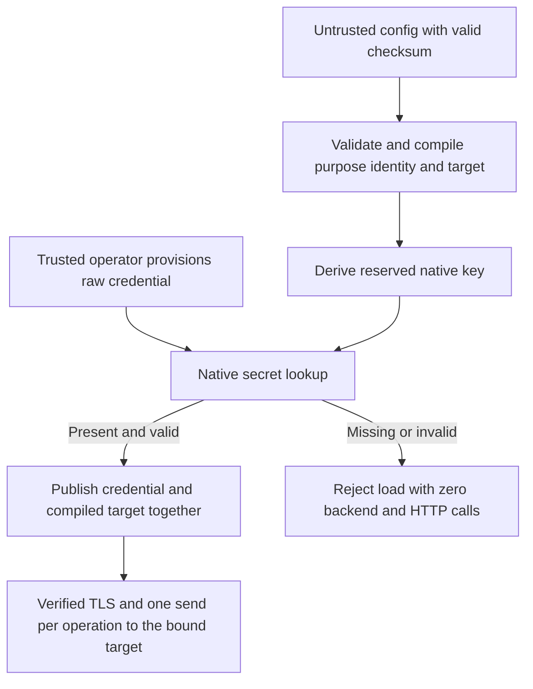

# Context-derived secret bindings

## Decision and status

For [issue #1037](https://github.com/IABTechLab/trusted-server/issues/1037), keep credentials as raw native secret values. Derive each physical secret key from its schema-owned purpose, actual identity, and approved destination or route policy. Operators configure the feature and provide its credential, but do not invent a reference label or physical key. Provisioning a value at the generated key authorizes that particular use. Changing an authorization-relevant input selects a different key, not the same credential with new permissions.

Implementation is under review on `feature/1037-secret-bindings`. The shared compiler, atomic loader, exporters, secure Fastly CLI, guides, and native fixture generation are implemented. This is not a released security fix. Native HTTPS/no-follow behavior, IAM separation, protected CI execution, and migration rehearsals remain release gates. The [implementation plan](../plans/2026-10-26-issue-1037-secret-bindings-implementation-plan.md) defines the work sequence.

This revision replaces the earlier label-bearing draft before any binding ABI has shipped. There is no compatibility lookup for that draft's names.

The alternative considered was a protected JSON record containing the credential and its authorization, selected by new slot and owner IDs. Both approaches can enforce the required boundary. Context-derived bindings avoid a second stored policy representation, a credential-record parser, and new configuration identifiers. They instead make deterministic naming and normalization a provisioning compatibility contract. Operators need a reviewed secret-free binding plan to explain otherwise opaque names and retire former authorizations.

## Issue and investigation base

The issue requires field-owned secret scopes on Fastly, Axum, Cloudflare, and Spin. It separately requires preventing cross-purpose secret substitution and preventing mutable-config retargeting of legitimate pull credentials. It requires migration guidance and config-store-only attacker tests, and excludes a new config-envelope signature/authentication layer.

The issue was read in full on 2026-10-16, including its empty comments collection. It was open with `updatedAt=2026-10-16T20:01:20Z`. Investigation base is `5bc38862512c5c71085b5052bc3e528ee9b9987d`.

Source observations at that revision:

| Source under `crates/`                                                                                         | Current behavior relevant to this design                                                                                                                                                          |
| -------------------------------------------------------------------------------------------------------------- | ------------------------------------------------------------------------------------------------------------------------------------------------------------------------------------------------- |
| `trusted-server-core/src/secret_resolution.rs`, `resolve_leaf`                                                 | Passes configured strings directly to the default secret store. Resolution clones and commits only on success; native lookup errors are suppressed.                                               |
| `trusted-server-core/src/config_payload.rs`, `settings_from_config_blob`                                       | Verifies the checksum, removes inactive references, resolves secrets, then constructs and validates settings.                                                                                     |
| `trusted-server-core/src/config.rs`, `TrustedServerAppConfig`                                                  | Normalizes during deserialization and describes twelve secret paths without authorization context.                                                                                                |
| `trusted-server-core/src/ec/registry.rs`, `validate_config_for_deploy`, `from_config`                          | Deploy validation rejects reused inbound reference strings; runtime separately rejects duplicate resolved token hashes. Pull validation requires its mutable allowlist.                           |
| `trusted-server-core/src/settings.rs`                                                                          | S3 defaults and aliases, Tinybird normalization, and effective asset-route query policy must be materialized before derivation. Existing trimming must not modify labels or resolved credentials. |
| `trusted-server-core/src/ec/pull_sync.rs`, `dispatch_pull_sync`                                                | Uses loose URL/token fields, inherits mutable proxy TLS policy, creates a backend before building the Bearer header, and has a request-builder `expect`.                                          |
| `trusted-server-core/src/integrations/datadome/protection.rs`; `trusted-server-adapter-fastly/src/tinybird.rs` | Export credentials to config-derived targets. Tinybird currently drops its pending handle after starting a fire-and-forget send.                                                                  |
| `trusted-server-core/src/proxy.rs`; `trusted-server-core/src/s3_sigv4.rs`                                      | S3 exports its access ID and optional session token, signs the final target, and has signing/preflight paths beyond the primary GET.                                                              |
| Adapter `app.rs` files; `trusted-server-adapter-fastly/src/main.rs`                                            | Settings-only builders, registry construction, retained state, diagnostic loads, and finalization fallback reloads all need the loaded-use boundary.                                              |

At the investigation base, EdgeZero v0.0.9 at `f7176742d46aa4d1a04ce4588b606afda388fd30` exposed only path, kind, and optionality in secret metadata. Its CLI walks raw references in two places, and its Spin validator applies native-looking syntax and lowercased duplicate checks to those references. A companion lookup-plan change is required below.

These are source observations, not executable security proof. An isolated fictional encoding model supports the naming contract, but no shipping Rust implementation or provider runtime has verified it.

## Threat model and invariant

The attacker can replace the app-config blob, change ordinary fields, and recompute a valid checksum. Assume they know native key names and complete provisioned identities. They cannot change the executable, trusted deployment mappings, native secret contents, native bindings, or their access controls.

For every active secret field, core determines its purpose and authorization context. The only allowed lookup is the derived key for that context. An outbound credential is sent only using the same compiled target that determined its lookup. A missing or invalid binding fails loading before backend creation or outbound requests.

The security authority is the set of native keys provisioned by a trusted operator. The hash is not a secret, signature, encryption, or authentication of config writers. Calculating another key name grants nothing without a credential provisioned there.

This protects against config-only reassignment, not malicious code with process-wide secret-store access. It does not provide general config integrity, availability, immutable partner membership, or immediate revocation in retained states. Selecting another complete provisioned identity remains allowed. Secret-store writers, deployment administrators, compromised approved endpoints, trusted DNS/CA compromise, and credential values deliberately reused across separately authorized uses are outside the guarantee. Operators must not provision another role's credential value into an outbound binding.

## Config contract

Remove operator-chosen secret references from unresolved app config. The twelve former secret leaves in the inventory below identify roles being migrated, not fields that remain configurable. Do not accept inline values, arbitrary labels, generated keys, `slot:` markers, `secret_owner_id`, physical binding overrides, or new per-field store selectors. Reject the removed reference properties with a schema-path-only migration error whenever present, including on disabled features, rather than silently ignoring a likely incomplete migration. Existing deprecated store selectors remain deserialize-only, ignored, and safely warned about. Tinybird's already discarded `access_token_secret` remains discarded and `access_enabled=true` remains rejected.

An enabled feature implies its required credential. Ordinary configuration supplies its identity and destination:

```toml
[tinybird]
enabled = true
api_host = "api.tinybird.example.com"
auction_dataset = "auction_events_raw"

[[ec.partners]]
name = "Example partner"
source_domain = "partner.example.com"
api_token_enabled = true
pull_sync_enabled = true
pull_sync_url = "https://sync.example.com/pull"
pull_sync_allowed_domains = ["sync.example.com"]
```

This is the proposed breaking schema, not configuration accepted by today's binary. Tinybird needs no token-name property. Partner inbound authentication uses a new boolean `api_token_enabled`, defaulting to false, to preserve the former optional-token behavior. Enabling it requires the partner's inbound binding; a missing credential never silently disables authentication. Pull sync keeps its existing activation flag and requires its separate pull binding.

For S3 auth, `access_key_id` and `secret_access_key` become implicit required roles. The new boolean `session_token_enabled` under route `auth` defaults to false; when true it requires the session-token binding. No lookup probes for optional bindings. Both new flags accept booleans only. The existing boolean/string pull activation is normalized consistently without treating `"false"` as true.

Publisher proxy and EC passphrase credentials are implicit required app roles. Each handler requires its password binding. Presence of trusted-client-IP configuration requires its shared-secret binding. Existing Tinybird, DataDome Protection, and bypass activation determine their required roles. Disabled uses make no secret reads; malformed present structures remain errors. An omitted partner array is empty. Deploy validation, lookup planning, and runtime loading share these rules.

Materialize ordinary defaults and effective S3 route/query policy before planning. Remove legacy S3 reference defaults instead of treating them as credential bytes. `s3_sig_v4` and `s3_sigv4` use identical policy. Preserve ordinary collection identity validation, including duplicate normalized partner-domain rejection and runtime duplicate resolved-token-hash rejection. Replace reference-string uniqueness checks with compiled lookup identity checks. Replace the mandatory mutable pull-allowlist rule with the endpoint assertion contract below.

Separate unresolved configuration from resolved credential state. Internal resolved fields may temporarily retain their existing Rust names for validation, but config deserialization cannot populate them and config serialization cannot emit them. A plain `Settings` object is not proof of a loaded credential binding.

Correct existing guide statements describing `trusted_client_ip.shared_secret` as inline during implementation. Runtime already resolves that value from the store; removing its reference field is not an inline-to-store migration.

## Deterministic naming contract

One TS-owned policy module compiles each active credential role into a private request containing a fixed executable scope code, a normalized subject vector, and a normalized export vector. Only core constructs this request. Adapters map native identities and perform lookup, not authorization. The purpose is fixed in code, but an outbound credential's physical key is not fixed independently of its destination.

Derive active credential metadata and the CLI lookup plan from the same descriptors. Descriptors identify the owning config path, fixed purpose, activation, subject, and export policy even though no reference leaf exists there. Unknown metadata or unsupported descriptor kinds fail closed. Keep the generic `PlatformSecretStore` interface for native access and separate signing/management uses; do not create an authorization engine in each adapter.

### Encoding and versioning

Use full SHA-256, not a truncated digest or language-dependent hash:

```text
LP(s)    = u32 big-endian UTF-8 byte length || UTF-8 bytes
VEC(xs)  = u32 big-endian element count || LP(x1) || ... || LP(xn)

payload  = ASCII("trusted-server-secret-binding-v1\0")
           || LP(scope)
           || VEC(subject)
           || VEC(export)

key      = "ts1_" || lowercase_unpadded_RFC4648_base32(SHA256(payload))
```

The domain separator ends with one NUL byte. The base32 alphabet is `abcdefghijklmnopqrstuvwxyz234567`. The complete key is 56 ASCII bytes. Check every string byte length and vector element count before conversion to u32; overflow is a safe configuration error, never truncation. Use UTF-8 byte lengths, not character counts.

Element counts and length prefixes distinguish all components, including empty optional values. Do not substitute delimiter-concatenated strings, generic object serialization, array indexes, or provider-specific hashing. The restricted key alphabet avoids Axum case/replacement aliases. Spin must still apply its existing native store/key mapping.

The encoding, subject/export shapes, defaults, and normalization rules together form the v1 provisioning ABI. Pin shared golden fixtures before integration, including every scope, optional markers, UTF-8 subject components, and accepted/rejected normalization cases. CLI plans, unresolved serialization, runtime loading, and actual send targets must agree. A library upgrade must not silently change v1 names or expand endpoint equivalence. Intentional incompatible changes require a new version/namespace and migration, not an old-key retry.

One fictional model vector to confirm independently in the shipping implementation is:

```text
scope:    ecpull
subject:  ["partner", "partner.example.com"]
export:   ["pull", "https://sync.example.com/pull"]
key:      ts1_2hsjuldwgmfhyotnokgn5mqrao6xnkyo3dwva33hez4vx43yvcjq
```

A matching model vector proves only those encoding bytes, not native compatibility, collision resistance, or exporter confinement.

### Complete context inventory

The CLI selectors are fixed descriptor IDs, not operator-chosen names or additional hash inputs. Repeated roles also require selection of a compiled subject from the plan.

| Former reference property                                             | CLI selector       | Fixed scope | Subject | Export                      | Activation                                  |
| --------------------------------------------------------------------- | ------------------ | ----------- | ------- | --------------------------- | ------------------------------------------- |
| `publisher.proxy_secret`                                              | `publisher.proxy`  | `proxy`     | App     | None                        | Required                                    |
| `ec.passphrase`                                                       | `ec.passphrase`    | `ecpass`    | App     | None                        | Required                                    |
| `ec.partners[*].api_token`                                            | `ec.inbound`       | `ecin`      | Partner | None                        | `api_token_enabled=true`                    |
| `ec.partners[*].ts_pull_token`                                        | `ec.pull`          | `ecpull`    | Partner | Pull endpoint               | Pull sync enabled                           |
| `handlers[*].password`                                                | `handler.password` | `handler`   | Handler | None                        | Each configured handler                     |
| `trusted_client_ip.shared_secret`                                     | `clientip.shared`  | `clientip`  | App     | None                        | Trusted-client-IP configuration exists      |
| `tinybird.auction_token_secret`                                       | `tinybird.auction` | `tinybird`  | App     | Events endpoint and dataset | Tinybird auction telemetry enabled          |
| `integrations.datadome.server_side_key_secret_name`                   | `datadome.server`  | `ddserver`  | App     | Protection endpoint         | Integration and Protection enabled          |
| `integrations.datadome.protection_test_bypass.credential_secret_name` | `datadome.bypass`  | `ddbypass`  | App     | None                        | Integration, Protection, and bypass enabled |
| `proxy.asset_routes[*].auth.access_key_id`                            | `s3.access-id`     | `s3id`      | Route   | S3                          | S3 auth                                     |
| `proxy.asset_routes[*].auth.secret_access_key`                        | `s3.secret`        | `s3secret`  | Route   | S3                          | S3 auth                                     |
| `proxy.asset_routes[*].auth.session_token`                            | `s3.session`       | `s3sess`    | Route   | S3                          | S3 auth and `session_token_enabled=true`    |

Vectors have these fixed shapes:

```text
App:       ["app"]
Partner:   ["partner", normalized_source_domain]
Handler:   ["handler", exact_validated_path_regex, exact_username]
Route:     ["route", normalized_prefix, normalized_https_origin,
            pattern_presence, pattern_value, target_presence, target_value,
            normalized_region, effective_origin_query]

None:      ["none"]
Pull:      ["pull", normalized_endpoint]
DataDome:  ["datadome", normalized_validate_request_endpoint]
Tinybird:  ["tinybird", normalized_events_endpoint, exact_dataset]
S3:        ["s3"]
```

For optional route pattern/target fields, presence is the literal `absent` or `present`; absence has an empty value component. Encode effective query policy as the literal `preserve` or `strip`. Use effective normalized route values after defaults, not raw aliases. Partner domains use the existing normalized source-domain function. Handler paths use exact validated regex strings, not regex equivalence. Dataset must be nonempty and is not silently trimmed into another value.

The subject is the identity, so there is no separately mutable owner ID. Reordering entries leaves keys unchanged. Changing a handler username, partner domain, or authenticated route policy changes keys. Equal purpose, subject, and export intentionally share one binding; existing collection uniqueness rules still apply. There is one value per effective context, not a configurable choice of credential generations. Copying a whole provisioned identity selects that identity, not another identity's credential.

All three S3 fields use the same compiled route subject, but distinct scopes. Bind prefix, origin, regex/rewrite policy, region, and effective query policy. Request-dependent object paths and permitted incoming queries remain dynamic; this is not a bucket/object authorization system. Image-optimizer behavior must not change the bound effective query policy. Any future send-affecting field requires a context review, not an assumption that the current inventory remains complete.

## Destination and send policy

The issue explicitly requires pull recipient protection. This design also retains protection for DataDome's own server key, Tinybird's own append token/dataset, and S3's own route credentials. Those are verified sibling export paths, broader than the literal pull-specific acceptance criterion. Do not silently remove them or claim that cross-scope names alone prevent their own-credential retargeting. S3 route/signing integration should be its own testable milestone.

### Endpoint normalization

For pull, DataDome, and Tinybird base endpoints, use one shared core parser:

- Require absolute HTTPS with an ASCII DNS hostname. Reject IP literals, internationalized host input, trailing-dot hosts, userinfo including empty userinfo, queries including empty `?`, fragments, backslashes, whitespace, and controls.
- Normalize scheme/host case and remove explicit port 443. Preserve other valid ports. An empty path becomes `/`.
- Paths contain only ASCII unreserved characters and `/`. Reject percent escapes and `.` or `..` segments before URL parsing can discard them. Preserve path case, trailing slash, and repeated slash distinctions.
- Hash and use the complete normalized scheme, hostname, port, and path. Host-only approval, suffix matches, and mutable allowlists are insufficient.

The same parser supplies both derivation inputs and actual exporter targets. Never hash one representation and rebuild the target from loose settings later.

### Export-specific rules

- Pull uses GET and appends exactly one validated runtime `ec_id` through URL query APIs. Config cannot supply fixed query parameters. The legacy allowlist may be omitted; a nonempty allowlist may contain only the endpoint's normalized hostname. It is a consistency assertion, not authority. Changing URL and allowlist together selects a new, unprovisioned key.
- DataDome binds the exact derived `/validate-request` endpoint and uses POST with a safely form-encoded credential.
- Tinybird binds the exact HTTPS `/v0/events` endpoint and dataset, then builds one encoded `name` query from that dataset. It uses POST NDJSON. Actual event emission remains Fastly-specific unless another adapter already implements it; this work does not add telemetry exporters.
- S3 binds an HTTPS origin and route policy. Apply the same hostname/port checks and existing prohibition on origin paths/queries. Check final target origin before signing or backend creation. GET/HEAD SigV4 only. Host overrides and general proxy rewriting cannot change the bound authority. Unauthenticated routes retain their existing behavior.

All credential-bearing flows require certificate and hostname verification independently of `proxy.certificate_check`. Backend reuse must not inherit weaker TLS settings. Each HTTP operation sends once and never follows redirects, even on the same host. Legitimate S3 HEAD/GET preflight operations may remain separate operations, all confined to the same bound origin; "one send" does not prohibit that existing flow.

Exporters that observe a response treat 3xx as unsuccessful and never retry at `Location`. DataDome's recognized 301/302 challenge verdicts retain their existing challenge/failure handling; they never trigger an HTTP client redirect. Preserve Tinybird's existing fire-and-forget behavior in this change. Its guarantee is no automatic redirect following, not observed classification of a response whose pending handle is dropped. Claiming observed delivery/3xx failure would require a separately specified response-observation change.

Validate header, form, and signing representation before backend creation. Pull and Tinybird require nonempty RFC 6750 b64token values plus existing length/placeholder checks. Build sensitive headers without panics. Safely encode DataDome form data, validate S3 header material, and redact access IDs as well as secret/session keys. Preserve credential bytes exactly. Native provider value limits still apply; there is no new JSON-record size limit.

## Loading and runtime boundary

### Unresolved and resolved normalization

Separate unresolved config normalization from credential handling. Validate original endpoint syntax before URL parsing or trimming can erase forbidden input. Reject removed reference properties before unresolved serialization can discard them. Materialize S3 defaults and effective route/query policy before planning; never hash an incomplete raw tree.

After lookup, preserve credential bytes through settings construction, runtime preparation, and exporter construction. Address current S3 normalization, Tinybird dataset normalization, DataDome startup normalization, and repeated `prepare_runtime` calls explicitly. Existing normalization cannot be reused unchanged if it trims a resolved credential or changes the compiled target. Apply activation consistently before secret reads without letting inactive cleanup hide malformed present structures.

### Private construction and snapshots

The loader returns a nonserializable `LoadedConfig` containing settings and outbound bindings as one successful snapshot. Its fields are private; access is read-only. A private resolved-use representation couples credentials, purpose/subject association, compiled target, and fixed send policy. Only successful core loading constructs enabled uses. No four separately named public exporter types are required.

Registry/state builders and exporter constructors consume loaded bindings, not loose credential/URL fields in plain `Settings`. A settings-only helper may construct disabled exporters, but cannot enable credential export without a validated use. Resolved-settings shadow fields may remain temporarily for runtime validation, with redaction, but are not outbound authority. CLI serialization uses only unresolved config; loaded objects never serialize into envelopes.

Prove this boundary first through a thin production load/pull-export path before substantial sibling integration. Cover all adapter state builders, registry rebuilds, retained Fastly state, diagnostic loads, Fastly fallback finalization, Tinybird construction, DataDome constructors, and S3 signing/image-optimizer preflight branches. Do not leave private construction as an unenforced convention.

After checksum verification, validate unresolved structure, materialize defaults, and compile active requests and targets. Read only derived keys in the trusted mapped default store, validate values and ordinary settings, then atomically publish the snapshot. Preserve existing successful-state retention, but never combine settings from one load with credentials/targets from another. An in-flight request retains its captured state. No global credential cache, watcher, TTL, or new reload mechanism is introduced. Memoization is limited to identical requests within one load.



Errors expose only safe schema paths and fixed categories. Do not attach native lookup diagnostics, credentials, URLs/queries, usernames, request bodies, or header values. Provisioning commands may deliberately show reviewed subject/target metadata as specified below; runtime errors must not. Audit `Debug`, traces, request-builder errors, panic paths, form payload logging, and header sensitivity. No raw-key retry, alternate-store retry, plaintext fallback, or prefix/suffix bypass exists.

Signing uses its existing fixed signing-store identity and separate `current-kid`; management uses its fixed credential identity and API host. Keep these separately audited paths outside app-config derivation. Do not redesign signing management or accidentally route app-config fields through a generic raw-reference extractor.

## Native provisioning and CLI

Keep the logical store `trusted_server_secrets`. Trusted runtime/deployment mappings select its physical store. Separate field stores are unnecessary and would not isolate Cloudflare, whose TS adapter ignores the store argument.

| Adapter    | Provisioning and proof                                                                                                                                                                                                                                                                                              |
| ---------- | ------------------------------------------------------------------------------------------------------------------------------------------------------------------------------------------------------------------------------------------------------------------------------------------------------------------- |
| Fastly     | Raw credential at the derived key in the trusted mapped store. Preserve startup and reload mappings. Verify actual Viceroy reads plus isolated platform smoke and TLS/backend reuse.                                                                                                                                |
| Axum       | Raw credential in the environment variable produced by TS's store/key mapping, which uppercases and replaces hyphen/dot/space. Verify real environment reads and final-name collisions with fixed trusted store identity.                                                                                           |
| Cloudflare | Raw Worker secret at the derived key. Verify actual Worker binding lookup, HTTPS/no-follow behavior, and a config-only publishing role without Worker deployment/secret rights. A constrained publishing service may be necessary. Host tests do not execute `worker::Env`.                                         |
| Spin       | Raw value supplied securely to the application/component variable produced by TS's existing store/key escaping. Declare both levels and test actual component lookup. `secret=true` alone is not encrypted storage; use a protected provider. Keep one logical store to avoid the current single-secret-store gate. |

A host-usable renderer must share TS adapters' actual native mapping implementation or prove equivalence. EdgeZero's generic secret-store behavior is not interchangeable with these TS bridges. Reserve the generated namespace and reject final native collisions with other declarations, including legacy/signing/management bindings where they share a flat namespace. Do not silently truncate, rename, or merge distinct contexts. Deduplicate only after confirming exact request and store/key equality.

### Lookup-plan prerequisite

The pinned EdgeZero CLI's `run_adapter_typed_checks` and `typed_secret_checks` both walk raw leaves; validate, push, and diff consume those paths. Its Spin adapter lowercases those leaves, validates native-looking names, and rejects duplicates without TS's store/key escaping. Old labels passing this check would still be validation of the wrong names.

Add a default-compatible opt-in hook representing implicit active credentials with descriptor ID, owning `field_path`, `store_id`, and derived key. The exact public API can follow upstream conventions. For TS plans, replace both raw-leaf walkers with active/defaulted compiled lookups while retaining metadata and logical store declaration validation. The hook must not require a credential reference leaf to exist, reinsert dummy labels, or skip required roles whose old fields have disappeared. Native validation uses generated lookups and final TS rendering; unresolved serialization contains feature configuration only. Other applications retain existing behavior when the hook is absent. Do not disable Spin validation globally.

Before substantial exporter/tooling work, demonstrate the hook through real validate/push/diff consumers and TS's host-usable renderer with fictional data. Cover omitted optional fields, defaults, inactive cleanup, metadata completeness, repeated identical requests, distinct contexts, and final binding collisions. Publish and pin the companion dependency before claiming CLI parity.

The 56-byte key does not prove provider acceptance. Under the inspected TS Spin mapping, its name with `trusted_server_secrets` is 92 bytes. Verify actual generated names, declarations, value-size limits, secure provisioning, and config-writer IAM separation in isolated native environments. Unavailable environments remain blockers, not assumed passes.

### Reuse existing deployment configuration

Do not introduce `deploy/production.toml`, a new `--target` descriptor, or a second source of service/store mappings. TS already delegates lifecycle commands to EdgeZero. Reuse `edgezero.toml`, the adapter manifest, existing service-selection rules, and deploy-process or GitHub Environment variables.

On Fastly, `fastly.toml` already supplies `service_id`. Provisioning also supports `FASTLY_SERVICE_ID` and rejects a conflict with the manifest. Managed deployment supports explicit `--service-id`; otherwise it resolves the verified manifest/environment selection. Expose any shared resolution needed for secrets through the companion dependency rather than maintaining another TS implementation. Existing physical store selectors are:

```text
EDGEZERO__STORES__SECRETS__TRUSTED_SERVER_SECRETS__NAME
EDGEZERO__STORES__CONFIG__TRUSTED_SERVER_CONFIG__NAME
EDGEZERO__STORES__KV__TRUSTED_SERVER_KV__NAME
```

These select names, not provider IDs. Resolve and record the exact physical resources with the existing provider machinery. An unset selector retains the existing logical-name default, which must be visible in the plan. `FASTLY_API_TOKEN` supplies authentication for managed direct API calls; a CLI profile alone does not replace it. Honor existing manifest selection, including `EDGEZERO_MANIFEST`, without adding conflicting path precedence.

`ts provision --adapter fastly` creates or reuses resources. Managed `ts deploy` links the selected physical stores to the target service version under logical IDs such as `trusted_server_secrets`. The runtime opens that logical ID and does not read deploy selectors from a Config Store. `--staging` is not a store selector; production and staging must supply different physical-store mappings where isolation is required. Secret writes do not deploy, activate a version, create resource links, or refresh retained state.

### First-release operator tooling

Provide a secret-free plan and native rendering/checking for all four adapters, plus a context-aware Fastly `set` workflow in the first release. The command interface below is proposed, not available today:

```bash
ts secrets plan --adapter fastly --app-config trusted-server.toml --out bindings.json
ts secrets set tinybird.auction --adapter fastly --app-config trusted-server.toml --plan bindings.json
ts secrets check --adapter fastly --app-config trusted-server.toml --plan bindings.json
```

Reuse existing app-config path and overlay semantics. The plan must record the effective unresolved config identity, overlay policy, compiler/ABI version, descriptor IDs, owning schema paths, normalized subject/export contexts, derived keys, final native identities/declarations, and resolved deployment resources. Keep a complete reviewed plan with the release/config records. Plan creation does not authorize its contents, and its checksum is not an approval signature.

`set` recompiles from the supplied config and current deployment inputs and rejects a stale, tampered, unsupported-version, or mismatched plan before reading a credential or making a provider mutation. Compare the full relevant plan and resolved provider identities, not just the selected entry's key. Select only an active compiled descriptor. Singleton `tinybird.auction` needs no extra name. For repeated roles, list the human-readable compiled subjects interactively; noninteractive callers must supply an unambiguous tool-generated `--binding` entry ID from that plan. Never choose the first array entry or accept a raw key/store override.

Show the selected purpose, subject, exact endpoint/dataset or route policy, service, physical store, and intended create/replace action for confirmation. This is intentional metadata output, not a runtime diagnostic. A changed target or provider resource requires a new reviewed plan. Keep this metadata access-controlled even though it contains no credential values.

Read the raw value through a hidden prompt by default or `--stdin` for automation. Require `--yes` with stdin; it replaces interactive approval only. Preserve bytes exactly, reject invalid credential representation and provider value limits before mutation, and fail without panics. Do not accept a value argument, print values, place them on subprocess argv, or write them to tracked files. Reuse provider tooling only if it supports secure input and sanitized errors; otherwise use a narrow adapter operation with equivalent handling. Do not execute commands embedded in a plan.

Resolve native IDs before mutation and use those exact IDs for the write. Report create versus replacement safely. Re-running an identical logical write must not allocate new names. Verify provider replacement and propagation behavior in isolated tests; report uncertain outcomes without automatically granting another context or deleting the former binding. S3 multi-key writes are not transactional. Do not infer immediate fleet-wide activation from successful storage.

`check` validates plan/config/deployment agreement and native binding/declaration existence where the provider exposes it without reading values. It must distinguish missing bindings, unsupported checks, and provider errors. It does not prove credential validity, external delivery, TLS behavior, or warm-state refresh. Unsupported direct `set` adapters fail explicitly before accepting input. Axum, Cloudflare, and Spin get generated native identities/declarations and tested secure native-tool instructions; do not imply that a subprocess can export variables into its parent shell or add a new persistent credential service.

Native tools may still perform deletion and advanced provider operations using generated identities from the reviewed plan. No credential discovery, automatic rotation, background reconciliation, protected-record parser, or persistent runtime authorization/inventory state is introduced. This narrow explicit write workflow replaces the earlier draft's prohibition on all provider writes, not its exclusion of a general secret-management system.

### Automation and provisioning guides

A dedicated trusted provisioning workflow can call the same command through stdin. The following Bash example is proposed and assumes the provider credential and reviewed deployment selectors are already supplied by the environment:

```bash
set +x
set -euo pipefail
: "${TINYBIRD_AUCTION_TOKEN:?Missing Tinybird credential}"
: "${FASTLY_API_TOKEN:?Missing Fastly provisioning credential}"
printf '%s' "$TINYBIRD_AUCTION_TOKEN" |
  env -u TINYBIRD_AUCTION_TOKEN ts secrets set tinybird.auction \
    --adapter fastly --app-config trusted-server.toml \
    --plan bindings.json --stdin --yes
```

Do not provision automatically on each ordinary config push or from the live mutable blob. CI is a trusted secret writer and must run approved CLI/workflow code against a reviewed revision and plan. Use protected provisioning credentials and an approval boundary that config-only publishers cannot bypass, a separate admin-controlled repository where necessary, and serialized writes to the same binding. Do not expose these credentials to untrusted pull-request jobs. An environment approval does not make attacker-controlled workflow code safe. Missing inputs, changed overlays, changed service/store selectors, or changed config/plan must fail before provider mutation. CI logs and artifacts must not contain credential values.

As implementation deliverables, add dedicated provisioning, CI, and migration guides and update configuration, CLI, Fastly, Axum, Cloudflare, Spin, Tinybird, DataDome, and S3 documentation plus examples and navigation. Include complete label-free TOML, interactive input, secure Bash stdin, a protected GitHub Actions workflow, environment-variable tables, provider-native walkthroughs, existence checks versus runtime smoke tests, rotation/retirement, and troubleshooting. Examples use fictional `example.com` endpoints and never real deployment identities. Mark proposed interfaces as proposed until executable help/tests and isolated rehearsals establish their behavior.

## Migration, rotation, and retirement

1. Inventory active uses and approved subjects/destinations without printing values. Separate cross-role credential reuse and verify config writers cannot modify native secrets or deployment bindings.
2. Create a reviewed new-schema config. Remove all twelve legacy reference properties. Set `api_token_enabled` for partners formerly using inbound tokens and `session_token_enabled` for S3 routes formerly using session tokens. Keep feature activation explicit; absence of a secret is not a disable signal.
3. Generate and approve the plan from that config and the existing deployment inputs. Blindly provisioning a plan derived from attacker-edited live config would grant the attacker new authority.
4. Copy existing raw values to the generated native identities through secure input. Use the Fastly `set` workflow or the tested generated/native instructions for other adapters. Update declarations and local fixtures, and retain the reviewed secret-free plan. No JSON wrapping or credential-value change is required unless validation or suspected compromise requires one.
5. Deploy the matching new config and binary to an isolated version. Old binaries and new binaries need separate compatible config snapshots/stores during a mixed rollout; sharing the new config with an old binary is unsafe. Exercise valid and attacker-modified blobs, recreate state, and switch traffic only after release gates pass.
6. Remove legacy raw-name entries after an explicitly owned rollback window. Revoke credentials at recipients if earlier exposure is suspected.

For an endpoint, subject, route-policy, or derivation-version change, review old/new plans, provision the new binding/declarations, switch config and recreate state, then remove every retired key/declaration within an owned window. The old context remains authorized for fresh loads while its key exists. Replace retained old states, account for in-flight requests, and verify that replaying retired config fails on newly created state.

Ordinary value rotation at an unchanged context updates the raw value at the same name and requires state recreation. Removing labels removes independently selectable same-context generations. Do not add a hidden label, generation ID, or raw-key override to recover that capability. Document provider replacement semantics and an overlap window at the external recipient where supported. If old and new values cannot overlap, use a coordinated maintenance cutover. For S3, update the required credential roles while affected state creation/traffic is paused, verify all writes, then recreate state and resume. Native multi-key updates are not a transaction; a provider requiring an unavailable atomic swap is a reported rollout blocker.

Axum normally requires process restart. Fastly requires new state/sandboxes, including reusable-sandbox mode. Cloudflare and Spin follow existing runner app-state construction. No immediate warm-instance refresh or global revocation guarantee is added.

Rollback requires the old binary's compatible config snapshot and retained legacy names and restores the original attack. Prefer rolling forward or disabling affected exporters. The new binary never reads legacy or earlier label-bearing draft names.

## Acceptance and proof contract

These are required executable results, not passing claims:

| Issue criterion                                           | Decision                                                                                 | Required evidence                                                                                                                                                                 |
| --------------------------------------------------------- | ---------------------------------------------------------------------------------------- | --------------------------------------------------------------------------------------------------------------------------------------------------------------------------------- |
| No unrestricted physical key from app config              | Implicit typed roles and derived keys only                                               | Spy-store coverage of all twelve roles; removed raw/generated-key reference properties reject before lookup                                                                       |
| Consistent scopes on all four adapters                    | Shared descriptors/encoder; trusted native mapping                                       | Golden vectors, native name/read tests, then Viceroy/Fastly, Axum HTTPS, Wrangler/workerd, and Spin smoke                                                                         |
| Unrelated values cannot become pull Bearer tokens         | Fixed purpose is in the hashed context                                                   | Inject legacy reference properties or mutate identities with valid checksums; no unrelated value returned, backend created, or HTTP send                                          |
| Blob edits cannot redirect a pull credential              | Exact subject/endpoint are in the key; fixed TLS/no-follow policy                        | Change URL and allowlist together, host/port/path, syntax, and TLS toggle; no lookup of the old key and zero sends. Approved 3xx sends once per operation and never to `Location` |
| Migration documents provisioning and required moves       | Raw-value copy, approved plans, native declarations, retirement, unsafe rollback warning | Fictional four-adapter operator walkthrough, including retired-context replay                                                                                                     |
| Config-only attacker rejected before any outbound request | Atomic loading and private resolved-use construction                                     | Production envelope reconstruction with valid-checksum mutations, backend/HTTP counters, and native/runtime negative sends                                                        |

Also test:

- Field reordering, complete authorized identity selection, identical context deduplication, framing boundaries, UTF-8 lengths, checked integer conversion, optional markers, and native declaration collisions. Removed reference properties must reject even if they contain real generated keys.
- Malformed/optional/inactive structures, both new activation flags and their defaults, missing enabled credentials, S3 auth aliases/effective query policy, partner normalization, preserved resolved-token collision checks, handler subject changes, sibling retargeting, and every bound S3 route-policy mutation.
- Exact credential-byte preservation through all normalization and repeated runtime preparation; unresolved config contains no credential values or references; schema-only safe runtime diagnostics with fictional sentinel values.
- CLI validate/push/diff for implicit roles and feature-only serialization; default-compatible behavior for other EdgeZero users; actual send method/authority/path/query equal to compiled context, including Host/SNI and Tinybird dataset encoding.
- Plan/config/overlay/compiler/native-mapping/resource mismatch, manifest/environment service conflicts, staging selectors, wrong-store selection, ambiguous repeated-role selection, unsupported adapters, cancelled input, invalid bytes, secure stdin, sanitized provider failures, replacement/uncertain outcomes, and zero mutation on any preflight failure. Never publish credential values in argv, logs, plans, generated declarations, or CI artifacts.
- Protected CI approval and trusted-code boundaries, deterministic reruns, presence-only check limitations, independent runtime smoke, and fictional four-adapter provisioning-guide rehearsals.
- Mandatory TLS despite proxy toggles/backend reuse, no credential-bearing redirect following, DataDome form encoding, all S3 signing/HEAD/GET preflight branches, and Tinybird no-follow without claiming observed responses.
- State recreation and in-flight snapshots, same-name value rotation, coordinated S3 rotation without labels, policy change/retirement, replay rejection, mixed-version config isolation, and rollback behavior.

Two high-risk facts remain unproven: every export-capable path can be confined to its loaded credential/target snapshot, and every native mapping/transport preserves that authorization. The cheapest next proofs are the production-loader/store/backend spy slice and the actual EdgeZero/TS renderer path, followed by native lookup and send tests.

Release requires the published dependency pin, migration walkthrough, real native reads, isolated valid/invalid HTTPS and redirect tests on all four adapters, and verified config-writer IAM separation. Host routes using Noop stores, source inspection, and a toy hash demonstration do not meet those gates. A missing provider environment is a reported blocker, not a pass.
