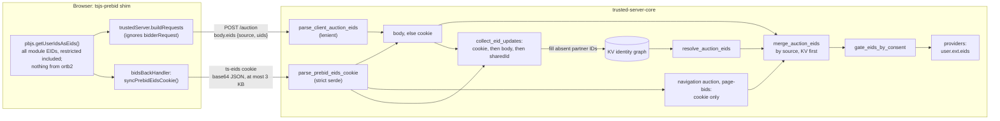
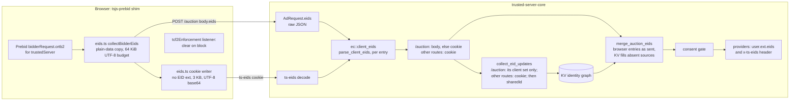

# Prebid EID fidelity

Status: Reviewed. Round 5 found nothing blocking (see the review log). Backwards
compatibility was explicitly not a constraint; section 8.2 lists what breaks.

Issue: [#1246](https://github.com/IABTechLab/trusted-server/issues/1246), "Write
Lockr IDs to KV store".

Designed against `main` at `a9037770a`. Every `file:line` reference below is to
that commit. Prebid.js references are to version 10.26.0, the version
`crates/trusted-server-js/lib/package-lock.json` pins, read from
`crates/trusted-server-js/lib/node_modules/prebid.js/`. References marked
"(11.43)" are to Prebid.js 11.43.0-pre at commit `51e968dba`, audited in
section 3.5 to check how the design holds across a future upgrade.

Related work:

- [KV EID request snapshot and EC recovery](2026-07-10-kv-eid-request-snapshot-ec-recovery-design.md)
  defines the `/auction` body to KV path this spec keeps.
- Draft PR #1382 (pluggable modules stack, #777) moves the `ts-eids` cookie
  parser out of core. Section 8.4 covers the overlap.
- Open PR #1406 changes Lockr API routing. It does not touch EIDs.

Terms used throughout:

- **EID**: an OpenRTB extended identifier object, `{source, uids[]}` plus
  optional `inserter`, `matcher`, `mm` and `ext` (OpenRTB 2.6 §3.2.27). A
  **UID** is one entry of `uids`, `{id, atype?, ext?}` (§3.2.28).
- **EID-level fields**: `inserter`, `matcher`, `mm` and the EID's own `ext`, as
  opposed to a UID's `atype` and `ext`. They say who added an ID and how it was
  matched.
- **`ortb2` / FPD**: Prebid's first-party data, the OpenRTB fragments that
  Prebid merges into each bidder's request.
- **Shim**: the `tsjs-prebid` script Trusted Server (TS) serves. It registers
  the `trustedServer` Prebid bid adapter, which sends bids to `/auction`.
- **EC / KV identity graph**: the Edge Cookie ID and the KV store row that maps
  it to partner UIDs registered under `[[ec.partners]]`.
- **`ts-eids`**: the first-party cookie in which the shim copies the browser's
  EIDs for requests that carry no EID body.
- **Body-less routes**: requests that carry no EID body and read `ts-eids`
  instead: the server-side auction at page navigation, `/_ts/page-bids`, and
  `/auction` calls from `tsjs.requestAds`.
- **`x-ts-eids`**: the `/auction` response header that shows the consent-gated
  EIDs TS sent to providers. Used for validation and troubleshooting.

## 1. Problem statement

The `trustedServer` adapter should forward to `/auction`, and copy into
`ts-eids`, the same EIDs Prebid.js gives that bidder, and KV should learn only
those. Today the adapter reads a different Prebid API, misses whole EID
sources, leaks IDs Prebid withholds, drops OpenRTB fields, and copies a
different set into the cookie than it sends.

### D1. IDs Prebid withholds from `trustedServer` are forwarded (privacy, contract)

- `collectAuctionEids` reads only `pbjs.getUserIdsAsEids()`
  (`crates/trusted-server-js/lib/src/integrations/prebid/index.ts:1891-1914`).
- In Prebid that call returns `getEids(initializedSubmodules.combined)`
  (`modules/userId/index.ts:675-677`). `combined` folds every bidder-restricted
  module map into the global one (`modules/userId/index.ts:440`). A
  `userSync.userIds[]` entry with `bidders: ['otherBidder']` is therefore
  returned too.
- It also skips per-bidder redaction. Prebid applies the `transmitEids`
  activity to `bidderRequest.ortb2` and `bid.userIdAsEids` only
  (`src/activities/redactor.ts:127-160`). EIDs that TCF enforcement
  (`modules/tcfControl.ts:291-316`) or US-state GPP rules
  (`libraries/mspa/activityControls.ts:130-131`, 11.43) strip from
  `trustedServer` are still returned. It does honor the module-level
  `enrichEids` activity (`modules/userId/index.ts:385`).
- The result feeds the `/auction` body (`index.ts:2361`, `:2365`) and the
  `ts-eids` cookie (`index.ts:2990`). The server forwards client EIDs to every
  server-side provider (`auction/endpoints.rs:347-350`) and ingests registered
  sources into KV (`ec/finalize.rs:84`, `:142`). The server's own consent gates
  (4.8) catch most consent cases, but not bidder restrictions.
- Observed: not seen on the investigated live page, which had no restricted
  entries and no consent denial. It follows directly from the Prebid source.

### D2. EIDs from `ortb2` never reach Trusted Server (#1246)

- `buildRequests(validBidRequests)` (`index.ts:2357`) ignores the second
  argument Prebid passes, `bidderRequest`
  (`src/adapters/bidderFactory.ts:140`, called at `:438`). Nothing in the
  collector reads `ortb2`.
- So EIDs set with `setConfig({ortb2})`, `mergeConfig`, `setBidderConfig`,
  per-call `requestBids({ortb2})` or RTD modules are invisible. The Lockr SDK
  writes its ID5 EID through `setConfig({ortb2: {user: {ext: {eids}}}})`.
- Without the userId module, `buildRequests` sends no EIDs at all and
  `syncPrebidEidsCookie` clears the cookie (`index.ts:2984-2987`), even when
  `ortb2` holds EIDs.
- Observed: #1246 reports `getUserIdsAsEids()` returning only `criteo.com` and
  `pubcid.org` on a Lockr page whose client-side bidders received Lockr's ID5.
  In a later live session, 13 of 14 `bidRequested` events for `trustedServer`
  carried Lockr's `id5-sync.com` entry in `bidderRequest.ortb2`. The
  `/auction` body is built from `getUserIdsAsEids()`, so it cannot carry that
  entry. Lockr does put the ID into Prebid; TS reads the wrong API.

### D3. EID-level OpenRTB fields are dropped

- TSJS: `AuctionEid` is `{source, uids}` (`src/core/auction.ts:30-33`), the
  collector pushes `{source: eid.source, uids}` (`index.ts:1910`) and the
  cookie writer rebuilds `{source, uids}` (`index.ts:2926`).
- Rust: `Eid` holds `source` and `uids` with `deny_unknown_fields`
  (`crates/trusted-server-core/src/openrtb.rs:67-75`). The body parser builds
  `Eid { source, uids }` (`auction/endpoints.rs:533`). The cookie parser's
  structs have no such fields (`ec/prebid_eids.rs:33-47`).
- `merge_auction_eids` folds every entry of a source into one
  (`auction/endpoints.rs:564-622`), so even with the fields carried it could
  keep only one entry's values per source.
- Prebid sets them. unifiedId's `adserver.org` entry carries `inserter` and
  `matcher` `adserver.org` and `mm: 4` (`modules/unifiedIdSystem.js:78-85`).
  LiveIntent puts `segments` in the EID's own `ext`
  (`libraries/liveIntentId/shared.js:156-168`). sharedId adds an `inserter`
  when configured (`modules/sharedIdSystem.ts:194-203`). Lockr's `ortb2` entry
  was observed with `inserter` and `mm: 2`. Section 3.5 lists the rest.

### D4. TS forces `auctionDelay: 0` (yield)

Prebid 10.26.0 behavior:

- `auctionDelay` defaults to 500 ms (`src/userSync.ts:59-70`).
- `userSync` settings accumulate across `setConfig` calls. The userSync module
  merges each new `userSync` config into the object Prebid also uses as that
  topic's defaults (`src/userSync.ts:103-120`, `:383-384`), so a later call
  keeps earlier keys such as `userIds`. A repo test characterizes this
  (`test/prebid-artifact-integration.test.mjs:432-446`).
- The userId module reads `auctionDelay` and `syncDelay` whenever a `userSync`
  config containing `userIds` is set (`modules/userId/index.ts:1245-1256`).
- At its first initialization the module decides when asynchronous `getId`
  calls start: immediately if `auctionDelay > 0`, otherwise only after the
  first auction ends plus `syncDelay` (`modules/userId/index.ts:536-547`).
- Each auction waits for pending IDs or `auctionDelay`, whichever comes first
  (`modules/userId/index.ts:596-606`).

Trusted Server behavior:

- `installUserIdModules()` (`index.ts:2881-2898`) runs on `window.load`, or at
  install if the page has already loaded (`index.ts:3020-3033`). It calls
  `setConfig({userSync: {syncEnabled: true, filterSettings: {all: …},
auctionDelay: 0, syncsPerBidder: 5, syncDelay: 3000}})`.
- Because settings accumulate, the result still carries `userIds`, so the
  userId module applies `auctionDelay: 0` to every auction after `window.load`.
  The call also overwrites whatever the publisher set for `syncEnabled`,
  `syncsPerBidder` and `syncDelay`, and its `filterSettings.all` enables iframe
  user syncs for every bidder, where Prebid's default allows image syncs only.
- A module first initialized after `window.load` starts with TS's `0`. How it
  then behaves depends on the path:
  - A publisher `userIds` config set after load defers every vendor call until
    after the first auction ends plus `syncDelay`.
  - TS's managed User ID seed after a late CMP answer sets `autoRefresh: true`
    (`index.ts:2247-2256`). Prebid then runs the new modules' callbacks at once
    (`modules/userId/index.ts:1093-1097`, `:549-566`). Vendor calls start, but
    with `0` no auction waits for them.
- `auctionDelay` never covers vendors that write `ortb2` asynchronously, such
  as Lockr. Only User ID module `getId` calls are awaited.

Observed: the first of 14 `trustedServer` requests on the live page carried
only `pubcid.org` and `adserver.org`, both read from storage synchronously. The
other 13 carried 13 sources, including criteo, LiveIntent and 8 LiveIntent
partner sources, and Lockr's ID5. The page's effective `auctionDelay` and the
order of `window.load`, CMP answer and first auction were not captured, so
TS's `0` is the likely cause, not a proven one. Section 7.5 proves the
mechanism; the live check in 7.6 decides whether it was the cause on that page.

### D5. The cookie copies a different set from the request

- `syncPrebidEidsCookie()` (`index.ts:2982-3009`) collects EIDs again in the
  chained `bidsBackHandler` (`index.ts:2537-2541`), without the bidder request,
  after every auction routed through the shim.
- Once D2 is fixed in `buildRequests` alone, the cookie and the body would
  carry different sets. Body-less routes (`publisher.rs:5531-5556`,
  `auction/endpoints.rs:472-477`) and KV ingestion read the cookie.
- Keying a copy of the body by auction in `bidsBackHandler` does not work:
  `bidderRequest.auctionId` is `null` unless the publisher sets `enableTIDs`
  (`src/adapters/bidderFactory.ts:200-232`,
  `src/activities/redactor.ts:225-230`).

### D6. Dead registry metadata (low)

`user_id_modules.json` carries `eidSources` per module, and
`resolvePrebidUserIdModulesFromEids`
(`src/integrations/prebid/user_id_modules.ts:104-112`) maps sources back to
modules. Only tests read either; the CLI reads only `moduleName` and
`configNames`. The data is also wrong in places: ID5 emits
`true-link-id5-sync.com` (`modules/id5IdSystem.js:41`), and LiveIntent's
`adserver.org` and `uidapi.com` entries cannot be listed without taking those
sources from unifiedId and uid2.

### D7. Prebid identityLink disables itself on a malformed `_lr_env` (upstream)

`modules/identityLinkIdSystem.js` calls `JSON.parse(envelope).envelope` without
a guard in the ATS branch (`:83`) and the storage branch (`:93`). The userId
core catches the exception, so the module never falls back to the LiveRamp
endpoint and never stores an ID. On the live page `_lr_env` base64-decoded to
text that is not JSON. Which script writes that value is unconfirmed.

### D8. One bad EID fails a whole request or cookie

- `JSON.stringify` writes a lone UTF-16 surrogate as an escape such as
  `"\ud800"`. The server parses the body in one `serde_json::from_slice`
  (`auction/endpoints.rs:161`), and serde_json rejects a lone surrogate escape
  (`src/read.rs:900-960` in 1.0.150 as locked; the error is
  `UnexpectedEndOfHexEscape` or `LoneLeadingSurrogateInHexEscape`, depending on
  what follows). One bad string in any EID, from any vendor or publisher, turns
  the request into a 400 and drops all `trustedServer` demand for that auction.
- UID-level `ext` has no size limit in TSJS or Rust. An oversized vendor `ext`
  can push the body past 256 KiB (`auction/endpoints.rs:46`), with the same
  result.
- The cookie is validated differently from the body. The body parser drops a
  bad field and keeps the entry (`auction/endpoints.rs:491-562`); the cookie
  parser deserializes into typed structs (`ec/prebid_eids.rs:33-47`, `:90-95`),
  so one mistyped field such as `"atype": "1"` rejects the whole cookie, and no
  caps apply. The shim's `btoa` throws on characters above U+00FF
  (`index.ts:2931`, `:3002`), leaving the previous cookie in place.

### D9. KV's stale copy overrides the browser's

`merge_auction_eids` lists KV-resolved EIDs first, deduplicates UIDs by `id`,
and keeps the first copy's `atype` and `ext` (`auction/endpoints.rs:564-622`,
pinned by the test at `:1721`). KV keeps the first value it stored and never
replaces it from the browser (KV snapshot spec, "Finalization Contract";
`ec/kv.rs:560-600` defers a different existing value), and its `atype` comes
from operator config (`openrtb_atype`, `ec/registry.rs:28`). So for rotating
IDs bidders receive the old KV value next to the fresh browser value, and KV's
operator-configured `atype` overrides the vendor's own.

| #   | Severity                    | Fixed by       |
| --- | --------------------------- | -------------- |
| D1  | Privacy / contract          | 4.2, 4.6       |
| D2  | High                        | 4.2            |
| D3  | Medium                      | 4.3, 4.4, 4.5  |
| D4  | Medium (yield)              | 4.9            |
| D5  | Medium                      | 4.3            |
| D6  | Low                         | Section 6, O6  |
| D7  | External                    | Follow-up, 8.5 |
| D8  | Low likelihood, high impact | 4.2, 4.3, 4.4  |
| D9  | Medium                      | 4.5            |

## 2. Goals and non-goals

Goals:

- **G1.** The `/auction` body carries exactly the EIDs Prebid placed in the
  `trustedServer` bidder request, as plain data. (D1, D2)
- **G2.** `ts-eids` copies the body set of the latest `trustedServer` request,
  without EID-level `ext` and within 3,072 bytes. It is cleared when that set
  is empty or Prebid's TCF rules block `trustedServer`, and left alone by
  auctions that do not include `trustedServer`. (D5)
- **G3.** KV ingestion on `/auction` uses exactly the client EIDs the auction
  used. (D1 for KV; #1246)
- **G4.** Browser entries reach the outbound `user.ext.eids` as Prebid sent
  them, EID-level fields included. KV adds entries only for registered sources
  the browser did not send. (D3, D9)
- **G5.** One parser for body and cookie. A bad entry costs only that entry,
  and EIDs cannot push the body over its limit. (D8)
- **G6.** TS stops overriding the publisher's Prebid `userSync` config, so the
  publisher's or Prebid's `auctionDelay` applies from the first auction. (D4)
- **G7.** The `x-ts-eids` response header stays, now with EID-level fields, for
  validation and troubleshooting.

Non-goals:

- **Changing who writes `ts-eids`, its lifetime, or moving it server-side.**
  The cookie stays a browser-written first-party cookie that TS reads before
  KV (O1).
- **Fixing D7 in Trusted Server.** The bug is in a Prebid module that TS does
  not fork. An upstream fix is a follow-up (8.5).
- **Waiting for asynchronous `ortb2` vendors before the first auction.** After
  their first `/auction`, registered partners such as Lockr's ID5 come from the
  cookie and KV on later requests.
- **Forwarding first-party data other than EIDs** (`user.data` segments,
  `site`, `device`) from `bidderRequest.ortb2`. A separate contract; Permutive
  segments already travel through the auction `config` (3.6).
- **Allowing RTD modules in generated bundles.** The CLI rejects them today
  (3.5). The collector handles their EIDs if that changes.
- **Changing KV storage rules or the identity graph schema**, including how
  browser-sourced partner IDs are refreshed. Those belong to the identity
  architecture work; this spec stores nothing new.
- **Moving outbound EIDs from `user.ext.eids` to OpenRTB 2.6 `user.eids`.**
  Prebid Server moves `user.ext.eids` to `user.eids` itself
  (`moveEIDFrom25To26` in `openrtb_ext/convert_up.go`), Prebid normalizes to
  `user.ext.eids` (11.43 `src/fpd/normalize.js:28-45`), and APS receives that
  shape from Prebid's own adapter. Moving gains nothing and risks APS.
- **TS's own TCF identity**: registering `trustedServer` as Prebid's
  `VENDORLESS_GVLID`, a server-side per-provider vendor check, and the upstream
  fix it needs. Needs legal review; its own spec (3.7, 8.5).
- **Server-side ingestion of Prebid's `_sharedid` cookie**, which ignores
  Prebid's bidder restrictions. A follow-up issue (O10, 8.5).
- **Restricting EIDs per server-side bidder** through Prebid Server
  `eidpermissions`. The adapter cannot see other bidders' fragments (4.8).
- **Adding Permutive identity (`permutiveIdentityManagerIdSystem`).** Product
  decision.
- **A public `tsjs.addEids` API or server-side reads of vendor cookies.**
  Separate features with their own contracts; #1246 does not need them.
- **A lenient parse of the rest of the `/auction` body.** Only `eids` is
  isolated (4.4).

## 3. Background

### 3.1 Where Prebid comes from

- `ts prebid client` generates a pure Prebid.js external bundle. Its entry
  imports Prebid core, the consent modules, `tcfControl` and `userId`
  (`crates/trusted-server-js/lib/build-prebid-external.mjs:519-556`). The
  operator hosts it and sets `external_bundle_url`.
- TS serves the shim as a deferred script that runs after the external bundle
  (`integrations/prebid.rs:1377`, asserted at `:4567-4570`).
- The shim registers the adapter, wraps `requestBids`, then calls
  `pbjs.processQueue()` (`index.ts:2592`). Publisher `pbjs.que` commands
  therefore run after TS's wrappers exist. The external bundle drains the queue
  itself only if the shim never installs (`build-prebid-external.mjs:547-553`).
- External bundles generated before the shim split carry a baked-in shim.
  `window.__tsjsPrebidShimInstalled` (`index.ts:2002-2009`) lets the first one
  win (`docs/guide/integrations/prebid.md:236-241`).

### 3.2 How Prebid builds a bidder's EIDs

1. `requestBids` builds `ortb2Fragments`: `global` is the `ortb2` config merged
   with per-call `ortb2`; `bidder[code]` is that bidder's `setBidderConfig`
   data (`src/prebid.ts:800-803`).
2. `normalizeFPD` moves `user.eids` into `user.ext.eids`, removing only
   deep-equal duplicates (`src/fpd/normalize.js:25-47`, called at
   `src/prebid.ts:804`).
3. The userId hook waits (3.3), then `enrichEids` appends unrestricted module
   EIDs to `global.user.ext.eids` and restricted ones to
   `bidder[code].user.ext.eids` (`modules/userId/index.ts:446-465`). RTD
   modules write into the same fragments, after normalization, so an RTD
   module that writes `user.eids` leaves it there (3.5).
4. `adapterManager` sets each bidder's `bidderRequest.ortb2` to global data
   merged with that bidder's fragment, redacted by activity controls
   (`src/adapterManager.ts:519-545`, `:588-597`). Redaction covers both
   `user.eids` and `user.ext.eids` (`ORTB_EIDS_PATHS`,
   `src/activities/redactor.ts:23`).
5. The adapter receives it as `buildRequests(validBidRequests, bidderRequest)`
   through a proxy that hides `auctionId` and `transactionId` unless
   `transmitTid` is allowed (`src/adapters/bidderFactory.ts:200-232`, `:438`).
   Each bid's `userIdAsEids` is a getter for the same `user.ext.eids` array
   (`modules/userId/index.ts:612-621`).

`pbjs.getUserIdsAsEids()` sits outside this pipeline. It returns every module
EID, restricted and redacted ones included, and nothing from `ortb2` (D1).

`createEidsArray` (`modules/userId/eids.js:49-90`) keys module EIDs by the
lowercased source plus the values of every other EID-level field. Same-source
entries with different `inserter`, `matcher`, `mm` or `ext` stay separate. For
example, unifiedId's TDID (`matcher: adserver.org`) and LiveIntent's TDID
(`matcher: liveintent.com`) are two `adserver.org` entries. Prebid passes
`ortb2` entries through without grouping.

### 3.3 Prebid timing

D4 lists the mechanics. In page order today:

1. The HTML loads the `pbjs` stub, the external bundle and the deferred shim.
2. The shim installs and runs the publisher queue. The first `userSync` config
   with `userIds` initializes the userId module with the publisher's
   `auctionDelay`, or Prebid's 500 ms.
3. Managed User ID seeding runs once a TCF CMP answers or the publisher
   configures `consentManagement` (`index.ts:2261-2323`), building its config
   from the effective `userSync`.
4. `window.load` fires and `installUserIdModules()` sets `auctionDelay: 0` and
   TS's sync settings. Every later auction waits for nothing. A module a
   publisher first configures after this point defers its vendor calls; one TS
   seeds after a late CMP answer calls its vendor at once, but no auction waits
   for it.
5. Vendors that call their own API, such as Lockr, write `ortb2` when their
   response arrives. Auctions that start after that see it.

### 3.4 Current Trusted Server data flow



- `/auction` uses the body EIDs, or the cookie when the body has none
  (`auction/endpoints.rs:472-477`), only when the request has an allowed EC
  (`auction/endpoints.rs:293-300`). `tsjs.requestAds` never sends a body set
  (`src/core/request.ts:45`), so it always uses the cookie.
- The navigation auction and `/_ts/page-bids` read only the cookie, through
  `apply_auction_eids_and_device` (`publisher.rs:5526-5556`).
- `merge_auction_eids` (`auction/endpoints.rs:564-622`) lists KV-resolved EIDs
  first, then client EIDs, grouped by `source`, deduplicates UIDs by `id`, and
  lets the KV value win for `atype` and UID `ext` (D9).
- Outbound EIDs go to `user.ext.eids` through one shared `UserExt`
  (`openrtb.rs:33-48`): config-first providers (`auction/openrtb.rs:372`),
  Prebid Server (`integrations/prebid.rs:2731`) and APS
  (`integrations/aps.rs:1119`). No other code path serializes EIDs; the
  orchestrator, routing, telemetry and mock ad server only build empty ones.
- The `/auction` response carries the consent-gated outbound set in
  `x-ts-eids` (`auction/formats.rs:536-548`).
- On response finalization (`ec/finalize.rs:84`, `:142`), `collect_eid_updates`
  (`ec/prebid_eids.rs:138-161`) reads the cookie, then the request's client
  EIDs, then the `sharedId` cookie, keeps one UID per registered partner, and
  writes only partners KV does not yet hold (`ec/kv.rs:145-155`). This runs on
  navigation, `/auction` and `/_ts/page-bids` responses. The Fastly adapter
  reads both cookies before routing
  (`trusted-server-adapter-fastly/src/app.rs:420`, `:740`).

### 3.5 Prebid module audit

All 1,579 entries of Prebid.js 11.43 `modules/` were checked against 10.26.0
for anything that produces, filters or moves EIDs. Everything below reaches
the adapter through `bidderRequest.ortb2`, so the collector (4.2) handles it
without module-specific code.

The EID pipeline in 3.2 is the same in 11.43: `enrichEids` still writes
`user.ext.eids` (11.43 `modules/userId/index.ts:461-480`), `normalizeFPD` and
`createEidsArray` are unchanged apart from formatting, `auctionDelay` is read
only with `userIds` (11.43 `:1349-1353`), callbacks start at initialization
only when it is above 0 (11.43 `:599-606`), and `getUserIdsAsEids()` still
returns `combined` (11.43 `:757-758`). 11.43 adds batching of in-flight
callbacks and an `acpId` (Google Additional Consent provider ID) for adapters
without a GVL ID.

| Category                                   | What they do with EIDs                                                                                                                                                                                                                                                                                                                                                                                                                                                                                                                            |
| ------------------------------------------ | ------------------------------------------------------------------------------------------------------------------------------------------------------------------------------------------------------------------------------------------------------------------------------------------------------------------------------------------------------------------------------------------------------------------------------------------------------------------------------------------------------------------------------------------------- |
| User ID modules (63 in 10.26, 67 in 11.43) | `enrichEids` adds them to `user.ext.eids`, globally or per bidder. `lockrAIMIdSystem`, `growthCodeIdSystem` and `adriverIdSystem` have no `eids` mapping in either version, so they never produce an EID through Prebid                                                                                                                                                                                                                                                                                                                           |
| Modules that set EID-level fields          | unifiedId (`inserter`, `matcher`, `mm: 4`), openPair (`mm: 3`, `inserter` and `matcher` from config and possibly `undefined`), sharedId (`inserter` from params), LiveIntent (TDID `matcher`; `ext.segments`), oneKey (`ext.preferences`), pubProvidedId (whatever the publisher passes, deep-cloned)                                                                                                                                                                                                                                             |
| Sources emitted by more than one module    | `adserver.org` (unifiedId, LiveIntent), `uidapi.com` (uid2, LiveIntent, Permutive identity manager), `id5-sync.com` (ID5, Permutive, Lockr via `ortb2`), `liveramp.com` (identityLink, Permutive), `google.com` (pairId, Permutive). Prebid keeps them as separate entries when their EID-level fields differ                                                                                                                                                                                                                                     |
| Sources not known in advance               | ID5 (an `euid` entry whose source comes from the response), intentIq, merkle                                                                                                                                                                                                                                                                                                                                                                                                                                                                      |
| RTD providers (70 in 11.43)                | Only a1Media (global `user.ext.eids`, `a1MediaRtdProvider.js:70-92`) and 51Degrees (11.43 only; global `user.eids`, one `51d.es` entry per `mm`, `51DegreesRtdProvider.js:262`, `:422-470`) write EIDs. Their `user.eids` survives to the adapter (3.2 step 3). TS bundles cannot include RTD modules today: the CLI rejects `real_time_data` (`trusted-server-cli/src/prebid_bundle.rs:1541-1554`)                                                                                                                                               |
| Filters that run before the adapter        | `tcfControl` (`enrichEids`, `transmitEids`, `eidsRequireP4Consent`), US-state GPP rules (11.43 `libraries/mspa/activityControls.ts:130-131`), `enrichmentLiftMeasurement` (blocks `enrichEids` for a control group, 11.43 `index.js:48-49`), `dataControllerModule` (`filterEIDwhenSDA` empties `user.ext.eids`, 11.43 `index.js:134-157`), the RTD write guard (11.43 `libraries/objectGuard/ortbGuard.js:15-17`), `rules` (11.43; can deny `fetchBids`, `rules/index.ts:3`). The collector inherits whichever of them the bundle contains (4.8) |
| Prebid Server adapter                      | Sends every distinct EID object in `user.ext.eids`, repeated sources included (11.43 `prebidServerBidAdapter/bidderConfig.js:47-82`, `:98-153`). Evidence for 4.5                                                                                                                                                                                                                                                                                                                                                                                 |
| Not bidder EIDs                            | Google encrypted signals (`registerSignalSources`, `getEncryptedEidsForSource`) go to GPT, not to bidders, and correctly stay out                                                                                                                                                                                                                                                                                                                                                                                                                 |

Shapes the server rules (4.4) must accept: integer `mm` and `atype` (including
PAIR's `571187`), EID-level `ext` objects of a few hundred bytes (LiveIntent
segments, oneKey preferences), `undefined` provenance fields (openPair), and
anything a publisher passes through pubProvidedId.

### 3.6 Trusted Server integrations

- **prebid** is the only integration that reads or writes EIDs.
- **lockr**: TS proxies the Lockr API, and until #1406 lands the shim rewrites
  the SDK's API host (`integrations/lockr/index.ts:51-70`). The Lockr SDK
  writes its EID into Prebid `ortb2`, which the collector reads like any other.
- **permutive** sends segments through a context provider in the auction
  `config` (`integrations/permutive/index.ts:102-110`), not as EIDs.
- **aps, gpt, google_tag_manager, gpt_diagnostics, creative, datadome,
  testlight**: no EID reads or writes. Their `setConfig` calls configure tsjs
  or `googletag`, not Prebid.
- **didomi, osano, sourcepoint** (CMPs) affect EIDs only through Prebid's
  consent modules and TS's server-side consent gates, which this design
  inherits.

### 3.7 TCF and the `trustedServer` adapter

- The shim registers `trustedServer` without a `gvlid` (`index.ts:2349`).
  Nothing in TS sets `gvlMapping`, `vendorExceptions` or
  `softVendorExceptions`.
- Generated bundles include `tcfControl` (`build-prebid-external.mjs:536`).
  TCF enforcement is active when the publisher configures
  `consentManagement.gdpr`, or when the shim enables it on finding a TCF CMP
  for managed User IDs (`index.ts:849-855`).
- With no rules configured, Prebid's defaults require vendor consent for
  Purposes 1 and 2 (`modules/tcfControl.ts:50-99`). A module without a GVL ID
  never has vendor consent (`validateRules`, `:232-243`). So where enforcement
  is active and GDPR applies, `fetchBidsRule` (`:287`) removes `trustedServer`
  from the auction and `transmitEidsRule` (`:291-316`) redacts its EIDs,
  unless the publisher lists `trustedServer` as an exception.
- Today such traffic gets no `trustedServer` bid requests at all, but the
  `ts-eids` cookie, written from `getUserIdsAsEids()`, still carries EIDs to
  body-less routes and KV. The documented IdentityLink flow relies on that
  (`docs/guide/integrations/prebid.md:845-856`).
- **A publisher rule replaces Prebid's default rule for that purpose
  wholesale** (`ACTIVE_RULES[...] = rules[name] ?? opts.default`, `:398`;
  11.43 `:468`), and `validateRules` reads `enforcePurpose` and
  `enforceVendor` from it directly (`:239-242`). A rule written as
  `{purpose: 'basicAds', softVendorExceptions: ['trustedServer']}` therefore
  switches off both checks for every bidder. The only safe form is the full
  rule:

  ```js
  {
    purpose: 'basicAds',
    enforcePurpose: true,
    enforceVendor: true,
    softVendorExceptions: ['trustedServer'],
  }
  ```

  With it, `trustedServer` still needs Purpose 2 consent and skips only the
  vendor check. For EIDs, Purpose 2 is then the only purpose that qualifies
  `trustedServer`, because the soft exception sits on that purpose's rule
  alone (`:295-307`, `:301`). `vendorExceptions` skips the purpose check too
  and is not recommended.

- A publisher that sets `eidsRequireP4Consent` makes the EID check use the
  `personalizedAds` rule alone (`:310-314`). That rule needs the same full
  form, with `enforcePurpose: true`, `enforceVendor: true` and
  `softVendorExceptions: ['trustedServer']`. Without it `trustedServer` gets
  bid requests with no EIDs, and the listener (4.3) clears `ts-eids` after
  every auction.

- After each auction Prebid reports what it blocked in the `tcf2Enforcement`
  event (`biddersBlocked`, `eidsBlocked`, `:319-336`). The event fires on
  `AUCTION_END`, which Prebid emits before it calls `bidsBackHandler`
  (`src/auction.ts:257-264`).

## 4. Architecture

### 4.1 Overview



| Component                                                | Owns                                                                                                   | Does not own                                        |
| -------------------------------------------------------- | ------------------------------------------------------------------------------------------------------ | --------------------------------------------------- |
| Browser collector, new `integrations/prebid/eids.ts`     | Reading `bidderRequest.ortb2`, the plain-data copy, the size budget, cookie fitting and encoding       | Scoping and redaction (Prebid's), validation, merge |
| Adapter glue, `integrations/prebid/index.ts`             | Calling the collector and the cookie writer in `buildRequests`, the TCF listener; no `userSync` writes |                                                     |
| Server parser, new `ec/client_eids.rs`                   | Isolating and validating each body or cookie entry into `Eid`                                          | Merging, consent                                    |
| Merge, `merge_auction_eids`                              | Browser entries as sent, plus KV entries for absent registered sources                                 | Parsing                                             |
| KV ingestion, `collect_eid_updates` and `ec/finalize.rs` | Choosing the input set, matching partners                                                              | KV write policy (`ec/kv.rs`, unchanged)             |
| Bidstream, `openrtb::Eid`                                | Serializing the new fields for every provider and for `x-ts-eids`                                      |                                                     |

### 4.2 Browser: collection

`integrations/prebid/eids.ts` holds pure functions, testable without mocking
`pbjs`:

```ts
export function collectBidderEids(bidderRequest: unknown): unknown[] | undefined
```

1. It reads `bidderRequest.ortb2.user.ext.eids`, then
   `bidderRequest.ortb2.user.eids`. Any shape other than an array contributes
   nothing. Reading `user.eids` is required, not defensive: RTD modules write
   after normalization, and 51Degrees writes there (3.5). Prebid redacts both
   paths for the bidder (3.2 step 4), so reading both does not widen what
   `trustedServer` receives.
2. It copies each entry through a JSON round trip, so the body holds plain data
   and `undefined` fields (openPair) disappear. An entry whose serialization
   throws, such as a circular object or a `BigInt`, is dropped. Without this a
   single such entry would make the whole body's `JSON.stringify` throw.
3. It keeps entries in order while the total size of their serializations,
   measured in UTF-8 bytes with `TextEncoder`, stays within
   `MAX_AUCTION_EIDS_BYTES = 65,536`, and drops the rest. JavaScript string
   length is not used: one UTF-16 code unit can be three UTF-8 bytes. The body
   limit is 256 KiB (`auction/endpoints.rs:46`); realistic EID sets are a few
   KB. This budget is what keeps EIDs from failing the request through size
   (G5).
4. It returns `undefined` when nothing is left.

It does no other validation. The server validates every entry, from the body
and the cookie alike (4.4), and a browser-side copy of the rules would only
drift. Lone surrogates are forwarded as `JSON.stringify` writes them; the
server drops that entry.

The collector never reads `getUserIdsAsEids()`, the `ortb2` config or bidder
config, and entries are not merged in the browser. Everything `trustedServer`
may receive is already in its bidder request, scoped and redacted by Prebid.

`buildRequests(validBidRequests, bidderRequest)`:

1. If `bidderRequest` is not an object, it sends no `eids` and leaves the
   cookie alone, with a debug log. Prebid 10 and 11 always pass it.
2. `eids = collectBidderEids(bidderRequest)`.
3. If `eids` is `undefined`, it clears `ts-eids`. Otherwise it writes `ts-eids`
   from `eids` (4.3). Both happen synchronously, before Prebid sends the
   request, so the server never falls back to a stale cookie for this request.
4. It passes `eids` to `buildAdRequest`, as today.
5. It logs counts at debug level: entries forwarded, dropped as
   unserializable, dropped for the budget, and the cookie decision. Never
   values.

Nothing reads `bidderRequest.auctionId`. Deleted from the shim:
`collectAuctionEids` (`index.ts:1891-1914`), `sanitizeAuctionUid`
(`:1076-1101`), the userId-module condition on the clear (`:2362-2364`),
`syncPrebidEidsCookie` (`:2982-3009`) and its call in the chained
`bidsBackHandler` (`:2537-2541`). `AuctionEid` in `src/core/auction.ts:30-33`
becomes `unknown`, since the server defines the contract.

### 4.3 Browser: the `ts-eids` cookie

- **When.** Written or cleared in every `buildRequests`, before the request
  (4.2). Auctions whose ad units do not include `trustedServer` never call it,
  so they leave the cookie as it is.
- **Content.** The collected entries, each without its EID-level `ext`. Entries
  that become identical after the removal are dropped, compared by a
  serialization with sorted keys.
- **Size.** Fitted to 3,072 encoded bytes with today's tail trim
  (`index.ts:2925-2954`): drop UIDs from the last entry, then the entry
  itself, and repeat. The collector does not validate, so the last entry may
  be `null`, a string, or an object without a `uids` array; such an entry is
  removed whole.
- **Encoding.** Base64 (standard alphabet, padded) of the UTF-8 bytes of the
  JSON array, via `TextEncoder`. For ASCII payloads this matches today's
  `btoa` output, and it no longer throws on characters above U+00FF.
- **Failure.** If nothing fits or encoding throws, the cookie is cleared
  rather than left stale.
- **Attributes** are unchanged: `Path=/; Secure; SameSite=Lax; Max-Age=86400`.
- **Overlapping auctions.** The last `buildRequests` wins. Every value is one
  complete `trustedServer` request's set.
- **TCF block (O9).** A `pbjs.onEvent('tcf2Enforcement')` listener, registered
  at install, clears `ts-eids` when `biddersBlocked` or `eidsBlocked` contains
  `trustedServer`. A blocked bidder never reaches `buildRequests`, so without
  the listener a cookie written before consent changed would live for a day.
- **Storage consent.** Where the bidder request's `gdprConsent` says GDPR
  applies, `buildRequests` writes the cookie only with TCF Purpose 1 and
  Purpose 4 consent in `vendorData.purpose.consents`. That is the server's
  rule for using or storing these EIDs (`allows_eid_persistence`,
  `gate_eids_by_consent`), so the cookie never holds IDs no server path would
  read. Otherwise, including GDPR data without a purpose record, it clears
  the cookie and still forwards the EIDs in the body. Forwarding follows
  Prebid's `transmitEids` decision, which any purpose from 2 to 10 satisfies,
  so it establishes neither purpose. The check applies only when
  `gdprApplies` is `true`: many CMPs answer outside the EU with
  `gdprApplies: false` and an empty purpose record, and the server keeps
  using browser EIDs for that traffic.
- **Why no EID-level `ext`.** It carries vendor data such as LiveIntent
  `segments` and oneKey `preferences`, which should not persist for a day in a
  script-readable cookie or reach body-less routes. A few hundred bytes of it
  would also push whole sources out of 3,072 bytes and reduce KV ingestion.
  Today's cookie has no EID-level `ext` either. The `/auction` body keeps it.

### 4.4 Server: one parser for body and cookie

`crates/trusted-server-core/src/ec/client_eids.rs`, new:

```rust
/// Parses and validates browser-supplied EID entries from an `/auction` body
/// or a `ts-eids` cookie.
pub(crate) fn parse_client_eids(raw: &RawValue) -> Vec<Eid>
```

1. It parses `raw` as `Vec<Box<RawValue>>`. Anything other than an array
   yields no entries.
2. It parses each element into a `serde_json::Value` on its own. An element
   that fails, such as one holding a lone surrogate, is dropped.
3. It applies the rules below to each entry.
4. It drops entries equal to an earlier kept entry, comparing the validated
   `Eid` values (`ext` compared as serde_json values).
5. It keeps the first 64 remaining entries, so a duplicate never takes a
   place.

Callers:

- **Body.** `AdRequest.eids` becomes `Option<Box<RawValue>>`
  (`auction/formats.rs:46`), which needs serde_json's `raw_value` feature
  (`Cargo.toml:105`). serde_json does not validate escapes while capturing a
  raw value (`src/read.rs:1025-1040`), so a lone surrogate inside `eids` no
  longer fails the body parse. `AdRequest` has no `flatten` or untagged enum,
  which would break raw capture. `/auction` still treats an empty result as
  absent.
- **Cookie.** The legacy flattened branch is still tried first
  (`ec/prebid_eids.rs:90-92`). It now drops an entry whose `id` is blank or
  longer than `MAX_UID_LENGTH`, or whose `source` is blank, the parser's UID
  and blank-source rules, because the merge (4.5) lets any browser entry
  displace KV's entry for its source. The structured branch base64-decodes the value,
  captures it with `serde_json::from_slice::<Box<RawValue>>`, and calls
  `parse_client_eids`. A mistyped field or a bad entry now costs only itself;
  previously it rejected the whole cookie. The body's caps now apply to the
  cookie too.
- **Admin diagnostics** keep reporting raw sources and raw UID strings from the
  decoded JSON, so `/_ts/admin/eids` can still say "no valid UID" for a
  configured source (`ec/admin.rs:577-660`).

| Field                 | Rule                                                        | On violation                  | Status                                               |
| --------------------- | ----------------------------------------------------------- | ----------------------------- | ---------------------------------------------------- |
| entry                 | parses on its own, JSON object                              | entry dropped                 | parse isolation new                                  |
| `source`              | string, not blank, at most 255 UTF-8 bytes                  | entry dropped                 | existing (body); new for cookie                      |
| `uids`                | array with at least one valid UID; first 32 valid UIDs kept | entry dropped when none valid | existing (body); new for cookie                      |
| `uids[].id`           | string, not blank, at most 512 bytes                        | UID dropped                   | existing (body); new for cookie                      |
| `uids[].atype`        | integer from 0 to 2,147,483,647                             | field dropped                 | existing; integral floats such as `1.0` now accepted |
| `uids[].ext`          | JSON object, at most 2,048 bytes as compact JSON            | field dropped                 | cap new                                              |
| `inserter`, `matcher` | string, not blank, at most 255 bytes                        | field dropped                 | new                                                  |
| `mm`                  | integer from 0 to 2,147,483,647                             | field dropped                 | new                                                  |
| `ext` (EID level)     | JSON object, at most 2,048 bytes as compact JSON            | field dropped                 | new                                                  |
| duplicates            | equal to an earlier kept entry                              | dropped, before the cap below | new                                                  |
| array                 | first 64 remaining entries kept                             | rest dropped                  | existing (body); new for cookie                      |
| unknown keys          | ignored                                                     |                               | existing                                             |
| order                 | preserved; a source may repeat                              |                               | existing                                             |

- **Blank** means empty or only whitespace by `str::trim`, as the body parser
  checks today (`auction/endpoints.rs:510`). Text is kept as supplied.
- **Integer** means a JSON number with no fractional part, so `4`, `4.0` and
  `4e0` are the same value, as they are in the browser.
- A blank `matcher` is dropped. OpenRTB 2.6 treats an absent `matcher` as equal
  to `source`, so nothing is lost.
- `mm` is not checked against AdCOM's list. Vendor values from 500 up are
  valid, and other integers are passed through.
- The limits move here from `auction/endpoints.rs:38-40`, with
  `MAX_CLIENT_EID_EXT_BYTES = 2048` added.
- Each dropped entry or field logs at debug level with the field name and
  source, never the value.
- `ec_context.set_client_eids` (`auction/endpoints.rs:304-306`) still carries
  the `/auction` client set to finalization.
- The `raw_value` feature has one workspace-wide effect: a JSON object whose
  first key is `"$serde_json::private::RawValue"` is read back as raw JSON
  (`src/value/de.rs:131-135`). No real payload uses that key.
- The new module is added to the Fastly-SDK guard list in
  `migration_guards.rs`.

`Eid` (`openrtb.rs:67-75`) gains `inserter: Option<String>`,
`matcher: Option<String>`, `mm: Option<i32>` and `ext: Option<Value>`, each with
`#[serde(default, skip_serializing_if = "Option::is_none")]`.
`deny_unknown_fields` stays. A constructor that leaves the new fields empty
replaces the 26 existing struct literals in 9 files, all of which build EIDs
that never carry these fields.

### 4.5 Merge

The client set is the body, else the cookie, on `/auction`, and the cookie on
the navigation auction and `/_ts/page-bids`.

| Concern                        | Rule                                                                                                                                                                                                                  | Status                     |
| ------------------------------ | --------------------------------------------------------------------------------------------------------------------------------------------------------------------------------------------------------------------- | -------------------------- |
| Precondition for client EIDs   | EC present and allowed (`ec_id.is_some()`)                                                                                                                                                                            | Unchanged                  |
| Browser entries                | Forwarded as parsed (4.4), in wire order, never altered or combined                                                                                                                                                   | New; were folded by source |
| KV-resolved EIDs               | Appended after the browser entries, one per registered source that no browser entry carries. Sources are compared as the partner registry normalizes them: lowercase, trailing dot removed (`ec/registry.rs:219-221`) | New; were listed first     |
| KV values for a browser source | Not used. The browser's UIDs, `atype` and `ext` go out unchanged                                                                                                                                                      | New; KV used to win (D9)   |
| KV entry fields                | No EID-level fields                                                                                                                                                                                                   | Unchanged                  |
| Entry with no UIDs             | Dropped                                                                                                                                                                                                               | Unchanged                  |
| Consent                        | `gate_eids_by_consent` on the merged set (TCF Purposes 1 and 4)                                                                                                                                                       | Unchanged                  |

Examples, where `S` is `ids.example.com`, `T` is `other.example.com`, and `F1`
and `F2` are different sets of EID-level fields:

| Case | Inputs                                                         | Output entries                |
| ---- | -------------------------------------------------------------- | ----------------------------- |
| 1    | Browser `S F1 [u1]`                                            | `S F1 [u1]`                   |
| 2    | KV `S [u1]` with `atype` 3; browser `S F1 [u1]` with `atype` 1 | `S F1 [u1]` with `atype` 1    |
| 3    | KV `S [u0]`; browser `S F1 [u1]`                               | `S F1 [u1]`                   |
| 4    | KV `T [t1]`; browser `S [u1]`                                  | `S [u1]`, then `T [t1]`       |
| 5    | Browser `S F1 [u1]`, then `S F2 [u1]`                          | `S F1 [u1]`, then `S F2 [u1]` |
| 6    | KV `S [u0]`; browser `IDS.Example.com [u1]`                    | `IDS.Example.com [u1]`        |
| 7    | KV `S [u0]`, `T [t1]`; no browser EIDs                         | `S [u0]`, then `T [t1]`       |

Why:

- The browser entries are exactly what Prebid sends every client adapter.
  Prebid does not group `ortb2` entries, and its Prebid Server adapter sends
  repeated sources (3.5). Current Prebid Server does not require unique
  sources: `validateEIDs` only removes entries with an empty source and UIDs
  with an empty id
  ([source](https://raw.githubusercontent.com/prebid/prebid-server/master/endpoints/openrtb2/auction.go)).
- KV is the staler copy for a source the browser sends (D9). Keeping the two
  kinds of data in separate entries means fields are never mixed.
- Section 8.3 adds a staging check that each deployed provider accepts
  repeated sources and the new fields.

### 4.6 KV ingestion

- **Input.** Both finalization branches, for a returning EC
  (`ec/finalize.rs:84-94`) and a newly generated one (`:132-150`), choose the
  browser input by `ec_context.eid_sync_source()`. The Fastly adapter sets it
  to `EidSyncSource::Auction` before `handle_auction`
  (`trusted-server-adapter-fastly/src/app.rs:673`).
  - `Auction`: only the request's client set (`ec_context.client_eids()`: the
    body, else the cookie). When `/auction` sets none, as on the
    auction-disabled early return (`auction/endpoints.rs:184-215`), nothing
    from `ts-eids` is ingested.
  - Any other source, or none: the `ts-eids` cookie. That covers navigation,
    `/_ts/page-bids`, and new ECs generated on integration-proxy navigations,
    which set no source (`integrations/registry.rs:1047-1050`).
  - On every route: the `sharedId` cookie last, as today.
  - Without usable consent, finalization returns before any ingestion
    (`ec/finalize.rs:63-77`, `:446-457`), as today.
- **Why.** Today a cookie from an earlier page, possibly written by older TSJS
  with restricted IDs, is ingested next to a scoped body, though the auction
  itself ignores the cookie when the body is present. After the change KV on
  `/auction` sees exactly what the auction forwarded.
- **Unchanged.** One UID per partner (the first valid UID; with repeated
  sources the later entry wins, as `dedupe_partner_updates` does today), only
  sources registered as `[[ec.partners]] source_domain`, the consent gate
  (`gate_eid_updates_by_consent`), the fill-absent write rule
  (`ec/kv.rs:145-155`, `:560-600`), and nothing new stored. Ingestion reads the
  client set directly, not the merged output.
- **Write frequency.** A browser-sourced write happens only when KV holds no
  UID for that partner; a different existing value is deferred, never
  overwritten. So each registered partner is written about once per EC, on the
  first response that carries it.
- **Where it runs.** Only adapters that call `ec_finalize_response` ingest.
  That is the Fastly adapter today (`trusted-server-adapter-fastly/src/main.rs:606`).
- **#1246.** Lockr's `id5-sync.com` entry reaches the body and the cookie
  (4.2, 4.3). With a matching `[[ec.partners]]` entry and EC consent,
  finalization writes it to KV when KV holds no ID5 UID for that EC. Where TCF
  enforcement is active and GDPR applies, this needs the publisher exception
  in 3.7.

### 4.7 Bidstream output and `x-ts-eids`

- `Eid` serialization adds the new fields when present. All three outbound
  paths (3.4) share the type and need no further change.
- Serializing a given EID set without the new fields is byte-identical to
  today. The golden requests in `integrations/prebid.rs:9994`, `:10033` and
  `integrations/aps.rs:2400` must not change. The merge itself does change
  output when browser and KV EIDs mix (4.5, 8.2).
- A source can now appear in more than one entry (4.5).
- Whether Prebid Server and APS act on `inserter`, `matcher` and `mm` under
  `user.ext.eids` is unknown. The keys are additive. A reader that does not
  know them ignores them, unless it rejects unknown fields; the staging check
  (8.3) covers that.
- **`x-ts-eids` stays (G7).** The `/auction` response carries the
  consent-gated outbound set as base64 JSON (`auction/formats.rs:536-548`),
  now including EID-level fields, so it shows exactly what each provider
  received. It reaches its 4,096-byte cap (`ec/eids.rs:17`, `:104-140`) sooner
  and sets `x-ts-eids-truncated` as today. TS lists it among internal headers
  (`constants.rs:67-71`). The live check reads it (7.6).

### 4.8 Privacy model

By construction:

- The browser's only input is `bidderRequest.ortb2` for `trustedServer`. Prebid
  built it from global data, `trustedServer`'s own fragment and the module EIDs
  `trustedServer` may receive, then applied whichever filters in 3.5 the bundle
  contains. Generated bundles contain the consent modules and `tcfControl` but
  no US-state activity controls (`docs/guide/integrations/prebid.md:820-823`),
  so US-state opt-outs stay enforced by the server gate below, as today.
- Where TCF enforcement is active and GDPR applies, `trustedServer` gets no bid
  request and no EIDs without a publisher exception (3.7), and the cookie is
  cleared (4.3). Nothing falls back to `getUserIdsAsEids()`.
- The cookie holds only the latest `trustedServer` request's set, minus
  EID-level `ext`.
- KV ingestion on `/auction` uses only the auction's own client set (4.6).
- Server-side bidders folded into `trustedServer` (`index.ts:2392-2480`): IDs a
  publisher restricts to such a bidder, through `userIds[].bidders` or
  `setBidderConfig`, land in that bidder's fragment, which `trustedServer`
  never sees. They are no longer forwarded at all. Today `getUserIdsAsEids()`
  forwards them to every provider. Per-bidder forwarding through Prebid Server
  `eidpermissions` is a follow-up (8.5).

Never forwarded or persisted **from the browser**:

- EIDs from `userIds[]` entries restricted to other bidders.
- Other bidders' `setBidderConfig` data.
- EIDs Prebid redacted for `trustedServer`.
- UID values in logs or metrics. Logs carry source names and counts only.

Server gates, unchanged:

- Client EIDs are used only with an allowed EC (US opt-out and GPC included).
- `gate_eids_by_consent` strips bidstream EIDs without TCF Purposes 1 and 4.
- KV writes go through `gate_eid_updates_by_consent`.

Residual exposure:

1. **The cookie outlives the page.** It is a script-readable, one-day copy of
   the latest `trustedServer` set. Body-less routes on later pages forward it
   before Prebid runs there. The server re-checks only the EC and TCF purposes,
   so a later change in Prebid's other decisions (bidder restrictions,
   per-vendor consent, browser US-state rules) applies only once the next
   `trustedServer` request rewrites or clears it. Accepted to keep browser IDs
   on body-less routes (O1).
2. **The cookie now holds `ortb2` EIDs, gated on Purposes 1 and 4 but not
   on a vendor.** IDs any vendor or the publisher put into Prebid's `ortb2` for
   `trustedServer`, and their provenance fields, now persist in it. Today it
   holds only User ID module output, which passed Prebid's Purpose 1
   `enrichEids` rule (`modules/tcfControl.ts:285`). An `ortb2` EID needs only
   what `transmitEids` requires for `trustedServer`: under TCF, a purpose from
   2 to 10 with vendor consent or a soft exception. The shim therefore checks
   Purposes 1 and 4 itself before storing, as the server does before using
   the cookie (4.3). It cannot check vendor consent,
   because `trustedServer` has no GVL ID; that waits for TS's TCF identity
   (8.5).
3. **`x-ts-eids` is visible to the page.** The `/auction` response shows the
   consent-gated outbound set, including KV-only partner IDs. Any page script
   that wraps `fetch` can read it. Kept for troubleshooting (G7).
4. **KV fills sources Prebid withheld.** KV adds every registered source the
   browser did not send, including sources Prebid withheld from
   `trustedServer` (restricted, redacted by `transmitEids`, vendor-denied). The
   server gate checks purposes only. Unchanged from today, where KV EIDs are
   always added.
5. A cookie written by older TSJS may hold restricted IDs until the next
   `trustedServer` request rewrites or clears it.
6. IDs that older TSJS already ingested into KV stay there. KV forwarding of a
   registered partner follows operator config (`bidstream_enabled`).
7. `sharedId` cookie ingestion ignores Prebid restrictions, as today (O10).

Validation only ever drops data, so it cannot widen what is forwarded.

### 4.9 Timing model

| Where the ID comes from                                                      | Present in `bidderRequest.ortb2`                | In the first auction?                                                                                      |
| ---------------------------------------------------------------------------- | ----------------------------------------------- | ---------------------------------------------------------------------------------------------------------- |
| User ID module with a stored value (sharedId, stored TDID)                   | At module initialization                        | Yes                                                                                                        |
| User ID module that calls its vendor (criteo, LiveIntent, ID5, identityLink) | When its callback resolves                      | Only if calls started at init (`auctionDelay > 0`) and resolved within `auctionDelay`                      |
| `setConfig` / `mergeConfig({ortb2})`, `setBidderConfig`                      | From the next `requestBids` after the call      | Only if called before the first `requestBids`                                                              |
| `requestBids({ortb2})`                                                       | That auction only                               | Yes, for that auction                                                                                      |
| RTD module                                                                   | Each auction, within the RTD module's own delay | Per RTD config                                                                                             |
| Vendor writing `ortb2` after its own network call (Lockr)                    | From the next auction after the write           | Usually not. After its first `/auction`, a registered partner reaches later requests via the cookie and KV |

**Change: delete `installUserIdModules()`** (`index.ts:2881-2898`) and its
load hook (`index.ts:3020-3033`). TS then writes no `userSync` values other
than managed `userIds` and, on a late seed, `autoRefresh`. Managed seeding
still builds its config from the effective `userSync` (`index.ts:2238-2256`)
and adds its entries, which carries the publisher's values or Prebid's
defaults through unchanged. The late seed's `autoRefresh: true`
(`index.ts:2248-2256`) stays: it is what initializes managed modules added
after Prebid's first pass. Because `userSync` settings accumulate, it remains
`true` for the rest of the page even though the code means to restore the
publisher's policy. That is unchanged by this work and listed in 8.2 and 8.5.

Effects:

- The userId module runs with the publisher's `auctionDelay`, or Prebid's
  500 ms default (`src/userSync.ts:59-70`), whenever it initializes, including
  after `window.load`. Vendor calls start at initialization, and each auction
  waits up to that delay, but only while IDs are pending. Once all modules
  settle, later auctions do not wait. A module that never settles makes every
  auction wait the full delay; that is Prebid's behavior for any publisher.
- Auctions after `window.load`, such as refreshes and lazy-loaded units, wait
  for pending IDs again instead of running with `0`.
- TS no longer overwrites the publisher's `syncEnabled`, `filterSettings`,
  `syncsPerBidder` or `syncDelay`. It no longer force-enables iframe user syncs
  for every bidder; Prebid's default allows image syncs only.
- No new configuration. Publishers tune `auctionDelay` and syncs in their own
  Prebid config, where every other Prebid setting lives.

D4's cause on the live page is likely, not proven. The timing arm in 7.5
proves the mechanism: it must fail against `main` and pass with the change,
next to a control arm that passes on both. The live check (7.6, steps 1 and 2)
decides whether it was the live cause. If `main`'s first auction there already
ran with a delay above 0 when the module initialized, the report says that D4
on that page had another cause, instead of claiming a fix.

### 4.10 Configuration

None added, changed or removed. `MAX_AUCTION_EIDS_BYTES` (TSJS) and the server
limits (4.4) are constants, not operator settings. `openrtb_atype` now applies
only where KV supplies a source the browser did not send (4.5).

### 4.11 Failure modes

| Condition                                                   | Behavior                                                                                                                                                              |
| ----------------------------------------------------------- | --------------------------------------------------------------------------------------------------------------------------------------------------------------------- |
| `bidderRequest` missing or not an object                    | No `eids` in the body, cookie unchanged, debug log                                                                                                                    |
| `ortb2.user.ext.eids` and `user.eids` absent or not arrays  | No `eids` in the body; cookie cleared before the request                                                                                                              |
| An entry that cannot be serialized in the browser           | Entry dropped in TSJS                                                                                                                                                 |
| EIDs over 64 KiB as UTF-8                                   | Later entries dropped in TSJS                                                                                                                                         |
| Cookie payload does not fit or cannot be encoded            | Cookie cleared                                                                                                                                                        |
| An entry that does not parse on the server (lone surrogate) | Entry dropped, in body or cookie; the request proceeds                                                                                                                |
| `eids` or the cookie JSON not an array                      | No client EIDs from it; the request proceeds                                                                                                                          |
| Malformed entry or field, in body or cookie                 | Entry or field dropped, others kept                                                                                                                                   |
| More than 64 entries or 32 UIDs                             | First 64 entries and first 32 UIDs kept                                                                                                                               |
| `ts-eids` undecodable or over 8 KiB                         | Ignored, as today                                                                                                                                                     |
| Lone surrogate outside `eids`                               | Request rejected, as today (non-goal)                                                                                                                                 |
| `/auction` body over 256 KiB                                | Rejected, as today. EIDs alone cannot cause it                                                                                                                        |
| userId module not bundled                                   | No effect on collection; `ortb2` EIDs still flow and are written to the cookie                                                                                        |
| External bundle failed to load                              | `installPrebidNpm` bails out as today (`index.ts:1994-2000`); no adapter, no EIDs, cookie unchanged                                                                   |
| External bundle with a baked-in old shim                    | The old shim runs: it sends `{source, uids}` from `getUserIdsAsEids()` and writes the cookie from it, both parsed by the new parser. Fixed by regenerating the bundle |
| Prebid's TCF rules block `trustedServer` bids               | No `/auction` from the adapter; the listener clears the cookie; body-less routes get KV EIDs only                                                                     |
| Prebid's TCF rules block only `trustedServer`'s EIDs        | `/auction` is sent without EIDs; the cookie is cleared before it and by the listener                                                                                  |
| KV unavailable                                              | Client EIDs still reach the auction; KV EIDs and ingestion skipped, as today                                                                                          |
| Consent denied                                              | Client EIDs unused without an allowed EC; bidstream EIDs stripped without TCF Purposes 1 and 4; KV writes gated                                                       |
| A User ID module never settles                              | Each auction waits the full `auctionDelay`, as in Prebid without TS                                                                                                   |
| A provider rejects repeated sources or the new fields       | That provider's request fails. Caught by the staging check before rollout (8.3)                                                                                       |

### 4.12 Observability

- TSJS, debug level, in `buildRequests`: entries forwarded, dropped as
  unserializable, dropped for the budget, and the cookie decision (written,
  trimmed, cleared). Never values. The existing trim log stays.
- TSJS, debug level: the cookie cleared for a TCF block.
- Rust, debug level: each dropped entry or field, with field name and source.
- `x-ts-eids` on the `/auction` response shows the consent-gated outbound set,
  EID-level fields included (4.7).
- `/_ts/admin/eids` serializes `Eid`, so the cookie's new fields appear in its
  output without code changes, alongside the raw diagnostics.
- Auction telemetry is unchanged.

### 4.13 Adapters

All four adapters (Fastly, Cloudflare, Spin, Axum) route `/auction`,
`/_ts/page-bids`, publisher auctions and `/_ts/admin/eids` into
`trusted-server-core`, where parsing, merging and output live. The Fastly
adapter keeps reading the raw `ts-eids` cookie before routing (`app.rs:420`,
`:740`) and passing it as a string to `ec_finalize_response` (`main.rs:606`).
No adapter code changes. Doc comments that describe the old writer or the old
ingestion order, such as `collect_eid_updates`'s (`ec/prebid_eids.rs:130-137`),
are updated. Nothing new reads the clock, so the Wasm clock lint is
unaffected. The parity test proves routing on all four adapters; EID handling
is covered by core and Fastly adapter tests (7.4).

## 5. Alternatives considered

1. **Keep `getUserIdsAsEids()` and filter by `userIds[].bidders` in TSJS.**
   Rejected. It reimplements Prebid's scoping, misses `setBidderConfig`,
   per-call `ortb2`, RTD output and every activity filter in 3.5, and breaks
   when Prebid changes `idPriority` or restriction logic.
2. **Merge the `ortb2` config with `getUserIdsAsEids()` (the staged
   `fix/1246` attempt).** Rejected. It keeps D1, bypasses redaction and bidder
   data, and duplicates what `bidderRequest.ortb2` already holds.
3. **Read EIDs from Prebid events such as `bidRequested`.** Rejected. Events
   fire after the request is built, so they cannot feed it.
4. **A TS Prebid hook or module reading `ortb2Fragments`.** Rejected. That data
   is pre-redaction, so TS would have to reimplement activity controls.
5. **Delete `ts-eids` (the design pass's recommendation).** Rejected by the
   author. The product needs IDs in a first-party cookie as well as KV, with
   the cookie read first for speed, and browser IDs on body-less routes.
6. **A server-written, `HttpOnly`, short-lived cookie set from `/auction`.**
   Deferred. It would remove the script exposure and shorten the stale window
   (4.8, residual 1). It fits server-side ID provider work, which would also
   write the cookie from the server.
7. **Write the cookie in `bidsBackHandler`, keyed by auction (an earlier
   draft).** Rejected. Prebid hides `auctionId` from adapters by default
   (D5), so the copy would never be written.
8. **A per-EC KV snapshot of the last client set.** Rejected. A write per
   auction contends with ingestion and pull-sync writes on the same row or
   costs another read, is eventually consistent across POPs, and stores
   unregistered sources server-side.
9. **Validate in both TSJS and Rust under a shared fixture (an earlier
   draft).** Rejected. The server validates both transports anyway, and two
   implementations disagree on numbers, whitespace and equality.
10. **A TSJS-only lone-surrogate rule (an earlier draft).** Rejected. It does
    not protect against old TSJS, baked-in shims or other clients. Isolating
    entries on the server does.
11. **Group by source and EID-level fields, union KV UIDs and let KV's `atype`
    win (an earlier draft).** Rejected. KV is the staler copy (D9), and the
    union mixes two kinds of data in one entry.
12. **One entry per source.** Rejected. It drops or misattributes provenance:
    51Degrees splits `51d.es` by `mm`, and several sources come from more than
    one module (3.5).
13. **An operator `user_id_auction_delay_ms` applied through `setConfig` and
    `mergeConfig` wrappers (an earlier draft).** Rejected. TS's own override
    is the likely cause of D4, and deleting it is simpler than managing it.
14. **Register `trustedServer` as `VENDORLESS_GVLID` in this work.** Deferred
    to its own spec. It moves the vendor check for TS-routed vendors out of
    Prebid, so it needs a server-side per-provider vendor check and legal
    review first. Prebid's EID check also never passes for a vendorless module
    without a soft exception (`modules/tcfControl.ts:295-307`), which needs an
    upstream fix.
15. **When TCF blocks `trustedServer`, write the cookie from
    `getUserIdsAsEids()` as today.** Rejected. It forwards exactly the EIDs
    Prebid's consent rules withheld.
16. **When TCF blocks `trustedServer`, leave the cookie unchanged.** Rejected.
    A cookie written before consent changed would live for its full day.
17. **Bump to Prebid 11 in this work.** Rejected. 11.43 is a pre-release, and
    the EID pipeline, `auctionDelay` handling and `getUserIdsAsEids()` are the
    same (3.5).
18. **A `tsjs.addEids` API and server-side vendor cookie reads.** Deferred.
    They have their own contracts and are not needed for #1246.

## 6. Decisions

| #   | Decision                                                                                                                                                                                     | Reason                                                                                                                                                             |
| --- | -------------------------------------------------------------------------------------------------------------------------------------------------------------------------------------------- | ------------------------------------------------------------------------------------------------------------------------------------------------------------------ |
| O1  | Keep `ts-eids` as a browser-written copy of the `/auction` body set, minus EID-level `ext`, written or cleared in `buildRequests` (4.3)                                                      | Product requirement: IDs in a first-party cookie and KV, cookie read first. Writing in `buildRequests` needs no auction key and copies exactly what was sent       |
| O2  | Validate on the server only, with one parser that isolates each entry of the body or the cookie (4.4). TSJS forwards Prebid's arrays as plain-data copies within a 64 KiB UTF-8 budget (4.2) | One implementation. A bad entry costs only itself, whichever client or transport sent it                                                                           |
| O3  | Forward browser entries as sent; KV adds entries only for registered sources the browser did not send (4.5)                                                                                  | Fidelity to what Prebid sends; KV is the staler copy (D9); no mixed fields. Guarded by the staging check (8.3)                                                     |
| O4  | The staged `fix/1246` work in the main checkout is superseded and not committed                                                                                                              | It reads `getUserIdsAsEids()` and the `ortb2` config, so it keeps D1                                                                                               |
| O5  | Fix D4 by deleting `installUserIdModules()`; no new config (4.9)                                                                                                                             | TS's own `auctionDelay: 0` is the likely cause. Prebid's and the publisher's settings already cover the need                                                       |
| O6  | Delete `resolvePrebidUserIdModulesFromEids` and the `eidSources` registry field (D6)                                                                                                         | Only tests read them, and the data cannot be made correct                                                                                                          |
| O7  | KV ingestion on `/auction` reads only the auction's own client set; other routes read the cookie; `sharedId` as today (4.6)                                                                  | KV must not ingest IDs the auction did not use                                                                                                                     |
| O8  | Prove D1, D3, D4 and the TCF behavior with real Prebid in the CI suites that load the generated bundle and the shim in JSDOM (7.5). The local Viceroy harness is not landed                  | Those suites already run in CI, so a regression fails every later pull request. Round 2 found a bug only real Prebid shows                                         |
| O9  | Under TCF, fail closed: clear the cookie on a `tcf2Enforcement` block, never fall back to `getUserIdsAsEids()`, and document the full exception rule (3.7)                                   | TS receives only what Prebid gives `trustedServer`. Granting an exception is the publisher's call, and a partial rule would switch off TCF checks for every bidder |
| O10 | `sharedId` cookie ingestion stays as is; a follow-up issue covers it (8.5)                                                                                                                   | Author's decision, to keep this change focused. Recorded as residual exposure 7 (4.8)                                                                              |

## 7. Testing strategy

### 7.1 Guarding against false passes

A test that cannot fail proves nothing. Every test this work adds or changes
follows these rules, and the implementation plan checks each one.

1. **Red first.** Each new test is run against the unchanged code and must
   fail for the expected reason. A regression net that passes before the change
   is proven by temporarily reverting the line it guards. The plan records the
   failing output for every test.
2. **Absence is paired with presence.** Every assertion that something is
   missing (a restricted ID, a cookie-only KV source, a canary) sits next to an
   assertion in the same request, cookie or output that a control value is
   there. An empty body cannot pass an absence check.
3. **A canary for D1 in every adapter test.** The hoisted `getUserIdsAsEids`
   mock (`test/integrations/prebid/index.test.ts:260`) returns a canary entry
   (`canary.example.com`) for the whole file instead of `[]`. The four
   describe-level `beforeEach` blocks that reset it to `[]` (`:580-581`,
   `:3363-3364`, `:4465-4466`, `:7552-7553`) restore the canary instead. The
   tests that set other values (among them `:2421`-`:2565` and
   `:3164`-`:3346`) encode the old collector and are deleted or rewritten.
   - **Capture point.** Tests call `buildRequests` only through a helper that
     records each returned request body, and the file's `fetch` mock records
     every body sent to `/auction`.
   - **Checks.** A shared `afterEach` first asserts that the mock still returns
     the canary, so a test that switched it off fails. It then fails if the
     canary appears in any recorded body or in `ts-eids`.
   - **Non-vacuous.** An `afterAll` asserts that at least one body was
     recorded, and a positive control asserts once that the mock is the
     function the shim's `pbjs` exposes.
4. **Exact equality.** EID payloads are compared whole: `toEqual` in Vitest and
   full `serde_json::Value` equality in Rust. No `objectContaining`,
   `toMatchObject`, `.contains()` or length-only checks, which let extra or
   leaked entries through.
5. **The cookie environment is checked, not assumed.** jsdom silently drops a
   `Secure` cookie on a non-HTTPS URL other than `localhost` (verified with the
   repo's jsdom: kept at `http://localhost:3000/` and `https://example.com/`,
   dropped at `http://example.com/`). A "cleared" or "unchanged" assertion
   would then pass without testing anything. Each suite that checks the cookie
   asserts in `beforeAll` that a cookie written with the shim's attributes
   reads back, and "cleared" and "unchanged" tests preset the cookie and read
   it back before acting.
6. **Prebid's real call shapes.** Unit tests call
   `buildRequests(validBidRequests, bidderRequest)` with a frozen
   `bidderRequest.ortb2` and `auctionId: null`, as Prebid's proxy passes it by
   default (3.2 step 5). No code path or test relies on `auctionId`.
7. **Inputs whose JSON spelling matters are raw text.** Rust parser tests use
   raw JSON for `4.0`, `4e0`, `-0`, values just above 2,147,483,647 and above
   2^53, multibyte text at exactly 255 and 256 bytes, an `ext` at exactly 2,048
   and 2,049 bytes, 65 entries of which one is a duplicate, and lone surrogate
   escapes in `source`, `id`, `inserter`, `matcher`, and in the keys and values
   of EID-level and UID-level `ext`. `json!` cannot express a number's spelling
   or a lone surrogate, so this is an intended exception to the `AGENTS.md`
   preference for `json!`.
8. **Two cross-language fixtures, tested end to end.** In
   `crates/trusted-server-js/lib/test/fixtures/`:
   - `auction-body-eids.txt` holds the exact body TSJS produces for a fixed
     input: one entry with a lone surrogate in a UID `id` between two good
     entries, one of which has non-Latin-1 text in `inserter` and a UID
     `ext`. The surrogate sits in a UID `id` because the cookie writer keeps
     it there; in an EID-level `ext` it would be stripped from the cookie.
   - `ts-eids-cookie.txt` holds the exact cookie value TSJS writes for the same
     input.

   The Vitest tests assert that TSJS output equals each file. Rust tests read
   them with `include_str!` and send each through `handle_auction` with an
   allowed EC: the body as the request body, the cookie as a `Cookie` header
   with no body EIDs. Both assert that the good entries reach
   `auction_request.user.eids` unchanged, the bad entry is dropped, and the
   request is not rejected. Calling `parse_client_eids` alone would pass even
   if `AdRequest.eids` stayed a `Value` and the full parse still failed. The
   `.txt` extension keeps Prettier from rewriting the files (`package.json:15`
   checks `ts`, `tsx`, `js`, `json`, `css` and `md`). A core test already reads
   a sibling crate's file this way (`settings.rs:8475`).

9. **Rust literals list every field.** Tests that assert EID-level fields build
   `Eid` with all fields written out, never `..Default::default()`, so a future
   field breaks them at compile time instead of defaulting silently.
10. **Logs are proven, then checked.** Logging tests set debug level, assert the
    expected log was emitted, then assert no argument contains a UID value.
11. **KV ingestion is tested in two layers**, because the Fastly adapter's test
    router cannot observe a KV write: finalization builds a real Fastly store
    with no injection point, and the test settings have no EC store.
    - **Adapter layer.** A Fastly adapter test sends a real `Cookie` header and
      asserts what the response's `EcFinalizeState` carries: the raw
      `ts-eids` value and the sync source, as `eid_sync_source_of` does
      (`app.rs:2291-2298`). This proves the adapter's cookie extraction. The
      client set is left to the core layer, since setting it needs an allowed
      EC, which no adapter test arranges.
    - **Core layer.** Core tests drive `ec_finalize_response` with an
      in-memory KV, as
      `auction_body_eids_reach_kv_even_when_the_ts_eids_cookie_is_absent`
      does (`auction/endpoints.rs:807`):
      - `/auction` with a `ts-eids` cookie holding registered source A and a
        body holding registered source B ingests B and not A.
      - `/auction` on the auction-disabled early return, with an allowed EC
        and the same cookie, ingests nothing from it, while a `sharedId`
        cookie in the same request is ingested.
      - A new EC generated with no sync source ingests the cookie's
        registered source.
      - A navigation response with that cookie ingests A, which proves the
        registry matches A.
12. **Real Prebid backs the mocks.** Vitest unit tests can only check what a
    mocked `pbjs` receives. The arms in 7.5 run in the JSDOM suites that load
    the real generated bundle and the real shim and capture `/auction` bodies
    (`test/prebid-artifact-integration.test.mjs:236-280`,
    `test/prebid-consent-enforcement.test.mjs`). They run in CI.

### 7.2 TSJS unit (Vitest), `test/integrations/prebid/eids.test.ts`, new

- `collectBidderEids`: `user.ext.eids` only, `user.eids` only, both in that
  order, neither, non-array shapes, a frozen input, a `bidderRequest` that is
  not an object.
- The plain-data copy: `undefined` provenance fields removed; a circular `ext`
  and a `BigInt` value each drop their entry and keep the others.
- The budget: a set that fits exactly is kept whole; one byte over drops the
  last entry; a multibyte set whose JavaScript length fits but whose UTF-8
  size does not is cut; order and repeated sources are preserved.
- Lone surrogates are forwarded unchanged (rule 8 fixtures).
- Shapes from 3.5: a 51Degrees-style `user.eids` set with one `51d.es` entry
  per `mm`, openPair with `undefined` `inserter`, LiveIntent with
  `ext.segments`, oneKey with `ext.preferences`, PAIR's `atype: 571187`.
- Cookie writer: EID-level `ext` removed and the duplicates it creates dropped;
  today's trim cases unchanged; a last entry that is `null`, a string, or an
  object without a `uids` array removed whole; UTF-8 encoding of non-Latin-1 text that round-trips through `atob` and
  `TextDecoder`; clearing when nothing fits.

### 7.3 TSJS adapter (Vitest), `test/integrations/prebid/index.test.ts`

- `buildRequests` forwards `bidderRequest.ortb2` EIDs with EID-level fields,
  and never calls `getUserIdsAsEids` or `getConfig('ortb2')`. The canary
  (rule 3) covers every test.
- After each `buildRequests`, the cookie equals that request's body set without
  EID-level `ext`, after trimming. It is cleared before the request when the
  set is empty. It is unchanged when an auction built no `trustedServer`
  request. With two overlapping auctions, the later `buildRequests` wins.
- TCF (O9): a `tcf2Enforcement` event that lists `trustedServer` in
  `biddersBlocked`, and one that lists it in `eidsBlocked`, each clear a preset
  cookie. An event that lists only another bidder leaves it unchanged. A
  positive control proves the shim registered the listener.
- Without the userId module, `ortb2` EIDs still flow and are written to the
  cookie.
- `installUserIdModules` is gone: after `window.load`, and with
  `document.readyState === 'complete'` at install, TS writes no `userSync`
  values other than managed `userIds` and, on a late seed, `autoRefresh`. The
  seeded config's `auctionDelay`, `syncDelay` and `filterSettings` equal the
  effective config's.
- `tsjs.requestAds` sends no `eids`, as today.

### 7.4 Rust unit

- `ec/client_eids.rs`: every row of the 4.4 table, valid and invalid, with the
  raw inputs of rule 7; input that is not an array; one unparsable entry among
  good ones; duplicates removed before the 64-entry cap; dropped entries and
  fields logged without values.
- `ec/prebid_eids.rs`: legacy cookies; structured cookies with and without the
  new fields; a mistyped field, now dropped instead of rejecting the cookie; a
  bad entry, now isolated; the caps; diagnostics that still report raw UIDs.
- `auction/endpoints.rs`: the rule 8 fixtures through `handle_auction`; body
  fields reach `auction_request.user.eids`; body wins over cookie; cookie used
  when the body has no EIDs.
- Merge: every example in 4.5, each asserted on the full output. The three
  existing merge tests (`auction/endpoints.rs:1656-1745`) get the new
  expectations.
- `publisher.rs`: navigation and page-bids auctions merge the cookie's entries
  first and KV-only sources after (4.5, cases 3 and 4).
- Fastly adapter and `ec/finalize.rs`: the two layers of rule 11.
- `auction/formats.rs`: `x-ts-eids` carries the new fields and a repeated
  source, decoded and compared in full.
- Serialization: the new fields appear in all three outbound paths when
  present, and a repeated source serializes as two entries; existing golden
  JSON stays byte-identical.
- `migration_guards.rs` includes `ec/client_eids.rs`.

### 7.5 Real Prebid in CI (O8)

These arms run in the JSDOM suites named in rule 12, which build the real
external bundle and evaluate it with the shim in a page window. Every arm must
fail against `main` (rule 1). The suites need this harness work, which the plan
does first:

- One harness with both the consent suite's `__tcfapi` stub and the artifact
  suite's `/auction` body capture, by extending one suite or sharing helpers.
- Bundles that add `unifiedIdSystem` and `identityLinkIdSystem`, next to a
  client bidder with a GVL ID such as `appnexus`.
- A `tcData` fixture that can grant Purpose 2 and per-vendor consents.
- `TextEncoder` and `TextDecoder` on the page window if jsdom lacks them, as
  the harness already copies `Request`, `Headers`, `Response` and
  `AbortController`.
- Control of `window.load`. The page's load is held by a sub-resource the
  suite's request interceptor leaves pending, and the test releases it. Each
  arm asserts `document.readyState` at every step, so an arm cannot silently
  run in the wrong order.
- Delayed vendor responses inside the `fetch` spy installed before the bundle
  is evaluated. Prebid's `ajax` uses `fetch` and binds `window.fetch` at
  evaluation (`src/ajax.ts:8-9`), so a spy installed later is never called.

- **Restriction (D1).** A sharedId entry restricted to another bidder, with a
  preset storage cookie, next to an unrestricted `ortb2` control. The arm first
  asserts that `pbjs.getUserIdsAsEids()` contains the restricted source, which
  proves the module produced it. Then the control is present and the
  restricted source is absent in the `/auction` body and `ts-eids`.
- **Fields (D3).** An `ortb2` entry with `inserter` and `mm`, plus a second
  entry for the same source with different fields: both reach the body as
  separate entries with their own fields, and the cookie holds both without
  EID-level `ext`.
- **Timing (D4).** No CMP, so TCF plays no part. A fixed order of events:
  1. The page loads with no User ID config, and the test releases
     `window.load` (`readyState` is `complete`).
  2. The publisher calls `setConfig({userSync: {userIds: [unifiedId]}})`.
     unifiedId's `params.url` points at the `fetch` spy, which answers after
     200 ms, and it has no `storage` param.
  3. The test asserts `pbjs.getConfig('userSync').auctionDelay` and calls
     `requestBids` while the unifiedId response is still pending.

  With the change, the delay is Prebid's 500 ms and the first `/auction` body
  carries `adserver.org`. Against `main`, the delay is `0`, the module defers
  its vendor call until after the first auction, and the body does not carry
  it.

  A control arm sets the same config and runs the first auction before
  releasing `window.load`. It must carry `adserver.org` on both builds, which
  proves the spy and the module work.

- **TCF (O9).** A `__tcfapi` stub reports `gdprApplies: true` with Purposes 1
  to 4 consented. Vendor consent is granted to identityLink (GVL 97) only, not
  to the control bidder. The page has:
  - identityLink with a preset stored envelope, so it produces a
    `liveramp.com` EID at once;
  - an `ortb2` control EID;
  - a client bidder with a GVL ID as the control bidder;
  - a preset `ts-eids`.

  Arms:
  - **Without an exception,** `pbjs.getEvents()` holds a `tcf2Enforcement`
    event listing `trustedServer` (the positive control), no `/auction`
    request is sent at all, and the cookie is cleared. Against `main` this arm fails: identityLink's
    vendor consent lets `getUserIdsAsEids()` return `liveramp.com`, and
    `main`'s `bidsBackHandler` rewrites the cookie with it.
  - **With the full rule from 3.7** in the page's
    `consentManagement.gdpr.rules`, `/auction` carries the control `ortb2` EID,
    and the control bidder is still listed in `biddersBlocked`, which proves
    the rule did not switch off enforcement for other bidders. Against `main`
    this arm fails because `main` never reads `ortb2`.

### 7.6 Manual live check

Through `ts dev proxy` on a page with Lockr and the default User ID preset. The
user runs the snippets in DevTools. Report only what was observed.

1. On a `main` build, record `pbjs.getConfig('userSync').auctionDelay` before
   the first `requestBids` and after `window.load`, when the CMP answered, and
   the sources of the first `/auction` body.
2. On the branch, record the same. Expect the publisher's or Prebid's delay
   throughout, and asynchronous User ID sources (criteo, LiveIntent) in the
   first body when they resolve within it. Lockr's ID5 may still be missing
   from the first auction (4.9).
3. Decode an `/auction` response's `x-ts-eids` and the cookie with
   `JSON.parse(new TextDecoder().decode(Uint8Array.from(atob(value), (c) => c.charCodeAt(0))))`.
   The header's browser entries should equal the request body's, with their
   own `inserter`, `matcher` and `mm`, followed by KV-only sources. The cookie
   should equal the body without EID-level `ext`, subject to the trim.
4. `/_ts/admin/eids` (authenticated) lists the cookie's `adserver.org` entries
   with their own fields.
5. Compare `pbjs.getEvents()` `bidRequested` events for `trustedServer` with
   the `/auction` bodies: the entries should match.

### 7.7 CI gates

This change touches JS and core, so all ten gates in `AGENTS.md` apply:
`cargo fmt`, all clippy aliases, `cargo test-fastly`,
`cargo test-fastly-reuse`, `cargo test-axum`, `cargo test-cloudflare`,
`cargo test-spin`, the parity test, Vitest, JS format, docs format, Markdown
format outside `docs/`, the native build-digest test and lint, and the Wasm
clock lint. CLI tests run too, because the CLI reads `user_id_modules.json`.

## 8. Rollout

### 8.1 Ordering

TSJS is compiled into the server binary, so JS and Rust ship together.
Compatibility with older TSJS, servers and cookies was not a constraint. The
change ships as one pull request, in this commit order so each step is
reviewable:

1. Rust: `Eid` fields and constructor, `raw_value`, `ec/client_eids.rs` for
   body and cookie.
2. Rust: the merge.
3. Rust: KV input selection.
4. TSJS: the collector, the cookie writer in `buildRequests`, the TCF listener,
   removal of the old collector and `bidsBackHandler` cookie sync.
5. TSJS: deletion of `installUserIdModules()`.
6. Registry: deletion of the resolver and `eidSources` (O6).
7. Docs.

### 8.2 What breaks

| Who                                              | Change                                                                                                                                                                                                                                                                                                                                      |
| ------------------------------------------------ | ------------------------------------------------------------------------------------------------------------------------------------------------------------------------------------------------------------------------------------------------------------------------------------------------------------------------------------------- |
| Bidders, when browser and KV EIDs mix            | Browser entries come first, KV-only sources after. For a source the browser sends, KV's value and `atype` are no longer sent. Repeated sources are no longer folded into one entry                                                                                                                                                          |
| Publishers                                       | TS stops overwriting `syncEnabled`, `filterSettings`, `syncsPerBidder`, `syncDelay` and `auctionDelay`. Iframe syncs are no longer force-enabled. Auctions wait up to `auctionDelay` (500 ms by default) while IDs are pending, including after `window.load`. Unchanged: a late managed seed still leaves `autoRefresh: true` for the page |
| Server-side bidders folded into `trustedServer`  | IDs restricted to them are no longer forwarded (4.8)                                                                                                                                                                                                                                                                                        |
| GDPR traffic without a `trustedServer` exception | Already no `trustedServer` demand. The cookie is now cleared instead of written from `getUserIdsAsEids()`, so body-less routes and KV ingestion lose browser EIDs for that traffic, including the IdentityLink flow                                                                                                                         |
| Cookie contents                                  | Holds `ortb2` EIDs and provenance fields, written only with TCF Purpose 1 and 4 consent where GDPR applies (4.8); never EID-level `ext`. Written at request time, not at auction end                                                                                                                                                        |
| KV ingestion on `/auction`                       | No longer reads the cookie next to the body                                                                                                                                                                                                                                                                                                 |
| Providers                                        | Additive fields and possibly repeated sources                                                                                                                                                                                                                                                                                               |
| `/_ts/admin/eids` consumers                      | New fields in the cookie entries. A mistyped field is dropped instead of failing the whole cookie                                                                                                                                                                                                                                           |
| Old TSJS, baked-in shims, rolled-back servers    | Old TSJS's body and cookie are parsed by the new parser. A rolled-back server reads only `source` and `uids` from new bodies and cookies                                                                                                                                                                                                    |

### 8.3 Operator actions

- Before production, send one request with repeated sources and all four
  fields to each configured provider in staging and confirm it is accepted.
- Regenerate external bundles that carry a baked-in shim (`ts prebid client`).
- Tell publishers about the `userSync` change: set `auctionDelay` and
  `filterSettings` in their own Prebid config if Prebid's defaults do not suit
  them.
- For sites with GDPR traffic, decide with the publisher whether their Prebid
  config grants `trustedServer` a soft exception, using only the full rule in
  3.7. A rule without `enforcePurpose: true` and `enforceVendor: true`
  switches off TCF checks for every bidder. Publishers that set
  `eidsRequireP4Consent` need the full `personalizedAds` rule too. The release
  notes say so.

### 8.4 Overlap with draft PR #1382

#1382 moves `ec/prebid_eids.rs` into `crates/auction/prebid/src/eids.rs` and
feeds core through an `IdentifierModule`. The shared parser lives in core
(`ec/client_eids.rs`). If #1382 lands first, `parse_client_eids` must become
`pub` so the Prebid crate can call it. Whichever lands second rebases; the
cookie decoder change is small.

### 8.5 Follow-ups

- Prebid.js upstream fix for D7: guard both `JSON.parse` calls in
  `modules/identityLinkIdSystem.js` and fall back to the LiveRamp endpoint.
- `sharedId` cookie ingestion ignores Prebid's restrictions (O10).
- TS's TCF identity, as its own spec: a server-side per-provider vendor check
  (`TcfConsent::has_vendor_consent`, `consent/types.rs:251`, has no production
  callers), then registering `trustedServer` as `VENDORLESS_GVLID`, then an
  upstream fix so Prebid's EID check accepts vendorless modules
  (`modules/tcfControl.ts:295-307`).
- `trustedServer` gets no client-side bid requests where GDPR applies unless
  the publisher grants an exception (3.7). This predates this work and affects
  demand, not only EIDs.
- Per-bidder EID forwarding for server-side bidders folded into
  `trustedServer`, through Prebid Server `eidpermissions` (4.8).
- Refresh rules for browser-sourced partner IDs in KV, which today keeps the
  first value forever (identity redesign).
- Restore the publisher's `autoRefresh` after a late managed seed; today it
  stays `true` for the page because `userSync` settings accumulate (4.9).
- Add a vendor-level storage check to the `ts-eids` write (4.8, residual 2),
  together with TS's TCF identity. The Purpose 1 and 4 check ships with this
  work.
- A server-written cookie (alternative 6), with server-side ID provider work.
- A lenient parse of the rest of the `/auction` body.

### 8.6 Documentation to update

- `docs/guide/integrations/prebid.md`: User ID modules and timing (TS no longer
  sets `userSync`), identity forwarding (which still names
  `getUserIdsAsEids()`), the IdentityLink flow, merge rules (which promise UIDs
  deduplicated by source and id), and a TCF section with the full exception
  rule, its warning, and the `personalizedAds` rule for publishers that set
  `eidsRequireP4Consent`.
- `docs/guide/integrations/lockr.md`: it describes a `contribute_eids()` path
  that does not exist and omits the `[[ec.partners]]` `id5-sync.com` setup and
  the TCF exception.
- `docs/guide/edge-cookies.md` and `docs/guide/ec-setup-guide.md`: the
  `ts-eids` writer and contents, and KV ingestion inputs.
- `docs/guide/api-reference.md`: the `/auction` body `eids` fields and
  per-entry dropping, `x-ts-eids` contents, and the `/_ts/admin/eids` section
  (`:902-936`).
- `docs/guide/configuration.md`: `openrtb_atype` applies only where KV supplies
  a source the browser did not send.

## 9. Acceptance criteria

- **A1.** With a `userIds` entry restricted to `bidders: ['otherBidder']`, its
  EID appears in neither the `/auction` body nor `ts-eids`, while a control EID
  in the same request does (7.3, 7.5). The canary never appears in any adapter
  test (7.1, rule 3).
- **A2.** An EID set with `setConfig({ortb2: {user: {ext: {eids}}}})` appears
  in the `/auction` body, `ts-eids` and the provider request. With a matching
  `[[ec.partners]]` entry and EC consent, finalization writes it to KV (7.4).
- **A3.** Every case in 4.5 holds, asserted on the full output. Two browser
  entries for one source with different EID-level fields reach the provider as
  two entries with their own fields.
- **A4.** The rule 8 fixtures pass through `handle_auction` as body and as
  cookie: the good entries arrive, the bad entry is dropped, the request is
  accepted. Every malformed field in 4.4 drops only itself, in body and cookie.
- **A5.** Serializing an EID set without the new fields is byte-identical to
  today (golden tests).
- **A6.** TS writes no `userSync` values other than managed `userIds` and, on a
  late seed, `autoRefresh`. In the timing arm, the first auction carries the delayed unifiedId with the change
  and not against `main`, and the control arm carries it on both (7.5).
- **A7.** After each `buildRequests`, `ts-eids` equals that body set without
  EID-level `ext`, after trimming. It is cleared when the set is empty or
  Prebid's TCF rules block `trustedServer`, and unchanged when an auction built
  no `trustedServer` request (7.3, 7.5).
- **A8.** On `/auction` with body EIDs, a registered source present only in
  `ts-eids` is not written to KV, while the body's source is. An `/auction`
  that sets no client set ingests nothing from the cookie. A navigation
  response ingests the cookie's registered source (7.1, rule 11).
- **A9.** EIDs over 64 KiB as UTF-8 are cut from the tail in TSJS, including a
  multibyte set that fits by JavaScript length (7.2).
- **A10.** Where TCF enforcement is active, GDPR applies and `trustedServer`
  has no exception, no client EIDs reach TS and the cookie is cleared, where
  `main` rewrites it from a vendor-consented module. With the full rule from
  3.7 the control `ortb2` EID reaches `/auction`, and a control bidder with a
  GVL ID stays blocked (7.5).
- **A11.** `x-ts-eids` carries the consent-gated outbound set with its
  EID-level fields (7.4).
- **A12.** Every new test was seen failing first (7.1, rule 1), and the plan
  records the output.
- **A13.** All gates in 7.7 pass, and the staging provider check in 8.3 passes
  before production rollout.

## Review log

- Round 1 (Claude Code, Opus 5.5, fresh session): two blocking findings.
  `trustedServer` has no GVL ID, so under TCF Prebid blocks it and the cookie
  would never be refreshed for that traffic; added 3.7 and O9. The D1
  real-Prebid case could pass without the restricted module running; it now
  first proves the source exists in `pbjs.getUserIdsAsEids()`. Should-fix items
  addressed: merge wording, precise validation rules, Prettier-safe fixtures, a
  lone-surrogate test that can fail, canary resets, test isolation, the GPT
  refresh claim, the bundled-filter list, EID-level `ext` out of the cookie.
- Round 2 (Claude Code, Sonnet 5.5, fresh session): one blocking finding. An
  earlier draft keyed its cookie copy on `bidderRequest.auctionId`, which
  Prebid hides from adapters by default, so the cookie would never be written,
  and mock tests would have passed anyway. The cookie is now written in
  `buildRequests` (O1), and rule 6 forbids relying on `auctionId`. Also
  addressed: UID `ext` cap and the EID budget (G5), folded server-side bidders
  (4.8, 8.2), a Rust test for a TSJS-written cookie (rule 8).
- Design pass (Claude Code, Opus 5.5, fresh session, told that backwards
  compatibility is not a constraint): recommended server-only validation with
  per-entry isolation, a browser-wins merge, deleting `installUserIdModules()`,
  deleting the dead resolver, moving TS's TCF identity out, and deleting
  `ts-eids`. The author adopted all but two. `sharedId` ingestion stays a
  follow-up (O10). `ts-eids` stays, because the product requires IDs in a
  first-party cookie as well as KV, with the cookie read first (O1).
  `x-ts-eids` stays for validation and troubleshooting (G7).
- Round 3 (Claude Code, Opus 5.5, fresh session, reviewing the version without
  the cookie): three blocking findings.
  - Prebid's `userSync` settings accumulate, so `installUserIdModules()` sets
    `auctionDelay: 0` for every later auction, and it never dropped `userIds`
    or `ppid`. D4, 3.3, 4.9 and 8.2 were rewritten.
  - The timing arm could not tell `main` from the branch. It now runs a fixed
    order of events with a control arm.
  - The recommended TCF exception, written as a partial rule, switches off TCF
    checks for every bidder. 3.7, 7.5 and 8.3 now give the full rule and test
    that other bidders stay blocked.

  Should-fix items addressed:
  - Real-Prebid arms moved into the CI JSDOM suites (O8).
  - Budget measured in UTF-8 bytes.
  - Privacy model qualified, with `x-ts-eids` and KV fill as residual exposures.
  - Byte-identity limited to serialization.
  - Vacuous-pass gaps closed: the canary capture point, ingestion arms through
    the Fastly adapter, fixtures through `handle_auction`.
  - Managed seeding expectations corrected.
  - Missing docs added.

  All nits fixed. Findings about deleting the cookie are moot now that the
  cookie stays.

- Round 4 (Claude Code, Sonnet 5.5, fresh session): two blocking findings.
  - The TCF arm without an exception also passed against `main`, because with
    no vendor consents `main` clears the cookie too. Vendor consent now goes to
    identityLink, so `main` rewrites the cookie and the arm fails there.
  - The KV ingestion arms could not be built in the Fastly adapter's test
    router, which cannot observe a KV write. Rule 11 now splits them: the
    adapter test checks what `EcFinalizeState` carries, and core tests drive
    `ec_finalize_response` with an in-memory KV.

  Should-fix items addressed:
  - D4 and 3.3 corrected. A late managed seed refreshes at once, so its vendor
    calls start but no auction waits. Only a publisher config after load
    defers vendor calls, which is what the timing arm now uses.
  - 7.5 lists the harness work: control of `window.load` with `readyState`
    checks, a combined CMP and body-capture harness, the bundle modules,
    Purpose 2 in `tcData`, `TextEncoder`, and delays inside the `fetch` spy.
  - `/auction` without a client set ingests nothing from the cookie (4.6).
  - The cookie write's missing Purpose 1 check is a residual exposure and a
    follow-up.

  Nits fixed: trim wording and the non-object case, the literal count, the
  `from_value` limit for raw values.

- Round 5 (Claude Code, Opus 5.5, fresh session): no blocking findings. Its
  should-fix items are addressed:
  - TS's late-seed `autoRefresh` write is an explicit exception in 4.9, 7.3,
    A6 and 8.2, with a follow-up to restore the publisher's value.
  - The adapter-layer ingestion test no longer asserts the client set, which
    needs an allowed EC.
  - The core ingestion test names the auction-disabled path. 4.6 now says
    that without usable consent nothing is ingested, and that new ECs and
    routes with no sync source keep the cookie as input.
  - 3.7, 8.3 and 8.6 cover publishers that set `eidsRequireP4Consent`.
  - D4 and 4.9 say that 7.5 proves the mechanism and 7.6 decides the live
    cause.

  Nits fixed:
  - The `from_value` claim is removed.
  - The no-exception TCF arm asserts that no `/auction` request is sent, with
    the event as the positive control.
  - The fixture puts its lone surrogate in a UID `id`.
  - 4.11 splits bid blocking from EID blocking.
  - Two line references are corrected.
  - 8.4 notes that `parse_client_eids` must become `pub` if #1382 lands first.

  This round meets the `CONTRIBUTING.md` bar: a round with nothing blocking.
