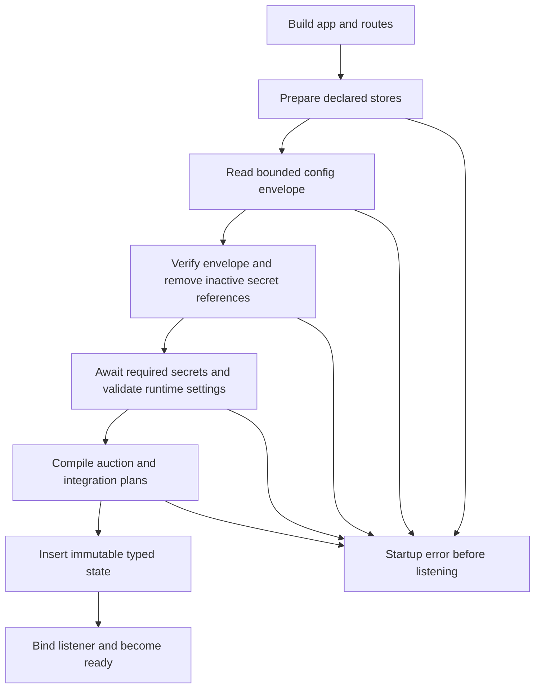

# EdgeZero RC431 compatibility and native demo

## Contract

Start from Trusted Server main `6ef07ae52bec3e695ec57fe090243b1a281c314f`.
Use `https://github.com/IABTechLab/edgezero.git` at
`61bfe3b931fd97f5300287e4a91e33f32aa0fbee` for all six workspace declarations.
This is a temporary integration candidate, not production certification or an
implementation of the broader production-support epic #1236.

The approved handoff supplies the requirements and implementation authority.
PRs #1410, #1411, #1412 and their #777 module/configuration/permission stack are
excluded. No code or architecture from those branches is a base for this work.
Existing page rewriting, TSJS, consent and auction behavior remains the product.

## Choices

A dependency-only update leaves native startup and outbound traffic outside the
new framework guarantees. A wholesale module/configuration rewrite exceeds the
approved scope. Use narrow compatibility adapters instead, with strict native
initialization and immutable prepared-store snapshots. Remove the synchronous
snapshot bridge when TS adopts asynchronous config/secret read traits.

Keep cryptographic algorithms and serialized bytes unchanged. Align only the
shared SDK and trait identities required by RC431, including validator, Fastly
and Spin. Pin Rust to the RC toolchain. Review the resolved graph and retain one
EdgeZero Git source. An ESI dependency patch may be needed for Fastly SDK identity;
use the existing reviewed dependency-only patch from #1123, not its EdgeZero tag.

## Native startup and state

Production routes must not load environment-backed TS settings or capture a
startup-error state. Define the route graph independently of initialization.
Resolve typed application state from the request for handlers and middleware.
Native preflight also requires an absolute HTTP/HTTPS publisher origin URI.
Keep explicit-settings/services builders as test seams.

Use `run_production_app_with_initializer`, retaining the framework App, platform,
clock and policies. Only declared logical IDs may be read. Metadata and manifest
must agree, enforced by a test. A selected provider error is fatal; no legacy
`TRUSTED_SERVER_*` fallback. Local config uses a key-to-string map containing the
existing TS BlobEnvelope. AppConfig supplies the envelope document itself.

Await finite required inputs at startup and preserve TS's envelope verification,
inactive-reference cleanup and resolved-runtime validation. Generic deploy
validation is not a substitute. Synchronous request consumers receive immutable
read-only maps. No arbitrary provider `block_on` is allowed in handlers. Missing
snapshot values are errors, and management writes remain unsupported.

The minimum demo omits signing and mutable integration-specific external stores.
If a selected configuration requires signing or another undeclared store, reject
it before listening with an actionable error. Supporting signing requires a
separate bounded addition declaring `jwks_store` and `signing_keys`, validating
all KIDs and matching public/private material before ready. Do not silently
serve incomplete signing or automatic rotation.

Reuse dependency handles, but derive client metadata per request. Do not install
one startup RuntimeServices value with a fixed client IP in production. Native
readiness follows successful initialization and framework listener readiness;
liveness does not imply valid application configuration. Use RC signal/drain
ownership and prove bounded SIGTERM behavior.

## Bodies, request heads and adapters

Consume owned bodies through exhaustive `BodyContent`; preserve managed inbound
limits and provenance during reconstruction. External-error streams use
`from_external_stream`. Chunk polling must remain cancellation-safe. Propagate
fallible body/request extraction. Head-only sanitation/auth helpers must work
without extracting or replacing managed bodies. Existing buffered JSON API
handlers receive bounded context-cached bodies before reconstruction, under
limits exported by their core handlers. Publisher/proxy streaming bodies remain
lazy. Raw streams cannot silently become empty auction or batch-sync input.

Axum receives the full strict startup migration. Fastly, Cloudflare and Spin
must use the same RC and preserve current behavior, subject to the explicit
Spin host-version migration below. An upstream API gap or a required wider
redesign is a blocker to report, not permission to weaken the contract.

Fastly retains the SDK serving loop and sandbox retirement policy. Replace its
routed custom dispatcher and writer with
`send_request_with_registries_and_hooks`. Preparation sanitizes trust headers
and inserts checked client/TLS/device metadata without reading the body. The
borrowed-response finalizer preserves TS's header, EC, asset-policy, terminal
privacy and sandbox-counter order. It returns only owned pull-sync inputs.
The RC owns actual transmission and completion. Never send another response
after it returns an error. Pull sync requires an observed Completed Application
egress report, not merely `Ok(Some(state))`, which can also mean a fallback was
sent. A bounded retained-app observer may record that terminal fact because the
SDK sandbox callback exclusively borrows the sandbox and runs serially; reset
it before each dispatch and retain no body or native resource. Detached refusal,
fallback and delivery failure must not run pull sync.

The existing `/health`, `/_ts/debug/ja4` and feature-gated sandbox metrics probes,
including their early errors, remain raw SDK exceptions outside RC admission
and egress accounting to preserve app-build-free probes. App construction must
install FASTLY_PLATFORM before fallible configure, propagate errors, and reject
replacement of that metadata.

Spin selects exact SDK 7.0.0, Rust `wasm32-wasip2`, the P3 `wasi:http` 0.3.0
interface and Spin >=4.1.0. Fastly stays on wasip1. Update Spin aliases, component
artifact paths, manifests, CI and operator docs together. Return the concrete RC
SpinResponse so the framework's response ownership is visible. Inspect the
emitted component interface and run it under the selected Spin host; compile
and native tests do not establish host compatibility.

Spin SDK7 config/variable reads are asynchronous. Do not keep provider block_on
in routes or handlers. Use invocation-local async bootstrap with bounded finite
reads and immutable snapshots for synchronous TS consumers. Preserve the
existing encoded store/key variable naming, not the RC flat lowercase secret
convention. An initial pre-dispatch bootstrap may fail without routed admission;
name and test that exception rather than implying it has the RC request-body
lifecycle. Preserve currently supported signing/JWKS reads when configured on
Spin, independently of the native demo's signing exclusion. No global cache of
live SDK resources or pending provider work is allowed.

## Native HTTP and ingress

Bridge TS's native HTTP abstraction to the request-scoped RC client. Retain TS
allowlists and per-hop redirect policy, POST replay, duplicate Set-Cookie,
bodyless responses, codec ownership and caller byte limits. RC batch indices,
cutoffs and driver failure need explicit TS pending/select semantics. One layer
owns cancellation and one owns transmission completion; returning a handler is
not delivery completion. Use the app clock for deadlines.

Before accepting pooled transport, reproduce truncated POST followed by the
Next.js server-action/API sequence. Test real native requests for redirects,
disallowed origins, response limits, timeout, disconnect and streaming cleanup.

Use checked `NativeIngressMetadata` for client IP and public host/scheme.
Normalize neutral RequestInfo, URI and Host together so URI-based consumers
cannot prefer a spoofed absolute-form scheme over checked ingress facts. Do not
trust raw Forwarded families, which the runner strips. Direct spoofing must not
change public URL or cookie behavior. Explicitly trusted proxies may supply that
metadata. Test two different clients for request-local isolation. Reader geo
remains unavailable on native; AWS region does not change consent, which stays
fail-closed.

## Providers and publication input

Add default-off native server features forwarding `aws-appconfig-agent`,
`aws-secrets-manager`, and independent `aws-dynamodb` only when KV is wired.
CLI features do not compile server providers. Keep AWS dependencies out of WASM
builds. Use recognized manifest build/run shapes or explicit Docker features.

Exercise real TS envelopes and secret references with local stores, then
account-free independent provider fixtures using synthetic credentials and
isolated state. Reject selected-provider failures without fallback. Running
snapshots do not change until restart. Secrets Manager returns whole values,
not selected JSON fields. Existing `ts config push` exports a local envelope;
it is not an AWS publisher. Document extraction of that same envelope as the
operator publication input, not a new format.

If generic KV is included, verify read/write, TTL, pagination and persistence.
Do not claim DynamoDB ordinary KV implements an EC graph, CAS, generations or
exactly-once semantics.

## Container and rollout

After native acceptance, build fresh embedded JS bundles with pinned Node and
locked dependencies, then a locked Rust release binary for the actual TS bin.
Use the RC hardened runtime recipe with CA roots, numeric non-root identity,
read-only root and explicit runtime-only configuration and writable mounts.
No Rust, Node, credentials or operator configuration belongs in the runtime.
Validate non-loopback reachability, invalid-input failure before listen and
in-flight bounded SIGTERM. Record tested architecture.

This changes native launch configuration from the old development environment
bridge to prepared stores. Update launchers and smoke expectations explicitly;
accepting any HTTP response as readiness would hide initialization failures.
Keep cloud provisioning, AWS deployment, registry publication, release automation,
new identity endpoints, module frameworks, cookie issuance, alternate asset
routing and live vendor integrations outside this PR.

## Proof and delivery

Maintain an exact-command ledger with tested revision/input fingerprint, outcome
and log. First reach a core compiler checkpoint, then native API compilation and
focused body/proxy/auth tests. Prove fail-before-listen and real TS routes using
subprocesses with poisoned legacy environment values. Add provider and transport
regressions at their behavioral checkpoints.

At integration checkpoints run applicable repository gates in AGENTS.md,
including all target checks/lints/tests, parity, JS, build-digest, docs and static
checks. Unavailable tooling and pre-existing failures remain named coverage gaps.
Framework RC evidence is not TS acceptance evidence.

Fastly proof includes preparation/finalization order, duplicate Set-Cookie,
stream success/failure and exactly one terminal completion, detached refusal,
late privacy effects, post-send gating, failed-build retry, probe laziness and
default/reusable sandbox modes. Spin proof includes the emitted component
interface, real config envelope and encoded variables, missing required secret,
pending read/deadline behavior, configured signing reads and two isolated
invocations. Unavailable compatible runtime tooling remains a named gap.

Review the complete diff, commit only this task's files, push
`rc/edgezero-431-demo`, and open a draft PR against main. Include exact SHAs,
excluded scope, observed outcomes and unresolved checks. Use Refs rather than
closing broad production issues. Leave reviewers and auto-merge unset.

## Review log

- Round 1, independent Pi agent using openai-codex/gpt-6.1-sol. Found ambiguous
  Fastly transmission ownership and fallback/post-send behavior, and missing
  Spin target/host/async-read contracts. Spec now selects closed RC transmission,
  Completed Application gating, named raw-probe exceptions, and the SDK7
  wasip2/P3/Spin 4.1 migration with invocation-local async bootstrap. No upstream
  API defect was established. Source/path review only, not runtime evidence.
- Round 2, fresh independent Pi agent using openai-codex/gpt-6.1-sol. Verified
  the revised Fastly observer gate, serial callback assumption, probe exceptions,
  and Spin SDK7 target/async bootstrap contracts against the exact RC and SDK
  sources. No remaining design blocker or demonstrated upstream API gap. Runtime
  and implementation acceptance remain separate required checks.
