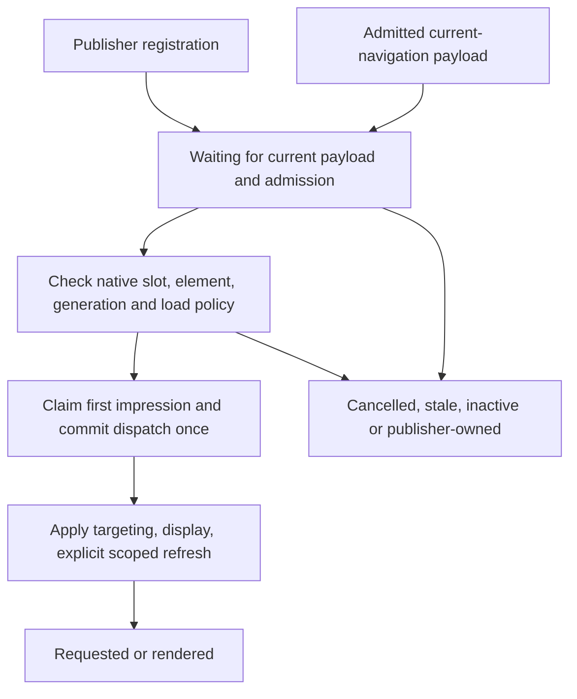

# Publisher-registered initial GPT delivery

Status: [Independently re-reviewed](../reviews/2026-10-27-854-publisher-registered-initial-delivery-rereview.md); A1 through A4 resolved at documentation level. The user separately authorized implementation and a draft PR on 2026-10-27. See the [plan](../plans/2026-10-27-854-publisher-registered-initial-delivery-plan.md) for execution status.

Issue: [#854](https://github.com/IABTechLab/trusted-server/issues/854).

Base: `5bc38862512c5c71085b5052bc3e528ee9b9987d`.

This specifies the publisher-registration portion of #854. The user expanded
PR #1460 on 2026-10-29 to include dependency-safe runtime deferral, explicit
responsive reservation and before/after lab measurements. See the
[CWV completion design](2026-10-29-854-client-cwv-completion-design.md) for that
scope. The original exclusions below describe this registration design, not the
expanded PR. It supplements the existing
[slot handoff design](2026-07-24-prevent-duplicate-gpt-slot-requests-design.md)
without replacing its default automatic mode.

## 1. Problem and evidence

The current automatic initializer can request an ad in a server-rendered slot
before a framework establishes its final element ID and size list. A later
publisher definition can create a second native GPT slot for that placement.
Changed-ID handoff currently requires serialized size-array equality. Reordered
or narrowed sizes do not match. Matching sizes alone is insufficient: reusing a
native slot associated with a removed element does not establish visible delivery
in a replacement element.

Prior local experiments exercised the actual bootstrap and built runtime with a
transport-only GPT stub. Reordered and narrowed sizes produced another request
after explicit element replacement. The identical-size control suppressed a
request but did not preserve creative nodes after full-subtree replacement. The
stub did not implement ownership suppression. A separate approved live observation
showed an early TS-marked header request followed by a publisher batch containing
a header with a changed ID and narrower sizes. Post-load observation could not
distinguish node replacement from renaming. The deployed bootstrap fingerprint
differed from the checkout, so production causality is not established solely by
the local reproduction.

The previous experimental tooling remains uncommitted in the original checkout.
It is not present in this clean worktree and is not an implementation dependency.
New regression coverage must be reproducible from this branch alone. No customer
domains, identifiers, targeting values, or raw browser captures belong in Git.

### GPT constraints

- A slot's `getSlotElementId()` returns its originally defined element ID. No
  public rebinding API is documented.
- `display()` requires a defined slot and a present element. Each slot should be
  displayed once.
- Removing a slot div without first destroying the slot is documented undefined
  behavior.
- With initial loading enabled, SRA can fetch other unfetched slots during
  `display()`. Therefore v1 of this opt-in mode requires effective initial loading
  to be disabled before services are enabled. TS must not change that setting.
- Disabled initial load separates `display()` registration from the explicit
  `refresh([slot])` request. This also allows selection of an SRA batch without
  requesting unrelated defined slots.

References: [GPT reference](https://developers.google.com/publisher-tag/reference),
[loading and refresh](https://developers.google.com/publisher-tag/guides/control-ad-loading),
[React integration guidance](https://developers.google.com/publisher-tag/samples/integrations/react),
and [SRA batching](https://developers.google.com/publisher-tag/samples/control-sra-batching).

## 2. Outcome and scope

For an opted-in placement, TS must not define a fallback slot or request an ad
until both the current navigation's admitted server payload and an explicit
publisher registration are available. It then requests the publisher's live
native slot once, with eligible TS targeting applied before the request.

This requires publisher integration. A timeout, `window.load`, two animation
frames, or temporary DOM stability cannot prove that a framework has finished
replacing a placement. The existing load/frame scheduler remains for automatic
placements; it is not a readiness signal for this mode.

### In scope

- One per-placement opt-in setting, its wire representation, and a public
  publisher registration API.
- A shared bootstrap/runtime registration protocol and current-navigation payload
  admission, including initial inline, shared-template and SPA delivery paths.
- Explicit scoped delivery, initial-claim arbitration, targeting compatibility,
  cancellation and navigation invalidation.
- A fictional React/Next.js publisher integration, browser regressions and CI
  evidence from actual generated HTML and built artifacts.
- An operator/publisher integration guide and a real-GPT staging verification gate.

### Not in scope

- Deferring the main bundle, adding min-height rules, changing auction selection,
  changing page-level SRA or initial-load policy, or fixing the publisher's React
  hydration errors.
- Sorting formats as an automatic-mode fix, broadening publisher formats, aliasing
  a native slot to a different DOM element, moving rendered creative iframes, or
  deduplicating placements by GAM unit path.
- Preventing arbitrary publisher code from making its own requests. Publishers
  using this mode explicitly delegate initial delivery to TS.
- Preserving a creative through arbitrary post-request subtree replacement.
  Supported publishers keep the element alive until explicit teardown.
- General TS ownership of publisher-slot destruction or a new refresh-auction
  mechanism.

## 3. Configuration and wire contract

Add an `initialization` enum to each creative-opportunity slot:

| Value                  | Meaning                                                                                           |
| ---------------------- | ------------------------------------------------------------------------------------------------- |
| `auto`                 | Existing automatic behavior. Default when absent.                                                 |
| `publisher_registered` | Publisher defines the final native slot; TS waits for explicit registration and admitted payload. |

Example, using fictional inventory:

```toml
[[creative_opportunities.slot]]
id = "header"
div_id = "example-header-"
page_patterns = ["/example/*"]
formats = [{ width = 300, height = 250 }, { width = 300, height = 600 }]
initialization = "publisher_registered"
```

Unknown enum values are configuration errors. Serialize the field into the
client slot only when non-default, preserving the existing automatic wire shape.
Use the same `build_slot_json` path for initial documents and SPA responses.
The setting affects delivery only. It does not independently enable templates,
auctions, consent, or an otherwise gated slot.

Old documents and placements without the field continue to behave exactly as
before. Activation requires a matched server/bootstrap/runtime/publisher release;
new configuration must not be served with older code that ignores the mode.

## 4. Public publisher contract

The bootstrap and runtime expose protocol version 1 and the same API:

```ts
interface PublisherSlotRegistrationOptions {
  slotId: string
  gptSlot: PublisherGptSlot
  navigationGeneration: number
  eligibleFormats: ReadonlyArray<readonly [number, number]>
}

interface PublisherSlotRegistration {
  getStatus(): PublisherSlotRegistrationStatus
  cancel(): void
}

// Public window.tsjs API:
// publisherSlotRegistrationVersion === 1
// registerPublisherSlot(options): PublisherSlotRegistration
```

`PublisherGptSlot` is the minimum structural public GPT interface needed by the
implementation. Do not expose private GPT internals or use `any`.

`eligibleFormats` is the publisher's finite eligible creative sizes for the
selected breakpoint, using the same values that feed its slot definition or size
mapping. The publisher remains responsible for that mapping. An empty list permits
GAM delivery but no TS bid candidate. This is not a second TS size-mapping engine.
The API never changes the native slot's sizes. Values must be finite positive
integer pairs; deduplicate only for eligibility comparison, not to rewrite GPT.

This snapshot must remain valid until dispatch. While a registration is pending,
the publisher adapter must synchronously cancel and re-register when its effective
eligible set changes, including a breakpoint change while the document is hidden.
Update from the publisher's own mapping-change/visibility handlers before allowing
foreground delivery, not from a later passive React effect. A set-equivalent
reordering does not change eligibility. TS does not poll the viewport or implement
a second responsive mapping engine. See section 8 for cancellation boundaries.

### Preconditions

The publisher must:

1. Configure initial load disabled before enabling services. Configure SRA and
   other service policy itself. TS does not enable services for this mode.
2. Mount the final slot element, define its native GPT slot, add PubAdsService,
   and enable services through GPT's command queue.
3. Capture `tsjs.navGeneration ?? 0` before queuing work that may run later. Pass
   that captured generation, not a fresh value inside an old callback.
4. Call the API before any `display`, request, or initial publisher auction for
   this placement. Delegate that first delivery to TS, including when it has no
   eligible bid. Do not independently run a first Prebid delivery for it.
5. Keep the same connected element and ID through request/render. Cancel pending
   TS work and call GPT destruction before removing the native slot's element.
   TS does not destroy a publisher-owned slot.
6. Keep pending size eligibility current under the cancellation/re-registration
   contract above. Once dispatch begins, the request is consumed; a later resize
   belongs to the publisher's normal responsive/refresh lifecycle, not a new TS
   initial request.

GPT does not expose a reliable public "already displayed but not requested" flag.
The fourth precondition is an integration contract, not a claim that the API can
prove every historical call. An observed prior publisher claim/request must make
TS stand down without overwriting targeting.

A synchronous invalid call returns a rejected handle without native GPT delivery
calls. A successful registration is not permission to request yet. Its status
may remain waiting while the payload is pending. Cancellation is explicit; no
arbitrary grace-period or retry timer changes ownership.

### Publisher example shape

The integration guide will show one stable mounted element and one native slot.
The publisher captures generation before its GPT callback, uses one `formats`
variable for native setup and `eligibleFormats`, then calls registration. It does
not call `display` or the initial `refresh` after that handover. A component tracks
the returned handle and native slot for cancellation and teardown. A real
framework fixture must prove cleanup occurs before DOM removal, rather than
assuming ordinary effect cleanup has that ordering. The adapter also owns its
mapping-change subscriptions. While waiting for payload or foreground delivery,
it cancels the old handle before registering changed eligibility for the same
native slot and element, and removes those subscriptions on teardown.

The production publisher source is outside this repository. The PR can verify
the API and example; the affected site is fixed only after its adapter adopts
this contract and passes the staging gate.

## 5. Registration identity and state

Store live records on `window.tsjs`, shared by bootstrap and runtime, not only in
module-local variables. A record is keyed by navigation generation and logical
configured slot ID. It retains the exact native GPT object, the exact current
element object and ID, eligible-format snapshot, status, and cancellation token.
Native objects are browser-local state, never serialized into a server payload or
an existing diagnostics export.

A repeated call with the same generation, slot ID, native slot, element and
set-equivalent finite eligibility snapshot returns a handle for the same record. It must not enqueue another
request. A conflicting active registration is rejected; the publisher must cancel
a pending record before replacing it. Once dispatch is committed, the logical
placement remains consumed for that navigation even if its element disappears.
A physical-element change cannot reopen that initial request.



Statuses are a discriminated result, with reason codes where needed:

- `waiting_payload`: no authoritative payload settlement for this generation.
- `waiting_delivery`: admitted registration queued for foreground delivery.
- `dispatching`: first-impression claim consumed; no automatic retry is allowed.
- `requested`: the initial native invocation has been submitted.
- `rendered`: a matching GPT render event was observed.
- `inactive`: payload excluded the slot or its mode was not this mode.
- `publisher_owned`: an earlier valid publisher auction/request claim wins.
- `cancelled`: pending work was explicitly cancelled, invalidated by navigation,
  or lost its element/native slot before dispatch.
- `rejected`: invalid arguments, generation, conflicting registration, or enabled/
  unknown initial-load policy. No ownership is acquired.
- `failed_after_dispatch`: a delivery call threw after dispatch began. Do not
  assume no request occurred, release the claim, or retry automatically.

Status is useful integration feedback, not a request source inferred from later
render events. Optional diagnostics must never determine delivery admission.

## 6. Joining registration with admitted payload

Neither `tsjs.adSlots` defaults nor a head slot list proves the auction/template/
consent gate has admitted delivery. Track authoritative payload settlement for
its generation explicitly.

### Initial document

The existing `scheduleInitialAdInit` entrypoint accepts slots and bids under its
existing generation-0 and first-call checks. Once it actually accepts that
payload, publish settlement to the registration join. Head-only configuration,
core defaults, duplicate scheduler calls and discarded SSR payloads do not settle
a new payload. Preserve initial slots omitted versus explicitly empty semantics.

For shared-template assembly, `initialSlots: []` settles with no eligible TS
placements. For an inline page that never emits a bids seam because no ad stack
was admitted, registrations remain waiting until cancellation; they must not
infer permission from `load` or request anyway.

### SPA navigation

At accepted navigation, capture and clear the old generation's automatic and
registered targeting/mapping bookkeeping before invalidating its registration
records and resetting payload admission. If GPT cleanup is queued, retain the old
key/native-identity snapshot and order cleanup before new-generation delivery;
never derive old cleanup from a newer route's records. Then invalidate old records
before queuing any work for the new generation. Accept new registration calls
with that generation while page-bids is pending. Settle admission only after the
existing endpoint response and generation checks accept slots/bids. Empty admitted
responses settle inactive; failed/aborted responses do not authorize a request.
Old command-queue callbacks, payloads, handles and cancelled frame callbacks must
not operate on the new record or route. Returning to the same pathname still uses
navigation generation, not URL equality, for identity.

Automatic placements retain their existing DOM wait and initialization behavior.
Registered-only SPA routes must not wait on the automatic all-slots DOM heuristic
before publishing an otherwise accepted payload. Mixed routes must not let one
registered missing element delay admission or the existing automatic work.

### Dispatch checks

Immediately before mutation, recheck:

- The generation and registration token are current and the record is unconsumed.
- The accepted payload still admits this slot in `publisher_registered` mode.
- The original element is connected, its ID is unchanged, and exact ID lookup
  yields that same element with no duplicate DOM ID.
- The offered native object is still in `pubads().getSlots()`, uses that exact
  element ID, and its ad-unit path equals the configured rendered path.
- Effective initial load is known disabled via the supported GPT getter or the
  existing observed legacy disable hook. Recheck policy at dispatch as well as
  registration. Unknown is not permission to send an uncontrolled display.
- The existing first-impression registry permits TS to claim the untouched slot.

Use existing foreground/rAF behavior to avoid spending initial requests in hidden
documents. Frames are delivery scheduling, not proof of framework readiness.
There is no timer fallback, whole-page reinitialization, or implicit alias to a
new element if a check fails.

## 7. Initial delivery and bid eligibility

Once dispatch is committed:

1. Reuse the offered native slot. Never call `defineSlot`, create a late-handoff
   record, or add this slot to `prevGptSlots` for TS destruction.
2. Apply configured slot targeting and `ts_initial=1` using existing targeting and
   render-bridge bookkeeping. Preserve unrelated publisher targeting keys.
3. Apply TS `hb_*` candidate targeting only if the TS renderer capability is
   installed, finite positive winning `w`/`h` are available, and those dimensions
   match both a configured format and a declared eligible final publisher format. Reordered sets do not change that eligibility. If dimensions
   are absent, incompatible or only fluid size is known, do not apply that TS bid
   or its renderable-candidate correlation. Continue normal GAM delivery once.
   Do not substitute the first configured size or broaden publisher formats.
4. Register exactly once with `display(actualId)` and request with
   `pubads().refresh([offeredSlot])`. The publisher already enabled services and
   disabled initial load. Do not call `enableSingleRequest`, `enableServices`, or
   a global refresh here.
5. Scope the existing `gptSlotHandoffInternal` and `adInitRefreshInProgress`
   bypasses with `try/finally`. Real Prebid refresh wrappers must forward this
   first delivery without clearing TS targeting or running a new auction.
6. Leave genuinely later publisher refreshes, auction ownership, refresh options
   and unrelated slots untouched. Do not install a one-shot publisher-refresh
   suppression for these registrations: the publisher delegated the first call
   and does not have a first call to suppress.

The automatic initializer and its retry/fallback paths must skip registered slots
before claiming, defining, refreshing, or treating them as renderable work. The
new mode must not be reachable through a legacy changed-ID alias. Existing automatic
behavior and its handoff policy remain unchanged in this PR.

Rejected candidate targeting must not break the existing renderer for automatic
placements or alter auction results stored by the server. Registered-slot render
correlation must not later reinterpret an excluded bid as the selected candidate.

### Renderer-unavailable degradation

The runtime publishes `tsRenderBridgeVersion === 1` on shared `window.tsjs` only
after its TS creative message handler is installed. The marker is an internal
capability signal for this matched release, not a substitute for installing or
testing the handler. Reinstallation must not reset or duplicate the handler. The
bootstrap does not claim this capability and does not add a creative renderer.

If that capability is absent at registered dispatch, omit TS candidate `hb_*`
targeting and candidate/render correlation even when a fitting server bid exists.
Make the single ordinary scoped GAM request with non-candidate slot targeting.
Actual GAM may return a publisher creative or no-fill; the guarantee is a valid
request path without selecting a TS creative that this code cannot render, not
guaranteed ad fill. Record a no-candidate reason without exposing bid payloads.

The delivery remains consumed if the runtime arrives later. Do not add TS
candidate targeting retroactively, refresh to replace this first delivery, or
resurrect it through the global retained bid map. A registration still waiting
when the real renderer installs may use its eligible TS bid at its eventual
single dispatch. The tradeoff is explicit: bootstrap-only ordinary-GAM delivery
gives up TS demand participation in exchange for avoiding an unrenderable TS fill.
This policy changes only the new registered mode, not legacy automatic behavior.

### Ownership of mapping and cleanup writes

The public `divToSlotId` and `prevSlotTargetingKeys` maps represent both automatic
and registered deliveries for the current generation. Registration records are
the source of their registered entries, including consumed/cancelled-after-dispatch
records whose live slot still needs correlation or later targeting cleanup. Do
not add another independent mutable registered-mapping registry.

An automatic pass replaces only its automatic entries, then retains/derives the
current-generation registered entries from those records. A registered dispatch
updates only its owned entries and leaves automatic and other registered entries
intact. Both paths use this same ownership rule in bootstrap and runtime. An empty
automatic pass on a registered-only page must not clear registered mappings.

Navigation snapshots and clears both owners before retiring the old records; no
old-generation merge is allowed. Registered slots remain absent from
`prevGptSlots`, so retaining cleanup metadata never transfers native destruction
to TS. Tests must cover either dispatch order, a registered-only page, a mixed SPA
route, an accepted final ID outside the configured prefix, and cleanup of the
registered TS targeting on the next navigation. Exact render lookup must not
depend on a configured-prefix fallback surviving a whole-map overwrite.

## 8. Cancellation, teardown and replacement

For a pending eligibility change, the publisher cancels before registering the
replacement snapshot, including when the native slot and element are unchanged.
Every queued payload/foreground callback checks its own record token again. Old
callbacks and old handles cannot request, clear, or cancel replacement work. The
publisher's mapping-change handling must run before dispatch, including after a
hidden-tab breakpoint change. No native destruction is needed solely to replace
an unconsumed eligibility snapshot on the same live slot.

Before dispatch, `cancel()` invalidates only its own record/token. It prevents
queued work, removes retained native/element references when safe, and permits a
new explicit registration for that unconsumed logical placement. It does not call
GPT, destroy a slot or transfer ownership to another element.

After dispatch, cancellation cannot undo a request. It stops future registration
work and releases no claim for another initial TS delivery. Retain only the
minimal consumed marker needed through that navigation; keep correlation needed
by the current render bridge until its existing lifecycle ends.

The publisher owns native teardown. Destroy before removing the div. A later
intentional replacement may require a new publisher-owned request; it is outside
the promise of preserving one initial ad through arbitrary DOM replacement. TS
must not quietly create another fallback or pretend that returning an old native
object proves a creative is visible in a new element.

## 9. Bootstrap/runtime protocol

The inline bootstrap installs API version 1 even when no payload is available.
The full bundle fills in the same API and adopts existing records, handle status,
payload generation, cancellation tokens and committed-delivery markers.

Queued bootstrap callbacks resolve the current shared dispatcher rather than
retaining an independent request loop after runtime installation. The native slot
and element references are the same objects in the browser realm.

The bootstrap must observe successful pathname-changing history operations and
`popstate` before the optional runtime arrives. Its provisional handler snapshots
cleanup, advances the existing navigation generation and invalidates old admission;
it does not fetch bids. The runtime takes over the same navigation bridge without
a second listener or generation increment. If navigation happened before takeover,
it reuses the existing page-bids operation to obtain the current generation's
payload, preserving waiting registrations and handles. Without such navigation,
runtime installation must not start another auction. Same-path query/hash changes
retain existing policy, while a pathname round trip advances the generation twice.
This also drops stale generation-zero automatic callbacks, fulfilling the existing
stale-SSR guard rather than authorizing an old-route fallback. Installing or
reinstalling the runtime cannot reset statuses, add wrappers twice, re-display,
re-request, lose a pending registration, or adopt stale SSR payload.

Both implementations must pass the same executable registration contract cases.
Prefer a small shared pure module if the current build pipeline can emit it into
the inline bootstrap without adding parser-blocking dependencies. Otherwise keep
the current deliberate duplication with parity tests; do not turn this PR into a
bootstrap build-system migration.

## 10. Compatibility and rollout

- Default `auto` behavior, existing wire shape, script order, auction gates,
  diagnostics activation and TS-only fallback remain unchanged.
- Registered mode v1 requires initial load already disabled. Enabled or
  unverifiable policy is a tested rejection, not a silent global change.
- Publish code with the mode unused first. Verify the HTML bootstrap, selected
  built assets and publisher adapter all implement protocol version 1. Only then
  activate selected placements and routes with the matching publisher adapter.
- The adapter must not treat every rejected/inactive registration as permission to
  run a second first impression. Define its rollback/legacy path as a separate
  release decision, not an asynchronous API-error callback that might race TS.
- Do not change initialization mode mid-document. Stop new opt-in assignments and
  serve a previously compatible server/adapter/configuration pair on rollback;
  already-open documents retain their agreed owner.
- Production adoption and deployment are separate approvals from implementing or
  merging this repository PR.

## 11. Verification and acceptance

Source inspection and simulated transport counts are not sufficient on their own.
The implementation plan must deliver all of the following:

1. Baseline reproduction of automatic changed-ID/reordered/narrowed-size requests,
   with an explicit note that a matching old slot does not prove a visible ad.
2. Failing-then-passing API/serializer tests and bootstrap/runtime parity for both
   payload arrival orders, repeated registration, cancellation and navigation.
3. Zero requests or fallback definitions for registered placeholders before final
   registration and current admitted payload. Exactly one intended per-slot
   request afterwards, with targeting at native invocation and a visible creative
   in the final registered element when the test ad server returns a fill. Cover
   registered dispatch before and after automatic initialization, including a
   registered-only page and next-navigation cleanup.
4. Known disabled load required; enabled/unknown state and changes while waiting
   reject without new requests. Model SRA with unrelated unfetched slots so an
   unsafe `display` cannot pass a permissive fake.
5. Missing/no-fill/incompatible TS bids and an unavailable renderer still give one
   ordinary scoped GAM request, with no ineligible TS creative correlation. Assert
   visible publisher creative content when the fixture supplies a fill; accept an
   explicit GAM no-fill as empty, not a TS renderer failure. Prior publisher claims
   are not overwritten or followed by a competing TS request.
6. Real Prebid plus Universal Creative in the browser fixture: first TS delivery
   bypasses refresh auctions; a later publisher refresh still runs normally. An
   inert external Prebid stub cannot satisfy this gate. Separately prove real
   ordinary creative content with no TS bridge installed, and no extra request or
   candidate resurrection when the bridge later installs.
7. Real Next.js/React mount, delayed hydration, changed pre-registration IDs,
   responsive narrowing, cancellation and teardown ordering. Include effective
   eligibility changes while waiting for payload and while hidden: cancel the old
   token, re-register the current set, reject old callbacks, and dispatch once. Assert native object
   identity, final-element identity and visible creative content independently.
8. Broader required project checks on the exact combined revision. Existing
   failures must be reproduced on the clean base and resolved or explicitly
   reviewed; do not convert timed-out/incomplete checks into passes.
9. A separately approved real-GPT staging canary on the exact deployed artifacts,
   covering one initial request, targeting and visible rendering, plus a later
   legitimate refresh and an unrelated slot. Record commit, bootstrap/asset hashes,
   deployment mapping, settings and observation window. No production CWV claim is
   required for this correctness PR.

### Local provider transport for the framework gate

The application provider keeps a canonical fictional HTTPS endpoint and
`certificate_check: true`. The isolated Viceroy 0.17.0 fixture maps the exact
production-predicted provider backend names to the plaintext loopback Next.js
auction route through static local backend configuration. Include all reachable
Fastly transport-timeout buckets; provider budget changes must not escape the
mapping. Generate names with the shared naming/canonicalization policy, never a
copied hash algorithm or one assumed timeout.

This overrides transport only in the generated test Viceroy configuration. Do not
relax HTTPS validation, change application provider endpoints to HTTP, disable
certificate checks, or add a production provider implementation. A mandatory
configuration/provider smoke preflight must prove the static-name collision is
reused and an actual Rust provider request reaches the local route and is admitted.
Source inspection supports this arrangement, but runtime success is not claimed
until that preflight runs. If it fails, stop before delivery implementation and
review the fixture transport instead of weakening validation.

The PR may merge only when its code/fixture/CI gates pass and its publisher contract
is documented. It must not be described as fixing the affected live site, closing
all of #854, or being production-verified until the adoption and real-GPT gate have
actually passed. If real-GPT validation is unavailable, record it as a deployment
blocker rather than silently substituting fake request counts.

## 12. Decisions requiring reviewer scrutiny

- Is explicit publisher registration the smallest contract that removes the race
  without inventing a hydration heuristic?
- Is disabled-load-only v1 sufficient and accurately scoped, given SRA behavior?
- Are payload admission and navigation identity shared with existing paths rather
  than maintained by another scheduler?
- Do consumed placement identity, cancellation and rendering correlation prevent
  both duplicate delivery and a misleading one-request/blank-creative result?
- Does candidate eligibility avoid serving a broad-config winner into a narrowed
  publisher placement without turning this into a new responsive-auction system?
