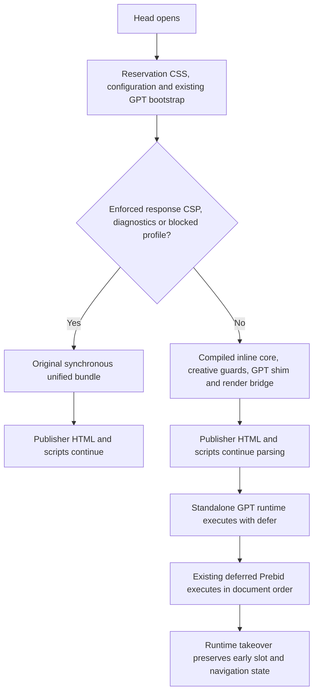

# Client CWV and initial-delivery completion for issue 854

Status: Implemented and locally validated after merging main in code commit `7b83a8ce87e773e2234a6dde7380a123f36e7d1f`. The user authorized specification, measurement, implementation, validation and pushing the existing PR on 2026-10-29. Hosted CI and real-GPT/field validation are separate checks; see the validation record.
Issue: https://github.com/IABTechLab/trusted-server/issues/854
PR: https://github.com/IABTechLab/trusted-server/pull/1460
Baseline: `c36c82df43c2f62a59444290f863f736b579ed33`.

## Outcome

Extend the existing publisher-registration PR with dependency-safe runtime deferral, explicit responsive slot-space reservation, and repeatable before/after browser measurements. Preserve the first-impression ownership contract. Report measured effects and blocking dependencies, not a guaranteed CWV improvement.

The earlier registration design remains authoritative for registration, payload admission, cancellation, targeting and navigation generations. This document supersedes its exclusion of bundle deferral and reservation from this PR. Production deployment, publisher activation and real-GPT staging are not authorized by a request to implement and push code.

## Invariants

- Early publisher code retains working synchronous core APIs and its existing command-queue semantics.
- Dynamic GPT scripts are intercepted before insertion and eligible creatives have a working render bridge before any TS initial request.
- Delaying the runtime must not consume a registration as renderer-unavailable merely because that runtime has not arrived.
- Runtime takeover must not create another initial request, lose registrations, replay stale payloads or erase early configuration.
- CSS reservation is path/config-derived and visitor-neutral. It never depends on consent, auction outcome, bot classification or per-user bids.
- No reservation is inferred from an arbitrary supported format list. Unconfigured placements retain their layout.
- Browser claims distinguish parser/paint timing, ad timing, request count, controlled layout shift and production field CWV.

## 1. Loading architecture

Supported default profile: no enforced response CSP, GPT enabled with core/creative and optionally the existing separately deferred Prebid integration, plus integrations with no JavaScript or early head dependency. Use an explicit allowlist after inspecting the registry. Unknown JS integrations are not silently deferred. Pages without GPT retain the existing synchronous bundle rather than receive unused GPT bootstrap code.



Compile an early entry from the real shared TypeScript implementation, rather than writing another hand-maintained protocol. Extract GPT shim and rendering helpers into modules used by both entry points. Early entry installs the real core APIs, creative interception, GPT command/script guard, attribution and render bridge. Existing inline GPT bootstrap continues to own provisional adInit, scheduler, registration and navigation state. The deferred GPT runtime owns full adInit takeover, publisher-slot handoff, page-bids fetching and slim-Prebid lifecycle.

Keep the original unified route, module hash and synchronous tag as the fallback. Supported profiles instead emit the compiled early entry inline and a deferred, versioned standalone GPT tag. Do not initialize core twice. Standalone GPT serving is enabled only when GPT is enabled. Preserve trusted GAM attribution and APS rendering-mode attributes on executing tags. Inline compiled JS must be safe in script text, including literal closing script sequences.

The existing raw GPT bootstrap is 56,429 source bytes, not the old issue's asserted 7.3 KB. Keeping it means synchronous execution remains. Measure raw and compressed inline bytes and remaining runtime bytes. Reducing or replacing that bootstrap is not a prerequisite for correctness and must not be claimed as accomplished.

### Dependency inventory and fallback

Document every current integration's early dependency and selection outcome. Initial blockers include DataDome, Google Tag Manager, Lockr, Permutive, Didomi, Sourcepoint, Osano and Testlight. They install guards, globals, consent initialization or immediate queue behavior that cannot simply run after publisher scripts. Active request-scoped GPT diagnostics also retains synchronous loading so listeners precede publisher calls.

An enforced Content-Security-Policy response header from the origin or configured response headers also retains the original synchronous unified path. Presence is sufficient, even for a permissive policy; there is no new general CSP evaluator. Report-Only alone does not force fallback. This choice is independent of visitor/auction admission and retained in shared-template output. Header-only selection does not promise detection of policies introduced later in document markup.

This rule follows an executed review counterexample: an old deployment allowing same-origin external scripts and the old inline hashes lost core APIs when the new default inline entry was denied. Documentation alone did not preserve compatibility. The conservative fallback gives up deferral on some compatible CSP pages rather than silently require new permissions. Do not weaken CSP, add nonce handling or add an operator loading-mode flag.

Do not add parallel experimental loading modes or a new operator flag merely to conceal uncertainty. Keep fallback explicit in source and tests. Adding a newly supported profile later requires ordering coverage.

### Failure behavior

Test delayed, failed and absent deferred GPT runtime. Existing early bootstrap and installed rendering support must remain usable and must not repeat delivery when the runtime catches up. No timer is proof of framework readiness. Preserve real navigation invalidation across takeover and reject stale responses.

## 2. Explicit slot-space reservation

Add optional per-placement configuration:

```toml
[[creative_opportunities.slot]]
id = "header"
page_patterns = ["/news/*"]
formats = [{ width = 300, height = 250 }, { width = 300, height = 600 }]

[creative_opportunities.slot.reservation]
element_id = "header-ad-space"
min_height = 250

[[creative_opportunities.slot.reservation.breakpoints]]
min_width = 1024
min_height = 600
```

The publisher supplies a stable wrapper with that exact ID. A framework may replace a child GPT div without changing this wrapper. Reservation does not resolve a div prefix or depend on registration's eventual element ID.

- Base height is a nonnegative integer CSS pixel value.
- Breakpoints are positive integer viewport widths with strictly increasing values and nonnegative heights. The base rule covers width zero.
- Only configured reservations for matching paths emit CSS. An absent matching element remains untouched. If multiple matching slots name the same wrapper, the first matching slot in configuration order owns its complete policy. Disjoint paths can reuse wrapper IDs.
- Emit scoped min-height rules in head before scripts. Use min-width media queries with deterministic mobile-first cascade.
- Escape IDs as CSS string content without allowing HTML style-tag termination or selector injection. Do not accept arbitrary CSS.
- No JS resize listener, mutation observer, guessed format maximum, forced width or overflow clipping.
- Preserve reservation for no-fill. Automatic collapse would itself shift content. Publishers choose whitespace tradeoffs explicitly.
- Fluid and unknown-height creatives may use explicit publisher-provided reservation, but it is not a bound on their final height and cannot guarantee zero shift.
- Omitted reservation serializes as absent. Do not change existing browser slot wire contracts or auction request formats.

Thread request path into the HTML transform separately from adSlots so inline, streaming and shared-template paths share the policy. Visitor gating must not leak into a shared template. The creative-opportunities enabled switch still disables its configured reservations. Cover query/path normalization consistently with existing slot matching and preserve nonmatching pages.

This unit reserves space for the initial document. Client-only SPA route additions need publisher-owned reservation CSS or a full document navigation; TS does not mutate head styles on navigation. Strict publisher style CSP must permit the deterministic style hash or supply equivalent reservation in an allowed stylesheet. Do not weaken CSP or inject visitor-specific nonces into shared templates.

## 3. Measurement contract

Use a loopback HTTP server, parser-created script tags, actual Rust-generated HTML and exact compiled production JS. Existing addScriptTag-based contracts remain useful for lifecycle behavior but cannot measure parser blocking.

Retain the baseline source revision, source/file fingerprints, lockfiles, browser and toolchain versions, viewport, CPU/network settings, commands and raw per-run results. Fresh browser contexts isolate cache/state. Compare baseline, deferral only, reservation only and combined behavior with repeated alternating runs. Report medians and variation, not one selected sample.

Capture FCP, LCP, DOM parse timings, raw layout-shift entries excluding recent input, proper maximum-session-window CLS, native request counts by slot, targeting at request time, and first visible ad time. Also capture reservation height/whitespace and exact inline/runtime byte counts with gzip/Brotli size. Observe shifts across multiple frames and finish pending observers before reading results.

Desktop/mobile viewports, responsive boundaries, multi-height creatives, no-fill, unknown/unreserved formats, absent/nonmatching slots, delayed creatives, framework child replacement and inline/shared output are required fixture cases. Include a controlled layout-only page that visibly reproduces the baseline shift.

Functional assertions are hard gates. Timing distributions are retained measurements; no arbitrary millisecond improvement threshold on shared CI. Fail if observers did not collect supported metrics, if the baseline does not exercise its intended blocking/shift, or if required cases were silently skipped. Controlled fixtures do not prove customer-site improvement.

## 4. Initial request and real-GPT validation

Retain existing request-count, targeting and visible-creative registration contracts, including ordinary automatic slots and publisher-owned slots. Test the new deferred loading through native browser parsing, not just direct module imports.

Use real GPT/GAM staging only with a separately approved environment. Required staging evidence: one intended initial request per delegated slot, eligible server targeting on that request, visible creative in the final element, unrelated-slot isolation and legitimate subsequent refreshes. Do not change page-level initial-load/SRA policy or trigger live customer auctions without permission.

## Acceptance and reporting

1. Supported profiles use deferred GPT runtime with real early dependencies installed; blocked integrations, diagnostics and enforced response CSP keep tested synchronous behavior and working early core APIs.
2. Explicit reservation config produces safe responsive early CSS on all relevant Rust paths, including shared templates, with unconfigured pages unchanged.
3. Baseline and changed browser measurements report both page-paint and ad-startup consequences and reproduce a controlled layout-shift improvement.
4. Existing registration contracts and affected neighboring paths pass with current artifacts.
5. Required repository build/test/lint gates run, with exact failures, baseline attribution and unavailable checks disclosed.
6. Push commits to the existing PR branch and update the PR scope/validation. Do not claim production or field validation. Keep issue closure conditional on its outstanding real-page measurement requirements if those remain unavailable.

## Related

- Registration design: [Publisher-registered initial delivery](2026-10-27-854-publisher-registered-initial-delivery-design.md).
- Plan: [Measurement, implementation and validation](../plans/2026-10-29-854-client-cwv-completion-plan.md).
- Validation: [Commands, measurements and remaining limits](../reviews/2026-10-29-854-client-cwv-validation.md).
