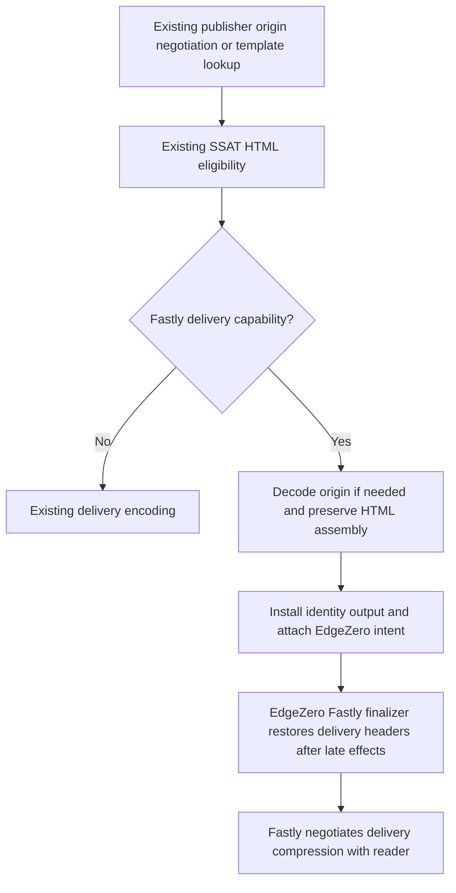

# Fastly SSAT delivery compression offload

## Goal and scope

Issue #858 and PR #884 will offload final SSAT HTML compression to Fastly on
current `main`. Preserve origin encoding negotiation and the existing rewrite,
auction, streaming, template-cache, and privacy behavior. Do not revive the
closed parser-safe streaming branch.

The July experiment measured approximately 44.6 ms versus 9.0 ms processing and
47 ms versus 19 ms Fastly vCPU, with Brotli browser delivery. That experiment
also requested identity from origin. These are historical measurements, not
proof of the output-only design's current performance.

## Decision

Automatically use Fastly dynamic delivery compression for eligible SSAT HTML.
There is no publisher opt-in or new configuration. Keep the existing restricted
origin `Accept-Encoding` negotiation. Decode supported origin encodings, rewrite
as today, and hand identity output to Fastly instead of recompressing in WASM.

Alternatives considered:

- Keep identity-origin fetching from the old PR. Rejected for this change because
  it changes origin bandwidth and representation selection independently of
  delivery offload.
- Keep a disabled-by-default publisher flag. Rejected in favor of automatic
  Fastly behavior, following the maintainer's request to remove the opt-in.
- Apply offload to every rewritten response. Rejected because this issue is
  limited to SSAT HTML and must not change assets, RSC, or ordinary proxying.

## Adapter and processing boundaries

Read `DeliveryCompressionSupport` from EdgeZero's typed request extension before
selecting the output codec. Fastly's request converter advertises `GzipBrotli`;
missing support defaults to unavailable on Axum, Cloudflare, and Spin. This is
independent of cache headers and origin-streaming support. Remove the branch-local
capability enum and publisher-options wrapper once no other option needs it.
No Fastly SDK dependency enters core.

### Framework dependency and pending output

The generic capability, checked identity-response intent, and platform header
finalizer live in [EdgeZero PR #452](https://github.com/IABTechLab/edgezero/pull/452).
Pin all six workspace EdgeZero dependencies to exact commit
`1c0f475097a813a3a9cbb7a4a121ca0523d5ed64` while the paired PRs are under review.
All eight resolved EdgeZero packages must use that one source. Move to a merged
EdgeZero release before Trusted Server becomes merge-ready; do not substitute a
mutable branch or local path.

Trusted Server owns a pending output plan through processing, template assembly,
and ordered EOF completion. Preserve-input, explicit guest encoding, and adapter
identity output are distinct choices. Template delivery must use this plan rather
than infer its encoder from response headers. Input decoding remains independent.

Only after installing completed identity bytes or the final lazy identity-producing
stream may a publisher finalizer normalize its identity metadata and call
`support.mark_identity_response`. Raw origin bodies and partially prepared
`PublisherResponse` values must not carry the final intent. The shared API rejects
unavailable support or non-identity encoding metadata without mutating the
response; propagate such errors through the existing application error boundary.
Keep all body consumption lazy where it is lazy today.

Fastly's documented dynamic delivery codecs are gzip and Brotli, not deflate.
Reuse reader negotiation to retain in-guest delivery when negotiation fails or
selects deflate. This preserves deflate-only readers, including those refusing
identity, and avoids expanding the existing malformed/unsupported-reader contract.
Successful identity, gzip, and Brotli negotiation can use offload. Do not change
origin negotiation in order to make a request eligible.

Select output compression independently from input compression. The selected
output must survive every affected finalizer, including lazy inline streaming,
buffered HTML processing, template-cache miss assembly, warm template delivery,
and fallback assembly. This includes the current ordered `HtmlEofDriver`, whose
encoder must use the selected output for ordinary, replacement, fallback, and
auction-tail bytes through both lazy and buffered entry points. Reuse existing
decoders, encoders, and negotiation helpers. Do not refactor parser or EOF
completion behavior.

Apply offload only to supported, processable HTML using the existing server-side
ad-stack eligibility. Do not expand consent gates or enable auctions for requests
that currently skip them. Unsupported encodings bypass rewriting unchanged.
Non-HTML, non-SSAT, redirects, error responses, and bodyless responses retain
their existing contracts. The offload predicate must explicitly require a
successful, body-bearing, supported HTML response and preserve existing range
bypasses. The broader processable-response classifier is not this predicate;
do not stop existing rewriting of redirects or errors just to exclude offload.

Template hits use this reader's ad-stack eligibility and negotiation, not the
request that populated the template. Ineligible readers can still assemble a
template with their current encoding and terminal privacy. An auction's presence,
outcome, or absence is not a substitute for the eligibility decision.

For offloaded delivery:

- Emit identity bytes from the guest, with no `Content-Encoding`.
- Normalize identity metadata after installing the final body, then attach
  EdgeZero's opaque intent. A buffered finalizer may calculate a correct identity
  length, but must not reuse the encoded origin length.
- The Fastly sender calls EdgeZero's `delivery_compression::finalize_response`
  after late effects. It sets `X-Compress-Hint: on` and removes encoding/length
  headers for the selected identity output.
- Preserve existing `Vary` fields and ensure `Accept-Encoding` is covered;
  `Vary: *` already covers it.
- Let Fastly negotiate the final representation using the original reader
  request. Do not overwrite the reader's encoding preferences. Verify readers
  with absent encoding headers, identity-only preferences, and identity refusal
  against the real platform before declaring delivery validated. Keep deflate
  selection and failed negotiation on the existing in-guest path.

Observe encoding, hint, framing, and privacy at the actual send boundary after
late effects. Carry a pending application plan until output installation, then
use the EdgeZero typed response intent, not an inbound or configurable header.
Remove the local `DynamicDeliveryCompression` marker and `enforce_delivery_compression`
helper. The existing custom Fastly sender must call the shared EdgeZero finalizer
for both streamed and buffered sends alongside its terminal privacy handling.
Do not use EdgeZero's standard collecting converter for this lazy path or broaden
unrelated header policy. Core publisher tests assert intent and identity output;
the adapter tests assert the final Fastly hint and framing.

Delivery hints must not alter stored templates or origin cache identities.
Template admission, key construction, origin readthrough, TTLs, and purge remain
unchanged. Reader-specific HTML must remain private under the current terminal
privacy rules, including existing stricter `no-store` paths.

## Failure handling and compatibility

Keep existing decode errors, truncation handling, byte limits, cancellation,
auction abandonment, and unsupported-encoding fallbacks. Add no retry, new size
limit, or alternative buffering path. Preserve lazy origin consumption and the
article-prefix-before-auction behavior.

The old `publisher.ssat_compression_offload_enabled` setting never landed on
`main`; remove its branch-only implementation, tests, and example documentation.
This change introduces no configuration migration. Other adapters retain their
current output, and eligible Fastly deployments change automatically on upgrade.
Rollback is to the preceding application release, not a new runtime flag.

The Fastly adapter's current 10 MiB origin-response materialization check applies
to buffered responses, not its streamed-response branch. Publisher pipeline
limits remain separate. This change does not request larger identity origin
responses and does not change any limit.

## Scenarios and acceptance

| Scenario                                                             | Expected outcome                                                                    |
| -------------------------------------------------------------------- | ----------------------------------------------------------------------------------- |
| Fastly eligible inline HTML, identity/gzip/deflate/Brotli origin     | Same decoded rewritten HTML, guest identity output, delivery hint, private response |
| Fastly eligible buffered HTML                                        | Same encoding and header contract without changing processor ordering               |
| Eligible Fastly template miss, warm hit, and assembly fallback       | Guest identity output; unchanged template bytes, admission, and privacy             |
| Ineligible reader of an existing template                            | Current encoding, assembly, consent gates, and terminal privacy                     |
| Axum, Cloudflare, or Spin, including with Fastly-style cache headers | Existing encoding; capability cannot be inferred from cache headers                 |
| Ad stack ineligible or non-HTML response                             | Existing compression and behavior                                                   |
| Unsupported origin encoding                                          | Existing unmodified bypass                                                          |
| HEAD, 204, 205, 304, redirects, and errors                           | Existing body/framing behavior; no newly activated offload                          |
| Deflate-selected or failed reader negotiation                        | Existing in-guest delivery, no new offload hint                                     |
| Existing multi-field Vary or wildcard                                | Fields preserved, no duplicate required variation                                   |
| Streaming origin and slow auction                                    | Lazy body consumption and prefix delivery remain intact                             |
| Decode failure or byte-limit violation                               | Existing failure behavior and auction cleanup                                       |

Local tests must observe origin request headers, decoded body equivalence,
response framing, compression metadata, terminal privacy, and adapter capability
isolation through current handler/finalizer paths. Add focused regressions before
running affected neighboring suites and the repository CI gates. Existing tests
can cover unchanged behavior where their inputs remain applicable.

## Live validation

Viceroy can prove guest bytes and headers but not Fastly dynamic compression.
Before claiming production performance or final reader negotiation, measure on
Fastly staging with representative normal and large pages:

- inline, template miss, and template hit paths;
- guest vCPU, TTFB, origin transfer bytes, and final browser transfer bytes;
- browser `Content-Encoding` and decoded HTML equivalence;
- absent `Accept-Encoding`, identity-only, supported compressed encodings, and
  identity-refusing requests;
- unchanged response privacy and no shared caching of assembled HTML.

Keep this evidence distinct from local regression results. Requesting identity
from origin is a separate future experiment, not an acceptance requirement here.

## Platform reference

Fastly's `X-Compress-Hint` documentation specifies streaming compression selected
from the matching reader request, gzip/Brotli support, automatic preference for
Brotli, removal of the hint, and removal of `Content-Length` when compression
occurs. See the [header reference](https://www.fastly.com/documentation/reference/http/http-headers/X-Compress-Hint/).
This documents the intended contract; staging must still verify this application.

## Review log

- Round 1, independent agent using `openai-codex/gpt-6.1-sol`: no blocking
  design defects. Clarified per-reader template eligibility, the current
  `HtmlEofDriver`, explicit successful/body-bearing offload gating independent
  of the rewrite classifier, wildcard Vary, final-send header checks, and valid
  recomputed buffered lengths. The reviewer confirmed deflate and failed-reader
  negotiation must retain existing delivery behavior.
- Round 2, fresh agent session using `openai-codex/gpt-6.1-sol`: source check
  confirmed the clarifications and found no blocking design gaps. Identified
  late Fastly response effects as a required send-time boundary; added a typed
  offload marker and narrow terminal reassertion for both send forms, with a
  focused regression. No broader header-policy change.
- 2026-11-02 framework extraction: two independent EdgeZero design checks confirmed
  the shared capability/intent/finalizer contract and identified the old early
  application markers as unsuitable for checked marking. This revision replaces
  them with a pending application output plan and marks only installed identity
  output.
- Consumer contract review, 2026-11-02: the implementation worker and a fresh
  independent `openai-codex/gpt-6.1-sol` session checked this revised spec and plan
  against rebased application source and published EdgeZero commit `63c7b63`.
  Both found no blockers. This contract review alone is not runtime proof.
- Consumer implementation review, 2026-11-02: a fresh independent
  `openai-codex/gpt-6.1-sol` session found no blockers after tracing the pending
  output plan, template and EOF encoders, post-install marking, and final Fastly
  effects. All ten runtime input hashes matched at completion. This was a
  source-only review; execution results belong to the implementation plan.
