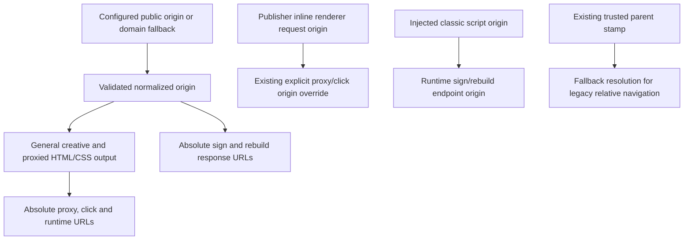

# Absolute creative rewrite URLs

## Intent and scope

Fix [#915](https://github.com/IABTechLab/trusted-server/issues/915): a creative
returned by Trusted Server must retain its generated proxy, click and runtime
URLs when a different origin renders it. This records the scope approved for
refreshing [PR #917](https://github.com/IABTechLab/trusted-server/pull/917).

Keep the existing rewriter, signing format and routes. Change the origin of
generated URLs and the creative runtime's endpoint resolution, not which assets
or clicks policy permits rewriting.

## Approaches

1. Keep root-relative output and require every renderer to supply a trusted base.
   This leaves external consumers dependent on document context and does not meet
   the issue's acceptance criteria.
2. Qualify output using an explicit browser-facing origin and capture the injected
   script's origin for runtime endpoints. This is the approved refresh approach.
   It preserves the current builders and supports ports, localhost and embedding
   on other origins, but deployments must configure their reachable endpoint.
3. Derive all output from each request's authority. This fits the existing inline
   publisher renderer, but general creative/CSS builders lack that request and
   external request authorities are not a substitute for configured ownership.
   Retain the existing inline override rather than extending it to every path.

## Configuration boundary

Add optional `[publisher].public_origin`. It is the browser-facing Trusted Server
origin, not the upstream `origin_url`. When absent, generated general-purpose
URLs use `https://{publisher.domain}`. An absent value remains absent when
serialized so legacy configuration blobs still load and default values do not
introduce an unknown key into an old schema.

The configured value must parse to an HTTP(S) origin with a host and optional
port. Reject userinfo, non-root paths, query, fragment, whitespace/control
characters and a trailing slash. Normalize an accepted parsed origin once at the
shared configuration-loading boundary, before output or blob serialization.
This includes repairing URL-parser-accepted spellings such as
`https:ads.example.com` to `https://ads.example.com`, lowercasing host/scheme and
removing default ports. Preserve non-default ports, IPv6 and HTTP development
origins such as `http://localhost:7676`.

Both `Settings` loading and `TrustedServerAppConfig` loading use this boundary.
The CLI environment overlay still replaces only scalar leaves already present
in TOML. An environment variable cannot create an omitted `public_origin` key.
No global overlay behavior changes.

## URL construction and rendering

- Qualify the shared signed-URL builder's root-relative outputs. HTML attributes,
  CSS, `srcset` and `/first-party/sign` then share one output rule.
- Qualify `/first-party/proxy-rebuild` JSON output and redirect `Location` with the
  same configured public origin.
- Use one creative runtime-tag generator for both `<body>` insertion and the
  body-less fragment fallback. Keep exactly one injection and the existing size
  limits. Qualify the source selected by the current TSJS helper; do not change
  bundle composition or hashing.
- Keep the inline SSAT/page-bids path's explicit request-origin override and its
  existing choice not to inject the creative runtime.
- Preserve `rewrite_creatives`, `rewrite_clicks`, `include_domains`, exclusion
  precedence and the distinct asset/click policies from current `main`.
- Leave relative creative source URLs and non-network schemes unchanged. Keep
  input/output bounds, optional sanitization and existing base-element handling.

## Browser runtime and recovery

Capture the classic script origin synchronously during module evaluation.
Prefer that endpoint origin even when the document or trusted parent stamp has
a different origin. If no usable script origin exists, use the existing pinned,
normalized trusted base. An unusable opaque base supplies no endpoint origin.
Later DOM or base-element mutations must not retarget captured endpoints.

Use the endpoint origin for sign/rebuild requests and exact-origin/exact-path
proxy recognition. Do not mistake another host's `/first-party/proxy` for a
Trusted Server proxy URL.

Keep successful rebuilt signed click values absolute in both `href` and
`data-tsclick`. A later unchanged click or second mutation must not drop the
public origin and navigate against the embedding document instead. Legacy
root-relative click inputs remain supported by the server.

Retain the existing stamped navigation base for legacy relative values. Do not
merge its trust precedence with script-origin endpoint selection. Keep pending
GET rebuild recovery, navigation scheme checks, opaque-origin no-fetch behavior
and the long-URL form POST fallback. Network and non-policy signing failures
still fall back to raw resources. A signing-policy `403` remains blocked and the
dynamic guard must not apply the resource. JSON rebuild failures still use
navigation recovery.

## Signing, routes, consent and privacy

Signatures continue to cover the clear destination and query parameters, not the
first-party origin. Reuse existing absolute/root-relative input parsing and
validate the original token before applying mutations. Keep reserved signing
fields immutable and exact click-path validation. No signing format migration.

All four adapters use the changed shared core. GET/POST rebuild routes already
exist on Fastly, Axum, Cloudflare and Spin; this feature adds no route. Retain
useful route/parity and legacy-input coverage without describing routing as new.

This changes endpoint URL resolution, not identity or consent policy. No new
identifiers or data collection, no wider rewrite host policy, and no change to
server-side EC forwarding rules. Fetch keeps `credentials: 'same-origin'`.
Actual cookie attachment can change when a configured endpoint differs from
the document origin; this feature does not add cross-origin credentials.
Operators must choose an appropriate browser-reachable endpoint. No CORS
grants, signing broker, retry framework or dynamic-signing transport redesign;
#982 remains separate.

## Compatibility and rollout

Configuration compatibility is not routing compatibility. Previously generated
root-relative URLs followed the visitor's scheme, host and port. The new absent
value fallback always uses HTTPS and the configured publisher domain. This may
change the endpoint for subdomain or local HTTP deployments.

Verify `public_origin`, DNS/TLS, routes and local ports before rollout. When the
fallback is not the reachable endpoint, activate the new binary with its matching
configuration blob as a coordinated release. Old binaries deny the new key, so
do not publish a configured `public_origin` to an old active binary. Rollback must
restore an old-compatible blob without the key together with the old binary.
Retain the public endpoint while previously emitted absolute creative URLs may
still be used. Existing signed relative inputs remain accepted on the new binary.

## Verification

- A regression must first expose malformed-origin emission, then prove TOML and
  JSON loads store and serialize a normalized origin and generated output resolves
  to that origin from a foreign document.
- Cover omission, invalid origin components, HTTP localhost, custom ports, IPv6,
  blob round trips and present/absent TOML-leaf environment overrides.
- Preserve current asset/click switch and include/exclude matrices. Update only
  expected output authority where those tests pin root-relative generated URLs.
- Test HTML, CSS, `srcset`, click, runtime-tag, sign and rebuild outputs, original
  signatures, reserved fields, and absolute/legacy input compatibility.
- Test distinct document/script/stamp origins, missing script, opaque srcdoc,
  repeated JSON repair/navigation, raw-resource fallback, GET fallback and
  long-URL form navigation. A mocked successful cross-origin POST test does not
  imply the production server adds CORS support.
- Generate each integration runtime's `public_origin` from its actual listener
  scheme/host/port, independent of the upstream origin. Preserve custom Viceroy
  resources and legacy source fixtures without the optional field. Cloudflare's
  generated integration binding is retargeted; its existing non-CI,
  operator-managed `wrangler.toml` path remains operator-configured.
- Run the real browser sandbox GET rebuild/click redirect chain against the
  configured runtime endpoint with both framework fixtures.
- Run target-matched Rust tests, parity, lint/build gates, JS tests/build/lint,
  formatting and changed-line URL-host lint before review handoff.

## Review log

- Round 1, independent Pi source review, 2026-10-29. Corrected the policy-403
  fallback distinction and cookie-attachment claim. Clarified the operator-managed
  Cloudflare path. Source review also verified the narrow constructor-normalization
  fix and its regression test. No remaining code-design blockers identified.
- Round 2, fresh independent Pi source review, 2026-10-29. Verified the corrected
  failure/credential contracts, configuration boundaries, signing, origin
  precedence, adapters and rollout against source and tests. No blocking findings.
  Runtime evidence is recorded separately in the PR test results.
