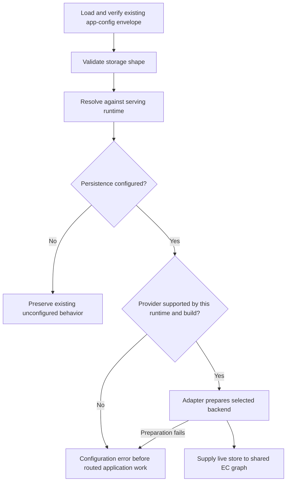

# EC storage provider configuration

Status: Design decisions confirmed. This document specifies configuration and
adapter selection changes, not an implemented feature. Native environment
configuration gets a hard cutover, and supplying both configuration forms is
always an error.

## Outcome

Configure EC identity persistence through `trusted-server.toml` and its existing
published app-config envelope. Preserve existing Fastly configurations and the
behavior of deployments without configured persistence. Make provider selection
independent of the serving runtime, while rejecting combinations that have no
implementation.

Fastly defaults to its own KV backend when a store is configured without an
explicit provider. Native, Cloudflare and Spin require explicit new provider
configuration to enable persistence. Merely running on a platform, declaring an
ordinary KV store, or supplying AWS credentials does not enable EC persistence.

DynamoDB remains native-only in this change. Supporting another provider on
Fastly or Cloudflare later must not require a different configuration model or
changes to EC identity business logic.

## Current behavior and constraints

- `Ec.ec_store` in `crates/trusted-server-core/src/settings.rs` is an optional
  Fastly store name. The example config sets it to `ec_identity_store`.
- Fastly's `maybe_identity_graph` and `require_identity_graph` in
  `crates/trusted-server-adapter-fastly/src/main.rs` construct `FastlyEcKvStore`
  directly from that name. The backend opens exactly that Fastly binding.
- Native startup loads verified Trusted Server settings, then separately calls
  `ec_kv::prepare_from_env`. `TS_EC_DYNAMODB_*` variables select and configure
  its dedicated EC backend. The provider requires `aws-dynamodb-ec`.
- Cloudflare and Spin do not currently wire an EC identity graph. Their ordinary
  KV handles are not evidence of the conditional writes, generations and strong
  reads required by `EcKvStore`.
- Native uses immutable startup config and secret snapshots, but identity rows
  remain live. Changing how the provider is configured must not snapshot rows.

Unconfigured persistence is not a new global EC-disable switch. Shared EC code
can generate an ID without a graph, while native publisher issuance currently
requires a graph. Preserve each adapter's existing unconfigured behavior rather
than using this migration to unify cookie issuance or route eligibility.

Relevant contracts are documented in
[the native persistence guide](../../guide/native-ec-persistence.md) and
[the RC431 compatibility design](2026-10-20-edgezero-431-compatibility-design.md).
The EC backend operations live in
`crates/trusted-server-core/src/ec/kv_backend.rs`.

## Configuration

### Existing Fastly config remains valid

```toml
[ec]
ec_store = "ec_identity_store"
```

On Fastly this continues to use the named Fastly KV binding. No new section,
provider field or environment variable is required. The name is not rewritten
or replaced with a manifest default.

### New Fastly configuration

```toml
[ec.storage]
store = "ec_identity_store"
```

On Fastly, omitting `provider` selects `fastly`. The fully explicit equivalent is:

```toml
[ec.storage]
provider = "fastly"
store = "ec_identity_store"
```

Neither example supplies a default store name. An empty or incomplete storage
section is an error, not permission to enable `ec_identity_store` implicitly.

### Native DynamoDB configuration

```toml
[ec.storage]
provider = "dynamodb"
region = "us-east-1"
table = "example-retained-ec"
namespace = "example-production"
```

Region, table and namespace are required. Preserve current validation rules,
including exact namespace bytes. Do not derive the namespace from a task ID,
publisher domain or deployment run. Do not infer the provider from AWS settings,
field names, or an ordinary EdgeZero KV declaration.

AWS credentials stay outside application config and use the standard SDK
credential chain, including an ECS task role. There are no access-key fields.
The existing `aws-dynamodb-ec` build feature is still required.

For explicit local testing, the DynamoDB variant may also contain:

```toml
local_endpoint = "http://127.0.0.1:8000"
```

This carries forward the existing emulator selection, not a general endpoint
override. Keep its current loopback HTTP, explicit-port and root-path validation,
and dummy credentials that bypass the ambient credential chain. Without it,
production uses the regional AWS endpoint and ignores endpoint overrides as it
does today. Do not place this field in production examples.

### Native celld configuration

```toml
[ec.storage]
provider = "celld"
endpoint = "https://stores.example.com:7780"
store = "checkout-identity"

[ec.storage.access]
mode = "authenticated"
token_env = "CHECKOUT_STORE_TOKEN"
```

The endpoint, exact service-owned alias and access policy use EdgeZero's pure
celld settings validation. No physical namespace or token value belongs in
application config. Capture the explicitly referenced bootstrap credential once
when preparing the backend. Authenticated mode requires HTTPS with normal
certificate verification. Trusted-network mode is an explicit alternative with
the existing celld rules, not a fallback after authentication fails.

The native build must include `celld-ec`, which enables the separate typed
conditional-record client in `edgezero-store-celld`. An ordinary KV declaration
or `celld-kv` feature does not select an identity backend. Native preparation
requires the additive record protocol, not just the original raw-value API.

Celld implements the same `EcKvStore` contract, including opaque metadata,
server-assigned u64 generations, Add/Overwrite/IfGenerationMatch, physical exact
existence, strong bounded prefix listing, expiry and deletion. The server owns
atomic preconditions and durable generation allocation. Reuse core graph and
consent logic unchanged. Do not emulate conditional writes with client GET/PUT,
redirect credentials, replay ambiguous mutations, or reset an allocator during
ordinary identity cleanup.

Celld is initially native-only, like DynamoDB. This does not claim a WASM
transport or add a placeholder implementation for another serving runtime.

## Resolution rules

Resolve configuration against an explicit serving-runtime identity, not the
host that runs the CLI or the Rust compilation target alone.

| Input                                          | Fastly                      | Native Axum                       | Cloudflare / Spin                 |
| ---------------------------------------------- | --------------------------- | --------------------------------- | --------------------------------- |
| Neither `ec_store` nor `storage`               | No graph, existing behavior | No graph, existing behavior       | Existing behavior, no graph       |
| Legacy `ec_store` only                         | Named Fastly graph          | Legacy field remains inactive     | Legacy field remains inactive     |
| `storage.store`, provider omitted              | Fastly, named store         | Error, explicit provider required | Error, explicit provider required |
| Explicit `provider = "fastly"`, valid store    | Fastly graph                | Unsupported-provider error        | Unsupported-provider error        |
| Explicit `provider = "dynamodb"`, valid fields | Unsupported-provider error  | DynamoDB graph, feature required  | Unsupported-provider error        |
| Explicit `provider = "celld"`, valid fields    | Unsupported-provider error  | Celld graph, feature required     | Unsupported-provider error        |
| Both `ec_store` and `storage`                  | Configuration error         | Configuration error               | Configuration error               |

Additional rules:

- Any simultaneous legacy field and new section is ambiguous and rejected,
  even if they name the same Fastly store. Do not invent precedence or merge
  fields across the two forms. Switching providers means removing `ec_store`.
- Reject unknown provider names, unknown fields, inappropriate variant fields,
  missing required fields and empty store names with field-oriented errors.
- Do not select the first available store or fall back after a selected-provider
  error. An unavailable configured store is not an unconfigured deployment.
- The legacy field remains inactive on non-Fastly adapters because that is its
  existing behavior. Explicit new configuration must never be silently ignored.
  This distinction keeps shared legacy config files usable during migration.
- Absence must survive serialization as absence. Do not publish an inferred
  provider, `storage = null`, or a generated default table into old config blobs.

The initial support matrix is deliberately small. Cloudflare and Spin have no
supported EC persistence provider in this change. New explicit storage config
there fails; deployments without it continue to work as before. Do not add
placeholder `cloudflare` or generic `kv` variants that cannot meet the contract.

## Ownership and implementation boundaries

Use one shared configuration resolver to produce either no persistence or a
validated provider-specific selection. A typed resolved enum should distinguish
Fastly binding configuration, DynamoDB configuration and celld configuration. Parsing compatibility
and the omitted-provider rule must not become several loosely synchronized
booleans and optional fields used throughout the request path.

Shared settings, validation and resolution must not depend on Fastly or AWS
SDKs. Adapters own provider construction and platform resources. A future
provider implementation may be usable on multiple runtimes; a runtime name is
not a permanent restriction on the provider model. No dynamic plugin registry
or universal byte-KV wrapper is needed for these implementations.



Native replaces `prepare_from_env()` with typed configuration input and awaits
provider preparation before readiness. Keep network I/O asynchronous, existing
bounds and sanitized errors, table validation, allocator continuity, logical
expiry, conditional writes and withdrawal semantics unchanged.

Fastly must use the resolved selection everywhere a graph is constructed,
including organic routes, auctions, identify, batch sync, finalization and
post-send pull sync. Do not update only one helper and leave other consumers
reading `ec.ec_store` directly. Preserve existing Fastly store-opening timing
and health/probe exceptions; this spec does not introduce remote readiness
checks or alter request/egress ownership.

Cloudflare and Spin must validate explicit storage selection during application
initialization, before routed application work, even though no new backend is
added there. A successful schema parse alone is not support for a provider.

Keep two validation stages distinct:

1. Shared TOML/JSON shape validation can run without a network or serving runtime.
2. Runtime-aware resolution and provider preparation run in the selected adapter.
   A target-aware CLI validation path may reject unsupported combinations early,
   but a native CLI must not reject Fastly config merely because it runs natively.

`ts config push` continues to publish the existing BlobEnvelope. AppConfig
continues to carry that same envelope where selected. Do not add another file
loader, environment overlay or publication format. EdgeZero still owns the
framework lifecycle and config/secret provisioning. This change does not claim
that its ordinary KV interface supplies the EC backend contract.

## Migration

### Fastly compatibility

Keep legacy `ec.ec_store` as a supported shorthand, without a removal deadline
in this change. New examples use `[ec.storage]`, but existing operator files and
already published envelopes need no rewrite. Migrate repository-owned active
examples and fixtures together, retaining dedicated legacy-compatibility tests.
Historical specs are records, not active config consumers to rewrite.

Older binaries use `deny_unknown_fields` on EC settings and cannot read the new
section. Deploy a compatible binary before publishing new-shaped config. For a
rollback, restore an old-compatible config and the matching binary together.
The migration must preserve the exact binding, table and namespace, not move
identity data or reset the generation allocator.

### Native environment-variable hard cutover

Migrate repository-owned launchers and deployment outputs in the same change,
then remove the old selection path. There is no compatibility release or
fallback reader that prepares a backend from legacy environment values.

- Move the four non-secret selection/binding values into `ec.storage` in the
  published envelope. Remove `TS_EC_DYNAMODB_ENABLED`, `REGION`, `TABLE` and
  `NAMESPACE` from application deployment inputs after publication is prepared.
- Replace Terraform's `runtime_environment` output in
  `deploy/examples/native-ec-dynamodb/outputs.tf` with a documented `ec_storage`
  configuration object for publication. This is an output-contract change;
  inspect downstream consumers before removal. It does not apply or provision AWS.
- Update `scripts/test-native-ec-image.mjs` to place provider config and
  `local_endpoint` in its fixture envelope instead of the app environment.
- Replace the app's `TS_EC_DYNAMODB_LOCAL_ENDPOINT` reader with the typed local
  field. A manual test runner may retain a test-only endpoint input, clearly
  distinguished from production application configuration.
- Update selection tests, the native persistence guide and the Terraform README.
  Inventory deployment automation, including untracked local work, without
  modifying unrelated work or operator-owned `trusted-server.toml` files.

Do not silently ignore an old active selection and start without a graph. A
native process still receiving an enabled legacy selection fails before
readiness with migration guidance, including when new
config is also present. Malformed legacy enablement remains an error. Absent or
`false` enablement does not select a backend; orphaned old binding values are
not an alternate configuration source. Errors must not echo record contents,
credentials or endpoint values.

This migration check detects an obsolete launch contract; it never prepares
DynamoDB from environment values.

## Persistence invariants and non-goals

For configured persistence, new identity issuance must still await a confirmed
write. Failed or uncertain writes must not become successful issuance through
a fallback store or a retry of a different backend. Consent, browser and route
gates remain unchanged. All graph consumers in an application use the same
resolved backend.

Changing provider or binding configuration is not data migration. This change
provides no copying, dual writes, cross-provider failover, namespace rotation or
automatic recovery plan for identities left in another store. A real switch
requires a separate continuity and withdrawal plan. Even changing only a
DynamoDB namespace changes the identity dataset.

Other non-goals are DynamoDB/celld EC on WASM runtimes, Cloudflare EC backend creation,
ordinary KV redesign, new native EC routes, pull-sync parity, hot reload,
credentials in TOML, table provisioning and changes to stored record formats.

## Acceptance checks

- Table-driven resolution tests cover every row in the matrix and all serving
  runtimes. Test malformed, empty and unsupported selections and duplicate forms.
- TOML and JSON round trips preserve both legacy config and absent storage.
  Config push and envelope reload preserve explicit new config without injecting
  defaults or resolving providers according to the CLI host.
- An unchanged legacy Fastly fixture uses the exact previous binding. New
  omitted-provider and explicit-Fastly fixtures use that same binding. No-store
  fixtures retain their existing graph availability and cookie behavior.
- All Fastly graph consumers use the resolved selection. Unsupported explicit
  selections fail before route work, with health/probe exceptions unchanged.
- Native feature-off builds accept unconfigured storage and reject selected
  DynamoDB before readiness. Feature-on tests prepare from envelope data, not
  legacy environment inputs. Obsolete active launch inputs cannot silently
  disable persistence or override the new config.
- Emulator tests use the new local field and retain endpoint-validation and
  dummy-credential isolation checks. Reuse existing backend tests for CAS,
  expiry, deletion/recreation and withdrawal where inputs remain unchanged.
- Native end-to-end fixtures prove issuance, persistence across application
  recreation, withdrawal and failed-write behavior through the new envelope path.
- Cloudflare and Spin compile without AWS dependencies and reject explicit
  unsupported new storage config. Shared legacy configs remain accepted.
- Inspect a Terraform config output and its documented publication path. Search
  active application launch inputs and docs for obsolete variables. Run focused
  formatting and affected crate checks during implementation; deployment or live
  IAM acceptance requires separate authorization.

## Contradiction review

### Default provider versus implicit enablement

Resolved by separating the two. Fastly is the default provider only when a store
is configured. With neither configuration form, nothing new is enabled. There
is no invented `ec_identity_store` binding and no global EC-disable behavior.

### Migrating configs versus not requiring existing users to change them

Resolved for Fastly by retaining `ec.ec_store` as supported input while moving
repository examples to the new section. Native env-based deployments necessarily
need an input migration to remove environment-only configuration. The confirmed
rollout is a hard cutover with coordinated config and launch-input changes,
without a staged compatibility release.

### Independent provider choice versus native-only DynamoDB

Resolved by separating configuration from runtime support. The schema and shared
resolver allow explicit provider choice; the initial implementations still only
support Fastly KV on Fastly and DynamoDB on native. Cross-provider use on Fastly
or Cloudflare is an extension goal, not delivered behavior in this change.

### Preserving legacy input versus rejecting unsupported providers

Legacy `ec_store` was inactive on non-Fastly adapters and remains so. A new
explicit section is an intentional selection and must fail if unsupported. This
asymmetry is necessary to preserve existing shared configs without pretending
that a newly requested backend works.

### Switching providers versus keeping identities

Not solved by configuration. Supporting a different provider later does not
make switching an existing deployment safe. Data continuity and withdrawal
obligations require separate migration work.

## Confirmed review decisions

1. Native environment configuration gets a hard cutover. Migrate config and
   launch inputs together; do not retain an environment-backed fallback.
2. Supplying both `ec.ec_store` and `[ec.storage]` is always a configuration
   error, even when equivalent. There are no precedence or merge rules.
