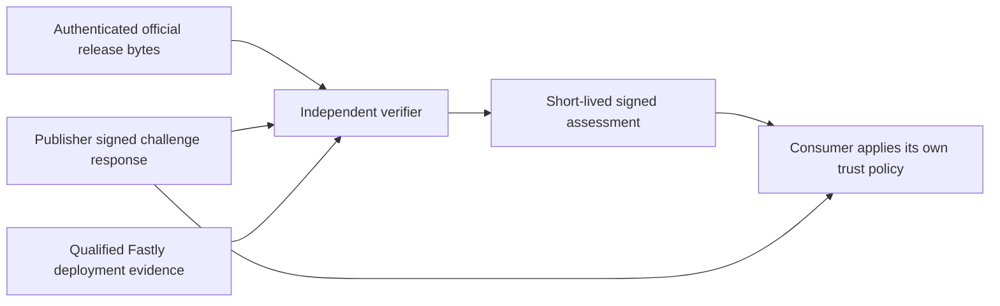

# Publisher attestation

**Date:** 2026-11-04. **Status:** Proposed contract for maintainer and user review; no implementation or provider qualification is claimed.

**Issues:** [#161](https://github.com/IABTechLab/trusted-server/issues/161), [#1427](https://github.com/IABTechLab/trusted-server/issues/1427). **Predecessor:** binary attestation [#1235](https://github.com/IABTechLab/trusted-server/issues/1235), [#1435](https://github.com/IABTechLab/trusted-server/pull/1435), [#1449](https://github.com/IABTechLab/trusted-server/pull/1449), and subsequent release-evidence work.

**Repository baseline:** `origin/main` at `51730bdaf841e4d7bb96c2258e5e98169bdff9a7`. Release-branch observations are dependencies, not functionality assumed to exist on this baseline. This specification introduces no code, credentials, enrollment, remote writes, or release authorization.

## Read this first

Publisher attestation answers: **who is responsible for this website's deployment, what software was independently checked, and how recently?** The publisher keeps its key. Its server answers a fresh random challenge with a signed identity statement. A separately chosen verifier checks host/key authorization and, when a qualified Fastly method is available, compares the deployed executable with an authenticated official release. It then signs a short-lived assessment. Consumers choose which verifiers and policies they trust.

The signed response alone is a declaration. A registry assessment can add independent evidence, but a package fingerprint match cannot be promoted into proof of installed official code. Public production Axum is supported for declarations; independently checked executable deployment starts with Fastly and remains qualification-gated.

V1 consumers normally rely on assessment expiry, at most 15 minutes from the oldest observation. Optional live status can detect a reported withdrawal sooner but adds a registry availability and privacy dependency. The signed identity projection describes five public identity values; registries do not inspect a publisher's whole business configuration for that check. Auction/bid attestation comes later.

| Read next                                                                               | Purpose                                                                                           |
| --------------------------------------------------------------------------------------- | ------------------------------------------------------------------------------------------------- |
| This document                                                                           | Publisher endpoint, common wire rules, runtime integration and acceptance boundaries              |
| [Registry protocol and operations](2026-11-04-publisher-attestation-registry-design.md) | Enrollment, assessments, consumer policy, optional status, governance and registry-side operation |
| [Fastly qualification](2026-11-04-publisher-attestation-fastly-qualification-design.md) | Evidence needed before anyone may assert an installed official executable                         |



## 1. Decision and assurance boundary

Publisher attestation connects a publisher host, its operator, a specific deployment, and an authorized public key to signed evidence and independent, time-bounded verifier assessments. It answers who made the declaration, what an independent party checked, how, and when. It does not establish continuous measured execution.

The selected architecture is publisher-produced evidence plus portable assessments from zero, one, or multiple independent verifiers. Publishers retain their keys. Consumers independently configure trusted verifier keys and acceptance policies. A registry is an optional directory and presentation service; it is not a mandatory administrator or key custodian.

The complete work includes independent deployment appraisal. An evidence-only milestone is useful, but MUST be labelled self-declared and MUST NOT be presented as an independently verified official deployment.

The intended strong result is:

> An identified verifier checked authorization for a publisher host and key, observed a specified production service/version, authenticated its selected executable against an eligible official release, and issued an assessment with an explicit observation time and expiry.

That result is available only after the selected provider method passes qualification. A provider package fingerprint match alone does not currently establish that result. The companion [Fastly binding qualification specification](2026-11-04-publisher-attestation-fastly-qualification-design.md) owns that gate.

### 1.1 Alternatives considered

| Approach                                                                 | Benefit                                                                                                | Cost or limitation                                                                     | Decision                                                       |
| ------------------------------------------------------------------------ | ------------------------------------------------------------------------------------------------------ | -------------------------------------------------------------------------------------- | -------------------------------------------------------------- |
| Publisher evidence plus independent, portable assessments                | Allows custom builds, multiple verifiers, and consumer choice; separates declarations from observation | Requires enrollment, provider qualification, and explicit freshness policy             | Selected                                                       |
| Operator signatures alone                                                | Small endpoint; useful identity and challenge evidence                                                 | Cannot independently establish installed official bytes or honest configuration        | Permitted delivery milestone, not the complete assurance claim |
| One administrator generates publisher keys and approves every deployment | One operational authority and policy                                                                   | Concentrates impersonation capability and governance; unnecessary for interoperability | Rejected                                                       |
| Hardware/provider-enforced measured execution and signing                | Could strengthen code-to-key binding                                                                   | No qualified capability established here                                               | Future separately specified assurance method                   |

### 1.2 Scope

In scope: host and operator authorization; deployment identity; publisher evidence; runtime key custody and rotation; independently verified release inputs; Fastly deployment observations; custom-build treatment; configuration claim boundaries; verifier assessment and withdrawal contracts; reference verification; safe networking; privacy; compatibility; acceptance tests; and operational responsibilities.

Out of scope: auction/bid signing, message-body integrity, auction execution proofs, bid replay caches, auction key delegation, transaction schemas, inventory truth, consent-input truth, legal-entity certification, broad configuration compliance certification, a hosted commercial registry, a registry dashboard, or hardware attestation. This work reserves stable deployment/key/assessment identifiers for future consumers; it does not design the next roadmap layer.

Fastly is the first target for independently checked executable deployment. Axum production and staging deployments are supported under the declaration profile after normal endpoint verification, public HTTPS, and real host/key enrollment; their installed code and environment remain declared. Axum also supplies isolated development transport. Cloudflare, Spin, and reusable Fastly require their own runtime qualification for the applicable profile. No new official adapter distribution is implied.

### 1.3 Normative language and ownership

MUST, MUST NOT, SHOULD, and MAY express requirements in the sense of BCP 14. Stable PA identifiers identify requirement groups. These wire/schema changes are revisions of an unshipped proposal and require coordinated implementation; they do not claim compatibility with a deployed earlier draft. The wire version is `1`; schema names and message types below are proposed private protocol identifiers, not claims of IANA registration.

| Owner                                 | Responsibility                                                                                                    |
| ------------------------------------- | ----------------------------------------------------------------------------------------------------------------- |
| Release producer and Layer 1 verifier | Authenticate executable bytes, source/workflow identity, official publication, and applicable release eligibility |
| Publisher/operator                    | Authorize enrollment, control DNS and deployment, provision runtime keys, maintain configuration and permissions  |
| Attester in Trusted Server            | Produce typed, fresh evidence from one actual request-used snapshot                                               |
| Independent verifier                  | Authenticate enrollment, collect provider observations, apply a named policy, sign assessments and status         |
| Consumer/relying party                | Supply independent trust roots, check bindings/freshness/status, and decide acceptance                            |
| Registry/directory                    | Distribute signed objects and clearly label their assurance; optional                                             |

### 1.4 RFC 9334 roles

| RATS role                            | Concrete participant and scope                                                                                                                                                     |
| ------------------------------------ | ---------------------------------------------------------------------------------------------------------------------------------------------------------------------------------- |
| Attester                             | The runtime serving publisher evidence for the requested host                                                                                                                      |
| Verifier                             | The independent component appraising that evidence and qualified provider observations                                                                                             |
| Relying Party                        | The consumer deciding whether the signed assessment meets its policy                                                                                                               |
| Reference Value Provider             | The release authority publishing authenticated official executable identities; #1435/#1449 contribute that Layer 1 work, rather than being participants themselves                 |
| Endorser                             | The authority supplying authenticated statements about artifact origin or approved reference values; release provenance does not endorse a publisher key or prove remote execution |
| Verifier Owner / Relying Party Owner | The parties configuring appraisal policy and consumer acceptance respectively                                                                                                      |

These roles may be performed by different organizations or combined. RFC 9334 does not require one administrator or prescribe this private wire format.

### 1.5 Platform feasibility and supported claims

| Deployment                | Target v1 evidence/profile                                             | Required qualification or limitation                                                                    |
| ------------------------- | ---------------------------------------------------------------------- | ------------------------------------------------------------------------------------------------------- |
| Fastly production/staging | Publisher declaration; official-deployment profile only for production | Endpoint/runtime verification; strong executable binding still requires the companion gate              |
| Axum production/staging   | `publisher-declaration-v1`, `assurance: declared`                      | Public HTTPS, real DNS/key enrollment; service fields may be null; environment/code remain declarations |
| Axum loopback development | Isolated declaration fixtures                                          | Separate test trust; cannot use development authorization in production                                 |
| Reusable Fastly           | Same intended profiles after lifecycle qualification                   | Actual retained snapshot, key expiry and refresh/recycling must be demonstrated                         |
| Cloudflare / Spin         | Future separately qualified endpoint support                           | No implicit provider measurement or production-assessment support from this spec                        |

This is a target support table, not a statement that endpoints are implemented today.

## 2. Terminology and threat model

### PA-IDENTITY: keep the identities distinct

**Publisher host** is the public DNS name being checked, such as `news.example.com`. **Backend origin** is the upstream content source and is not publisher identity. **Publisher ID** is an opaque UUID assigned by the publisher; it is not evidence of legal identity. **Operator ID** is a stable HTTPS identifier for a separately claimed operator, or null when the publisher acts for itself. A non-null identifier requires independent technical authorization; it is not legal-entity certification or trusted merely because it is a URL. Verifiers MUST NOT fetch arbitrary operator-ID URLs.

**Deployment ID** is a publisher-assigned UUID stable for one intended logical deployment. Separate production/staging deployments MUST use different deployment IDs and keys. Cloning a service does not authorize reuse of an enrollment. **Binding ID** is the digest of the exact version/configuration/key descriptor defined below. A new service version, attestation key, or covered configuration value changes the binding ID. Assessment renewal does not change it.

Consumers MUST compare the full binding, not assume UUID uniqueness makes assertions true. Enrollment authorizes the tuple `(host, publisher_id, operator_id, deployment_id, provider, service_id, environment, attestation_key_thumbprint)`; versions and binding IDs are separately checked at assessment time.

### 2.1 Attacker capabilities and residual trust

Assume an attacker can copy endpoints and assessments, replay or relay challenges, manipulate unsigned discovery, control a custom binary and its reported metadata, change publisher configuration or service versions, upload unusual packages, obtain a publisher runtime key through deployment control, submit malicious enrollment/package URLs, and operate an untrusted verifier. Assume network outages and partial provider observations.

| Threat                                                    | Required control                                                                       | Remaining limitation                                                      |
| --------------------------------------------------------- | -------------------------------------------------------------------------------------- | ------------------------------------------------------------------------- |
| Forged publisher or verifier signature                    | Pinned keys, strict typed signatures, key-purpose separation                           | A stolen trusted key can sign                                             |
| Evidence copied to another host                           | Expected host, independent authorization, fresh challenge, authenticated HTTPS         | A live same-host relay is not measured execution proof                    |
| A clean attestation path hides different traffic handling | Explicit endpoint-only claim; provider service/version observations                    | No proof that all site traffic follows this path                          |
| Custom code reports an official commit                    | Independently authenticated executable binding                                         | Self-reported headers/build facts are not measurements                    |
| Alternate code uses an endorsed key                       | Monitoring, short-lived assessments, withdrawal, isolated key scope                    | Operator-controlled software keys are not exclusive to approved code      |
| Ambiguous package produces matching fingerprint           | Provider binding qualification, structural evidence, stronger selected-module identity | Local package inspection alone cannot constrain a malicious remote upload |
| Configuration changes without activation                  | Actual snapshot binding and coverage declaration                                       | Uncovered/dynamic settings and propagation remain outside the claim       |
| SSRF or credential leakage                                | Fixed provider authority, constrained enrollment targets, bounded fetches, redaction   | Trust in configured resolver/provider remains                             |
| Compromised verifier or misleading directory              | Consumer-pinned trust roots/policies; signed provenance of assessments                 | An accepted verifier can lie                                              |

Consumers still rely on Fastly reporting its state truthfully, on verifier collection and signing being honest, on the release authority, and on the declared clock/status assumptions. No result promises absence of vulnerabilities, continuous execution, honest publisher inputs, or secret non-extractability.

Monitoring reduces exposure; it does not close the code-to-key gap. Binding version 42 does not invalidate its signed assessment when version 43 activates. A consumer rejects the mismatch only after trustworthy newer evidence/status reaches it, or the old assessment expires. No finite probe set proves universal routing or parser behavior.

### What this does not prove

- A nonce/signature proves a fresh answer from a key holder; it cannot prevent a live relay or prove exclusive use of that key by official code.
- An installed executable observation is time-bounded and trusts the provider/verifier. It does not establish uninterrupted execution or simultaneous state at every POP.
- Official release bytes do not certify configuration, business rules, consent inputs, page content, inventory truth, or absence of vulnerabilities.
- V1 does not verify that Trusted Server is the outermost layer for all site traffic. An endpoint probe and domain mapping are insufficient to establish that property.
- Expiry-only acceptance cannot promise immediate withdrawal. Known withdrawal is honored, but an uninformed consumer can accept until the existing assessment expires.
- Protocol identity/DNS control does not certify a legal entity, contractual relationship, or legal compliance. Governance/liability choices belong to registry agreements and task-force approval.

## 3. Protocol artifacts and common encoding

### PA-WIRE: one strict signed envelope

Evidence, assessments, and status use compact JWS. The response body is the compact ASCII serialization, not a JSON object with an unsigned readable evidence copy. The protected header contains exactly `alg`, `kid`, and `typ`:

| Field | Version 1 rule                                                                                                   |
| ----- | ---------------------------------------------------------------------------------------------------------------- |
| `alg` | Exactly `Ed25519` as registered by RFC 9864; no polymorphic algorithm identifier                                 |
| `kid` | Base64url, unpadded SHA-256 JWK thumbprint of the signing public key                                             |
| `typ` | Exactly `ts-publisher-evidence+jws`, `ts-publisher-assessment+jws`, or `ts-publisher-status+jws`, as appropriate |

All header fields are protected. Reject unprotected headers, detached payloads, `none`, HMAC, legacy `EdDSA`, alternate curves, embedded trust keys, key URLs, certificate URLs, `crit`, compression, and unencoded payload extensions. Signature length is exactly 64 bytes. Public keys are JWK objects containing exactly `kty: "OKP"`, `crv: "Ed25519"`, and a canonical unpadded base64url `x` encoding 32 bytes. Private JWK material MUST NOT appear on a public surface. The transport uses JWS rules; implementations MUST NOT introduce the fork's separate context-prefix format under the same message type.

Sign and verify the original JWS segments; never reserialize a decoded payload to check its signature. Parse UTF-8 JSON with duplicate-member rejection, including nested objects, bounded depth 16, and no trailing data. Unknown members anywhere in a version 1 payload are rejected. The closed schemas below use an explicit `extensions` object, initially required empty; a nonempty extension requires a later supported profile/version. Arrays are limited to 16 entries unless a smaller limit is stated. Claim strings have a 256-byte UTF-8 limit unless specified otherwise. This bound is not applied to compact JWS serialization or its encoded segments. An assessment-list item is an explicitly exempt compact-JWS string of at most 32,768 ASCII bytes; the list remains bounded to 16 items and 524,288 total response bytes. These transport bounds also apply to unsigned discovery/list responses. Their decoded claim strings retain the ordinary bound. Structural JSON Schema `maxLength` counts Unicode code points, so receivers must independently enforce the UTF-8 byte and raw-response bounds before accepting data. Integers are nonnegative JSON integers no greater than `9007199254740991`. Time fields are UTC Unix seconds, not milliseconds.

Use SHA-256, lowercase 64-character hex, for document/content identifiers, except `kid` as above and Fastly's explicitly labelled SHA-512 fingerprint. `digest` means `{ "algorithm": "sha256", "value": <hex> }`. Canonical descriptor/projection hashes use JCS over the defined public JSON value. JWS signatures themselves do not require JCS. Object digests of signed objects hash the exact compact JWS bytes; do not hash a readable rendering.

The JOSE and canonicalization rules are based on RFC 7515, RFC 8037 as updated by RFC 9864, RFC 7638, RFC 8725, and RFC 8785. RFC 9864 replaces the deprecated polymorphic `EdDSA` identifier with `Ed25519` for this new protocol; a library that cannot enforce that protected identifier is not conforming and must not silently substitute it. Some deployed JOSE libraries may support only the older `EdDSA` name; integrators must qualify or update those libraries before enabling v1. Renaming an incoming protected header breaks its signature and is forbidden. These standards define encoding and validation primitives; the publisher claim semantics here are project requirements.

The accompanying [wire schema](schemas/publisher-attestation-v1.schema.json) uses JSON Schema draft-07 with local references and no remote schema fetch. It omits a `$schema` URI, so validators must select draft-07 explicitly. Its definitions cover protected headers, signed payloads, discovery/list envelopes, enrollment challenges, and stored public metadata. The [public verification vectors](fixtures/publisher-attestation-v1-vectors.json) retain exact signed bytes, public keys, expected context, and positive/negative outcomes; no signing private key is retained. They are protocol fixtures, not provider observations or official-deployment qualification.

Schema validation is necessary but insufficient. Duplicate JSON members, canonical base64url, actual UTF-8 byte lengths, canonical host handling, JWK thumbprints, JCS/digest equality, signature/type/key agreement, time intervals, operator authorization, policy eligibility, status, and cross-object equality require the separate semantic checks specified here. Consumers reject a schema-valid object that fails any applicable semantic check. A valid signature on an unknown/legacy algorithm identifier or wrong message type is still rejected. Published vectors must be checked through two independent cryptographic implementations and include changed-signature, changed-context, stale, and mismatched-binding cases before wire freeze.

### PA-BINDING: exact deployment descriptor

The `binding` object is closed and has these required fields:

| Field             | Type and meaning                                                                                                                                  |
| ----------------- | ------------------------------------------------------------------------------------------------------------------------------------------------- |
| `schema`          | Literal `ts-publisher-binding-v1`                                                                                                                 |
| `host`            | Canonical authorized publisher host                                                                                                               |
| `publisher_id`    | Canonical lowercase UUID                                                                                                                          |
| `operator_id`     | HTTPS identifier with no userinfo/query/fragment, or null for publisher self-operation                                                            |
| `deployment_id`   | Canonical lowercase UUID                                                                                                                          |
| `environment`     | `production`, `staging`, or `development`                                                                                                         |
| `platform`        | Object: `provider` (`fastly` or `axum`), `service_id` (string or null), `service_version` (positive integer or null), `staging` (boolean or null) |
| `attestation_key` | Object: `kid`, public `jwk`, `not_before`, `not_after`                                                                                            |
| `configuration`   | Object: `schema` literal `ts-publisher-identity-v1`, `digest`, and `projection` defined in section 7                                              |
| `extensions`      | Empty object                                                                                                                                      |

`binding_id` is the lowercase 64-character hexadecimal string SHA-256 of JCS(`binding`), not a nested digest object. `attestation_key.kid` MUST equal its JWK thumbprint and the evidence signing header `kid`. Its validity interval MUST be nonempty and contain the entire evidence lifetime. Fastly service identity is adapter-observed runtime identity, still a declaration to an external verifier until corroborated. Axum production/staging/development declaration bindings use null service ID, version, and staging fields when the adapter has no independent provider identity. The declared environment is an operator setting, not a provider measurement. Fastly official-deployment bindings require independently corroborated non-null service/version identity. Axum can never satisfy the Fastly official-deployment profile. Unknown staging MUST be null, never silently false. Fastly staging must agree with the declared environment; `development` cannot pass production policy.

The descriptor MUST NOT include verifier assessment IDs, verifier list order, latest store state fetched after the request, private configuration hashes, or a claimed self-measurement of the binary. This avoids circular identity and changing the binding whenever an assessment renews.

### PA-EVIDENCE: publisher payload

| Required field            | Type and rule                                                                                                                                                                   |
| ------------------------- | ------------------------------------------------------------------------------------------------------------------------------------------------------------------------------- |
| `schema`                  | `ts-publisher-evidence-v1`                                                                                                                                                      |
| `binding`                 | Exact descriptor above                                                                                                                                                          |
| `binding_id`              | Matching descriptor digest                                                                                                                                                      |
| `nonce`                   | Canonical base64url encoding of exactly 32 random bytes supplied by the caller                                                                                                  |
| `issued_at`, `expires_at` | `issued_at < expires_at <= issued_at + 60`, within signing-key validity                                                                                                         |
| `build_report`            | Object with `declared_class` (`custom` or `unspecified`) and nullable `source_commit` (40 lowercase hex), `package_version` (string), `target` (string), and `variant` (string) |
| `extensions`              | Empty object                                                                                                                                                                    |

All five `build_report` members are required; only the four build-fact members may be null when unavailable. `declared_class` is an operator declaration; `unspecified` does not mean official. These are declarations, not an installed-artifact digest. Use existing immutable owning-product build facts when present; do not add operator/tag/time inputs to Layer 1 builds. An external tag belongs in verified release evidence, not a new compiled publisher input.

The caller supplies expected host, nonce, environment, and trust policy out of band. No payload-selected verifier URL or public key can establish trust. A verifier MUST correlate the nonce to one outstanding collection operation, expire it after 60 seconds, and consume it once. A valid signature does not establish authorization before enrollment checks.

### Reader example: declarations and assessments are different

The following is an annotated **excerpt of a decoded publisher payload**, not a complete valid wire object or a signature to copy:

```json
{
  "schema": "ts-publisher-evidence-v1",
  "build_report": {
    "declared_class": "custom",
    "source_commit": null,
    "package_version": "0.1.0",
    "target": "aarch64-unknown-linux-gnu",
    "variant": "default"
  }
}
```

`custom` is the publisher's own declaration. A verifier's separate `build.assurance: declared` keeps that visible. `fingerprint_only` means a narrower provider hash comparison; it still cannot carry `provenance: official`. Only independently bound selected executable bytes plus eligible authenticated release evidence can support `artifact_bound` and `official`. Complete signed examples and rejection cases are in the linked public vectors; a structurally valid object still needs semantic, policy and cryptographic checks.

### PA-ASSESSMENT and PA-STATUS: registry-issued objects

The normative assessment/status fields, policy outcomes and optional status mode are defined in the [registry protocol](2026-11-04-publisher-attestation-registry-design.md#pa-assessment-verifier-payload). The shared wire schema and typed JWS rules remain common to both documents. Publisher evidence never signs a registry verdict into its own descriptor.

## 4. Enrollment and independent trust bootstrap

[Registry enrollment and consumer trust](2026-11-04-publisher-attestation-registry-design.md#pa-enrollment-authorize-before-endorsing) define publisher DNS/key proof, optional separate operator proof, finite renewal, issuer trust and exit. Production Axum declaration uses the same real host/key proof; loopback shortcuts are development-only. The publisher advertises untrusted issuer hints in discovery, while consumers configure actual trust independently.

## 5. Publisher HTTP surface and runtime behavior

### PA-HTTP: fixed, small endpoint

| Request                                                                              | Response                                               |
| ------------------------------------------------------------------------------------ | ------------------------------------------------------ |
| `GET /_ts/attestation.jws?nonce=<challenge>`                                         | `200 application/jose` with evidence compact JWS       |
| `GET /_ts/attestation/keys.json`                                                     | `200 application/json` with versioned public discovery |
| Missing/invalid nonce, repeated nonce parameter in one request, unknown query member | `400` with bounded generic error code                  |
| Disabled attestation or unsupported method on either exact reserved path             | `404`; no origin fallback and no signing               |
| Enabled but unavailable key/identity/clock or snapshot mismatch                      | `503`; no unsigned success payload                     |
| Invalid or mismatched host selection                                                 | `421`; no signing or origin fallback                   |
| Deployment/platform admission rate limit exceeded                                    | `429`; no signed payload                               |

Only GET is supported. HEAD and OPTIONS return 404; browser clients need no custom request headers. Only the two exact paths in the table are reserved; neighboring paths retain existing routing and may reach the publisher fallback. No whole-prefix takeover or configurable endpoint is introduced in version 1. The evidence endpoint requires exactly one `nonce` parameter with the canonical encoding above. A repeated parameter in one request is malformed; the stateless edge does not maintain a global used-nonce cache. Single-use outstanding challenges are tracked by the caller/verifier that generated them. The keys endpoint accepts no query parameters. Request bodies are rejected with 400. Nonce-free evidence is not a conforming freshness check.

All responses on these paths, including errors and public discovery, MUST have `Cache-Control: no-store, private`, `Surrogate-Control: no-store`, and `X-Content-Type-Options: nosniff`. No ETag, Last-Modified, Set-Cookie, authentication redirect, or shared-cache lifetime is emitted. Conditional requests do not produce 304. Responses are independent of reader cookies and contain no user IDs or client IP. Wildcard CORS is permitted for these public GET resources with no credentials; credentialed CORS is prohibited. A human-readable status page is not required. Any later UI must explain declarations versus verifier results and cannot present its own rendering as verification.

Discovery is `{ "schema": "ts-publisher-key-discovery-v1", "host": <host>, "keys": [...], "verifiers": [...] }`. `verifiers` is a unique list of at most 16 HTTPS issuer identifiers configured by the publisher, empty by default. An entry advertises a possible source of assessments, not proof that the issuer endorses this host. Consumers match it to independently configured issuer/trust information before any lookup; it never supplies a trust key or authority to fetch arbitrary URLs. `keys` holds one to four entries, and each contains only `kid`, public `jwk`, `not_before`, and `not_after`. Include active and overlap keys; no private key, secret reference, provider token, or mutable URL-as-key-authority. Discovery is untrusted until matched to enrollment/assessment, and cannot replace retained historical key records. It contains no verifier trust roots.

### PA-ROUTING: trusted host selection before evidence

Version 1 protocol boundaries accept canonical lowercase ASCII DNS names only. Enrollment/configuration/signed claims and lookup paths reject Unicode; optional operator UI tooling may convert an internationalized name before submission, show the resulting ASCII name for confirmation, and must not change it again inside the protocol. No Unicode database version or IDNA mapping library is a runtime protocol dependency. Names beginning `xn--` are treated as opaque ASCII DNS labels; this profile neither converts them nor certifies their Unicode spelling. Identity comparisons use the exact same ASCII name across publisher authority, enrollment DNS, TLS/SNI, and registry lookup.

For trusted ingress authority only, lowercase ASCII and remove one final ASCII dot before comparing with enrolled canonical host. Reject a second terminal dot, empty labels, userinfo, percent escapes, wildcards, IP literals, invalid ports, and ambiguous/conflicting authority sources. Labels are 1–63 octets and the host at most 253 ASCII octets, with letters/digits/hyphens and no leading/trailing hyphen. Prefixed DNS challenge owners must separately fit DNS limits. Production uses HTTPS port 443; another port is not silently treated as the same origin. Host and URI authority, when both present, must agree after this normalization. Client-supplied forwarded headers never select signed host identity. Retain the original trusted ingress host before module header rewriting. International-name conversion rules belong to operator tooling and its compatibility tests, not a second implicit identity equivalence rule.

Resolve the intended host's settings through the existing trusted configuration selector, then require configured attestation host and publisher authorization to match that ingress host. Unknown/mismatched hosts MUST NOT borrow another host's settings or sign a statement; return 421 when host selection is invalid. Multi-host deployments require explicit per-host bindings. This spec does not depend on an unmerged configuration-by-host implementation; the first release may require one enrolled host per configured deployment.

Dispatch evidence after ingress sanitization and host/snapshot resolution, but before Edge Cookie creation, consent processing, device classification, bot challenges, request filters, publisher backend calls, and auctions. An explicit attestation exception to generic authentication is needed so a verifier can reach the public endpoint; it applies only to these exact read-only paths and is covered by route tests. Normal routes retain existing authentication and filtering.

This needs an explicit startup seam as well as a route exception. The baseline constructs auction/integration state and resolves ordinary application secrets before normal dispatch. Implementation must acquire the verified nonsecret configuration snapshot and attestation identity independently of those unrelated initialization steps, then dispatch the evidence request without creating the auction application. When ordinary application construction succeeds, both paths must use the same loader normalization and snapshot provenance; retained sandboxes must not mix snapshots. An unrelated bidder/secret initialization failure is not an attestation-key failure and must not force the proof path through that failing component. Evidence describes the attestation request's actual snapshot, not a guarantee that ordinary site traffic is healthy. Invalid own host/identity configuration still fails safely.

Response finalization MUST enforce attestation headers last, including when generic `response_headers` configuration or middleware tries to loosen privacy. A diagnostic endpoint is not a path to execute arbitrary modules or sign arbitrary bytes. Provider identity and trusted host come from adapter-owned data, not custom integration headers.

### PA-CONFIG: proposed operator configuration

```toml
[attestation]
enabled = true
host = "news.example.com"
publisher_id = "11111111-1111-4111-8111-111111111111"
operator_id = "https://operator.example.com/publisher-attestation"
deployment_id = "22222222-2222-4222-8222-222222222222"
environment = "production"
active_key = "publisher-evidence-2026-11"
discovery_keys = ["publisher-evidence-2026-11"]
verifiers = []
build_class = "unspecified"
```

This is a proposed configuration contract, not a claim that these fields already load. Omitted `operator_id` normalizes to null for self-operation; the wire descriptor/projection/challenge still includes the explicit null member so its digest is unambiguous. Default is absent/disabled; `build_class` defaults to `unspecified` and accepts only `unspecified` or `custom`. Unknown keys are rejected. `verifiers` defaults to an empty list and contains at most 16 unique HTTPS issuer identifiers; it is public discovery metadata only and never changes signature trust. Host, IDs, environment, and the selected key metadata must validate when enabled. The selected name is an opaque local key reference, never a private key. `discovery_keys` defaults to a list containing `active_key`; an explicit list must contain 1–4 unique valid local key names and include `active_key`. The discovery endpoint performs bounded metadata reads of those exact names, ordered by thumbprint in its public response; it never enumerates a provider store. Missing, malformed, duplicate-thumbprint, or inconsistent metadata in that list returns discovery 503 rather than publishing a partial set. Evidence signing reads only the active key metadata/secret and may still succeed when an overlap entry is unavailable. Disabled mode ignores the list without store reads. Key metadata and private key bytes live in dedicated runtime stores described next. It MUST NOT permit overriding observed provider/service/version, choosing a signature algorithm, choosing arbitrary signed claims, or supplying a purported official checksum.

Disabled attestation reads no attestation stores. Invalid structural configuration fails ordinary configuration validation with redacted errors; a temporarily missing/malformed key at runtime fails only the attestation endpoint. The config loader MUST NOT eagerly resolve the endpoint's optional private key as a required site-wide secret. Endpoint admission validates the effective metadata and secret together, so a partially propagated rotation returns 503 rather than mislabelling the signing key.

## 6. Key custody, provisioning, and recovery

### PA-KEYS: dedicated publisher keys

Publisher evidence keys are distinct from Layer 1 release signatures, existing request-signing keys, verifier assessment keys, TLS keys, and future auction keys. No modification to today's request-signing protocol or rotation endpoints is authorized by this spec.

Provision a publisher-generated Ed25519 key through an authenticated operator tool or existing provider secret mechanism. The private seed is exactly 32 bytes encoded as canonical standard base64 in a dedicated secret-store entry. Metadata contains the public JWK, thumbprint, validity interval, and secret entry reference. The runtime derives the public key from the loaded seed and compares it with metadata before signing. A metadata/key mismatch is 503. Secrets never enter source, build inputs, artifact metadata, shared CI caches, app-config JSON, generated documentation, or verifier enrollment. A provisioning tool MUST NOT print or return private key bytes in ordinary output.

Version 1 preserves the existing portable store inventories and defaults unchanged. Store nonsecret metadata in the existing logical config store `trusted_server_config` at `ts-publisher-key-<local-name>`, and private seeds in the existing logical secret store `trusted_server_secrets` at `ts-publisher-<local-name>`. A local name is 1–48 lowercase ASCII letters, digits, or hyphens, starts with a letter, and is unique within that deployment. The prefixed secret name therefore remains at most 61 characters. Metadata has the closed schema `schema: ts-publisher-key-metadata-v1`, `kid`, `jwk`, `not_before`, `not_after`, and `secret_name` (exactly the prefixed secret name). Verify that metadata and the derived public key agree. The ordinary app-config secret resolver MUST NOT eagerly resolve these endpoint-only entries.

These prefixes are reserved for attestation provisioning. Before writing, the operator tool checks existing entries and ordinary app-config secret references, including each adapter's normalized key/environment mapping, and refuses collisions; it must not overwrite an unrelated value. Rotation replaces only entries explicitly owned by that deployment/key. Physical IDs and resource-link mappings remain operator deployment context, not public claims or new build inputs. Fastly reads by the existing logical links. The running Trusted Server Axum adapter reads metadata through `TRUSTED_SERVER_CONFIG_{STORE}_{KEY}` and seed values through `TRUSTED_SERVER_SECRET_{STORE}_{KEY}`, using its existing uppercase/underscore normalization. EdgeZero CLI local-config files and its separate secret environment convention are not automatically consumed by that runtime. P1 provisioning must use the Trusted Server mapping explicitly, or supply and verify a bridge, including entry-ownership/collision checks and a running-adapter readback test. Cloudflare/Spin flat secret namespaces remain unchanged and production attestation there remains unsupported until separately qualified.

Do not add a second logical secret store, a second config store, or unconditional attestation resource links to `edgezero.toml`/adapter store metadata. Pinned EdgeZero v0.0.11 treats Axum, Cloudflare, and Spin as single-secret-store adapters; shared inventory expansion would reject strict validation, config push, and provision before feature enablement is considered. Existing-store namespaces avoid that regression and impose no additional store quota or empty-store linkage requirement on disabled deployments. Fastly requires an initial config entry before association under its documented provisioning path; existing application-config provisioning already supplies it. Enabling attestation adds validated entries only after existing link/access/quota checks succeed. No empty new store, placeholder private key, or sentinel is needed. Disabled mode performs zero attestation-entry reads/writes and requires no new resources.

A future operator may isolate keys in additional physical stores only through an adapter-scoped, separately reviewed capability/provisioning change; this spec does not authorize changing the shared inventory to do so. Store sharing does not mean key reuse: cryptographic purposes, metadata, prefixes, and enrollment are separate, but application code with access to the shared secret store can read those keys. Verifier credentials remain read-only; absence of physical isolation is explicit in the residual trust model.

Sharing the public release executable does not imply sharing keys between publishers. Existing store linkage is observed provider context, not proof of non-extractability or per-key access isolation. Verifiers receive no write permission to these stores and do not generate publisher keys. Axum fixtures use the existing environment-backed read adapter and a test-only mapping; adding portable logical names does not imply provider namespace isolation or write support on Cloudflare/Spin, whose production paths remain unsupported.

Key validity is at most 90 days. Metadata may publish a successor before activation. Operator rotation stages new metadata/secret, includes the successor in `discovery_keys`, and stages DNS authorization, changes `active_key`, then completes fresh endpoint proof and obtains an assessment for the new key/binding. Until that assessment is available, the new evidence is unendorsed and a consumer requiring an assessment rejects it; normal site traffic continues. Version 1 does not promise an uninterrupted attestation transition. Keep the old public key verifiable for at least the maximum assessment lifetime plus status/cache allowance. Never sign after key expiry. No "last key signs forever" fallback. There is no promise of an atomic distributed store/config transaction: readers observing inconsistent metadata fail the endpoint, and rotation tests must cover ordering and propagation.

The endpoint checks key validity and current time on every response even if parsed key bytes are sandbox-cached. A reusable sandbox cannot extend an expired key or assessment. Cached metadata has the same documented snapshot lifetime as its bound settings; changing a store does not retroactively update a running snapshot. Operators must plan instance recycling or bounded refresh where required by a qualified adapter.

On compromise, stop positive renewal, mark affected enrollments/keys compromised, provision a fresh key through trusted operator recovery, re-prove host control, and issue new assessments. Old-key signatures cannot authorize the replacement alone. Routine retirement does not imply historical signatures were forged; compromise and observation unavailability are separate reasons. Historical evidence remains verifiable as historical data, not current authorization.

## 7. Configuration claims and actual snapshot identity

### PA-SNAPSHOT: commit only to a defined public projection

Version 1 claims a deliberately narrow identity projection:

```json
{
  "schema": "ts-publisher-identity-v1",
  "host": "news.example.com",
  "publisher_id": "11111111-1111-4111-8111-111111111111",
  "operator_id": "https://operator.example.com/publisher-attestation",
  "deployment_id": "22222222-2222-4222-8222-222222222222",
  "environment": "production"
}
```

The object is closed. It is built from effective normalized settings after defaults and permitted overrides, alongside that request's settings snapshot. `configuration.digest` is SHA-256 of its JCS representation; descriptor identity fields MUST equal their projection counterparts. The key and provider version are already separately bound in the descriptor.

This digest says nothing about auction rules, consent policies, bidder lists, integration safety, source contents, mutable dictionaries, runtime data, resolved secret values, or the full settings document. Neither built-in policy may claim those properties. A broader policy projection is a follow-up requiring named fields, normalization, privacy review, and independent check methods; merely hashing more JSON is not approval of behavior.

Capture verified envelope identity and configuration selector privately before `BlobEnvelope::into_data()` and secret resolution discard them, and carry that provenance beside the same immutable settings snapshot. Do not publicly expose an arbitrary full-config hash: low-entropy sensitive settings can be guessed. An opaque internal snapshot ID and a public projection digest serve different purposes. A timestamp or envelope checksum is not proof of publisher authorization.

For both built-in v1 policies, the configuration check validates the signed public projection's schema, digest, equality with the descriptor, and consistency with the enrolled host/operator/deployment/environment tuple. Its method is `public-identity-projection-v1`; a pass means that those declared values are structurally consistent and authorized, not independently observed runtime configuration. The registry does not read the whole app-config envelope merely to compare these five identity values. Even an official executable assessment MUST state this declared-configuration scope; official bytes do not certify settings or behavior.

The runtime still binds evidence to the snapshot actually used by its handler. The verifier compares fresh evidence bindings during collection and repeats provider active-version/host observations where the selected policy requires them. Covered declared identity or provider version changes cause a bounded retry and then an indeterminate result. Matching observations cannot rule out change-and-restore or global propagation differences. Independent business/consent/integration policy appraisal requires a separate privacy-reviewed method and consumer opt-in.

Default Fastly, reusable Fastly, Axum, Cloudflare, and Spin can have different settings lifetimes. Evidence MUST describe the actual retained snapshot, not the latest config store fetched later. When fresh evidence and a retained assessment disagree on covered identity/key/version, a consumer rejects the combination and requests reassessment. It never relabels a stale binding as current.

## 8. Assessment lifecycle

The [registry lifecycle contract](2026-11-04-publisher-attestation-registry-design.md#pa-collection-deterministic-independent-assessment) defines collection and timing. V1 uses expiry-only consumer acceptance by default: assessments last at most 15 minutes from the oldest observation and no longer than their authorizations. Live status is optional consumer policy with its own availability/privacy cost. Independent configuration reads are excluded from both built-in profiles; projection consistency remains a signed publisher declaration.

## 9. Consumer verification and networking

### PA-CONSUMER: consumer verification

The [consumer acceptance algorithm](2026-11-04-publisher-attestation-registry-design.md#pa-consumer-acceptance-algorithm) compares a fresh publisher response with assessments from independently trusted issuers. It validates exact bindings, signatures, policy and expiry, and checks live status only when expressly configured. A matching package fingerprint cannot satisfy official-executable policy.

### PA-NETWORK: constrain all external fetches

Publisher checks require TLS certificate and hostname validation with SNI and authority set to the expected enrolled host. No redirects, downgrade to HTTP, userinfo, URL fragments, caller-selected port, or alternate host supplied by a response. Fixed endpoint paths prevent following a page's attacker-selected verify link. Development HTTP is allowed only for explicitly configured loopback fixtures under the declaration profile, never production.

Reference-verifier enrollment and publisher fetching MUST defend against SSRF: reject loopback, private, link-local, multicast, unspecified, reserved/nonpublic, and provider metadata destinations; resolve and validate all connection candidates, pin a validated address for the connection, and revalidate on every new connection. Do not merely validate a hostname before a client re-resolves it. Resolver trust and allowed enterprise exceptions require explicit operator configuration and cannot produce the public production profile. Proxy environment variables are disabled by default in the reference collector; explicitly configured egress proxies are trusted components recorded in its policy.

Provider API traffic uses an independently configured fixed Fastly authority, not report-selected URLs. Provider credentials are never forwarded to publisher, release, discovery, redirect, or status endpoints. Release evidence acquisition follows Layer 1's trusted repository/workflow/publication policy. Verifier status URLs are constructed from configured verifier base and validated UUID, not fetched from an arbitrary assessment member.

Each network call has a five-second deadline; transient idempotent reads may retry once within the collection deadline, respecting bounded Retry-After. HTTP error bodies are capped at 4 KiB and redacted. Evidence is capped at 16 KiB, discovery at 16 KiB, assessment at 32 KiB, and status at 8 KiB, measured after any HTTP decoding. Do not accept unlimited decompression or chunked growth. Provider/package limits belong to the qualification spec. Endpoint rate limiting is an operator/platform deployment responsibility; tests cover bounded work per request without assuming a global counter across WASM instances.

### PA-REFERENCE: delivery boundary

This repository delivers the publisher endpoint, portable types/pure verification, and a bounded host-target reference verifier. Registry publication, administration, signer recovery, governance, retention and the demo are specified in the [separate registry contract](2026-11-04-publisher-attestation-registry-design.md). Production checkpoint/fencing backend engineering is a registry deployment obligation, not code required inside the edge publisher binary. Moving it to that contract does not waive the no-stale-issuance invariant.

## 10. Failure model, diagnostics, and privacy

### PA-FAILURE: distinguish rejection from uncertainty

| Reason code                  | Meaning                                                                            | Default effect                              |
| ---------------------------- | ---------------------------------------------------------------------------------- | ------------------------------------------- |
| `malformed`                  | Invalid syntax, schema, limits, or inconsistent hashes                             | Reject                                      |
| `signature_invalid`          | Wrong key, message type, or signature                                              | Reject                                      |
| `operator_unauthorized`      | Claimed operator identifier lacks valid independent account association/delegation | Reject enrollment/issuance                  |
| `state_recovery_required`    | Durable authorization history or fencing cannot be established                     | Stop signing/current status                 |
| `host_mismatch`              | Expected host or enrolled authorization differs                                    | Reject                                      |
| `environment_mismatch`       | Wrong staging/production or unavailable identity                                   | Reject production                           |
| `key_unauthorized`           | Unknown/not-yet-valid/expired/retired key                                          | Reject current acceptance                   |
| `key_compromised`            | Confirmed compromise recorded by trusted authority                                 | Reject; rotate/re-enroll                    |
| `nonce_mismatch`             | Missing, stale, repeated, or wrong challenge                                       | Reject freshness                            |
| `stale`                      | Evidence, observations, assessment, enrollment, or status too old                  | Reject current acceptance                   |
| `binding_mismatch`           | Version/key/projection/deployment tuple differs                                    | Reject combination; reassess                |
| `release_ineligible`         | Authentic release not accepted under configured policy                             | Reject official profile                     |
| `artifact_mismatch`          | Qualified observation binds a different executable                                 | Fail official check                         |
| `artifact_binding_unproven`  | Only fingerprint/declaration or unqualified method available                       | Indeterminate official check                |
| `configuration_unobservable` | Inputs to an explicitly selected independent configuration method are unavailable  | Indeterminate selected optional method      |
| `provider_unavailable`       | Outage, timeout, permission, incomplete state                                      | Indeterminate; stop positive renewal        |
| `observation_race`           | Observed state changed during collection                                           | Retry bounded operation; then indeterminate |
| `withdrawn`                  | Assessment or enrollment withdrawn                                                 | Reject current acceptance                   |
| `status_unavailable`         | Explicitly required live status cannot be validated                                | Reject current official assurance           |
| `policy_untrusted`           | Unknown issuer/policy/method or threshold not met                                  | Reject endorsement                          |
| `clock_unavailable`          | Reliable current time unavailable                                                  | Stop current assurance                      |

No API response should reduce these distinctions to a universal `trusted: true`. Public verdicts include expected host, issuer/policy, observation interval, expiry, build class/assurance, coverage, and reason codes. A declaration can satisfy the declaration profile without satisfying official-deployment policy. A custom build is not intrinsically a failure; it fails a policy that requires official bytes.

Attestation failure does not shut down normal publisher traffic by default. It removes the attestation claim or returns an endpoint error. Any site-wide blocking policy belongs to explicit operator configuration outside this feature. Ordinary request-signing behavior remains unchanged.

### PA-PRIVACY: minimize disclosures and retained evidence

Public objects disclose host, IDs, key, provider service/version, public identity projection, build declarations, appraisal scope/times, and potentially official release identity. Operators explicitly opt in to this disclosure. No browser identities, IPs, cookies, consent strings, bidder credentials, backend URLs, full configuration, private keys, or provider tokens appear in public evidence.

Log operation IDs, outcome codes, durations, and shortened safe object IDs through `log`; do not log nonce query strings, bodies, raw config, secret references, provider authorization headers, or sensitive provider error payloads. Public errors use generic codes; privileged diagnostics are separately access controlled. Do not publish arbitrary low-entropy private digests.

The reference verifier retains exact public signed objects, sanitized observation records, policy/release evidence identities, and enrollment/recovery audit events for 90 days by default in restricted storage. Public historical objects may be archived longer under a stated operator policy. Raw credential-bearing responses and signing secrets are excluded from evidence archives; retention and credential backup have separate access controls. Restrict state directories and files to the owning account. Disable unrelated third-party analytics on a reference verification page, if one is added later.

Fastly read-only credentials may still expose account-wide information: service restrictions on global read scopes do not imply isolation of non-service endpoints. Before enrollment, document actual endpoint permissions, resource exposure, rotation/expiry, and separation from unrelated account assets. Prefer a dedicated deployment account where required by the observed permission model. No verifier requires provider write/deploy rights.

## 11. Repository integration and compatibility

### PA-INTEGRATION: fit existing seams

| Existing surface                                             | Proposed work and constraint                                                                                                       |
| ------------------------------------------------------------ | ---------------------------------------------------------------------------------------------------------------------------------- |
| `crates/trusted-server-core/src/config.rs` and `settings.rs` | Typed opt-in attestation settings, strict validation, narrow projection                                                            |
| `config_payload.rs` and `settings_data.rs`                   | Retain provenance beside the actual settings snapshot before secret resolution; do not change existing secret semantics            |
| `platform/` runtime services                                 | Adapter-owned identity and dedicated store access; no publisher-controlled identity override                                       |
| `trusted-server-adapter-fastly/src/app.rs` and `main.rs`     | Exact early route, request-local identity/snapshot, default and reusable admission semantics                                       |
| `trusted-server-adapter-axum/`                               | Production/staging declarations and isolated development fixtures; no measured provider identity                                   |
| Cloudflare and Spin adapters                                 | Preserve existing routes/builds; unsupported production attestation remains explicit; qualify separately before adding claims      |
| `request_signing/`                                           | Reuse reviewed crypto primitives only where useful; retain separate keys, entry namespaces, types, and endpoints                   |
| Host CLI/reference verifier                                  | Enrollment input, collection, offline verification, public assessment/status generation; target-isolated dependencies              |
| Layer 1 release evidence                                     | Authenticate retained raw executable bytes and eligibility; no runtime GitHub verification or new publisher-specific release build |
| JS bundles and publisher HTML                                | No new JS injection, user flow, or auction modification                                                                            |

Core protocol types and validation should have narrow modules and strong domain types for host, deployment ID, binding ID, key thumbprint, and times. Use `error-stack` and existing runtime store/HTTP abstractions. Runtime clock access must use the repository's WASM-safe clock conventions. No dependency is selected solely by this design; verify support across targeted builds before implementation.

The endpoint and its required protocol/key-reading capability MUST be compiled into the authenticated release executable used for an official deployment claim, then enabled at runtime with publisher config/keys. Adding an operator-specific module or recompiling in a key changes the artifact and cannot inherit that official release identity. Core versus linked module placement remains an implementation choice only if the official release composition includes it. Older releases lacking the endpoint are not made capable by configuration alone.

Do not depend on the fork's full module/source/filter stack to ship this feature. An existing or merged module endpoint seam may host it if it can enforce the routing/key/snapshot contract; otherwise add the smallest explicit adapter route. The architecture is independent of code placement. Do not add a broad generic attestation plugin framework.

Existing deployments remain disabled and preserve normal behavior. Existing `/.well-known/trusted-server.json` key discovery and `/verify-signature` retain their current purposes; they do not become publisher-attestation authorities. No automatic migration of their keys is allowed. The old fork's bespoke ES256 envelope and compiled-key schedule are not wire-compatible with this version. Operators must enroll new runtime keys; do not silently accept legacy objects under new assurance labels.

The historical January proposal is background only. Its full-config commitments and embedded final-binary checksum must not become requirements by implication. The release specification/guide on #1435 distinguishes raw executable identity, source facts, and deployment observations; consume verified inputs without assuming a later release index is shipped. A candidate/unsigned index cannot authorize an official assessment.

## 12. Delivery boundaries and qualification gates

This is the cross-component architecture contract. It is not an implementation plan or permission to activate live credentials/services. Each delivery milestone gets its own bounded implementation plan and any necessary phase-specific spec amendment; provider experiments require explicit authorization of named disposable resources.

| Milestone                            | Deliverable                                                                                                                                                                                    | Exit gate                                                                                                                             |
| ------------------------------------ | ---------------------------------------------------------------------------------------------------------------------------------------------------------------------------------------------- | ------------------------------------------------------------------------------------------------------------------------------------- |
| P0: provider feasibility             | Retained Fastly source/provider evidence and supported method decision                                                                                                                         | Companion qualification review; unresolved official binding remains closed                                                            |
| P1: publisher evidence               | Runtime keys, strict schemas, host/snapshot binding, endpoint, pure/reference verifier, minimal declaration enrollment and signed assessment, fixtures/docs; public Axum declarations included | Declaration-profile end-to-end proof; visibly no independent installed-code claim                                                     |
| P2: independent deployment appraisal | Provider-backed enrollment/appraisal, qualified provider/release collection with declared identity consistency, signed assessments/status                                                      | Strong profile enabled only for methods passing P0 and runtime tests                                                                  |
| P3: operational adoption             | Operator-run renewal/status service and recovery runbooks                                                                                                                                      | Chosen consumer-mode availability/privacy SLOs, credential exposure review, rollback and incident rehearsal                           |
| P4: demo registry                    | Stacked illustrative registry with enrollment/status display and consumer verification walkthrough                                                                                             | Fictional/local fixtures, clear declared/fingerprint/official labels; no implicit public accreditation or live provider qualification |

P1 does not close the full independent-verification scope of #161. If P0 cannot justify a strong binding, maintainers may ship the declaration profile and fingerprint observations, but must record the unsupported official-deployment claim and revise acceptance rather than quietly mark it achieved. P4 is a named stacked demo-registry follow-up after the protocol/reference verifier; its UI and hosting are not core-feature acceptance dependencies. Future auction/bid work is not an acceptance dependency.

No calendar commitment is made here. Endpoint work, provider feasibility, and a continuously operated verifier are different effort categories. Estimates must follow the qualified method, phase scope, dependencies, and reviewer capacity; signature code size is not a measure of complete assurance-system effort.

## 13. Verification and acceptance matrix

### PA-TESTS: evidence before assurance

Tests use fictional hosts/data and generated test-only keys, never operator credentials or production signing keys. A fixture's declared expected result cannot stand in for provider qualification. CI tests must include independent verification of produced JWS bytes and malicious negative fixtures, not only round-trip tests through the same serializer.

| Test family            | Required cases                                                                                                                                                                                                                                                                                                                    | Requirements                    |
| ---------------------- | --------------------------------------------------------------------------------------------------------------------------------------------------------------------------------------------------------------------------------------------------------------------------------------------------------------------------------- | ------------------------------- |
| T1 encoding/crypto     | Independent JWS verification; altered segments; wrong key/type/curve/algorithm; duplicate members; limits; canonical thumbprints/hashes; structurally valid semantic contradictions                                                                                                                                               | PA-WIRE, PA-BINDING             |
| T2 endpoint freshness  | Exact nonce; repeated parameters and invalid encoding; future/expired/key-boundary times; unavailable clock                                                                                                                                                                                                                       | PA-EVIDENCE                     |
| T3 host routing        | Exact host; parent/suffix/lookalike rejection; canonical ASCII/A-label/trailing dot/port/authority conflicts; forwarded-host spoofing                                                                                                                                                                                             | PA-IDENTITY, PA-ROUTING         |
| T4 routes/privacy      | No bot/auth/EC/consent/auction dependency; disabled reserved paths; unsupported methods; unchanged neighbors; no backend calls; conditional requests; final no-store; CORS; no user identifiers                                                                                                                                   | PA-HTTP, PA-ROUTING, PA-PRIVACY |
| T5 runtime keys/stores | No key; corrupt seed; public-key mismatch; rotation propagation; bounded discovery list; missing overlap metadata; no enumeration; expiry in cached sandbox; staging isolation; no secret disclosure; namespace collisions; strict disabled validation/provision/config push without inventory expansion; absent optional entries | PA-CONFIG, PA-KEYS              |
| T6 runtime snapshots   | Actual retained versus latest config; projected versus uncovered changes; declared scope; multi-host mismatch; cached sandbox; version/config/key changes                                                                                                                                                                         | PA-SNAPSHOT                     |
| T7 adapter integration | Running Fastly evidence independently verified; production/staging Axum declarations; canonical host consistent across ingress/TLS; ordinary deploy emits new version binding and rejects old assessment combination                                                                                                              | PA-REFERENCE, PA-BINDING        |

Registry enrollment, appraisal, consumer acceptance, provider collection and durable recovery tests belong to the [registry verification matrix](2026-11-04-publisher-attestation-registry-design.md#registry-verification-matrix). Provider executable-binding experiments belong to the Fastly qualification companion. These separate acceptance boundaries do not require auction/bid implementation.

Before publisher-evidence handoff, run changed core/adapter tests with target-matched aliases, Fastly reusable tests if that path is touched, host verifier/CLI tests, strict applicable clippy, formatting, domain lint, documentation checks, and an actual running-adapter fixture. Use native tests for protocol logic and Viceroy for Fastly endpoint behavior. Cloudflare/Spin compilation/parity checks demonstrate compatibility only, not production provider qualification. No HTML EOF harness is required unless implementation changes publisher/HTML processing. Before an implementation PR handoff, run all repository-mandated CI gates, documenting any unavailable external runtime checks without calling them passed.

Acceptance of this design requires review of the contracts and explicit unresolved-provider gates, not a claim that implementation tests have run. Acceptance of the full feature requires:

- **AC1:** Authorized publisher evidence verifies independently; malformed, forged, stale, cross-host, cross-environment, and unauthorized-key objects fail.
- **AC2:** Keys are runtime-only and separate from release/request signing; rotation/expiry/compromise behavior is demonstrated.
- **AC3:** The exact request-used identity projection and service/version/key binding survive the real runtime transport.
- **AC4:** A qualified independent method authenticates the installed selected executable before official provenance is asserted. If that gate remains unresolved, only the narrower milestone is accepted; the full independent-verification feature remains incomplete and the strong profile stays unsupported. Any reduced-scope closure requires an explicit maintainer disposition.
- **AC5:** Declaration, custom, fingerprint-only, official, unavailable, failed, and withdrawn outcomes cannot be confused by the reference consumer or documentation.
- **AC6:** Signed assessments, default expiry-only acceptance, optional live status, monitoring outages, sequence recovery where applicable, and multiple-verifier trust policy are exercised end to end.
- **AC7:** No auction/bid behavior changes, new user-data collection, publisher-specific official build inputs, or mandatory central administrator are introduced.

## 14. Prior work and references

The role separation follows RFC 9334: attester, verifier, relying party, reference-value provider, and endorser are roles, not a requirement for one administrator. This design borrows the operator endpoint's narrow declarations and exact-byte verification lessons while requiring independent evidence for stronger appraisal.

| Work                                                                                                                                                         | Learning and treatment                                                                                                                                                                                                                         |
| ------------------------------------------------------------------------------------------------------------------------------------------------------------ | ---------------------------------------------------------------------------------------------------------------------------------------------------------------------------------------------------------------------------------------------- |
| [jwrosewell/trusted-server#7](https://github.com/jwrosewell/trusted-server/pull/7), inspected at `59e09b6cd9632b8198deaa92b38ed7d5b841e06e`                  | Historical closed/unmerged attestation prototype: bounded nonce, explicit limits, endpoint-local errors, independent OpenSSL harness. Reject compiled private keys and endless last-key signing; it supplies no installed-artifact measurement |
| [IABTechLab/trusted-server#1297](https://github.com/IABTechLab/trusted-server/pull/1297) and [#1353](https://github.com/IABTechLab/trusted-server/pull/1353) | Related upstream stack history; attestation was removed from #1353, which is endpoint-seam work, not an implemented assurance dependency                                                                                                       |
| [jwrosewell/trusted-server#34](https://github.com/jwrosewell/trusted-server/pull/34), inspected at `12b1f467aeab9cfb5650e7fbc2b32f654d323ebd`                | Distinguish publisher identity from backend source and outbound Host; source refactor is not required here                                                                                                                                     |
| [jwrosewell/trusted-server#47](https://github.com/jwrosewell/trusted-server/pull/47), inspected at `86f77a124d49bcfe27d00be2b397b481786340fb`                | Request-cycle parity and terminal privacy protections matter; no independent executable verification supplied                                                                                                                                  |
| [#846](https://github.com/IABTechLab/trusted-server/issues/846)                                                                                              | Secret migration background. Current baseline already resolves typed secret references; open issue status is not proof of current plaintext blob behavior                                                                                      |

Primary provider sources: [Fastly package API](https://www.fastly.com/documentation/reference/api/services/package/), [token scopes](https://www.fastly.com/documentation/reference/api/auth-tokens/user/), [edge data stores](https://www.fastly.com/documentation/guides/compute/edge-data-storage/about-edge-data-stores/), [secret-store API](https://www.fastly.com/documentation/reference/api/services/resources/secret-store/), and [audit events](https://www.fastly.com/documentation/reference/api/account/events/). These support provider semantics, not an inference of exclusive runtime key access or globally consistent observation.

Normative encoding references: RFC 7515 (JWS), RFC 8037 as updated by RFC 9864 (fully specified Ed25519 JOSE), RFC 7638 (JWK thumbprints), RFC 8725 (strict validation and message separation), and RFC 8785 (JCS). Verify interoperability and target support during implementation qualification; no external standard certifies this project's claim accuracy.

The v1 host contract is canonical ASCII DNS syntax; Unicode/IDNA conversion, if offered by operator tooling, is explicit preprocessing outside protocol identity checks. Using JWS does not claim EAT conformance; RFC 9711 EAT alignment or registered public media types may be considered later without weakening this private profile's validation.

## Task-force decisions and open questions

The proposed v1 defaults now explicitly select expiry-only acceptance, optional live status, publisher-declared identity consistency, real production Axum declarations, runtime-enabled capability in the authenticated official release, registry-side endorsement storage with read-only provider access, and provider polling as the monitoring baseline. Fresh DNS challenges are retained with automation support. Outermost traffic placement is not a verified v1 claim.

Before implementation/production adoption, the task force must decide:

1. Which Fastly selected-executable binding method passes qualification? If none does, is a clearly narrower declaration/fingerprint milestone useful without closing the strong feature?
2. Who will operate verifiers, which policies/keys consumers should trust, and whether any consumer requires the optional live-status mode?
3. Which operator DNS/account-delegation methods are accepted, and how DNS renewal automation is supported? Persistent issuer/key/scope authorization is a follow-up alternative, not an unreviewed replacement for fresh challenges.
4. Which governance/appeal procedures and registry service agreements apply, including allocation of legal responsibilities? Cryptographic validity does not settle those terms.
5. What deployment and acceptance scope should the stacked demo registry have? It cannot present fictional evidence as production qualification.
6. Is independently checked full configuration or outermost traffic placement required in a later profile? Each needs a new evidence/privacy contract and qualification; neither may be inferred from official bytes.

These are explicit approval/qualification gates, not implementation TODOs or permission to invent missing provider capabilities.

## Review log

- **Round 1 (Codex, independent security and runtime review):** Corrected policy-conditional inputs, exact-path routing, store wiring and rotation.
- **Round 2 (Codex, independent security and runtime review):** Corrected overlap-key discovery without store enumeration.
- **Round 3 (Codex, independent security and runtime review):** No blocking contract issue remained.
- **Follow-up review (Codex, independent security, feasibility and standards review):** Corrected existing-store compatibility, operator authorization, JOSE algorithm identifier and transport limits; added schemas, vectors and recovery fencing.
- **Second detailed pass (Codex, independent security and feasibility review):** Corrected authorization-expiry caps; no blocking contract issue remained after correction.
- **Split-contract review (Codex, independent security and contract review):** Aligned the signed configuration-method identifier; no blocking contract issue remained after correction. Document and fixture checks do not qualify runtime behavior or a Fastly method.
- **Cleanup review (Codex, independent contract review):** Checked contextual fingerprint evidence, deployment gaps, operator lifetime, rejection semantics and test ownership; corrected declaration-profile wording to permit optional provider observations.
- **Cleanup follow-up (Codex, independent contract review):** No remaining blocking consistency findings. Structural and signature fixtures pass; runtime and provider qualification remain unexecuted.
- **Final detailed review (Codex, independent security, runtime-feasibility and protocol reviewers):** No blocking findings. Clarified Axum provisioning mapping, optional provider observations, and P1 declaration enrollment/assessment ownership. Runtime implementation and provider qualification remain unexecuted.
- **Self-review (Claude Code, independent contract and fixture review):** No blocking findings. Renamed the evidence path to `/_ts/attestation.jws` to match its `application/jose` body, clarified the discovery `keys` bound, and fixed live-status sequence ordering in the registry contract. The schema keeps draft-07 in its `$comment` and in the wire-schema text rather than a `$schema` URI, because the repository URL-host lint rejects that host and JSON cannot carry a per-line suppression; validators must select draft-07 explicitly. Fixture signatures, digests and schema results were rechecked independently.
