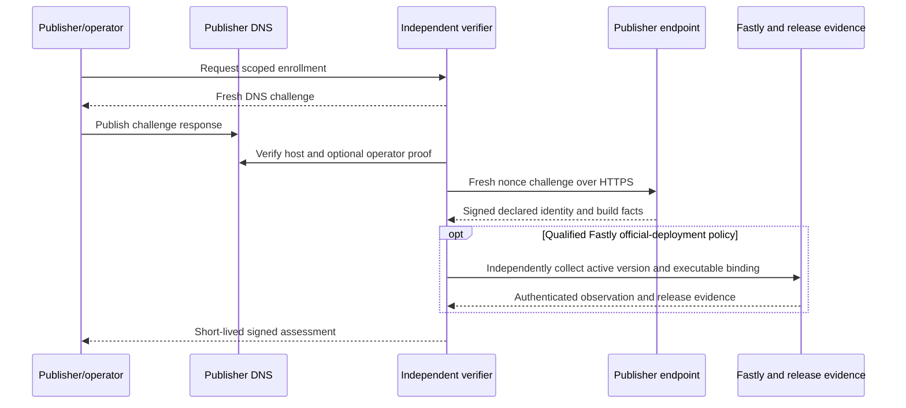
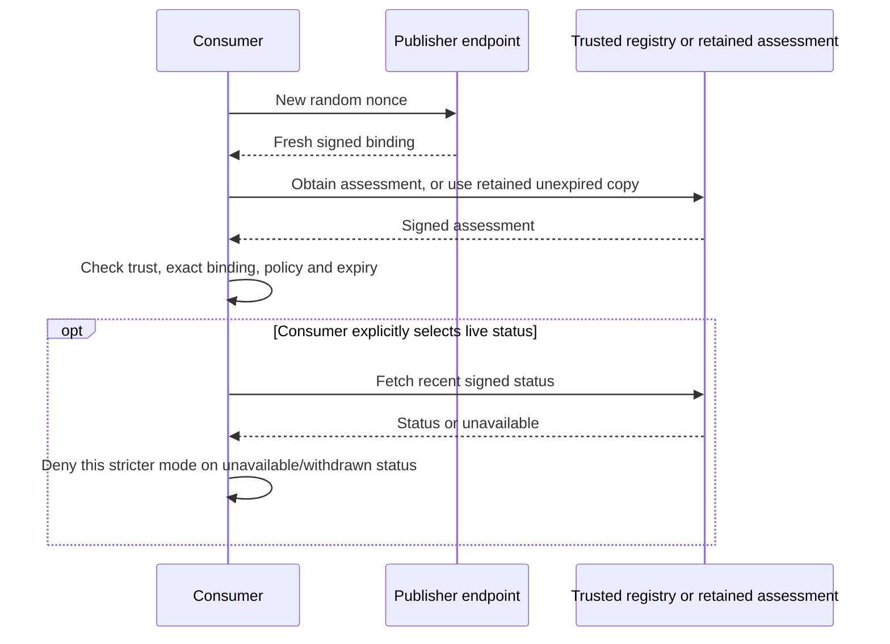

# Publisher attestation: registry protocol and operations

**Date:** 2026-11-04. **Status:** Proposed registry-side contract; no deployed registry or qualified Fastly method is claimed.

**Parent:** [Publisher endpoint and common wire contract](2026-11-04-publisher-attestation-design.md). **Provider gate:** [Fastly executable binding](2026-11-04-publisher-attestation-fastly-qualification-design.md).

This companion specifies what an independent verifier signs and what a consumer checks. Registry hosting, administration, signer recovery and governance belong to that registry's operator; they do not run inside the edge publisher binary. The repository supplies a bounded reference verifier and a separately planned stacked demo, not an automatically accredited multi-tenant public service.

V1 defaults to expiry-only consumer acceptance. An assessment lives for at most 15 minutes from its oldest observation and no longer than applicable authorizations. Live status is optional and introduces availability, privacy and load costs. Known compromise/withdrawal is never ignored, but a consumer without a live update can accept until its assessment expires. Consumer trust roots are independently configured.

## Signed registry objects

### PA-ASSESSMENT: verifier payload

| Required field                    | Type and rule                                                                                        |
| --------------------------------- | ---------------------------------------------------------------------------------------------------- |
| `schema`                          | `ts-publisher-assessment-v1`                                                                         |
| `issuer`                          | Consumer-configured verifier HTTPS identifier                                                        |
| `assessment_id`, `enrollment_id`  | Verifier-assigned canonical UUIDs                                                                    |
| `binding`, `binding_id`           | Full endorsed descriptor and its digest                                                              |
| `evidence_digest`                 | SHA-256 of collected evidence compact JWS                                                            |
| `observed_from`, `observed_until` | Ordered observation interval covering all successful checks                                          |
| `issued_at`, `expires_at`         | Ordered times subject to PA-TIME                                                                     |
| `policy`                          | Object: `id` string, `version` positive integer, `digest` of the verifier's retained policy document |
| `result`                          | `satisfied`, `not_satisfied`, or `indeterminate` under that policy                                   |
| `checks`                          | Object described immediately below                                                                   |
| `build`                           | Build appraisal object described immediately below                                                   |
| `reason_codes`                    | Unique sorted array of codes from the parent PA-FAILURE, empty allowed                               |
| `extensions`                      | Empty object                                                                                         |

`checks` contains exactly `host_authorization`, `key_possession`, `host_service_binding`, `active_version`, and `configuration`. Each is an object with `outcome` (`pass`, `fail`, `unavailable`, `not_assessed`), `method` (nonempty profile identifier string or null), `observed_at` (integer or null), and `evidence_digest` (digest or null). A pass requires a non-null method, non-null observation time, and retained evidence digest. `not_assessed` requires all three other fields null; a fail/unavailable outcome names the attempted method and may have null observation/evidence when collection did not complete. An unavailable/not-assessed outcome MUST NOT satisfy a required check.

`build` contains exactly `provenance` (`official`, `custom`, `unknown`), `assurance` (`artifact_bound`, `fingerprint_only`, `declared`), `method` (string), `artifact_sha256` (digest or null), `provider_files_hash` (128 lowercase hex or null), `release` (object or null), and `coverage` (literal `selected_executable_only` or `declaration_only`). A non-null `release` contains `repository`, `tag`, `source_commit`, `asset_name`, `artifact_sha256`, and `verification_evidence_digest`; it names authenticated Layer 1 evidence, not runtime strings. `repository` is a nonempty `owner/name` string matched to the configured Layer 1 source; `tag` is a nonempty tag string validated under that release policy; `source_commit` is 40 lowercase hex characters; `asset_name` is one basename without slash, backslash, or dot-segment components; both digest members are SHA-256 digest objects. None of these members may be null inside a non-null release.

`provenance: official` requires `assurance: artifact_bound`, a non-null executable digest, and a verified eligible release with the same digest. `custom` may be independently observed or declared; the assurance field is mandatory and MUST be displayed alongside it. A publisher saying it customized code does not prove those bytes are installed. A custom classification requires the signed custom declaration or a retained custom-build appraisal; absence from the verifier's known release list alone means unknown, not custom. `fingerprint_only` MUST have null executable digest/release and MUST NOT be rendered as official. It records a provider fingerprint comparison, not a stronger claim. An artifact-bound custom build has a non-null independently bound digest and null official release. All other declared builds have null artifact digest/release and `coverage: declaration_only`.

A non-null `provider_files_hash` requires `checks.host_service_binding.outcome: pass` and `checks.active_version.outcome: pass`, plus a Fastly binding with non-null service ID, version and staging flag. Retained provider evidence MUST attribute the hash to that exact host-authorized service/version/environment, observed within the assessment interval. A publisher-supplied hash or a hash from an unattributed package cannot satisfy this rule. These checks establish context, not selected-executable binding or official provenance. Consumers reject a violated cross-field invariant as `malformed`.

Two built-in appraisal contracts are defined:

| Policy ID                       | Version 1 acceptance condition                                                                                                                                                                                                                                                                                                                                             |
| ------------------------------- | -------------------------------------------------------------------------------------------------------------------------------------------------------------------------------------------------------------------------------------------------------------------------------------------------------------------------------------------------------------------------- |
| `publisher-declaration-v1`      | Authorized enrollment; fresh evidence; exact authorized key/binding; valid configuration identity projection; explicit build declaration. Host-service and installed-artifact checks may be not assessed; the result must remain visibly self-declared                                                                                                                     |
| `fastly-official-deployment-v1` | Qualified Fastly active production service/version and host binding; artifact-bound official eligible executable; authorized host/key and structural projection-consistency checks pass. Configuration remains publisher-declared as scoped in the [parent PA-SNAPSHOT](2026-11-04-publisher-attestation-design.md#pa-snapshot-commit-only-to-a-defined-public-projection) |

A verifier may add its own named policy, with retained policy digest, explicit check requirements, and consumer opt-in. A custom policy is not interchangeable with either built-in policy. No policy here certifies consent behavior, module safety, the truth of the full configuration, or outermost traffic placement. Additional profiles require their own reviewed specification, qualification, and negative tests before consumers enable them.

### PA-STATUS: signed withdrawal and key status

A verifier publishes a status object for a requested assessment. Required fields are `schema: ts-publisher-status-v1`, `issuer`, `enrollment_id`, `assessment_id`, `binding_id`, `publisher_key_kid`, `sequence`, `assessment_status`, `enrollment_status`, `publisher_key_status`, `reason_codes`, `issued_at`, `expires_at`, and empty `extensions`.

Statuses are `current`/`withdrawn` for the assessment, `active`/`withdrawn` for enrollment, and `active`/`compromised`/`retired` for the publisher key. `sequence` is an increasing positive integer per enrollment, durably persisted by the verifier. Withdrawal and compromise are terminal for their identifier. Re-enrollment uses new identifiers; an expired assessment is not extended by a status response. A current status means no withdrawal is recorded, not that a fresh provider observation occurred. Before each current-status issuance or reuse, recheck any applicable separate operator authorization, enrollment, publisher key, assessment, and verifier signing-key validity at the current time. Its expiry is no later than the earliest of those authorization/assessment expiries and issued_at+60; a still-valid signature cannot extend an expired operator delegation. On operator-record expiry/withdrawal, stop current-status issuance and positive assessment publication, mark affected enrollment authorization withdrawn, and advance durable generation/sequence. Time passing across an expiry is a denial condition even if no event has yet updated the generation.

Status MUST satisfy `issued_at < expires_at <= issued_at + 60`. Consumers persist the highest seen sequence per verifier/enrollment and reject lower sequences. A fresh consumer may still accept an older signed status within its bounded lifetime; no instantaneous revocation is promised. Compromised-key status affects all assessments for that key in that enrollment; known cross-enrollment reuse triggers investigation and withdrawal of each affected enrollment. Status history and assessment expiry remain independent.

## Enrollment and independent trust bootstrap

### PA-ENROLLMENT: authorize before endorsing

The reference verifier accepts enrollment only through an authenticated operator workflow, not an anonymous public URL submission that automatically grants trust. Required private enrollment input is the full authorized tuple from PA-IDENTITY, publisher contact/recovery authorization, public key and validity, and selected policy. Provider observations additionally require an existing Fastly service ID, intended host mapping, and narrowly scoped provider credentials. The declaration profile can be satisfied without provider credentials or release acquisition; when no provider observation is collected, provider checks are not assessed. An optional fingerprint observation requires independent provider credentials and the host/service/version checks above, without upgrading declaration acceptance to official assurance. A Fastly service ID remains part of the operator-declared enrolled tuple; Axum declaration bindings may use null service identity in production, staging, or development as permitted by PA-BINDING. No signing private key is submitted to a verifier.

The authenticated enrollment account MUST have a verifier-maintained authorization record permitting any non-null `operator_id` it submits. Null means publisher self-operation; the publisher host/key authorization supplies the finite authority interval and no separate operator identity is asserted. That record binds account identity, the exact canonical operator identifier, permitted publisher/deployment scope, authorization method, approver or delegating authority, evidence digest, validity interval, and withdrawal state. The default version 1 operator-control method, `operator-dns-control-v1`, is a fresh DNS proof at `_ts-operator.<operator-host>` with value `ts-operator-v1=<base64url(SHA-256(JCS(enrollment-challenge)))>`, using the same exact identifier, publisher/deployment/key scope, verifier issuer, nonce, and ten-minute deadline as the publisher challenge. The host is parsed from the authorized HTTPS operator identifier under PA-ROUTING; the verifier performs no arbitrary URL fetch. Operator DNS control grants technical authority for that identifier/scope, not a legal relationship. A documented preapproved association or delegation may be a separately named consumer-opted-in method; a self-submitted URL, publisher DNS proof, key possession, or an authenticated login alone does not establish that association. Do not fetch an arbitrary operator URL to manufacture proof. If the record is absent, expired, outside scope, or withdrawn, fail enrollment with `operator_unauthorized` before any positive assessment. Retain and recheck the authorization record on renewal, recovery, and assessment publication. A legitimate operator-identifier change, including switching between self-operation and a separate operator, requires new authorization/binding. An old publisher-key signature alone cannot authorize a third-party operator. Prefixed DNS owner names must fit DNS length limits; unrepresentable challenge names fail enrollment explicitly.

The verifier MUST also establish DNS control for the exact host and proof of possession of the exact key, rather than treating either as sufficient alone. A parent publisher domain is descriptive; it does not authorize arbitrary subdomains. Every host is enrolled explicitly. Neither a wildcard nor a string suffix check grants enrollment.

The verifier creates a single-use enrollment challenge: a closed JSON object with `schema: ts-publisher-enrollment-challenge-v1`, `issuer`, `host`, `publisher_id`, `operator_id`, `deployment_id`, `provider`, `service_id`, `environment`, `publisher_key_kid`, random 32-byte base64url `nonce`, and `expires_at` at most ten minutes after creation. The operator publishes `ts-publisher-v1=<base64url(SHA-256(JCS(challenge)))>` as a TXT value at `_ts-attestation.<host>`. The verifier retains the exact challenge and hash, checks that value before its deadline using a documented trusted resolver, and does not accept unrelated existing tokens. A TXT record split into DNS character strings is joined within that one record; separate records are never concatenated.

The verifier then fetches fresh HTTPS publisher evidence and verifies it with the proposed key, matches the enrolled tuple, and corroborates provider host/service ownership and production version where the chosen policy requires them. Only after these steps may it issue an enrollment ID and assessment. DNS proves technical control under the resolver trust model, not legal ownership or that all requests use Trusted Server. DNSSEC validation status is retained; absence does not become a false DNSSEC claim. The operator may remove the enrollment TXT value after success. An explicit loopback development fixture substitutes a manually pinned host/key authorization for DNS and uses a separate test trust configuration; its environment is development, it cannot produce the production profile, and its objects MUST NOT be accepted by production trust configuration.

Enrollment expires after at most 30 days and requires new DNS and key-possession challenges to renew. This is deliberate fresh-control proof, not a promise of zero DNS operations. Operator tooling SHOULD automate challenge publication, propagation checks, retry within the deadline, cleanup, and renewal scheduling using publisher-controlled DNS credentials; registries receive no DNS write credentials. For `operator-dns-control-v1`, operator authorization expires no later than 30 days after successful proof and no later than the publisher enrollment; a shorter registry policy may apply. Each publisher/deployment/key scope needs a fresh challenge at renewal, so multi-publisher operators incur per-scope DNS work. Separately approved delegation methods must state their own finite maximum lifetime. Persistent issuer/key/scope authorization remains the explicit task-force alternative for reducing that burden; it requires separate revocation rules. Propagation failure leaves the existing unexpired authorization unchanged and cannot silently extend it. A new key requires new proof and enrollment authorization; possession of an old key alone cannot authorize recovery. Production/staging, host, publisher/operator, deployment ID, or service changes require explicit enrollment review. A new service version within the enrolled service requires a new assessment/binding, not automatically new DNS proof. Suspected DNS/host ownership changes suspend renewal until reauthorization.

### PA-TRUST: discovery is not authority

Consumer trust configuration supplies verifier ID, pinned public keys and validity, permitted policies/methods, acceptable releases, expected host/environment, observation age, and status requirements. The publisher's bounded `verifiers` discovery list is only an untrusted hint; a consumer queries only issuer bases it independently trusts. Unknown issuers, self-provided trust roots, unapproved policies, and additional untrusted endorsements cannot turn rejection into acceptance.

The first consumer policy accepts one independently configured verifier; multiple-verifier support means evaluating each signed assessment independently. A consumer may require a threshold of distinct configured issuers whose accepted assessments match the same binding ID. Repeated keys/objects from one issuer count once. This is not evidence that organizations are operationally independent. There is no protocol-wide majority vote or mandatory registry.

Trust-anchor rotation occurs through an authenticated consumer configuration update with an overlap period. A new root published solely in an untrusted assessment is not accepted. Verifiers retain historical public keys for audit verification. Compromise of a verifier key requires consumer trust withdrawal and reissuance through trusted recovery, not a status response signed only by that compromised key.

## Collection, freshness, and monitoring

### PA-COLLECTION: deterministic independent assessment

For each assessment, the verifier performs these steps under an operation ID and a total 60-second collection deadline. Provider/release steps apply only when required by the selected policy or explicitly requested as additional observations. When no additional provider observation is requested, the declaration profile skips provider/release steps and records those checks as `not_assessed`; it still validates enrollment, evidence, actual descriptor/projection consistency, clock, and key possession. Optional provider observations must satisfy their contextual evidence requirements and never upgrade declaration acceptance to official assurance. Public production Axum uses declaration enrollment with real DNS/TLS; only loopback fixtures use the isolated development exception:

1. Load an active enrolled tuple, trusted publisher key, and appraisal policy; load provider credentials and authenticated release eligibility policy only when the selected collection requires them. Checking current enrollment state is a new observation; the retained original DNS proof has its own historical timestamp and 30-day authorization deadline and is not misrepresented as a new DNS lookup.
2. Read provider host/service mapping, production active version, package identity and required resource links without reading the app-config payload solely for the identity projection. Record retrieval timestamps and retained response digests privately.
3. Fetch fresh evidence with a new unpredictable nonce over authenticated HTTPS to the expected host. Verify signature, clock, enrolled key, host, environment, descriptor/projection hashes, and all tuple values.
4. Compare reported service/version with independently observed state. Never use a report's service ID as authorization to query another service.
5. Apply the qualified selected-executable binding method, if available. Verify retained official release bytes and eligibility; classify the outcome without upgrading a fingerprint match into artifact binding.
6. Repeat provider version/host observations and, when needed, a fresh evidence challenge to detect declared-identity changes. On a detected race, discard the collection and make at most one fresh attempt within a new bounded operation. Never combine old/new observations into one successful interval.
7. Calculate results under the named policy; sign an assessment referencing exact evidence and policy digests. Persist the object and evidence before advertising success.

No write or deployment is necessary for collection. Missing credentials, 403/429, outage, incomplete audit pages, malformed provider responses, or unavailable release evidence produce unavailable/indeterminate results, not a successful downgraded official assessment. A verifier may separately issue a clearly named declaration assessment after its own required checks; that is a different result, not continuation of the failed policy.

### PA-TIME: bounded acceptance

Evidence lifetime is at most 60 seconds. Verifier assessment issuance MUST occur within 60 seconds after `observed_until`. An assessment MUST satisfy `observed_from <= observed_until <= issued_at < expires_at <= observed_from + 900`. Its expiry is also no later than publisher-key, enrollment, verifier-signing-key, or any applicable separate operator-authorization expiry; self-operation uses the finite publisher enrollment authority. The verifier computes that minimum at commit/publication, not just when collection begins. A non-null separate operator claim with no independently established finite validity interval cannot authorize a positive assessment. Old observations cannot receive a new 15-minute lease by re-signing them.

Consumers require `issued_at <= now + 30`, unexpired evidence/assessment and any explicitly required status, and `observed_until <= issued_at`. Clock skew allowance applies to future issuance and not-before checks; it never extends an expiry. A consumer may require a shorter observation age or lifetime. All interval and cross-object relationships are validated even when signatures are correct. Missing/unreliable runtime time is endpoint 503; verifier clock failure stops issuance; consumer clock failure stops current-assurance acceptance.

The default verifier renews positive assessments every five minutes, subject to provider rate limits and a configured queue. For the monitored Fastly profile it polls provider version/host state at least every 60 seconds; a new signed projection is checked for consistency during renewal. V1 deliberately uses polling. Audit-log polling may trigger earlier rechecks only after event visibility/completeness is qualified; no push feed or complete audit history is assumed. If that monitoring interval cannot be maintained, stop representing the service as currently monitored and stop new positive official assessments until a complete collection succeeds. Previously issued assessments retain their explicitly bounded validity unless withdrawn.

An ordinary deploy changes `service_version` in the binding. Fresh version-43 evidence cannot be combined with a version-42 assessment, even if that assessment has not expired. There is therefore an expected unendorsed interval after activation until a complete new-version assessment is published: under normal polling, up to the 60-second polling interval plus collection/publication time, and potentially longer during outages or queueing. This is a loss of endorsement, not necessarily website availability. Rolling deployments may expose both versions; consumers require an assessment matching whichever version answered and MUST NOT fall back to an old-version assessment. Publisher tooling SHOULD request prompt reassessment through the registry's authenticated enrollment-management interface after activation. Such a request is rate-limited and coalesced by enrollment, carries only the enrolled identifier and expected version, and is an untrusted scheduling hint: it never supplies observation evidence, selects arbitrary fetch targets, bypasses the complete collection, or guarantees zero gap. Exact management transport is registry-specific; baseline polling remains sufficient for protocol conformance.

Observed changes to active version, authorized host mapping, declared identity projection, linked key context, or enrolled authorization trigger reassessment and withdrawal of known stale assessments. A confirmed key compromise also changes key status. API unavailability alone is not a declaration that the publisher key was compromised. Monitoring credentials being revoked prevents further positive collection.

The v1 default consumer policy uses short assessment expiry alone and does not require a live registry status call. A previously obtained assessment and fresh publisher evidence may be checked without contacting the registry while their validity and independently configured trust policy hold. Registry unavailability prevents obtaining/renewing assessments but does not shorten an existing assessment to 60 seconds. Known withdrawal or compromise evidence is never ignored; without a live update the consumer may continue accepting until the existing assessment expires, at most the remaining bounded lifetime.

Live-status checking is a separately configured stricter consumer mode, not a field selected by the publisher or an implicit v1 requirement. That mode requires a signed status no older than 60 seconds and denies acceptance on status failure. It introduces registry availability and query-observation dependencies: the registry may learn the checking client's network identity and publisher interest. The collector and consumer must document that choice and its privacy/load implications. Default expiry-only consumers cannot claim prompt revocation. Initial assessment discovery or renewal can still reveal a client's network identity and publisher interest; retaining a valid signed copy avoids a mandatory new registry query for each check, not all registry traffic. No per-bid registry lookup or auction/bid transport is specified here.

## Consumer acceptance

### PA-CONSUMER: acceptance algorithm

A current publisher check MUST:

1. Take expected host/environment, trusted issuers/keys, permitted policies/methods, and freshness/status settings from independent configuration.
2. Generate a fresh nonce and fetch publisher evidence. Strictly validate JWS and schema with an enrolled/endorsed publisher key; unsigned discovery may supply candidate bytes only.
3. Verify each candidate assessment with an allowed verifier key and exact message type, then validate policy, result, intervals, enrollment status, build assurance, release eligibility, and required check outcomes.
4. Require full descriptor and binding-ID equality between fresh evidence and assessment, including host, deployment ID, service/version/environment, projection, key material, and validity.
5. Under the default expiry-only mode, enforce assessment expiry and any independently known withdrawal/compromise. Only if the consumer explicitly requires live status, fetch it from the independently configured verifier base and match issuer, enrollment, assessment, binding, key, sequence, and timing; a live-status failure denies that stricter mode. A publisher cannot disable the consumer's configured checks.
6. Apply the consumer's distinct-issuer threshold to matching accepted assessments. Return structured reasons and the accepted scope. No acceptable assessment means unendorsed, not a registry-verified success.

The assessment-only operation is explicitly historical/bounded-observation verification. Without fresh publisher evidence it cannot claim that the host responded now. Conversely, a fresh publisher response cannot refresh an old assessment. Consumers MUST NOT accept `result: satisfied` without evaluating the policy and concrete required fields. A known policy with `result: satisfied` and a failed/unavailable/not-assessed required check is internally contradictory and rejected as `malformed`; `policy_untrusted` is reserved for unknown/unaccepted issuer, policy, method or an unmet trust threshold.

### PA-REFERENCE: tools and registry boundary

The delivery includes a host-target reference verifier/collector and a pure verification library, with machine-readable results and offline historical verification. Planning must select its concrete crate/CLI placement without making runtime core depend on host HTTP, GitHub CLI subprocesses, or credentials. Prefer a small host-only component exposed through the existing operator CLI when dependency/target separation permits. Names of future commands are not frozen by this spec.

The reference collector consumes operator-supplied enrollment and, only for provider-backed profiles, read-only provider credentials, retains evidence, and produces signed assessments/status. Its local state writes are atomic and restrictive. A production operator owns scheduling, authenticated administration, durable sequence allocation, backup, serving, abuse controls, and signer isolation. Allocate status sequences and persist withdrawal state atomically before signing or publishing status, following PA-RECOVERY below. A failed publication must not undo recorded withdrawal. After restart, never reset a sequence; if durable monotonic state cannot be recovered, stop current issuance and use authenticated recovery with a new enrollment identifier rather than risk rollback. A deployment of this reference component is not automatically an endorsed public registry. A full multi-tenant hosted registry and UI require a separate operational design. The named demo-registry follow-up below is a smaller illustrative deployment, not a production accreditation service.

### PA-RECOVERY: fence stale collectors and restored state

All registry modes, including expiry-only, must prevent new issuance from known withdrawn or stale restored authorization. The following production recovery design is registry-side qualification work. Each enrollment has an authoritative authorization generation in addition to its public status sequence. Changing operator authorization, enrollment/key status, accepted binding, or withdrawal increments that generation in a serialized durable transaction. A collector captures the generation when it starts and, immediately before committing a positive assessment, rechecks the generation, current authorization/key/enrollment validity, expiry deadlines, and policy. Commit uses compare-and-swap against that generation; an intervening withdrawal/change discards the candidate. Signing/outbox publication is likewise gated on the current generation, so a pre-withdrawal job cannot publish a new positive assessment or `current` status afterward. Already delivered objects retain only the bounded exposure explicitly described in PA-TIME.

Local persistence alone does not prove a restored backup is current. A production registry offering the monitored/live-status contract MUST have a trusted recovery checkpoint outside the rollback domain of its ordinary backups. That checkpoint binds enrollment ID, highest allocated sequence, authorization generation, a digest of the authoritative authorization/withdrawal state, and a current signer fencing epoch. It is updated monotonically and acknowledged before any affected object is signed/released. A checkpoint digest covers authorization state rather than secrets or raw credential responses. A database transaction/outbox and checkpoint protocol must treat a partially acknowledged transition as pending and fail closed; it cannot sign using a guessed earlier state. A deployment unable to supply and qualify this checkpoint mechanism cannot offer the monitored production profile.

Every restart or restore verifies local state against the trusted checkpoint and obtains the current exclusive signer epoch. A lower sequence/generation, inconsistent state digest, unknown checkpoint, stale epoch, or checkpoint outage fences signing, positive collection commits, and current-status publication with `state_recovery_required`. A restored process does not automatically overwrite the checkpoint or reset sequence state. Authorized recovery restores the latest corroborated state or withdraws the affected enrollment through trusted administration and re-enrolls with a new identifier; an old backup/key cannot authorize its own clean replacement. The checkpoint/signing owner must ensure a fenced old worker cannot continue publishing through another outbox or signer instance. Retained historical verification remains available without a current-assurance claim.

Qualification must exercise restore of an internally valid backup that predates a withdrawal, crashes on both sides of checkpoint acknowledgment, duplicate/fenced signer instances, and a delayed collector completing after compromise. This registry-side contract specifies the required invariant; the concrete transaction/checkpoint backend and its failure proof belong to P3's bounded operational plan. The edge endpoint and local protocol fixtures do not implement that production backend. No distributed-store atomicity or safe backup restoration is assumed merely because local files use atomic rename.

### PA-PUBLICATION: verifier read surfaces

A minimal verifier publication service exposes these read-only paths under an independently configured HTTPS base:

| GET path                                                           | Response                                                                                                                               |
| ------------------------------------------------------------------ | -------------------------------------------------------------------------------------------------------------------------------------- |
| `/v1/hosts/{canonical-host}/assessments?environment={environment}` | JSON with exactly `schema: ts-publisher-assessment-list-v1`, `host`, `environment`, and `assessments` (at most 16 compact JWS strings) |
| `/v1/assessments/{assessment_id}`                                  | Exact assessment compact JWS, `application/jose`                                                                                       |
| `/v1/assessments/{assessment_id}/status`                           | Signed status compact JWS, `application/jose`                                                                                          |

The host lookup makes assessment discovery possible without putting changing assessment IDs in publisher evidence. Its list is only a transport hint; each signed object is independently checked against the fresh binding and configured issuer. The list includes the newest unexpired assessment for each current binding/policy, suppresses withdrawn entries, and returns 409 if more than 16 matching entries require an explicit policy/assessment selection. Each compact JWS list item is explicitly permitted up to 32,768 ASCII bytes, overriding the ordinary claim-string limit; the entire decoded response including JSON framing is capped at 524,288 bytes. Return 409 for a list that exceeds either the entry-count or total-byte bound rather than silently omitting applicable assessments. Unknown IDs/hosts return 404, unavailable status returns 503, and no public route exposes admin operations. Public responses use `no-store`; no redirect or unsigned success status is accepted. Consumers may instead receive explicit assessment files/IDs from independent input. The reference consumer's provider abstraction supports lookup, assessment, and status retrieval; it cannot assume a publisher-advertised endpoint is trusted. Enrollment, withdrawal, trust updates, and signer operations require authenticated administration and auditable authorization.

## Deliberate storage and access decision

Assessments are stored and served by their issuing registry, not written into publisher config/secret stores. This deliberately avoids granting verifiers provider write/deploy permission and avoids making renewal a publisher-store write transaction. Publisher discovery lists only untrusted issuer identifiers; actual trust comes from consumer configuration. A registry must not gain write access merely to make its endorsement appear on the publisher endpoint.

A Fastly read token is not a five-field disclosure channel. Depending on role/scope/resource permissions it can expose broader service and account configuration, including commercially sensitive settings. Service restrictions on `global:read` do not isolate non-service endpoints. Plaintext secret-store values are separately protected; do not claim that every secret is readable. The registry must inventory and disclose actual readable endpoints/resources and retention before enrollment. Removing the v1 full-config projection read reduces unnecessary collection, but does not narrow the provider credential's inherent access.

## Governance, withdrawal and publisher exit

Each verifier publishes its issuer/key identities, policy versions, assessment scope, suspension/withdrawal criteria, evidence-retention policy, administrative authorization roles, contact/appeal process, and consumer-mode availability expectations. No protocol participant gains authority over another verifier's assessments or the publisher's website.

- Authorized publisher administrators may request exit for their own enrolled tuple through the registry's authenticated administration channel. Verify an enrolled credential or approved recovery/fresh DNS proof, record the request, stop renewal immediately, and withdraw that registry's enrollment/assessments. A compromised publisher key alone does not authorize a clean replacement identity.
- The verifier's explicitly authorized incident/policy administrators may stop issuance or withdraw their own assessments for confirmed mismatches, lost authorization, compromise, or policy breach. Keep reason/evidence and timestamps; distinguish unavailable observations from misconduct or key compromise. Technical emergencies may be acted on immediately, with notice and appeal afterward.
- Give the publisher an explanation and a documented review/correction route. Sensitive provider evidence is not automatically public. An appeal cannot extend expired objects or turn a failed check into success. Corrected deployments receive new assessments; terminally withdrawn identifiers are not resurrected.
- Under expiry-only consumption, withdrawal/exit stops new issuance but previously delivered assessments can be accepted until their bounded expiry. Optional live-status consumers can learn a withdrawal sooner, subject to their stated freshness/network limits. DNS token cleanup or persistent-record deletion is not immediate revocation: DNS caches/serve-stale, polling, and outstanding assessments matter.
- Withdrawal affects only that verifier's signed endorsement. It is not a global kill switch, does not disable site traffic, and does not revoke another independent verifier's opinion. Consumers retain their own trust/acceptance decisions.

The task force and participating organizations must approve the governance and any registry service agreements before public production operation. This specification does not assign legal liability, create indemnities, or certify regulatory compliance; those questions remain explicit agreement/approval items rather than consequences of a valid signature.

## Public publisher-key history

The registry provides `GET /v1/hosts/{canonical-host}/key-history?environment={environment}` with an optional opaque `cursor` of 1–256 printable ASCII bytes. The JSON response is exactly `schema: ts-publisher-key-history-v1`, `host`, `environment`, `entries`, and `next_cursor` (null or a bounded printable-ASCII opaque string). Entries are closed objects containing an assessment compact JWS (at most 32 KiB) and an optional status compact JWS (at most 8 KiB, or null). Limit pages to 16 entries and 512 KiB including framing; page earlier when the byte bound is reached. Cursor values never name URLs. Unknown host/environment/cursor returns 404/400 as appropriate; responses use no-store.

History retains issued assessment/key material for the documented retention window (90 days by default) and is ordered by issuance time plus assessment ID. The list itself is an untrusted transport hint; independently verify every object's issuer, message type, signature and exact host. Expired/withdrawn objects are historical evidence only and cannot authorize current publisher keys, extend expiry, bootstrap a new verifier trust root, or prove completeness across other registries. A null/expired historical status does not establish current revocation state. Verifier signing-key history is a separate issuer trust-management responsibility; archived public keys never become trusted automatically.

## Stacked demo-registry follow-up

P4 is a named follow-up stacked on the approved publisher/reference-verifier protocol. It demonstrates enrollment, declared/custom/fingerprint/official labels, assessment lookup, optional status, publisher-key history, and a consumer verification walkthrough. Its initial inputs are fictional/local fixtures; an official-shaped fixture is marked synthetic and cannot claim a qualified live Fastly deployment. The demo's UI/hosting plan and data sources require separate review. It is not an acceptance dependency for the edge endpoint and does not authorize deploying an operational public registry.

## Registry verification matrix

| Family                   | Required cases                                                                                                                                                                                                                                                                                                                       |
| ------------------------ | ------------------------------------------------------------------------------------------------------------------------------------------------------------------------------------------------------------------------------------------------------------------------------------------------------------------------------------ |
| Enrollment/authorization | DNS reuse/expiry; key possession; unauthorized operator; self-operation; per-scope operator renewal and lifetime cap; recovery without old-key authority; canonical host across enrollment and index lookup                                                                                                                          |
| Collection/network       | Qualified provider/release positive and negative cases; wrong service/version/staging; non-null hash without successful host/version checks; redirects/SNI mismatch; DNS rebinding; nonpublic addresses; proxy/token leakage; response bounds/deadlines/retries/429; no report-selected resource lookup                              |
| Assessment semantics     | Exact binding; unsupported policy/method; satisfied with failed/missing required check is malformed; reversed intervals; oldest-observation expiry; full-size embedded JWS; declared/fingerprint/artifact-bound distinctions; official-shaped unqualified rejection                                                                  |
| Consumer                 | Multiple issuers and duplicates; exact fresh-evidence binding match; compromised/withdrawn keys and enrollment; expiry-only outage tolerance; optional-live outage denial; sequence rollback; ordinary version activation gap and rolling-version mismatch                                                                           |
| Operations/recovery      | Poll/renewal outage; reassessment hint abuse/coalescing; publication failure; retained-state restart; stale checkpoint/backup mismatch; collector/signing race with withdrawal; operator expiry between collection and commit; assessment/status cap at authority expiry; current-status denial after expiry before any timer update |

These tests qualify registry/reference-consumer behavior separately from the publisher runtime. Provider executable binding still requires the companion's independent qualification evidence.

## Review log

- **Split-contract review (Codex, independent security and contract review):** Checked consumer defaults, operator proof, governance, history and trust. Corrected the shared configuration-method identifier; no blocking contract issue remained after correction. No registry deployment or provider qualification was performed.
- **Cleanup review (Codex, independent contract review):** Checked contextual fingerprint evidence, deployment gaps, operator lifetime, rejection semantics and test ownership; corrected declaration-profile wording to permit optional provider observations.
- **Cleanup follow-up (Codex, independent contract review):** No remaining blocking consistency findings. Structural and signature fixtures pass; runtime and provider qualification remain unexecuted.
- **Final detailed review (Codex, independent security and protocol reviewers):** No blocking findings. Clarified that declaration collection omits provider checks only when no optional observation is requested; contextual fingerprints retain their narrower assurance.
