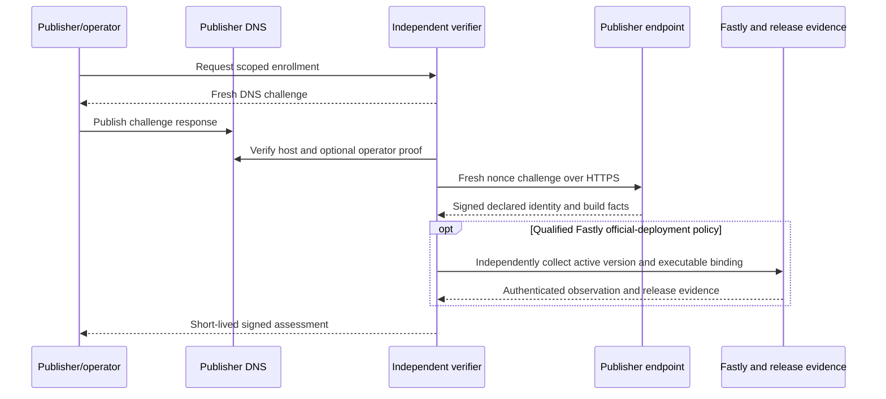
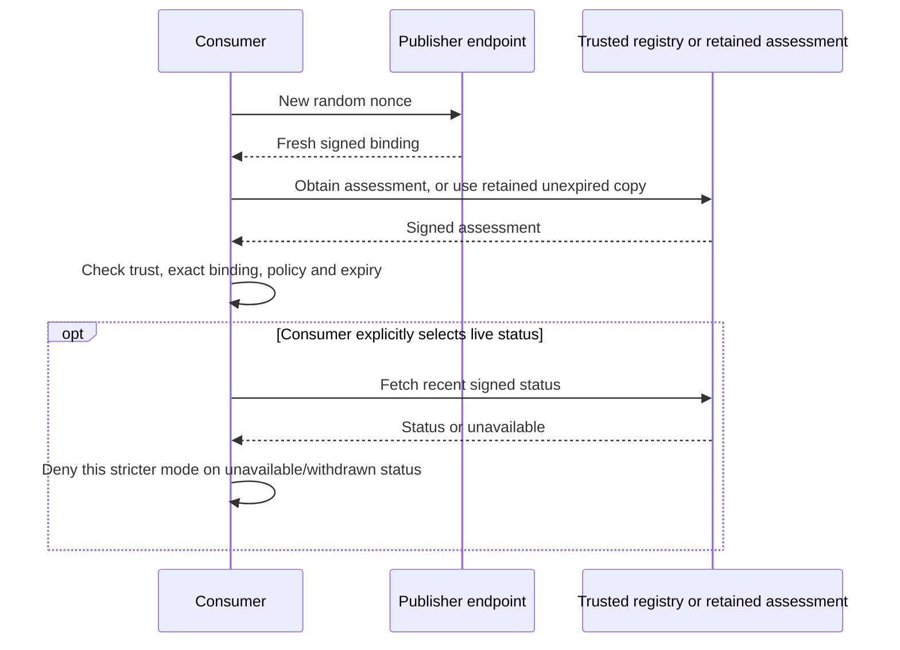

# Publisher attestation: registry protocol and operations

**Date:** 2026-11-04. **Status:** Proposed registry-side contract; no deployed registry or qualified Fastly method is claimed.

**Parent:** [Publisher endpoint and common wire contract](2026-11-04-publisher-attestation-design.md). **Provider gate:** [Fastly executable binding](2026-11-04-publisher-attestation-fastly-qualification-design.md).

This companion specifies what an independent verifier signs and what a consumer checks. Registry hosting, administration, signer recovery and governance belong to that registry's operator; they do not run inside the edge publisher binary. The repository supplies a bounded reference verifier and a separately planned stacked demo, not an automatically accredited multi-tenant public service.

V1 defaults to expiry-only consumer acceptance. An assessment lives for at most 15 minutes from its oldest observation and no longer than applicable authorizations. Live status is optional and introduces availability, privacy and load costs. Known compromise/withdrawal is never ignored, but a consumer without a live update can accept until its assessment expires. Consumer trust roots are independently configured.

## Signed registry objects

### PA-ASSESSMENT: verifier payload

| Required field                    | Type and rule                                                                                        |
| --------------------------------- | ---------------------------------------------------------------------------------------------------- |
| `schema`                          | `ts-publisher-assessment-v1`                                                                         |
| `issuer`                          | Consumer-configured verifier identifier, canonical per parent PA-IDENTIFIER                          |
| `assessment_id`, `enrollment_id`  | Verifier-assigned canonical UUIDs                                                                    |
| `binding`, `binding_id`           | Full endorsed descriptor and its digest                                                              |
| `evidence_digest`                 | SHA-256 of collected evidence compact JWS                                                            |
| `observed_from`, `observed_until` | Ordered observation interval covering all successful checks                                          |
| `issued_at`, `expires_at`         | Ordered times subject to PA-TIME                                                                     |
| `policy`                          | Object: `id` string, `version` positive integer, `digest` of the verifier's retained policy document |
| `result`                          | `satisfied`, `not_satisfied`, or `indeterminate` under that policy                                   |
| `checks`                          | Object described immediately below                                                                   |
| `build`                           | Build appraisal object described immediately below                                                   |
| `reason_codes`                    | Unique sorted array of codes from the parent PA-FAILURE, empty allowed                               |
| `extensions`                      | Empty object                                                                                         |

`checks` contains exactly `host_authorization`, `key_possession`, `host_service_binding`, `active_version`, and `configuration`. Each is an object with `outcome` (`pass`, `fail`, `unavailable`, `not_assessed`), `method` (nonempty profile identifier string or null), `observed_at` (integer or null), and `evidence_digest` (digest or null). A pass requires a non-null method, non-null observation time, and retained evidence digest. `not_assessed` requires all three other fields null; a fail/unavailable outcome names the attempted method and may have null observation/evidence when collection did not complete. An unavailable/not-assessed outcome MUST NOT satisfy a required check.

Each check's `evidence_digest`, when not null, identifies what that check examined:

| Check                                    | `evidence_digest` value                                                            | Consumer use                       |
| ---------------------------------------- | ---------------------------------------------------------------------------------- | ---------------------------------- |
| `key_possession`                         | Equal to the assessment's `evidence_digest` (SHA-256 of the evidence compact JWS)  | Checkable: must match              |
| `configuration`                          | Equal to `binding.configuration.digest`                                            | Checkable: must match              |
| `host_authorization`                     | SHA-256 of the verifier's retained authorization record for the current generation | Opaque; supports audit and dispute |
| `host_service_binding`, `active_version` | SHA-256 of the verifier's retained, sanitized provider observation                 | Opaque; supports audit and dispute |

A passing `host_authorization` under `dns-key-control-v1` requires both exact site DNS/key enrollment and active PA-PUBLISHER account/site membership. `host_authorization.observed_at` is when the verifier rechecked both records during this collection, not when DNS control was last proved. The age of DNS proof is bounded by the 30-day publisher-record, site-enrollment and operator-authorization lifetimes, which also cap assessment expiry; version 1 gives consumers no field for a stricter DNS-freshness policy.

`build` contains exactly `provenance` (`official`, `custom`, `unknown`), `assurance` (`artifact_bound`, `fingerprint_only`, `declared`), `method` (string), `artifact_sha256` (digest or null), `provider_files_hash` (128 lowercase hex or null), `release` (object or null), and `coverage`. `coverage` is determined by `assurance`: `artifact_bound` requires `selected_executable_only`, `fingerprint_only` requires `provider_package_fingerprint` (the provider's hash of the whole uploaded package, which does not single out the executable that runs), and `declared` requires `declaration_only`. A non-null `release` contains `repository`, `tag`, `source_commit`, `asset_name`, `artifact_sha256`, and `verification_evidence_digest`; it names authenticated Layer 1 evidence, not runtime strings. `repository` is a nonempty `owner/name` string matched to the configured Layer 1 source; `tag` is a nonempty tag string validated under that release policy; `source_commit` is 40 lowercase hex characters; `asset_name` is one basename without slash, backslash, or dot-segment components; both digest members are SHA-256 digest objects. None of these members may be null inside a non-null release.

`provenance: official` requires `assurance: artifact_bound`, a non-null executable digest, and a verified eligible release with the same digest. `custom` may be independently observed or declared; the assurance field is mandatory and MUST be displayed alongside it. A publisher saying it customized code does not prove those bytes are installed. A custom classification requires the signed custom declaration or a retained custom-build appraisal; absence from the verifier's known release list alone means unknown, not custom. `fingerprint_only` MUST have null executable digest/release and MUST NOT be rendered as official. It records a provider fingerprint comparison, not a stronger claim. An artifact-bound custom build has a non-null independently bound digest and null official release. All other declared builds have null artifact digest/release and `coverage: declaration_only`.

A non-null `provider_files_hash` requires `checks.host_service_binding.outcome: pass` and `checks.active_version.outcome: pass`, plus a Fastly binding with non-null service ID, version and staging flag. Retained provider evidence MUST attribute the hash to that exact host-authorized service/version/environment, observed within the assessment interval. A publisher-supplied hash or a hash from an unattributed package cannot satisfy this rule. These checks establish context, not selected-executable binding or official provenance. Consumers reject a violated cross-field invariant as `malformed`.

Two built-in appraisal contracts are defined:

| Policy ID                       | Version 1 acceptance condition                                                                                                                                                                                                                                                                                                                                             |
| ------------------------------- | -------------------------------------------------------------------------------------------------------------------------------------------------------------------------------------------------------------------------------------------------------------------------------------------------------------------------------------------------------------------------- |
| `publisher-declaration-v1`      | Authorized enrollment; fresh evidence; exact authorized key/binding; valid configuration identity projection; explicit build declaration. Host-service and installed-artifact checks may be not assessed; the result must remain visibly self-declared                                                                                                                     |
| `fastly-official-deployment-v1` | Qualified Fastly active production service/version and host binding; artifact-bound official eligible executable; authorized host/key and structural projection-consistency checks pass. Configuration remains publisher-declared as scoped in the [parent PA-SNAPSHOT](2026-11-04-publisher-attestation-design.md#pa-snapshot-commit-only-to-a-defined-public-projection) |

Each built-in policy version has one canonical policy document, a closed JSON object with `schema: ts-publisher-policy-v1`. The assessment's `policy.digest` is the SHA-256 of the JCS form of that exact document, so every conforming verifier emits the same digest for the same built-in policy and consumers can pin `id`, `version` and `digest` together. A verifier MUST NOT change the semantics behind a built-in `id`/`version`; a change needs a new version and a new document. The normative [`publisher-declaration-v1` version 1 document](policies/publisher-declaration-v1.json) requires:

| Check or field         | Requirement for `result: satisfied`                                                             | Version 1 method identifier                                                                    |
| ---------------------- | ----------------------------------------------------------------------------------------------- | ---------------------------------------------------------------------------------------------- |
| `host_authorization`   | `pass`                                                                                          | `dns-key-control-v1`                                                                           |
| `key_possession`       | `pass`                                                                                          | `publisher-evidence-jws-v1`                                                                    |
| `configuration`        | `pass`                                                                                          | `public-identity-projection-v1`                                                                |
| `host_service_binding` | `not_assessed`, or `pass` with a method the consumer allowlists                                 | Assigned when a provider observation method qualifies                                          |
| `active_version`       | `not_assessed`, or `pass` with a method the consumer allowlists                                 | Assigned when a provider observation method qualifies                                          |
| `build.assurance`      | `declared`, or `fingerprint_only` with a method the consumer allowlists; never `artifact_bound` | `publisher-custom-declaration-v1` (custom) or `publisher-unspecified-declaration-v1` (unknown) |

Under any built-in policy, a `fail` or `unavailable` outcome on any check means the result is not `satisfied`. `fastly-official-deployment-v1` has no canonical document yet: its provider methods are assigned only when the Fastly qualification passes, and no conforming verifier issues it before then.

The declaration policy JCS SHA-256 digest is `18a2b4608f13f6d28a2439222731ef0e37dfabd64ee840a779ed9f60f2b2b2f3`. The [fictional official-shaped policy](policies/fictional-official-profile-v1.json) is a normative definition for synthetic cases only; it authorizes no real official method. Vectors copy these files, and regeneration reads them without redefining policy semantics.

Policy documents are normative evaluation inputs, not digest labels. Consumer administrators obtain built-in documents from the normative policy files linked here and custom documents from the policy owner out of band, validate them and pin their exact `id`, `version` and JCS SHA-256 digest in independent local configuration before enabling that policy. Issuer metadata advertises descriptors only; it is not a policy retrieval or trust update channel. Missing or mismatched documents fail `policy_untrusted`; no automatic fetch from an assessment-selected URL is allowed.

| Policy field                                                  | Normative evaluation                                                                                                                                                                          |
| ------------------------------------------------------------- | --------------------------------------------------------------------------------------------------------------------------------------------------------------------------------------------- |
| `checks.<name>.requirement: pass`                             | The named check must pass.                                                                                                                                                                    |
| `pass_or_not_assessed`                                        | The check may pass or be not assessed; fail/unavailable never satisfies it.                                                                                                                   |
| `checks.<name>.methods: null`                                 | A passing check must use a method in the consumer's independent allowlist.                                                                                                                    |
| `methods: [...]`                                              | A passing check must satisfy both this list and the consumer allowlist. An empty list permits no passing method; a not-assessed check needs no method.                                        |
| `build.assurance`                                             | The assessment assurance must be a member of this list.                                                                                                                                       |
| `declared_methods`, `fingerprint_methods`, `artifact_methods` | The list corresponding to the actual assurance restricts `build.method`, in addition to the independent consumer allowlist; null delegates to that allowlist, and an empty list permits none. |
| `max_assessment_lifetime_seconds`                             | Require `expires_at <= observed_from + limit`, in addition to PA-TIME and any stricter consumer bound. It is never measured from issuance.                                                    |

Consumers evaluate the complete pinned document at stage 8; a local `required_checks` override cannot weaken it. Independent consumer configuration may impose stricter requirements. Method trust is checked at stage 5, while a `satisfied` result that contradicts the known document's required outcomes is `malformed` at stage 8.

A verifier may add its own named policy, with retained policy digest, explicit check requirements, and consumer opt-in. A custom policy is not interchangeable with either built-in policy. No policy here certifies consent behavior, module safety, the truth of the full configuration, or outermost traffic placement. Additional profiles require their own reviewed specification, qualification, and negative tests before consumers enable them.

### PA-STATUS: signed withdrawal and key status

A verifier publishes a status object for a requested assessment. Required fields are `schema: ts-publisher-status-v1`, `issuer`, `enrollment_id`, `assessment_id`, `binding_id`, `publisher_key_kid`, `sequence`, `assessment_status`, `enrollment_status`, `publisher_key_status`, `reason_codes`, `issued_at`, `expires_at`, and empty `extensions`.

1. Statuses are `current`/`withdrawn` for the assessment, `active`/`withdrawn` for enrollment, and `active`/`compromised`/`retired` for the publisher key. `sequence` is a positive integer per enrollment, durably persisted by the verifier.

2. It advances only when the enrollment's recorded status state changes: an assessment or enrollment withdrawal, a publisher-key status change, or an authorization-generation change.

3. A status reissued or reused while that state is unchanged carries the current sequence, so concurrently current assessments in one enrollment, such as both versions during a rolling deployment, share it.

4. Withdrawal and compromise are terminal for their identifier.

5. Re-enrollment uses new identifiers; an expired assessment is not extended by a status response.

6. A current status means no withdrawal is recorded, not that a fresh provider observation occurred.

7. Before each current-status issuance or reuse, recheck publisher authorization/site membership, any applicable separate operator authorization, enrollment, publisher key, assessment, and verifier signing-key validity at the current time.

8. Its expiry is no later than the earliest of those authorization/assessment expiries and issued_at+60; a still-valid signature cannot extend an expired operator delegation.

9. On publisher-record or operator-record expiry/withdrawal, stop current-status issuance and positive assessment publication, mark affected enrollment authorization withdrawn, and advance durable generation/sequence.

10. Time passing across an expiry is a denial condition even if no event has yet updated the generation.

11. A publisher key rotation is a key transition within the enrollment (PA-ENROLLMENT): it advances the authorization generation and the sequence, the new key becomes `active`, and the old key becomes `retired` once its last assessment expires.

12. Superseding a service version does not withdraw its assessment: that assessment stays `current` until expiry and is not renewed (PA-TIME).

13. Recording a different accepted binding advances the authorization generation and therefore the public sequence under PA-RECOVERY.

14. An unexpired old-binding assessment can obtain a fresh `current` status at that new sequence; after seeing a higher sequence, consumers reject older statuses, not the still-authorized assessment merely because its binding is older.

15. Status MUST satisfy `issued_at < expires_at <= issued_at + 60`.

16. Consumers persist the highest seen sequence per verifier/enrollment, accept an equal sequence, and reject lower sequences.

17. A lower sequence means the status predates a recorded state change, so a superseded `current` status for another assessment in the enrollment is correctly rejected.

18. A fresh consumer may still accept an older signed status within its bounded lifetime; no instantaneous revocation is promised.

19. Compromised-key status affects all assessments for that key in that enrollment; known cross-enrollment reuse triggers investigation and withdrawal of each affected enrollment.

20. Status history and assessment expiry remain independent.

## Enrollment and independent trust bootstrap

### PA-PUBLISHER: authorize a publisher and its sites

1. Before site enrollment, the verifier maintains a publisher authorization record binding an authenticated account, canonical owner-domain `publisher_id`, explicitly authorized site hosts, proof method/evidence digest, inclusive `not_before`, exclusive `not_after`, approver, and withdrawal state. One account's owner identifier cannot be claimed by another account without an authenticated recorded delegation or recovery.
2. The default `publisher-owner-dns-v1` method proves technical control at `_ts-publisher.<publisher_id>`. The verifier creates a single-use ten-minute challenge binding its issuer, owner identifier, authenticated account reference, the exact proposed site set, random 32-byte nonce and issue/expiry times. Publish `ts-publisher-owner-v1=<base64url(SHA-256(JCS(challenge)))>` at that name. The verifier checks the exact TXT and outstanding challenge, and retains its evidence. This private administrative challenge is not a signed public object; its concrete API encoding is provisional and must be frozen before P1b implementation.
3. The publisher record is valid for at most 30 days after proof. Site membership is explicit, including unrelated DNS domains; adding sites or changing the authenticated account requires fresh publisher authorization. The same verified record can authorize several site enrollments without repeating owner proof for each site. Each site still independently proves its own exact host/key through PA-ENROLLMENT. Owner-domain DNS alone never proves site control.
4. Before enrollment, renewal and positive publication, require an active record with exact publisher/account equality, the site in its authorized set and `not_before <= now < not_after`. Cap assessment expiry by this record as well as site/operator/key authority. Missing, foreign-account, unproven, out-of-scope, expired or withdrawn records fail `publisher_unauthorized`.
5. Withdrawal of a publisher record withdraws its affected site assessments and fences their collectors/signers through PA-RECOVERY. Removing one site affects that membership only. Account transfer/recovery requires independently authorized new proof; the old site key cannot authorize it. A consumer relies on the issuer's signed membership assertion, rather than reading private account records.
6. The owner-domain identifier permits comparison with ads.txt `OWNERDOMAIN` and seller-domain records, but equality alone does not validate those files, seller IDs, legal ownership or business relationships. Those checks remain independent consumer policy.
7. V1 requires a distinct key for each site enrollment, including sites of one publisher. Reuse is a provisioning error requiring investigation and withdrawal of every affected enrollment, rather than an authorized sharing mode. The narrower compromise radius costs one to four secrets per site and per-site rotation work; publisher-wide keys need a separately approved profile.

### PA-ENROLLMENT: authorize before endorsing

1. The reference verifier accepts enrollment only through an authenticated operator workflow, not an anonymous public URL submission that automatically grants trust.

2. Required private enrollment input is the full authorized tuple from PA-IDENTITY, publisher contact/recovery authorization, public key and validity, and selected policy.

3. Provider observations additionally require an existing Fastly service ID, intended host mapping, and narrowly scoped provider credentials.

4. The declaration profile can be satisfied without provider credentials or release acquisition; when no provider observation is collected, provider checks are not assessed.

5. An optional fingerprint observation requires independent provider credentials and the host/service/version checks above, without upgrading declaration acceptance to official assurance.

6. A Fastly service ID remains part of the operator-declared enrolled tuple; Axum declarations are isolated development fixtures with null service identity; no production/staging Axum support is introduced.

7. No signing private key is submitted to a verifier.

8. The authenticated enrollment account MUST have a verifier-maintained authorization record permitting any non-null `operator_id` it submits.

9. Null means publisher self-operation; the intersection of publisher-record and site host/key authorization supplies the finite authority interval and no separate operator identity is asserted.

10. That record binds account identity, the exact canonical operator identifier, permitted publisher/deployment scope, authorization method, approver or delegating authority, evidence digest, validity interval, and withdrawal state.

11. The default version 1 operator-control method, `operator-dns-control-v1`, is a fresh DNS proof at `_ts-operator.<operator-host>` with value `ts-operator-v1=<base64url(SHA-256(JCS(enrollment-challenge)))>`, using the same exact identifier, publisher/deployment/key scope, verifier issuer, nonce, and ten-minute deadline as the publisher challenge.

12. The host is parsed from the authorized HTTPS operator identifier under PA-ROUTING; the verifier performs no arbitrary URL fetch.

13. Operator DNS control grants technical authority for that identifier/scope, not a legal relationship.

14. The optional path is descriptive: the DNS controller can authorize every path under the same operator host, so distinct paths do not establish independent operators.

15. A documented preapproved association or delegation may be a separately named consumer-opted-in method; a self-submitted URL, publisher DNS proof, key possession, or an authenticated login alone does not establish that association.

16. Do not fetch an arbitrary operator URL to manufacture proof.

17. If the record is absent, expired, outside scope, or withdrawn, fail enrollment with `operator_unauthorized` before any positive assessment.

18. Retain and recheck the authorization record on renewal, recovery, and assessment publication.

19. A legitimate operator-identifier change, including switching between self-operation and a separate operator, requires new authorization/binding.

20. An old publisher-key signature alone cannot authorize a third-party operator.

21. Prefixed DNS owner names must fit DNS length limits; unrepresentable challenge names fail enrollment explicitly.

The verifier MUST also establish DNS control for the exact host and proof of possession of the exact key, rather than treating either as sufficient alone. A parent publisher domain is descriptive; it does not authorize arbitrary subdomains. Every host is enrolled explicitly. Neither a wildcard nor a string suffix check grants enrollment.

22. The verifier creates a single-use enrollment challenge: a closed JSON object with `schema: ts-publisher-enrollment-challenge-v1`, `issuer`, `host`, `publisher_id`, `operator_id`, `deployment_id`, `provider`, `service_id`, `environment`, `publisher_key_kid`, random 32-byte base64url `nonce`, `issued_at`, and `expires_at` with `issued_at < expires_at <= issued_at + 600`.

23. The operator publishes `ts-publisher-v1=<base64url(SHA-256(JCS(challenge)))>` as a TXT value at `_ts-attestation.<host>`.

24. The verifier retains the exact challenge and hash, checks that value before its deadline using a documented trusted resolver, and does not accept unrelated existing tokens.

25. A TXT record split into DNS character strings is joined within that one record; separate records are never concatenated.

26. The DNS check, any operator DNS check and the key-possession fetch that follows must all complete before the challenge's `expires_at`; otherwise the attempt fails and a new challenge is required.

27. Verifiers SHOULD confirm the TXT value from more than one network vantage point to reduce exposure to localized DNS hijacking, and record which resolvers they used.

28. The verifier then fetches fresh HTTPS publisher evidence and verifies it with the proposed key, matches the enrolled tuple, and corroborates provider host/service ownership and production version where the chosen policy requires them.

29. Only after these steps may it issue an enrollment ID and assessment.

30. DNS proves technical control under the resolver trust model, not legal ownership or that all requests use Trusted Server.

31. DNSSEC validation status is retained; absence does not become a false DNSSEC claim.

32. The operator may remove the enrollment TXT value after success.

33. An explicit loopback development fixture substitutes a manually pinned host/key authorization for DNS and uses a separate test trust configuration; its environment is development, it cannot produce the production profile, and its objects MUST NOT be accepted by production trust configuration.

34. Enrollment expires after at most 30 days and requires new DNS and key-possession challenges to renew.

35. This is deliberate fresh-control proof, not a promise of zero DNS operations.

36. Operator tooling SHOULD automate challenge publication, propagation checks, retry within the deadline, cleanup, and renewal scheduling using publisher-controlled DNS credentials; registries receive no DNS write credentials.

37. For `operator-dns-control-v1`, operator authorization expires no later than 30 days after successful proof and no later than the publisher enrollment; a shorter registry policy may apply.

38. Each site/deployment/key scope needs a fresh challenge at renewal. A publisher with 200 sites and two verifiers needs about 400 site DNS changes every 30 days, each within its ten-minute challenge window, plus owner-record renewal and any distinct operator proofs. V1 accepts this burden and requires operator tooling to automate it; no single owner proof replaces site control.

39. Separately approved delegation methods must state their own finite maximum lifetime.

40. Persistent per-site delegation to a verified publisher/issuer, with owner-level fresh renewal, is the named task-force alternative. Multi-site publishers are the driving case; delegation needs finite validity, removal, compromise and revocation rules before adoption.

41. Propagation failure leaves the existing unexpired authorization unchanged and cannot silently extend it.

42. A new key requires new proof and enrollment authorization; possession of an old key alone cannot authorize recovery.

43. A routine rotation is a key transition within the existing enrollment: the verifier issues a fresh challenge naming the successor thumbprint, proves possession through `?kid=<successor>` before the successor is active (parent PA-KEYS), records the successor under a new authorization generation, advances the status sequence and issues the successor binding's assessment.

44. Compromise recovery is different: it withdraws the enrollment and re-enrolls under a new `enrollment_id`.

45. Production/staging, host, publisher/operator, deployment ID, or service changes require explicit enrollment review.

46. A new service version within the enrolled service requires a new assessment/binding, not automatically new DNS proof.

47. Suspected DNS/host ownership changes suspend renewal until reauthorization.

### PA-ENROLLMENT-API: provisional operator-interface sketch

The following is a candidate follow-up for a common operator interface, not a frozen v1 wire API or a P1a prerequisite. P1b uses the authenticated enrollment workflow and operator-supplied inputs defined by PA-ENROLLMENT and PA-REFERENCE. A future interoperable API needs exact field names and closed request/response schemas, identifier formats, authentication/authorization binding, errors, response/work limits, idempotency and credential-provisioning rules before a tool can claim compatibility across verifiers. The paths below are illustrative operations under a configured issuer base:

| Operation                                                         | Request                                                                                                                | Response                                                                                                                         |
| ----------------------------------------------------------------- | ---------------------------------------------------------------------------------------------------------------------- | -------------------------------------------------------------------------------------------------------------------------------- |
| `POST {issuer}/v1/enrollment-requests`                            | The PA-IDENTITY tuple, the publisher public JWK with `not_before`/`not_after`, and the requested policy `id`/`version` | `201` with `request_id`, the challenge object, and each TXT owner name and value to publish (publisher and, if any, operator)    |
| `POST {issuer}/v1/enrollment-requests/{request_id}/verify`        | Empty                                                                                                                  | `202`; the verifier checks DNS and key possession before the challenge expires                                                   |
| `GET {issuer}/v1/enrollment-requests/{request_id}`                | None                                                                                                                   | `state` (`pending`, `verifying`, `enrolled`, `failed`), `enrollment_id` when enrolled, and PA-FAILURE `reason_codes` when failed |
| `POST {issuer}/v1/enrollments/{enrollment_id}/key-transitions`    | The successor public JWK with validity                                                                                 | `201` with a new `request_id` and challenge naming the successor thumbprint; continue with `verify` and `GET` as above           |
| `POST {issuer}/v1/enrollments/{enrollment_id}/reassessment-hints` | Optional `expected_binding_id`                                                                                         | `202`; rate-limited and coalesced per enrollment; an untrusted scheduling hint only                                              |

In this sketch, renewal would reuse `enrollment-requests` for the same tuple and return the existing `enrollment_id` on success. The later wire contract must make each request/response a closed JSON object and reject unknown members. No enrollment interface may accept publisher private keys, DNS credentials or provider write credentials. Nothing here authorizes fetching an untrusted issuer endpoint or sending it credentials.

### PA-TRUST: discovery is not authority

Consumer trust configuration supplies verifier ID, pinned public keys and validity, permitted policies/methods, acceptable releases, expected host/environment, observation age, and status requirements. The publisher's bounded `verifiers` discovery list is only an untrusted hint; a consumer queries only publication bases it configured for issuers it independently trusts. Unknown issuers, self-provided trust roots, unapproved policies, and additional untrusted endorsements cannot turn rejection into acceptance.

The first consumer policy accepts one independently configured verifier; multiple-verifier support means evaluating each signed assessment independently. A consumer may require a threshold of distinct configured issuers whose accepted assessments match the same binding ID. Repeated keys/objects from one issuer count once. This is not evidence that organizations are operationally independent. There is no protocol-wide majority vote or mandatory registry.

Trust-anchor rotation occurs through an authenticated consumer configuration update with an overlap period. A new root published solely in an untrusted assessment is not accepted. Verifiers retain historical public keys for audit verification. Compromise of a verifier key requires consumer trust withdrawal and reissuance through trusted recovery, not a status response signed only by that compromised key.

Each verifier publishes an unsigned issuer metadata document at `GET {issuer}/v1/issuer` with `schema: ts-publisher-verifier-metadata-v1`, `issuer`, `publication_bases` (1–4 canonical HTTPS identifiers where its read surfaces can be fetched, normally including the issuer itself), `keys` (1–4 entries of `kid`, `jwk`, `not_before`, `not_after`), `policies` (up to 16 entries of `id`, `version`, `digest`), and `live_status` (boolean: whether it serves PA-STATUS). The document is a convenience for setting up consumer configuration and is untrusted until an administrator confirms it out of band and pins it; fetching it never changes trust on its own. Every verifier signing key has a finite, published validity; the maximum is a governance decision (parent task-force question 8).

Consumer trust configuration maps each trusted issuer to one or more publication bases. A base may be the issuer's own service or an untrusted mirror or directory, such as a third-party registry that aggregates several verifiers. A mirror never adds trust: the consumer verifies every object it returns against the pinned keys of the object's `issuer`, exactly as if the issuer had served it.

## Collection, freshness, and monitoring

### PA-COLLECTION: deterministic independent assessment

For each assessment, the verifier performs these steps under an operation ID and a total 60-second collection deadline. Provider/release steps apply only when required by the selected policy or explicitly requested as additional observations. When no additional provider observation is requested, the declaration profile skips provider/release steps and records those checks as `not_assessed`; it still validates enrollment, evidence, actual descriptor/projection consistency, clock, and key possession. Optional provider observations must satisfy their contextual evidence requirements and never upgrade declaration acceptance to official assurance. Production Fastly declarations require real DNS/TLS enrollment; Axum uses only the isolated development fixture exception:

1. Load an active enrolled tuple, trusted publisher key, and appraisal policy; load provider credentials and authenticated release eligibility policy only when the selected collection requires them. Checking current enrollment state is a new observation; the retained original DNS proof has its own historical timestamp and 30-day authorization deadline and is not misrepresented as a new DNS lookup.
2. Read provider host/service mapping, production active version, package identity and required resource links without reading the app-config payload solely for the identity projection. Record retrieval timestamps and retained response digests privately.
3. Fetch fresh evidence with a new unpredictable nonce over authenticated HTTPS to the expected host. Verify signature, clock, enrolled key, host, environment, descriptor/projection hashes, and all tuple values.
4. Compare reported service/version with independently observed state. Never use a report's service ID as authorization to query another service.
5. Apply the qualified selected-executable binding method, if available. Verify retained official release bytes and eligibility; classify the outcome without upgrading a fingerprint match into artifact binding.
6. Repeat provider version/host observations and, when needed, a fresh evidence challenge to detect declared-identity changes. On a detected race, discard the collection and make at most one fresh attempt within a new bounded operation. Never combine old/new observations into one successful interval.
7. Calculate results under the named policy; sign an assessment referencing exact evidence and policy digests. Persist the object and evidence before advertising success.

No write or deployment is necessary for collection. Missing credentials, 403/429, outage, incomplete audit pages, malformed provider responses, or unavailable release evidence produce unavailable/indeterminate results, not a successful downgraded official assessment. A verifier may separately issue a clearly named declaration assessment after its own required checks; that is a different result, not continuation of the failed policy.

### PA-TIME: bounded acceptance

Evidence lifetime is at most 60 seconds. Verifier assessment issuance MUST occur within 60 seconds after `observed_until`. An assessment MUST satisfy `observed_from <= observed_until <= issued_at < expires_at <= observed_from + 900`. Its expiry is also no later than publisher-authorization, publisher-key, enrollment, verifier-signing-key, or any applicable separate operator-authorization expiry; self-operation uses the finite publisher enrollment authority. The verifier computes that minimum at commit/publication, not just when collection begins. A publisher record or non-null separate operator claim with no independently established finite validity interval cannot authorize a positive assessment. Old observations cannot receive a new 15-minute lease by re-signing them.

Consumers require `issued_at <= now + 30`, unexpired evidence/assessment (valid while `now < expires_at`) and any explicitly required status, and `observed_until <= issued_at`. Clock skew allowance applies only to future issuance. Pinned verifier keys and authorization records require exact inclusive not-before and exclusive expiry boundaries; skew never extends either authority. A consumer may require a shorter observation age or lifetime. All interval and cross-object relationships are validated even when signatures are correct. A failed platform time operation is endpoint 503 (the endpoint cannot detect arbitrary clock drift); verifier clock failure stops issuance; consumer clock failure stops current-assurance acceptance.

The default verifier renews positive assessments every five minutes, subject to provider rate limits and a configured queue. For the monitored Fastly profile it polls provider version/host state at least every 60 seconds; a new signed projection is checked for consistency during renewal. V1 deliberately uses polling. Audit-log polling may trigger earlier rechecks only after event visibility/completeness is qualified; no push feed or complete audit history is assumed. If that monitoring interval cannot be maintained, stop representing the service as currently monitored and stop new positive official assessments until a complete collection succeeds. Previously issued assessments retain their explicitly bounded validity unless withdrawn.

An ordinary deploy changes `service_version` in the binding. Fresh version-43 evidence cannot be combined with a version-42 assessment, even if that assessment has not expired. There is therefore an expected unendorsed interval after activation until a complete new-version assessment is published. How long it lasts depends on how the verifier learns of the new version:

- **Monitored Fastly profile (provider polling):** up to the 60-second polling interval plus collection and publication time.
- **Declaration profile without provider observation:** the verifier learns of the new version only when fresh evidence reports it, so up to the 5-minute renewal interval plus collection and publication time, unless a reassessment hint (below) arrives sooner.
- **Either profile:** longer during outages or queueing.

This is a loss of endorsement, not necessarily website availability. Rolling deployments may expose both versions; consumers require an assessment matching whichever version answered and MUST NOT fall back to an old-version assessment. The superseded version's assessment therefore stays published and `current` until its own expiry, so POPs still serving the old version remain endorsed during propagation; the verifier stops renewing it once the new version is the active one. Publisher tooling SHOULD request prompt reassessment after activation through the registry's authenticated enrollment-management interface; PA-ENROLLMENT-API sketches a possible later transport rather than requiring one in v1. Such a request is rate-limited and coalesced by enrollment, carries only the enrollment and an optional expected binding, and is an untrusted scheduling hint: it never supplies observation evidence, selects arbitrary fetch targets, bypasses the complete collection, or guarantees zero gap. Baseline renewal and polling remain sufficient for protocol conformance.

Observed changes trigger reassessment, but only some justify withdrawal:

- **Reassess, do not withdraw:** a new active service version, or a completed key transition. Each produces a new binding within the enrolled tuple; the old binding's assessment is still accurate for that binding, is not renewed, and lapses at its own expiry.
- **Stop positive issuance pending enrollment review:** a changed declared identity projection. Its five fields are the enrolled tuple, so a change (for example a new `deployment_id` or `environment`) is outside the enrollment and receives no positive assessment until the enrollment is reviewed; existing assessments lapse at expiry unless the change also indicates lost authorization.
- **Withdraw known affected assessments:** loss of the authorized host mapping, loss or expiry of publisher, enrolled or operator authorization, a provider observation contradicting the binding (`artifact_mismatch`, host or service mismatch), and key compromise. Withdrawal advances the status sequence.

A confirmed key compromise also changes key status. API unavailability alone is not a declaration that the publisher key was compromised. Monitoring credentials being revoked prevents further positive collection.

The v1 default consumer policy uses short assessment expiry alone and does not require a live registry status call. A previously obtained assessment and fresh publisher evidence may be checked without contacting the registry while their validity and independently configured trust policy hold. Registry unavailability prevents obtaining/renewing assessments but does not shorten an existing assessment to 60 seconds. Known withdrawal or compromise evidence is never ignored; without a live update the consumer may continue accepting until the existing assessment expires, at most the remaining bounded lifetime.

Live-status checking is a separately configured stricter consumer mode, not a field selected by the publisher or an implicit v1 requirement. That mode requires a signed status no older than 60 seconds and denies acceptance on status failure. It introduces registry availability and query-observation dependencies: the registry may learn the checking client's network identity and publisher interest. The collector and consumer must document that choice and its privacy/load implications. Default expiry-only consumers cannot claim prompt revocation. Initial assessment discovery or renewal can still reveal a client's network identity and publisher interest; retaining a valid signed copy avoids a mandatory new registry query for each check, not all registry traffic. No per-bid registry lookup or auction/bid transport is specified here.

## Consumer acceptance

### PA-CONSUMER: acceptance algorithm

A current publisher check MUST:

1. Take expected host/environment, trusted issuers/keys, permitted policies/methods, and freshness/status settings from independent configuration.
2. Generate a fresh nonce and fetch publisher evidence. Strictly validate the JWS and schema, and verify the signature with the key in the evidence's own `binding.attestation_key`, whose thumbprint must equal the protected-header `kid`. That key is endorsed only through binding equality in step 4. Require the payload `nonce` to equal the generated nonce byte for byte (`nonce_mismatch`) and evidence times to satisfy PA-TIME (`stale`). Unsigned discovery may supply candidate bytes only. A valid evidence signature alone is self-declared, not independently trusted.
3. Verify each candidate assessment with an allowed verifier key and exact message type, then validate policy, result, intervals, enrollment status, build assurance, release eligibility, and required check outcomes.
4. Require full descriptor and binding-ID equality between fresh evidence and assessment, including host, deployment ID, service/version/environment, projection, key material, and validity.
5. Under the default expiry-only mode, enforce assessment expiry and any independently known withdrawal/compromise. Only if the consumer explicitly requires live status, fetch it from the independently configured verifier base and match issuer, enrollment, assessment, binding, key, sequence, and timing; a live-status failure denies that stricter mode. A publisher cannot disable the consumer's configured checks.
6. Apply the consumer's distinct-issuer threshold to matching accepted assessments. Return structured reasons and the accepted scope. No acceptable assessment means unendorsed, not a registry-verified success.

Consumers evaluate in this order and report the reason code of the first stage that fails; they may also report later failures for diagnostics, but acceptance depends only on the first:

1. Bounded decoding, duplicate-member rejection and limits (`malformed`).
2. Protected header and message type, and lookup of an active independently pinned verifier key (exact kid, JWK, and `not_before <= now < not_after`) for an assessment/status issuer (evidence uses its binding key with matching thumbprint, pending endorsement) (`signature_invalid`; an unknown issuer is `policy_untrusted`).
3. Strict Ed25519 signature verification (`signature_invalid`).
4. Payload schema and cross-field consistency, including digest equalities and the per-check digest rules above (`malformed`). First reject a Fastly staging/environment contradiction as `environment_mismatch`; an untrusted signer cannot bypass this binding invariant.
5. Issuer, policy `id`/`version`/`digest` and method allowlists (`policy_untrusted`).
6. Time: future issuance beyond the skew allowance, expiry, observation age (`stale`, `clock_unavailable`); for fresh evidence, first require exact equality with the locally generated nonce (`nonce_mismatch`).
7. Exact equality with fresh evidence: host, environment, binding (`host_mismatch`, `environment_mismatch`, `binding_mismatch`).
8. `result` against the policy's required checks; a `satisfied` result contradicting them is `malformed`. A well-formed `not_satisfied` or `indeterminate` result is rejected with `policy_untrusted`, with its signed reason codes available as supplemental diagnostics.
9. Build assurance and release eligibility against the consumer's requirement (`artifact_binding_unproven`, `release_ineligible`).
10. Live status, only when the consumer requires it (`withdrawn`, `key_compromised`, `status_unavailable`).
11. Distinct-issuer threshold (`policy_untrusted`).

The check returns a consumer result, a local object that is not signed and not transmitted: `host`, `environment`, `accepted`, the accepted scope (policy, assurance, issuers and `binding_id`), `reason_codes`, `evaluated_at`, and `valid_until`. `valid_until` is the minimum deadline for the selected assessments that satisfy the distinct-issuer threshold: their `expires_at`, any independently configured trust-key validity limit, and any configured observation-age deadline derived from the original observation times. Only when live status is required, also include each required status's `expires_at` and `issued_at + configured_status_max_age` (at most 60 seconds). A shorter configured cache lifetime is measured from `evaluated_at`; reading a cached result never resets any deadline. Expiry-only mode does not acquire a live-status requirement or a 60-second status cache limit. A cached positive result MUST NOT be used at or after `valid_until`; it must also be invalidated on newly known withdrawal/compromise or a relevant change to the consumer's trust, policy, threshold or status settings. In live-status mode, cache state retains each supporting status's issuer, enrollment and sequence; learning a higher sequence for that issuer/enrollment invalidates a result supported by an older status until fresh matching status is checked. Cache entries are scoped to that consumer configuration, and say that the host answered a fresh challenge only as of `evaluated_at`, not at every later cache read.

Publisher-authorization, operator-authorization, durable-state and signer-fencing conditions are verifier issuance preconditions, not consumer inputs. A consumer cannot observe them; it relies on assessment and status expiry being capped by those authorities (PA-TIME). The public vectors mark each case as a consumer-acceptance or a verifier-issuance case accordingly.

The assessment-only operation is explicitly historical/bounded-observation verification. Without fresh publisher evidence it cannot claim that the host responded now. Conversely, a fresh publisher response cannot refresh an old assessment. Consumers MUST NOT accept `result: satisfied` without evaluating the policy and concrete required fields. A known policy with `result: satisfied` and a failed/unavailable/not-assessed required check is internally contradictory and rejected as `malformed`; `policy_untrusted` also covers an honest unsuccessful policy result; malformed is reserved for contradictory or structurally invalid claims.

### PA-REFERENCE: tools and registry boundary

The delivery includes a host-target reference verifier/collector and a pure verification library, with machine-readable results and offline historical verification. Planning must select its concrete crate/CLI placement without making runtime core depend on host HTTP, GitHub CLI subprocesses, or credentials. Use a separate host-only verifier binary/crate sharing the pure verification library. Publisher provisioning belongs to a distinct attestation command namespace, not request-signing `ts keys`. Placement alone establishes no independence: a publisher-run verifier produces a self-assessment, and consumers MUST NOT configure it as independent merely because it runs this reference software. Independent trust requires an out-of-band decision about who operates the signing key. Names of future commands are not frozen by this spec.

The reference collector consumes operator-supplied enrollment and, only for provider-backed profiles, read-only provider credentials, retains evidence, and produces signed assessments/status. Its local state writes are atomic and restrictive. A production operator owns scheduling, authenticated administration, durable sequence allocation, backup, serving, abuse controls, and signer isolation. Advance the status sequence and persist the changed status state atomically before signing or publishing a status that reflects the change, following PA-RECOVERY below. A failed publication must not undo recorded withdrawal. After restart, never reset a sequence; if durable monotonic state cannot be recovered, stop current issuance and use authenticated recovery with a new enrollment identifier rather than risk rollback. A deployment of this reference component is not automatically an endorsed public registry. A full multi-tenant hosted registry and UI require a separate operational design. The named demo-registry follow-up below is a smaller illustrative deployment, not a production accreditation service.

### PA-RECOVERY: fence stale collectors and restored state

All registry modes, including expiry-only, must prevent new issuance from known withdrawn or stale restored authorization. The following production recovery design is registry-side qualification work. Each enrollment has an authoritative authorization generation in addition to its public status sequence. Changing publisher membership/authorization, operator authorization, enrollment/key status, accepted binding, or withdrawal increments that generation in a serialized durable transaction. A collector captures the generation when it starts and, immediately before committing a positive assessment, rechecks the generation, current authorization/key/enrollment validity, expiry deadlines, and policy. Commit uses compare-and-swap against that generation; an intervening withdrawal/change discards the candidate. A generation change fences in-flight work; it does not by itself withdraw previously issued assessments. The enrollment retains the authorized key/binding records needed to serve current status for an unexpired superseded assessment, unless those records are independently withdrawn, expired or compromised. Recording a different accepted binding advances both generation and public status sequence, while renewing the same binding does not; old assessments can receive fresh statuses carrying the current sequence without renewing their assessment lifetime. Signing/outbox publication is likewise gated on the current generation, so a pre-withdrawal job cannot publish a new positive assessment or `current` status afterward. Already delivered objects retain only the bounded exposure explicitly described in PA-TIME.

Local persistence alone does not prove a restored backup is current. A production registry offering the monitored/live-status contract MUST have a trusted recovery checkpoint outside the rollback domain of its ordinary backups. That checkpoint binds enrollment ID, highest allocated sequence, authorization generation, a digest of the authoritative authorization/withdrawal state, and a current signer fencing epoch. It is updated monotonically and acknowledged before any affected object is signed/released. A checkpoint digest covers authorization state rather than secrets or raw credential responses. A database transaction/outbox and checkpoint protocol must treat a partially acknowledged transition as pending and fail closed; it cannot sign using a guessed earlier state. A deployment unable to supply and qualify this checkpoint mechanism cannot offer the monitored production profile.

Every restart or restore verifies local state against the trusted checkpoint and obtains the current exclusive signer epoch. A lower sequence/generation, inconsistent state digest, unknown checkpoint, stale epoch, or checkpoint outage fences signing, positive collection commits, and current-status publication with `state_recovery_required`. A restored process does not automatically overwrite the checkpoint or reset sequence state. Authorized recovery restores the latest corroborated state or withdraws the affected enrollment through trusted administration and re-enrolls with a new identifier; an old backup/key cannot authorize its own clean replacement. The checkpoint/signing owner must ensure a fenced old worker cannot continue publishing through another outbox or signer instance. Retained historical verification remains available without a current-assurance claim.

Qualification must exercise restore of an internally valid backup that predates a withdrawal, crashes on both sides of checkpoint acknowledgment, duplicate/fenced signer instances, and a delayed collector completing after compromise. This registry-side contract specifies the required invariant; the concrete transaction/checkpoint backend and its failure proof belong to P3's bounded operational plan. The edge endpoint and local protocol fixtures do not implement that production backend. No distributed-store atomicity or safe backup restoration is assumed merely because local files use atomic rename.

### PA-PUBLICATION: verifier read surfaces

A publisher-level site-list read surface (for example `/v1/publishers/{publisher}/sites`) is a named follow-up requiring bounded pagination and withdrawal semantics. Current consumers still discover and independently verify exact-host assessments; they cannot treat an unsigned owner grouping as endorsement. Multi-site and foreign-account squatting fixtures cover the PA-PUBLISHER issuance rule.

A minimal verifier publication service exposes these read-only paths under an independently configured HTTPS base:

| GET path                                                           | Response                                                                                                                               |
| ------------------------------------------------------------------ | -------------------------------------------------------------------------------------------------------------------------------------- |
| `/v1/hosts/{canonical-host}/assessments?environment={environment}` | JSON with exactly `schema: ts-publisher-assessment-list-v1`, `host`, `environment`, and `assessments` (at most 16 compact JWS strings) |
| `/v1/assessments/{assessment_id}`                                  | Exact assessment compact JWS, `application/jose`                                                                                       |
| `/v1/assessments/{assessment_id}/status`                           | Signed status compact JWS, `application/jose`                                                                                          |

The host lookup makes assessment discovery possible without putting changing assessment IDs in publisher evidence. Its list is only a transport hint; each signed object is independently checked against the fresh binding and configured issuer. The list includes the newest unexpired assessment for each `(issuer, binding_id, policy)` combination, so a mirror aggregating several verifiers keeps each issuer's assessment separate; it suppresses withdrawn entries. Optional query parameters `binding_id`, `policy` and `issuer` (each at most once, canonical values only) narrow the list; a consumer normally passes the `binding_id` from the fresh evidence it just verified. If more than 16 entries or more than the byte bound still match, the server returns 409 and the consumer retries with narrower parameters. Each compact JWS list item is explicitly permitted up to 32,768 ASCII bytes, overriding the ordinary claim-string limit; the entire decoded response including JSON framing is capped at 524,288 bytes. The server never silently omits applicable assessments. Unknown IDs/hosts return 404, unavailable status returns 503, and no public route exposes admin operations. Error bodies use the parent's closed `ts-publisher-error-v1` shape with codes `invalid_request` (400), `not_found` (404), `conflict` (409) and `unavailable` (503).

The status of an assessment that has expired returns 404 with error `not_found`; a status response is never `current` for an expired assessment, and a superseded but unexpired assessment keeps returning its real status.

Caching differs by response. A response from `/v1/assessments/{assessment_id}` is an immutable signed object and MAY carry `Cache-Control: public, immutable, max-age=<n>` with `n` no greater than the seconds remaining until its `expires_at`, so shared caches can absorb load; consumers still evaluate expiry themselves. List, status and key-history responses use `Cache-Control: no-store`. No redirect or unsigned success status is accepted. Consumers may instead receive explicit assessment files/IDs from independent input. The reference consumer's provider abstraction supports lookup, assessment, and status retrieval; it cannot assume a publisher-advertised endpoint is trusted. Enrollment, withdrawal, trust updates, and signer operations require authenticated administration and auditable authorization.

### PA-HOSTING: listing in an existing registry

An existing registry, for example an industry directory that already lists agents or other services, can host publisher attestation in either role:

- **As a mirror or directory:** it lists hosts and serves the PA-PUBLICATION read surfaces for verifiers it aggregates. It is untrusted; consumers verify each object against the issuing verifier's pinned keys.
- **As a verifier:** it also performs enrollment and signs assessments under its own issuer identifier and keys, and is then one verifier among possibly several, not a mandatory central authority.

Either way, these rules keep the registry's presentation honest:

1. Any additional transport, such as a registry's own REST API or MCP tool, MUST return the exact compact JWS bytes of each signed object. A re-encoded or summarized rendering is never a substitute.
2. A listing that shows verification marks MUST map them to the assessment's policy, `build.assurance`, issuer and `expires_at`. A bare check mark that hides whether a result is declared, fingerprint-only or official, or which verifier issued it, is not conforming.
3. A listing stops showing a host as assessed once its newest assessment has expired or been withdrawn, using the same rules as consumers.
4. The registry's own entry model (categories, descriptions, logos) is presentation only and never enters a signed object.

## Deliberate storage and access decision

Assessments are stored and served by their issuing registry, not written into publisher config/secret stores. This deliberately avoids granting verifiers provider write/deploy permission and avoids making renewal a publisher-store write transaction. Publisher discovery lists only untrusted issuer identifiers; actual trust comes from consumer configuration. A registry must not gain write access merely to make its endorsement appear on the publisher endpoint.

A Fastly read token is not a five-field disclosure channel. Depending on role/scope/resource permissions it can expose broader service and account configuration, including commercially sensitive settings. Service restrictions on `global:read` do not isolate non-service endpoints. Plaintext secret-store values are separately protected; do not claim that every secret is readable. The registry must inventory and disclose actual readable endpoints/resources and retention before enrollment. Removing the v1 full-config projection read reduces unnecessary collection, but does not narrow the provider credential's inherent access.

## Governance, withdrawal and publisher exit

Each verifier publishes its issuer/key identities, policy versions, assessment scope, suspension/withdrawal criteria, evidence-retention policy, administrative authorization roles, contact/appeal process, and consumer-mode availability expectations. No protocol participant gains authority over another verifier's assessments or the publisher's website.

- Authorized publisher administrators may request exit for their own enrolled tuple through the registry's authenticated administration channel. Verify an enrolled credential or approved recovery/fresh DNS proof, record the request, stop renewal immediately, and withdraw that registry's enrollment/assessments. A compromised publisher key alone does not authorize a clean replacement identity.
- The verifier's explicitly authorized incident/policy administrators may stop issuance or withdraw their own assessments for confirmed mismatches, lost authorization, compromise, or policy breach. Keep reason/evidence and timestamps; distinguish unavailable observations from misconduct or key compromise. Technical emergencies may be acted on immediately, with notice and appeal afterward.
- Give the publisher an explanation and a documented review/correction route. Sensitive provider evidence is not automatically public. An appeal cannot extend expired objects or turn a failed check into success. Corrected deployments receive new assessments; terminally withdrawn identifiers are not resurrected.
- Under expiry-only consumption, withdrawal/exit stops new issuance but previously delivered assessments can be accepted until their bounded expiry. Optional live-status consumers can learn a withdrawal sooner, subject to their stated freshness/network limits. DNS token cleanup or persistent-record deletion is not immediate revocation: DNS caches/serve-stale, polling, and outstanding assessments matter.
- Withdrawal affects only that verifier's signed endorsement. It is not a global kill switch, does not disable site traffic, and does not revoke another independent verifier's opinion. Consumers retain their own trust/acceptance decisions.

The task force and participating organizations must approve the governance and any registry service agreements before public production operation. This specification does not assign legal liability, create indemnities, or certify regulatory compliance; those questions remain explicit agreement/approval items rather than consequences of a valid signature.

## Public publisher-key history

The registry provides `GET /v1/hosts/{canonical-host}/key-history?environment={environment}` with an optional opaque `cursor` of 1–256 printable ASCII bytes. The JSON response is exactly `schema: ts-publisher-key-history-v1`, `host`, `environment`, `entries`, and `next_cursor` (null or a bounded printable-ASCII opaque string). Entries are closed objects containing an assessment compact JWS (at most 32 KiB) and an optional status compact JWS (at most 8 KiB, or null). Limit pages to 16 entries and 512 KiB including framing; page earlier when the byte bound is reached. Cursor values never name URLs. Unknown host/environment/cursor returns 404/400 as appropriate; responses use no-store.

History is a key log, not an assessment log: it holds one entry per `(issuer, policy.id, policy.version, policy.digest, publisher key kid, binding_id)` combination, carrying the most recent assessment issued for that combination and its latest status. Mirrors preserve each issuer/policy separately; an assessment from one verifier never replaces another verifier's evidence merely because the publisher key and binding match, so renewals every five minutes do not grow it. It retains entries for the documented retention window (90 days by default) and is ordered by the entry's assessment issuance time plus assessment ID. The list itself is an untrusted transport hint; independently verify every object's issuer, message type, signature and exact host. Expired/withdrawn objects are historical evidence only and cannot authorize current publisher keys, extend expiry, bootstrap a new verifier trust root, or prove completeness across other registries. A null/expired historical status does not establish current revocation state. Verifier signing-key history is a separate issuer trust-management responsibility; archived public keys never become trusted automatically.

## Stacked demo-registry follow-up

P4 is a named follow-up stacked on the approved publisher/reference-verifier protocol. It demonstrates enrollment, declared/custom/fingerprint/official labels, assessment lookup, optional status, publisher-key history, and a consumer verification walkthrough. Its initial inputs are fictional/local fixtures; an official-shaped fixture is marked synthetic and cannot claim a qualified live Fastly deployment. The demo's UI/hosting plan and data sources require separate review. It is not an acceptance dependency for the edge endpoint and does not authorize deploying an operational public registry.

## Registry verification matrix

| Family                   | Required cases                                                                                                                                                                                                                                                                                                                                                                                                                                                                                                                                                                                                                                                                                                                                        |
| ------------------------ | ----------------------------------------------------------------------------------------------------------------------------------------------------------------------------------------------------------------------------------------------------------------------------------------------------------------------------------------------------------------------------------------------------------------------------------------------------------------------------------------------------------------------------------------------------------------------------------------------------------------------------------------------------------------------------------------------------------------------------------------------------- |
| Enrollment/authorization | Owner-domain publisher proof; two unrelated sites of one publisher; foreign-account identifier squatting; missing/expired/withdrawn publisher record and site membership; assessment expiry capped by publisher authority; DNS reuse/expiry; key possession; unauthorized operator; self-operation; per-scope operator renewal and lifetime cap; recovery without old-key authority; canonical host across enrollment and index lookup                                                                                                                                                                                                                                                                                                                |
| Collection/network       | Qualified provider/release positive and negative cases; wrong service/version/staging; non-null hash without successful host/version checks; redirects/SNI mismatch; DNS rebinding; nonpublic addresses; proxy/token leakage; response bounds/deadlines/retries/429; no report-selected resource lookup                                                                                                                                                                                                                                                                                                                                                                                                                                               |
| Assessment semantics     | Exact binding; unsupported policy/method; canonical built-in policy digest; satisfied with failed/missing required check is malformed; per-check digest equalities; coverage determined by assurance; reversed intervals; oldest-observation expiry; full-size embedded JWS; declared/fingerprint/artifact-bound distinctions; official-shaped unqualified rejection                                                                                                                                                                                                                                                                                                                                                                                  |
| Consumer                 | Multiple issuers and duplicates; mirror-served objects verified against issuer keys; first-failure reason precedence; `valid_until` bounded by selected assessment/trust-key/observation deadlines and required live-status expiry/freshness; expiry-only cache unaffected by optional status; cache invalidated by known withdrawal or changed consumer policy; exact fresh-evidence binding match; compromised/withdrawn keys and enrollment; expiry-only outage tolerance; optional-live outage denial; sequence rollback; equal-sequence statuses for concurrently current assessments; superseded-version assessment still accepted for old-version evidence until expiry with a fresh status at the advanced sequence; rolling-version mismatch |
| Rotation and lifecycle   | Staged-key proof via `kid` before activation; key transition within the enrollment with the old key retired; challenge expiry covering DNS and possession steps; status 404 for expired assessments; key-history deduplication per key and binding                                                                                                                                                                                                                                                                                                                                                                                                                                                                                                    |
| Hosting                  | Additional transports return exact JWS bytes; listing marks map to policy, assurance, issuer and expiry; list filtering by `binding_id`, `policy` and `issuer`; cache headers per response type                                                                                                                                                                                                                                                                                                                                                                                                                                                                                                                                                       |
| Operations/recovery      | Poll/renewal outage; reassessment hint abuse/coalescing; publication failure; retained-state restart; stale checkpoint/backup mismatch; collector/signing race with withdrawal; operator expiry between collection and commit; assessment/status cap at authority expiry; current-status denial after expiry before any timer update                                                                                                                                                                                                                                                                                                                                                                                                                  |

These tests qualify registry/reference-consumer behavior separately from the publisher runtime. Provider executable binding still requires the companion's independent qualification evidence.

## Review log

- **Split-contract review (Codex, independent security and contract review):** Checked consumer defaults, operator proof, governance, history and trust. Corrected the shared configuration-method identifier; no blocking contract issue remained after correction. No registry deployment or provider qualification was performed.
- **Cleanup review (Codex, independent contract review):** Checked contextual fingerprint evidence, deployment gaps, operator lifetime, rejection semantics and test ownership; corrected declaration-profile wording to permit optional provider observations.
- **Cleanup follow-up (Codex, independent contract review):** No remaining blocking consistency findings. Structural and signature fixtures pass; runtime and provider qualification remain unexecuted.
- **Final detailed review (Codex, independent security and protocol reviewers):** No blocking findings. Clarified that declaration collection omits provider checks only when no optional observation is requested; contextual fingerprints retain their narrower assurance.
- **Gap review (Claude Code, independent security, consistency, implementability, adoption and lifecycle review):** Superseded-version assessments now stay valid until expiry instead of being withdrawn; built-in policies have a normative check table, method identifiers and a canonical policy document whose digest consumers pin; per-check digests and coverage follow defined rules (`provider_package_fingerprint` for fingerprint-only); key rotation is a transition within the enrollment with pre-activation proof; consumers follow a fixed evaluation order and produce a result with `valid_until`; verifier-only conditions are no longer consumer inputs. Added a provisional enrollment-API sketch, issuer metadata, mirror bases, list filters and caching, expired-status behavior, key-history deduplication and hosting rules for existing registries. Vectors were regenerated with new ephemeral keys and checked with two independent Ed25519 implementations. DNS-proof age stays bounded by enrollment lifetime rather than exposed; an issuer-allowlist record is left to the task force.
- **Self-review (Claude Code, independent contract review):** No blocking findings. Per-issuance status sequences could make a consumer reject a valid reused status for one of two concurrently current assessments during a rolling deployment; the sequence now advances only on recorded status-state changes, and the consumer matrix covers equal sequences.
- **Correction review (Codex, independent contract and security reviewers):** Preserved issuance fencing while allowing refreshed current-sequence status for superseded assessments; capped cached acceptance by all applicable deadlines, preserved issuer/policy history, and marked the incomplete operator API as provisional.
- **Correction follow-up (Codex, both independent reviewers):** No remaining blocking design/fixture findings after checking cache invalidation and boundary cases. Production registry operation and provider qualification remain unexecuted.

- **Maintainer-feedback correction (Codex):** Defined pinned policy-document evaluation, explicit consumer nonce/key checks and verifier independence; aligned development-only Axum and split P1a/P1b. Runtime and operated-verifier qualification remain outstanding.

- **Round-2 correction (Codex, internal author check):** Added owner-domain publisher authority with explicit account/site membership, per-site key costs and expiry caps. Corrected pinned-key, signed-status and first-failure fixture checks; extracted normative policies. The author check identified missing authority-bound admission, corrected with four regressions. This is specification/fixture evidence, not production qualification or maintainer approval.
