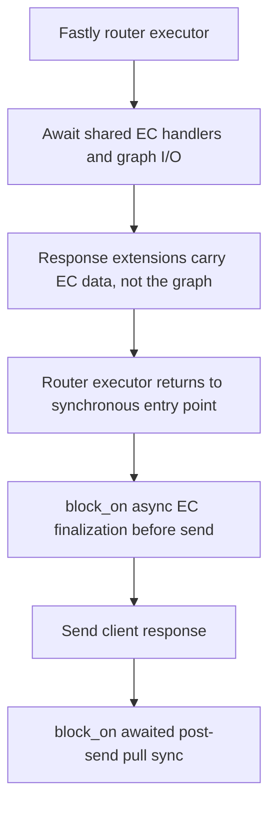

# Shared async EC persistence contract

Status: reviewed reconstruction of an implemented unit. Two independent reviews followed implementation and preceded readiness disposition; this does not record preimplementation approval or deployment readiness.

The scoped change is `2c79ea596621143c38167a0ee33e39d32696309e` to `7d0add324349f349933da1d8f85bb450b990f02b`. The implementation head has tree `77ce936af36cdf2233a2f53c8f739f0c56c02c5c`.

## Purpose and scope

Make shared Edge Cookie identity-graph I/O awaitable without requiring a multithreaded executor. Migrate the existing Fastly backend and all affected core callers together, while retaining consent, issuance, snapshot, write-precondition and failure policy.

The unit changes 14 Rust files. It adds no provider, configuration, dependency, Cargo feature, manifest or lockfile change. It does not implement or qualify native EC persistence. Axum, Cloudflare and Spin still pass no identity graph on their shared EC-consuming routes at this head.

The [request-snapshot design](2026-07-10-kv-eid-request-snapshot-ec-recovery-design.md) explains the existing policy. This document specifies the async boundary and its actual implementation, not a replacement policy or an extension of that older document's approval.

## Core contract

`crates/trusted-server-core/src/ec/kv_backend.rs` defines the object-safe `EcKvStore` boundary with `#[async_trait::async_trait(?Send)]`.

- `store_name` remains synchronous. Lookup, exact-key existence, insert, prefix listing, capped counting and delete return local futures. Neither stores nor futures require `Send` or `Sync`.
- `KvIdentityGraph` retains `Arc<dyn EcKvStore>`. Cloning that handle shares one backend; `Arc` does not make a non-`Send` backend safe to move to another thread. Callers drive and await work on their local executor. The unit adds no detached task or Tokio runtime requirement to the production interface.
- Lookup returns owned body bytes, optional owned metadata and a generation token, or `Ok(None)` for a missing key. Infrastructure errors remain `Report<TrustedServerError>`. Insert borrows the serialized body and metadata for its future's lifetime and retains TTL and `Add`, `Overwrite` or `IfGenerationMatch(u64)` intent.
- `Written` and `PreconditionFailed` remain distinct normal outcomes. An atomic Add must reject an existing key; a generation-conditional write must reject a stale token. Core, not the backend, owns retry and merge policy.
- Exact-key existence and bounded prefix listing must use strong state. A recently completed issuance must be visible even if ordinary lookup lags. A backend that cannot establish the required answer returns an error, not an eventually consistent guess. A full list page is potentially truncated, and counting is capped, not a total.

Making a method async permits suspension; it does not guarantee that every implementation yields. It also adds no operation deadline, transaction, automatic retry, cancellation rollback or guarantee that a dropped future did not commit a write. Callers must not infer completion without the returned outcome. Failure halfway through multiple store operations retains the existing partial-effect behavior.

## Preserved graph and privacy policy

`ec/kv.rs`, `ec/mod.rs` and `ec/finalize.rs` retain the following rules across every new await point.

1. Request snapshots remain `NotRead`, `Missing`, `Failed`, or `Present` tied to a particular EC ID. Present rows carry an optional generation. A successful write retains only persisted entry data and clears the generation because insert does not return its replacement token. A later writer refreshes before CAS. Read failure is not proof of absence.
2. Generation and orphan recovery use fresh IDs and Add, with at most five collision attempts. New browser issuance is not emitted without backing-row proof. Orphan rotation remains limited to eligible browser document navigations after a second lookup and a strong exact-key absence check. Generic enrichment and batch sync do not create missing roots. `create_or_revive` remains a separate explicit same-key operation, not the production generation path.
3. Partner-owned mutations and snapshot withdrawals retain at most five CAS write attempts, rereading on precondition conflict. Partner mutations re-merge; withdrawal still writes a tombstone. Snapshot APIs resolve their initial usable generation outside that write budget. There is no retry sleep or new backend retry layer.
4. Browser-cookie EID synchronization still preserves a different stored UID because cookies have no value-owned freshness. It may add missing IDs with one conditional write; after conflict it performs one follow-up read and never retries that write. A stale or failed refresh may retain prior existence proof, but never upgrades unpersisted IDs into stored state. Actual write failure produces failed state.
5. Explicit withdrawal still expires the browser cookie and strips identity headers even when storage fails. The finalizer awaits each distinct valid active/cookie identity sequentially. Existing tombstones short-circuit; stale misses use completion-marker checks and strong exact-key existence before the existing unconditional privacy-write fallback. Marker-recording failure does not undo a successful tombstone. Saturated marker cleanup fails before revival or hard deletion. Live TTL remains one year and tombstone TTL remains 24 hours.
6. A failed withdrawal can leave a live server row despite cookie expiry; it is logged, not represented as success. Consent gates and tombstone rejection still control enrichment and partner disclosure. Strong existence followed by an overwrite is not a newly atomic multi-operation transaction.

These rules are existing behavior at the scoped baseline. Async conversion does not claim stronger serialization, global linearizability, or production replication guarantees.

## Consumers and ownership

| Boundary                                                                | Required async behavior                                                                                                                                                                                                                                                                             |
| ----------------------------------------------------------------------- | --------------------------------------------------------------------------------------------------------------------------------------------------------------------------------------------------------------------------------------------------------------------------------------------------- |
| Core `ec/kv.rs` and `ec/mod.rs`                                         | Await raw I/O, graph mutations and creation before advancing request state.                                                                                                                                                                                                                         |
| Core `publisher.rs`, `auction/endpoints.rs`, `integrations/registry.rs` | Await snapshot preload and organic generation at the existing scheduling points. Publisher origin overlap still depends on the HTTP client's real pending/concurrency capabilities and the existing template-cache conditions.                                                                      |
| Core `ec/identify.rs`, `ec/admin.rs`, `ec/batch_sync.rs`                | Await lookup or grouped writes without changing authentication, eligibility, diagnostic or response policy. Batch groups remain sequential, in first-valid-occurrence order, with the last valid UID per normalized key. Infrastructure failure marks the failing and remaining groups unavailable. |
| Core `ec/finalize.rs`, `ec/pull_sync.rs`                                | Await privacy writes, browser-cookie ingestion, live-row revalidation, partner transport and the final bulk merge.                                                                                                                                                                                  |
| Fastly `app.rs`, `ec_kv.rs`, `main.rs`                                  | Await shared callers, supply the unchanged SDK mechanics, and bridge only at the synchronous entry-point lifecycle boundaries.                                                                                                                                                                      |

Fastly request state owns the graph during routing. `EcFinalizeState` carries cloneable EC context, snapshots, captured cookies, browser classification, services and a graph-use flag through response extensions; it does not carry the non-`Sync` graph. The entry point rebuilds the configured graph for finalization and post-send work.

## Fastly mechanics and concurrency

`FastlyEcKvStore` still opens the named SDK store for each operation. Lookup uses the SDK's blocking lookup completion and body extraction. Insert maps modes to `InsertMode::Add`, default overwrite or `if_generation_match`; SDK precondition errors map to `PreconditionFailed`. Delete and prefix listing retain their SDK calls.

Exact-key existence still drives explicit strong-list pages, checking equality rather than accepting a prefix match. It inspects at most four pages of 100 keys and returns an error if continuation prevents a conclusive answer. Ordinary prefix listing returns one bounded strong page.

These SDK operations remain blocking hostcalls inside async methods. This migration does not make Fastly KV nonblocking or add KV parallelism. The synchronous Fastly entry point calls `block_on` only after its router executor has returned, for pre-send finalization and post-send pull sync. Shared async code must not introduce nested `block_on`; pull-sync send and wait now directly await the existing platform HTTP client.

Pull sync is post-send work awaited by the entry point, not a durable background job. Snapshot eligibility and EID-persistence consent gate dispatch. If any partner remains eligible, one fresh live-row read precedes the first disclosure. A missing, failed or withdrawn row cancels dispatch. This is a revalidation boundary, not an atomic guarantee against withdrawal after that read. Existing pending-request batching retains its configured concurrency bound, with a minimum of one. Responses across all batches collect into one set of partner updates, followed by one bulk-merge operation, which may itself retry CAS. There is no KV write per network batch. Post-send errors remain best effort and cannot change the already-sent client response.

## Evidence and limits

The retained regressions include `graph_lookup_yields_to_other_work_with_a_non_send_store`, `dispatch_pull_sync_runs_inside_the_fastly_executor_boundary`, and the existing CAS, issuance, tombstone, withdrawal, grouped-write and snapshot-reuse tests. These exercise controlled stores and HTTP collaborators. Fastly backend SDK hostcalls have also been exercised under the pinned local simulator; that is not deployed POP or fleet qualification.

Actual entry-point post-send ordering, cancellation rollback, production replication, native persistence, and later combined-tree compatibility are not established by this unit's historical checks. Native backend, restart, outage and provider-selection proof belongs to its separate follow-on. Existing ignored tests remain coverage gaps.

## Review log

The implementation and its execution evidence existed before the reconstructed contract. Both independent reviewers read the frozen contract and complete 14-file implementation delta. These reviews do not backdate design approval or establish execution of later combined trees.

| Date       | Round          | Frozen target                                                                                                           | Result                                                                                                                                          |
| ---------- | -------------- | ----------------------------------------------------------------------------------------------------------------------- | ----------------------------------------------------------------------------------------------------------------------------------------------- |
| 2026-11-10 | 1              | Contract SHA256 `8d7d0cd3e61a9286eab9a44077fb0e0ec68b924361925aff944167dcc6f2e673`; implementation `2c79ea59..7d0add32` | No blocking or nonblocking findings. Full source delta and matching prior proof inputs inspected; no new runtime commands executed.             |
| 2026-11-10 | 2, independent | Same frozen contract and implementation; all 16 source/manifest fingerprints checked                                    | No findings or requested changes. Local-future ownership, CAS/privacy policy, SDK mechanics and lifecycle proof limits inspected independently. |

Private execution and review records remain outside the public package. This copy retains the reviewed contract and records completed reviews without publishing private qualification history. The extraction replays the unit without relay ancestry onto current main. Later SDK caller ports require their own affected checks; no historical whole-tree or production qualification is claimed.

## Review and readiness boundary

The two recorded review rounds are complete for their exact frozen inputs. Current target-matched tests, lint, formatting and required combined checks remain publication/readiness obligations. Native persistence, actual service integration and deployment acceptance remain outside this unit.
