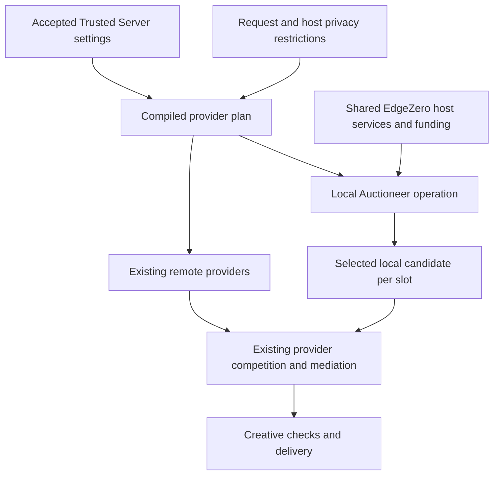

# Auctioneer Integration into Trusted Server

**Date:** 2026-11-22

**Status:** Draft for review

**Scope:** Trusted Server host contract, service binding, local execution, and acceptance for Fastly banner/display

**Implementation plan:** [Auctioneer integration](../plans/2026-11-22-auctioneer-integration.md)

## Outcome

Trusted Server links Auctioneer into its Fastly application and runs it as a local auction provider. Operators configure it through `trusted-server.toml`, using the existing validation, push, and runtime extraction flow. Auctioneer supplies preparation, bidder policy, fan-out, local selection, and targeting. Trusted Server supplies the runtime, routing, competition between providers, and creative delivery.

This is the Trusted Server specification for [epic #1505](https://github.com/IABTechLab/trusted-server/issues/1505) and its existing delivery tickets. It reconciles the accepted [Fastly local-provider contract](https://github.com/IABTechLab/auctioneer/blob/9b83deaa680ad8e867169db3b4ebb195b8a1b33c/docs/superpowers/specs/2026-11-05-trusted-server-fastly-local-provider-design.md) with the settings-first bridge merged in [Auctioneer PR #159](https://github.com/IABTechLab/auctioneer/pull/159). The upstream contract remains authoritative for shared engine behavior; this specification defines the host changes needed to consume it.

The first delivery is Fastly banner/display. Other Trusted Server hosts, video/native/AMP delivery, new currency conversion, new creative renderers, and live publisher qualification are outside this change. Auctioneer retains ownership of bidder discovery, implementation, and adapter qualification.

## Existing tickets and ownership

| Trusted Server ticket                                             | Deliverable                                                                                 | Auctioneer relationship                                                                 |
| ----------------------------------------------------------------- | ------------------------------------------------------------------------------------------- | --------------------------------------------------------------------------------------- |
| [#1509](https://github.com/IABTechLab/trusted-server/issues/1509) | Review this host specification and reconcile host answers with the accepted contract        | #34, accepted through PR #152 and tracking reconciliation #153                          |
| [#1510](https://github.com/IABTechLab/trusted-server/issues/1510) | Typed settings, validated policy, real host services, original timing, and funded ownership | #51; PR #159 supplies the portable API, while real host handoff acceptance remains open |
| [#1511](https://github.com/IABTechLab/trusted-server/issues/1511) | Link the actual Fastly artifact, execute the local provider, preserve routing and delivery  | #76; acceptance requires the bridge and qualified Fastly serving path, including #88    |
| [#1512](https://github.com/IABTechLab/trusted-server/issues/1512) | Supply the host artifact harness and controlled display flow                                | #91 records standalone/embedded equivalence using that artifact                         |

The SDK cutover is [#1507](https://github.com/IABTechLab/trusted-server/issues/1507), implemented by [PR #1506](https://github.com/IABTechLab/trusted-server/pull/1506); its specification is tracked in #1513. Qualification is separately tracked in [#1508](https://github.com/IABTechLab/trusted-server/issues/1508). Follow PR #1506's current decisions: cutover merge and production deployment do not wait for the EdgeZero EZ-Q1 qualification record. This scheduling decision does not establish Auctioneer host acceptance or waive its selected Fastly serving and resource requirements.

Use these tickets rather than creating parallel integration tasks. Epic #1505 coordinates the work; its completion is not a prerequisite of its own leaves. The wider protocol modularity work in #1336 and Cloudflare/Spin work in #1484 are not prerequisites for this selected Fastly path.

## Source baseline and dependency alignment

| Source                                         | Baseline used by this design                                                                    | Consequence                                                                       |
| ---------------------------------------------- | ----------------------------------------------------------------------------------------------- | --------------------------------------------------------------------------------- |
| Planning PR base on the default branch         | `1810c763add220dd34fd5faaffe2c69aab1d556f`; EdgeZero `v0.0.11`                                  | Documentation lands independently of the pending cutover                          |
| Local Trusted Server checkout                  | `5ee01b365`; EdgeZero `v0.0.11`                                                                 | The existing checkout has neither the cutover nor the local provider              |
| Trusted Server PR #1506 candidate              | `feaf3df5d1c9bb2dca64158480725cb555ab9c26`; EdgeZero `9d02d7b3185b49e81d9ac972ca3feef932ed848a` | Design against its shared outbound client and canonical lifecycle                 |
| Auctioneer PR #159 merge                       | `499f0e540e95e1c86b730c1030aabef28de01d0a`; EdgeZero `598f0a2a490eb83dd31c06c024a0cefa8e049628` | Establishes the implemented bridge API, not compatibility with the later host SDK |
| Auctioneer main inspected for dependency drift | `05f2a56e9555be9c46a789c868100e37162abe5b`; EdgeZero `ea2549fb13728debf5afc34da2e70593061aa05f` | The merged bridge's historical SDK pin is no longer Auctioneer's current pin      |

The final linked application must resolve one reviewed immutable EdgeZero revision and one source identity for every shared SDK package. Follow the cutover's current integration branch policy rather than restoring the older PR #159 pin. Coordinate any required Auctioneer repin and API changes upstream. Record the final Trusted Server, Auctioneer, and EdgeZero revisions and feature graph in implementation evidence. Different SDK revisions are not made compatible by converting or disguising their request, client, or instant types.

The implementation must inspect the actual Cargo graph and lockfile, including source URL differences. Auctioneer's workspace-root patches and release profiles are not inherited when it becomes a Git dependency. Review the required patched dependency identities, including its schema/regex patches, and the actual Trusted Server release profile before claiming equivalent validation or resource fit. Use reviewed upstream sources; do not copy Auctioneer's engine into this repository.

## Architecture decision

Extend the existing compiled provider plan with a typed local execution kind. Implement the Auctioneer binding outside the neutral routing and competition types, within existing packages. This adds one execution boundary without requiring a new crate or a wholesale auction rewrite.

| Approach                                                         | Assessment                                                                                  |
| ---------------------------------------------------------------- | ------------------------------------------------------------------------------------------- |
| Local execution through Auctioneer's shared preparation API      | Selected. Preserves one policy implementation and lets the host own scheduling and delivery |
| Call a standalone Auctioneer service                             | Adds a service boundary and does not satisfy the in-process epic                            |
| Assemble the low-level engine context directly in Trusted Server | Duplicates account, alias, privacy, and resource policy already owned by shared preparation |

The production plan currently constructs `GenericOpenRtbProvider` instances; test-only `AuctionProvider` registration is insufficient. Extend Settings-to-plan compilation, target validation, executor construction, dispatch, collection, and delivery capability registration together. A local provider has no synthetic endpoint, backend, HTTP application, loopback call, or remote response parser.



## Configuration contract

Keep provider instances under `[auction.providers.<id>]` and bidder assignments under `[auction.bidders.<id>]`. Introduce an `execution` discriminator: omitted or `remote` retains the current remote declaration; `auctioneer` selects local execution. Do not add a new default field to serialized remote-only configurations.

| Declaration          | Fields and validation                                                                                                                                                     |
| -------------------- | ------------------------------------------------------------------------------------------------------------------------------------------------------------------------- |
| Remote               | Existing protocol, endpoint, profile, profile configuration, routing, timeout, and notification behavior remain in force                                                  |
| Auctioneer           | Requires a typed `auctioneer` subtree using the actual shared `AuctioneerAppConfig`; accepts common logical timeout and notification policy; uses explicit bidder routing |
| Invalid local fields | Reject `protocol`, `endpoint`, `profile`, `profile_config`, and remote `all_eligible` routing on an Auctioneer declaration                                                |

The nested policy uses Auctioneer's generated bidder settings, defaults, and shared validators. It is not a copied schema or arbitrary JSON field. Each provider invocation receives only the borrowed subtree associated with that provider. Unrelated Trusted Server settings cannot become Auctioneer policy.

The native CLI and Fastly runtime must invoke the shared contextual validator with matching discovered catalog, product defaults, and accepted resource facts. Supply those immutable facts explicitly through the existing configuration integration; do not create a process-global operator-policy fallback. Structural authoring checks, accepted runtime settings, and resolved credential validation retain their distinct existing responsibilities.

Use the existing TOML/environment overlay, `TrustedServerAppConfig`, signed blob envelope, chunking, push, extraction, and settings validation paths. Invalid policy or unavailable local execution support fails before affected bidder I/O. Do not require an Auctioneer configuration file, configuration store, loader, or push command.

Bidder credentials remain references to host-selected secret services. Preserve Auctioneer's lazy, bounded credential lookup after admission and deadline checks. Do not indiscriminately register these references as Trusted Server `KeyInDefault` leaves: that path resolves static secrets eagerly during configuration extraction. The host binds the store; Auctioneer's credential source validates and resolves the applicable bidder credential when permitted.

Gate the new dependency and execution code behind a consistent `auctioneer` Cargo feature in core, the native CLI, and Fastly. Existing default builds retain their behavior. Builds without local support reject a configured local declaration, and unsupported deployment targets reject it during validation. This feature selects integration support, not a handwritten bidder cohort. Once a local declaration has been published, rollback to a binary that predates the schema requires restoring its matching compatible configuration blob.

## Routing and typed input

Compile one provider owner for each requested public bidder identity, including aliases. Resolve local identity bindings from Auctioneer's discovered registry and declared aliases; do not maintain a host bidder list. Reject unknown, disabled, unavailable, or ambiguous assignments through the appropriate existing validation/resolution boundary before their bidder calls. Distinct valid aliases may share an implementation without losing their requested identities.

Only demand assigned to the local provider enters its request. Remote routing, including any remote `all_eligible` behavior, must not rediscover or dispatch locally assigned identities. The local executor cannot rescan the raw browser payload to expand demand. Invalid routing is not retried through a remote provider. Existing independent providers may still compete for the same slot with their own assigned demand.

Remote stored requests can expand to bidders the host cannot inspect. For this first delivery, reject an auction that combines local demand with opaque remote stored demand before either affected path dispatches. Mixed local/remote auctions must use inspectable explicit bidder assignments. Remote-only stored-request behavior remains unchanged; an operator assertion about an opaque expansion is not proof of unique routing.

Convert Trusted Server's provider-routed `AuctionRequest` explicitly into Auctioneer's typed `BidRequest`; the repositories' Rust models are not interchangeable. Preserve request and impression IDs, offered banner dimensions, floor semantics, selected bidder parameters, publisher/site/device context, and permitted user data. Account selection follows the accepted host policy and Auctioneer's established resolution rules; an untrusted context value cannot select another tenant. Exclude unsupported media before local routing.

Do not serialize and reparse a whole request to cross the bridge. Admit and fund the host's conversion storage before allocating it, then retain Auctioneer's own typed depth/node/width and parameter validation. Missing/null/value distinctions and unknown original wire provenance must remain honest; a reconstructed typed request cannot manufacture raw-wire evidence.

The current `AuctionRequest` serialization explicitly omits consent and EIDs, so it is unsuitable as a bridge representation. Populate the Auctioneer fields consumed by its canonical preparation, including the expected consent/EID locations, rather than assuming the existing remote OpenRTB shape is structurally identical.

## Consent and identity

Use the authoritative request-bound consent and identity already selected by Trusted Server's ingress paths. Preserve the existing auction eligibility gate, EC consent checks, client and KV EID gating, trusted device/geo inputs, and allowed context keys for direct `/auction`, navigation auctions, and page-bids calls.

The typed conversion forwards the relevant raw consent signals and their source semantics from `ConsentContext`, alongside the permitted contextual data. Decoded host permission alone does not replace Auctioneer's per-vendor and per-purpose enforcement. If the current host request loses provenance needed by the shared resolver, extend the request-bound typed context at its source; do not reread cookies, reconstruct permission from a boolean, or recover discarded IDs from the browser payload.

The current context retains TC/GPP/US Privacy values and validated GPP section IDs, but only aggregate consent provenance. It loses raw malformed section-ID hints and the distinction between absent and non-`1` GPC headers. Add the narrow ingress evidence needed to preserve Auctioneer's existing missing/malformed/conflicting-signal precedence across all three entry paths. Keep that evidence request-bound and separate from decoded permission. Unsupported COPPA, structured client hints, or Additional Consent evidence remains absent unless the host actually captures an authoritative source; a declared but unpopulated field is not evidence.

Bind an explicit `HostRestrictionSource`. Its fetch, identifier, precise-geo, user first-party-data, and transaction-ID ceilings intersect with Auctioneer's own decisions. Host denial remains denied when Auctioneer allows, and Auctioneer denial remains denied when the host allows. Restrictions beyond those five dimensions remain enforced at host ingress and cannot be undone by later enrichment.

Preserve malformed/conflicting signal precedence and missing-signal behavior. Cover the existing case where a contextual auction is allowed while EC identity and EIDs are absent. Local execution does not grant a new privacy permission. Debug and trusted entrypoint context come from the host, not bidder parameters or arbitrary client fields.

## Host services and bridge call

Use the implemented settings-first API:

```rust
let prepared = prepare_auction(auctioneer_settings, auction_input, services, funding)?;
let completed = prepared.run().await?;
```

`auctioneer_settings` is `&AuctioneerAppConfig`; `auction_input` uses `AuctionInput::Typed`. This illustrates the existing Auctioneer boundary, not a new Trusted Server API. The host must drive the resulting future according to the lifecycle below.

| Bridge dependency           | Trusted Server binding                                                                                                                                                      |
| --------------------------- | --------------------------------------------------------------------------------------------------------------------------------------------------------------------------- |
| Outbound transport          | The request's EdgeZero `HttpClient`, through `EdgeZeroFanout::with_wave_scheduler`, with actual resolved limits, timer, decode cooperator, strategy, and shared stream gate |
| Clock and deadlines         | The matching EdgeZero monotonic clock, original auction admission instant, absolute outer deadline, and one explicit wall-clock capture                                     |
| Credentials                 | Host-selected `BoundSecretStore` and the exported `CredentialLoader`, preserving lazy access, byte bounds, and the original deadline                                        |
| Registry and reference data | Matching build-discovered registry/bindings, immutable GVL/GCL, and product defaults from the selected Auctioneer artifact                                                  |
| Randomness and restrictions | Explicit request RNG and host restriction source; no ambient fallback                                                                                                       |
| Resource facts and funding  | `AuctionResourceProfile` from accepted target/catalog/construction facts; `AuctionFunding::prepay` using the shared ledger and an already-acquired capacity permit          |

After PR #1506, `RuntimeServices` already carries the request client and its paired monotonic clock. The Fastly request-context construction is the binding point. It does not yet supply every dependency in this table: in particular, the candidate installs no cooperative timer and has no complete Auctioneer funding/reference-data binding. #1510 must supply these explicitly and prove the handoff with real SDK objects.

Keep immutable references and validated settings in their established shared owners. Keep input, restrictions, credential loader, preparation, execution, and funding within the request operation. Reusable Fastly sandboxes must not retain a request's policy or credentials as a fallback for later requests. Do not invoke Auctioneer's standalone bootstrap, HTTP App, ambient operator registry, or `DevFanout` to fill missing services.

## Start collect and abandon lifecycle

Represent pending remote and local execution separately under the same host auction state. The post-cutover remote path owns an EdgeZero `OutboundBatch`; retain that implementation. Add an owned local operation and completed-result state rather than restoring the deleted HTTP pending-handle abstraction.

1. **Start:** capture the existing auction start/deadline, acquire the accepted shared funding, build only the routed input, and prepare the local operation. Poll eligible local execution so bidder work begins before returning control to publisher-origin work. Dispatch each provider once.
2. **Progress:** retain the same pinned future. Co-poll it while origin headers, body chunks, and asynchronous HTML EOF stages are pending. Origin output and prefix delivery must not wait for the entire local auction. Constructing an unpolled future, polling only during origin headers, or awaiting the complete local auction inside dispatch does not satisfy this behavior.
3. **Collect:** join the already-started operation and remote batch under the original absolute cutoff, then apply existing competition and mediation. Direct `/auction` and page-bids execution use the same operation; publisher hold/EOF paths retain it across their existing ownership transfers.
4. **Cutoff:** use the engine's bounded deadline completion path to retain the local candidates it permits, alongside the host's permitted completed remote results. Do not wait for additional network work, reset timing, or drop the local future before allowing its deadline path to finalize available results. If the selected upstream API cannot meet this behavior, resolve that interface gap before host acceptance rather than substituting an empty result.
5. **Abandon:** response drop, origin/body failure, EOF failure, or explicit cancellation abandons the existing operation and releases its owners once. Preserve the distinction between abandoning a host operation and physically cancelling an upstream Fastly request.

Use a request-owned async operation that captures its owned service binding and creates borrowed `AuctionServices` inside that operation. This allows the compiler-generated future to retain the required borrows without a handwritten self-referential struct. Preserve the bridge's non-`Send` contract; the response stream owns the operation for its required lifetime. Use the existing EdgeZero request execution and stream polling model, without a second process executor or detached task.

The effective local deadline is the minimum of the original outer host cutoff and Auctioneer's existing request/host/provider limits. Entering preparation, queuing, progressing HTML, and collecting never grants a new allowance. An already-expired entry performs no new bridge parsing, credential access, or bidder dispatch. Deadline notifications must also wake the progress driver when the origin body is stalled.

## Results competition and delivery

Retain `CompletedAuction` and inspect its borrowed typed outcome. Offer Auctioneer's actual selected candidate for each slot to outer provider competition. Other admitted local candidates remain bounded diagnostic/response data; they are not separately reranked by Trusted Server's CPM reducer. This preserves Auctioneer's deal preference and stable tie order while retaining Trusted Server's existing cross-provider competition and mediation rules.

Keep host provider ID, requested bidder/alias, canonical implementation, returned upstream seat, impression ID, and bid ID distinct. Preserve admitted price/currency, dimensions, media, creative, notifications, and applicable delivery metadata. Keep Auctioneer's supported response-currency admission; this change supplies no response FX and cannot compare incompatible currency amounts numerically.

The local projection must preserve the host's existing response-admission invariants: known impression IDs, finite nonnegative USD prices, admitted unambiguous banner dimensions, and either nonempty renderable markup or an admitted existing typed renderer with its required metadata and registered capability. The outer reducer does not supply those checks. Enforce delivery compatibility at the typed projection without creating a second bidder-policy or local-selection implementation; an invalid selected candidate cannot trigger a new reduction over local runners-up. Do not admit an arbitrary executable renderer descriptor.

Extend the host's typed delivery result to carry the selected local candidate's finalized targeting. Both `auction::formats` and publisher `build_bid_map_with_auction_id` must consume it. Do not reconstruct Auctioneer price buckets or targeting, hide them in an ignored metadata field, or allow a losing local candidate's winner keys to remain when a remote provider wins. Existing remote targeting projection remains unchanged.

Keep the existing creative safety, sanitization, rewriting, and notification suppression behavior. Register existing delivery capabilities from the compiled execution declaration and actual typed requirements. In particular, prove APS display delivery when local demand is configured without a remote APS profile; do not infer renderer support solely from that old remote-profile condition or route local APS output through the different remote parser.

Auctioneer's local selection does not authorize a win or billing notification: that candidate can still lose host competition or downstream ad-server delivery. Preserve notification URLs and applicable macro semantics for the existing final-delivery owner, with no new notification sender in the bridge. Publisher delivery retains its current forwarding behavior. Direct `/auction` projection must also carry the winning local candidate's permitted `nurl`/`burl`, which its current serializer omits, without sending them during local selection or forwarding a losing candidate's URLs.

A selected creative rejected by host delivery is a delivery rejection. Do not report it as delivered or introduce an automatic runner-up retry. Standalone/embedded equivalence applies to shared preparation and engine results; additional host floors, mediation, and creative transformations are tested separately.

## Errors and diagnostics

| Outcome                                                              | Host behavior                                                                                 |
| -------------------------------------------------------------------- | --------------------------------------------------------------------------------------------- |
| Invalid configuration, routing, or unavailable service/capability    | Refuse before affected provider I/O; retain the appropriate configuration or capability error |
| Shared preparation failure, disabled account, or fatal privacy input | Preserve the typed failure category; no second ingress attempt or remote fallback             |
| Valid no-bid                                                         | Successful empty local result, distinguishable from failure                                   |
| Bidder-local error with valid siblings                               | Preserve valid sibling candidates and attributed diagnostics                                  |
| Local provider failure                                               | Preserve provider failure; independent remote work follows existing host policy               |
| Deadline, cancellation, or resource refusal                          | Preserve cause and exact-once cleanup, without a fresh budget                                 |
| Creative rejection                                                   | Preserve host delivery diagnostics and report no delivery for that creative                   |

Map Auctioneer failures into Trusted Server's concrete errors and existing provider outcome reporting using `error-stack`. Retain a funded failure owner for as long as its bounded diagnostic storage survives. Expose only permitted bounded diagnostics. Logs and evidence must not contain raw consent, identifiers, credential values, private addresses, or operator configuration.

## Resource ownership

The acceptance subject is the actual linked Trusted Server Fastly artifact. Reuse Auctioneer's existing checked derivation and receipts with the host's accepted shared admission and transport owners. Do not install independent local/remote concurrency pools, add standalone totals as proof of fit, or raise a workload limit, ceiling, reserve, or budget equation to accommodate integration.

Account for overlapping host settings/request storage, typed conversion, registry/schema/reference residency and initialization, engine work, retained results/failures, creative copies, output buffers, and terminal egress. Count shared immutable storage once and additional live owners explicitly. Include the actual compiler layouts, dependency patches, release profile, SDK bookkeeping, and installed Fastly limits.

`CompletedAuction` and funded failures retain their original receipts and acquired capacity. Holding a completion at capacity must prevent another admission until destruction or an accepted prepaid transfer. Host copies and transformations require their own accounted storage before allocation; retaining the original completion alone does not fund a new creative copy.

Keep the completed owner until all borrowed data is gone, or transfer surviving data through the existing reviewed funded boundary before releasing it. The final response/creative owner lasts through serialization and terminal egress. Finalize completion observation once with the appropriate success/error/cancellation status; finalizing observation does not itself release funding. Follow the accepted [shared resource ownership contract](https://github.com/IABTechLab/auctioneer/blob/ec9d7905002f7f4b760144b7cf0fedc0773a9bd2/docs/superpowers/specs/2026-11-09-shared-resource-ownership-design.md).

## Acceptance by delivery ticket

These controls are required implementation evidence. Reuse existing configuration, provider-plan, privacy, publisher EOF, Fastly/Viceroy, and Auctioneer conformance tests at the boundary they already own.

### Host contract and service binding

For #1509, record agreement with the accepted upstream contract and the host deltas defined here. For #1510, prove:

- The shared typed subtree survives the existing CLI validation/push/blob/runtime path; invalid settings fail consistently, and unrelated TS settings never enter the bridge policy argument.
- One unchanged executable uses two isolated accepted policies and secret references; independently vary bidder/alias, account, privacy, and credentials. Cover invalid configuration, accepted changes, reusable-sandbox recovery, and absence of cached operator fallback.
- Actual SDK client/clock/store objects reach the bridge on the common revision. Missing timer, decoder cooperation, registry/schema capability, or funding refuses without forbidden I/O.
- Expired entry and admission refusal perform no credential lookup or bidder dispatch; delayed credentials retain their original bounds and deadline. Independently test host-deny/engine-allow and host-allow/engine-deny in serialized bidder calls, with data present before removal.

### Local provider and linked artifact

For #1511, prove:

- The real compiled plan reaches local execution, feature-off and unsupported-target declarations fail, and existing remote-only configurations preserve behavior.
- Direct `/auction`, page-bids, navigation hold, and lazy HTML EOF paths use the same start/progress/collect/abandon operation. Delayed headers, pending body chunks, asynchronous EOF stages, and sibling responses do not starve local work or reset deadlines. Prefix streaming remains independent.
- With one completed local bidder and one suspended bidder, original-cutoff finalization retains the permitted completed candidate without another network wait or a restarted operation.
- Mixed local/remote routing produces exact sent-impression and requested-alias coverage with no duplicate dispatch, including remote `all_eligible` interactions, legitimate aliases sharing an implementation, and refusal of simultaneous opaque stored demand before I/O.
- Local deal preference and equal-price order survive outer competition; direct and publisher targeting agree with the selected local outcome; remote winners have no stale local keys or local notification URLs. Include response-admission invariants, mediation, no-bid, valid siblings plus failures, creative rejection, notification ownership, and APS capability registration.
- Preparation drop, suspended execution drop, origin/body/EOF failure, deadline, retained completion/failure, and terminal egress release each owner once. At-limit retention refuses the next admission and release restores exactly one slot.

### Equivalence and artifact qualification

For #1512, compare standalone and embedded shared outcomes with identical effective policy, routed typed input, clock/RNG behavior, reference data, and captured bidder responses. Compare admitted candidates, selected local winners and ties, targeting, bidder/alias/seat attribution, and permitted diagnostics. Cover privacy denial, invalid input/account, timeout, partial failure, resource refusal, and cancellation; test wire-only syntax separately where typed input has no equivalent.

Run the controlled display flow against the actual linked Fastly artifact, including current production registration and the installed schema/serving path. Derive implemented display identities and aliases from Auctioneer's build discovery and declared capabilities. Exercise the whole required set individually across deterministic batches within existing limits; include installed concurrency and one-over refusal. Report verified unimplemented inventory separately without generating bidder I/O. Native fakes, direct-factory calls, compilation, metadata enumeration, or another artifact's measurements do not establish linked serving.

Bind observations to exact host/Auctioneer/SDK revisions, features, artifact digest, accepted policy identity, captured input/output fixtures, build profile, service facts, and resource owners. Auctioneer #91 consumes this evidence; #76 also requires #51 and #88 acceptance. Broader Auctioneer catalog qualification stays with its upstream owners. This flow does not claim live bidder authorization or a publisher pilot.

## Delivery and verification sequence

1. Complete host contract review under #1509, using the current PR #1506 cutover decisions rather than stale historical SDK gates.
2. Land or rebase onto the cutover and align the reviewed Auctioneer/EdgeZero graph. Record the compatibility delta and affected checks.
3. Implement #1510's typed configuration, validation, explicit request services, and funded binding. Coordinate real handoff evidence with Auctioneer #51.
4. Implement #1511's compiled local execution, progress driver, result projection, and delivery capabilities. Gate accepted Fastly serving on the applicable upstream requirements.
5. Implement #1512's controlled artifact flow and equivalence evidence, then record the result with Auctioneer #91.

Implementation checks must include the repository's full CI gate list before PR handoff. Add feature-on Fastly tests, reusable-sandbox tests, Fastly build/clippy, native CLI validation tests/clippy, and feature-off regression checks to the existing aliases; the implementation plan must record their exact feature flags and test targets. Explicitly enable any required Auctioneer conformance features so silently skipped test targets cannot count as evidence.

Because scheduling changes touch publisher and EOF behavior, also run the native `html_eof_runtime` test/lint, `./scripts/async-html-finalization-local-test.sh axum --auction`, and `./scripts/async-html-finalization-local-test.sh fastly --release --auction`. Extend their existing delayed-origin, pending-body, EOF, cancellation, and prefix-delivery controls to include local execution. Native shared-boundary checks supplement the Fastly artifact run.

Deployment uses the existing operator workflow after the corresponding artifact and configuration are reviewed. Disabling local execution requires a validated routing/configuration change; it must not silently duplicate or reroute bidder calls. Rollback restores a compatible artifact and configuration together, while in-flight operations retain their original accepted snapshot and ownership.

## Primary source references

- [Merged settings-first preparation API](https://github.com/IABTechLab/auctioneer/blob/499f0e540e95e1c86b730c1030aabef28de01d0a/crates/auctioneer-core/src/auction/prepare.rs), [services and funding](https://github.com/IABTechLab/auctioneer/blob/499f0e540e95e1c86b730c1030aabef28de01d0a/crates/auctioneer-core/src/auction/services.rs), and [retained results](https://github.com/IABTechLab/auctioneer/blob/499f0e540e95e1c86b730c1030aabef28de01d0a/crates/auctioneer-core/src/auction/result.rs).
- [Cutover provider plan](https://github.com/IABTechLab/trusted-server/blob/feaf3df5d1c9bb2dca64158480725cb555ab9c26/crates/trusted-server-core/src/auction/plan.rs), [orchestrator](https://github.com/IABTechLab/trusted-server/blob/feaf3df5d1c9bb2dca64158480725cb555ab9c26/crates/trusted-server-core/src/auction/orchestrator.rs), [runtime services](https://github.com/IABTechLab/trusted-server/blob/feaf3df5d1c9bb2dca64158480725cb555ab9c26/crates/trusted-server-core/src/platform/types.rs), and [Fastly binding](https://github.com/IABTechLab/trusted-server/blob/feaf3df5d1c9bb2dca64158480725cb555ab9c26/crates/trusted-server-adapter-fastly/src/app.rs).
- [Current cutover design and maintainer decisions](https://github.com/IABTechLab/trusted-server/blob/feaf3df5d1c9bb2dca64158480725cb555ab9c26/docs/superpowers/specs/2026-10-17-edgezero-pr275-hard-cutover-design.md) and [inspected Auctioneer dependency manifest](https://github.com/IABTechLab/auctioneer/blob/05f2a56e9555be9c46a789c868100e37162abe5b/Cargo.toml).
- [Auctioneer linked-artifact acceptance #76](https://github.com/IABTechLab/auctioneer/issues/76) and [equivalence acceptance #91](https://github.com/IABTechLab/auctioneer/issues/91).

## Review log

- Round 1 (Codex agent, 2026-11-22): found that mandatory nonempty creative markup would reject valid APS renderer bids. Changed local admission to allow an admitted existing typed renderer with required metadata and capability, while rejecting arbitrary executable descriptors.
- Round 2 (Codex agent, 2026-11-22): verified the renderer correction and found no remaining blocking gaps. Added an explicit cutoff control with one completed local bidder and one suspended bidder, preserving the permitted completed candidate without further network waits.
- Round 3 (Codex plan-document reviewer, 2026-11-22): checked the implementation plan against this specification and the source boundaries. Found no blocking mismatch or required design change; clarified artifact identity in the plan's controlled-flow evidence.
