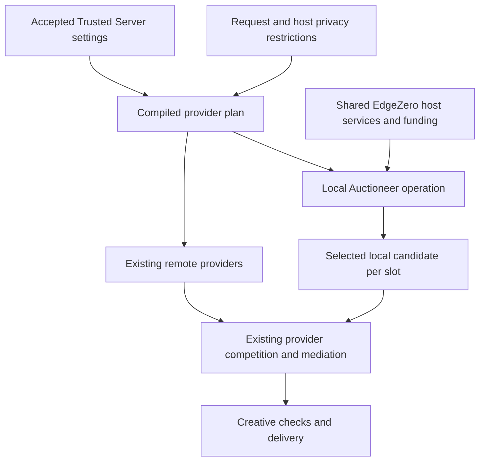

# Auctioneer Integration into Trusted Server

**Date:** 2026-11-22

**Status:** Draft for review

**Scope:** Trusted Server host contract, service binding, local execution, and acceptance for Fastly banner/display

**Implementation plan:** [Auctioneer integration](../plans/2026-11-22-auctioneer-integration.md)

## Outcome

Trusted Server first adopts Auctioneer's OpenRTB types across its existing OpenRTB paths, then links Auctioneer into its Fastly application as a local auction provider. Operators configure it through `trusted-server.toml`, using the existing validation, push, and runtime extraction flow. Auctioneer supplies the shared protocol model, preparation, bidder policy, fan-out, local selection, and targeting. Trusted Server supplies the runtime, routing, competition between providers, and creative delivery.

This is the Trusted Server specification for [epic #1505](https://github.com/IABTechLab/trusted-server/issues/1505) and its delivery tickets. It reconciles the accepted [Fastly local-provider contract](https://github.com/IABTechLab/auctioneer/blob/05f2a56e9555be9c46a789c868100e37162abe5b/docs/superpowers/specs/2026-11-05-trusted-server-fastly-local-provider-design.md) with the settings-first bridge merged in [Auctioneer PR #159](https://github.com/IABTechLab/auctioneer/pull/159). That contract's approved content merged at `9b83deaa680ad8e867169db3b4ebb195b8a1b33c`; the linked revision records its acceptance. The upstream contract remains authoritative for shared engine behavior; proposed host additions and missing capabilities below require their named acceptance before implementation handoff.

The first local Auctioneer host delivery is Fastly banner/display. The prerequisite OpenRTB type migration affects shared paths and must preserve existing behavior on every Trusted Server adapter. Local Auctioneer hosts on other adapters, video/native/AMP delivery, new currency conversion, new creative renderers, and live publisher qualification are outside this change. Auctioneer retains ownership of bidder discovery, implementation, and adapter qualification.

## Existing tickets and ownership

| Trusted Server ticket                                             | Deliverable                                                                                                                                      | Auctioneer relationship                                                                 |
| ----------------------------------------------------------------- | ------------------------------------------------------------------------------------------------------------------------------------------------ | --------------------------------------------------------------------------------------- |
| [#1509](https://github.com/IABTechLab/trusted-server/issues/1509) | Review this host specification and reconcile host answers with the accepted contract                                                             | #34, accepted through PR #152 and tracking reconciliation #153                          |
| [#1652](https://github.com/IABTechLab/trusted-server/issues/1652) | Required shared OpenRTB migration, compatibility, model/codegen retirement and default-release impact; separate prerequisite PR                  | Raw-model source and any minimal compatibility corrections remain Auctioneer-owned      |
| [#1510](https://github.com/IABTechLab/trusted-server/issues/1510) | Host binding after the shared OpenRTB model prerequisite: typed settings, validated policy, real services, original timing, and funded ownership | #51; PR #159 supplies the portable API, while real host handoff acceptance remains open |
| [#1511](https://github.com/IABTechLab/trusted-server/issues/1511) | Link the actual Fastly artifact, execute the local provider, preserve routing and delivery                                                       | #76; acceptance requires the bridge and qualified Fastly serving path, including #88    |
| [#1512](https://github.com/IABTechLab/trusted-server/issues/1512) | Supply the host artifact harness and controlled display flow                                                                                     | #91 records standalone/embedded equivalence using that artifact                         |

The SDK cutover is [#1507](https://github.com/IABTechLab/trusted-server/issues/1507), implemented by [PR #1506](https://github.com/IABTechLab/trusted-server/pull/1506); its specification is tracked in #1513. Qualification is separately tracked in [#1508](https://github.com/IABTechLab/trusted-server/issues/1508). Follow PR #1506's current decisions: cutover merge and production deployment do not wait for the EdgeZero EZ-Q1 qualification record. This scheduling decision does not establish Auctioneer host acceptance or waive its selected Fastly serving and resource requirements.

Use these delivery tickets rather than parallel integration implementations. Epic #1505 coordinates the work; its completion is not a prerequisite of its own leaves. Cloudflare/Spin fan-out work in #1484 is not a prerequisite for this selected Fastly path.

#1510 remains the host resource-proof coordination owner named by Auctioneer #76. #1511 supplies the linked production artifact and execution observations; #1512 supplies its controlled flow and comparison. Those implementation commits can land in order without waiting for #1510 issue closure, but #1510's resource handoff is not accepted until their combined-artifact evidence is available. This avoids a cyclic issue-completion dependency while filing the evidence where upstream expects it.

## Required shared OpenRTB model

Adopting `auctioneer-openrtb` throughout Trusted Server is a prerequisite to host binding and local-provider integration. Land it as a separately reviewed implementation change before #1510's bridge work and #1511's local execution. It can progress independently of the EdgeZero cutover because the shared protocol package does not itself depend on EdgeZero. SDK alignment remains a separate prerequisite for passing actual host services to the engine.

Use Auctioneer's raw `BidRequest`, `BidResponse`, `SeatBid`, `Bid`, and nested OpenRTB types for all existing remote-provider builders/readers, legacy Prebid/APS paths, and direct auction wire output. The dependency is present in default builds on all adapters; only the engine and local executor remain behind the `auctioneer` feature. The eventual bridge and shared model must resolve to the same reviewed Auctioneer source revision, without parallel versions or a host fork.

The initial migration target for #1652 is the immutable Auctioneer revision `05f2a56e9555be9c46a789c868100e37162abe5b`, with canonical Git source `https://github.com/IABTechLab/auctioneer`. This is a selected source candidate, not a claim that every compatibility case already passes. Before linking the engine, repin all Auctioneer packages together to the reviewed commit delivered by Auctioneer #265 and rerun affected raw-model controls.

Retire `trusted-server-openrtb`, its generated bindings/proto pipeline, and `trusted-server-openrtb-codegen` after all consumers and behavior tests migrate. Update the workspace, aliases, CI, and documentation together. A re-export facade for the shared types and project-owned extension helpers is acceptable; copied standard structs, a maintained second generated model, and serialization/reparse conversion between competing OpenRTB models do not satisfy this prerequisite.

Keep `AuctionRequest`, routing/permissions, and host bid/delivery facts protocol-neutral. Convert those facts to the shared raw model at protocol boundaries. Sharing raw types does not apply Auctioneer's engine-specific preparation or bidder policy to remote providers; each existing protocol/profile keeps its validation, signing, response admission, and error ownership.

The existing models are not a source-compatible substitution. The inspected shared model requires request/response/bid IDs and bid price, uses integer flags and a wider `tmax`, and represents extension/unknown fields differently from Trusted Server's generated model. Preserve the installed wire and admission behavior through explicit compatibility controls:

| Area                           | Required compatibility                                                                                                                                                                                                                          |
| ------------------------------ | ----------------------------------------------------------------------------------------------------------------------------------------------------------------------------------------------------------------------------------------------- |
| Request and response encoding  | Preserve omitted/default fields, numeric widths, supported flag encodings, currency, banner sizes, notification fields, and existing no-bid forms                                                                                               |
| Extensions and identity        | Preserve permitted Prebid/APS/Trusted Server extensions, signing payloads, consent/EID placement and privacy gates; a shared unknown-field map does not authorize new forwarding                                                                |
| Decoding and failure isolation | Preserve currently supported malformed/missing-field handling, per-bid rejection versus provider failure, and valid siblings; do not turn absent IDs into fabricated identities or lose unrelated bids through stricter whole-response decoding |
| Presence and bounds            | Preserve missing/null/value distinctions wherever policy consumes them, existing byte/node/depth caps, and bounded allocation/work; sharing a type does not grant wire provenance                                                               |

Existing response readers use tolerant raw JSON framing to isolate malformed bids and apply profile-specific admission. Preserve that bounded framing where required; do not replace it with strict whole-response deserialization that discards valid siblings. Use the shared raw types at typed protocol boundaries while keeping neutral admitted host bids and their existing numeric/delivery rules.

Where upstream's raw model or codec cannot express a required compatibility case, make the minimal reviewed change in Auctioneer and keep the prerequisite open until it is available and verified. Maintain strict standalone engine policy in its existing preparation/validation boundary. Do not silently change Trusted Server's wire contract, weaken engine checks, or introduce shadow wire structs to get the migration through. Any intentional compatibility change returns to explicit design review.

The prerequisite is accepted only when the default builds use the shared types, the old model/codegen have no live consumers or build jobs, and positive/negative remote protocol, privacy, signing, direct-output and cross-adapter controls pass. This evidence is required before host-binding implementation starts; merely adding the new crate beside the old one is insufficient.

Measure comparable default release artifacts before and after #1652 using identical pinned toolchains, profiles and features. Record digests and byte sizes for Fastly, Axum, Cloudflare, Spin and the native CLI, attributable dependency/initialization impact, and the applicable published platform or installed deployment limits. Before implementation PR handoff, exercise the actual locked producer, feature-matched offline SBOM, build facts and packaging guards with the Git dependency. Signing and attestation are first proven at an authorized release: the existing workflow requires a `v*` tag push and publication enabled. Record that evidence as pending until executed, and block publication/deployment until digest and attestation-subject verification succeeds. This plan authorizes no tag or deployment. No limit increase or later feature-on resource proof substitutes for default-build evidence.

## Source baseline and dependency alignment

| Source                                         | Baseline used by this design                                                                    | Consequence                                                                       |
| ---------------------------------------------- | ----------------------------------------------------------------------------------------------- | --------------------------------------------------------------------------------- |
| Planning PR base on the default branch         | `1810c763add220dd34fd5faaffe2c69aab1d556f`; EdgeZero `v0.0.11`                                  | Documentation lands independently of the pending cutover                          |
| Trusted Server PR #1506 candidate              | `feaf3df5d1c9bb2dca64158480725cb555ab9c26`; EdgeZero `9d02d7b3185b49e81d9ac972ca3feef932ed848a` | Design against its shared outbound client and canonical lifecycle                 |
| Auctioneer PR #159 merge                       | `499f0e540e95e1c86b730c1030aabef28de01d0a`; EdgeZero `598f0a2a490eb83dd31c06c024a0cefa8e049628` | Establishes the implemented bridge API, not compatibility with the later host SDK |
| Auctioneer main inspected for dependency drift | `05f2a56e9555be9c46a789c868100e37162abe5b`; EdgeZero `ea2549fb13728debf5afc34da2e70593061aa05f` | The merged bridge's historical SDK pin is no longer Auctioneer's current pin      |

The selected alignment direction is Auctioneer moving forward to the cutover's EdgeZero revision `9d02d7b3185b49e81d9ac972ca3feef932ed848a`, tracked by [Auctioneer #265](https://github.com/IABTechLab/auctioneer/issues/265). If the reviewed cutover advances first, both projects must name and review that immutable replacement before linking. Review the intervening SDK source changes, required bridge adjustments and qualification evidence; neither inspected Auctioneer pin establishes compatibility today. The final application must resolve one source identity for every shared SDK package. Record the final Trusted Server, Auctioneer and EdgeZero commits and feature graph. Different revisions are not made compatible by converting or disguising their client or instant types.

The implementation must inspect the actual Cargo graph and lockfile, including source URL differences. Auctioneer's workspace-root patches and release profiles are not inherited when it becomes a Git dependency. Review the required patched dependency identities, including its schema/regex patches, and the actual Trusted Server release profile before claiming equivalent validation or resource fit. Use reviewed upstream sources; do not copy Auctioneer's engine into this repository.

## Architecture decision

Extend the existing compiled provider plan with a typed local execution kind. Implement the Auctioneer binding outside the neutral routing and competition types, within existing packages. This adds one execution boundary without requiring a new crate or a wholesale auction rewrite.

| Approach                                                         | Assessment                                                                                  |
| ---------------------------------------------------------------- | ------------------------------------------------------------------------------------------- |
| Local execution through Auctioneer's shared preparation API      | Selected. Preserves one policy implementation and lets the host own scheduling and delivery |
| Call a standalone Auctioneer service                             | Adds a service boundary and does not satisfy the in-process epic                            |
| Assemble the low-level engine context directly in Trusted Server | Duplicates account, alias, privacy, and resource policy already owned by shared preparation |

The production plan currently constructs `GenericOpenRtbProvider` instances; test-only `AuctionProvider` registration is insufficient. Extend Settings-to-plan compilation, target validation, executor construction, dispatch, collection, and delivery capability registration together. A local provider has no synthetic endpoint, backend, HTTP application, loopback call, or remote response parser.



## Configuration contract

Keep provider instances under `[auction.providers.<id>]` and bidder assignments under `[auction.bidders.<id>]`. Introduce a `ProviderConfig::Remote` / `ProviderConfig::Auctioneer` union. Extend the existing `deserialize_provider_map` boundary with a discriminator-aware decoder: omitted or `remote` selects the current remote schema, while `auctioneer` selects the local schema. Validate allowed fields within the selected branch; do not flatten a tagged enum into the existing `deny_unknown_fields` struct. Serialize remote declarations in their existing shape with no `execution` field, including explicit-remote input. Unknown discriminators and mixed branch fields fail.

| Declaration          | Fields and validation                                                                                                                                                                             |
| -------------------- | ------------------------------------------------------------------------------------------------------------------------------------------------------------------------------------------------- |
| Remote               | Existing protocol, endpoint, profile, profile configuration, routing, timeout, and notification behavior remain in force                                                                          |
| Auctioneer           | Requires typed `auctioneer: AuctioneerAppConfig`, explicit trusted `account` selection and `artifact_identity`; accepts common `timeout_ms` and notification policy; uses explicit bidder routing |
| Invalid local fields | Reject `protocol`, `endpoint`, `profile`, `profile_config`, and remote `all_eligible` routing on an Auctioneer declaration                                                                        |

The nested policy uses Auctioneer's generated bidder settings, defaults, and shared validators. It is not a copied schema or arbitrary JSON field. Each provider invocation receives only the borrowed subtree associated with that provider. Unrelated Trusted Server settings cannot become Auctioneer policy.

The native CLI and Fastly runtime invoke the shared contextual validator with explicit `AuctioneerArtifactFacts`: selected target, catalog/binding/schema identity, product-default identity and accepted resource facts. Derive a versioned `AuctioneerArtifactIdentity` from those canonical shared discovery facts and the reviewed source/features; a source revision alone is insufficient because native and Fastly catalogs differ. Require the expected identity on each local declaration, retained inside the signed application blob. Compare it to actual deployed facts before accepting policy or reading credentials. A mismatch produces a distinct `AuctioneerArtifactMismatch` startup/configuration error naming the provider and expected/actual nonsecret identities; the operator must deploy a matching bundle/config. Never silently disable the provider.

Add a feature-gated `ts auctioneer facts --target fastly` command to expose this nonsecret identity for configuration authoring. This command is planned, not existing support. Native validation must use the shared selected-Fastly catalog view, not its broader native catalog. If the selected upstream discovery API cannot expose that view, #1510 waits on the minimal shared export under Auctioneer #51; do not copy bidder lists or invent a native-only match. Structural authoring checks, runtime acceptance and deferred credential validation remain distinct.

Use the existing TOML/environment overlay, `TrustedServerAppConfig`, signed blob envelope, chunking, push, extraction, and settings validation paths. Invalid policy or unavailable local execution support fails before affected bidder I/O. Do not require an Auctioneer configuration file, configuration store, loader, or push command.

Bidder credentials remain references to host-selected secret services. Preserve Auctioneer's lazy, bounded credential lookup after admission and deadline checks. Do not indiscriminately register these references as Trusted Server `KeyInDefault` leaves: that path resolves static secrets eagerly during configuration extraction. The host binds the store; Auctioneer's credential source validates and resolves the applicable bidder credential when permitted.

Keep `auctioneer-openrtb` available to existing protocol paths in default builds. Gate engine dependencies and local execution behind a consistent non-default `auctioneer` feature in core, CLI and Fastly. A feature-off decoder recognizes the local discriminator and returns `AuctioneerUnavailable` before decoding its policy or constructing a plan; it does not retain an arbitrary JSON substitute for the absent shared config type. Test TOML, environment and blob decoding in both lanes.

After common compilation, every adapter's state builder calls the new target-aware `validate_auction_execution` seam. Axum, Cloudflare and Spin reject local declarations even when feature unification enables core's engine code. Fastly checks compiled support, accepted target facts and remote backend bounds; the backend check sees remote variants only. `ts config push --adapter …` selects the destination and adapter-level checks, but the typed `Validate` hook receives no adapter context. A structurally valid, identity-matching local declaration can therefore be pushed with `--adapter axum` and then be refused at Axum startup before bidder credentials or dispatch. This delivery keeps runtime target refusal authoritative; it does not add a target-aware typed-validation API. Native harness use does not enable a production Axum host. Rollback to a binary predating the schema requires its matching compatible blob.

## Routing and typed input

Compile one provider owner for each requested public bidder identity, including aliases. Resolve local identity bindings from Auctioneer's discovered registry and declared aliases; do not maintain a host bidder list. Reject unknown, disabled, unavailable, or ambiguous assignments through the appropriate existing validation/resolution boundary before their bidder calls. Distinct valid aliases may share an implementation without losing their requested identities.

Only demand assigned to the local provider enters its request. Remote routing, including any remote `all_eligible` behavior, must not rediscover or dispatch locally assigned identities. The local executor cannot rescan the raw browser payload to expand demand. Invalid routing is not retried through a remote provider. Existing independent providers may still compete for the same slot with their own assigned demand.

Remote stored requests can expand to bidders the host cannot inspect. Determine actual outgoing stored expansion after routing and inline/profile overrides, rather than treating a browser `storedRequest` flag alone as proof of opacity. If local demand overlaps an opaque remote invocation, preflight refuses the entire affected local invocation and opaque remote invocation before either dispatches, with explicit provider errors. Independent inspectable remote providers continue under established host failure policy. The `Legacy` missing-field default can trigger this refusal when it actually produces stored fallback; usable inline demand suppresses that fallback. Remote-only stored behavior is unchanged. This deliberate mixed-provider refusal is documented to operators and tested; it is not a whole-auction rejection or an automatic remote retry.

Convert Trusted Server's provider-routed neutral `AuctionRequest` explicitly into the already-shared raw `BidRequest`. Preserve request/impression IDs, offered banner dimensions, floor semantics, selected bidder parameters, admitted publisher/site/device context and permitted user data. Exclude unsupported media before local routing.

Each trusted local declaration requires `account = { mode = "default" }` or `account = { mode = "named", id = "example-account" }`; named IDs must be nonempty. For this site/display host, named selection writes only the host-configured ID to `site.publisher.ext.prebid.parentAccount`. Default selection leaves all account-ID lookup paths empty. Do not construct `app`/`dooh`, copy client publisher IDs or parent-account extensions, or interpret domain/page/bidder parameters as a tenant selector. The current host has no separate trusted inventory publisher ID, so `site.publisher.id` stays absent. Preserve the shared resolver's named-unknown fallback to defaults and disabled-account rejection, and test those explicit outcomes. Two providers may select different named policies without sharing mutable state.

Project Trusted Server's effective display price granularity into `ext.prebid.targeting.pricegranularity`: Low → `low`, Medium → `med`, Dense and host Auto → `dense`, High → `high`. Host Auto already behaves as Dense; forwarding the word `auto` would change its ranges. Auctioneer computes the selected targeting once. Keep admitted unbucketed CPM for host competition, creative macros and notifications.

Do not serialize and reparse a whole request to cross the bridge. Admit and fund the host's conversion storage before allocating it, then retain Auctioneer's own typed depth/node/width and parameter validation. Missing/null/value distinctions and unknown original wire provenance must remain honest; a reconstructed typed request cannot manufacture raw-wire evidence.

The neutral `AuctionRequest` serialization explicitly omits consent and EIDs, so it is unsuitable as a bridge representation. Populate the shared raw fields consumed by Auctioneer's canonical preparation, including the expected consent/EID locations. The local and remote paths share the model while retaining their explicit profile and policy projections.

## Consent and identity

Use the authoritative request-bound consent and identity already selected by Trusted Server's ingress paths. Preserve the existing auction eligibility gate, EC consent checks, client and KV EID gating, trusted device/geo inputs, and allowed context keys for direct `/auction`, navigation auctions, and page-bids calls.

The typed conversion forwards the relevant raw consent signals and their source semantics from `ConsentContext`, alongside the permitted contextual data. Decoded host permission alone does not replace Auctioneer's per-vendor and per-purpose enforcement. If the current host request loses provenance needed by the shared resolver, extend the request-bound typed context at its source; do not reread cookies, reconstruct permission from a boolean, or recover discarded IDs from the browser payload.

The current context retains TC/GPP/US Privacy values and a section-ID list that prefers decoded GPP envelope IDs and falls back to a cookie hint; proxy mode uses the hint without decoding. That list is not uniformly validated caller evidence, and the host does not compare the decoded and hinted lists there. Capture raw SID hint presence/value, decoded-versus-hint provenance and proxy mode separately, plus raw GPC presence/value, before ingress consumes the request. Keep this evidence request-bound and separate from permission.

For local typed input, an absent SID hint stays absent; a present empty hint stays an explicit empty list; a well-formed numeric hint supplies exactly those IDs, allowing shared preparation to handle envelope conflict. Do not substitute envelope-derived IDs for a caller-supplied SID hint. A malformed hint refuses the affected local invocation with a typed privacy-input error before bidder I/O, rather than fabricating a valid array; record this typed-boundary host delta upstream. Preserve existing remote projection. Cover absent, empty, malformed, matching, conflicting, envelope-only and SID-only cases in proxy and decoded modes. Unsupported COPPA, structured client hints and Additional Consent evidence stay absent unless actually captured.

Bind an explicit `HostRestrictionSource`. Its fetch, identifier, precise-geo, user first-party-data, and transaction-ID ceilings intersect with Auctioneer's own decisions. Host denial remains denied when Auctioneer allows, and Auctioneer denial remains denied when the host allows. Restrictions beyond those five dimensions remain enforced at host ingress and cannot be undone by later enrichment.

Preserve malformed/conflicting signal precedence and missing-signal behavior. Cover the existing case where a contextual auction is allowed while EC identity and EIDs are absent. Local execution does not grant a new privacy permission. Debug and trusted entrypoint context come from the host, not bidder parameters or arbitrary client fields.

## Host services and bridge call

Use the implemented settings-first API:

```rust
let prepared = prepare_auction(auctioneer_settings, auction_input, services, funding)?;
let completed = prepared.run().await?;
```

`auctioneer_settings` is `&AuctioneerAppConfig`; `auction_input` uses `AuctionInput::Typed`. This illustrates the existing Auctioneer boundary, not a new Trusted Server API. The host must drive the resulting future according to the lifecycle below.

Snapshot the typed-input headers at ingress with their admitted source and lifetime; collect-time placeholder requests cannot supply them:

| Input                                            | Source for direct, navigation and page-bids display                                                            |
| ------------------------------------------------ | -------------------------------------------------------------------------------------------------------------- |
| `referer`                                        | Existing host-admitted, sanitized publisher page URL, or absent                                                |
| `user_agent`                                     | Captured ingress user agent when present, matching remote ingress; canonical per-bidder privacy still applies  |
| `dnt`, `sec_gpc`                                 | Original request-bound presence/value evidence, separate from decoded permission                               |
| `true_client_ip`, `x_forwarded_for`, `x_real_ip` | Absent; browser forwarding headers are not trusted address sources                                             |
| `remote_addr`                                    | Attested host client address when available, matching current remote ingress; no extra host IP gate is assumed |
| `content_encoding`                               | Absent for the already-decoded typed request                                                                   |
| `entry_point`                                    | `EntryPoint::Auction` for all three display ingress paths; neither Amp nor Video                               |
| `debug_requested`                                | Default false; only the trusted local declaration's debug policy may request permitted diagnostics             |

Raw context and bidder parameters cannot override these values. Current Trusted Server ingress supplies the attested address without a separate IP consent gate; this design preserves that raw input contract. Auctioneer's canonical per-bidder privacy decisions and the explicit host ceilings still apply before bidder dispatch. Do not invent an existing IP permission check or treat supplying preparation input as permission to disclose it. Controls inspect prepared and serialized requests, spoofed forwarding headers, every ingress's `EntryPoint::Auction`, and client debug/test flags with trusted debug disabled.

| Bridge dependency           | Trusted Server binding                                                                                                                                                      |
| --------------------------- | --------------------------------------------------------------------------------------------------------------------------------------------------------------------------- |
| Outbound transport          | The request's EdgeZero `HttpClient`, through `EdgeZeroFanout::with_wave_scheduler`, with actual resolved limits, timer, decode cooperator, strategy, and shared stream gate |
| Clock and deadlines         | The matching EdgeZero monotonic clock, original auction admission instant, absolute outer deadline, and one explicit wall-clock capture                                     |
| Credentials                 | Host-selected `BoundSecretStore` and the exported `CredentialLoader`, preserving lazy access, byte bounds, and the original deadline                                        |
| Registry and reference data | Matching build-discovered registry/bindings, immutable GVL/GCL, and product defaults from the selected Auctioneer artifact                                                  |
| Randomness and restrictions | Explicit request RNG and host restriction source; no ambient fallback                                                                                                       |
| Resource facts and funding  | `AuctionResourceProfile` from accepted target/catalog/construction facts; `AuctionFunding::prepay` using the shared ledger and an already-acquired capacity permit          |

After PR #1506, `RuntimeServices` already carries the request client and its paired monotonic clock. The Fastly request-context construction is the binding point. It does not yet supply every dependency in this table: in particular, the candidate installs no cooperative timer and has no complete Auctioneer funding/reference-data binding. #1510 must supply these explicitly and prove the handoff with real SDK objects.

### Installed capacity and request ownership

Install host-owned `InstalledAuctionResources` in Fastly's retained `AppState` only when the compiled plan contains at least one local Auctioneer provider. Remote-only plans on either default or feature-on binaries keep the existing single `OutboundBatch`, with no Auctioneer admission, stream waves or resource-profile initialization. Cargo feature presence alone never selects the new capacity path.

For a local-containing plan, install once per Wasm execution/sandbox capacity domain. Per-request services clone the handle; they never recreate its gates. It owns one `Arc<AdmissionGate>`, one `Arc<StreamGate>`, the checked `AuctionResourceProfile` and accepted host-storage partition. Capacities come exclusively from that profile's `limits.max_concurrent_auctions` and `limits.max_active_body_streams`, derived from the complete accepted target/catalog/schema tuple. No independent settings knob or caller-fabricated derived budget overrides them.

For that local-containing plan, `try_begin` acquires one original outer-auction lease before conversion, credentials or provider dispatch and creates the single per-auction ledger from the accepted combined partition. Its local and remote work enroll under the lease, including requests where local routing returns no demand. It survives local failure/losing completion, remote siblings, publisher hold/EOF transfers, serialization and terminal egress. Auctioneer currently consumes an owned admission permit during prepay; the reviewed sharing/handoff contract and unchanged-envelope host partition are explicit prerequisites under [Auctioneer #266](https://github.com/IABTechLab/auctioneer/issues/266), not implemented public APIs.

Within a local-containing plan, retain `OutboundBatch` transport but enroll bounded remote waves in the same stream gate used by `EdgeZeroFanout`. Acquire at most `min(gate.capacity(), pending_legs)` permits, race acquisition against the original cutoff, recheck expiry before `start_batch_until`, and retain the wave permit through body consumption and bounded response decoding/drop. Preserve original provider/slot indices across waves. Co-drive local execution, remote acquisition/batch/decode and publisher I/O: awaiting a blocked full remote wave before polling local work can deadlock. Header arrival alone cannot release stream capacity. A feature-on remote-only regression must prove the unmodified single-batch path and zero new admissions.

The candidate has no usable installed Auctioneer timer. Bind any new host wait adapter to the same request client's existing `HttpClient::time().wait_until` in EdgeZero's managed Fastly progress scope and paired clock. That SDK wait is fallible and absolute; Auctioneer's current timer trait is infallible and relative. #266 must establish the exact error/wakeup/drop mapping and bounded engine behavior before this adapter counts as supported. No-op timers and swallowed registration errors are unavailable service failures.

Keep immutable references and validated settings in their established shared owners. Keep input, restrictions, credential loader, preparation, execution, and funding within the request operation. Reusable Fastly sandboxes must not retain a request's policy or credentials as a fallback for later requests. Do not invoke Auctioneer's standalone bootstrap, HTTP App, ambient operator registry, or `DevFanout` to fill missing services.

## Start collect and abandon lifecycle

Represent pending remote and local execution separately under the same host auction state. The post-cutover remote path owns an EdgeZero `OutboundBatch`; retain that implementation. Add an owned local operation and completed-result state rather than restoring the deleted HTTP pending-handle abstraction.

1. **Start:** capture the existing auction start/deadline, acquire the accepted shared funding, build only the routed input, and prepare the local operation. Poll eligible local execution so bidder work begins before returning control to publisher-origin work. Dispatch each provider once.
2. **Progress:** retain the same pinned future. Co-poll it while origin headers, body chunks, and asynchronous HTML EOF stages are pending. Origin output and prefix delivery must not wait for the entire local auction. Constructing an unpolled future, polling only during origin headers, or awaiting the complete local auction inside dispatch does not satisfy this behavior.
3. **Collect:** join the already-started operation and remote batch under the original absolute cutoff, then apply existing competition and mediation. Direct `/auction` and page-bids execution use the same operation; publisher hold/EOF paths retain it across their existing ownership transfers.
4. **Cutoff:** pass the unchanged absolute limit through `AuctionServices.outer_deadline` and drive the existing consuming `run()` future. There is no separate public snapshot/finalize API. The inspected Fastly timer is BestEffort and the engine's unproductive-timer fallback can await the stream gate without a deadline, so the required bound is not established today. Task 5 waits on Auctioneer #266's accepted bounded completion/error contract. Its control must retain permitted completed candidates beside remote results without another network wait, reset timeout or premature future drop. An empty substitute is not acceptance.
5. **Abandon:** response drop, origin/body failure, EOF failure, or explicit cancellation abandons the existing operation and releases its owners once. Preserve the distinction between abandoning a host operation and physically cancelling an upstream Fastly request.

Use a request-owned async operation that captures its owned service binding and creates borrowed `AuctionServices` inside that operation. This allows the compiler-generated future to retain the required borrows without a handwritten self-referential struct. Preserve the bridge's non-`Send` contract; the response stream owns the operation for its required lifetime. Use the existing EdgeZero request execution and stream polling model, without a second process executor or detached task.

The owning future also captures `Arc<AuctioneerProviderConfig>` and borrows `policy.auctioneer` for preparation. `OwnedAuctioneerInput` alone owns request restrictions and header backing; the service binding borrows those restrictions during the call. Task 3 defines `OriginalAuctionTiming` from the existing dispatch start and absolute deadline, retained by the host lease. Input conversion and service binding never recapture or restart timing.

The effective local deadline is the minimum of the original outer host cutoff and Auctioneer's existing request/host/provider limits. Entering preparation, queuing, progressing HTML, and collecting never grants a new allowance. An already-expired entry performs no new bridge parsing, credential access, or bidder dispatch. Deadline notifications must also wake the progress driver when the origin body is stalled.

## Results competition and delivery

Retain `CompletedAuction` and inspect its borrowed typed outcome. Offer Auctioneer's actual selected candidate for each slot to outer provider competition. Other admitted local candidates remain bounded diagnostic/response data; they are not separately reranked by Trusted Server's CPM reducer. This preserves Auctioneer's deal preference and stable tie order while retaining Trusted Server's existing cross-provider competition and mediation rules.

Keep host provider ID, requested bidder/alias, canonical implementation, returned upstream seat, impression ID, and bid ID distinct. Preserve admitted price/currency, dimensions, media, creative, notifications, and applicable delivery metadata. Keep Auctioneer's supported response-currency admission; this change supplies no response FX and cannot compare incompatible currency amounts numerically.

The local projection must preserve the host's existing response-admission invariants: known impression IDs, finite nonnegative USD prices, admitted unambiguous banner dimensions, and either nonempty renderable markup or an admitted existing typed renderer with its required metadata and registered capability. The outer reducer does not supply those checks. Enforce delivery compatibility at the typed projection without creating a second bidder-policy or local-selection implementation; an invalid selected candidate cannot trigger a new reduction over local runners-up. Do not admit an arbitrary executable renderer descriptor.

Extend the host's typed delivery result to carry the selected local candidate's finalized targeting. Both `auction::formats` and publisher `build_bid_map_with_auction_id` consume it without recomputing or overwriting local price keys. Permitted keys are the engine-emitted winner and applicable bidder-suffixed keys for price, bidder, size, deal, environment and format under the accepted prefix/truncation policy. Keep host render/cache identity explicit; an engine prefix does not replace it. Remote targeting retains its existing projection.

Use direct `bid.ext.prebid.targeting` and publisher bid-object `targeting` as the explicit optional wire carriers. Preserve that map in JS `AuctionBid.targeting`/`AuctionBidData.targeting`, direct parsing, Prebid projection, GPT application and dynamic-key bookkeeping. The current browser readers copy only fixed keys and otherwise discard it. Track every applied dynamic key so navigation/refresh removes stale deal/custom-prefix keys on a later remote winner or no-bid. Selected engine keys override configured slot collisions for this impression; host render/cache identity remains authoritative. Prove this through Vitest and the production display flow, not just Rust JSON assertions.

Keep the existing creative safety, sanitization, rewriting, and notification suppression behavior. Register existing delivery capabilities from the compiled execution declaration and actual typed requirements. In particular, prove APS display delivery when local demand is configured without a remote APS profile; do not infer renderer support solely from that old remote-profile condition or route local APS output through the different remote parser.

Auctioneer's local selection does not authorize a win or billing notification: that candidate can still lose host competition or downstream ad-server delivery. Preserve URLs and macro semantics for the existing final-delivery owner, with no new bridge sender. Publisher delivery retains its current forwarding. Direct `/auction` adds optional winner targeting and permitted `nurl`/`burl` for local winners; remote direct output remains unchanged for compatibility. Clients must tolerate those fields being absent for remote/no-bid responses. The JS parser/projection handles the additive optional fields explicitly; only final delivery owns notifications. Losing local URLs and keys must never attach to a remote winner.

A selected creative rejected by host delivery is a delivery rejection. Do not report it as delivered or introduce an automatic runner-up retry. Standalone/embedded equivalence applies to shared preparation and engine results; additional host floors, mediation, and creative transformations are tested separately.

## Errors and diagnostics

| Outcome                                                              | Host behavior                                                                                 |
| -------------------------------------------------------------------- | --------------------------------------------------------------------------------------------- |
| Invalid configuration, routing, or unavailable service/capability    | Refuse before affected provider I/O; retain the appropriate configuration or capability error |
| Shared preparation failure, disabled account, or fatal privacy input | Preserve the typed failure category; no second ingress attempt or remote fallback             |
| Valid no-bid                                                         | Successful empty local result, distinguishable from failure                                   |
| Bidder-local error with valid siblings                               | Preserve valid sibling candidates and attributed diagnostics                                  |
| Local provider failure                                               | Preserve provider failure; independent remote work follows existing host policy               |
| Deadline, cancellation, or resource refusal                          | Preserve cause and exact-once cleanup, without a fresh budget                                 |
| Creative rejection                                                   | Preserve host delivery diagnostics and report no delivery for that creative                   |

Map Auctioneer failures into Trusted Server's concrete errors and existing provider outcome reporting using `error-stack`. Retain a funded failure owner for as long as its bounded diagnostic storage survives. Expose only permitted bounded diagnostics. Logs and evidence must not contain raw consent, identifiers, credential values, private addresses, or operator configuration.

## Resource ownership

The acceptance subject is the actual linked Trusted Server Fastly artifact. Reuse Auctioneer's existing checked derivation and receipts with the host's accepted shared admission and transport owners. Do not install independent local/remote concurrency pools, add standalone totals as proof of fit, or raise a workload limit, ceiling, reserve, or budget equation to accommodate integration.

Account for overlapping host settings/request storage, typed conversion, registry/schema/reference residency and initialization, engine work, retained results/failures, creative copies, output buffers, and terminal egress. Count shared immutable storage once and additional live owners explicitly. Include the actual compiler layouts, dependency patches, release profile, SDK bookkeeping, and installed Fastly limits.

`CompletedAuction` and funded failures retain their original receipts. Keep them intact; the public API exposes borrowed `outcome`, observation `finish`, and `into_wire_response`, not a generic host transfer/extraction API. Holding a completion at capacity must prevent another admission through the host outer lease until its complete ownership chain is gone.

The current prepay charges sum to the entire canonical `per_auction_peak`. A ledger of that size has no positive spare receipt for host copies. Auctioneer #266 must supply a reviewed disjoint host-storage partition/reservation or funded export contract within the unchanged accepted combined envelope before Tasks 3/4/8 can allocate conversion, creative or output copies. If it cannot fit, integration remains refused/unqualified. Do not create a second ledger, raise a ceiling or describe a nonexistent transfer as accepted.

Retain the completion/failure and the accepted host-copy receipts through the final response/creative owner's serialization and terminal egress. Finalize observation once with success/error/cancellation; observation finalization does not itself release funding. Follow the accepted [shared resource ownership contract](https://github.com/IABTechLab/auctioneer/blob/ec9d7905002f7f4b760144b7cf0fedc0773a9bd2/docs/superpowers/specs/2026-11-09-shared-resource-ownership-design.md).

## Host deltas and acceptance record

#1509 records the following host choices on open Auctioneer #51/#76 rather than reopening completed #34: explicit default/named account selection; header/entry-point/debug projection; artifact identity and selected-Fastly validation; affected-provider opaque-demand refusal; malformed SID refusal at the typed boundary; host-effective price granularity; additive local direct targeting/notification fields and browser cleanup; and non-test release variants. Their acceptance is still required, not implied by this draft.

Auctioneer #265 tracks the SDK repin. #266 tracks the original-permit lifetime, unchanged-envelope host storage and bounded fallible Fastly cutoff contract. #1510 owns installation, shared remote enrollment and evidence coordination; #1511/#1512 supply the executable and observations. Record accepted upstream decisions and exact implementing commits before the corresponding task proceeds. A planning merge neither resolves these dependencies nor changes shared engine policy.

## Acceptance by delivery ticket

These controls are required implementation evidence. Reuse existing configuration, provider-plan, privacy, publisher EOF, Fastly/Viceroy, and Auctioneer conformance tests at the boundary they already own.

### Shared model prerequisite

Before #1510's host binding, prove that default and feature-off builds on Fastly, Axum, Cloudflare and Spin use `auctioneer-openrtb`, that no retired model/codegen remains in the workspace/dependency graph or CI, and that the compatibility matrix above passes for standard, Prebid and APS paths. Migrate applicable old wire-model tests before retiring their crate. Capture source-bound before/after request/output and response-admission cases, including missing IDs, accepted flag forms, unknown extensions, permitted consent/EIDs, signing, malformed bids with valid siblings, no-bid and notifications. This prerequisite does not enable new media or local execution on other hosts.

### Host contract and service binding

For #1509, record the enumerated host deltas and their accepted decisions in Auctioneer #51/#76. For #1510, prove:

- The shared typed subtree survives the existing CLI validation/push/blob/runtime path; invalid settings fail consistently, and unrelated TS settings never enter the bridge policy argument.
- One unchanged executable uses two isolated accepted policies and secret references; independently vary bidder/alias, account, privacy, and credentials. Cover invalid configuration, accepted changes, reusable-sandbox recovery, and absence of cached operator fallback.
- Actual SDK client/clock/store objects reach the bridge on the common revision. Missing timer, decoder cooperation, registry/schema capability, or funding refuses without forbidden I/O.
- Expired entry and admission refusal perform no credential lookup or bidder dispatch; delayed credentials retain their original bounds and deadline. Independently test host-deny/engine-allow and host-allow/engine-deny in serialized bidder calls, with data present before removal.

### Local provider and linked artifact

For #1511, prove:

- The real compiled plan reaches local execution, feature-off and unsupported-target declarations fail, and existing remote-only configurations preserve behavior.
- Direct `/auction`, page-bids, navigation hold, and lazy HTML EOF paths use the same start/progress/collect/abandon operation. Delayed headers, pending body chunks, asynchronous EOF stages, and sibling responses do not starve local work or reset deadlines. Prefix streaming remains independent.
- With one completed local bidder and one suspended bidder, original-cutoff finalization retains the permitted completed candidate without another network wait or a restarted operation.
- Mixed local/remote routing produces exact sent-impression and requested-alias coverage with no duplicate dispatch, including remote `all_eligible` interactions, legitimate aliases sharing an implementation, and refusal of simultaneous opaque stored demand before I/O.
- Local deal preference and equal-price order survive outer competition; direct and publisher targeting agree with the selected local outcome; remote winners have no stale local keys or local notification URLs. Include response-admission invariants, mediation, no-bid, valid siblings plus failures, creative rejection, notification ownership, and APS capability registration.
- Preparation drop, suspended execution drop, origin/body/EOF failure, deadline, retained completion/failure, and terminal egress release each owner once. At-limit retention refuses the next admission and release restores exactly one slot.

### Equivalence and artifact qualification

For #1512, compare standalone and embedded shared outcomes with identical effective policy, routed typed input, clock/RNG behavior, reference data, and captured bidder responses. Compare admitted candidates, selected local winners and ties, targeting, bidder/alias/seat attribution, and permitted diagnostics. Cover privacy denial, invalid input/account, timeout, partial failure, resource refusal, and cancellation; test wire-only syntax separately where typed input has no equivalent.

Run the controlled display flow against the actual linked Fastly artifact, including current production registration and the installed schema/serving path. Derive implemented display identities and aliases from Auctioneer's build discovery and declared capabilities. Exercise the whole required set individually across deterministic batches within existing limits; include installed concurrency and one-over refusal. Report verified unimplemented inventory separately without generating bidder I/O. Native fakes, direct-factory calls, compilation, metadata enumeration, or another artifact's measurements do not establish linked serving.

The acceptance subject is the producer-built non-test `auctioneer` Fastly release variant and its matching native CLI. Keep default release assets and add explicit feature-on assets, with identical feature selection in locked builds, metadata/SBOM, build facts, signing and publication. Internal `test-utils` EOF controls remain supplementary and carry separate digests. The public-route acceptance harness executes the supplied production binary rather than rebuilding an instrumented substitute.

Task 9's [production fixture topology](../plans/2026-11-22-auctioneer-integration.md#production-fixture-topology) runs the native worker, publisher origin, TLS bidder fixtures, matching producer Linux CLI, Viceroy and Playwright/Chromium inside one prepared Linux/amd64 container attached only to an owned internal network. They share container loopback; the host coordinates through Docker process I/O and mounted results, with no published ports or host-network exception. Production inputs/source are read-only; generated config, state and results have separate writable locations. Task 9 owns the DNS/TLS, child-environment, browser trust/request guard and labelled GPT/APS vendor fixture boundaries; production auction/delivery bytes and creative assets remain unmocked and stay in-container. This topology is source-supported, not executed evidence: worker-to-origin, public-route, bidder receipt/parsing and browser reachability plus wrong-CA/wrong-SAN/no-egress controls must pass before #1512 and Auctioneer #76/#91 acceptance. Rebuilt fixture variants remain labelled supplementary and cannot replace those production-artifact observations.

In that same linked binary, observe browser creative rendering/APS capability, targeting and notification ownership; apply an accepted config change without rebuilding; exercise invalid config and recovery; and perform compatible artifact/config rollback. Record both pre/post artifact and config identities. Restoring a schema-incompatible binary requires first restoring compatible routing/config, with no implicit bidder fallback or duplicate dispatch.

Bind observations to exact host/Auctioneer/SDK revisions, features, artifact digest, accepted policy identity, captured input/output fixtures, build profile, service facts, and resource owners. Auctioneer #91 consumes this evidence; #76 also requires #51 and #88 acceptance. Broader Auctioneer catalog qualification stays with its upstream owners. This flow does not claim live bidder authorization or a publisher pilot.

## Delivery and verification sequence

1. Complete host contract review under #1509, using the current PR #1506 cutover decisions rather than stale historical SDK gates.
2. Land the shared OpenRTB model migration and its compatibility evidence as a separate prerequisite change. Independently land or rebase onto the cutover and align the reviewed Auctioneer/EdgeZero graph. Both prerequisites must be satisfied before host binding; record their exact merged commits and affected checks.
3. Implement #1510's typed configuration, validation, explicit request services, and funded binding. Coordinate real handoff evidence with Auctioneer #51.
4. Implement #1511's compiled local execution, progress driver, result projection, and delivery capabilities. Gate accepted Fastly serving on the applicable upstream requirements.
5. Implement #1512's controlled artifact flow and equivalence evidence, then record the result with Auctioneer #91.

Implementation checks must include the repository's full CI gate list before PR handoff. Add feature-on Fastly tests, reusable-sandbox tests, Fastly build/clippy, native CLI validation tests/clippy, and feature-off regression checks to the existing aliases; the implementation plan must record their exact feature flags and test targets. Explicitly enable any required Auctioneer conformance features so silently skipped test targets cannot count as evidence.

Because scheduling changes touch publisher and EOF behavior, also run the native `html_eof_runtime` test/lint, `./scripts/async-html-finalization-local-test.sh axum --auction`, and `./scripts/async-html-finalization-local-test.sh fastly --release --auction`. Extend their existing delayed-origin, pending-body, EOF, cancellation, and prefix-delivery controls to include local execution. Native shared-boundary checks supplement the Fastly artifact run.

Deployment uses the reviewed feature-on producer assets through the existing operator workflow. Disabling local execution requires a validated routing/configuration change; it must not silently duplicate or reroute bidder calls. Rollback restores a compatible artifact and configuration together, while in-flight operations retain their original accepted snapshot and ownership.

## Primary source references

- [Merged settings-first preparation API](https://github.com/IABTechLab/auctioneer/blob/499f0e540e95e1c86b730c1030aabef28de01d0a/crates/auctioneer-core/src/auction/prepare.rs), [services and funding](https://github.com/IABTechLab/auctioneer/blob/499f0e540e95e1c86b730c1030aabef28de01d0a/crates/auctioneer-core/src/auction/services.rs), and [retained results](https://github.com/IABTechLab/auctioneer/blob/499f0e540e95e1c86b730c1030aabef28de01d0a/crates/auctioneer-core/src/auction/result.rs).
- [Cutover provider plan](https://github.com/IABTechLab/trusted-server/blob/feaf3df5d1c9bb2dca64158480725cb555ab9c26/crates/trusted-server-core/src/auction/plan.rs), [orchestrator](https://github.com/IABTechLab/trusted-server/blob/feaf3df5d1c9bb2dca64158480725cb555ab9c26/crates/trusted-server-core/src/auction/orchestrator.rs), [runtime services](https://github.com/IABTechLab/trusted-server/blob/feaf3df5d1c9bb2dca64158480725cb555ab9c26/crates/trusted-server-core/src/platform/types.rs), and [Fastly binding](https://github.com/IABTechLab/trusted-server/blob/feaf3df5d1c9bb2dca64158480725cb555ab9c26/crates/trusted-server-adapter-fastly/src/app.rs).
- [Current cutover design and maintainer decisions](https://github.com/IABTechLab/trusted-server/blob/feaf3df5d1c9bb2dca64158480725cb555ab9c26/docs/superpowers/specs/2026-10-17-edgezero-pr275-hard-cutover-design.md) and [inspected Auctioneer dependency manifest](https://github.com/IABTechLab/auctioneer/blob/05f2a56e9555be9c46a789c868100e37162abe5b/Cargo.toml).
- [Shared raw request model](https://github.com/IABTechLab/auctioneer/blob/05f2a56e9555be9c46a789c868100e37162abe5b/crates/auctioneer-openrtb/src/types/bid_request.rs), [response model](https://github.com/IABTechLab/auctioneer/blob/05f2a56e9555be9c46a789c868100e37162abe5b/crates/auctioneer-openrtb/src/types/bid_response.rs), and [presence representation](https://github.com/IABTechLab/auctioneer/blob/05f2a56e9555be9c46a789c868100e37162abe5b/crates/auctioneer-openrtb/src/types/field.rs).
- [Auctioneer linked-artifact acceptance #76](https://github.com/IABTechLab/auctioneer/issues/76) and [equivalence acceptance #91](https://github.com/IABTechLab/auctioneer/issues/91).
- [Pinned Viceroy 0.21.0 TLS roots and backend connector](https://github.com/fastly/Viceroy/blob/a69d982d1d95e13c0fc9f92683b9118639bb4b04/src/upstream.rs), its [locked TLS/DNS dependencies](https://github.com/fastly/Viceroy/blob/a69d982d1d95e13c0fc9f92683b9118639bb4b04/Cargo.lock), and [pinned SDK Fastly registration](https://github.com/IABTechLab/edgezero/blob/9d02d7b3185b49e81d9ac972ca3feef932ed848a/crates/edgezero-adapter-fastly/src/outbound.rs). The fixture route requires actual execution controls; source inspection alone does not qualify it.

## Review log

- Round 1 (Codex agent, 2026-11-22): found that mandatory nonempty creative markup would reject valid APS renderer bids. Changed local admission to allow an admitted existing typed renderer with required metadata and capability, while rejecting arbitrary executable descriptors.
- Round 2 (Codex agent, 2026-11-22): verified the renderer correction and found no remaining blocking gaps. Added an explicit cutoff control with one completed local bidder and one suspended bidder, preserving the permitted completed candidate without further network waits.
- Round 3 (Codex plan-document reviewer, 2026-11-22): checked the implementation plan against this specification and the source boundaries. Found no blocking mismatch or required design change; clarified artifact identity in the plan's controlled-flow evidence.
- Round 4 (Codex spec and plan reviewers, 2026-11-22): reviewed the user-required shared OpenRTB prerequisite against existing builders/readers, identity consumers and upstream raw models. Both approved the mandatory default-build migration, compatibility controls, tolerant sibling handling, old model/codegen retirement, and subsequent host-integration gates with no blocking findings.
- Round 5 (Codex advisory spec-document reviewer, 2026-11-22): approved the feedback revision covering concrete account/header/SID and artifact contracts, installed capacity ownership, explicit #265/#266 prerequisites, funded host-copy limits, browser targeting and non-test acceptance. Upstream decisions and GitHub finding acceptance remain pending their respective owners.
- Round 6 (Codex advisory spec-document reviewer, 2026-11-23): approved the follow-up corrections for remote-only scheduling, actual ingress IP semantics, adapter-versus-typed validation, policy/timing ownership, reachable release evidence and the source-supported DNS/TLS fixture mechanism. Production fixture execution and GitHub finding acceptance remain required.
- Round 7 (Codex advisory spec-document reviewer, 2026-11-24): approved the consolidated fixture contract and its reference to Task 9's shared-loopback worker topology, read-only production inputs, writable outputs and explicit child environment injection. Found no planning blocker; runtime reachability proof and GitHub finding acceptance remain pending.
- Round 8 (Codex advisory spec-document reviewer, 2026-11-24): approved Task 9's labelled local GPT callback fixture while preserving production auction/render bytes, in-container creative assets and actual DOM/render-bridge observations. Found no correction-related planning blocker; no runtime fixture or live GPT/GAM compatibility was verified.
- Round 9 (Codex advisory spec-document reviewer, 2026-11-24): approved the GPT/APS vendor fixture boundaries, browser HTTPS trust and request-guard contract while preserving production delivery evidence. Found no blocking gap; fixture execution and live vendor compatibility remain unverified.
