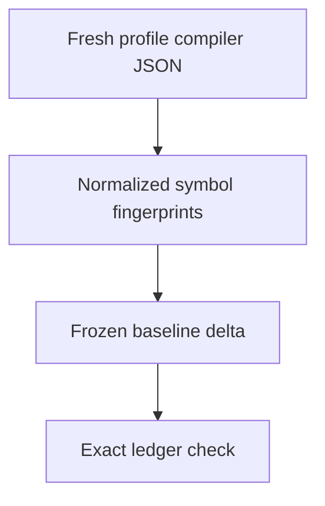

# Integration API delta gate

Run from the repository with its pinned Node and Rust toolchains:

```sh
node --test scripts/integration-api/*.test.mjs
scripts/check-integration-api-delta.sh native/default
scripts/check-integration-api-delta.sh --all
scripts/check-integration-api-delta.sh native/test-utils --changes
```

The ordinary check generates fresh compiler JSON and requires every change to
match the cumulative exact delta manifest. It never rewrites baselines or grants
approvals. `--changes` reports candidate deltas only; a successful report is not a
passing API gate. Cargo and browser build scheduling remains the caller's job.



## Profiles and provenance

Each target has separate `default` and `test-utils` profiles. Both use normal
production defaults; only the latter adds `--features test-utils`.

| Profile prefix | Target                     |
| -------------- | -------------------------- |
| `native`       | `x86_64-unknown-linux-gnu` |
| `wasi`         | `wasm32-wasip1`            |
| `worker`       | `wasm32-unknown-unknown`   |

Rustdoc uses crate-scoped `RUSTC_BOOTSTRAP=trusted_server_core`, only for JSON
inspection with the pinned stable compiler. No nightly installation is needed.
Raw rustdoc JSON must have format 60 and public-only item selection with hidden
public items included. Profiles are never merged into a union.

Frozen snapshots and `provenance.json` live in
`crates/trusted-server-integration-tests/fixtures/integration_split_baseline/api/`.
The immutable origin is `ca95a2dacb7fac1a47d7504ec0cc8d0dad8539bf`. Historical
Cargo.lock and tool-pin hashes are checked against that commit's Git blobs.
Current compiler/Node versions, Rust flags and selected profile commands must
match the capture. The current Cargo.lock hash is reported and Cargo uses
`--locked`; dependency updates require review, not an automatic baseline refresh
or a second input-approval ledger.

The baseline owner can import these pure helpers from `check.mjs`:

- `BASELINE_COMMIT`, `CRATE`, `PROFILES` and `rustdocArgs(label)` define the pins.
- `environmentPins(repo)` inspects versions, flags and current input hashes.
- `baselineFilePins(repo)` reads immutable origin input hashes.
- `captureProfile(label, rawBytes)` returns `snapshotBytes` and the profile's
  `provenance` metadata, including raw and snapshot SHA-256 hashes. It writes
  nothing. The owner must establish that raw bytes came from the recorded command
  at the corrected baseline before freezing them.

The provenance document has this shape:

```js
const provenance = {
  schema: 1,
  baselineCommit: BASELINE_COMMIT,
  crate: CRATE,
  rustdocFormat: 60,
  environment: { ...environmentPins(repo), files: baselineFilePins(repo) },
  profiles: {
    /* all six labels map to captureProfile(...).provenance */
  },
}
```

Write each snapshot to `PROFILES[label].snapshot`. Raw SHA-256 attests the
recorded capture bytes; it is not compared with candidate JSON, whose source
positions and compiler IDs can change.

## Exact ledger and limitations

`delta-manifest.json` starts with an empty `changes` array. Each reviewed row
needs exact `profile`, `key`, `change`, `before` and `after` fingerprints, plus
`owner`, `class` and direct workspace `consumers`. Classes are `core-neutral`,
`integrations-facade` or `transitional`; a transitional row also needs
`replacement`, `step` and `removal`. Planned rows authorize nothing. Wildcard,
prefix, duplicate and stale approved rows are rejected. Consumer and class truth
still requires human review.

The normalizer tracks exported paths, explicit reexports, public members,
locally owned impls, auto-trait headers and signature-reachable local types.
Filesystem paths, spans, docs, numeric compiler IDs and definition-owner metadata
are not signature identity. Snapshot normalizer schema 2 also excludes rustdoc's
internal `CfgTrace` attribute, which embeds source locations rather than an API
contract. Profile-specific compiler views still prove configuration visibility;
other API-bearing attributes remain observed. Canonical referenced type and
reexport binding paths remain semantic.

A normalization-policy correction must reproduce the same historical raw
captures, first checking their recorded SHA-256 values. It must not freeze a
candidate's new exports into the baseline. Public-only captures classify newly exposed symbols as
`add-or-widen`; private compiler fixtures prove both cases are blocked.

This is not a transitive dependency semver, ABI-layout or runtime-behavior check.
Dependency-owned blanket instantiations are excluded; explicit external aliases
retain binding identity without recursively checking dependency members. Macro
expansion behavior and ordinary function bodies are not captured. Generic
alpha-renames, some attribute/constant spellings and structural changes can
produce conservative deltas. Variant and tuple order is intentionally retained.

Unresolved external/non-module globs, direct enum-variant reexport targets,
ambiguous shadowed exports, unknown JSON formats and unresolved IDs fail closed.
Current core local module globs are supported. Add a compiler fixture before
supporting another case; never silently omit an export. Independent tests use
isolated synthetic rustdoc inputs and mocked project commands. Real core source
canaries, captured profiles and project-wrapper checks belong to the coordinator.
